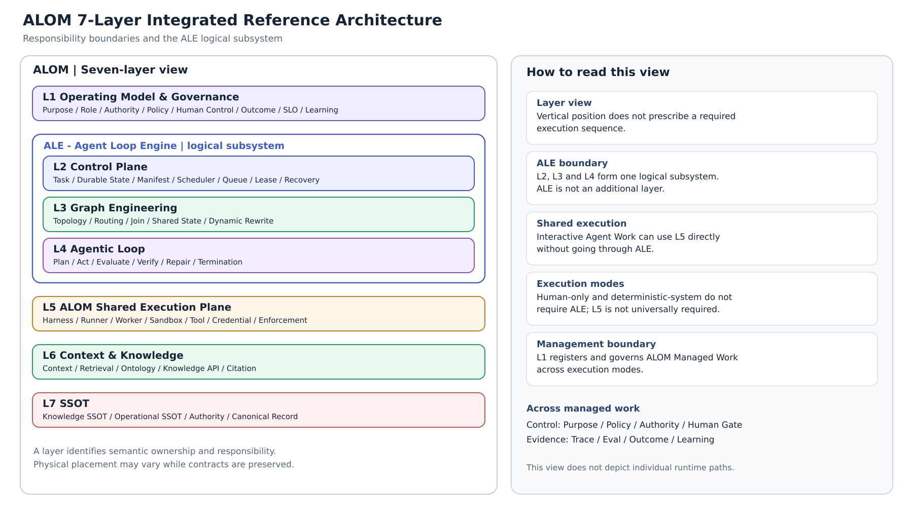

**ARCHITECTURE STANDARD**

**ALOM Integrated Architecture Standard**

AI × Human Production Operating Architecture

Operating Model & Governance / Control / Graph / Loop / Shared Execution / Knowledge Runtime / SSOT

> Purpose of the standard: Define ALOM as a seven-layer Operating Architecture for managing production and work performed by humans and AI Agents, and operate purpose, authority, context, structure, execution, evaluation, knowledge, evidence, control, stopping and remedy, and learning within consistent responsibility boundaries.

| **Management item** | **Value** |
|------------------|--------------------------------------------------------|
| **Document ID** | ALOM-ARCH-STD-001 |
| **Version** | v2.5-review.20261110 (non-effective scope, binding, and trace alignment candidate) |
| **Issue date** | 2026-08-12 |
| **Document owner** | ALOM accountable lead |
| **Management responsibility** | Organization Architecture (Enterprise Architecture) / AI Platform |
| **Approval responsibility** | Executive Sponsor / Security and Privacy / Business Owner |
| **Classification** | Public |

# Document Control

## Version History

| **Version** | Date | **Category** | **Changes** |
| --------- | ------------ | ---------- | ---------------------------------------------------------------------------------------------------------------------------------------------------------------------------------------------------------------------------------------------------------------------------------------------------------------------------------------------------------------------------------------- |
| **1.0** | 2026-08-09 | Initial release | Consolidated existing ALOM, ALE, Graph / Loop / Harness, HITL, RAG / Ontology, SSOT, and Trace / SLGA materials, and established mandatory requirements and acceptance criteria. |
| **1.1** | 2026-08-11 | Minor revision | Added the Ontology Runtime implementation standard. Defined responsibility boundaries and minimum data contracts for Canonical Relations in OKF, Ontology Schema / Type Registry, Relation Resolver, Ontology Builder, Inference, Semantic Join, Relation Provenance, and Runtime API / MCP. |
| **2.0** | 2026-08-12 | Major revision | Redefined ALOM as the root concept of the entire seven-layer stack rather than the name of L1. Integrated the former L1 ALOM and L2 Governance into the new L1 Operating Model & Governance, and renumbered the former L3-L8 as L2-L7. Limited ALOM's scope to managing production and work performed by AI and humans; explicitly placed the applying organization's management and operations, business strategy, capital policy, and revenue / profit targets outside its boundary. Reorganized requirements OM-01-06. |
| **2.1** | 2026-08-12 | Minor revision | Clarified the scope boundary of ALOM Managed Work. Human-only Work can be included through registration in L1; routing through an Agentic Loop / ALE is not required. Merely referencing L6 / L7 does not bring work into scope. |
| **2.2** | 2026-08-12 | Minor revision | Retained the seven-layer Reference Architecture and defined ALE as a logical Execution Subsystem comprising L2 Control Plane, L3 Graph Engineering, and L4 Agentic Loop. Removed ALE from the L2 name and organized L5 as the ALOM Shared Execution Plane, a common execution boundary for ALE-controlled Agentic Work and human-led Interactive Agent Work. Separated Layer View from Subsystem View and standardized the L2 requirement prefix as CTL. |
| 2.3 | 2026-08-13 | Minor revision | Formalized Profile Engineering & Generation as an implementation Subsystem of L1 Operating Model & Governance, not an eighth Layer. Added responsibility for generating Draft Operating Profiles from Business Mission and Canonical Rulebook and making them Effective after Execution Suitability assessment and Human Review / Approval. Added PROF-01-08 as governing mandatory requirements. Retained the seven-layer structure, ALE=L2-L4, and the L5 Shared Execution Plane boundary. |
| 2.4 | 2026-09-06 | Minor revision | Aligned canonical Execution Mode values to exactly four: human-only / interactive-agent / agentic / deterministic-system. hybrid is not an Execution Mode. Work Type deterministic / hybrid remains orthogonal; Work Type deterministic is not equivalent to execution_mode deterministic-system. deterministic-system is non-Agentic, does not require ALE (L2-L4), and does not make L5 globally mandatory. |
| 2.4 | 2026-09-15 | Meaning-preserving errata | Aligned Section 7.1 Retrieval and Section 7.2 rebuild unambiguously with the current KNW-02 hybrid MUST (Vector + Full-text + Graph / Metadata, rerank / citation / source path / commit SHA). Target Vector/RAG MAY has not been promoted. |
| 2.4 | 2026-09-15 | Meaning-preserving errata | Explicitly added Full-text Index regeneration to the Compatibility rebuild in Section 7.2 step 7, mechanically aligning the independent derived artifact in L6 Section 13.3 with KNW-02 hybrid MUST. Target Vector/RAG MAY has not been promoted. |
| 2.4 | 2026-09-15 | Meaning-preserving errata | Added deterministic-system to the active list in Section 7.0. Added only the prefix row for existing PROF-01-08 to Appendix D. Preserved the closing v2.2 baseline text as a historical quotation and appended the current v2.4 exact-four applicability statement. No new requirement IDs. KNW body text is unchanged. |
| 2.5 | 2026-10-27 | normative scope-model alignment | Applied the scope model in ALOM-PROF-SCOPE-SPEC-001 Draft v0.3 to PROF-03, Section 5 P-08 / GOV-02 body text, HUM-05, Section 9 Repository / SEC-04 / NFR-02, Section 11 acceptance, G-Isolation, and Appendix B.1. Operating Domain (`domain_id`) is required; Organization / Customer / Project are parallel optional overlays; `project_id` is optional; the isolation boundary is `isolation_scope_ref`. The seven layers, ALE, L5, and exact-four Execution Mode set are unchanged. The names P-08 / GOV-02 and the Section 9 heading are retained. |

## Authority Precedence and Change Principles

- This standard is the normative baseline for ALOM architecture within the organization.

- If this standard conflicts with a subordinate design, this standard takes precedence. Where laws, contracts, customer NDAs, or security rules are stricter, the stricter rule takes precedence.

> Document status: v2.4 is a minor revision retaining the v2.3 seven-layer baseline and the ALE=L2-L4 / L5 Shared Execution Plane boundaries. The canonical Execution Mode set contains exactly four values: human-only / interactive-agent / agentic / deterministic-system; hybrid is not an Execution Mode. Profile Engineering & Generation remains an implementation Subsystem of L1 Operating Model & Governance. It can resolve Business Mission / Objective / Demand / Constraint received from management of the applying organization (Corporate Management), and L7 Canonical Rulebook through L6, to generate Draft Operating Profiles for Business / Project / Organization / Lifecycle / Managed Work / Execution. Generated Profiles become Effective only after Human Review / Approval; the Profile Generator itself is not granted canonical Authority.

> Document status: v2.5 retains the v2.4 boundaries for the seven layers, ALE, L5, the exact-four Execution Mode set, and Profile Engineering & Generation, and incorporates the scope model in ALOM-PROF-SCOPE-SPEC-001: a permanent Operating Domain is the required anchor; Organization / Customer / Project are parallel optional context overlays; the isolation boundary is `isolation_scope_ref`. Read Project / Organization in the Operating Profiles above as optional overlays. The controlled alignment baseline is ALOM-PROF-SCOPE-SPEC-001 v0.4; this bundle includes its proposed v0.4-review.20261108 clarification, which retains the common Scope contract.

## Structure of Conformance Documents

| **Document type** | **Role** | **Update unit** | **Canonical source** |
|------------------------------|-------------------------------------------------|--------------------|------------------------------|
| **ADR** | Significant design decisions, alternatives, reasons for adoption or rejection, and impacts | Per decision | Relevant repository |
| **Graph / Harness / Eval specification** | Executable definitions and regression assets | component / release | Relevant repository |
| **Trace / Evidence** | Evidence of execution, evaluation, approval, stopping, and remedy | event / case | Trace Ledger / Evidence Store |

# Contents

| **Chapter** | **Content** | **Starting page** |
|-----------|-------------------------------------|------------|
| **1** | Purpose and Scope | 6 |
| **2** | Normative Terms and Basic Principles | 9 |
| **3** | Conceptual Framework and Fixed Definitions | 11 |
| **4** | Integrated Reference Architecture | 15 |
| **5** | Standard Requirements by Layer | 18 |
| **6** | Human Control and Autonomy (HITL / HOTL / HIC) | 27 |
| **7** | Standard Processing Flows | 29 |
| **8** | Evaluation, Trace, SLGA, and Learning | 31 |
| **9** | Security, NDA, and Isolation Scope Separation | 33 |
| **10** | Nonfunctional Requirements, SLOs, and Metrics | 35 |
| **11** | Lifecycle, Change, and Operations | 37 |
| **12** | Conformance Decisions and Acceptance Gates | 39 |
| **Appendix A** | Technical Element Mapping | 41 |
| **Appendix B** | Minimum Data Contracts | 43 |
| **Appendix C** | Mapping to Existing Documents and External Standards | 46 |
| **Appendix D** | Requirement ID List | 48 |

> Reading guide: Management and oversight roles should primarily consult Chapters 1-4, 6, and 10 to understand the Operational Outcomes and responsibility boundaries ALOM provides to management of the applying organization. Architects should primarily consult Chapters 3-9; implementation and operations roles should consult Chapters 5-12 and the appendices.

> **Scope of applying organizations** In this document, an applying organization is an entity that applies ALOM, including businesses, public authorities, educational and research institutions, and nonprofit organizations. Distinguish the organization-wide Enterprise scope (rank 10) from the optional Organization overlay (rank 30), which expresses responsibility and authority. Existing `enterprise_id` and example value `company` are identifiers and do not limit applicability.

# 1. Purpose and Scope

## 1.1 Purpose

This standard defines the common architecture for Operating Model & Governance, control plane, execution plane, knowledge, evidence, and SSOT needed to implement and operate ALOM (Agentic Loop Operating Model) as a seven-layer Operating Architecture. Using Agentic Loop as its principal autonomous execution mechanism, ALOM manages production and work performed by humans, AI Agents, deterministic automation, and external systems within a consistent management boundary. Of the seven layers, L2 Control Plane, L3 Graph Engineering, and L4 Agentic Loop form ALE (Agent Loop Engine), a logical Execution Subsystem that controls, organizes, and converges Agentic Work. L5 ALOM Shared Execution Plane is not exclusive to ALE; it is also shared by Interactive Agent Work in which a human primarily controls the interaction. ALOM does not replace management of the applying organization. It is a management foundation that converts the Business Objectives, demand, constraints, and priorities provided by that management into Operational Outcomes such as production capacity, quality, Lead Time, Cost, Risk, Evidence, and Learning. Individual Work need not pass through ALE; Human-only Work registered and controlled in L1 as ALOM Managed Work can also be managed. The objective is to enable the applying organization to retain purpose, authority, evaluation, knowledge, evidence, stopping, and remedy even when models or Agent products are replaced. \[I1\]\[I3\]

## 1.2 In Scope

- Agentic Loops for development, testing, CI repair, PR creation, and repository maintenance.

- Agentic Loops for operations and maintenance, inquiries, incidents, changes, releases, documents, tickets, data processing, and business API operations.

- Dynamic Agent Organizations that coordinate multiple Agents / Tasks through a Graph and change their configuration during execution.

- Interactive Agent Work in which a human primarily controls iteration through dialogue, additional instructions, and confirmation, directly using L5 ALOM Shared Execution Plane Harnesses / Runners to generate and modify artifacts. Even if a Runner has a native agent loop, distinguish this from Agentic Work unless it uses the applying organization's ALE control in L2-L4.

- Configurations using Git hosting (for example, GitHub) / OKF as Knowledge SSOT and RAG / Ontology Runtime as derived runtimes.

- Human-only Work registered within L1's management boundary as ALOM Managed Work and subject to management of purpose, owner, authority, policy, and outcome / evidence. This may include decisions and work referencing L6 Context & Knowledge / L7 SSOT under managed revision / authority, Human fallback, exception decisions, and external or legacy work.

## 1.3 Out of Scope

- Design of internal LLM algorithms or model weights.

- Permanently fixing a particular vendor product's UI, pricing, or contractual terms as a standard.

- Delegating final decisions of business, legal, security, or privacy accountable roles to Agents.

- Mistaking storage, query, or runtime behavior not defined by OKF specifications for mandatory requirements of OKF itself. \[E3\]

Final management decisions of the applying organization (Corporate Management), such as business strategy, market selection, product and service strategy, pricing strategy, M&A, capital policy, organization-wide capital allocation, and revenue / profit targets.

Organization-wide personnel and compensation systems, and organizational governance itself by boards or supervisory bodies. However, production and work performed within these functions may be within ALOM's scope.

Directly attributing or guaranteeing Corporate Outcomes such as revenue, gross profit, profit, or organization-wide value solely from ALOM Operational KPIs. Evaluate their connection to management outcomes through a separate Business Outcome Model.

## 1.4 Units of Conformance

Assess conformance at the units of applying organization / PJ, use case, ALOM Managed Work, human workflow, Graph, Loop, Harness, Runner, Knowledge Bundle, and Action. 'ALOM applied' does not mean 'routed through ALE', 'Agentic Loop execution', or 'fully automated'. Determine ALOM applicability by the management boundary, not the execution actor. Human-only execution can be included when the Work is registered and controlled in L1 as ALOM Managed Work. Interactive Agent Work can use L5 directly and does not require ALE. Conversely, general Human Work that merely views or references L6 Context & Knowledge / L7 SSOT or other ALOM components, without registration within a management boundary for purpose, authority, policy, and outcome / evidence, is outside ALOM's scope. ALE is a logical Execution Subsystem comprising L2-L4; neither L2 alone nor L5 may be equated with ALE itself.

## 1.5 Responsibility Boundary with Management of the Applying Organization

ALOM is not the applying organization's Corporate Management, which determines growth strategy, revenue / profit targets, and capital allocation. Management provides ALOM with Business Objective / Demand / Constraint; ALOM manages production activities for the relevant work and returns Operational Outcomes. ALOM can apply to work performed in finance, sales, HR, legal, and other functions, but their management and legal Authority is not delegated to ALOM.

| **Category** | **Position in this standard** |
|---------------------------|----------------------------------------------------------------------------------------------------------------------------|
| Input from management of the applying organization | Business Objective, demand, priorities, acceptable Risk, budget / resource limits, relevant work, and expected outcomes. |
| Directly managed by ALOM | AI-human Work design, Role / Authority, Policy, Task / Graph / Loop, execution, evaluation, Context, SSOT, Trace, stopping and remedy, and learning. |
| Direct ALOM Outcomes | Throughput, Accepted Outcome, quality, Lead Time, Human Effort, unit Cost, Risk / Control, reuse, and learning speed. |
| Corporate Outcomes outside ALOM | Revenue, Gross Profit, EBITDA, Market Share, organization-wide value, capital efficiency, and similar outcomes. Connect these through a Business Outcome Model; they are not direct ALOM KPIs. |

# 2. Normative Terms and Basic Principles

## 2.1 Normative Terms

| **Expression** | **English keyword** | **Meaning** |
|------------------------------|----------|---------------------------------------------------------|
| **Required / shall** | MUST | Required for conformance. Failure to meet it is nonconformance. |
| **Prohibited / shall not** | MUST NOT | Not permitted. Stop and remediate when detected. |
| **Recommended / should** | SHOULD | Deviation is permitted only with a reasonable justification. Record an ADR and risk acceptance. |
| **Optional / may** | MAY | The application profile may select it. |

## 2.2 Basic Principles

| **ID** | **Principle** | **Normative requirement** |
|----------|--------------------------|-----------------------------------------------------------------------------------------------------------------------------------------------------------------------------------------------------------------------------------------------------------------------------------------------------------------------------------------------------------------------|
| **P-01** | Sovereignty of the applying organization | Purpose, authority, evaluation, Trace, knowledge, stopping, and remedy MUST be retained as canonical assets on the applying organization's side. |
| **P-02** | Separation of the whole ALOM from ALE | ALOM is the entire seven-layer Operating Architecture managing ALOM Managed Work. ALE is the logical Execution Subsystem comprising L2 Control Plane, L3 Graph Engineering, and L4 Agentic Loop, responsible for controlling, organizing, and converging Agentic Work. L5 ALOM Shared Execution Plane is not exclusive to ALE and is also available to Interactive Agent Work. ALOM, ALE, L2, L5, and a particular Runner MUST NOT be equated. |
| **P-03** | Runner replaceability | Connect Cursor, Claude, Codex, and similar products through Runner Adapters; Runner-specific state MUST NOT become the standard's canonical source. |
| **P-04** | Evaluation independence | Generation and evaluation MUST be separated, combining deterministic verification, Private Evals, External Oracle, and human judgment. \[E1\] |
| **P-05** | Risk-proportionate human control | Place HITL, HOTL, and HIC according to impact, reversibility, uncertainty, and authority; control MUST NOT be reduced to a binary choice between approval for everything and no supervision. |
| **P-06** | SSOT boundaries | Distinguish Knowledge SSOT from Operational SSOT; RAG, Ontology Index, Cache, and Runner Memory MUST NOT be treated as canonical sources. |
| **P-07** | Reproducibility and traceability | Execution MUST be linked to purpose, policy, graph, harness, runner, model, tool, source, eval, commit SHA, and Trace ID. |
| **P-08** | NDA / Isolation Scope separation | Separate repository, runner, container, network, identity, secret, index, and trace access at the `isolation_scope_ref` boundary (including customer / PJ), and apply default deny. |
| **P-09** | Convergence and stopping | Loops and Dynamic Graphs MUST have limits for time, iterations, cost, failures, and reconfigurations, and have stopping conditions. |
| **P-10** | Controlled learning | Return learning results from Trace as proposals through Issues / change requests; make them assets only after human approval and reevaluation. |
| **P-11** | Availability of remedy | High-impact use cases MUST provide paths for correction, objection, stopping, rollback, deletion, and reconsideration. |
| **P-12** | Portability | Contracts MUST preserve meaning, evaluation, authority, Trace, and audit after changes to Runner, model, index, or workflow. |
| **P-13** | Corporate Management boundary | ALOM MUST NOT own final Corporate Management Authority over the applying organization's business strategy, markets, capital allocation, revenue / profit targets, or similar matters. Connect Corporate Objective as external input and Corporate Outcome as external outcome. |
| **P-14** | Applicability determined by management boundary | Determine ALOM applicability by whether Work is registered in L1 as ALOM Managed Work within the management boundary for purpose, owner, authority, policy, and outcome / evidence, rather than by the presence of ALE or the execution actor. Human-only execution and Interactive Agent Work may be included, but merely viewing or referencing Knowledge / SSOT MUST NOT automatically bring work into ALOM's scope. |

> External alignment: This standard maps NIST AI RMF GOVERN / MAP / MEASURE / MANAGE to L1 Operating Model & Governance / Context and Risk / Evals and Trace / Policy, HITL, and Remedy. \[E1\]\[E2\]

# 3. Conceptual Framework and Fixed Definitions

## 3.1 Execution Scope and Operating Scope

> Execution scope: Prompt → Context → Harness → Loop → Graph is a conceptual progression describing expansion of Agentic execution capability, not the serial order of ALOM's seven-layer Reference Architecture. ALOM is the root concept covering all L1-L7 responsibility boundaries. Within it, ALE logically groups L2 Control Plane, L3 Graph Engineering, and L4 Agentic Loop to control Tasks for Agentic Work, organize multiple Work Units, and control convergence of a single Work Unit. L5 ALOM Shared Execution Plane receives Execution Intent from ALE and can also be used directly by Interactive Agent Work in which humans primarily control iteration. ALOM Managed Work does not require routing through ALE, regardless of whether the execution actor is Human / Agent / System. \[I1\]\[I7\]

Prompt is a single instruction; Context is information assembled at execution time; Harness is the execution envelope around Agent execution; Loop is repetition until termination conditions are met; and Graph is the topology of multiple Tasks / Agents / dependencies. Treat their conceptual containment, L1-L7 Layer responsibility boundaries, and ALE Subsystem containment as distinct architecture views; they MUST NOT substitute for one another.

## 3.2 Fixed Definitions

Profile Engineering & Generation: An L1 implementation Subsystem that takes Business Mission and Canonical Rulebook / Constraint as inputs, generates and validates the L1 Operating Model contract as a Draft Profile, and makes it Effective after human approval. It is not an eighth Layer.

Operating Profile: A versioned contract bundling the structures, responsibility, Authority, Outcome/SLO, Execution Mode, and subordinate-Layer Bindings of Business / Project / Organization / Lifecycle / Process / Managed Work / Execution.

Effective Profile: An approved Profile that has passed Profile Validator and Human Review / Approval, pins source revision, compiler version, and approval record, and is available for Runtime reference. Do not equate it with a Draft / AI Proposal.

Execution Suitability: A decision for each Managed Work that evaluates capability, authority, risk, interpersonal interaction, accountability, independence, and legal / contractual constraints to determine human-only / interactive-agent / agentic / deterministic-system and Human Control conditions. hybrid is not an Execution Mode.

| **Term** | **Fixed definition** | **Not equivalent to** |
|----------------------------------|----------------------------------------------------------------------------------------------------------------------------------------------------------------------------------------------------------------------------------------------------------------------------------------------------------------------------------------------------------------------------------|---------------------------------------------------------------------|
| **ALOM** | Agentic Loop Operating Model. A seven-layer Operating Architecture using Agentic Loop as its principal autonomous execution mechanism and managing production and work performed by humans, AI Agents, deterministic automation, and external systems as a closed loop of purpose, roles, authority, structure, execution, evaluation, Context, Knowledge, Trace, control, stopping and remedy, and learning. Individual Work need not use Agentic Loop / ALE. | Management of the applying organization (Corporate Management), LLM, Chatbot, AIOps product, individual Workflow, or L1 alone |
| **ALOM Managed Work** | A production or work unit registered within ALOM L1's management boundary, with identifiable and controllable purpose, owner, authority, policy, and outcome / evidence. The execution actor may be Human / AI Agent / System; Agentic Loop or ALE is not required. It may include Human-only Work performed using L6 Context & Knowledge / L7 SSOT under managed revision / authority. | General Human Work, merely viewing Knowledge / SSOT, or unregistered ad-hoc work |
| **Operating Model & Governance** | ALOM L1. Defines and controls purpose, owner, role, authority, identity, policy, risk, autonomy, human control, outcome, SLO, budget, lifecycle, remedy, and learning for work / use cases managed by ALOM. | The applying organization's management strategy, organization-wide capital policy, or board itself |
| **Management of the applying organization (Corporate Management)** | External to ALOM. The management domain making final decisions on behalf of the applying organization about business strategy, markets, products and services, capital allocation, revenue / profit, and organizational / personnel systems. | ALOM L1, ALE, or Agentic Loop |
| **ALE** | Agent Loop Engine. A logical Execution Subsystem comprising ALOM L2 Control Plane, L3 Graph Engineering, and L4 Agentic Loop. L2 controls Task / Durable State / Scheduling / Recovery; L3 organizes Topology / Routing / Join / Rewrite across multiple Work Units; L4 brings Plan / Execute / Evaluate / Verify / Repair / Termination to bounded convergence. Actual Agent execution is delegated to L5 ALOM Shared Execution Plane. | L2 alone, L5 Shared Execution Plane, Runner, a single Agent, or model API |
| **ALOM Shared Execution Plane** | ALOM L5. A shared execution boundary providing Harness, Runner Adapter, Execution Worker, Sandbox, Tool / MCP, Credential, Network / Filesystem enforcement, and Runtime Telemetry. Both ALE-controlled Agentic Work and Interactive Agent Work in which humans primarily control iteration can use it. | ALE, Agentic Loop, or a particular Runner product |
| **Interactive Agent Work** | ALOM Managed Work in which a human primarily controls the outer iteration through dialogue, additional instructions, and confirmation, directly using the L5 ALOM Shared Execution Plane Harness / Runner. Native loops inside a Runner are allowed, but are distinct from Task / Graph / Loop control by the applying organization's ALE in L2-L4. | Agentic Work or Human-only Work |
| **Prompt** | Roles, background, instructions, examples, and an output contract supplied to one model invocation. | The canonical source of organizational knowledge |
| **Context** | Information selected and assembled at execution time from SSOT, Runtime State, Memory, and Tool results based on purpose and authority. | Unlimited full-text input |
| **Node Harness** | Prompt, Context, Memory, Tool permissions, Sandbox, Hook, Eval, and stopping conditions surrounding one Node / Work Unit. | Routing for the entire Graph |
| **Graph Harness** | An execution envelope managing Shared State, Handoff Schema, Routing, Join, Recovery, and Graph-level Eval across multiple Nodes. | A single Node's Prompt |
| **Agentic Loop** | A control loop repeating Observe / Plan / Act / Evaluate / Verify / Repair until success, stopping, or Escalation conditions are met. | Unlimited retry |
| **Graph Engineering** | Designing Task, Agent, Node, Edge, dependency, fan-out / fan-in, routing, join, verification, isolation, model routing, and topology. | ALOM governance authority |
| **Dynamic Agent Organization** | A mechanism that reconfigures Graph roles, Nodes, Edges, parallelism, and degraded-operation routes during execution within constraints, based on Shared State and evaluation results. | Unconstrained self-organization |
| **Runner Adapter** | A translation layer normalizing runner-specific session, result, tool event, cost, and trace for Cursor / Claude / Codex and similar products into the ALOM Shared Execution Contract, allowing interchangeable use from ALE or Interactive Agent Work. | Runner itself, ALE, or all of L5 |
| **RAG** | A derived read layer that searches Vector, Full-text, and Graph / Metadata indexes generated from SSOT and supplies evidence, citations, and versions to Context. | SSOT or update authority |
| **Ontology Runtime** | A derived semantic runtime that consumes Concept / Canonical Relation in OKF and performs Type, Relation, Constraint, Policy, Validation, Inference, Semantic Join, and Graph Traverse operations. OKF is the canonical source of Canonical Relations; inferred relations and Runtime Index are derived artifacts. A Graph DB is an implementation option, not a requirement. It coexists with RAG. | A replacement for RAG, Knowledge SSOT, or a Graph DB itself |
| **Knowledge SSOT** | OKF on the protected default branch of Git hosting. The canonical source that versions concepts, relations, evidence, trust, freshness, and lifecycle by commit SHA. | Index or Bundle Runtime |
| **Operational SSOT** | The canonical source of current business data, transactions, and state held by ERP, DB, SaaS, and APIs. | RAG replica or Cache |
| **Action Gateway** | A boundary applying Policy, authority, HITL, idempotency, and audit, and exposing only authorized business operations to Operational SSOT. | Direct updates by an Agent |
| **HITL** | Human-in-the-Loop. A synchronous gate that stops the Loop before a high-impact or exceptional Action, allowing a human to review evidence and impact and decide. | Manual approval of everything |
| **HOTL** | Human-on-the-Loop. Runtime supervision that monitors normal execution and intervenes, stops, rolls back, or enters degraded operation when thresholds are exceeded. | A weaker expression of HITL |
| **HIC** | Human-in-Command. Meta-governance that designs purpose, prohibitions, authority, autonomy, evaluation, stopping, remedy, and resumption conditions, and holds ultimate accountability. | Only individual Action approval |
| **Trace** | A chain of records correlating decisions, evidence, input, execution, evaluation, approval, exceptions, modifications, and results through a Trace ID. | Merely an app log |
| **Token Capital** | Organizational resources whose meaning, procedures, evaluation, governance, and portability are connected and can legitimately be reused. Stored Trace does not automatically become capital. \[I4\] | Token count or log volume |
| **Trace Quality Debt** | Debt in which defects in provenance, context, freshness, completeness, evaluation evidence, outcome linkage, and reusability increase future costs. \[I4\] | Defects in legitimacy |
| **Trace Legitimacy Debt** | Debt in which defects in purpose limitation, authority, transparency, retention / deletion, correction, objection, remedy, and responsibility allocation increase trust, rights, and institutional costs. \[I4\] | Defects in quality |
| **SLGA** | The proper name of an existing body of theory and documents addressing Trace capitalization / debt, governance capability, and their relationship to evaluation and remedy. | This standard does not assign an unverified formal expansion of the name |

## 3.3 Distinct Responsibilities

| **Incorrect equivalence** | **Decision under this standard** |
|--------------------------------------------|------------------------------------------------------------------------------------------------------------------------------------------------------------------------------------------------|
| **ALOM = L1 Operating Model & Governance** | Nonconforming. ALOM is the entire L1-L7 architecture stack; L1 holds its upper-level operating and governance responsibilities. |
| **ALOM = ALE** | Nonconforming. ALOM is the complete L1-L7 seven-layer Operating Architecture and encompasses Managed Work such as Human-only / Interactive Agent / Agentic Work. ALE is a logical Subsystem for Agentic Execution comprising L2-L4. |
| **ALE = L2 Control Plane** | Nonconforming. L2 is the control responsibility within ALE; ALE logically groups L2 Control Plane, L3 Graph Engineering, and L4 Agentic Loop. Treat L5 Shared Execution Plane as a shared execution boundary outside ALE. |
| **ALE = Cursor / Claude / Codex** | Nonconforming. Products are interchangeable Runners / Adapters connected to L5 ALOM Shared Execution Plane; they are not ALE's canonical source. |
| **RAG = Knowledge SSOT** | Nonconforming. RAG is a regenerable retrieval derivative. |
| **Ontology Runtime = RAG** | Nonconforming. Semantics / constraints / inference and retrieval / evidence presentation are distinct responsibilities that coexist. |
| **Graph = Loop** | Nonconforming. A Loop is a single iteration process; a Graph defines relationships and organization across multiple Work Units. |
| **HITL = a human checks every time** | Nonconforming. HITL is a risk-proportionate synchronous gate. HOTL handles routine supervision; HIC handles purpose and authority. |
| **ALOM = management of the applying organization (Corporate Management)** | Nonconforming. ALOM manages production and work performed by AI and humans. Final management Authority over the applying organization's business strategy, capital allocation, and revenue / profit targets remains outside ALOM. |

# 4. Integrated Reference Architecture

## 4.1 Baseline Architecture

Figure 1 presents the normative responsibility boundaries of ALOM as the entire seven-layer stack. Layers express Semantic Ownership / Responsibility Boundaries, not a mandatory serial processing sequence. ALE is a Subsystem View functionally grouping L2-L4, not a Super Layer adding or replacing Layer numbers. L5 ALOM Shared Execution Plane is shared by ALE and Interactive Agent Work. Each PJ may change physical placement while retaining Layer responsibilities and Subsystem contracts.

Figure 1. ALOM 7-Layer Integrated Reference Architecture

## 4.2 Seven-Layer Model

## 4.2.1 L1 Profile Engineering Subsystem

Profile Engineering is a design and compilation Subsystem within L1 and does not change the Layer View. Inputs are Business Mission / Objective / Demand / Constraint from management of the applying organization (Corporate Management), and Canonical Rulebook / Standards / Contract / Customer Constraints obtained from L6/L7 with authority/revision pinned.

The standard path is Mission → Rule Resolution → Applicability → Organization/Lifecycle/Work Generation → Execution Suitability → L2-L7 Binding → Validation → Human Review/Approval → Effective Profile Registry.

| **Layer** | **Name** | **Responsibilities** | **Main records** |
|--------|------------------------------|--------------------------------------------------------------------------------------------------------------------------------------------------------------------|---------------------------------------------------------|
| L1 | Operating Model & Governance | purpose, role, authority, identity, PJ / scope, policy, risk, autonomy, HITL / HOTL / HIC, outcome, SLO, budget, lifecycle, stop / remedy / learning for work managed by ALOM | Purpose / Policy / Catalog / Decision / Approval / Exception |
| L2     | Control Plane                | Ingress, Graph/Loop State, Scheduler, Queue, Lease, Manifest, Context/Eval/Trace coordination, Recovery                                                         | State/Task/Manifest/Checkpoint                       |
| L3 | Graph Engineering | Node / Edge contracts, DAG / State Machine, routing, fan-out / join, shared state, dynamic rewrite | Graph Spec / Graph State |
| L4     | Agentic Loop                 | Planner, Executor, Evaluator, Verifier, Repair, termination/escalation                                                                                            | Loop State/Artifacts/Eval                             |
| L5 | ALOM Shared Execution Plane | Harness, Runner Adapter, Execution Worker, Sandbox, Tool / MCP, Credential / Network / FS enforcement, Runtime Telemetry; shared by ALE and Interactive Agent Work | Harness Spec / Runner Contract / Execution Event |
| L6     | Context & Knowledge          | Context Builder, Retrieval, RAG, Ontology Runtime, Index, Bundle, Knowledge API/MCP, Read Adapter                                                                 | Context/Derived Runtime/Manifest/Citation            |
| L7 | SSOT | Git hosting / OKF Knowledge SSOT, ERP / DB / SaaS Operational SSOT, Authority, Controlled Write, Verification | Commit SHA / Transaction Ref / Authority Ref |

Layer numbers indicate responsibility boundaries and do not require every operation to pass serially through L1→L7. In the Layer View, L1-L7 are peer responsibility boundaries; in the Subsystem View, L2 Control Plane, L3 Graph Engineering, and L4 Agentic Loop are logically grouped as ALE. A Human-only workflow registered in L1 as ALOM Managed Work may bypass ALE / L5; Interactive Agent Work can use L5 directly. ALE controls Agentic Work using L2-L4 and delegates actual Agent execution to L5. A single Loop can omit a Graph. Merely referencing ALOM components, however, does not make work ALOM Managed Work. L1 purpose / portfolio / budget is operating information for ALOM-managed work, not the applying organization's business strategy / capital allocation itself.

Fixed ALE boundary: ALE = L2 Control Plane + L3 Graph Engineering + L4 Agentic Loop. ALE is a logical Execution Subsystem encapsulating L2-L4 implementation. It receives Agentic Work purpose, authority, and constraints from L1, delegates Execution Intent to L5, and references L6 / L7 Context and Authority. ALE MUST NOT be treated as L2 alone, L5, a Runner product, or a higher Layer replacing the seven layers.

## 4.3 Cross-Cutting Concerns

| **Concern** | **Top-down effect** | **Bottom-up feedback** |
|----------------|----------------------------------------------------------------------------------|-------------------------------------------------------|
| **Control and authority** | Enforce purpose, identity, policy, budget, tool, isolation, and human gates from L1 across the layers | Return violations, exceptions, stopping, remedy, and Outcomes to L1 |
| **Evidence and learning** | Distribute Trace Schema, Eval policy, retention, and debt classification | Aggregate OTel, Eval, provenance, outcomes, and learning proposals |

> **Derived-artifact boundary** RAG Index, Ontology Runtime, Cache, Runner Memory, and generated answers are derived artifacts that can be regenerated and verified from SSOT; they have no authority to update canonical sources.

# 5. Standard Requirements by Layer

## 5.1 L1 Operating Model & Governance

## 5.1.1 Mandatory Profile Engineering & Generation Requirements

| ID | Mandatory requirement |
|---------|---------------------------------------------------------------------------------------------------------------------------------------------------------------------------------|
| PROF-01 | L1 MUST accept Business Mission / Objective / Demand / Constraint as structured input and establish the Profile generation scope. |
| PROF-02 | References to Rules / Standards MUST resolve L6/L7 Authority, Revision, and Classification. Search results and generated answers MUST NOT be equated with canonical sources. |
| PROF-03 | The composition of Business (Operating Domain) / Organization, Customer, and Project (optional overlays) / Lifecycle / Managed Work / Execution MUST be generatable and composable as versioned Profiles. |
| PROF-04 | Each Managed Work MUST explicitly specify human-only / interactive-agent / agentic / deterministic-system through Execution Suitability. It MUST NOT be promoted to Agentic without justification concerning authority, risk, interpersonal interaction, and accountability. human_required=true together with execution_mode=deterministic-system is an ERROR. |
| PROF-05 | Work requiring Human Authority, including customer negotiation, customer request / requirement approval, quality decisions, and Go/No-Go, MUST remain Human-required. |
| PROF-06 | Generated Profiles MUST be Draft / AI Proposal and become Effective only after independent Validation and Human Review / Approval. |
| PROF-07 | Effective Profiles MUST retain source revision, rule decision, compiler/schema version, approval record, and digest, with Provenance traceable to Mission/Rulebook. |
| PROF-08 | On Rule conflict, unknown Authority, unknown applicability conditions, or uncertain Human-required decisions, processing MUST fail closed and Escalate to a human as an unresolved decision. |

L1 defines Why / Who / Control / Measure for ALOM Managed Work. Register and control Work as a unit of purpose, responsibility, authority, policy, outcome, evidence, and learning; explicitly specify execution_mode from exactly four values: human-only / interactive-agent / agentic / deterministic-system. hybrid is not an Execution Mode. Work Type deterministic / hybrid is an orthogonal classification; Work Type deterministic is not equivalent to execution_mode deterministic-system. Human-only does not require ALE / L5; Interactive Agent can use L5 directly; Agentic Work delegates execution from ALE (L2-L4) to L5. deterministic-system is non-Agentic, does not require ALE (L2-L4), and does not make L5 globally mandatory. Explicit L5 mediation does not imply Agent Runner / L4 / ALE. Correlate deterministic-system through SystemExecutionRecord. SystemExecutionRecord is a record contract correlating profile / binding / executor revision / evidence; it does not reuse HumanWorkRecord as its execution record or acquire Human/Business/L7 Authority. Human-only Work using L6 Context & Knowledge / L7 SSOT under managed revision / authority can also be included. Merely viewing or referencing them MUST NOT automatically bring work under ALOM management. L1 does not own Corporate Management Authority over the applying organization's business strategy, capital policy, revenue, or profit.

| **ID** | **Subject** | **Mandatory requirement** | **Acceptance evidence** |
|------------|-----------------------------|-------------------------------------------------------------------------------------------------------------------------------------------------------------------------------------|--------------------------|
| **OM-01** | Purpose Registry | Assign purpose_id, purpose, prohibited uses, targets, accountable owner, and validity period to all ALOM Managed Work (including Loop / Graph / Human Work / System Work). | Purpose record / approval |
| **OM-02** | Managed Work / Loop Catalog | Register use case / work, owner, execution mode (human-only / interactive-agent / agentic / deterministic-system), risk class, autonomy, SLO, budget, state, version, and retirement conditions. hybrid is not an Execution Mode value. | Catalog export |
| **OM-03** | Role / Authority | Separate authority for creation, approval, execution, change, stopping, resumption, and retirement by role. | RACI / policy test |
| **OM-04** | Operational Outcome | Measure quality, value, risk, cost, and human effort separately, avoiding optimization for a single KPI. | Scorecard |
| **OM-05** | Managed Production Service | Define responsibilities for onboarding, operations, incident, change, capacity, support, and review. | Service catalog / SLO |
| **OM-06** | Lifecycle / Learning | Provide pilot, limited production, production, suspended, and retired states; define promotion / suspension gates. | Lifecycle event |
| **GOV-01** | Identity | Identify human, service, Agent, and delegator, and apply OIDC / SAML, Workload Identity, short-lived credentials, and revocation. | actor_id / delegator_id |
| **GOV-02** | Isolation Scope separation | Separate repo, runner, container, network, identity, secret, storage, index, and trace access by `isolation_scope_ref` (including PJ). | isolation test |
| **GOV-03** | Policy | Evaluate purpose, data class, tool, arguments, budget, risk, time, and location through the Policy Engine. | policy_ref / decision |
| **GOV-04** | Human control | Assign HITL / HOTL / HIC and stop / rollback / resume according to A0-A4. | review / control record |
| **GOV-05** | Independent assurance | Separate generator from evaluator; connect significant decisions to independent verification by an External Oracle or human. | eval / oracle result |
| **GOV-06** | Remedy | Provide correction, objection, deletion, rollback, independent reconsideration, and explanations to affected people for high-impact use cases. | case_id / remedy_ref |

## 5.2 L2 Control Plane

L2 holds the control responsibility within ALE and owns Task Ingress, Durable State, Scheduling, Queue / Lease, Manifest, and Recovery. L3 / L4 own Graph / Loop semantics; L2 alone is not ALE itself.

| **ID** | **Subject** | **Mandatory requirement** |
|------------|---------------|----------------------------------------------------------------------------------------------------|
| **CTL-01** | Ingress | Attach task_id, purpose_id, tenant_id, actor, deadline, budget, and applicable Common Scope to Chat / UI / API / Webhook requests. Attach project_id when applicable; its absence alone is not grounds for rejection. |
| **CTL-02** | Durable state | Persist Loop / Graph state, checkpoints, artifacts, and pending approvals resumably and idempotently. |
| **CTL-03** | Scheduling | Control priority, queue, worker, concurrency, retry, timeout, and cancellation. |
| **CTL-04** | Coordination | Correlate Context, Policy, Eval, Trace, Runner, and SSOT version in one manifest. |
| **CTL-05** | Fail-safe | When mandatory Policy, Trace, Eval, or HITL services are unavailable, fail closed or degrade to read-only operation. |
| **CTL-06** | Portability | Provide an Adapter Contract that preserves task, state, artifact, eval, trace, and approval after a runner switch. |

### Minimum Control Plane Components

| **Category** | **Required capability** | **Implementation example (nonnormative)** |
|-------------------|--------------------------------------------------------|-----------------------------------|
| **API / Event** | request / webhook intake, auth, rate limit, idempotency | REST / event bus / Git hosting Webhook |
| **State** | transactional task / graph / loop state | PostgreSQL or equivalent |
| **Queue**         | durable delivery, priority, retry, DLQ                 | message queue/workflow scheduler |
| **Artifact** | Versioning of artifacts, diffs, evidence, and manifests | object store / artifact registry |
| **Policy**        | decision/enforcement, exception, break-glass          | OPA/Cedar/custom policy service |
| **Observability** | trace/log/metric, context propagation                | OpenTelemetry Collector/backend  |

## 5.3 L3 Graph Engineering

L3 holds the organization responsibility within ALE and owns Topology, Routing, Join, Shared State, Graph-level Verification, and Dynamic Rewrite across multiple Work Units. Separate it from L2 durable orchestration and L4 convergence semantics for a single Work Unit.

| **ID** | **Subject** | **Mandatory requirement** |
|------------|-------------------------|----------------------------------------------------------------------------------------------------------------|
| **GRF-01** | Graph Spec | Version each Node, Edge, input / output schema, dependency, timeout, owner, risk, model route, and recovery. |
| **GRF-02** | Topology | Specify fan-out / fan-in, join, critical path, parallel limit, and cancellation propagation. |
| **GRF-03** | Verification | Verify Graph-level invariants, completion, partial failure, and evidence completeness. |
| **GRF-04** | Dynamic rewrite | Define the permitted reconfiguration scope, maximum count, authority ceiling, budget, before / after hash, and reevaluation. |
| **GRF-05** | No privilege escalation | Expanding data, tool, identity, or network privileges through Graph reconfiguration is prohibited. |
| **GRF-06** | Convergence | Detect identical failures, repeated reconfiguration, and stalled progress; transition to degraded operation, HITL, or STOPPED. |

## 5.4 L4 Agentic Loop

L4 holds the convergence responsibility within ALE. It brings Plan / Execute / Evaluate / Verify / Repair / Termination for a single Work Unit to bounded convergence using state, evaluation, and stopping conditions owned by the applying organization. Delegate actual Agent execution and Tool enforcement to L5.

> **Standard states** RECEIVED → POLICY_CHECK → CONTEXT_READY → PLANNED → EXECUTING \<-\> EVALUATING → VERIFIED → HUMAN_REVIEW (when required) → COMPLETED. Failures branch to REVISE, DEGRADED, ROLLBACK, STOPPED, or ESCALATED.

| **ID** | **Role** | **Mandatory requirement** |
|-------------|-------------|---------------------------------------------------------------------------------------------|
| **LOOP-01** | Planner | Generate purpose, assumptions, Task decomposition, success conditions, risk, tool plan, budget, and stopping conditions. |
| **LOOP-02** | Executor | Use only authorized tools and sandboxes; record artifacts and events in Trace. |
| **LOOP-03** | Evaluator | Evaluate output through Private Eval and a rubric, and classify defects. A pass based solely on generator self-evaluation is not allowed. |
| **LOOP-04** | Verifier | Verify validity through Oracles such as CI, tests, schemas, real data, permission logs, and external results. |
| **LOOP-05** | Repair | Make only changes addressing the cause; check the count of identical failures, remaining budget, and expansion of impact. |
| **LOOP-06** | Termination | Always converge on one of success, significant risk, awaiting approval, time, token, cost, iteration, or identical-failure limits. |

## 5.5 L5 ALOM Shared Execution Plane

L5 is ALOM's common Agent execution boundary, with Harness & Runner as its core capability. For ALE-controlled Agentic Work, it receives Execution Intent from L4; for human-led Interactive Agent Work, it receives execution requests directly from Human / Client. In both cases, Runner-specific session / memory / event MUST NOT become the applying organization's sole canonical source.

| **ID** | **Subject** | **Mandatory requirement** |
|------------|-----------------|------------------------------------------------------------------------------------------------------------------|
| **HAR-01** | Node Harness | Version Prompt, Context selection, Memory, Tool allowlist, Hook, Sandbox, Eval, and termination per Node. |
| **HAR-02** | Graph Harness | Manage Shared State, Handoff Schema, Routing / Join / Recovery, Graph Eval, and cancellation. |
| **HAR-03** | Runner Adapter | Normalize start / resume / cancel, tool event, artifact, usage, error, and trace into a common schema. |
| **HAR-04** | Isolation | Assign a dedicated workspace, container / VM, identity, secret, and egress policy for the applicable isolation boundary and session. Project context, when present, does not replace isolation_scope_ref. |
| **HAR-05** | Tool control | Register MCP / API / CLI in the Tool Registry; control capability units, arguments, data class, credential, rate, and cost. |
| **HAR-06** | Living artifact | Apply Harness changes as code / config through change requests, Eval, rollout, and rollback. |

> **Replaceability: Cursor CLI / SDK, Claude Code, Codex, and similar products are L5 implementation examples. Use them interchangeably from both ALE and Interactive Agent Work through common Harnesses, Session / Execution Contracts, Workers, management APIs, and Trace Schemas. Product-specific sessions MUST NOT be the applying organization's sole canonical source. \[I1\]**

## 5.6 L6 Context & Knowledge Runtime

| **ID** | **Subject** | **Mandatory requirement** |
|------------|---------------------|-------------------------------------------------------------------------------------------------------------------------------------------------------------------------------------------------------------------------------------------------------------------------------------|
| **KNW-01** | Context Builder | Assemble Context based on purpose, actor, ACL, data class, source, freshness, and token budget. |
| **KNW-02** | RAG | Perform hybrid search across Vector + Full-text + Graph / Metadata and return rerank, citation, source path, and commit SHA. |
| **KNW-03** | Ontology Runtime | Load Concept / Canonical Relation in OKF and provide Type, Relation, Constraint, Policy, Validation, Inference, Semantic Join, and Graph Traverse. Distinguish Canonical Relations from Derived / Inferred Relations, supplementing RAG or Semantic Retrieval results with semantic validation and impact exploration. |
| **KNW-04** | Derived status | RAG / Ontology Index must have a bundle manifest; build / promotion occurs only after merge to main. |
| **KNW-05** | ACL | Carry original-source permissions through search, rerank, cache, prompt, and output; prevent disclosure of the existence of unauthorized resources. |
| **KNW-06** | Freshness | Handle source lifecycle, valid_from / until, last_verified, and stale policy, marking or excluding stale knowledge. |
| **KNW-07** | Last good | If a new Index fails validation, retain last-known-good and prohibit switching. |
| **KNW-08** | Ontology Schema | Version Concept Type, Relation Predicate, source / target types, cardinality, constraint, and permitted direction in the organization-wide Profile (Enterprise Profile) or a dedicated Schema. |
| **KNW-09** | Relation provenance | Make source_ref, source_revision / commit SHA, generation method, producer / human, and review state traceable for Canonical Relations. Relations based solely on LLM inference MUST NOT be treated as Canonical. |
| **KNW-10** | Ontology Builder | Normalize Approved OKF releases into Node / Edge / Property and build regenerable Ontology Index / Runtime Views. Do not require a Graph DB; allow RDB / in-memory graphs and other implementations. |
| **KNW-11** | Inference boundary | Keep inferred Relations separate from Canonical Relations as Derived / Inferred; trace rule_ref, input relations, and runtime version. Inference results MUST NOT directly update SSOT. |
| **KNW-12** | Semantic Join | Use OKF Concepts and Operational Source external identifiers / mappings to semantically connect Git hosting, tickets, DBs, observability, and other resources to the same Concept. Ambiguous Joins carry confidence and candidate status. |
| **KNW-13** | Ontology access | Expose Ontology Runtime operations such as resolve, neighbors / traverse, validate_relation, infer, and semantic_join through Knowledge API / MCP; include principal, scope, ACL, and revision in mandatory input / output contracts. |

### 5.6.1 Ontology Runtime Implementation Standard

Ontology Runtime is a derived Runtime that interprets, validates, explores, and infers over OKF Concepts and Relations at runtime while retaining OKF as Knowledge SSOT. Relation authority MUST NOT be transferred to the Runtime.

Standard pipeline: Approved OKF → OKF Parser → Ontology Schema / Type Registry → Relation Resolver → Ontology Builder → Validation / Inference → Ontology Runtime API / MCP.

| **Technical element** | **Responsibility** | **Canonical / derived** | **Minimum implementation example** |
|--------------------------------|--------------------------------------------------------------------------|--------------------|---------------------------------|
| OKF Parser | Extract Concept, metadata, relation, and external identifier from Markdown / YAML | Derived processing | Python / TypeScript parser |
| Ontology Schema / Type Registry | Define Type, Predicate, source / target types, cardinality, and constraint | Schema is canonical in Git hosting | YAML / JSON Schema |
| Relation Resolver | Resolve Concept ID, alias, and external identifier to establish Edges | Derived processing | RDB lookup / in-memory map |
| Ontology Builder | Convert Approved OKF into Node / Edge / Property and generate Runtime Views | Derived | SQLite / PostgreSQL / Graph Store |
| Validation Engine | Validate types, relations, constraints, and referential integrity | Derived decision | JSON Schema + custom rules |
| Inference Engine | Derive permitted Relations from explicit Relations | Derived | rule engine / graph traversal |
| Semantic Join | Connect OKF Concepts to live identifiers in Git hosting / ticket / DB / monitor | Derived mapping | external_identifiers + MCP |
| Ontology API / MCP | Provide resolve / traverse / validate / infer / join to Agents | Derived access | MCP server / REST API |

### Relation Authority Levels

| **Level** | **Relation type** | **Treatment** | **Example** |
|-----------|-------------------------|---------------------------------------------------------------------------------------------|--------------------------------------------|
| L1 | Explicit / Canonical | Explicit in OKF and approved by a human or approval Workflow. Canonical. | system A depends_on database B |
| L2 | Deterministic Extracted | Mechanically extracted from code, Schema, configuration, or similar sources by a Producer. Can become Canonical after Draft → change request → approval. | Extracting a DB connection target from config |
| L3 | Rule Inferred | Derived at Runtime through Ontology rules. Remains Derived. | Deriving A's transitive dependency from A→B and B→C |
| L4 | AI Suggested | Semantically inferred by an LLM or similar mechanism. Candidate only. Attach evidence and confidence; do not make it Canonical without approval. | Proposing a related_to candidate from similar contexts |

Design prohibitions: Do not treat Ontology Runtime or Graph Store as Knowledge SSOT. Do not promote inferred Relations to Canonical Relations without review. Do not make adoption of a Graph DB a prerequisite for Ontology Runtime. Do not establish permissions, Policy, or dependencies solely on LLM inference.

## 5.7 L7 SSOT

### Knowledge SSOT

| **ID** | **Subject** | **Mandatory requirement** |
|-------------|----------------|----------------------------------------------------------------------------------------------------------------|
| **SSOT-01** | Protected default branch | Use the protected default branch in Git hosting as Knowledge SSOT; prohibit routine direct pushes. |
| **SSOT-02** | OKF | Manage concepts, relations, provenance, trust, freshness, lifecycle, and attestation through Markdown + YAML frontmatter. \[E3\] |
| **SSOT-03** | Approval | Merge only changes that have passed change-request review, CI, lint, link, schema, trust, eval, CODEOWNERS, and human approval. \[E4\]\[E5\] |
| **SSOT-04** | Version | Use commit SHA as the knowledge-version boundary; record tag, digest, source commit, and build job in the release bundle. |
| **SSOT-05** | AI write | AI submits update proposals as Issues / branches / change requests and MUST NOT write directly to the protected default branch. |
| **SSOT-06** | Break-glass | Emergency direct pushes are prohibited in principle. Exceptions require two-party approval, limited scope, immediate review, a retrospective change request, and Trace. |

### Operational SSOT

| **ID** | **Subject** | **Mandatory requirement** |
|-------------|-----------------------|------------------------------------------------------------------------------------------------|
| **SSOT-07** | Read | Obtain current state through Read Adapters using APIs, CDC, virtualization, or similar mechanisms. |
| **SSOT-08** | Write | Business updates pass only through Action Gateway, which verifies Policy, authorization, HITL conditions, and idempotency. |
| **SSOT-09** | Verify | After an update, verify read-after-write, transaction ref, expected state, and rollback feasibility; record them in Trace. |
| **SSOT-10** | No authority transfer | Replicating data to RAG, Ontology, or Cache MUST NOT transfer Operational SSOT update authority. |

# 6. Human Control and Autonomy (HITL / HOTL / HIC)

## 6.1 Three Governance Structures

| **Structure** | **Timing** | **Subject** | **Required capabilities** |
|----------|------------------|--------------------------------------------------|--------------------------------------------------------------------------------|
| **HITL** | Before Action / on exceptions | High impact, irreversibility, authority changes, policy exceptions, insufficient evidence | pause, decision packet, approve / reject / modify / escalate, timeout fail-closed |
| **HOTL** | During execution / post-execution monitoring | Normal paths, A2, SLO deviations, consecutive failures, cost / risk thresholds | console, alert, stop, rollback, degrade, resume authority |
| **HIC** | Design / periodic review | Purpose, prohibitions, authority, autonomy, evaluation, retention, remedy, retirement | Ultimate accountability, policy approval, risk acceptance, independent reconsideration |

> **Terminology control** This standard does not use Human-over-the-Loop. The formal three categories are HITL, Human-on-the-Loop, and Human-in-Command. \[I2\]

## 6.2 Autonomy Levels A0-A4

| **Level** | **Permitted scope** | **Human role** | **Standard gates** |
|----------|------------------------------------------------|-----------------------------------------------|------------------------------------|
| **A0** | Retrieval, summarization, and proposals. No changes to external state. | User decides whether to adopt results; retrospective checking. | Purpose, sources, ACL, retention |
| **A1** | Reversible assistance such as drafts, branches, PRs, and execution in isolated environments. | Sampling / threshold review; merge / deploy requires separate authority. | Private Evals, log, rollback |
| **A2** | Predefined low-impact Actions. | HOTL with immediate stopping authority; HITL when conditions apply. | Oracle, continuous monitor, budget |
| **A3** | Prepare high-impact decisions; a human confirms the final Action. | HITL / HIC; independent evaluation. | Explanation, evidence, remedy, rollback |
| **A4** | Automated irreversible, high-impact decisions / execution. | Prohibited in principle; exceptions only under special organizational governance. | Legal, ethical, safety, and management approval |

## 6.3 HITL Trigger Conditions

| **ID** | **Condition** | **Decision criterion** |
|------------|------------|------------------------------------------------------------------------|
| **HUM-01** | Irreversibility | Rollback is impossible or recovery cost exceeds the threshold. |
| **HUM-02** | High impact | Affects production, customers, money, contracts, legal matters, HR, safety, or confidential data. |
| **HUM-03** | Authority | Requests privileged credentials, privilege escalation, or changes to network / data boundaries. |
| **HUM-04** | Uncertainty | confidence, evidence completeness, or freshness is below policy thresholds. |
| **HUM-05** | Deviation | Signs of policy exceptions, unregistered Tools, cross-isolation access (including cross-PJ), or prohibited uses. |
| **HUM-06** | Failure to converge | Identical failures, retries, dynamic rewrites, cost, or time reach a threshold. |
| **HUM-07** | Evaluation disagreement | generator, evaluator, oracle, and human judgments disagree. |
| **HUM-08** | Remedy | A complaint, correction, objection, deletion, or reconsideration case has been initiated. |

## 6.4 Decision Packet

A HITL decision task MUST provide an evidence packet sufficient for a decision, not merely a request to approve.

**Timeout — When the approval deadline is exceeded, fail-closed is the default. Processing MUST NOT move to automatic approval or unconditional retry.**

| **Category** | **Required fields** |
|----------|----------------------------------------------------------------------|
| **Identity** | work_id, trace_id, purpose_id, actor / delegator. task_id applies only to agentic work; use_case_id applies when the UseCase overlay is present. Other modes correlate through the applicable HumanWorkRecord, session, or SystemExecutionRecord reference |
| **Request** | requested_action, target, arguments summary, requested time |
| **Reason** | Necessity within the plan, expected effect, success conditions |
| **Evidence** | source, commit SHA, eval, oracle, confidence, freshness |
| **Impact** | data / system / customer / financial scope, reversibility, blast radius |
| **Alternatives** | no-action, lower-impact option, degraded-operation option, postponement |
| **Recovery** | rollback plan, read-after-write verification, owner |
| **Decision** | APPROVE / REJECT / MODIFY / ESCALATE / STOP, approver role, reason, deadline |

# 7. Standard Processing Flows

## 7.0 Profile Generation / Activation Flow

Management of the applying organization (Corporate Management) → Mission Intake → L6 Rule Resolution → L7 Canonical Revision Fix → Applicability / Suitability → DraftProfileBundle → Deterministic Validation → Human Review / Approval → Effective Profile Registry → L1 Managed Work Registration → expansion into human-only / interactive-agent / agentic / deterministic-system according to Execution Mode. Preserve Human-required status. deterministic-system is non-Agentic, does not require ALE (L2-L4), and does not make L5 globally mandatory.

Profile Generation is design control before Runtime execution; the Profile Generator MUST NOT replace L2-L7 Authority.

## 7.1 Evidence-Backed Answer Flow: Agentic Example

1.  Ingress attaches actor, purpose, applicable Common Scope, risk, and budget. Project context is included when applicable.

2.  Policy determines identity, ACL, data class, and permitted Tools.

3.  Context Builder selects the OKF bundle version and Operational Read.

4.  Semantic Retrieval MUST use hybrid Vector + Full-text + Graph / Metadata under current Compatibility, established in v2.4 and retained in v2.5, and return rerank, citation, source path, and commit SHA. Target Vector/RAG MAY has not been promoted; this step MUST NOT be treated as optional RAG. Ontology Runtime performs Concept resolution, type / relation / constraint validation, Graph Traverse, and required Inference / Semantic Join.

5.  Agentic Loop performs planning, generation, evaluation, verification, and necessary repair.

6.  Attach source path, commit SHA, freshness, confidence, and major constraints to the answer.

7.  Correlate all processing through a common Trace ID and connect user feedback to a case / learning proposal.

> **Prohibition** Runtime MUST NOT directly reference the Git-hosting default branch and introduce unreleased changes. Use approved bundle / index manifests.

## 7.2 Knowledge SSOT Update Flow

1.  A human or AI creates an Issue and registers the reason for change, source, impact, and owner.

2.  Modify OKF on a dedicated branch; update provenance, trust, freshness, and links.

3.  Change-request CI runs schema, lint, link, cycle, ACL, citation, and regression eval checks.

4.  CODEOWNERS and the required Business / Security / Privacy owners approve.

5.  Merge into the protected default branch and finalize the commit SHA and release tag.

6.  Generate a versioned OKF bundle; record digest, attestation, and build job.

7.  Regenerate Ontology Index / Runtime View from Approved OKF. Under Compatibility, also regenerate Vector / RAG Index and Full-text Index (not configured-only). Perform atomic promotion after eval passes; retain last-known-good on failure. Target Vector/RAG MAY remains unpromoted.

> **Git-hosting caution** Even on protected branches, broadly granting push / merge permissions or protection-bypass permissions can bypass required reviews, change requests, and CODEOWNERS. Disable direct-push permissions for ordinary actors and automation, and isolate break-glass access. \[E4\]\[E5\]

## 7.3 Operational Action Flow

1.  The Agent creates an Action Intent presenting target, arguments, expected state, risk, and rollback.

2.  Policy Engine evaluates purpose, actor, autonomy, data, tool, budget, and time.

3.  When HITL conditions apply, generate a Decision Packet and pause the Loop in HUMAN_REVIEW.

4.  After approval, Action Gateway executes only the permitted operation using a short-lived credential and idempotency key.

5.  Read after write from Operational SSOT and verify expected state and transaction ref.

6.  On mismatch, transition to rollback / compensation / STOPPED and notify HOTL.

7.  Record result, approval, policy, tool, transaction, and verification in Trace.

## 7.4 Trace-to-Learning Flow

1.  Extract candidate cases from Trace / Eval / incident / feedback.

2.  Classify Trace Quality Debt and Trace Legitimacy Debt separately.

3.  Verify facts, legality, and legitimacy through reproduction tests, external Oracles, and affected-party / owner review.

4.  Separate proposed changes to Knowledge, Harness, Graph, Policy, Eval, and Training.

5.  Release through Issue / branch / change request / regression Eval / approval.

6.  Measure outcomes, recurrence, cost, human effort, and remedy before and after the change.

7.  Register only assets satisfying reuse conditions in the Catalog as Token Capital.

# 8. Evaluation, Trace, SLGA, and Learning

## 8.1 Evaluation Architecture

| **Evaluation layer** | **Role** | **Example** | **Independence** |
|---------------------|------------------------------------------|----------------------------------------------------|---------------------------|
| **Deterministic** | Mechanically verify explicit validity conditions | schema, unit / integration test, lint, policy, hash | Independent of the generating model |
| **Private Evals** | Evaluate quality, risk, and customer context specific to the applying organization | case set, rubric, regression, critical failures | versioned evaluator / case |
| **External Oracle** | Check reality independently of how persuasive the internal evaluation is | CI, real DB reconciliation, SLO, signatures, accounting, customer outcome | External system / independent human |
| **Human Review** | Decide ambiguity, value judgments, rights, exceptions, and remedy | HITL, HIC, independent review | Separate accountability and conflicts of interest |

## 8.2 Minimum Trace Packet

| **Category** | **Required fields** |
|----------------|---------------------------------------------------------------------------------------------|
| **Identity** | trace_id, span_id, timestamp; parent_trace_id, task_id, graph / loop / node IDs and work / execution record references when applicable to the execution path. |
| **Purpose and actors** | purpose_id, actor_id, delegator_id, scope_ref, domain_id, isolation_scope_ref; use_case_id, tenant_id and project_id when applicable. |
| **Version and input** | policy_ref, input hash, and applicable source version including commit SHA for Git sources; runner, model, graph_ref and harness_ref when applicable. |
| **Execution** | tool_ref, arguments hash, credential ref, execution result, artifact ref, cost / token / time |
| **Evaluation** | eval_ref, oracle_ref, result, threshold, confidence, defect class, review record |
| **Control** | iteration, deadline, budget, autonomy, stop signal, rollback ref, HITL state |
| **Governance** | classification, retention, deletion due, exception, case, remedy, approval |
| **Outcome** | business outcome, SLO impact, customer / operator feedback, verification |

Use OpenTelemetry context propagation to carry Trace ID / Span ID across services, runners, tools, CI, and Action Gateway. Trace, logs, and metrics MUST be correlatable regardless of where they are generated. \[E6\]

## 8.3 Capitalization and Debt through SLGA

| **State** | **Decision criteria** | **Standard treatment** |
|---------------------------|----------------------------------------------------------------------------------------------------------------|----------------------------------------------------|
| **Raw Trace** | Stored, but meaning, authority, evaluation, freshness, outcomes, and reuse conditions remain unverified | Quarantine or limit use. Do not label it Token Capital. |
| **Token Capital candidate** | provenance, context / freshness, outcome, evaluation, authority / purpose, rights / remedy, and portability are verified | Owner approval and Catalog registration; periodic reevaluation. |
| **Trace Quality Debt** | Defects in meaning, provenance, freshness, completeness, evaluation, outcome linkage, or dependencies | Correction, invalidation, reevaluation, restricted use, or disposal. |
| **Trace Legitimacy Debt** | Defects in purpose, authority, transparency, minimum necessity, retention, correction, objection, or remedy | Suspend use; rights review, correction / deletion, independent reconsideration, and remedy. |

> **Important** Quality conditions and legitimacy conditions cannot substitute for each other. Even high-quality Trace MUST NOT be reused as legitimate Token Capital if it lacks usage authority or remedy. \[I4\]

# 9. Security, NDA, and Isolation Scope Separation

## 9.1 Isolation Model

| **Boundary** | **Mandatory requirement** |
|----------------|------------------------------------------------------------------------------------------------------------------|
| **Repository** | Separate repositories or explicit access boundaries by `isolation_scope_ref` (including customer / PJ). Default-deny cross-isolation search. |
| **Runner** | Scope service accounts, runner pools, workspaces, and queue routing to isolation_scope_ref and applicable policy; enforce any project-specific restrictions when applicable. Shared runners are ephemeral and maintain strong isolation. |
| **Compute** | Isolate container / VM, filesystem, process, and network namespace per session. Safely dispose of them on termination. |
| **Network** | egress allowlist, private endpoint, DNS / proxy policy. Direct connections to public MCP / unknown endpoints are prohibited. |
| **Identity** | Separate human, service, Agent, and delegator identities. Apply short-lived tokens, audience, scope, and revocation. |
| **Secrets** | Inject secrets at runtime from a secret manager. Plaintext exposure in Prompt, Context, artifacts, or logs is prohibited. |
| **Knowledge** | Separate OKF bundles, RAG / Ontology Indexes, and caches by isolation_scope_ref and classification; propagate ACLs through search results. |
| **Trace** | Control Trace access, retention, export, and redaction by isolation_scope_ref and applicable case. Define independent auditor access. |

## 9.2 Security Requirements

| **ID** | **Subject** | **Mandatory requirement** |
|------------|-------------------|-----------------------------------------------------------------------------------------------------------|
| **SEC-01** | Default deny | Deny repository, data, tool, network, credential, and Action access unless explicitly permitted. |
| **SEC-02** | Least privilege | Issue minimum permissions restricted by task / purpose / time; revoke them on completion or cancellation. |
| **SEC-03** | Input protection | Isolate and inspect Prompt injection, malicious documents, and tool output as untrusted input. |
| **SEC-04** | Output protection | Inspect for secrets, personal data, customer data, cross-isolation content, and unsafe action instructions. |
| **SEC-05** | Supply chain | Record provenance and digests for runner images, dependencies, MCP servers, tools, bundles, and eval assets. |
| **SEC-06** | Incident | Execute credential revocation, runner quarantine, graph stopping, index rollback, and case / remedy through one runbook. |
| **SEC-07** | Break-glass | Require two-party approval, scope / time limits, recording of all events, retrospective review, and automatic return to ordinary privileges. |

# 10. Nonfunctional Requirements, SLOs, and Metrics

## 10.1 Minimum Acceptance Metrics

| **ID** | **Metric** | **Criterion** | **Evidence** |
|------------|-----------------------------|-----------------------------------------------|----------------------------|
| **NFR-01** | Unapproved direct SSOT updates | 0 | Git hosting / DB audit |
| **NFR-02** | Cross-isolation (different `isolation_scope_ref`, including cross-project / cross-customer) / NDA boundary violations | 0 | isolation / access test |
| **NFR-03** | Unapproved A3 / A4 Actions | 0 | Action Gateway / HITL trace |
| **NFR-04** | Required Trace field completeness | 100% | schema validation |
| **NFR-05** | Loop termination | All tasks reach COMPLETED / STOPPED / ESCALATED within limits | state audit |
| **NFR-06** | Index-source version mismatches | 0 | bundle / index manifest |
| **NFR-07** | Release Eval reproducibility | 100% of mandatory cases can be rerun | Eval report |
| **NFR-08** | stop / rollback drills | 100% success for applicable scenarios | drill evidence |
| **NFR-09** | Runner switching | Preserve baseline task / eval / trace | portability test |
| **NFR-10** | HITL timeout | 0 automatic approvals; 100% fail-closed | approval state audit |

Set concrete values for availability, latency, RTO / RPO, cost, retention, and HITL SLA in the application profile based on business impact and contracts. Production transition MUST NOT occur while these numerical values remain unset.

## 10.2 Measurement Boundaries for ALOM Coverage, Automation, and Management Outcomes

| **Metric** | **Definition** | **Interpretation** |
|--------------------------------|--------------------------------------------------------------------------------------------------------------------------------------------------------|-------------------------------------------------------------------------------------------------------------------------------------------|
| **ALOM Project Coverage** | Number of PJs applying ALOM ÷ number of applicable PJs | Coverage of the operating model, not the automation rate. |
| **ALOM Managed Work Coverage** | Standardized work volume registered and controlled as ALOM Managed Work ÷ standardized work volume eligible for ALOM | Coverage of the management boundary regardless of whether execution is by Human / Agent / System. Measure separately from Agentic Loop / ALE coverage. |
| **ALE Work-unit Coverage** | Standard work units controlled by ALE (L2-L4) ÷ standard work units of ALOM Managed Work | Coverage of the Agentic Execution Subsystem. Human-only / Interactive Agent / deterministic Work may remain in the denominator. |
| **AI Automation Rate** | Standardized work volume completed by AI within its defined autonomy scope ÷ all standardized work volume | A3 requiring a human final Action is not included in full automation. |
| **AI Assistance Rate** | Standardized work volume assisted by AI generation, retrieval, evaluation, or similar capabilities ÷ all standardized work volume | Adoption of AI collaboration, including HITL and Interactive Agent Work. Keep separate from ALE Coverage and full automation rate. |
| **Human Effort Reduction** | (baseline person-hours − current person-hours) ÷ baseline person-hours | Change in human workload. Monitor quality degradation separately. |
| **AI Cost Share** | model + runtime costs ÷ total execution costs for labor + AI + infrastructure | AI cost composition. Do not equate with value or coverage. |
| **ALOM Managed Cost Share** | Human + AI execution costs under ALOM control ÷ total execution costs of the relevant work | Scope of managed costs. Does not imply 100% automation. |
| **ALE Opportunity Gap** | Standardized work volume that is ALOM Managed Work but is not routed through ALE (L2-L4) | Analyze separately the candidates for autonomous ALE orchestration and Work intentionally retained as Human-only / Interactive Agent / deterministic execution. |
| **Corporate Outcome Linkage** | Revenue / Gross Profit / EBITDA / Market Share and similar outcomes are not direct ALOM KPIs. Evaluate their relationship to ALOM Operational Outcomes separately through a Business Outcome Model / Evidence. | ALOM's contribution is subject to explanation and verification; causality is not automatically attributed. |

> **Measurement principle** ALOM Coverage, ALE Coverage, AI Automation Rate, AI Assistance Rate, Human Effort, and Cost MUST NOT substitute for one another. Always show the denominator and unit.

# 11. Lifecycle, Change, and Operations

## 11.1 Standard Lifecycle

| **State** | **Activity** | **Main gate** |
|----------------|-----------------------------------------------------------------------------|----------------------|
| **IDEA** | Define purpose, owner, targets, prohibitions, and expected value. | OM-01 |
| **DESIGN** | Design Graph, Loop, Harness, Policy, Eval, SSOT, Trace, and HITL. | ADR / threat model |
| **PILOT** | A0 / A1, isolated, read-only or limited to branch / PR. | 0 unapproved external changes |
| **LIMITED** | Limited users and PJs, selected A2 capabilities, HOTL, and explicit rollback. | SLO / incident review |
| **PRODUCTION** | Pass acceptance gates and operate on-call, capacity, change, DR, and remedy. | release approval |
| **SUSPENDED** | Freeze autonomy scope after major incidents, policy deviations, evaluation degradation, or missing Trace. | stop / case record |
| **RETIRED** | Revoke credentials, stop runners, invalidate indexes, apply retention / deletion, and transfer knowledge. | retirement evidence |

## 11.2 Change Management

| **ID** | **Subject** | **Mandatory requirement** |
|------------|---------------------|-----------------------------------------------------------------------------------------------------------------|
| **OPS-01** | Versioning | Version Standard, profile, policy, graph, harness, eval, ontology, bundle, and adapter separately; record compatibility. |
| **OPS-02** | Change-request gate | Include reason for change, impact, migration, rollback, Eval, owner, and approval in the change request. |
| **OPS-03** | Progressive rollout | Apply in sandbox→pilot→limited→production order, using feature flags / canaries / rollback. |
| **OPS-04** | Emergency change | Limit scope through break-glass; require retrospective review and a formal change request within 24 hours. |
| **OPS-05** | Dependency | Maintain a dependency map for model, runner, tool, MCP, API, schema, index, and SSOT versions. |
| **OPS-06** | Review cadence | Periodically review risk, SLO, incidents, cost, debt, HITL load, and knowledge freshness. |

## 11.3 Incident/Remedy

1.  detect: Detect events from Policy / Eval / OTel / user reports / external outcomes.

2.  contain: Stop and isolate Graph / Loop / Runner / Tool / credentials / indexes.

3.  preserve: Preserve Trace, artifacts, policy, bundles, transactions, and approvals with tamper protection.

4.  assess: Separately assess quality defects and legitimacy defects, affected parties, blast radius, and reuse scope.

5.  remedy: Perform rollback, correction, deletion, explanation, notification, independent reconsideration, and permission changes.

6.  learn: Change Harness / Graph / Policy / Eval / Knowledge through change requests and verify prevention of recurrence.

# 12. Conformance Decisions and Acceptance Gates

## 12.1 Production Acceptance Gates

Applications using Profile Engineering require additional Production acceptance evidence: Rule revision pinning, schema/conformance validation, Human-required regression, cross-isolation isolation (including cross-PJ), Mission→Rule→Work traceability, and Human approval records.

| **Gate** | **Pass conditions** | **On failure** |
|-------------------|-----------------------------------------------------------------------------------|----------------------|
| **G-Purpose** | Establish purpose, prohibitions, targets, owner, A0-A4, retention, and remedy. | Execution prohibited |
| **G-Identity** | Test human, service, Agent, delegator, short-lived credentials, and revocation. | Degrade to read-only |
| **G-Isolation** | Pass isolation tests for cross-isolation (including cross-PJ), filesystem, network, secrets, indexes, and trace access. | Onboarding for the relevant scope prohibited |
| **G-Context** | Verify source, ACL, classification, commit SHA, freshness, and token budget. | Answering / execution prohibited |
| **G-Tool** | Test Tool Registry, argument policy, credentials, egress, idempotency, and rollback. | Disable Tool |
| **G-Loop** | Test state, checkpoint, retry, timeout, budget, termination, resume, and cancel. | Return to pilot |
| **G-Graph** | Test contracts, fan-out / join, partial failure, dynamic rewrite, and no escalation. | Degrade to static graph |
| **G-Eval** | Reproduce deterministic checks, Private Eval, Oracle, regression, and critical failures. | Release prohibited |
| **G-Human** | Exercise HITL packets, HOTL alerts, stop / rollback / resume, and timeout fail-closed. | Restrict to A0 / A1 |
| **G-Trace** | Verify required fields, OTel correlation, retention, redaction, export, and case linkage. | Execution prohibited |
| **G-SSOT** | Verify protected default branch, CODEOWNERS, change requests, bundle / index, and Action Gateway. | Writes prohibited |
| **G-Portability** | Preserve baseline task, Eval, Trace, and artifacts when switching Runner / model. | Limited operation with a single Runner |
| **G-Operations** | Establish SLO, on-call, incident, DR, capacity, cost, and review cadence. | Production prohibited |

## 12.2 Conformance Decisions

| **Decision** | **Condition** | **Treatment** |
|-------------------------------|-----------------------------------------------------|-------------------------------------------------------------|
| **CONFORMANT** | Meets all MUST / MUST NOT requirements and applicable Gates. | Operate in production or under the specified profile. |
| **CONFORMANT WITH EXCEPTION** | Deviation from SHOULD or a time-limited exception. MUST requirements cannot be relaxed. | Register ADR, risk owner, deadline, compensating control, and reconsideration date. |
| **LIMITED** | Passes only within a restricted scope such as A0 / A1, read-only, or isolated operation. | Technically enforce the scope and set promotion conditions. |
| **NON-CONFORMANT** | Unmet MUST, violated MUST NOT, or failed critical Gate. | Stop, remediate, and reevaluate. Production prohibited. |

> **MVP baseline** An initial MVP SHOULD cover 1-3 repositories / PJs at A0 / A1, limited to branch / PR. Prohibit merge, deploy, and production Actions; establish Trace ID, CI Oracle, Private Evals, stopping procedures, and Runner switching first. \[I1\]

# Appendix A. Technical Element Mapping

| **Concept** | **Required technical category** | **Implementation example (nonnormative)** | **Canonical source / main record** |
|-------------------------------------|-------------------------------------------------------------------------------------------------------------------------------------|-----------------------------------------------------------------------------------------------------|---------------------------------------------------------|
| **ALOM (overall)** | 7-Layer Architecture / Profile / Coverage / Cross-cutting Trace, Security, and Evaluation | Architecture Standard / Application Profile / Dashboard | ALOM Standard / Profile / Release |
| **L1 Operating Model & Governance** | Purpose / Work Catalog / Role / IAM / Workload ID / Policy Engine / Approval / Case / Remedy / Outcome / SLO | Git hosting config / catalog, OIDC / SAML, OPA / Cedar or equivalent | Purpose / Policy / Decision / Approval / Exception / Outcome |
| **ALE (logical Subsystem)** | L2 Control Plane / L3 Graph Engineering / L4 Agentic Loop | durable orchestration + graph runtime + loop runtime | Task / Graph / Loop State / Manifest / Trace |
| **L2 Control Plane**                | Task API/Scheduler/Queue/Lease/State Store/Artifact/Manifest/Recovery                                                        | REST/event, PostgreSQL, queue, object store/workflow scheduler                                    | Control State/Task/Manifest/Checkpoint               |
| **L3 Graph Engineering**            | DAG/State Machine/Router/Coordinator/Join/Dynamic Rewrite                                                                      | workflow engine/graph runtime                                                                      | Graph Spec/State                                       |
| **L4 Agentic Loop**                 | Planner/Executor/Evaluator/Verifier/Repair/Termination                                                                         | agent runtime+eval runner                                                                          | Loop State/Eval                                        |
| **L5 Shared Execution/Harness**    | Context, Memory, Tool Registry, Hook, Sandbox, Recovery                                                                             | code/config, container/VM, MCP gateway                                                            | Harness Spec                                            |
| **L5 Shared Execution/Runner**     | Adapter, Session, Worker, Usage, Tool Event, Cancel/Resume                                                                         | Cursor/Claude/Codex/custom runner                                                                | Adapter Contract                                        |
| **L6 Context & Knowledge**          | Context Builder, Semantic Retrieval/RAG, Ontology Schema/Runtime, Relation Resolver, Inference, Semantic Join, Index, Bundle, ACL | YAML/JSON Schema, parser, RDB/in-memory graph/graph store, rule engine, vector/full-text search | Bundle/Ontology/Index Manifest                        |
| **Knowledge SSOT** | Protected default branch in Git hosting, OKF, change requests, CI, CODEOWNERS | Self-hosted or dedicated-tenant Git hosting and similar implementations | commit SHA / release tag |
| **Operational SSOT**                | Read Adapter, Action Gateway, Policy, HITL, Verify                                                                                  | ERP/DB/SaaS/API                                                                                  | transaction/business record                            |
| **Trace / Learning** | OTel, Trace Ledger, Eval, Debt, Case, Learning Proposal | OTel Collector / SIEM / evidence store | Trace / Evidence / change request |

> **Product selection** Implementation examples help explain categories and do not mandate adoption of specific products. When selecting products, evaluate portability through Adapter, Eval, Trace, SSOT, and migration tests.

# Appendix B. Minimum Data Contracts

## B.1 Task Contract

| **field** | **type** | **Required?** | **Meaning** |
|----------------------------|------------------------------|--------------|------------------|
| **task_id** | string | Required | Unique work unit |
| **purpose_id** | string | Required | Reference to an authorized purpose |
| **scope_ref / domain_id** | string | Required | Common scope identity / permanent Operating Domain |
| **isolation_scope_ref** | string | Required | NDA / isolation boundary |
| **tenant_id** | string | Required for this Task Contract | Tenant routing. CommonScopeContract itself permits omission; tenant_id is not the sole isolation key. |
| **project_id** | string | Optional | Project overlay. Reject absence only when a selected rule requires Project |
| **actor_id / delegator_id** | string | Required | Actor and delegating actor |
| **autonomy_level** | A0-A4 | Required | Permitted autonomy |
| **graph_ref** | version ref | Conditional | Required when an L3 Graph is used; may be omitted for a single Loop without a Graph. |
| **harness_ref** | version ref | Conditional | Required when L5 is used, including L4 Agent execution. |
| **policy_ref / eval_ref** | version ref | Required | Control and pass/fail criteria |
| **deadline / budgets** | time / token / cost / iteration | Required | Convergence limits |
| **source / bundle refs** | path + commit / digest | Conditionally required | Context version |
| **trace_id** | W3C-compatible id | Required | Correlation identifier |

## B.2 Runner Adapter Contract

| **operation**    | **input**                                 | **output**                |
|------------------|-------------------------------------------|---------------------------|
| **start** | execution request + workspace + credential refs; Task Contract when applicable | session_id + initial state |
| **resume**       | checkpoint/session ref                   | resumed state             |
| **cancel/stop** | task/session+reason                     | terminal state+evidence  |
| **event**        | model/tool/hook/approval/error        | normalized span/event    |
| **artifact**     | path/hash/mime/classification          | artifact ref              |
| **usage**        | token/cost/time/compute                | normalized usage          |
| **result**       | status/summary/artifacts/eval refs     | common result schema      |

## B.3 Bundle/Index Manifest

| **field** | **Meaning** |
|-----------------------------|--------------------------------------------------|
| **source_commit** | Knowledge SSOT commit SHA |
| **bundle_tag / digest** | Distributed bundle version and hash |
| **okf_spec_version** | Applicable OKF specification version |
| **ontology_schema_version** | Version of types, relations, and constraints |
| **index_schema / model** | Versions of chunk, embedding, full-text, and graph schemas |
| **acl_snapshot** | Snapshot / policy used in permission evaluation |
| **build_job / built_at** | Regeneration provenance |
| **eval_result** | Pass/fail results for retrieval, citation, ACL, freshness, and regression |
| **promotion_status**        | candidate/active/last-good/rejected           |

## B.4 Ontology Relation Contract

Canonical Relations retain at least source, predicate, target, authority, provenance, and revision. Inference or AI Suggested Relations set canonical=false and retain derivation evidence and Runtime / Rule version.

| **Item** | **Requirement** | **Meaning** |
|----------------------|------------------------|--------------------------------------------------------|
| source_concept_id | MUST | Relation source Concept ID |
| predicate | MUST | Relation type defined in Ontology Schema |
| target_concept_id | MUST | Relation target Concept ID |
| authority            | MUST                   | canonical/deterministic-draft/inferred/ai-suggested |
| source_ref | MUST for canonical / draft | Supporting source path / ticket / schema or similar evidence |
| source_revision | MUST for canonical / draft | commit SHA / source revision |
| rule_ref | MUST for inferred | Inference Rule and version |
| confidence | MUST for ai-suggested | Confidence in the candidate relation; not a substitute for approval |
| external_identifiers | MAY | System-specific identifiers used for Semantic Join |

# Appendix C. Mapping to Existing Documents and External Standards

## C.1 Internal Evidence Ledger

The internal evidence ledger is not included in this edition.

## C.2 External References

| **ID** | **Reference** | **Area incorporated** | **URL** |
| -------- | ------------------------------------------------------- | ---------------------------------------------------------------------- | -------------------------------------------------------------------------------- |
| **E1** | NIST AI 100-1, AI Risk Management Framework 1.0, 2023 | GOVERN / MAP / MEASURE / MANAGE, continuous risk management, TEVV | https://nvlpubs.nist.gov/nistpubs/ai/nist.ai.100-1.pdf |
| **E2** | NIST AI 600-1, Generative AI Profile, 2024 | govern / map / measure / manage for generative-AI-specific risks | https://doi.org/10.6028/NIST.AI.600-1 |
| **E3** | Open Knowledge Format Specification v0.2 | Markdown+YAML, provenance, trust, freshness, lifecycle, attestation | https://github.com/GoogleCloudPlatform/knowledge-catalog/blob/a8291a1a656669b8766fd4ff0f985505fb955e94/okf/SPEC.md |
| **E4** | GitHub Docs, About code owners (implementation example) | Automatic review requests to code owners through CODEOWNERS, and change-request approval through protected-branch required reviews, including required code-owner reviews | https://docs.github.com/en/repositories/managing-your-repositorys-settings-and-features/customizing-your-repository/about-code-owners |
| **E5** | GitHub Docs, About protected branches (implementation example) | Push / merge restrictions on the protected default branch, required reviews, and protection-bypass permissions | https://docs.github.com/en/repositories/configuring-branches-and-merges-in-your-repository/managing-protected-branches/about-protected-branches |
| **E6** | OpenTelemetry Context Propagation | Trace / Log / Metric correlation and Trace ID / Span ID propagation | https://opentelemetry.io/docs/concepts/context-propagation/ |

*External references checked: 2026-08-09. Products and specifications may change; recheck official information during implementation.*

## C.3 Mapping to NIST AI RMF

| **AI RMF** | **Mapping in the ALOM standard** | **Main requirements** |
|-------------|--------------------------------------------------------------------------------------------|-------------------------------------------------------------|
| **GOVERN** | L1 Operating Model & Governance, HIC, Policy, responsibility, change, Remedy | OM-01-06, GOV-01-06, OPS-01-06 |
| **MAP** | Purpose, Context, SSOT, classification, risk, autonomy | P-05-08, KNW-01-07, SSOT-01-10 |
| **MEASURE** | Private Evals, External Oracle, Trace, SLO, Debt | LOOP-03-06, NFR-01-10, Chapter 8 |
| **MANAGE**  | ALE(L2-L4), Policy Enforcement, HITL/HOTL, L5 Shared Execution, Action, Stop/Rollback | CTL-01~06, GRF-01~06, LOOP-01~06, HUM-01~08, SEC-01~07 |

# Appendix D. Requirement ID List

| **prefix** | **Range** | **Subject** |
|------------|------------------|------------------------------------------------------------------------------------------------|
| **P** | P-01-P-14 | Basic principles |
| **OM**     | OM-01~OM-06     | L1 Operating Model/Managed Production Service                                                 |
| **GOV**    | GOV-01~GOV-06   | L1 Governance/Human Control/Remedy                                                           |
| **PROF** | PROF-01-PROF-08 | L1 Profile Engineering & Generation (existing Section 5.1.1; no new requirements added) |
| **CTL**    | CTL-01~CTL-06   | L2 Control Plane                                                                               |
| **GRF**    | GRF-01~GRF-06   | Graph Engineering                                                                              |
| **LOOP**   | LOOP-01~LOOP-06 | Agentic Loop                                                                                   |
| **HAR**    | HAR-01~HAR-06   | Harness/Runner                                                                                |
| **KNW** | KNW-01-KNW-13 | Context / Semantic Retrieval and RAG / Ontology Schema and Runtime / Relation / Inference / Semantic Join |
| **SSOT**   | SSOT-01~SSOT-10 | Knowledge/Operational SSOT                                                                    |
| **HUM** | HUM-01-HUM-08 | HITL trigger conditions |
| **SEC**    | SEC-01~SEC-07   | Security/Isolation                                                                            |
| **NFR** | NFR-01-NFR-10 | Minimum acceptance metrics |
| **OPS**    | OPS-01~OPS-06   | Change/Operations                                                                             |

## End of Standard

Historical note (public-facing paraphrase of the v2.2 baseline with organization-neutral terminology; neither a verbatim quotation nor current conformance conditions. The original quotation is retained in the source. Do not rewrite the v2.2 technical content to match current content):

> v2.2 baseline: This standard defines ALOM as the entire L1-L7 seven-layer Operating Architecture. Layers are Semantic Ownership / Responsibility Boundaries; ALE is not a Layer, but a logical Execution Subsystem comprising L2 Control Plane, L3 Graph Engineering, and L4 Agentic Loop. L5 ALOM Shared Execution Plane has Harness & Runner as its core capability and is shared by both ALE-controlled Agentic Work and Interactive Agent Work in which humans primarily control iteration. L1 Operating Model & Governance owns Why / Who / Control / Measure for ALOM Managed Work and selects the appropriate route according to execution mode, including Human-only Work. L6 Context & Knowledge handles meaning, retrieval, and context; L7 SSOT handles Truth / Authority / Record. Corporate Management Authority over the applying organization's business strategy, capital allocation, revenue / profit targets, and similar matters remains outside ALOM and connects through Business Objective and Operational Outcome. Enforce HITL / HOTL / HIC, Trace, evaluation, stopping and remedy, and learning across all layers.

Current applicability (established in v2.4 and retained in v2.5): The canonical Execution Mode set contains exactly four values: human-only / interactive-agent / agentic / deterministic-system; hybrid is not an Execution Mode. Preserve Human-required status. deterministic-system is non-Agentic, does not require ALE (L2-L4), and does not make L5 globally mandatory. Retain the boundaries of the seven layers, ALE=L2-L4, L5 Shared Execution Plane, L1 Profile Engineering (PROF-01-08), and HITL / HOTL / HIC as stated in the v2.4 header. Mixed pins in the L2/L3/L4/L7 implementation standards are not changed here.

