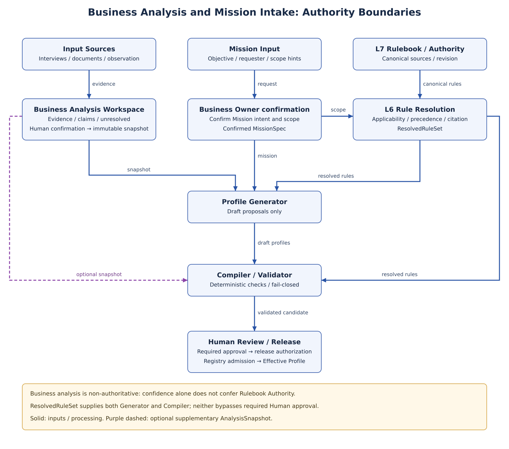
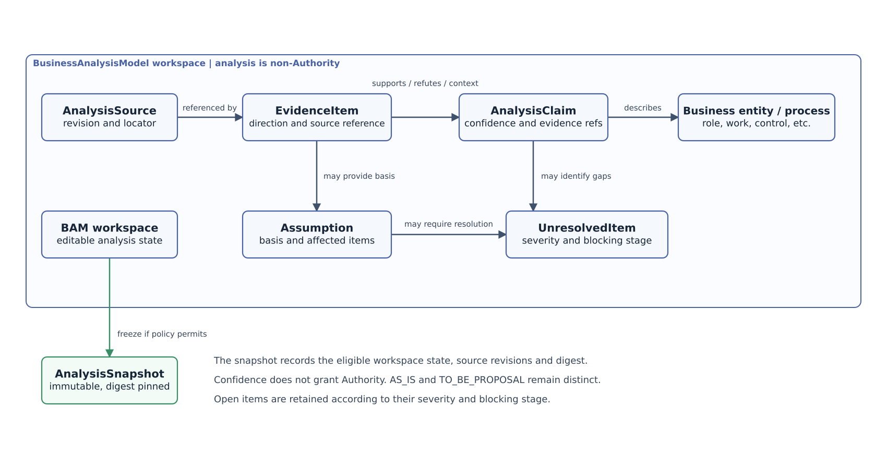
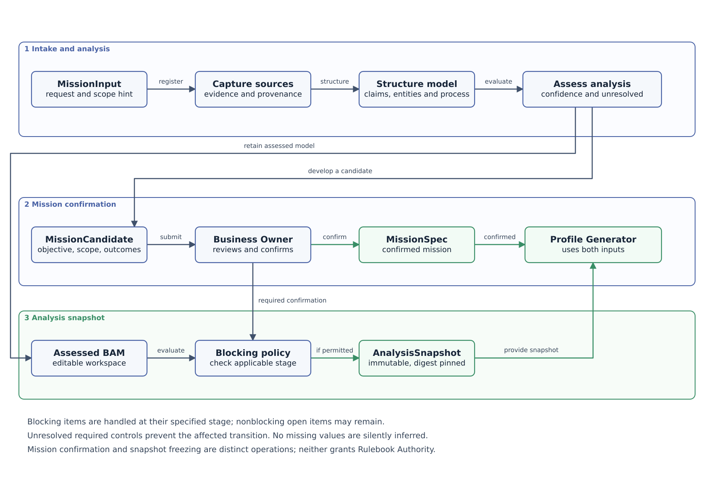

**SPECIFICATION**

**ALOM Business Analysis Model**

**& Mission Input Specification**

Business Discovery / Evidence / Confidence / Unresolved / Mission Intake / Non-Authority Input

| **Core principle** Before applying ALOM to the adopting organization's work, structure Interviews, existing-document analysis, and observations of current work into a BusinessAnalysisModel retaining Evidence, Confidence, and Unresolved items. Pass it to Profile Generator with a MissionSpec confirmed by the Business Owner. Analysis results have no Authority and do not replace Canonical Rulebook, Authority, or Effective Profiles. |
|--------------------------------------------------------------------------------------------------------------------------------------------------------------------------------------------------------------------------------------------------------------------------------------------------------------------------------------|

| **Management item** | **Value** |
|--------------|---------------------------------------------------------------------------------------------------------------|
| **Document ID** | ALOM-BAM-SPEC-001 |
| **Version** | v0.3-review.20261110 |
| **Created** | 2026-08-13 |
| **Governing standard** | ALOM-ARCH-STD-001 v2.5 |
| **Related standards** | ALOM-L1-STD-001 v0.7-review.20261110 / ALOM-PROF-STD-001 v0.4-review.20261109 / ALOM-PROF-CONTRACT-SPEC-001 v0.5-review.20261108 / ALOM-PROF-CV-SPEC-001 v0.4-review.20261110 |
| **Scope** | ALOM L1 Profile Engineering & Generation / Mission Intake / Business Analysis |
| **Owner** | Organization Architecture (Enterprise Architecture) / AI Platform |
| **Joint responsibility** | Business Owner / Project Management / Quality / Security/Privacy |
| **Classification** | Public |

## Version Control / History

| **Version** | **Date** | **Category** | **Content** |
| -------- | ---------- | ---------- | ---------- |
| Draft v0.3 | 2026-10-27 | normative scope-model alignment | Incorporate the scope model from ALOM-PROF-SCOPE-SPEC-001 Draft v0.3 into scope tables (MissionInput / Scope / scope_hint / MissionSpec), the Validation Scope row, Security, CI, and BA-G06. Operating Domain (`domain_id`) is required; Organization / Customer / Project (rank 30) and UseCase / Process (rank 40) are parallel optional overlays; each scope kind is single-valued; `project_id` is optional; `isolation_scope_ref` is required at runtime. |

# Document Control

## 1. Position and Order of Authority

- This specification details PROF-01 through PROF-08 of ALOM Integrated Architecture Standard v2.5 and the Mission Intake / pre-Profile Generation stage of Profile Engineering & Generation as structural contracts for Business Analysis Model and Mission Input.

- Business Analysis Model is a Design-time Artifact of L1 Profile Engineering & Generation, not an eighth Layer. It does not change L2-L7 Authority.

- Retain information obtained from Interviews, AI summaries, document analysis, and current-work observations as Analysis Claims with sources and Confidence; do not treat the information itself as Canonical Rules, Authority, or Operational Truth.

- MissionSpec is an input contract normalizing Missions supplied by management of the applying organization (Corporate Management) / Business Owner. AI may organize Mission candidates but does not finalize Mission intent without Business Owner confirmation.

- Profile Generator / Compiler / Validator may reference BusinessAnalysisModel, but must not fill gaps, contradictions, or unknown Authority through guesswork. Fail closed for unresolved required items.

- Where laws, contracts, customer NDAs, Security/Privacy policies, or Canonical Rulebook are stricter, they take precedence over analytical observations or customary practice.

| **Fixed boundary** Separate Confidence from Authority. Even high-Confidence observations do not become Canonical Rulebook or formal Authority. Prohibit direct promotion from BusinessAnalysisModel to Effective Profile. |
|-----------------------------------------------------------------------------------------------------------------------------------------------------------------------------------------|

## 2. Sources and Design Categories

| **ID** | **Source** | **Use in this specification** |
|--------|-------------------------------------------------------|------------------------------------------------------------------------------|
| **S1** | ALOM-ARCH-STD-001 v2.5-review.20261110 (ALOM Integrated Architecture Standard) | Non-effective alignment candidate; controlled authority remains v2.5. L1 Profile Engineering, PROF-01 through PROF-08, Human Control, seven-layer boundaries. |
| **S2** | ALOM-L1-STD-001 v0.7-review.20261110                            | Purpose / Managed Work / Authority / Outcome / Mission Intake.              |
| **S3** | ALOM-PROF-STD-001 v0.4-review.20261109 | MissionSpec, Rulebook, Generator, Suitability, Approval, Provenance.        |
| **S4** | ALOM-PROF-CONTRACT-SPEC-001 v0.5-review.20261108 | BusinessAnalysisModel as non-Authority input, initial MVP P2, Effective contract. |
| **S5** | ALOM-PROF-CV-SPEC-001 v0.4-review.20261110 | Compiler/Validator fail-closed; blocking on Unresolved/Authority/SLO conditions. |
| **S6** | ALOM-KNW-STD-001 v0.4-review.20261110<br />ALOM-SSOT-STD-001 v0.5 | Canonical Knowledge/Authority/Revision/Citation boundaries. |

Design categories: \[STD\] = inherited from the governing standard; \[REF\] = reuse of existing implementation standards; \[PROPOSAL\] = detailed analysis-input contracts first established in this specification.

# Contents

| **Section** | **Content** |
|--------|------------------------------------|
| **1** | Purpose and Scope |
| **2** | Fixed Definitions and Responsibility Boundaries |
| **3** | Business Analysis Principles |
| **4** | Overall Architecture and Authority Boundaries |
| **5**  | Analysis Source Intake             |
| **6**  | BusinessAnalysisModel Contract     |
| **7**  | Evidence Contract                  |
| **8**  | Analysis Claim / Confidence        |
| **9**  | Business Entity / Process Model    |
| **10** | Assumption / Hypothesis            |
| **11** | Unresolved / Ambiguity / Conflict  |
| **12** | MissionInput / MissionSpec         |
| **13** | Mission Intake / Confirmation Flow |
| **14** | Analysis Lifecycle / Snapshot      |
| **15** | Interview / Document / Observation |
| **16** | Profile Generator Input Mapping    |
| **17** | Validation / Completeness / Gate   |
| **18** | Security / NDA / Privacy           |
| **19** | API / Event Architecture           |
| **20** | Repository / Versioning / Digest   |
| **21** | Observability / NFR                |
| **22** | Physical Deployment Reference Configuration |
| **23** | Application Example for Contracted Development |
| **24** | Acceptance Gates |
| **25** | Implementation Roadmap and Backlog |

# 1. Purpose and Scope

## 1.1 Purpose

This specification defines standards for retaining business-analysis results as reproducible structured data and safely passing them to Profile Engineering when applying ALOM to actual work in an adopting organization. BusinessAnalysisModel describes what was observed about current work, the evidence supporting it, and what remains unresolved. MissionSpec expresses what ALOM is to achieve as an input contract confirmed by the Business Owner.

## 1.2 In Scope

- Understanding work through Interviews / Workshops / Questionnaires.

- Analysis of documents such as policies, SOPs, procedures, design standards, templates, tickets, and meeting minutes.

- Observation of current work and nondestructive understanding of processes through screens / Workflows / Tickets / Git, etc.

- Structuring Process / Activity / Role / Responsibility / System / Data / Outcome / Control candidates.

- Managing Evidence, Provenance, Confidence, Assumptions, Contradictions, and Unresolved items.

- Normalizing MissionInput, Scope, Target Outcomes, Constraints, Rulebook roots, and Business Owner confirmation.

- Contracts for converting BusinessAnalysisSnapshot + MissionSpec into formal Profile Generator inputs.

## 1.3 Out of Scope

- Final Strategy, Market, Pricing, Capital Allocation, and related decisions by management of the applying organization (Corporate Management).

- Canonical Rulebook approval and Authority determination (L7 / Rulebook operating standard).

- Final decisions on personnel evaluation, assignment of actual people, or execution of customer contracts.

- Mandating Process Mining products or particular LLM/Agent products.

- Direct transition from BusinessAnalysisModel to Production Actions or Effective Profiles.

## 1.4 Adopter-First Completion Criteria

| **Completion criterion** For 1 representative business activity in the adopting organization, structure Interview/document/current-work Evidence into BusinessAnalysisModel, identify Blocking Unresolved items, and provide Profile Generator with a Business Owner-confirmed MissionSpec and immutable AnalysisSnapshot. |
|---------------------------------------------------------------------------------------------------------------------------------------------------------------------------------------------------------------------------------------|

# 2. Fixed Definitions and Responsibility Boundaries

| **Term** | **Fixed definition** | **Not equivalent to** |
|---------------------------|-----------------------------------------------------------------------------------------------------------------------|-----------------------------------------------------------|
| **BusinessAnalysisModel** | Non-Authority analytical model structuring Sources, Entities, Processes, Claims, Evidence, Assumptions, and Unresolved items for the target work. | Canonical Rulebook / Operational SSOT / Effective Profile |
| **AnalysisSource** | Origin such as an Interview, document, observation, or system record. Includes source/revision/scope. | Evidence content itself |
| **EvidenceItem** | Evidence reference with locator/revision/hash that supports or refutes a Claim. | Claim / Authority |
| **AnalysisClaim** | Structured statement about work, associated with Evidence and confidence. | Canonical Rule |
| **Confidence** | Indicator of an Analysis Claim's plausibility, calculated/judged from Source quality, agreement, and directness. | Authority / Permission |
| **Assumption** | Explicitly retained, currently unverified assumption used to proceed with work. Includes risk-if-false and expiry. | Fact / Rule |
| **UnresolvedItem** | Item awaiting resolution, such as a gap, ambiguity, contradiction, unknown Authority, or undefined SLO. | A note that can be ignored as merely a Warning |
| **MissionInput** | Input Envelope for a Mission received from a Business Owner, etc. Retains the raw statement and source. | MissionSpec |
| **MissionSpec** | Formal Profile Engineering input contract created by structuring MissionInput and obtaining Business Owner confirmation. | Applying-organization strategy / Effective Profile |
| **AnalysisSnapshot** | Immutable point-in-time BAM used as Profile Generation input, with digest/provenance. | Live workspace |
| **MissionCandidate** | Mission candidate organized from BAM; non-Authority until Owner confirmation. | MissionSpec |

# 3. Business Analysis Architecture Principles

| **ID** | **Principle** | **Normative requirement** |
|------------|----------------------------|----------------------------------------------------------------------------|
| **BA-P01** | Evidence before assertion | Do not mark important Claims CONFIRMED without sources/evidence. |
| **BA-P02** | Confidence ≠ Authority | High confidence alone does not make a finding a Canonical Rule or confer Authority; follow the applicable Authority and Rulebook decision process. |
| **BA-P03** | No silent inference | Expose gaps/ambiguities as Unresolved; prohibit implicit LLM completion. |
| **BA-P04** | Source revision | Pin revision/locator/hash for documents and System sources wherever possible. |
| **BA-P05** | Scope isolation | Propagate Customer/PJ/NDA boundaries through sources/evidence/claims/snapshots. |
| **BA-P06** | Contradiction first-class | Retain conflicting observations as Contradiction/Unresolved instead of overwriting them. |
| **BA-P07** | Temporal validity | Distinguish current practice, exceptions, and past practice; include validity. |
| **BA-P08** | Human confirmation | Provide Human confirmation Gates for important matters such as Mission intent, responsibility, Authority, and interpersonal requirements. |
| **BA-P09** | Minimal necessary capture | Do not copy more confidential/personal information into BAM than necessary. Prefer references. |
| **BA-P10** | Reproducible snapshot | Make BAM used for Profile generation reproducible through immutable snapshot + digest. |
| **BA-P11** | Separate current vs target | Do not mix As-Is observations and To-Be proposals in the same Claim. |
| **BA-P12** | Progressive structure | Start with broad Process/Role structures and refine iteratively while retaining unresolved items. |

BA-P05 applies to each applicable `isolation_scope_ref`, including work in a permanent Operating Domain without a Project. Customer and Project are optional context overlays; applicable NDA and authorization constraints remain in force. See §18.

# 4. Overall Architecture and Authority Boundaries



Figure 1. Position and Authority boundaries of Business Analysis / Mission Intake

Place BusinessAnalysisModel before Profile Generator. L6/L7 Canonical Rulebook/Authority is one analysis Source, but its Authority is determined by L7 Authority/Revision, not confidence within BAM. Compiler/Validator may use AnalysisSnapshot as supplementary input, but does not bypass Rule Resolution or Human Approval.

## 4.1 Standard Pipeline

> **Alignment candidate:** This review revision and Figure 1 resolve rules before Profile generation, following the Contract and Rulebook review set. The controlled v0.3 baseline retains the earlier ordering; prior approvals and releases are unchanged.

Input Sources → AnalysisSource / EvidenceItem → AnalysisClaim / BusinessEntity / Process → Confidence / Assumption / Unresolved → Human Confirmation → immutable AnalysisSnapshot.

MissionInput → Business Owner-confirmed MissionSpec. Using its Scope and `rulebook_roots`, L6 Rule Resolution derives a ResolvedRuleSet while preserving Canonical Rulebook Authority / Revision / Citation.

Supply the AnalysisSnapshot, confirmed MissionSpec and ResolvedRuleSet to the Profile Generator. Its outputs are draft proposals. The Compiler / Validator takes the draft proposals and ResolvedRuleSet, and may use the AnalysisSnapshot as supplementary input. Effective Profile status requires the applicable Human Review / Approval, Release Authorization and Registry admission.

Required unresolved matters are not silently inferred; fail-closed conditions apply. High confidence alone does not confer Authority.

# 5. Analysis Source Intake

## 5.1 Source Classes

| **Class** | **Examples** | **Authority treatment** |
|---------------------------|-----------------------------------------------------|---------------------------------------------------|
| **CANONICAL_KNOWLEDGE** | Approved OKF / organizational standards / contract revisions | L7/Rulebook determines Authority; BAM references it. |
| **OFFICIAL_RECORD** | Approved minutes, official tickets, system-of-record exports | Separately check the Authority Descriptor for the Subject. |
| **STAKEHOLDER_STATEMENT** | Owner/PM/staff Interviews | Record speaker Role and scope. Do not turn a statement alone into a Rule. |
| **WORK_OBSERVATION** | Screen operations, observation of current procedures, workflow traces | Candidate As-Is facts. Distinguish exceptional operations/temporary measures. |
| **DERIVED_ANALYSIS** | AI/Analyst summaries, classifications, and estimates | Always non-authority. Original Evidence is required. |
| **EXTERNAL_REFERENCE** | External standards/customer materials/public materials | Treat as reference until contract/applicability is established. |

## 5.2 Minimum AnalysisSource Contract

| **Field** | **Req** | **Meaning** |
|------------------------------|---------|----------------------------------------------|
| **source_id** | MUST | Unique ID |
| **source_class** | MUST | Source Class listed above |
| **title** | MUST | Display name |
| **scope** | MUST | enterprise / domain (Operating Domain `domain_id`, formerly business) / organization? / customer? / project? / usecase? / process? |
| **source_ref**               | MUST    | URI/repository/ticket/interview ref          |
| **revision**                 | SHOULD  | commit/revision/timestamp/version            |
| **captured_at** | MUST | Capture time |
| **captured_by**              | MUST    | human/service/agent identity                 |
| **classification** | MUST | Confidentiality classification |
| **authority_descriptor_ref** | MAY | Reference when Authority is known |
| **content_hash** | SHOULD | Reproducibility/tamper detection |
| **retention** | MUST | Retention conditions |

# 6. BusinessAnalysisModel Contract

## 6.1 Top-level

| **Group** | **Required content** |
|---------------------|------------------------------------------------------------------------------------------|
| **Identity**        | bam_id / schema_version / version / status / digest                                      |
| **Scope** | enterprise / domain (Operating Domain `domain_id`, formerly business) / organization? / customer? / project? / usecase? / process? / isolation_scope_ref / classification / NDA |
| **Mission linkage** | mission_input_ref? / mission_spec_ref?                                                   |
| **Sources**         | analysis_source_refs\[\]                                                                 |
| **Model**           | entities\[\] / processes\[\] / roles\[\] / systems\[\] / data_objects\[\] / outcomes\[\] |
| **Analysis**        | claims\[\] / evidence\[\] / assumptions\[\] / unresolved\[\] / contradictions\[\]        |
| **Quality**         | coverage / confidence_summary / blocking_count / stale_source_count                      |
| **Provenance**      | created_by / generator_version? / analyst / source_snapshot / timestamps                 |
| **Lifecycle**       | working/review/confirmed/frozen/superseded                                               |

## 6.2 Status

| **Status** | **Meaning** | **Profile input** |
|---------------------|-----------------------------------------------|------------------|
| **WORKING** | Collection in progress; unstructured/unconfirmed information permitted. | Not permitted |
| **REVIEW_REQUIRED** | Important Unresolved/Contradiction items await Human confirmation. | Normally not permitted |
| **CONFIRMED** | Required Human confirmations complete. | Snapshot may be created |
| **SNAPSHOT_FROZEN** | Immutable, with digest. | Permitted |
| **SUPERSEDED** | Replaced by a new Snapshot. | Not permitted for new generation |

# 7. Evidence Contract

| **Field** | **Req** | **Meaning** |
|--------------------------|---------|------------------------------------------------------------|
| **evidence_id** | MUST | Unique ID |
| **source_ref** | MUST | AnalysisSource reference |
| **source_revision** | SHOULD | Pinned revision |
| **locator** | MUST | page/section/line/ticket/event/time range, etc. |
| **evidence_kind**        | MUST    | TEXT / RECORD / OBSERVATION / ARTIFACT / METRIC / DECISION |
| **supports**             | MUST    | claim_id\[\]                                               |
| **direction**            | MUST    | SUPPORT / CONTRADICT / CONTEXT                             |
| **captured_at** | MUST | Capture time |
| **content_hash** | SHOULD | Evidence identity |
| **scope/classification** | MUST | Access boundary |
| **redaction_ref** | MAY | When redaction/minimization is necessary |
| **note** | MAY | Brief supporting explanation |

| **Evidence minimization** BAM need not duplicate complete source text. Use source_ref + revision + locator + hash as the basis, with only necessary short excerpts as Evidence payload. |
|------------------------------------------------------------------------------------------------------------------------------------------------------|

# 8. Analysis Claim / Confidence

## 8.1 AnalysisClaim

| **Field** | **Meaning** |
|--------------------------|--------------------------------------------------------------------------------------------------------------------|
| **claim_id** | Unique ID |
| **claim_type**           | FACT_OBSERVED / PRACTICE / RESPONSIBILITY / AUTHORITY_CANDIDATE / RULE_CANDIDATE / OUTCOME / CONSTRAINT / RELATION |
| **subject_ref** | Process/Role/System/WorkCandidate, etc. |
| **predicate** | Structured relationship |
| **object/value** | Target/value |
| **state**                | PROPOSED / CORROBORATED / CONFIRMED / DISPUTED / REJECTED                                                          |
| **source/evidence refs** | Supporting basis |
| **confidence** | Plausibility, independent of Authority |
| **validity**             | valid_from/until / current/as-is/target                                                                            |
| **scope** | Applicability scope |
| **confirmed_by** | Required Human confirmation |

## 8.2 Confidence

| **Level** | **Guideline** | **Usage conditions** |
|-------------|-----------------------------------------------------|-----------------------------------------|
| **HIGH** | Multiple independent Evidence items agree, or direct records/observations are clear. | Strong analytical basis. Does not become Authority. |
| **MEDIUM** | One reliable Source, or partial disagreement. | May generate Profile candidates. Review important decisions. |
| **LOW** | Includes hearsay, old Sources, or speculation. | Generate Unresolved items or confirmation questions. |
| **UNKNOWN** | Insufficient Evidence. | Candidate blocker. Do not fill gaps arbitrarily. |

\[PROPOSAL\] confidence_score(0.0-1.0) may be retained, but a threshold alone MUST NOT determine CONFIRMED status or Authority. Include Source Class, directness, recency, corroboration, and contradiction as explainable reason codes.

# 9. Business Entity / Process Model



Figure 2. Logical Entity relationships in Business Analysis Model

| **Entity Type** | **Minimum attributes** | **Candidate use in Profiles** |
|-------------------|----------------------------------------------------------------------|--------------------------------------|
| **Capability**    | name / owner? / outcome / scope                                      | BusinessProfile / Work decomposition |
| **Process** | input / output / trigger / actors / systems / controls | ProcessProfile / Graph candidate |
| **Activity** | process_ref / performer / input/output / decision / frequency | ManagedWork candidate |
| **Role** | role_id / responsibility observed / authority candidate | OrganizationProfile candidate |
| **System** | system_id / purpose / read-write relation / source authority? | L7/L5 binding candidate |
| **DataObject** | name / classification / system-of-record candidate | Context/SSOT candidate |
| **Outcome** | metric candidate / accepted condition / external vs operational | Outcome/SLO candidate |
| **Control** | approval/review/check/segregation observed | Governance/Assurance candidate |
| **WorkCandidate** | purpose / owner candidate / human interaction / repeatability / risk | ManagedWork/Suitability input |

| **Separate As-Is / To-Be** Mark Entities observed in current work as view=AS_IS. Mark improvements or future designs as view=TO_BE_PROPOSAL; do not overwrite them as the same Process/Role/Control. |
|---------------------------------------------------------------------------------------------------------------------------------------------------------|

# 10. Assumption / Hypothesis

| **Field** | **Normative requirement** |
|-----------------------------|---------------------------------------|
| **assumption_id** | Unique ID |
| **statement** | Assumption content |
| **basis_refs** | Evidence/Claim references |
| **risk_if_false** | Impact if incorrect |
| **affected_entities** | Affected entities |
| **owner** | Role responsible for confirmation |
| **expires_at / review_due** | Do not leave fixed indefinitely |
| **status**                  | OPEN / CONFIRMED / REJECTED / EXPIRED |
| **resolution_ref** | Confirmation result |

Assumptions may be carried into MissionSpec assumptions, but distinguish by severity whether they must be resolved before the Profile becomes Effective. Major assumptions about Authority, laws/contracts, safety, Human-required conditions, and SLOs are BLOCKER by default.

# 11. Unresolved / Ambiguity / Conflict

## 11.1 Classes

| **Code Class** | **Example** | **Default severity** |
|--------------------------------|-----------------------------|-----------------------|
| **MISSING_SCOPE** | Target PJ/customer/Domain unknown | BLOCKER |
| **MISSING_BUSINESS_OWNER** | Mission owner unknown | BLOCKER |
| **AUTHORITY_UNCLEAR** | Approval/Stop/authorization Role unknown | BLOCKER |
| **RULEBOOK_ROOT_MISSING** | Starting reference for applicable standards unknown | BLOCKER |
| **CONTRADICTING_PRACTICE** | Policies conflict with actual operations/statements | REVIEW_REQUIRED |
| **PROCESS_BOUNDARY_AMBIGUOUS** | Start/end/deliverables ambiguous | REVIEW_REQUIRED |
| **HUMAN_INTERACTION_UNCLEAR** | Need for interpersonal negotiation/responsibility judgment unknown | REVIEW_REQUIRED |
| **SLO_UNDEFINED** | Numeric SLO undefined | BLOCKER for Effective |
| **SYSTEM_AUTHORITY_UNKNOWN** | System of record unknown | REVIEW_REQUIRED |
| **STALE_SOURCE** | Old procedures/documents | WARNING/REVIEW |
| **LOW_CONFIDENCE** | Insufficient Evidence for principal Claims | REVIEW_REQUIRED |

## 11.2 UnresolvedItem Contract

| **Field** | **Meaning** |
|--------------------------------------|--------------------------------------------------------|
| **unresolved_id / class / severity** | Identification/classification |
| **question** | Question a Human can answer |
| **affected_refs**                    | Mission/Entity/Claim/WorkCandidate                     |
| **evidence_refs** | Currently available basis |
| **candidate_answers** | If candidates exist; do not select automatically |
| **assigned_owner** | Role responsible for answering |
| **due/review_by** | Deadline |
| **blocking_stage**                   | SNAPSHOT / PROFILE_DRAFT / EFFECTIVE / RUNTIME_BINDING |
| **resolution** | Answer/decision ref |
| **status**                           | OPEN / ANSWERED / WAIVED_WITH_EXCEPTION / CLOSED       |

| **Fail-closed** If BLOCKERs remain, do not mark AnalysisSnapshot FROZEN, or mark the Profile DRAFT_WITH_UNRESOLVED; do not proceed to Effective status. |
|----------------------------------------------------------------------------------------------------------------------------------------|

# 12. MissionInput / MissionSpec

## 12.1 MissionInput

MissionInput is the input Envelope for requests, Objectives, and Constraints received from management of the applying organization (Corporate Management) / Business Owner. It may retain unstructured free text, but source and requester are required.

| **Field** | **Req** | **Meaning** |
|------------------------------|---------|----------------------------------|
| **mission_input_id** | MUST | Unique ID |
| **raw_statement** | MUST | Original Mission wording |
| **requested_by**             | MUST    | principal/role                   |
| **business_owner_candidate** | SHOULD | Candidate owner |
| **source_refs** | MUST | Meeting/authorization/request ticket, etc. |
| **scope_hint**               | SHOULD  | domain / organization? / customer? / project? / usecase? / process? |
| **target_outcome_hint** | SHOULD | Candidate expected Outcomes |
| **constraint_hints** | MAY | Deadline/cost/contract, etc. |
| **submitted_at** | MUST | Receipt time |
| **classification** | MUST | Confidentiality classification |

## 12.2 MissionSpec - Alignment with Profile Engineering Standard

| **Field** | **Req** | **Normative requirement** |
|---------------------------|---------|-----------------------------------------------------------|
| **mission_id** | MUST | Unique identifier |
| **objective** | MUST | Objective to achieve |
| **business_owner** | MUST | Mission owner. Role/Principal reference |
| **scope** | MUST | tenant / enterprise / domain (Operating Domain `domain_id`, formerly business) / organization? / customer? / project? / usecase? / process? (overlays only as needed, each single-valued) |
| **target_outcomes** | MUST | Distinguish Operational/External outcomes |
| **constraints**           | MUST    | time/cost/security/contract/resource                      |
| **rulebook_roots** | MUST | Starting points for L6/L7 Rule Resolution |
| **assumptions** | MAY | Explicit assumptions, associated with risk/owner |
| **validity** | MUST | Validity period |
| **source_refs**           | MUST    | MissionInput/BAM evidence                                 |
| **confirmation**          | MUST    | confirmed_by / role / timestamp / decision_ref            |
| **analysis_snapshot_ref** | SHOULD | BAM snapshot used during generation |

| **Mission Authority** AI/Analysts may organize MissionCandidates, but MissionSpec becomes formal Profile Engineering input only after confirmation by appropriate Human Authority such as the Business Owner. |
|------------------------------------------------------------------------------------------------------------------------------------------------------------------------------|

# 13. Mission Intake / Confirmation Flow



Figure 3. Business Analysis Refinement Lifecycle

1\. Accept MissionInput and record requester / business_owner candidate / scope hints.

2\. Register related Interview/document/current-work Sources as AnalysisSources.

3\. Structure Evidence and AnalysisClaims and associate them with Process/Role/WorkCandidate.

4\. Evaluate Confidence, Contradiction, Assumption, and Unresolved items.

5\. Assemble candidate objective / scope / outcomes / constraints / rulebook roots as a Mission Candidate.

6\. Present Mission, Scope, Outcomes, Constraints, and principal Unresolved items to the Business Owner for confirmation.

7\. Issue the confirmed MissionSpec. Retain unconfirmed Rulebook/Authority/SLO matters, etc., as Unresolved.

8\. Freeze BAM with the necessary Unresolved items resolved as an immutable AnalysisSnapshot.

9\. Pass MissionSpec + AnalysisSnapshot to Profile Generator.

# 14. Analysis Lifecycle / Snapshot

## 14.1 Workspace vs Snapshot

| **Item** | **Workspace** | **AnalysisSnapshot** |
|-------------------|-----------------------|-----------------------------------|
| **Updates** | Continued editing permitted | immutable |
| **Source** | Additions/updates permitted | Revisions pinned |
| **Claim** | PROPOSED/DISPUTED permitted | Adoption state fixed |
| **Unresolved** | OPEN permitted | Fixed within blocking-policy requirements |
| **Digest** | Optional | MUST |
| **Profile input** | Direct use prohibited | MUST |
| **After changes** | Continue in the same Workspace | Issue a new Snapshot |

## 14.2 Snapshot Manifest

This is an illustrative partial manifest, not a complete schema-conformant Snapshot or CommonScopeContract. The legacy `business` / `project` scope does not by itself supply the required `enterprise_id` and `domain_id` or the runtime isolation boundary. Resolve and validate the applicable Common Scope and authorization information using the selected versioned contract; do not infer a complete scope from this excerpt. Placeholder digests and confirmation values are not evidence of an actual Snapshot or approval.

```yaml
kind: BusinessAnalysisSnapshot  
snapshot_id: bam-snapshot://example/example-delivery/2026-08-13/001  
schema_version: alom.bam/v1  
scope: {business: example-delivery, project: pilot-001}  
mission_spec_ref: mission://example/example-delivery@1  
source_revisions: [...]  
claim_set_digest: sha256:...  
unresolved:  
  blocker: 0  
  review_required: 3  
created_by: role://business-analyst  
confirmed_by: role://business-owner  
digest: sha256:...  
```

# 15. Interview / Document / Observation

## 15.1 Interview Minimum Questions

| **Domain** | **Minimum confirmation points** |
|-----------------------|----------------------------------------------------------|
| **Purpose/Outcome** | What counts as completion, who accepts it, and what constitutes failure. |
| **Scope** | Which customers/PJs/work/periods/exceptions are included. |
| **Process** | Start conditions, principal steps, branches, Gates, termination. |
| **Responsibility** | Who performs, approves, stops, consults, and is accountable. |
| **Human interaction** | Where customer negotiation, agreement, evaluation, interpersonal judgment, or responsibility is required. |
| **Systems/Data** | Which Systems hold the facts and where reads/writes occur. |
| **Rules/Constraints** | Applicable policies, contracts, Quality/Security/customer constraints. |
| **Evidence** | Actual deliverables, Decision records, tickets, tests, monitors, etc. |
| **Exceptions** | Nonroutine situations, break-glass, rework, incidents. |
| **Metrics/SLO** | How Quality/Flow/Human Effort/Cost/Risk is measured. |

## 15.2 Document Analysis

- Store source_ref/revision/locator, not just document titles.

- Mark AI-extracted items DERIVED_ANALYSIS and link them to original Evidence.

- If multiple documents about the same Subject conflict, do not silently select one merely because it appears newest. Verify Authority/validity.

- Distinguish items present in templates from those actually mandatory in operations.

## 15.3 Observation

- Observations are Evidence of As-Is practice; they do not establish that procedures are correct/approved.

- Minimize personal/confidential information in screens, tickets, and workflow traces; retain references alone where necessary.

- Where frequency, exception rate, rework, Human touchpoints, etc., can be measured numerically, retain them as Metric Evidence.

# 16. Profile Generator Input Mapping

| **BAM / Mission** | **Candidate Profile Engineering output** | **Caution** |
|----------------------------------------------|-------------------------------------------|--------------------------------------------|
| **MissionSpec.objective/outcomes/scope** | BusinessProfile (≙ OperatingDomainProfile) / ProjectProfile (only when a Project overlay exists) | Use only confirmed Missions |
| **Process/Activity** | ProcessProfile / ManagedWorkProfile\[\] | Do not automatically adopt As-Is as To-Be |
| **Role/Responsibility Claim** | OrganizationProfile | Authority requires Rule/Owner confirmation |
| **WorkCandidate.human_interaction** | ExecutionSuitability input | Do not weaken human-required determinations |
| **System/Data + source authority candidate** | ContextProfile / L7 authority binding candidate | Resolve again through L7 Authority Registry |
| **Control / Approval observation** | GovernanceProfile / AssuranceProfile candidate | Cross-check against Canonical Rulebook |
| **Outcome candidate** | OutcomeSpec / SLO candidate | Undefined numeric values are UNRESOLVED |
| **Assumption** | Profile assumption / review item | Resolve critical assumptions before Effective status |
| **Unresolved** | ValidationFinding / HumanReviewPacket | Retain blocking stage |
| **Evidence / Claim provenance** | Profile provenance / review evidence | Maintain source traceability to Effective fields |

## 16.1 GenerationInput Envelope \[PROPOSAL\]

This is an illustrative partial envelope, not a validated complete ProfileGenerationInput. Before use, resolve the applicable versioned schema, complete the required scope and authorization information, and validate all references.

```yaml
kind: ProfileGenerationInput  
mission_spec_ref: mission://example/example-delivery@1  
analysis_snapshot_ref: bam-snapshot://example/example-delivery/...  
rulebook_roots:  
  - okf://company/project-standard  
  - okf://company/quality-standard  
constraints_ref: [...]  
requested_by: role://profile-engineering  
expected_schema: alom.profile/v1  
trace_id: ...  
```

# 17. Validation / Completeness / Gate

| **Category** | **Representative check** | **Blocking** |
|-----------------------|-------------------------------------|------------------------|
| **Schema**            | required field / enum / ref         | ERROR                  |
| **Source** | Missing source_ref/revision/locator | ERROR/REVIEW |
| **Evidence** | Critical Claim lacks Evidence | REVIEW_REQUIRED |
| **Confidence**        | critical Claim LOW/UNKNOWN          | REVIEW_REQUIRED        |
| **Scope** | Missing `domain_id`, or ambiguity in present overlays (organization / customer / project) or NDA. Absence of Project alone is not ERROR | ERROR |
| **Mission Owner** | Business Owner unknown/unconfirmed | ERROR |
| **Rulebook roots** | Required roots unresolved | ERROR |
| **Authority** | Only candidates exist for approval/stop authority | ERROR before Effective |
| **SLO** | Required numeric values undefined | ERROR before Effective |
| **Contradiction**     | critical contradiction OPEN         | ERROR/REVIEW           |
| **Human interaction** | Handling of customer negotiation, etc., unclear | REVIEW_REQUIRED |
| **Snapshot** | digest/source revisions not pinned | ERROR |

## 17.1 Completeness Metrics \[PROPOSAL\]

| **Metric** | **Definition** |
|---------------------------------------|------------------------------------------------------------|
| **analysis.source_traceability**      | critical claims with resolvable evidence / critical claims |
| **analysis.unresolved_blocker_count** | OPEN blocker count                                         |
| **analysis.claim_confirmation_rate**  | confirmed critical claims / critical claims                |
| **analysis.stale_source_ratio**       | stale used sources / used sources                          |
| **analysis.contradiction_open_count** | open contradictions                                        |
| **mission.confirmation_state**        | UNCONFIRMED / CONFIRMED                                    |
| **mission.rulebook_root_coverage**    | resolved required roots / required roots                   |

# 18. Security / NDA / Privacy

- Source/Evidence/Claim/Entity/Snapshot retains scope/classification; deny cross-isolation joins by default (different `isolation_scope_ref`, including cross-project / cross-customer).

- Minimize personal Interview statements to necessary Role/Decision information; do not repurpose them for personnel evaluation.

- Prefer permission-controlled source references over copying restricted Evidence text into BAM.

- Reduce Snapshots passed to Profile Generator to information necessary for the target scope; retain purpose-before-retrieval.

- Agent analysis is read-only by default; do not grant write privileges to Canonical sources or the protected default branch.

- Do not unconditionally emit confidential source text to Export/Debug/Trace. Correlate using hash/ref/locator.

# 19. API / Event Architecture

## 19.1 Minimum API

| **API** | **Use** |
|---------------------------------------|----------------------------------------|
| **POST /v1/analysis/sources** | Register Source |
| **POST /v1/analysis/evidence** | Register Evidence |
| **POST /v1/analysis/claims** | Register/propose Claim |
| **POST /v1/analysis/unresolved** | Create Unresolved item |
| **POST /v1/analysis/snapshots** | Create immutable Snapshot |
| **POST /v1/missions/intake** | Receive MissionInput |
| **POST /v1/missions/{id}/confirm** | Human confirmation → MissionSpec |
| **GET /v1/analysis/{id}/health**      | coverage/unresolved/confidence         |
| **POST /v1/profile-generation-input** | Generate MissionSpec+Snapshot input Envelope |

## 19.2 Event

| **event_type** | **Minimum content** |
|-------------------------------------|-----------------------------------------|
| **analysis.source.captured**        | source/scope/revision/actor             |
| **analysis.claim.proposed**         | claim/evidence/confidence               |
| **analysis.contradiction.detected** | claims/evidence/affected refs           |
| **analysis.unresolved.opened**      | class/severity/question/owner           |
| **analysis.unresolved.resolved**    | decision/evidence/actor                 |
| **mission.intake.received**         | input/requester/scope hint              |
| **mission.confirmed**               | MissionSpec/business owner/decision ref |
| **analysis.snapshot.frozen**        | snapshot/digest/source revisions        |
| **profile.input.prepared**          | mission/snapshot/rulebook roots/trace   |

# 20. Repository / Versioning / Digest

> alom-business-analysis/
> schemas/
> business-analysis-model/
> evidence/
> claim/
> unresolved/
> mission-input/
> mission-spec/
> templates/
> interview/
> analysis-workspace/
> examples/
> example-development/
> golden-tests/
> negative-tests/
> migrations/
> docs/

| **Version** | **Subject** |
|-----------------------------|--------------------------------------|
| **bam_schema_version**      | BAM/Evidence/Claim contract          |
| **mission_schema_version**  | MissionInput/MissionSpec contract    |
| **analysis_method_version** | Extraction/normalization rules |
| **snapshot_version** | One immutable analysis release |
| **source_revision** | Per-source commit/version/timestamp |
| **generator_version** | AI/Parser/Extractor implementation/model references |

Generate Snapshot digests after canonical serialization. Even when Source content changes, do not rewrite past Snapshot content; issue a new Snapshot.

# 21. Observability / NFR

| **Area** | **Initial MVP criterion** |
|--------------------------|---------------------------------------------------------------|
| **Traceability** | 100% source/evidence traceability for critical Claims used as Profile input |
| **Blocking safety** | Zero silently ignored OPEN BLOCKERs |
| **Mission confirmation** | Zero MissionSpecs without Business Owner confirmation |
| **Scope isolation** | Cross-isolation negative tests deny 100% (different `isolation_scope_ref`, including cross-project / cross-customer) |
| **Determinism** | 100% identical snapshot digests for identical Snapshot inputs |
| **Freshness** | Explicitly mark stale sources; detect every required-freshness violation |
| **Privacy** | Zero unauthorized display of restricted raw evidence |
| **Availability** | Design-time system. Brief outages are acceptable; do not lose Snapshots/Sources |
| **Performance** | Analysis Health/validation for 1 contracted business activity does not impede interactive review |
| **Portability** | Preserve Contracts without dependence on a specific LLM/Process Mining/Interview tool |

# 22. Physical Deployment Reference Configuration

For the initial MVP, Analysis API / Workspace / Snapshot Store may be placed in the Design-time area of Profile Generation Service. Do not create Authority by duplicating Canonical Knowledge/Operational SSOT. Access Sources through existing boundaries such as L6 Knowledge API / Read Adapter / MCP.

| **Component** | **Responsibility** | **Authority** |
|----------------------------|-----------------------------------------|-------------------------------------|
| **Analysis Workspace UI** | Interview/Claim/Unresolved review | None |
| **Analysis API** | schema/CRUD/validation | None |
| **Extraction Worker** | Extract candidates from documents/records | None |
| **Snapshot Builder** | canonicalize/digest/freeze | Snapshot freezing only |
| **Mission Intake Service** | normalize/confirmation workflow | MissionSpec depends on Human confirmation |
| **L6/L7 Connectors** | Reference Canonical source/revision/authority | Retained by L6/L7 |
| **Profile Generator** | Generate Draft from Snapshot+Mission+Rules | None |
| **Trace Store** | analysis/mission events | Audit records |

# 23. Application Example for Contracted Development

This example assumes contracted system development. If Rulebook revisions, Authority, SLOs, etc., remain unresolved, mark PRE-EFFECTIVE / BLOCKED and resolve them explicitly with evidence instead of guessing within BAM / Mission Intake.

## 23.1 Minimum Analysis Scenario

1\. Register MissionInput for contracted work and confirm the Business Owner candidate.

2\. Register references to development/quality/PJ standards as AnalysisSources (canonicalization is performed in the next document).

3\. Structure Interview results from PM/PL/Quality/Security, etc., as Evidence/Claims.

4\. Extract Human interaction / Authority candidates for requirements approval, customer agreement, quality decisions, and Go-No-Go.

5\. Model system development lifecycle, principal deliverables, Gates, and WorkCandidates as As-Is.

6\. Output missing Rulebook revision, Authority mapping, SLOs, etc., as Unresolved BLOCKERs.

7\. The Business Owner confirms MissionSpec.

8\. Freeze a BAM Snapshot that meets BLOCKER-resolution conditions and generate Profile Generator Input.

## 23.2 Expected Blocking Examples

| **Unresolved item** | **Reason** | **Next step** |
|--------------------------------------|---------------------------------------------------|------------------------------|
| **Formal Rulebook root/revision unconfirmed** | Analysis documents alone do not become Canonical Rules | Step 15 Rulebook Inventory |
| **Customer requirements approval Authority unknown** | Cannot fix Owner/Approver for Human-required Work | Authority mapping/Pilot |
| **Quality Gate SLO undefined** | Fabricating arbitrary values is prohibited | Business/Quality Owner confirmation |
| **Go-No-Go owner unknown** | High-impact Human Control | Block pending Human Review |

# 24. Acceptance Gates

| **Gate** | **Test** | **Pass condition** |
|------------|----------------------------|------------------------------------------------------------|
| **BA-G01** | Non-authority boundary | Zero direct promotions from BAM Claims into Canonical Rules/Authority |
| **BA-G02** | Source traceability        | critical Claim→Evidence→Source/revision 100%               |
| **BA-G03** | Confidence separation | Zero Authority determinations based on HIGH confidence alone |
| **BA-G04** | Unresolved safety | Zero silent closure/implicit defaults for BLOCKERs |
| **BA-G05** | Mission confirmation | Zero MissionSpecs without Business Owner confirmation |
| **BA-G06** | Scope isolation | Zero cross-isolation Evidence leakage (different `isolation_scope_ref`, including cross-project / cross-customer) |
| **BA-G07** | Temporal/As-Is | Zero undifferentiated mixing of past/exception/To-Be content |
| **BA-G08** | Snapshot reproducibility | Identical input/source/method produces identical digest |
| **BA-G09** | Profile input completeness | Can generate MissionSpec + Snapshot + rulebook roots + trace |
| **BA-G10** | Example Delivery integration | Structurally reproduce the example's principal Unresolved items and hand them to the next stage |

# 25. Implementation Roadmap and Backlog

| **Phase** | **Deliverables** | **Completion criteria** |
|-----------|-----------------------------|-------------------------------------------------------------|
| **BA-P0** | Schemas                     | BAM/Evidence/Claim/Unresolved/Mission schemas examples pass |
| **BA-P1** | Workspace / Intake API | Source → Claim → Unresolved → Mission lifecycle operates |
| **BA-P2** | Document/Interview adapters | Generate Evidence / Claims from test fixtures supplied by the adopting organization |
| **BA-P3** | Confidence/Conflict         | contradiction + confidence reason codes                     |
| **BA-P4** | Mission confirmation | MissionSpec includes Business Owner decision ref |
| **BA-P5** | Snapshot Builder            | immutable digest + provenance                               |
| **BA-P6** | Profile Input adapter | Generate Profile Generator Input |
| **BA-P7** | Example Delivery E2E                      | BA-G01-10 pass                                             |

# Appendix A. Minimum Data Contracts

| **Contract** | **Minimum fields** |
|----------------------------|------------------------------------------------------------------------------------------------------------|
| **BusinessAnalysisModel**  | bam_id/schema/version/status/scope/sources/entities/claims/evidence/assumptions/unresolved/digest          |
| **AnalysisSource**         | source_id/class/source_ref/revision/scope/classification/captured_at/captured_by                           |
| **EvidenceItem**           | evidence_id/source_ref/revision/locator/kind/direction/claim_refs/hash                                     |
| **AnalysisClaim**          | claim_id/type/subject/predicate/object/state/evidence/confidence/validity/scope                            |
| **Assumption**             | id/statement/basis/risk_if_false/owner/expiry/status                                                       |
| **UnresolvedItem**         | id/class/severity/question/affected_refs/evidence/owner/blocking_stage/status                              |
| **MissionInput**           | id/raw_statement/requested_by/source_refs/scope_hint/outcome_hint/classification                           |
| **MissionSpec**            | mission_id/objective/business_owner/scope/target_outcomes/constraints/rulebook_roots/validity/confirmation |
| **AnalysisSnapshot**       | snapshot_id/schema/source_revisions/claim_digest/unresolved_summary/confirmed_by/digest                    |
| **ProfileGenerationInput** | mission_spec_ref/analysis_snapshot_ref/rulebook_roots/requested_by/schema/trace_id                         |

# Appendix B. YAML Examples

These are illustrative field excerpts, not complete schema-conformant AnalysisClaim, MissionSpec, or CommonScopeContract payloads. Their legacy `business` / `project` scopes do not by themselves supply the required `enterprise_id` and `domain_id` or the runtime isolation boundary. Resolve and validate the applicable Common Scope and authorization information using the selected versioned contract. The example's confirmation fields do not establish that a real Human decision occurred.

```yaml
kind: AnalysisClaim  
claim_id: claim://si/requirements/approval-owner  
claim_type: AUTHORITY_CANDIDATE  
subject_ref: work-candidate://requirements/customer-approval  
predicate: approved_by  
object: role://project-leader  
state: CORROBORATED  
evidence_refs:  
  - evidence://interview/pm/004  
  - evidence://project-standard/sec-4-2  
confidence:  
  level: MEDIUM  
  reasons: [two_sources, authority_not_canonical]  
validity: {view: AS_IS, as_of: 2026-08-13}  
scope: {project: pilot-001}  
unresolved_ref: unresolved://authority/requirements-approval  
```

```yaml
kind: MissionSpec  
mission_id: mission://example/example-delivery@1  
objective: "Improve delivery flow through an appropriate division of Human/AI responsibilities while maintaining the quality of contracted system development"  
business_owner: role://business-owner  
scope: {business: example-delivery, project: pilot-001}  
target_outcomes:  
  - {class: operational, name: accepted-delivery}  
constraints:  
  - {class: security, ref: unresolved://rulebook/security-root}  
rulebook_roots: [okf://company/project-standard, okf://company/quality-standard]  
validity: {from: 2026-08-13}  
confirmation:  
  status: CONFIRMED  
  decision_ref: decision://mission/pilot-001/001  
analysis_snapshot_ref: bam-snapshot://example/example-delivery/001  
```

# Appendix C. Governing Requirement Mapping

| **Governing requirement / existing specification** | **Corresponding sections** |
|-------------------------------------------|------------------|
| **PROF-01 Mission/Rule input**            | 5,12,13,16,17    |
| **PROF-02 Draft profile generation**      | 6,9,16           |
| **PROF-04 Human-required protection** | 9,11,15,17,23,24 |
| **PROF-05 Validation/Conformance**        | 17,24            |
| **PROF-07 Provenance**                    | 7,8,14,19,20     |
| **Profile Contract P2 Adopter Analysis** | 6-17,23,24      |
| **Compiler CV blocking unresolved**       | 11,17,23         |
| **L1 Purpose/Authority/Outcome**          | 9,12,16          |
| **L6/L7 Authority/Revision**              | 4,5,7,16,18      |

