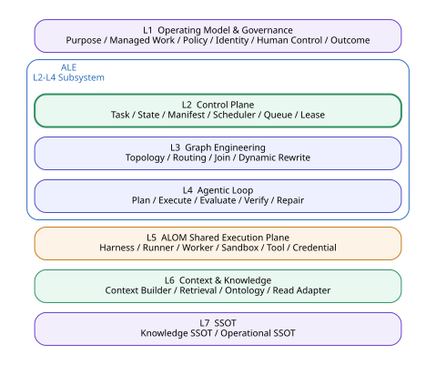
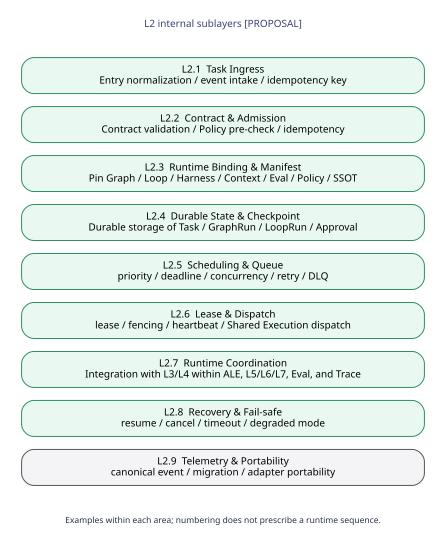
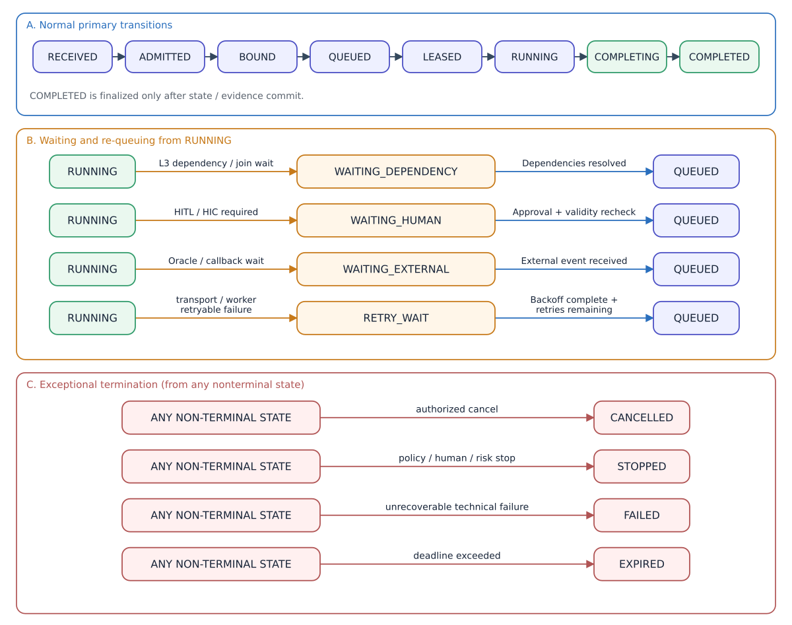
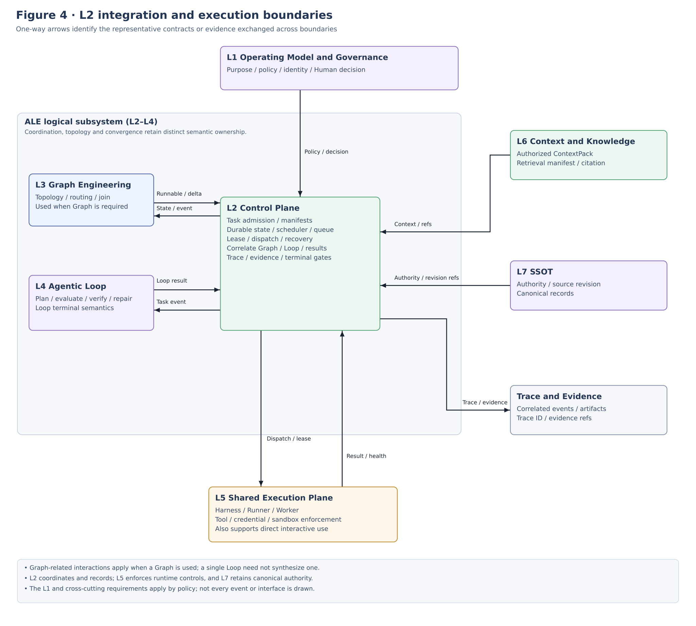
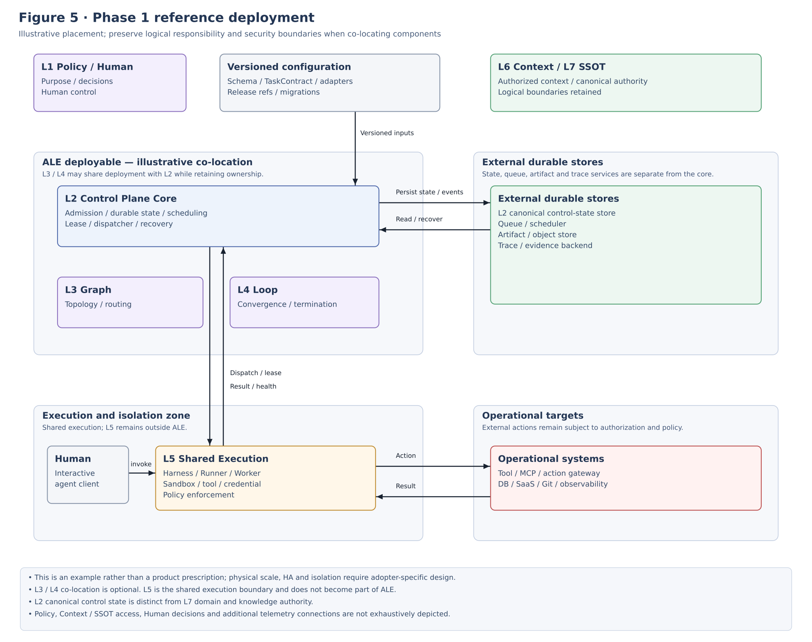

**IMPLEMENTATION STANDARD**

**ALOM L2 Control Plane**

**Implementation Architecture Standard**

Task / Durable State / Manifest / Scheduler / Queue / Lease / Coordination / Recovery

| **Core baseline Implement L2 Control Plane as the Durable Orchestration Control responsibility owned by the applying organization and forming part of ALE (Agent Loop Engine). Retain Task, GraphRun, LoopRun, Checkpoint, and Approval in resumable form and consistently control execution through Scheduler / Queue / Lease / Manifest. Separate Graph / Loop semantics into L3 / L4 and actual Agent execution into L5 ALOM Shared Execution Plane.** |
|----------------------------------------------------------------------------------------------------------------------------------------------------------------------------------------------------------------------------------------------------------------------------------------------------------------------------------------------------------------------|

| **Control item** | **Value** |
|--------------|----------------------------------------------------------------------------|
| Document ID | ALOM-CTL-STD-001 |
| Version | v0.4-review.20261110 (aligned with the logical ALE Subsystem / L5 Shared Execution) |
| Created | 2026-08-12 |
| Parent standard | ALOM-ARCH-STD-001 v2.5 |
| Scope | ALOM L2 Control Plane / Durable Orchestration / ALE Control Responsibility |
| Accountable function | Organization Architecture (Enterprise Architecture) / AI Platform |
| Information classification | Public |

This specification elaborates the parent standard's CTL-01–CTL-06 into implementable responsibilities, contracts, state machines, and acceptance tests for the L2 Control Plane within ALE (Agent Loop Engine).

# Document Control

## 1. Position and Order of Authority

This implementation standard elaborates L2 Control Plane in ALOM-ARCH-STD-001 v2.5 (ALOM Integrated Architecture Standard v2.5). L2 is the Control responsibility within ALE (Agent Loop Engine); L2 alone is not ALE itself. Without changing the parent standard's MUST / MUST NOT requirements, it turns Task Ingress, Durable State, Scheduler, Queue, Lease, Manifest, Recovery, Fail-safe, and Portability into implementable design units.

- ALOM-ARCH-STD-001 v2.5 takes precedence in the event of a conflict with the parent standard.

- Where laws and regulations, contracts, customer NDAs, or security rules impose stricter requirements, the stricter rules take precedence.

- Items marked \[PROPOSAL\] are implementation details not specified in the parent standard. Standardize them through ADR / change request / Eval when adopting them.

- Native state from a Workflow Engine, Queue product, Runner product, Kubernetes Job, or CI Job must not become the applying organization's sole canonical L2 Control Plane state. Compose ALE-wide semantics through standard L2–L4 contracts; do not delegate them to a particular product's native state.

## 1.1 Common Scope / Isolation

The runtime / protected contracts in this document consume CommonScopeContract from `ALOM-PROF-SCOPE-SPEC-001`.

- `scope_ref` is the common canonical scope identity and is required.
- `domain_id` is the persistent operating-domain identity and is required.
- `project_id` is optional Project overlay / context. Its absence alone must not cause rejection. Do not synthesize a Project merely to satisfy an implementation schema.
- `isolation_scope_ref` is the mandatory runtime / protected isolation boundary. Fail closed if it is unresolved.
- Do not infer runtime isolation from `project_id` alone. Bind Queue / state / worker / sandbox / tool / credential / repository / cache / retrieval / Trace / L7 access to explicit `isolation_scope_ref` and authorization policy.
- Do not relax Authority-conflict controls, Human-required, mandatory assurance, HITL timeout, no-relaxation, or cross-isolation denial.
L2 produces Common Scope for TaskContract / TaskRun / RuntimeManifest. Admission / Queue / State / Lease / Trace use `isolation_scope_ref` as a mandatory partition and do not reject solely because `project_id` is absent.

Basis/category: \[STD\] \[S1\] Inherits document control, P-01–P-03, P-07, P-08, P-12, CTL-01–06, and OPS-01–06.

## 2. Sources and Design Categories

| **ID** | **Source** | **Use in this document** |
|--------|-------------------------------------------------------------------------|----------------------------------------------------------------------------------------------------------------------------------------------------------------------------------------------|
| \[S1\] | ALOM-ARCH-STD-001 v2.5-review.20261110 (ALOM Integrated Architecture Standard v2.5-review.20261110) | Non-effective alignment candidate; controlled authority remains v2.5. Inherits seven layers, ALE = logical L2–L4 Execution Subsystem, L2 CTL-01–06, L5 Shared Execution, Security, NFR, OPS, and minimum data contracts. |
| \[S2\] | ALOM-GRAPH-STD-001 v0.4-review.20261110 (related specification) | Cross-check for the L2/L3 boundary within ALE, GraphRun durable state, and separation of runnable-node decisions from dispatch. Layer names in S1 v2.5 take precedence. |
| \[S3\] | ALOM-LOOP-STD-001 v0.6-review.20261110 (related specification) | Cross-check for the L2/L4 boundary within ALE and LoopRun / checkpoint / idempotency / concurrency / portability. |
| \[S4\] | ALOM L5 Shared Execution Plane Implementation Architecture Standard (ALOM-HR-STD-001 v0.4-review.20261110, formerly Harness & Runner v0.2) | Reference for L2/L5 Runner Adapter, Execution Worker, checkpoint/recovery, and external enforcement. The formal position of L5 as ALOM Shared Execution Plane in S1 v2.5 takes precedence. |

Related specifications are cross-check references for current content and do not imply identity with the original historical sources.

Design categories: \[STD\] = inherited from the parent standard; \[REF\] = reference elements based on existing source materials; \[PROPOSAL\] = implementation detail added in this document. Related specifications are cross-check references for current content.

# Contents

1 Purpose and Scope

2 Fixed Definitions and Responsibility Boundaries

3 Control Plane Architecture Principles

4 Overall ALOM Stack and Internal L2 Structure

5 Task Ingress / Contract / Admission

6 Runtime Binding / Execution Manifest

7 Durable State / Checkpoint / Artifact

8 Scheduling / Queue / Concurrency / Budget

9 Lease / Dispatch / Worker Coordination

10 Task State Machine / Transition Control

11 Recovery / Resume / Cancellation / Idempotency

12 Runtime Coordination / L1–L7 Integration

13 Fail-safe / Degraded Mode / Human Control

14 Trace / Event / Evidence / Telemetry

15 Security / NDA / Multi-tenant Isolation

16 Repository / CI/CD / Versioning / Migration

17 Reference Physical Deployment

18 Nonfunctional Requirements / SLO / Operations

19 Acceptance Gates and Conformance Tests

20 Implementation Roadmap and Backlog

Appendix A Minimum Data Contracts

Appendix B YAML Contract Examples

Appendix C State Transition Matrix

Appendix D Parent Requirement Mapping

Appendix E Technology Mapping

# 1. Purpose and Scope

## 1.1 Purpose

This document defines standards for implementing ALOM L2 Control Plane as the Durable Orchestration Control responsibility owned by the applying organization within ALE (Agent Loop Engine). L2 admits Tasks, pins execution contracts, makes TaskRun / GraphRun / LoopRun / Approval / Checkpoint durable, and uses Scheduler / Queue / Lease to control execution within bounds and make it resumable and auditable. L3 owns Graph organization semantics, L4 owns convergence semantics for a single Work Unit, and actual Agent execution and external enforcement are delegated to L5 ALOM Shared Execution Plane.

Design goal: The applying organization must preserve the meaning and continuity of task, state, artifact, eval, trace, approval, manifest, and checkpoint in the L2 Control responsibility within ALE when replacing Cursor / Claude / Codex / custom Agent Runtime, Graph Engine, or Workflow Engine.

## 1.2 In Scope

- Task Ingress from Chat / UI / REST API / Webhook / Git hosting (e.g., GitHub) Webhooks / Schedule / Event for ALOM Managed Work admitted to L2 as Agentic Work.

- Task Contract, Admission, and resolution of Purpose / Tenant / Project / Actor / Budget / Deadline.

- Durable persistence of Task, GraphRun, LoopRun, Shared State, Approval, Checkpoint, and Artifact references.

- priority, queue, worker, concurrency, retry, timeout, cancellation, DLQ, lease, fencing.

- Correlation of Context, Policy, Eval, Trace, Runner, and Knowledge / Operational SSOT versions in a Runtime Manifest.

- Resume, Cancel, Recovery, Fail-safe, Degraded Mode, Runner switch, schema migration.

## 1.3 Out of Scope

- Graph topology, Routing, Join, and Dynamic Rewrite semantics (L3).

- Loop semantics of Plan / Execute / Evaluate / Verify / Repair / Termination (L4).

- Physical enforcement of Tool / Credential / Network / Filesystem / Sandbox controls and actual Runner execution (L5 ALOM Shared Execution Plane).

- Internal implementation of Context Builder, RAG, Ontology Runtime, and Knowledge retrieval (L6).

- Canonical Authority for Knowledge / Operational SSOT and business-system-specific data models (L7).

- Interactive-session control for Interactive Agent Work that directly uses L5 ALOM Shared Execution Plane without ALE. However, TaskContract / Trace / Artifact handoff when promoting or handing over Interactive Agent Work to Agentic Work is in scope for L2 integration.

- Design of internal LLM reasoning algorithms, chain-of-thought, or model weights.

Basis/category: \[STD\] \[S1\] Defines L2 as ALE's Control responsibility for Ingress, Graph/Loop State, Scheduler, Queue, and Context/Eval/Trace coordination, and L5 as Shared Execution Plane outside ALE. \[REF\] \[S2\]\[S3\]\[S4\] Adjacent-layer exclusions and ownership boundaries.

# 2. Fixed Definitions and Responsibility Boundaries

| **Term** | **Fixed definition** | **Not equivalent to** |
|-----------------------------|-----------------------------------------------------------------------------------------------------------------------------------------------------------------------------------|--------------------------------------------------------------------------------|
| Control Plane | ALOM L2. The Durable Orchestration Control Plane that, as the Control responsibility within ALE, admits Agentic Work as Tasks and manages durable state, scheduling, execution correlation, and recovery for the applying organization. | All of ALE / L3 Graph / L4 Loop / L5 Shared Execution / Runner / Workflow Engine |
| ALE | Agent Loop Engine. The logical Execution Subsystem comprising L2 Control Plane, L3 Graph Engineering, and L4 Agentic Loop, responsible for controlling, organizing, and converging Agentic Work. | L2 alone / L5 Shared Execution Plane / Runner |
| ALOM Shared Execution Plane | ALOM L5. The execution boundary providing Harness / Runner Adapter / Execution Worker / Sandbox / Tool / Credential / Runtime Telemetry for shared use by ALE and Interactive Agent Work. | ALE / L2 Control Plane / a particular Runner product |
| TaskContract | A versioned contract structuring Task purpose, actors, PJ, ingress, deadline, budget, classification, autonomy, and execution entrypoint. | Prompt / Ticket body |
| TaskRun | An execution instance for one TaskContract, correlating Task lifecycle, manifest, graph/loop refs, budget, checkpoint, and approval. | GraphRun / LoopRun / Runner session |
| RuntimeManifest | A manifest pinning Context, Policy, Eval, Trace, Graph, Loop, Harness, Runner constraints, and SSOT revisions into one execution correlation. | Context Pack / HarnessSpec |
| Durable State | Canonical orchestration state that supports resumption beyond process / worker / runner loss. | In-memory state / Redis cache alone |
| Scheduler | The mechanism that orders launch candidates according to priority, deadline, quota, budget, and capacity. | L3 runnable determination |
| Queue | The delivery boundary retaining work items awaiting dispatch with durable delivery, priority, retry, and DLQ. | Graph topology |
| Lease | An exclusion and reacquisition contract granting a worker time-limited execution rights for one work item. | Credential / User session |
| Fencing Token | A monotonically increasing token that prevents a previous lease owner's delayed results from overwriting the new owner's state. | trace_id |
| Checkpoint | A state / artifact / side-effect boundary reference pinning Task / Graph / Loop to a safe resumption point. | Runner session snapshot |
| Canonical Event | An event normalizing Task, state, lease, dispatch, approval, error, and recovery into a common schema. | Vendor-specific logs |

Basis/category: \[STD\] \[S1\] CTL-01–06, P-03/P-07/P-12. \[REF\] \[S2\]\[S3\]\[S4\] Separation of GraphRun / LoopRun / Runner session. \[PROPOSAL\] Explicit TaskRun / Fencing Token / Canonical Event implementation contracts.

# 3. Control Plane Architecture Principles

| **ID** | **Principle** | **Requirement** |
|---------|--------------------------------|----------------------------------------------------------------------------------------------------------------------------------------------------------------------------------------------------------|
| CTL-P01 | Orchestration State owned by the applying organization | Retain Task / Manifest / Checkpoint / Approval in the applying organization's schemas, independently of product-native state. |
| CTL-P02 | Separate semantic ownership | Within ALE, L2 owns persistence / scheduling / coordination, L3 Graph organization, and L4 Loop convergence. L5 Shared Execution is the common execution boundary outside ALE; do not equate L2 alone with ALE. |
| CTL-P03 | Durable first | Establish canonical TaskRun and idempotency key before executing a task with external side effects. |
| CTL-P04 | Idempotent ingress | Safely resolve the same Task / Effect from identical requests, retransmissions, and duplicate Webhooks. |
| CTL-P05 | Lease + fencing | Use time-limited leases and fencing for worker execution to prevent duplicate execution and stale commits. |
| CTL-P06 | Bounded scheduling | Set bounds on priority, deadline, quota, budget, concurrency, retry, and timeout; prohibit unbounded delivery. |
| CTL-P07 | Manifest correlation | Pin and correlate Policy, Context, Eval, Trace, Runner, and SSOT revisions for each task. |
| CTL-P08 | Fail-closed control | Do not advance writes/actions when required services such as Policy, Trace, Eval, or HITL cannot be resolved. |
| CTL-P09 | Recovery over restart | On worker / runner loss, verify the checkpoint and side-effect state before resuming, rather than blindly restarting. |
| CTL-P10 | Cancellation propagation | Propagate higher-level STOP / policy deny / human cancel to L3/L4 within ALE and to L5 Shared Execution / Runner / Tool. |
| CTL-P11 | NDA isolation | Separate state, queue, worker pool, artifact, trace, and credential at the mandatory `isolation_scope_ref` boundary. `project_id` is optional overlay/context, not an isolation key. |
| CTL-P12 | Portability | Preserve task/state/artifact/eval/trace/approval/terminal meaning after replacing the Runner / Workflow Engine. |

Basis/category: \[STD\] CTL-P01/P07/P08/P12 elaborate CTL-02/04/05/06. \[REF\] \[S2\]\[S3\]\[S4\] durable state / cancellation / runner portability. \[PROPOSAL\] Explicit lease/fencing/idempotent-ingress principles for L2 implementation.

# 4. Overall ALOM Stack and Internal L2 Structure

As ALE's Control responsibility, L2 receives purpose, policy, identity, and human control from L1 Operating Model & Governance; makes L3/L4 execution semantics durable and coordinates them; dispatches executable Work Items to L5 ALOM Shared Execution Plane; and pins L6/L7 context / authority references in the manifest. L2 itself does not own Graph topology, Loop convergence, Tool enforcement, or Knowledge authority. Direct L5 paths for Interactive Agent Work may exist outside L2.



Figure 1 The ALOM Seven-Layer Model and the Positions of ALE and L2 Control Plane

Basis/category: \[STD\] \[S1\] 4.2 Seven-layer model.

## 4.1 Nine Internal L2 Sublayers



Figure 2 Detailed L2 Control Plane Architecture

| **Layer** | **Name** | **Responsibility** |
|--------|----------------------------|---------------------------------------------------------------------------------------------|
| L2.1 | Task Ingress | Normalize ingress into TaskContract and attach auth / rate limit / idempotency / trace. |
| L2.2 | Contract & Admission | Validate schema, identity, purpose, Common Scope / isolation_scope_ref, classification, policy pre-check, and autonomy ceiling. |
| L2.3 | Runtime Binding & Manifest | Resolve Graph/Loop/Harness/Context/Eval/Policy/SSOT revisions and generate an immutable manifest. |
| L2.4 | Durable State & Checkpoint | Transactionally persist TaskRun, GraphRun, LoopRun, Approval, Checkpoint, and Artifact refs. |
| L2.5 | Scheduling & Queue | Manage priority, deadline, quota, budget, concurrency, retry, timeout, and DLQ. |
| L2.6 | Lease & Dispatch | Manage lease, fencing, heartbeat, dispatch, and result commit according to worker capability. |
| L2.7 | Runtime Coordination | Correlate L3/L4 inside ALE and L1/L5/L6/L7/Eval/Trace/Human ports outside ALE, and propagate control events. |
| L2.8 | Recovery & Fail-safe | Control resume, cancel, timeout, stale workers, service outages, and degraded/read-only operation. |
| L2.9 | Telemetry & Portability | Manage canonical events, OTel correlation, usage, migration, and adapter portability. |

Basis/category: \[STD\] Preserves CTL-01–06. \[PROPOSAL\] Internal structure L2.1–L2.9.

# 5. Task Ingress / Contract / Admission

## 5.1 Ingress Adapter

Ingress normalizes Chat / UI / REST / Webhook / Git hosting Webhook / Schedule / Event into TaskContract instead of passing them directly to L3/L4. Retain ingress-specific IDs as external_request_ref; the applying organization issues task_id / trace_id.

| **Ingress** | **Normalization subject** | **Required processing** |
|-----------------------|-----------------------------|------------------------------------------------------------|
| Chat / UI | user request / form | Resolve actor, purpose, Common Scope (`domain_id` and runtime `isolation_scope_ref`; `project_id` only when present), classification, and deadline. |
| REST API              | request body / auth context | schema validation, rate limit, idempotency key, authz.    |
| Webhook / Git hosting Webhook | event id / source revision | Event deduplication, signature validation, and source-revision pinning. |
| Schedule              | schedule id / trigger time  | missed-run policy, concurrency key, deadline.             |
| Internal Event        | event type / subject        | correlation, causation, replay safety.                    |

## 5.2 Required TaskContract Fields

`use_case_id` is required only when the UseCase overlay applies. Admission must not reject work without a UseCase overlay solely because this field is absent.

<table>
<colgroup>
<col style="width: 100%" />
</colgroup>
<thead>
<tr class="header">
<th>task_contract_version: '1.0'<br />
task_id: task-...<br />
idempotency_key: ...<br />
purpose_id: ...<br />
use_case_id: ... (required only when the UseCase overlay applies)<br />
scope_ref: ...<br />
domain_id: ...<br />
tenant_id: ...<br />
project_id: null<br />
isolation_scope_ref: ...<br />
actor_id: ...<br />
delegator_id: ...<br />
classification: internal | confidential | restricted<br />
autonomy_level: A0 | A1 | A2 | A3 | A4<br />
priority: ...<br />
deadline: ...<br />
budget: {max_duration_sec: ..., max_cost: ..., max_tokens: ...}<br />
entrypoint: {type: graph | loop | deterministic | human, ref: ...}<br />
trace_id: ...</th>
</tr>
</thead>
<tbody>
</tbody>
</table>

## 5.3 Admission Control

Admission is the applying organization's Control Gate before Agent / Graph / Loop startup, not an Agent decision after accepting the Task. Do not transition to ADMITTED unless the following conditions are satisfied.

- TaskContract schema / required fields are valid.

- actor / delegator / purpose and Common Scope (`scope_ref` / `domain_id` / runtime `isolation_scope_ref`) can be resolved through Authority. Absence of `project_id` alone must not cause rejection.

- classification and autonomy level are within applicable Profile ceilings.

- Policy pre-check returns allow or an explicit human gate.

- The idempotency key resolves safely against existing Tasks.

- deadline / budget / retention / trace policy are configured.

Basis/category: \[STD\] CTL-01. \[PROPOSAL\] Explicit Admission Control and TaskContract schema.

# 6. Runtime Binding / Execution Manifest

CTL-04 Coordination is implemented by pinning the execution conditions referenced by a Task in one RuntimeManifest, rather than merely making service-to-service calls. The Manifest underpins TaskRun reproducibility, change-impact analysis, and Runner replacement, correlating L3/L4 semantics within ALE with L5 Shared Execution conditions.

## 6.1 Manifest Resolution

1.  Obtain purpose / Common Scope (optional `project_id`) / `isolation_scope_ref` / autonomy / entrypoint from TaskContract.

2.  Resolve policy_ref / human gate / exception_ref from L1.

3.  Resolve GraphSpec / LoopSpec versions and Effective manifest references from L3/L4.

4.  Resolve Harness / Runner capability constraints from L5.

5.  Obtain context policy / retrieval manifest references from L6.

6.  Pin Knowledge commit SHA / Operational authority references from L7.

7.  Combine Eval / Trace policy with budget / retention and finalize the manifest digest.

## 6.2 Minimum RuntimeManifest Structure

<table>
<colgroup>
<col style="width: 100%" />
</colgroup>
<thead>
<tr class="header">
<th>manifest_version: '1.0'<br />
manifest_id: man-...<br />
task_id: task-...<br />
trace_id: ...<br />
purpose_id: ...<br />
scope_ref: ...<br />
domain_id: ...<br />
project_id: null<br />
isolation_scope_ref: ...<br />
policy_ref: ...<br />
graph_ref: ...<br />
effective_graph_ref: ...<br />
loop_refs: [...]<br />
harness_refs: [...]<br />
runner_constraints: [...]<br />
context_policy_ref: ...<br />
eval_ref: ...<br />
knowledge_revisions:<br />
- repository: ...<br />
commit_sha: ...<br />
operational_authority_refs: [...]<br />
autonomy_level: A2<br />
budget_ref: ...<br />
manifest_digest: sha256:...</th>
</tr>
</thead>
<tbody>
</tbody>
</table>

## 6.3 Manifest Immutable / Rebind

When changing policy, context source, runner, graph, loop, or harness while RUNNING, do not overwrite the existing manifest. Generate a new manifest revision and record rebind reason, impact, approval, and effective_at in Trace. High-impact rebind requires an L1 Human Gate.

Basis/category: \[STD\] CTL-04, P-07, P-12. \[REF\] \[S2\]\[S3\]\[S4\] EffectiveGraphManifest / LoopSpec binding / EffectiveHarness.

# 7. Durable State / Checkpoint / Artifact

## 7.1 State Ownership

| **State / record** | **Meaning owner** | **Canonical persistence / authority** |
|-------------------------------------|-------------------|-----------------------------------------------------------------|
| TaskRun / Work lifecycle            | L2                | L2 Control State Store                                          |
| GraphRun domain state               | L3                | L2 Control State Store                                          |
| LoopRun domain state                | L4                | L2 Control State Store                                          |
| Shared State schema                 | L3                | L2 persistence / L5 access enforcement                          |
| Runner session / native job state | Runner / L5 | Non-canonical. May be stored as an external reference. |
| Context Manifest / retrieval result | L6                | L2 reference, L6 derived runtime                                |
| Knowledge Revision | L7 | L7 Knowledge SSOT. L2 references the commit SHA. |
| Operational State | L7 | L7 Operational SSOT. L2 references authority / transaction refs. |
| Artifact / Evidence payload | producer layer | Artifact / Evidence Store. L2 retains digest/refs. |

L2 must not reimplement Graph / Loop domain semantics. Persist GraphRun / LoopRun schema versions and payloads in the durable store, and follow L3/L4 transition contracts to determine transition validity.

## 7.2 Checkpoint Boundary

| **Checkpoint** | **Recommended timing** | **Checks on resumption** |
|----------------------|--------------------------------------------|------------------------------------------------------------|
| Task checkpoint | After Admission / binding | policy / deadline / budget / manifest validity |
| Graph checkpoint | Stable points in routing/join/rewrite/recovery | GraphSpec version / invariant / runnable set |
| Loop checkpoint | After Planning, after Eval/Verify, before a Human Gate | LoopSpec / iteration / artifact / eval / side effect |
| Side-effect boundary | Before and after external Actions | idempotency / transaction ref / canonical read-after-write |
| Human checkpoint | Start of HITL/HIC waiting | approval validity / timeout / approver authority |

## 7.3 Transaction / Revision

- TaskRun / GraphRun / LoopRun updates carry a revision or optimistic concurrency token.

- A design that commits state transitions and outbox events in the same transaction is recommended.

- Put large artifact / evidence bodies in an object store; the State Store retains immutable digest/refs.

- Do not store Secrets / short-lived credentials in checkpoints; reissue them at resume.

Basis/category: \[STD\] CTL-02. \[REF\] \[S2\]\[S3\]\[S4\] durable persistence / checkpoint / state independence. \[PROPOSAL\] optimistic revision / transactional outbox.

# 8. Scheduling / Queue / Concurrency / Budget

## 8.1 Separating L3 Runnable Decisions from L2 Scheduling

L3 determines runnable candidates from dependency / routing / join / graph budget / policy results. L2 decides when, through which Queue, and with which Worker capacity those candidates actually start. Do not conflate Graph semantics with execution scheduling.

| **Decision** | **Owner** | **Example** |
|------------------------------------|-----------|------------------------------------------------------------------|
| Whether a Node is runnable | L3 | Dependencies resolved, routing guard, join satisfied, graph invariant |
| When to dispatch a Task / Node | L2 | priority, deadline, tenant quota, worker capacity |
| Whether to retry within a Node | L4 | defect, same failure, remaining budget, repair policy |
| Whether a Worker can execute | L5 | runner capability, sandbox, credential, network / FS enforcement |

## 8.2 Scheduling Key

<table>
<colgroup>
<col style="width: 100%" />
</colgroup>
<thead>
<tr class="header">
<th>scheduling_key:<br />
isolation_scope_ref: ...<br />
tenant_id: ...<br />
project_id: null<br />
priority: 50<br />
deadline: ...<br />
capability: [git, browser, mcp:ticket]<br />
conflict_keys: [repo:foo, env:staging]<br />
concurrency_group: isolation:scope://company/finance<br />
budget_ref: ...<br />
queue_class: interactive | batch | human | recovery</th>
</tr>
</thead>
<tbody>
</tbody>
</table>

## 8.3 Queue / Retry / DLQ

- Queues provide durable delivery, visibility/lease timeout, priority, retry backoff, and DLQ.

- Limit retry to transport / worker failures; do not confuse it with L4 semantic repair.

- Do not retransmit same-failure / policy-deny / deterministic-validation failures indefinitely through transport retry.

- The effective parallelism ceiling is the minimum of GraphSpec max_parallelism, L2 scheduler capacity, and L4/L5 budgets.

- Tasks/Nodes updating the same resource use conflict keys / locks / optimistic concurrency.

Basis/category: \[STD\] CTL-03. \[REF\] \[S2\] L3 parallelism / L2 scheduler capacity; \[S3\] semantic retry / budget.

# 9. Lease / Dispatch / Worker Coordination

## 9.1 Lease Contract

When passing a work item retrieved from a Queue to a Worker, use a time-limited Lease rather than a simple pop / ack. A Lease contains task/node/attempt, worker, expires_at, and fencing_token, and is renewed through heartbeats.

<table>
<colgroup>
<col style="width: 100%" />
</colgroup>
<thead>
<tr class="header">
<th>lease:<br />
lease_id: lease-...<br />
work_item_id: ...<br />
task_id: ...<br />
node_instance_id: ...<br />
worker_id: ...<br />
attempt: 2<br />
fencing_token: 1042<br />
leased_at: ...<br />
expires_at: ...<br />
heartbeat_due_at: ...<br />
capability_snapshot: ...</th>
</tr>
</thead>
<tbody>
</tbody>
</table>

## 9.2 Fencing / Stale Worker

8.  Worker A acquires a lease with fencing_token=1041.

9.  After a heartbeat timeout, L2 expires the lease and redistributes it to Worker B with fencing_token=1042.

10. If the delayed Worker A returns a result, reject its state commit / side-effect confirmation because 1041 is older than the current token.

## 9.3 DispatchResult

| **Category** | **Required fields** | **Treatment** |
|-----------|--------------------------------------------------|-------------------------------------------------------|
| Accepted | dispatch_id / lease_id / runner_ref / started_at | Transition to RUNNING. |
| Rejected | reason / capability_gap / policy_ref | Reschedule or STOP/HITL. |
| Heartbeat | lease_id / token / progress_ref / usage | Renew the lease. Distinguish progress from L3/L4 semantic events. |
| Completed | result_ref / artifact_ref / exit status / usage | Return a result event to L3/L4 and end the lease. |
| Lost | last heartbeat / worker state / checkpoint_ref | Enter Recovery after lease expiry. |

Basis/category: \[REF\] \[S2\]\[S3\]\[S4\] duplicate lease / worker loss / checkpoint resume. \[PROPOSAL\] Adopt fencing tokens as a standard L2 contract.

# 10. Task State Machine / Transition Control

The L2 state machine represents the orchestration lifecycle and is separate from the L3 GraphRun / L4 LoopRun domain state machines. L2 durably retains WAITING\_\* states and reschedules on dependency resolution, Human decisions, or external events.



Figure 3 Standard TaskRun State Machine

## 10.1 State Semantics

| **State** | **Meaning** | **Representative guard** |
|--------------------|----------------------------------------------------------------------|--------------------------------------------|
| RECEIVED | Ingress completed; not yet admitted. | schema / auth / idempotency not yet determined |
| ADMITTED | Passed the applying organization's Gate. | identity / purpose / policy / budget valid |
| BOUND | RuntimeManifest pinned. | required refs resolved / digest fixed |
| QUEUED | Awaiting dispatch. | priority / deadline / capacity |
| LEASED | One worker holds execution rights. | valid lease / fencing |
| RUNNING | L2 correlates L3/L4 semantic progress inside ALE with execution in L5 Shared Execution. | lease valid / policy still valid |
| WAITING_DEPENDENCY | Waiting for dependencies, join, or resources. | event / dependency update |
| WAITING_HUMAN | Waiting for HITL/HIC. | valid approval / timeout |
| WAITING_EXTERNAL | Waiting for an external system / oracle / callback. | callback / polling policy |
| RETRY_WAIT | Waiting for transport / worker-recovery backoff. | retryable class / attempts remaining |
| COMPLETING | Committing terminal evidence / state. | required evidence complete |
| COMPLETED | Successful terminal state. | L3/L4 terminal semantics satisfied |
| CANCELLED | Request cancelled. | authorized cancellation |
| STOPPED | Stopped due to Policy / Human / risk. | stop signal / fail-closed |
| FAILED | Unrecoverable technical / consistency failure. | recovery exhausted |
| EXPIRED | deadline / TTL exceeded. | now \> deadline |

Basis/category: \[STD\] CTL-02/03/05. \[REF\] \[S3\] standard state / stop / human review. \[PROPOSAL\] Explicit L2 TaskRun lifecycle.

# 11. Recovery / Resume / Cancellation / Idempotency

## 11.1 Recovery Decision

| **Failure** | **Standard decision** | **Prohibited** |
|-----------------------------|---------------------------------------------------------------|--------------------------------------|
| Worker crash / lease expiry | Check checkpoint + side-effect state and resume with a new lease. | blind restart |
| Runner unavailable | Rebind / requeue to a compatible alternate runner. | Treating the runner session as the sole state |
| Queue redelivery | Prevent duplicate commits through idempotency + fencing. | Duplicate side effects for the same Action |
| L3/L4 process restart | Reconstruct the engine from canonical state. | Treating the engine-native cache as canonical |
| External Action timeout | Verify L7 canonical state / transaction ref. | Assuming timeout means failure and re-executing |
| Policy/HITL unavailable | WAIT / STOP / read-only. | Automatic allow |
| Manifest dependency drift   | rebind proposal / human gate.                                | silent latest-version binding        |

## 11.2 Resume Procedure

11. Load TaskRun / GraphRun / LoopRun / Checkpoint revisions.

12. Re-evaluate Task deadline / budget / retention / cancellation state.

13. Re-resolve Policy / autonomy / approval validity.

14. Check Knowledge / Operational authority revision / freshness.

15. Re-resolve Harness / Runner capability and issue new short-lived credentials.

16. Perform L7 Verification if the side-effect boundary remains unresolved.

17. Resume with a new lease / fencing token and record recovery events in Trace.

## 11.3 Cancellation Propagation

L2 issues Task CANCEL / STOP as canonical control events; L3 determines semantic propagation to child Nodes / Subgraphs; L4 applies it to Loop termination; and L5 stops Runner / Tool execution. L2 must support separate recording of cancellation requested / acknowledged / completed.

Basis/category: \[STD\] CTL-02/03/05/06. \[REF\] \[S2\]\[S3\]\[S4\] recovery / cancellation / idempotency / state portability.

# 12. Runtime Coordination / L1–L7 Integration



[Open Figure 4 at full size](figures/ALOM-CTL-STD-001-fig4-current.svg)

Figure 4 L2 Control Plane Integration Boundaries (Responsibilities within ALE and Shared Execution Made Explicit)

| **Item** | **Owner** | **L2 boundary** |
|-----------------------------------------------|-----------|---------------------------------------------------------------------------------------|
| Purpose / SLO / Portfolio | L1 | Receive purpose / budget / business context into TaskContract. |
| Policy / Identity / Human Gate | L1 | Reference decisions during Admission / rebind / action / fail-safe and durably retain approval waits. |
| Graph runnable / topology / routing / join | L3 | Receive runnable candidates / graph state deltas, persist GraphRun, and schedule execution. |
| Loop plan / eval / verify / repair / terminal | L4 | Persist LoopRun and correlate execution requests / results. |
| Shared Execution / Harness / Runner | L5 | Correlate dispatch, lease, runner results, and worker health. Enforcement belongs to L5. |
| Context / Knowledge | L6 | Reference Context Pack / retrieval manifests and pin them in the task manifest. |
| Knowledge / Operational Authority | L7 | Reference commit SHA / authority / transaction refs. L2 has no canonical-update authority. |
| Eval / Oracle | Cross-cutting | Correlate Eval requests/results with task/graph/loop and use them as terminal gates when required. |
| Trace / Evidence | Cross-cutting | Correlate canonical events / artifact/evidence refs through trace_id. |

## 12.1 Reference Flow

18. L2 admits TaskContract and performs Admission / Policy pre-check.

19. L2 pins RuntimeManifest and transitions TaskRun to BOUND.

20. L3 resolves the Graph and returns runnable Node candidates to L2. A single-Loop entrypoint is treated as an L4 candidate.

21. L2 manages scheduler / queue / lease and dispatches the runnable / execution semantics determined by L3/L4 as Work Items to execution workers in L5 ALOM Shared Execution Plane.

22. L2 durably records L4/L5 results and returns events to L3/L4 semantic transitions.

23. L2 persists Human / External / Dependency waits as WAITING\_\*.

24. Once L3/L4 terminal semantics and required evidence hold, L2 finalizes TaskRun as COMPLETED.

Basis/category: \[STD\] CTL-04. \[REF\] \[S2\] L2/L3/L4 boundaries inside ALE; \[S3\]\[S4\] L5 Shared Execution / runner boundary.

# 13. Fail-safe / Degraded Mode / Human Control

CTL-05 requires that unsafe operations do not proceed when mandatory controls are unavailable, rather than requiring uninterrupted operation during failures. L2 declares mandatory / optional / read-only fallback treatment for each dependency service in the applicable Profile.

| **Dependency failure** | **Default behavior** | **Permitted degradation** |
|------------------------------------|--------------------------------|----------------------------------------------|
| Policy decision unavailable | STOP / WAIT | Preapproved A0 read-only only. |
| Required HITL unavailable | WAIT → timeout → STOP/ESCALATE | Automatic approval is prohibited. |
| Required Trace unavailable | STOP | Limited A0 read-only may be permitted by Profile. |
| Required Eval / Oracle unavailable | WAIT / STOP | Only optional eval may continue with a warning. |
| L6 Context service unavailable | retry / WAIT | May continue if the pinned context snapshot remains valid. |
| Partial retrieval failure | Degrade / WAIT / STOP according to the applicable profile | Use Canonical OKF / local retrieval within the applicable policy and record coverage / degraded status. Do not relax the KNW-02 hybrid MUST. |
| Runner unavailable | requeue / alternate runner | Rebind within manifest constraints. |
| State Store unavailable | Stop new dispatch | Read-only status display only. |
| L7 Action Authority unavailable | write STOP | Read-only through a read adapter is permitted. |

## 13.1 Human Control

- For Tasks requiring HITL/HIC, durably retain WAITING_HUMAN and correlate approval request / evidence / options / deadline.

- Approval timeout must not transition to automatic allow.

- Approval contains approver_id, authority_ref, decision, conditions, and expires_at.

- Re-evaluate approval validity if policy / context / target state changes after approval.

Basis/category: \[STD\] CTL-05, P-05, NFR-10. \[REF\] \[S2\]\[S3\] HITL timeout fail-closed.

# 14. Trace / Event / Evidence / Telemetry

## 14.1 Canonical Event

> **Partial illustrative excerpts:** These examples are field excerpts, not complete CommonScopeContracts or executable requests. Actual inputs must satisfy the applicable schema/version, scope_ref, enterprise_id, domain_id, isolation_scope_ref, runtime work_id, classification, authorization, and required contract fields. Project is optional; do not invent missing values.

L2 normalizes Task / State / Lease / Dispatch / Approval / Recovery semantics into Canonical Events rather than treating unmodified vendor-specific events as canonical Trace. Use OpenTelemetry trace/span as a correlation foundation, with a separate role from the Trace Ledger / Evidence carrying business semantics.

<table>
<colgroup>
<col style="width: 100%" />
</colgroup>
<thead>
<tr class="header">
<th>event_version: '1.0'<br />
event_id: ...<br />
event_type: task.queued | lease.acquired | task.waiting_human | recovery.resumed | ...<br />
timestamp: ...<br />
trace_id: ...<br />
span_id: ...<br />
task_id: ...<br />
graph_run_id: ...<br />
loop_run_id: ...<br />
lease_id: ...<br />
actor_id: ...<br />
project_id: ...<br />
manifest_ref: ...<br />
state_before: ...<br />
state_after: ...<br />
artifact_refs: [...]<br />
evidence_refs: [...]<br />
content_hash: ...</th>
</tr>
</thead>
<tbody>
</tbody>
</table>

## 14.2 Event Categories

| **Category** | **Example** | **Purpose** |
|--------------|----------------------------------------------------|-----------------------------------|
| Ingress | task.received / admitted / rejected | Audit ingress, purpose, actors, and duplicates. |
| Binding | manifest.resolved / rebound | Reproducibility and change impact. |
| State | task/graph/loop transition | Resumption points and terminal reasons. |
| Scheduling   | queued / dequeued / throttled / deadline           | capacity / SLO / queue debt.     |
| Lease | acquired / renewed / expired / fenced | Duplicate execution and worker health. |
| Dispatch     | accepted / started / completed / lost              | L5 Shared Execution correlation. |
| Human | approval.requested / decided / expired | HITL / HIC audit. |
| Recovery | checkpoint.created / resume / requeue / compensate | Recovery and retry reasons. |
| Fail-safe | dependency.unavailable / degraded / stopped | Decisions during control failures. |

## 14.3 Metrics

- queue depth / age / deadline risk

- lease expiry rate / stale result rejected

- resume success rate / duplicate suppression

- manifest resolution latency / rebind rate

- Task terminal distribution COMPLETED / STOPPED / FAILED / EXPIRED

- cross-isolation access denied / policy deny / HITL timeout

- Runner switch success / portability regression

Basis/category: \[STD\] CTL-04, P-07, NFR-04. \[REF\] \[S1\] OpenTelemetry context propagation. \[PROPOSAL\] L2 canonical event taxonomy.

# 15. Security / NDA / Multi-tenant Isolation

As a control plane, L2 uses Defense in Depth so that runtime `isolation_scope_ref` boundaries do not rely solely on logical keys, even when sharing a Queue / DB. Keep queue, lease, artifact, trace, worker-pool, and credential-reference boundaries consistent. Do not infer isolation from `project_id` alone.

| **Boundary** | **Required controls** | **Acceptance focus** |
|----------------|-------------------------------------------------------------------------------------|--------------------------------------------|
| Identity | Separate human / service / agent / delegator and use short-lived tokens | Reject stale tokens / cross-tenant identities |
| State Store | Use `isolation_scope_ref` as a mandatory partition key and choose RLS / schema / DB separation. `project_id` is an optional overlay | cross-isolation queries: 0 |
| Queue | Align queue namespace / routing key / consumer scope with `isolation_scope_ref` | Cannot consume work items from another isolation scope |
| Lease / Worker | Validate worker pool / capability / isolation_scope binding | Dispatches to unauthorized workers: 0 |
| Artifact | Restrict object prefix / KMS key / ACL / signed URL to `isolation_scope_ref` | cross-isolation artifact reads: 0 |
| Trace | Carry trace access policy / retention / deletion into `isolation_scope_ref` | cross-isolation trace exposure: 0 |
| Secrets | L2 stores only credential_ref, never secret bodies, in state/checkpoint | Issue new credentials at resume |
| Break-glass | Limit scope/time, require two-party approval, record all events, and review afterward | Automatic expiry / return to normal permissions |

## 15.1 Default Deny

If any of `isolation_scope_ref` / purpose / policy / authority / revision / approval cannot be resolved, L2 must not infer a value and dispatch. Absence of `project_id` alone does not trigger fail-closed. In particular, work items with Action capability must fail closed.

Basis/category: \[STD\] P-08, SEC-01–07, NFR-02. \[REF\] \[S4\] Execution isolation / short-lived credential.

# 16. Repository / CI/CD / Versioning / Migration

## 16.1 Recommended Repository Structure

<table>
<colgroup>
<col style="width: 100%" />
</colgroup>
<thead>
<tr class="header">
<th>alom-control-plane/<br />
schemas/<br />
task-contract.schema.json<br />
task-state.schema.json<br />
runtime-manifest.schema.json<br />
checkpoint.schema.json<br />
lease.schema.json<br />
dispatch.schema.json<br />
event.schema.json<br />
task/{ingress,admission,lifecycle}/<br />
manifest/{resolver,binding}/<br />
state/{task,graph,loop,checkpoint,migration}/<br />
scheduling/{scheduler,queue,lease,concurrency,retry}/<br />
dispatch/<br />
recovery/<br />
ports/{governance,graph,loop,harness,context,ssot,eval,human,trace}/<br />
adapters/<br />
telemetry/<br />
tests/{contract,state,idempotency,scheduling,recovery,failure,isolation,portability}/<br />
deploy/<br />
docs/adr/</th>
</tr>
</thead>
<tbody>
</tbody>
</table>

## 16.2 Change Gate

- The protected default branch on Git hosting is canonical for TaskContract / State / Manifest / Lease / Event schemas.

- Changes follow Issue → branch → change request → schema/static test → migration test → replay/recovery regression → CODEOWNERS → merge.

- Changes to state machine / terminal semantics / idempotency / cancellation / fail-safe require a version bump and impact analysis.

- AI-generated schema / migration / policy changes are Proposals / change requests and must not write directly to the protected default branch.

- Correlate release tag, schema version, migration version, and binary/image digest with RuntimeManifest / Trace.

## 16.3 Compatibility / Migration

| **Subject** | **Requirement** |
|------------------------------------|---------------------------------------------------------------------------|
| TaskContract | Maintain a major/minor compatibility matrix and consumer contract tests. |
| TaskRun / GraphRun / LoopRun state | Maintain versioned migrations and rollback/forward-fix procedures. |
| Manifest | Provide sufficient retention to resolve pinned revisions for older tasks. |
| Event schema | Maintain producer/consumer compatibility and replay tests. |
| Queue payload | Version payload schemas and support mixed versions during rolling deployment. |
| Runner/Engine Adapter | Reproduce baseline tasks across multiple adapters and compare terminal meaning. |

Basis/category: \[STD\] P-07/P-10/P-12, OPS-01–06. \[REF\] \[S2\]\[S3\] state migration / adapter compatibility.

# 17. Reference Physical Deployment

Independent services for every component are unnecessary at the outset as long as logical responsibilities are preserved. For Phase 1, deploy L2 Control Plane Core as a modular monolith and separate Canonical State / Queue / Artifact / Trace into external durable stores. L3/L4 may initially share a deployable with L2 while retaining separate Semantic Ownership within ALE. Separate L5 ALOM Shared Execution Plane as the shared execution boundary outside ALE.



[Open Figure 5 at full size](figures/ALOM-CTL-STD-001-fig5-current.svg)

Figure 5 Phase 1 Reference Physical Deployment

| **Zone** | **Principal deployment contents** |
|--------------------------------|-------------------------------------------------------------------------------------------------------------------------|
| Git hosting / Config Repo | Schema, TaskContract, adapter contracts, migrations, ADRs, release tags. |
| L2 Control Plane               | Task API, Admission, Manifest Resolver, State Repository, Scheduler, Lease, Dispatcher, Recovery, Ports.               |
| Durable Stores | PostgreSQL or equivalent, message queue / workflow scheduler, object store / artifact registry, Trace backend. |
| Policy / Human                 | Policy Decision/Enforcement, Approval/Decision Queue, HITL/HOTL/HIC.                                                   |
| ALE Graph / Loop Runtime | L3 Graph Engineering and L4 Agentic Loop. Retain separate Semantic Ownership within ALE; Phase 1 may share a deployable with L2. |
| L5 ALOM Shared Execution Plane | Harness, Runner Adapter, Execution Worker, Sandbox, Tool/MCP Gateway. Shared by ALE and Interactive Agent Work. |
| Knowledge / SSOT               | L6 Context / Knowledge, L7 Knowledge / Operational SSOT.                                                               |

## 17.1 Scale-Out Decisions

- Split services when Task API and Scheduler load characteristics diverge.

- Shard by tenant / workload class when Queue / Lease throughput or noisy-neighbor behavior becomes an issue.

- Prioritize State Store availability / RTO/RPO / transaction consistency; do not make a cache canonical.

- Separate L3/L4 Core into distinct deployables when organizational boundaries, independent scaling, or failure domains require it.

Basis/category: \[REF\] \[S2\]\[S3\] L3/L4 Runtime may initially share a deployable with L2. \[STD\] State / Queue / Artifact / Policy / Observability as minimum L2 Control Plane components.

# 18. Nonfunctional Requirements / SLO / Operations

## 18.1 Minimum L2 Acceptance Metrics

| **ID** | **Metric** | **Criterion** |
|------------|---------------------------------|-------------------------------------------------------------------------------------|
| CTL-NFR-01 | Task ingress idempotency | Duplicate logical Tasks from the same idempotency key: 0. |
| CTL-NFR-02 | Durable state recovery | Resume from a canonical checkpoint or terminate safely in 100% of applicable failure scenarios. |
| CTL-NFR-03 | Duplicate execution suppression | Canonical commits from stale lease / fencing attempts: 0. |
| CTL-NFR-04 | Queue durability | Message loss before ack: 0; validate DLQ / replay procedures. |
| CTL-NFR-05 | Cancellation propagation | Child executions stop within the specified time in 100% of applicable scenarios. |
| CTL-NFR-06 | Fail-safe | Unapproved Actions during failures of required Policy / Trace / Eval / HITL services: 0. |
| CTL-NFR-07 | Trace completeness | 100% of required Task / manifest / state / lease / dispatch / terminal events. |
| CTL-NFR-08 | Cross-isolation | Crossings of state / queue / artifact / trace isolation boundaries: 0. |
| CTL-NFR-09 | Runner portability | A second Runner preserves baseline task state/eval/trace/artifact/terminal meaning. |
| CTL-NFR-10 | Schema migration | Successful N-1 → N migration and rollback/forward-recovery drills. |

## 18.2 SLO Configuration Items

| **Category** | **Values required in the applicable Profile** |
|--------------|----------------------------------------------------------------------------------|
| Availability | SLOs for Task API, State Store, Queue, and Policy/Human integration. |
| Latency | p95/p99 for ingress admission, manifest resolution, queue age, dispatch, and resume. |
| RTO/RPO      | State Store, Queue, Artifact, Trace.                                            |
| Capacity     | task/min, active Task, queue depth, lease count, worker concurrency.            |
| Retention    | Task state, manifest, event, artifact/evidence, approval.                       |
| Human SLA    | HITL timeout, escalation, on-call.                                              |
| Cost         | per task / per successful task / tenant budget / alert threshold.               |

Do not move to production before concrete values are configured. Set SLOs in the applicable Profile according to tenant/PJ/use-case impact, reversibility, RTO/RPO, and contracts.

Basis/category: \[STD\] Applies NFR-02/04/05/08/09/10 to L2.

# 19. Acceptance Gates and Conformance Tests

| **Gate** | **Verification content** |
|-------------------|-----------------------------------------------------------------------------------------------|
| G-CTL-Contract | Compatibility and mandatory fields for Task / State / Manifest / Lease / Event schemas. |
| G-CTL-Idempotency | Identical requests / webhooks / queue redelivery do not duplicate Tasks / effects. |
| G-CTL-Durability | State can be restored after Control Plane / worker / runner loss. |
| G-CTL-Lease | Fencing excludes expired leases / duplicate workers / stale results. |
| G-CTL-Scheduling | priority / concurrency / deadline / quota / budget / retry / DLQ behave as specified. |
| G-CTL-Cancel | Propagate cancel / stop through Task → ALE(L3/L4) → L5 Shared Execution → Runner. |
| G-CTL-Resume | Resume from checkpoint, reissue credentials, and verify side effects. |
| G-CTL-FailSafe | Fail-closed / approved degraded mode during Policy / Trace / Eval / HITL outages. |
| G-CTL-Trace | Correlate Task → Graph → Loop → L5 Shared Execution → Runner → Tool → Eval / Human through trace_id. |
| G-CTL-Isolation | Unauthorized state / queue / artifact / trace crossings between distinct `isolation_scope_ref` boundaries: 0. Cross-isolation access fails closed without explicit authorization. |
| G-CTL-Portability | Reproduce baseline tasks with a second Runner / Engine. |
| G-CTL-Migration   | state/event/schema version upgrade / rollback / replay.                                      |

## 19.1 Failure Injection Matrix

| **Injection** | **Expected result** |
|-----------------------------------|--------------------------------------------------------------------|
| State Store transient failure | Stop new dispatch, transaction rollback, and recovery after restoration. |
| Queue redelivery x3 | Exactly 1 canonical effect for the same Task/Node. |
| Worker kill after external action | Resume / complete after L7 verification. |
| Lease heartbeat stop              | lease expiry → new fencing token → stale commit rejected.         |
| Policy outage                     | Action capable task STOP/WAIT.                                    |
| HITL timeout                      | auto allow 0, STOP/ESCALATE.                                      |
| Runner unavailable | Rebind to a compatible runner or stop safely. |
| Cross-isolation (including cross-PJ) payload injection | Deny at Admission / queue / worker / state. |

## 19.2 Conformance Conditions

Verify CTL-01–06 conformance through automated tests or drill evidence for the Gates above, not merely the existence of a specification. Production targets must not omit G-CTL-FailSafe, G-CTL-Isolation, G-CTL-Resume, or G-CTL-Portability.

Basis/category: \[STD\] CTL-01–06, NFR-01–10. \[PROPOSAL\] L2-specific conformance gates.

# 20. Implementation Roadmap and Backlog

## 20.1 Recommended Roadmap

| **Phase** | **Principal deliverables** | **Decision criteria** |
|-------------------------------|--------------------------------------------------------------------------------------|--------------------------------------|
| Phase 0 Design baseline | TaskContract, TaskRun, RuntimeManifest, State/Lease/Event schemas, transition table. | Fix contracts and replay tests first. |
| Phase 1 Minimal Control Plane | Task API, Admission, PostgreSQL state, Queue, Scheduler, 1 Runner, A0/A1.           | idempotent task + durable state.    |
| Phase 2 Recovery              | Lease/fencing, checkpoint/resume, cancel, DLQ, worker loss drill.                   | duplicate effect 0, resume success. |
| Phase 3 Governance | Policy/HITL, fail-safe, Trace/Evidence, Action verification. | stop/human/outage drills pass. |
| Phase 4 Portability | Second Runner / Engine, schema migration, state portability report. | G-CTL-Portability / Migration pass. |
| Phase 5 Scale | multi-PJ, HA, sharding, capacity, chargeback, SLO/on-call. | Production operation. |

## 20.2 Implementation Epics

| **Epic** | **Name** | **Principal deliverables** |
|----------|--------------------------|---------------------------------------------------------------------|
| E1       | Task Contract & Ingress  | schema / adapter / idempotency / admission                          |
| E2       | Manifest & Binding       | resolver / digest / rebind                                          |
| E3       | Durable State            | TaskRun / state repository / optimistic revision / outbox           |
| E4       | Scheduling & Queue       | priority / concurrency / budget / DLQ                               |
| E5       | Lease & Dispatch         | lease / fencing / heartbeat / worker capability                     |
| E6       | Recovery & Cancellation  | checkpoint / resume / cancel propagation / side-effect verification |
| E7       | Governance Coordination  | Policy / HITL / fail-safe / degraded mode                           |
| E8       | Trace & Telemetry        | canonical event / OTel / usage / evidence refs                      |
| E9       | Security & Isolation     | isolation_scope_ref partition / queue / artifact / trace / secrets  |
| E10      | Portability & Operations | 2nd runner / migration / replay / SLO / runbook                     |

Basis/category: \[STD\] The MVP prioritizes A0/A1 and canonical state/trace owned by the applying organization. \[REF\] \[S2\]\[S3\]\[S4\] Adjacent-layer roadmaps. \[PROPOSAL\] Reorganized into an L2 implementation sequence.

# Appendix A Minimum Data Contracts

## A.1 TaskRun

| **Group** | **Required fields** |
|------------|-------------------------------------------------------------------------|
| identity   | task_id, task_contract_version, external_request_ref, trace_id          |
| scope      | scope_ref, domain_id, isolation_scope_ref, purpose_id, use_case_id (when the UseCase overlay applies), tenant_id, project_id (optional), classification |
| actor      | actor_id, delegator_id, authorization_ref                               |
| control    | state, revision, priority, deadline, autonomy_level, cancellation_state |
| binding    | manifest_id, manifest_digest, graph_run_id (only when L3 Graph is used), loop_run_ids, harness_refs  |
| budget     | duration/cost/token/execution consumed/remaining                        |
| scheduling | queue_class, concurrency_group, conflict_keys                           |
| lease      | current_lease_id, fencing_token, attempt                                |
| human      | human_review_ref, approval_state                                        |
| recovery   | checkpoint_ref, retry_count, recovery_count, last_failure_class         |
| terminal   | terminal_state, terminal_reason, completed_at                           |

## A.2 RuntimeManifest

| **Group** | **Required fields** |
|----------------|-----------------------------------------------------------|
| identity       | manifest_id, task_id, trace_id, version, digest           |
| scope          | scope_ref, domain_id, isolation_scope_ref, project_id (optional), classification |
| policy         | purpose_id, policy_ref, exception_ref, autonomy_level     |
| graph/loop     | graph_ref/effective_graph_ref (only when L3 Graph is used), loop_refs / versions       |
| harness/runner | harness_refs, runner_constraints, capability requirements |
| context        | context_policy_ref, context_manifest_ref                  |
| eval           | eval_policy_ref, oracle requirements                      |
| ssot           | knowledge commit SHA refs, operational authority refs     |
| telemetry      | trace policy, retention policy, evidence requirements     |
| time           | created_at, effective_at, expires_at                      |

## A.3 Lease

| **Group** | **Required fields** |
|-----------|------------------------------------------------------------------|
| identity  | lease_id, work_item_id, task_id, node_instance_id                |
| owner     | worker_id, runner_ref, capability_snapshot                       |
| control   | attempt, fencing_token, leased_at, expires_at, heartbeat_due_at  |
| scope     | isolation_scope_ref, tenant_id, project_id (optional), concurrency_group, conflict_keys |
| result    | status, result_ref, artifact_ref, last_heartbeat, release_reason |

# Appendix B YAML Contract Examples

## B.1 Combined TaskContract / RuntimeManifest Example

<table>
<colgroup>
<col style="width: 100%" />
</colgroup>
<thead>
<tr class="header">
<th>task_contract:<br />
version: '1.0'<br />
task_id: task-001<br />
purpose_id: maintain-repository<br />
scope_ref: scope://company/domain/system-integration/customer/customer-a/project/pj-alpha/work/maintain-repository<br />
domain_id: system-integration<br />
tenant_id: corp<br />
project_id: pj-alpha<br />
isolation_scope_ref: scope://customer-a/pj-alpha<br />
actor_id: user-123<br />
classification: confidential<br />
autonomy_level: A1<br />
entrypoint: {type: graph, ref: repo-maintenance@2.1}<br />
deadline: '2026-08-12T00:00:00+09:00'<br />
budget: {max_duration_sec: 3600, max_cost: 20}<br />
<br />
runtime_manifest:<br />
manifest_id: man-001<br />
task_id: task-001<br />
policy_ref: policy/alom-default@7<br />
effective_graph_ref: graph/repo-maintenance@2.1#sha256:...<br />
loop_refs: [loop/repair@1.4]<br />
harness_refs: [harness/git@3.0]<br />
runner_constraints: [git, shell, test]<br />
context_policy_ref: context/sdlc@4<br />
eval_ref: eval/repo-repair@8<br />
knowledge_revisions:<br />
- {repository: enterprise-knowledge, commit_sha: abc123}<br />
manifest_digest: sha256:...</th>
</tr>
</thead>
<tbody>
</tbody>
</table>

## B.2 Recovery Policy Example

<table>
<colgroup>
<col style="width: 100%" />
</colgroup>
<thead>
<tr class="header">
<th>recovery_policy:<br />
transport_retry:<br />
max_attempts: 3<br />
backoff: exponential<br />
worker_loss:<br />
action: resume_from_checkpoint<br />
require_new_lease: true<br />
require_new_credential: true<br />
external_action_timeout:<br />
verify_with: operational_ssot<br />
retry_only_if: not_applied<br />
policy_unavailable:<br />
action: fail_closed<br />
human_timeout:<br />
action: stop_or_escalate</th>
</tr>
</thead>
<tbody>
</tbody>
</table>

## B.3 Common Scope golden cases

These examples illustrate Scope propagation; they are not complete TaskContracts or CommonScopeContract payloads. Real requests must include the complete applicable Common Scope, authorization information, and other fields required by the TaskContract.

Project-less Managed Work in Finance / HR and SI Customer + Project overlays are expressed through the same contract.

```yaml
# permanent Finance work: project_id absent/null is valid
task_contract:
  scope_ref: scope://company/domain/finance/work/expense-approval
  domain_id: finance
  project_id: null
  isolation_scope_ref: scope://company/finance
  purpose_id: expense-approval
---
# SI delivery work: Customer + Project overlays remain representable
task_contract:
  scope_ref: scope://company/domain/system-integration/customer/customer-a/project/core-renewal/work/code-review
  domain_id: system-integration
  customer_id: customer-a
  project_id: core-renewal
  isolation_scope_ref: scope://customer-a/core-renewal
  purpose_id: code-review
# missing runtime isolation => deny / fail-closed
# differing isolation_scope_ref values => cross-isolation deny
```

# Appendix C State Transition Matrix

| **From** | **To** | **Guard** | **Required record** |
|--------------------|--------------------|------------------------------------|---------------------------|
| RECEIVED           | ADMITTED           | admission allow                    | TaskRun + admission event |
| RECEIVED           | STOPPED            | policy deny / invalid scope        | rejection evidence        |
| ADMITTED           | BOUND              | manifest resolved                  | manifest digest           |
| BOUND              | QUEUED             | schedule accepted                  | queue item                |
| QUEUED             | LEASED             | valid lease                        | lease + fencing token     |
| LEASED             | RUNNING            | worker accepted                    | dispatch start            |
| RUNNING            | WAITING_DEPENDENCY | L3 dependency/join wait            | checkpoint                |
| RUNNING            | WAITING_HUMAN      | HITL/HIC required                  | HumanReviewPacket         |
| RUNNING            | WAITING_EXTERNAL   | oracle/callback wait               | external ref              |
| RUNNING            | RETRY_WAIT         | retryable transport/worker failure | failure class + backoff   |
| WAITING_DEPENDENCY | QUEUED             | dependency resolved                | new candidate             |
| WAITING_HUMAN      | QUEUED             | approved + still valid             | approval ref              |
| WAITING_EXTERNAL   | QUEUED             | external event received            | callback evidence         |
| RETRY_WAIT         | QUEUED             | backoff elapsed + attempts remain  | new lease candidate       |
| RUNNING            | COMPLETING         | L3/L4 terminal success             | terminal evidence         |
| COMPLETING         | COMPLETED          | state/evidence commit success      | completion event          |
| \*                 | CANCELLED          | authorized cancel                  | cancel audit              |
| \*                 | STOPPED            | policy/human/risk stop             | stop evidence             |
| \*                 | FAILED             | unrecoverable technical failure    | incident/remedy ref       |
| \*                 | EXPIRED            | deadline exceeded                  | expiry event              |

# Appendix D Parent Requirement Mapping

| **Parent requirement** | **Chapters in this document** | **Implementation / evidence** |
|-----------------------|---------------------------------------|----------------------------------------------------------------|
| CTL-01 Ingress        | 5 Task Ingress / Contract / Admission | TaskContract / admission / idempotency                         |
| CTL-02 Durable state  | 7,10,11                               | TaskRun / GraphRun / LoopRun / checkpoint / recovery           |
| CTL-03 Scheduling     | 8,9                                   | scheduler / queue / concurrency / lease / retry / cancellation |
| CTL-04 Coordination   | 6,12,14                               | RuntimeManifest / ports / canonical event correlation          |
| CTL-05 Fail-safe      | 13,18,19                              | dependency classification / fail-closed / outage drill         |
| CTL-06 Portability    | 9,11,16,19                            | adapter / runner switch / state migration / portability gate   |
| P-07 Reproducibility and traceability | 6,14 | manifest digest / trace_id / revision correlation |
| P-08 NDA/Isolation Scope separation | 15 | state / queue / worker / artifact / trace isolation |
| P-12 Portability | 16,19 | schema compatibility / 2nd runner / migration |
| NFR-04 Trace          | 14,18                                 | canonical event completeness                                   |
| NFR-09 Runner replacement | 19 | G-CTL-Portability |
| NFR-10 HITL timeout   | 13,19                                 | auto allow 0 / fail-closed                                     |

# Appendix E Technology Mapping

| **Area** | **Implementation examples (non-normative)** | **Use in L2** |
|------------------|------------------------------------------------|----------------------------------------------------------------|
| API / Event      | REST / Webhook / Event Bus                     | request intake, auth, rate limit, idempotency.                |
| State | PostgreSQL or equivalent | transactional Task / Graph / Loop state, checkpoint metadata. |
| Queue            | Durable Message Queue / Workflow Scheduler     | priority, retry, DLQ, delivery.                               |
| Scheduler        | Control Plane Scheduler Service                | deadline, quota, budget, capacity, conflict.                  |
| Lease            | DB transaction / lease service                 | lease, heartbeat, fencing, attempt.                           |
| Artifact         | S3 compatible object store / artifact registry | artifact, diff, evidence, large checkpoint payload.           |
| Policy           | OPA / Cedar / custom service                   | decision / enforcement / exception / break-glass.             |
| Telemetry        | OpenTelemetry Collector / backend              | trace/log/metric, context propagation.                        |
| Trace / Evidence | Trace Ledger / Evidence Store                  | semantic audit, approval, recovery, terminal evidence.        |
| Deployment | Container / Kubernetes / Serverless | A modular monolith is acceptable initially. |
| Configuration | Protected default branch on Git hosting | schema, contract, migration, ADR, release tag. |

Note: Product names are non-normative implementation examples. Do not make a particular product's native state / session / queue metadata the applying organization's sole canonical source.

