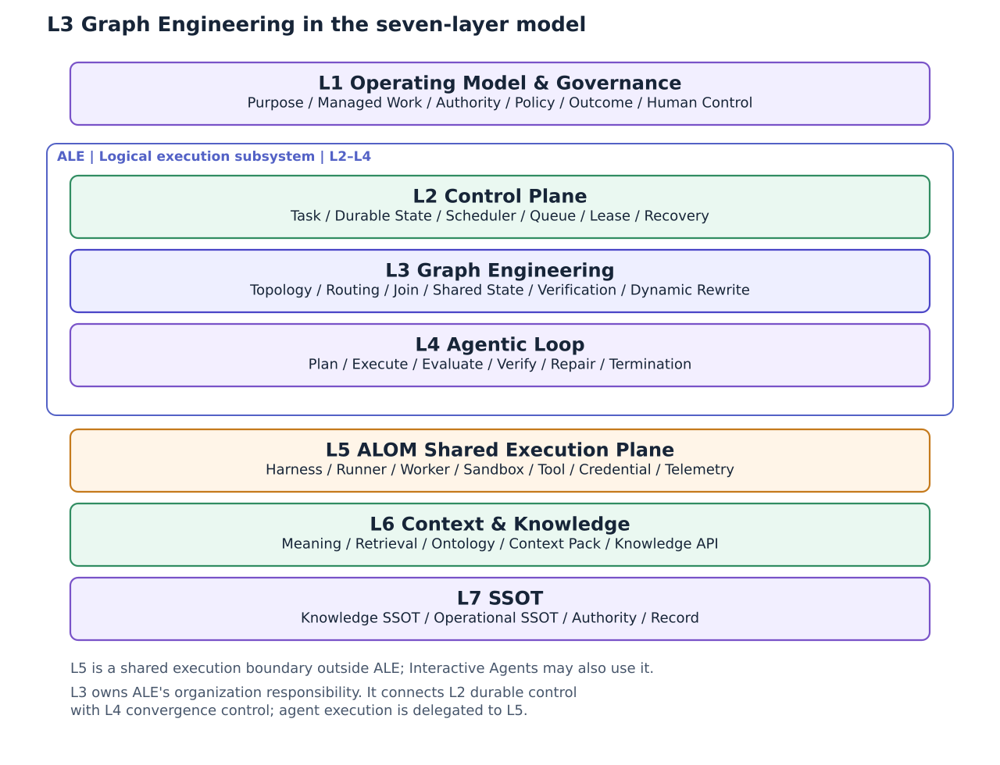
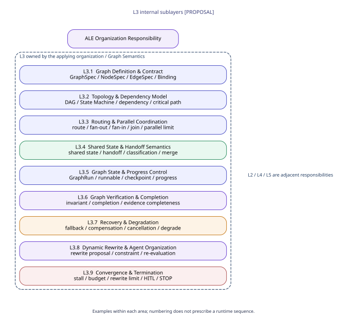
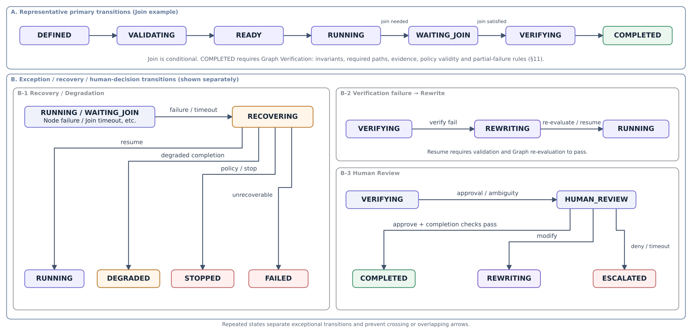
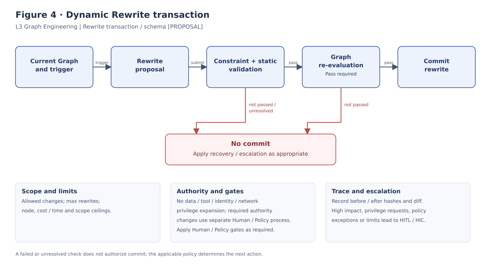
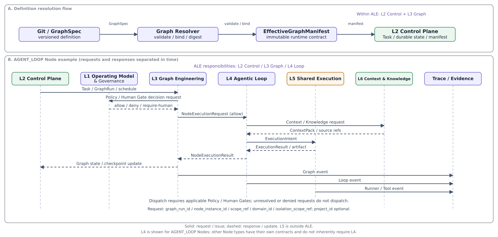

**ALOM L3 Graph Engineering
Implementation Architecture Standard**

**Graph Contract / Topology / Routing / Join / Shared State / Verification / Recovery / Dynamic Rewrite**

**IMPLEMENTATION STANDARD**

| Core baseline Implement L3 Graph Engineering as the Organization responsibility owned by the applying organization within ALE (Agent Loop Engine). Use GraphSpec / GraphRun / EffectiveGraphManifest / RewriteProposal as canonical contracts, and control Topology, Routing, Join, Shared State, Graph-level Verification, Recovery, and Dynamic Rewrite within bounds and with auditability. Separate durable orchestration into L2, convergence of a single Work Unit into L4, and actual Agent execution into L5 ALOM Shared Execution Plane. |
|-------------------------------------------------------------------------------------------------------------------------------------------------------------------------------------------------------------------------------------------------------------------------------------------------------------------------------------------------------------------------------------------------------------------------------------------------------|

| **Control item** | **Value** |
|--------------|-------------------------------------------------------------|
| Document ID | ALOM-GRAPH-STD-001 |
| Version | v0.4-review.20261110 (aligned with the logical ALE Subsystem / L5 Shared Execution) |
| Created | 2026-08-12 |
| Parent standard | ALOM-ARCH-STD-001 v2.5 |
| Scope | ALOM L3 Graph Engineering / ALE Organization Responsibility |
| Accountable function | Organization Architecture (Enterprise Architecture) / AI Platform |
| Information classification | Public |

This specification elaborates the parent standard's GRF-01–GRF-06 into implementable contracts, state, Topology, Routing, Join, Verification, Recovery, Dynamic Rewrite, and acceptance tests for the Organization responsibility of L3 Graph Engineering within ALE (Agent Loop Engine).

# Document Control

## 1. Position and Order of Authority

This implementation standard elaborates L3 Graph Engineering in ALOM-ARCH-STD-001 v2.5 (ALOM Integrated Architecture Standard v2.5). L3 is the Organization responsibility within ALE (Agent Loop Engine); L3 alone is not ALE itself. Without changing the parent standard's MUST / MUST NOT requirements, it specifies Graph implementation responsibilities, data contracts, state, Topology, Routing, Join, Graph-level Verification, Recovery, Dynamic Rewrite, and acceptance tests.

- ALOM-ARCH-STD-001 v2.5 takes precedence in the event of a conflict with the parent standard.

- Where laws and regulations, contracts, customer NDAs, or security rules impose stricter requirements, the stricter rules take precedence.

- Items marked \[PROPOSAL\] are implementation details not specified in the parent standard. Standardize them through ADR / change request / Eval when adopting them.

- Native DSL / state from a Workflow Engine, Graph Framework, or Agent Framework must not be treated as the applying organization's canonical Graph. Compose ALE as the logical Subsystem of L2 Control Plane, L3 Graph Engineering, and L4 Agentic Loop; do not equate L5 ALOM Shared Execution Plane or a particular Runner product with ALE.

## 1.1 Common Scope / Isolation

The runtime / protected contracts in this document consume CommonScopeContract from `ALOM-PROF-SCOPE-SPEC-001`.

- `scope_ref` is the common canonical scope identity and is required.
- `domain_id` is the persistent operating-domain identity and is required.
- `project_id` is optional Project overlay / context. Its absence alone must not cause rejection. Do not synthesize a Project merely to satisfy an implementation schema.
- `isolation_scope_ref` is the mandatory runtime / protected isolation boundary. Fail closed if it is unresolved.
- Do not infer runtime isolation from `project_id` alone. Bind Queue / state / worker / sandbox / tool / credential / repository / cache / retrieval / Trace / L7 access to explicit `isolation_scope_ref` and authorization policy.
- Do not relax Authority-conflict controls, Human-required, mandatory assurance, HITL timeout, no-relaxation, or cross-isolation denial.
L3 GraphRun inherits Common Scope from the L2 Task. Graph semantics introduce no new mandatory Project requirement.

Basis/category: \[STD\] \[S1\] Inherits document control, P-02, P-07, P-09, P-12, GRF-01–06, and OPS-01–06.

## 2. Sources and Design Categories

| **ID** | **Source** | **Use in this document** |
|--------|-------------------------------------------------------------|---------------------------------------------------------------------------------------------------------------------------------------|
| \[S1\] | ALOM-ARCH-STD-001 v2.5-review.20261110 (ALOM Integrated Architecture Standard v2.5-review.20261110) | Non-effective alignment candidate; controlled authority remains v2.5. Inherits seven layers, ALE = L2–L4, L5 Shared Execution, GRF-01–06, Human Control, Trace, Security, NFR, and OPS. |
| \[S2\] | ALOM-LOOP-STD-001 v0.6-review.20261110 (related specification) | Cross-check for the L3/L4 boundary within ALE, Node Contract, LoopRun, Checkpoint, and Eval/Verify/Convergence. |
| \[S3\] | ALOM L5 Shared Execution Plane Implementation Architecture Standard (ALOM-HR-STD-001 v0.4-review.20261110, formerly Harness & Runner v0.2) | Reference for Graph Harness, Shared State, Handoff, Routing/Join, Recovery, and Runtime Enforcement. The position of L5 in the parent standard v2.5 takes precedence. |
| \[S4\] | ALOM-CTL-STD-001 v0.4-review.20261110 (related specification) | Cross-check for the L2/L3 boundary within ALE, GraphRun durable state, Scheduler / Queue / Lease, runnable node / dispatch, and RuntimeManifest / Checkpoint. |

| Design categories: \[STD\] = inherited from the parent standard; \[REF\] = reference elements based on existing source materials; \[PROPOSAL\] = implementation detail added in this document. Related specifications are cross-check references for current content. |
|--------------------------------------------------------------------------------------------------------------------|

Related specifications are cross-check references for current content and do not imply identity with the original historical sources.

# Contents

1 Purpose and Scope

2 Fixed Definitions and Responsibility Boundaries

3 Graph Engineering Architecture Principles

4 Overall ALOM Stack and Internal L3 Structure

5 Graph Definition / Contract

6 Graph Resolution / EffectiveGraphManifest

7 Topology / Dependency Model

8 Routing / Fan-out / Join / Parallel Coordination

9 Shared State / Handoff and the Graph Harness Boundary

10 Graph State / Progress / Checkpoint

11 Graph Verification / Completion

12 Recovery / Degradation / Compensation

13 Dynamic Rewrite / Dynamic Agent Organization

14 Convergence / Termination / Human Control

15 Integration Boundaries with L2 / L4 inside ALE, L5 Shared Execution, and L6

16 Trace / Evidence / Telemetry

17 Security / NDA / Governance

18 Repository / CI/CD / Versioning

19 Reference Physical Deployment

20 Acceptance Gates and Conformance Tests

21 Implementation Roadmap and Backlog

Appendix A Minimum Data Contracts

Appendix B GraphSpec Example

Appendix C Graph Engine Port / RewriteProposal Examples

Appendix D Parent Requirement Mapping and References

# 1. Purpose and Scope

## 1.1 Purpose

This document defines standards for implementing ALOM L3 Graph Engineering as the Organization responsibility owned by the applying organization within ALE (Agent Loop Engine). L3 owns relationships, dependencies, parallelism, Topology, Routing, Join, Shared State, Graph-level Verification, Recovery, and Dynamic Rewrite across multiple Tasks / Agents / Nodes / Human Work Units / Subgraphs. It determines the structure by which multiple Work Units coordinate and the Graph as a whole satisfies its requirements and converges. Separate durable orchestration into L2, convergence semantics for a single Work Unit into L4, and actual Agent execution and external enforcement into L5 ALOM Shared Execution Plane.

| Design goal The applying organization must preserve Graph semantics, Topology, Node/Edge contracts, Shared State, Completion, Recovery, Dynamic Rewrite, Trace, and Human Gates when replacing the Workflow / Graph Framework. |
|-------------------------------------------------------------------------------------------------------------------------------------------------------------------------------------------------|

## 1.2 In Scope

- Graphs of multiple Work Units / Nodes / Human Tasks / Subgraphs delegated by ALE to L3 for organizing Agentic Work.

- DAG, State Machine, Conditional Routing, fan-out / fan-in, ALL / ANY / Quorum Join.

- Configurations whose Nodes are Agentic Loops, deterministic Tasks, Human Tasks, External System Tasks, Eval Tasks, or Subgraphs.

- Verification of Graph-level invariants, completion, partial failure, and evidence completeness.

- Shared State, Handoff, Cancellation Propagation, Checkpoint / Resume, Recovery / Degradation.

- Constrained Dynamic Rewrite / Dynamic Agent Organization.

## 1.3 Out of Scope

- Detailed design of Plan / Execute / Evaluate / Verify / Repair / Termination within a single Node (L4).

- Physical enforcement of Tool / Credential / Network / Filesystem / Sandbox controls and actual Runner / Worker execution (L5 ALOM Shared Execution Plane).

- Physical ownership of Scheduler / Queue / Lease / Durable State Store (L2 Control Plane).

- Internal implementation of OKF / Ontology / RAG / Knowledge SSOT (L6/L7).

- Design of internal LLM reasoning, chain-of-thought, or model weights.

Basis/category: \[STD\] \[S1\] P-02; 3.3, where equating Graph with Loop is nonconforming; 4.2 Seven-layer model; 5.3 L3 GRF-01–06. L3 is the Organization responsibility within ALE, and L5 Shared Execution is the common execution boundary outside ALE. \[REF\] \[S2\]\[S3\]\[S4\] L2/L4/L5 boundaries.

# 2. Fixed Definitions and Responsibility Boundaries

| **Term** | **Fixed definition** | **Not equivalent to** |
|-----------------------------|-------------------------------------------------------------------------------------------------------------------------------------------------------------------------------------------------------------|-------------------------------------------------------------------------------------|
| Graph Engineering | The L3 Organization responsibility within ALE. The applying organization owns the semantics of Task, Agent, Node, Edge, dependency, fan-out / fan-in, routing, join, shared state, graph verification, recovery, dynamic rewrite, and topology. | All of ALE / L2 Control / L4 Loop convergence / L5 Shared Execution / ALOM governance authority |
| ALE | Agent Loop Engine. The logical Execution Subsystem comprising L2 Control Plane, L3 Graph Engineering, and L4 Agentic Loop, responsible for controlling, organizing, and converging Agentic Work. L3 provides its Organization responsibility. | L3 alone / L5 Shared Execution Plane / Runner / a Graph Engine product |
| ALOM Shared Execution Plane | ALOM L5. The execution boundary providing Harness / Runner / Worker / Sandbox / Tool / Credential / Runtime Telemetry for shared use by Agentic Work under ALE control and Interactive Agent Work. | ALE / L3 Graph Engineering / a particular Runner product |
| GraphSpec | An asset defining Graph Node / Edge / schema / dependency / timeout / risk / routing / join / recovery / dynamic rewrite as a versioned specification. | Workflow Engine DSL |
| GraphRun | A Graph execution instance for one Task, correlating Graph state, Node instances, Edge state, Shared State, budget, rewrite, and checkpoint. | L4 LoopRun / Runner session |
| NodeSpec | The contract for one Work Unit on the Graph, defining input/output, type, owner, loop/harness, risk, timeout, and evidence. | An Agent itself |
| EdgeSpec | A transition contract between Nodes, defining source/target, condition, guard, handoff, priority, and failure route. | A mere drawn arrow |
| JoinPolicy | The contract defining fan-in conditions and partial result / timeout / required node / quorum. | Simply waiting for all results |
| Shared State | The logical schema for durable, classified state shared within a Graph. L2 persists it and L5 enforces access. | Runner memory / unrestricted sharing |
| Graph Invariant | An invariant that the Graph as a whole must satisfy, evaluated independently of individual Node Eval passes. | Node Eval |
| EffectiveGraphManifest | An immutable runtime contract generated by resolving GraphSpec with Task/Policy/Loop/Harness and related inputs and pinning it at runtime. | The original Graph template |
| RewriteProposal | A proposal to change an active Graph, containing rationale, before/after states, Node/Edge diff, budget, policy decision, and re-evaluation results. | Unconstrained Agent self-modification |
| Dynamic Agent Organization | A mechanism for reconfiguring Graph roles, Nodes, Edges, parallelism, and degraded paths at runtime within constraints, based on Shared State and evaluation results. | Unconstrained self-organization |

Basis/category: \[STD\] \[S1\] Fixed definitions and GRF-01–06. \[PROPOSAL\] Explicit GraphSpec / GraphRun / EffectiveGraphManifest / RewriteProposal implementation contracts.

# 3. Graph Engineering Architecture Principles

| **ID** | **Principle** | **Requirement** |
|--------|------------------------------------------------|--------------------------------------------------------------------------------------------------------------------------------------------------------------------------------|
| GE-P01 | Graph semantics owned by the applying organization | Manage Topology, Routing, Join, Completion, and Rewrite semantics as schema/config/code rather than delegating them to a particular Framework. |
| GE-P02 | Graph ≠ Loop | L3 owns the relationships and Organization of multiple Work Units in ALE, not L4 single-Node convergence semantics. L2 owns durable orchestration and L5 shared execution. |
| GE-P03 | Contract first | Node / Edge / Handoff / Join / Completion have structured schemas; do not connect them solely through free-form LLM text. |
| GE-P04 | Durable graph state | L3 defines Graph domain-state schemas; Canonical persistence resides in the L2 Control Plane Durable State Store inside ALE. |
| GE-P05 | Graph-level assurance | Do not declare Graph success solely from a collection of Node Eval passes; independently assess invariants / completion / evidence completeness. |
| GE-P06 | Bounded parallelism | Cap parallelism, fan-out, join wait, and node executions to constrain resources / cost / blast radius. |
| GE-P07 | No privilege escalation | Dynamic Rewrite must not expand data/tool/identity/network privileges. |
| GE-P08 | Constrained rewrite | Treat Rewrite as a change transaction: Proposal → Constraint Validation → Re-evaluation → Commit. |
| GE-P09 | Bounded convergence | Monitor repeated failures, repeated rewrites, stalls, and budget/time, and converge to DEGRADED / HITL / STOPPED. |
| GE-P10 | L3 semantics / L5 Shared Execution enforcement | L3 owns Shared State, Handoff, and Routing/Join semantics; L5 ALOM Shared Execution Plane performs actual Agent execution and fail-closed Tool/Network/Identity/Filesystem enforcement. |
| GE-P11 | Trace by default | Correlate Graph state, routing, join, verification, recovery, rewrite, human decisions, and termination through trace_id. |
| GE-P12 | Portability | Maintain contracts preserving baseline GraphSpec, GraphRun, Trace, Completion, and Rewrite semantics when the Workflow / Graph Engine changes. |

Basis/category: \[STD\] GRF-01–06, P-02, P-07, P-09, P-12. \[REF\] \[S2\]\[S3\]\[S4\] durable state / fail-closed / portability / ALE semantic ownership. \[PROPOSAL\] Implementation principles GE-P01–12.

# 4. Overall ALOM Stack and Internal L3 Structure

As ALE's Organization responsibility, L3 connects L2 Control Plane Task / durable state / scheduling with single-Work-Unit convergence in L4 Agentic Loop. It determines the structure through which multiple Work Units coordinate and the Graph as a whole satisfies requirements and converges. Delegate runtime Harness / Runner / Tool enforcement to L5 ALOM Shared Execution Plane outside ALE, and reference L1 Policy / Human Gates and L6/L7 Context / Authority. Do not equate L3 alone or a Graph Runtime product with ALE.



*Figure 1 The ALOM Seven-Layer Model and the Positions of ALE and L3 Graph Engineering*

Basis/category: \[STD\] \[S1\] 4.2 Seven-layer Reference Architecture and ALE = logical L2–L4 Execution Subsystem.

## 4.1 Nine Internal L3 Sublayers



*Figure 2 Detailed L3 Graph Engineering Architecture*

| **Layer** | **Name** | **Responsibility** |
|--------|--------------------------------------|---------------------------------------------------------------------------------|
| L3.1 | Graph Definition & Contract | Declare GraphSpec, NodeSpec, EdgeSpec, Binding, and Compatibility. |
| L3.2 | Topology & Dependency Model | Manage DAG/State Machine, dependencies, critical path, and reachability. |
| L3.3 | Routing & Parallel Coordination | Manage conditional routing, fan-out/fan-in, join, quorum, and parallelism limits. |
| L3.4 | Shared State & Handoff Semantics | Define Shared State schemas, classification, handoff, and merge/ownership. |
| L3.5 | Graph State & Progress Control | Manage GraphRun, runnable decisions, checkpoints, and progress/stalls. |
| L3.6 | Graph Verification & Completion | Verify invariants, completion, partial failure, and evidence completeness. |
| L3.7 | Recovery & Degradation | Manage fallback, compensation, cancellation, degraded paths, and subgraph recovery. |
| L3.8 | Dynamic Rewrite & Agent Organization | RewriteProposal, constraint decisions, role/Node/Edge/parallelism changes, and re-evaluation. |
| L3.9 | Convergence & Termination | Determine budget, rewrite-limit, stall, HITL, and STOPPED/FAILED/COMPLETED outcomes. |

Basis/category: \[STD\] Preserves L3 / GRF-01–06 Organization responsibilities. \[PROPOSAL\] Internal structure L3.1–L3.9.

# 5. Graph Definition / Contract

## 5.1 GraphSpec Structure

GraphSpec is a declarative configuration asset that makes Graph semantics reproducible and is versioned in Git. The Workflow Engine's internal representation is an implementation detail generated or resolved from GraphSpec.

| **Section** | **Principal fields** | **Requirement** |
|-----------------|------------------------------------------------------------------------|----------|
| metadata | graph_id, version, owner, compatibility | Required |
| binding | policy_ref, graph_harness_ref, graph_eval_ref | Required |
| nodes | node_id, type, input/output schema, loop/harness, owner, risk, timeout | Required |
| edges | source, target, condition, guard, handoff, failure route | Required |
| topology | mode, entry, terminal, parallel limit, cycle policy | Required |
| routing | conditional route, fallback, model/runner route policy | Required |
| join | ALL/ANY/quorum, required nodes, timeout, partial failure | Conditional |
| shared_state | schema, classification, merge, ownership | Conditional |
| verification | invariants, completion, evidence completeness | Required |
| recovery | fallback, compensation, cancellation, degrade policy | Required |
| dynamic_rewrite | enabled, allowed changes, max rewrites, privilege ceiling | Conditional |
| budget | duration, node executions, cost/token, concurrency | Required |
| termination | success, stop, degraded, human escalation | Required |
| trace | required events, evidence, retention/redaction refs | Required |

Basis/category: \[STD\] Mandatory elements of GRF-01–06. \[REF\] \[S3\] Graph Harness elements. \[PROPOSAL\] Integration into GraphSpec schema.

## 5.2 Node type

| **Node type** | **Meaning** | **Principal contract** |
|--------------------|--------------------------------------------|--------------------------------|
| AGENT_LOOP | Work Unit executing an L4 Agentic Loop | loop_ref required |
| DETERMINISTIC_TASK | CI, schemas, transformations, fixed algorithms, etc. | handler_ref / command contract |
| HUMAN_TASK | Approval, investigation, exception decisions, and review | DecisionPacket / SLA |
| EXTERNAL_TASK | Execution of or waiting for an external system / API / batch | operation_ref / idempotency |
| EVAL_TASK | Independent evaluation of the Graph/artifacts | eval_ref |
| SUBGRAPH | Composite Work Unit referencing another GraphSpec | subgraph_ref |

Do not equate a Node with an Agent. The standard requires that a Graph can organize AI / non-AI / human / external processing under the same contract model.

# 6. Graph Resolution / EffectiveGraphManifest

Before execution, resolve GraphSpec with Task Contract, Policy Snapshot, Graph Harness, Node LoopSpec, Node Harness, and available capabilities to generate an EffectiveGraphManifest pinned at runtime.

GraphSpec  
+ Task Contract  
+ Policy Snapshot  
+ Graph Harness  
+ Node LoopSpec / HarnessRef  
+ Runtime Capabilities  
↓  
Graph Resolver / Compiler  
↓  
EffectiveGraphManifest + digest

| **Category** | **Contract** |
|------------|-------------------------------------------------------------------------------------------------------------|
| input      | task_contract / graph_ref / policy_snapshot / graph_harness_ref / node bindings / runtime capabilities      |
| validation | schema / reference existence / cycle policy / reachability / ACL / risk / capability / budget compatibility |
| output     | effective_graph_id / digest / resolved nodes/edges / policies / denied overrides / compatibility result     |
| trace      | graph_ref + graph_digest + policy_ref + harness digests + source revision                                   |

| Lower-level overrides must not relax higher-level Policy / autonomy / classification / NDA / privilege ceilings. Stricter constraints take precedence. |
|------------------------------------------------------------------------------------------------------------------------------------|

Basis/category: \[STD\] GRF-01, P-07, P-12. \[REF\] \[S2\]\[S3\] EffectiveLoop / EffectiveHarness patterns. \[PROPOSAL\] Graph Resolver / EffectiveGraphManifest.

# 7. Topology / Dependency Model

## 7.1 Topology modes

| **Mode** | **Purpose** | **Required controls** |
|-------------------|-------------------------------------|------------------------------------------------------|
| DAG | Acyclic dependencies. Default mode. | cycle detection, topological order, critical path |
| STATE_MACHINE | Explicit states and conditional transitions. | transition guards, terminal states, prohibited transitions |
| CONTROLLED_CYCLIC | Bounded feedback / rework edges. | max traversals, same failure, budget, progress guard |

## 7.2 Static validation

- Reject undefined Nodes / dangling Edges.

- Reject required Nodes unreachable from entry. Unreachable optional Nodes may produce a warning under the applicable policy.

- Reject cycles in DAG mode. Controlled cyclic requires an explicit loop budget.

- Validate schema compatibility between Edge source output and target input.

- Calculate and record critical path and parallelism limits.

- Do not enable startup of high-risk Nodes missing required evidence / owner / timeout.

Basis/category: \[STD\] GRF-01/02. \[PROPOSAL\] Topology-mode and static-validator details.

# 8. Routing / Fan-out / Join / Parallel Coordination

## 8.1 Routing

Routing evaluates structured result / eval / verification / policy decision / state predicates as guards rather than relying solely on free-form LLM branching. Even when a model judge performs semantic evaluation, GraphSpec constrains the permitted route set.

| **Pattern** | **Representation** | **Design conditions** |
|-------------|-----------------|-------------------------------------------|
| Sequential | A → B | Simple dependency |
| Conditional | A → B/C | Exclusive/multiple routes determined by guards |
| Fan-out | A → B,C,D | Parallelism ceiling, budget, and blast radius |
| ALL Join | B,C,D → E | All required inputs satisfied |
| ANY Join | B,C,D → E | First successful result. Define cancellation of unnecessary branches |
| Quorum Join | K of N satisfied → E | Explicit required nodes and minimum_success |
| Fallback | A fail → B | Explicit failure class and alternate route |

## 8.2 JoinPolicy

```yaml
join:  
  type: quorum  
  minimum_success: 2  
  required_nodes: [security-review]  
  timeout_sec: 600  
  partial_failure: degrade  
  cancel_remaining: true  
```

## 8.3 Parallelism

- Use the minimum of GraphSpec max_parallelism, L2 Control Plane scheduler capacity, L4 Loop budget, and L5 Shared Execution capacity as the effective ceiling.

- Nodes modifying the same resource / artifact use conflict keys / locks / optimistic concurrency.

- Fan-out must not automatically expand credentials, data scope, or egress scope.

- Define cancel propagation in GraphSpec and propagate higher-level STOP / policy deny to child Nodes.

Basis and classification: \[STD\] GRF-02, GRF-05. \[REF\] \[S2\] L4 concurrency is agreed within L3/L2 ceilings. \[PROPOSAL\] JoinPolicy / conflict key.

# 9. Shared State / Handoff and the Graph Harness Boundary

L3 defines the semantics, schema, ownership, and merge conditions for Shared State / Handoff; Graph Harness / Runtime Enforcement in the L5 ALOM Shared Execution Plane enforces that contract in the execution environment. Even when Graph Harness implements routing/join/recovery/dynamic_rewrite, semantic Authority remains with L3 Graph Engineering, and L5 serves as the enforcement / execution surface.

| **Item** | **Primary responsibility** | **Design content** |
|------------------------------------|---------------------------|------------------------------------------------------------------------------|
| Shared State schema                | L3 Owner                  | state key, type, classification, owner, merge semantics                      |
| Durable persistence | L2 Control Plane Owner | Persist GraphRun / state revision / checkpoint in the L2 durable store within ALE |
| Access / data boundary enforcement | L5 Shared Execution Owner | Enforce classification, isolation_scope_ref, credential, network, and filesystem constraints on a fail-closed basis |
| Handoff contract                   | L3 Owner                  | input/output artifact, evidence, owner, mapping, freshness                   |
| Handoff execution                  | L5 Shared Execution Owner | artifact transfer, schema validation, redaction, access enforcement          |
| Node interpretation | L4 Consumer | Receive as Node input and use within the Loop |

```yaml
shared_state:  
  analysis:  
    classification: internal  
    owner: analysis-node  
    merge: replace  
  findings:  
    classification: confidential  
    owner: graph  
    merge: append  
  decision:  
    classification: restricted  
    owner: human-gate  
    merge: human-approved  
```

Basis and classification: \[STD\] \[S1\] Separation of L3 semantics / L5 Shared Execution. \[REF\] \[S3\] Graph Harness shared_state_schema / handoff_schema / routing_policy / join_policy / recovery / graph_eval / cancellation / dynamic_rewrite. \[PROPOSAL\] Explicit L3 Semantics / L5 Enforcement boundary.

# 10. Graph State / Progress / Checkpoint

## 10.1 Canonical Graph State

L3 defines the Graph domain state schema and delegates Canonical durable state persistence, leases, and scheduler / queue to the L2 Control Plane within ALE. Native execution state in a Workflow Engine / Graph Engine is an external reference and must not serve as the sole authoritative source.

| **State group** | **Key fields** |
|-----------------|------------------------------------------------------------------------------|
| identity        | graph_run_id, task_id, graph_ref, trace_id                                   |
| control         | state, revision, rewrite_count, stall_count, repeated_failure_count          |
| binding         | effective_graph_ref, policy_ref, graph_harness_ref, node loop/harness refs   |
| topology        | node_instances, edge_states, active/waiting/completed/failed nodes           |
| shared          | shared_state_ref, state_version, artifact/evidence refs                      |
| budget          | duration/cost/token/node executions/concurrency consumed/remaining           |
| progress        | last_progress_at, completed dependencies, resolved blockers, invariant delta |
| human           | human_review_ref, approval_state                                             |
| recovery        | checkpoint_ref, compensation refs, cancellation state                        |
| terminal        | terminal_state, reason, completed_at                                         |

## 10.2 Standard State Machine



Figure 3 GraphRun standard state machine (main transitions and exception transitions shown separately)

## 10.3 Progress semantics

Measure Progress as increments in resolved dependencies, verified outputs, resolved blockers, and satisfied invariants, rather than simply whether a Node is running. Determine stalls from meaningful progress delta rather than the number of state transitions.

progress_delta =  
newly_completed_dependencies  
+ newly_verified_outputs  
+ newly_resolved_blockers  
+ newly_satisfied_invariants

## 10.4 Checkpoint

- Basic checkpoint candidates are before fan-out, after a join is satisfied, after Graph Verification, before and after Dynamic Rewrite, before a Human Gate, and before termination.

- A Checkpoint includes Graph state, topology revision, shared state refs, and artifact/evidence refs.

- Re-evaluate Policy / Graph Harness / source freshness / Node compatibility during recovery.

Basis and classification: \[STD\] P-07, GRF-06. \[REF\] \[S4\] L2 durable state / checkpoint, \[S2\] L4 node-level convergence. \[PROPOSAL\] GraphRun state / progress semantics / checkpoint timing.

# 11. Graph Verification / Completion

Separate Graph-level Verification from Node-level Eval / Verify. Even if every Node passes, the Graph must not transition to COMPLETED unless Graph invariants, required paths, evidence completeness, policy validity, and the partial failure policy are satisfied.

| **Verification area** | **Example** |
|-----------------------|----------------------------------------------------------------|
| Topology invariant    | required path completed, unresolved required dependency = 0    |
| Policy invariant | Policy / autonomy / classification have not become invalid during execution |
| Evidence completeness | Required artifact / eval / oracle / human evidence is present |
| Outcome completion | The Graph's business completion condition is satisfied |
| Partial failure | Only permitted optional failures are present |
| Security invariant | No cross-isolation / privilege escalation / prohibited tool use is present |
| Budget invariant | Budget has not been exceeded through termination |

```yaml
completion:  
  required_nodes: [analyze, implement, verify]  
  optional_nodes: [documentation]  
  invariants:  
    - no_unresolved_critical_failure  
    - required_evidence_complete  
    - policy_still_valid  
  allowed_partial_failures:  
    documentation: warning  
```

Basis and classification: \[STD\] GRF-03. \[REF\] \[S2\] Extend the Eval Pass ≠ Verified distinction to the Graph level. \[PROPOSAL\] Completion schema.

# 12. Recovery / Degradation / Compensation

First handle Node Failure through L4 Repair / Recovery. If a Node reaches terminal failure or becomes unavailable, L3 Graph Recovery decides on an alternative route, subgraph recovery, compensation, degraded completion, human intervention, or Graph stop.

| **Recovery** | **Responsibility** | **Design content** |
|------------------------|-----------------------------|----------------------------------------------------------------|
| Node-local repair | L4 | Correct the defect/root cause within the same Node. |
| Node restart | L3/L2/L5 | Resume the same Node with a new lease / worker. Check idempotency. |
| Alternative node/route | L3 | Route to another Node / path. Maintain authority ceilings. |
| Compensation | L3 semantics + L5 execution | Compensate for existing side effects. Specify whether rollback is possible, the owner, and the oracle. |
| Subgraph restart | L3 | Re-execute a subgraph within an independent boundary from a checkpoint. |
| Degraded completion | L3 | Complete with optional failures explicitly identified and residual risk / debt recorded. |
| Human intervention | L1/L3 | Generate a DecisionPacket and receive MODIFY / ESCALATE / STOP. |
| Graph stop | L3/L2/L5 | Stop launching new Nodes and propagate cancellation to child Nodes. |

| Blind retry must not be regarded as Graph Recovery. Re-execution requires assessment of the failure class, remaining budget, idempotency, blast radius, and same-failure count. |
|-----------------------------------------------------------------------------------------------------------------------------------------------------------|

Basis and classification: \[STD\] GRF-02/03/06, P-09. \[REF\] \[S2\]\[S3\]\[S4\] Node recovery / shared execution / durable resume. \[PROPOSAL\] Graph Recovery decision table.

# 13. Dynamic Rewrite / Dynamic Agent Organization

Dynamic Agent Organization is a mechanism that reconfigures the roles, Nodes, Edges, parallelism, and degraded routes of a running Graph within constraints, based on Shared State and evaluation results. It is not unconstrained self-organization.



*Figure 4 Standard change transaction for Dynamic Rewrite*

## 13.1 Rewrite trigger

| **Trigger** | **Example** |
|---------------------|----------------------------------------------------|
| Capability mismatch | The current Node / Runner does not satisfy the required capability |
| Repeated failure | The same failure class reaches a threshold |
| Evidence gap | Evidence required for Graph completion is missing |
| Resource pressure | Parallelism / budget / deadline pressure requires degradation |
| New dependency | A required dependency is detected during execution |
| Human modification | A route / scope modification is approved through a DecisionPacket |

## 13.2 Rewrite constraints

- Enumerate the allowed changes to roles / Node types / Edges / parallelism / fallback in GraphSpec.

- Set ceilings for max_rewrites, the number of additional Nodes, additional cost/time, and scope expansion.

- Do not expand data/tool/identity/network permissions beyond those of the before graph. Treat any necessary permission expansion as a separate Human/Policy change.

- Record before_graph_hash / after_graph_hash and the diff in Trace.

- Repeat static validation and Graph-level re-evaluation on the modified Graph.

- Transition to HITL/HIC for high impact, permission requests, policy exceptions, or reaching a convergence limit.

## 13.3 RewriteProposal

```yaml
rewrite_id: rw-...  
reason: repeated_failure  
before_graph_hash: sha256:...  
changes:  
  add_nodes: [specialist-review]  
  remove_nodes: []  
  add_edges: [implement->specialist-review, specialist-review->verify]  
parallelism_change: 3 -> 2  
budget_delta:  
  max_duration_sec: +600  
privilege_delta: none  
policy_decision: allow  
requires_human_gate: false  
after_graph_hash: sha256:...  
```

Basis and classification: \[STD\] GRF-04/05, HUM-06. \[Explanation\] When adopting A2A, treat inter-Agent coordination and knowledge access through MCP / Knowledge API as separate responsibilities. \[PROPOSAL\] Rewrite transaction / schema.

# 14. Convergence / Termination / Human Control

## 14.1 Graph convergence budget

| **Control** | **Meaning** |
|-------------------------|-----------------------------------|
| max_graph_duration | Wall-clock ceiling for the entire Graph |
| max_node_executions | Ceiling on the total number of Node instance launches |
| max_parallelism | Ceiling on concurrently active Nodes |
| max_rewrites | Ceiling on the number of Dynamic Rewrites |
| max_total_cost / tokens | AI/compute budget for the entire Graph |
| same_failure_limit | Repetition ceiling for the same failure signature |
| stall_timeout | Maximum time without meaningful progress |
| no_progress_limit | Ceiling on consecutive assessments with progress delta = 0 |

## 14.2 Terminal semantics

| **Terminal** | **Meaning** |
|--------------|---------------------------------------------------------------------------------|
| COMPLETED | All required completion conditions / invariants / evidence requirements are satisfied. |
| DEGRADED | Permitted partial failures are present, but the explicitly defined degraded conditions are satisfied. |
| STOPPED | Safely stopped due to Policy deny, human stop, budget, convergence failure, or a similar condition. |
| ESCALATED | Decision-making is delegated to a human or higher-level Governance. Do not resume automatically. |
| FAILED | An unrecoverable technical / consistency failure. Open an Incident/Remedy as needed. |

## 14.3 HITL Triggers

- High impact on production / customers / money / contracts / legal affairs / human resources / safety / restricted data.

- Requests for privileged credentials, privilege escalation, or network/data boundary changes.

- Confidence / evidence completeness / freshness below a threshold.

- Policy exceptions, unregistered Tools, cross-isolation access (including cross-PJ), or signs of prohibited use.

- Repeated failures, retries, dynamic rewrites, cost, or time reaching a threshold.

- Disagreement among generator / evaluator / oracle / human evaluations.

| HITL timeout defaults to fail-closed. It must not lead to automatic approval, unconditional rewrite, or unconditional retry. |
|---------------------------------------------------------------------------------------------------------|

Basis and classification: \[STD\] GRF-06, HUM-02–07. \[PROPOSAL\] Concrete Graph terminal semantics / convergence budgets.

# 15. Integration Boundaries with L2 / L4 within ALE, L5 Shared Execution, and L6



Figure 5 L3 Graph Engineering integration boundaries (responsibilities within ALE and the L5 Shared Execution boundary)

| **Item** | **Owner** | **Boundary** |
|----------------------------------|---------------------|--------------------------------------------------------------------------------------------------------------------|
| Task / durable state store | L2 Control Plane | Task issuance, GraphRun persistence, and Scheduler / Queue / Lease within ALE. Does not own Graph semantics. |
| Runnable node determination | L3 | Determine launch candidates from dependencies and routing / join / budget / policy results. |
| Graph topology / routing / join | L3 | Authoritative source of Graph semantics. |
| Node Plan/Eval/Repair | L4 Agentic Loop | Bring one Work Unit to convergence within bounds. |
| Tool / Credential / Network / FS | L5 Shared Execution | Physically enforce Tool / Credential / Network / FS constraints received from Graph/Loop and execute Runners / Workers. |
| Graph Harness | L5 Shared Execution | Execution / enforcement of Shared State / Handoff / Join / Recovery through Graph Harness. Semantic Authority resides in L3. |
| Context / Knowledge | L6 | Supply each Node with Context / Knowledge aligned with its purpose and authority. |
| Knowledge / Operational SSOT | L7 | Authoritative source. Do not make Graph state / framework cache the SSOT. |
| Policy / Human Gate | L1 | Purpose, authority, exceptions, HITL/HOTL/HIC, and rollback constraints. |

## 15.1 L3 → L4 Node Contract

NodeExecutionRequest  
- graph_run_id / node_instance_id  
- task_id / trace_id / purpose_id / scope_ref / domain_id / isolation_scope_ref / project_id (optional)  
- input_manifest_ref  
- loop_ref / harness_ref / policy_ref / eval_ref  
- dependency_evidence_refs  
- deadline / node_budget / autonomy_level  
- cancellation_token_ref  

NodeExecutionResult  
- node_instance_id / terminal_state  
- output_manifest_ref / artifact_refs / evidence_refs  
- eval_refs / verification_refs  
- failure_class / retryability  
- budget_usage / checkpoint_ref

Basis and classification: \[STD\] \[S1\] Responsibility boundaries between L2/L3/L4 within ALE and L5–L7. \[REF\] \[S2\]\[S3\]\[S4\] Task/Loop/Shared Execution contract. \[PROPOSAL\] L3↔L4 NodeExecution contract.

# 16. Trace / Evidence / Telemetry

L3 does not require storage of detailed chain-of-thought. It records, as Canonical Trace, the events / reasons / evidence needed for structured Graph decisions, branching, Joins, verification, reorganization, and stopping.

| **Event family** | **Representative events** |
|-------------------|---------------------------------------------------------------------------------------------------------------|
| Lifecycle         | graph.received, graph.validated, graph.ready, graph.completed, graph.degraded, graph.stopped, graph.escalated |
| Node coordination | node.runnable, node.dispatched, node.started, node.result, node.cancelled                                     |
| Routing           | route.evaluated, route.selected, fallback.selected                                                            |
| Join              | join.waiting, join.partial, join.satisfied, join.timeout                                                      |
| State             | graph.state.updated, shared_state.updated, checkpoint.created                                                 |
| Verification      | graph.verify.started, invariant.result, evidence.checked, completion.result                                   |
| Recovery          | recovery.selected, compensation.requested, subgraph.restarted                                                 |
| Rewrite           | rewrite.proposed, rewrite.denied, rewrite.approved, rewrite.committed                                         |
| Human             | human.requested, human.decision, human.timeout                                                                |
| Budget            | budget.warning, budget.exceeded, stall.detected                                                               |

## 16.1 Minimum Graph Trace Packet

| **Category** | **Required information** |
|--------------|------------------------------------------------------------------------------------------|
| Identification | trace_id, parent_trace_id, graph_run_id, node_instance_id, event_type, timestamp |
| Purpose and actor | task_id, purpose_id, actor_id, delegator_id, scope_ref, domain_id, isolation_scope_ref, project_id (optional) |
| Version | graph_ref, effective_graph_digest, policy_ref, graph_harness_ref, node loop/harness refs |
| State | graph_state, topology_revision, active/waiting/completed/failed nodes |
| Routing/Join | edge_ref, guard_result, join_ref, partial result refs                                    |
| Evaluation | invariant_ref, completion_ref, evidence refs, result |
| Rewrite      | rewrite_id, before_hash, after_hash, diff_ref, policy decision                           |
| Control | budget state, parallelism, stall count, stop/human reason |
| Governance | classification, retention, exception_ref, remedy_ref |

Trace ID / Span ID must propagate from L2→L3→L4 within ALE through L5 ALOM Shared Execution Plane→Runner→Tool / MCP, enabling correlation between Graph events and Node / Runner events.

Basis and classification: \[STD\] P-07, cross-cutting NFR / Trace requirements. \[REF\] \[S2\]\[S3\]\[S4\] Canonical event / OTel / Trace packet. \[PROPOSAL\] Graph event family.

# 17. Security / NDA / Governance

| **Control area** | **Required design** |
|---------------------|------------------------------------------------------------------------------------------------|
| Isolation boundary | Separate GraphRun, Queue, State, Artifact, Evidence, Index/Context, and Trace by `isolation_scope_ref`. `project_id` is an optional overlay, and its absence alone must not cause rejection of a GraphRun. |
| Node authority | A Node cannot request Context / Tool / Data beyond the authority ceiling granted by its Graph / Task. |
| Rewrite authority | Prohibit privilege expansion through Rewrite. Authority changes are a separate Policy/Human transaction. |
| Shared State | Include classification and reader/writer policy in the schema and prohibit cross-isolation merges. |
| Handoff | Propagate classification/provenance with artifacts/evidence. Fail closed if the receiving Node lacks sufficient authority. |
| Cancellation | Propagate policy deny / human stop / security events to child Nodes and stop new dispatches. |
| Secrets | Do not store plaintext secrets in Graph state / RewriteProposal / Trace. |
| Framework isolation | Do not treat native state in an external Workflow/Graph Engine as a trust boundary; place the applying organization's Policy/Trace above it. |

## 17.1 Dynamic Rewrite Safety Conditions

effective_privilege(after) ⊆ effective_privilege(before)  

where privilege = {data, tool, identity, network, secret, project-scope}

If the above containment cannot be verified automatically, deny the Rewrite or route it through a Human Gate.

Basis and classification: \[STD\] GRF-05, P-08, SEC-01–07, HUM-03/05. \[PROPOSAL\] Rewrite privilege containment check.

# 18. Repository / CI/CD / Versioning

## 18.1 Recommended Repository Structure

graph-engineering/  
├─ specs/  
│ ├─ graphs/  
│ ├─ nodes/  
│ └─ profiles/  
├─ schemas/  
│ ├─ graph-spec.schema.json  
│ ├─ node.schema.json  
│ ├─ edge.schema.json  
│ ├─ graph-state.schema.json  
│ └─ rewrite.schema.json  
├─ runtime/  
│ ├─ resolver/  
│ ├─ topology/  
│ ├─ routing/  
│ ├─ join/  
│ ├─ progress/  
│ ├─ verification/  
│ ├─ recovery/  
│ ├─ rewrite/  
│ └─ convergence/  
├─ contracts/  
│ ├─ l3/  
│ ├─ l5/  
│ ├─ l6/  
│ └─ trace/  
├─ evals/  
├─ tests/  
└─ examples/

## 18.2 Change Gate

- Use the protected default branch on a Git hosting service (e.g., GitHub) as the authoritative source for GraphSpec / schema / invariant / rewrite policy.

- Changes proceed through Issue → branch → change request → schema/static tests → graph regression → CODEOWNERS → merge.

- Changes to Graph topology require a version bump and impact analysis.

- Changes to Dynamic Rewrite policy / privilege ceiling / termination require Security / Business Owner approval.

- Treat AI-generated Graph changes as Proposals / change requests; do not write them directly to the protected default branch.

- Associate the release tag and EffectiveGraphManifest digest with Trace.

## 18.3 Compatibility

| **Subject** | **Normative requirement** |
|------------------------|-----------------------------------------------------------------------------|
| GraphSpec schema | Maintain a major/minor compatibility matrix |
| LoopSpec / HarnessSpec | The resolver validates the version range / capability required by each Node |
| State migration | Provide versioned migration / rollback for the GraphRun schema |
| Engine Adapter | Maintain a test that reproduces at least 1 baseline Graph across multiple adapters |
| Eval assets | Version Graph invariants / regression cases and incorporate them into the release gate |

Basis and classification: \[STD\] P-07/P-10/P-12, OPS-01–06. \[REF\] \[S2\]\[S3\] Living Artifact / Git management. \[PROPOSAL\] Graph-specific change gate.

# 19. Reference Physical Deployment

Provided logical responsibilities are maintained, not every component needs to be an independent Service in the initial stage. L3 Core may be placed in the same deployable as the L2 Control Plane while retaining distinct Semantic Ownership within ALE, and may be separated according to load, availability, and organizational boundaries. Treat the L5 ALOM Shared Execution Plane as a shared execution boundary outside ALE.

| **Zone** | **Main components** |
|--------------------------------|-------------------------------------------------------------------------------------------------------------------------------|
| Git hosting / Config Repo | GraphSpec, schema, invariant, regression, ADR, release tag |
| L2 Control Plane (ALE)         | Task API, State Store, Scheduler, Queue, Lease, GraphRun durable state / RuntimeManifest                                      |
| L3 Graph Engineering (ALE)     | Resolver, Topology, Routing/Join, Progress, Verification, Recovery, Rewrite, Convergence                                      |
| Policy/Human                   | Policy Decision/Enforcement, Approval/Decision Queue, HITL/HOTL                                                               |
| L4 Agentic Loop (ALE)          | Node-level Plan / Execute / Eval / Verify / Repair / Termination                                                              |
| L5 ALOM Shared Execution Plane | Graph/Node Harness, Runner Adapter, Execution Worker, Sandbox, Tool/MCP Gateway. Shared by ALE and Interactive Agent Work. |
| Trace/Evidence                 | OTel collector, Trace Ledger, Artifact/Evidence Store, SIEM export                                                            |
| Knowledge/SSOT                 | OKF/Knowledge Access, Operational system / API / DB                                                                           |

## 19.1 Reference flow

1.  L2 receives the Task Contract and graph_ref and performs a Policy pre-check.

2.  L3 Graph Resolver resolves GraphSpec and dependent contracts and pins the EffectiveGraphManifest.

3.  L3 computes runnable Nodes and returns dispatch candidates to the L2 scheduler.

4.  L2 Control Plane manages leases / queues and starts the runnable Nodes determined by L3 as NodeExecutions in L4 Agentic Loop.

5.  L4 Agentic Loop delegates ExecutionIntent to the Harness / Runner in the L5 ALOM Shared Execution Plane and returns ExecutionResult / Artifact to L3.

6.  L3 updates Routing / Join / Shared State / Graph Verification and branches to Recovery / Rewrite / HITL as needed.

7.  Terminate as COMPLETED when Graph completion is satisfied, or as DEGRADED / STOPPED / ESCALATED / FAILED when convergence fails.

Basis and classification: \[STD\] \[S1\] ALE = L2–L4 and the L2–L7 responsibility boundaries, including L5 Shared Execution. \[PROPOSAL\] L3 deployable / flow.

# 20. Acceptance Gates and Conformance Tests

| **ID** | **Acceptance condition** |
|---------------------------|------------------------------------------------------------------------------------------------------|
| GE-T01 Schema             | GraphSpec / Node / Edge / State / Rewrite schema validation 100% pass                                |
| GE-T02 Static topology | Reject dangling edges / illegal cycles / unreachable required nodes / schema mismatches |
| GE-T03 Routing | Conditions / fallback / fan-out / cancellation can be reproduced deterministically |
| GE-T04 Join | ALL / ANY / Quorum / timeout / partial result cases behave as expected |
| GE-T05 Graph verification | Prohibit false completion and detect invariant / evidence completeness conditions |
| GE-T06 Partial failure | Reproduce node loss / timeout / degraded operation / compensation / stop |
| GE-T07 Convergence | Stall / repeated failure / rewrite loop / budget exhaustion reach termination within bounds |
| GE-T08 Rewrite safety     | max rewrite / before-after hash / re-eval / privilege escalation deny                                |
| GE-T09 Checkpoint/Resume | Resume after a control-plane restart / worker loss / mid-join interruption while preserving L2 durable state and L3 semantics |
| GE-T10 Human fail-closed | STOP/ESCALATE on required HITL timeout without automatic approval |
| GE-T11 Trace | Correlate trace_id across ALE(L2→L3→L4)→L5 Shared Execution→Runner→Tool and satisfy required event coverage |
| GE-T12 NDA isolation | Zero information crossing the boundary in cross-isolation (including cross-PJ) shared state / handoff / rewrite |
| GE-T13 Portability | Baseline graph semantics / terminal states / trace are preserved with a second Graph/Workflow adapter |
| GE-T14 Regression | Private graph cases can be re-executed for each GraphSpec release |

## 20.1 Property-based / model-based testing

- No unauthorized transition from a terminal state to a non-terminal state.

- A Node with unsatisfied required dependencies does not become runnable.

- Do not dispatch a successor before its join condition is satisfied.

- Do not dispatch new Nodes after STOP / policy deny.

- The privilege set after a rewrite does not exceed the before set.

- Every path that exceeds a budget ceiling converges to terminal / human handling.

- Routing/join decisions are reproducible with the same EffectiveGraphManifest + deterministic inputs.

Basis and classification: \[STD\] GRF-01–06, NFR/SEC/HUM. \[REF\] \[S2\]\[S4\] State machine / convergence / durable recovery / portability tests. \[PROPOSAL\] L3 acceptance gate.

# 21. Implementation Roadmap and Backlog

## 21.1 Recommended Roadmap

| **Phase** | **Key deliverables** | **Decision criteria** |
|------------------------------|------------------------------------------------------------------------------------------------|-----------------------------------------------|
| Phase 0 Design baseline | GraphSpec / GraphRun / Node/Edge / EffectiveGraphManifest / Trace schema / 1 baseline graph | Establish the contracts and tests first |
| Phase 1 Static Graph | DAG, Sequential/Conditional, fan-out/fan-in, ALL Join, Graph State, Trace | 1 PJ, A0/A1, no Dynamic Rewrite |
| Phase 2 Resilient Graph | parallel limit, timeout, cancellation, partial failure, fallback, checkpoint/resume, invariant | Pass recovery / stop drills |
| Phase 3 Adaptive Graph       | ANY/Quorum Join, runtime route, degraded path, progress/stall                                  | bounded adaptation                            |
| Phase 4 Dynamic Organization | RewriteProposal, Node/Edge/Role/parallelism rewrite, re-eval, HITL                             | No privilege escalation / rewrite convergence |
| Phase 5 Portability & Scale | Second engine adapter, multi-PJ, HA, capacity, chargeback, central registry | Production operation |

## 21.2 Implementation Epics G1–G10

| **Epic** | **Name** | **Key deliverables** | **Higher-level requirements** |
|----------|---------------------|----------------------------------------------------------|---------------|
| G1       | Graph Contract      | GraphSpec / NodeSpec / EdgeSpec / schema / validator     | GRF-01        |
| G2       | Graph Resolver      | EffectiveGraphManifest / digest / compatibility          | GRF-01/P-07   |
| G3       | Topology            | DAG/state machine/dependency/critical path               | GRF-02        |
| G4       | Routing & Join      | route/fan-out/fan-in/ALL-ANY-Quorum/cancel               | GRF-02        |
| G5       | State & Progress    | GraphRun/shared state/checkpoint/progress/stall          | GRF-06/P-07   |
| G6       | Graph Assurance     | invariant/completion/evidence/partial failure            | GRF-03        |
| G7       | Recovery            | fallback/compensation/degrade/subgraph recovery          | GRF-03/06     |
| G8       | Dynamic Rewrite     | proposal/constraint/hash/re-eval/no privilege escalation | GRF-04/05     |
| G9       | Human & Convergence | budget/HITL/terminal/stop                                | GRF-06/HUM    |
| G10      | Trace/Portability   | canonical event/OTel/2nd adapter/regression              | P-07/P-12/NFR |

Basis and classification: \[STD\] GRF-01–06, P-07/P-09/P-12, OPS. \[PROPOSAL\] Phase / Epic breakdown.

# Appendix A. Minimum Data Contracts

## A.1 GraphRun Contract

| **field** | **type** | **Requirement** | **Meaning** |
|------------------------|-------------|----------|-----------------------------------|
| graph_run_id | string | Required | Unique ID for a Graph execution |
| task_id / trace_id | string | Required | Task / Trace correlation |
| graph_ref | version ref | Required | Original GraphSpec |
| effective_graph_digest | hash | Required | Runtime Graph contract |
| state | enum | Required | Graph terminal/non-terminal state |
| topology_revision | integer | Required | Structural version, including rewrites |
| node_instances | ref\[\] | Required | Node execution state |
| edge_states | ref\[\] | Required | Transition / join state |
| shared_state_ref | ref | Conditional | Shared state |
| artifact/evidence refs | ref\[\] | Conditional | Outputs / supporting evidence |
| rewrite_count | integer | Required | Number of reorganizations |
| budget_state | object | Required | time/cost/token/node/concurrency |
| checkpoint_ref | ref | Conditional | Recovery point |
| terminal_reason | enum/ref | Conditional | Reason for termination |

## A.2 NodeExecutionRequest / Result

| **Contract** | **Key fields** |
|----------------------|--------------------------------------------------------------------------------------------------------------------------------------------------------------|
| NodeExecutionRequest | graph_run_id, node_instance_id, purpose, Common Scope (`scope_ref` / `domain_id` / `isolation_scope_ref`, optional `project_id`), input_manifest_ref, loop/harness/policy/eval refs, dependency evidence, deadline/budget, cancellation token |
| NodeExecutionResult  | terminal_state, output/artifact/evidence refs, eval/verification refs, failure class/retryability, usage, checkpoint_ref                                     |

## A.3 EffectiveGraphManifest

effective_graph_id: eg-...  
graph_ref: dev.issue-to-pr@1.0.0  
graph_digest: sha256:...  
task_id: task-...  
purpose_id: dev-maintenance  
scope_ref: scope://company/domain/system-integration/project/project-a/work/dev-maintenance  
domain_id: system-integration  
project_id: project-a  
isolation_scope_ref: scope://customer-a/project-a  
policy_ref: policy@...  
graph_harness_ref: graph-harness@...  
nodes: \[...\]  
edges: \[...\]  
routing_policy: {...}  
join_policy: {...}  
recovery_policy: {...}  
graph_invariants: \[...\]  
dynamic_rewrite_policy: {...}  
budget: {...}  
convergence_policy: {...}  
resolved_at: 2026-08-11T...+09:00

# Appendix B. GraphSpec Example

This is a partial illustrative excerpt. It omits the required `routing` and `recovery` sections identified in §5.1 and does not claim to be a complete, deployable, or schema-validated GraphSpec. Supply and validate all fields required by the applicable contract before use.

```yaml
apiVersion: alom/v0.1  
kind: Graph  
metadata:  
  graph_id: dev.issue-to-pr  
  version: "1.0.0"  
  owner: ai-platform  
binding:  
  policy_ref: dev-policy@3  
  graph_harness_ref: dev-graph@1  
  graph_eval_ref: issue-to-pr-graph-eval@2  
nodes:  
  - id: analyze  
    type: AGENT_LOOP  
    loop_ref: issue-analysis@1  
    harness_ref: analysis@2  
    timeout_sec: 600  
    risk: low  
  - id: implement  
    type: AGENT_LOOP  
    loop_ref: code-change@3  
    harness_ref: code-change@2  
  - id: verify  
    type: EVAL_TASK  
    eval_ref: ci-security@2  
edges:  
  - from: analyze  
    to: implement  
    condition: analysis.accepted  
  - from: implement  
    to: verify  
    condition: implementation.completed  
topology:  
  mode: DAG  
  max_parallelism: 4  
verification:  
  invariants: [required_evidence_complete, policy_still_valid]  
dynamic_rewrite:  
  enabled: true  
  allowed_changes: [add_review_node, reduce_parallelism, select_fallback]  
  max_rewrites: 2  
  privilege_escalation: deny  
budget:  
  max_duration_sec: 3600  
  max_node_executions: 12  
termination:  
  stop: [policy_denied, budget_exceeded, stall_limit, rewrite_limit]  
trace:  
  required: true  
```

Basis and classification: \[PROPOSAL\] An example translating GRF-01–06 into implementable YAML.

# Appendix C. Graph Engine Port / RewriteProposal Examples

## C.1 Graph Runtime Port

interface GraphRuntimePort {  
resolve(task: TaskContract, graphRef: VersionRef): EffectiveGraphManifest;  
initialize(manifest: EffectiveGraphManifest): GraphRunRef;  
runnable(run: GraphRunRef): NodeExecutionRequest\[\];  
applyNodeResult(run: GraphRunRef, result: NodeExecutionResult): GraphTransitionResult;  
verify(run: GraphRunRef): GraphVerificationResult;  
proposeRewrite(run: GraphRunRef, trigger: RewriteTrigger): RewriteProposal;  
applyRewrite(run: GraphRunRef, proposal: ApprovedRewrite): GraphRunRef;  
checkpoint(run: GraphRunRef): CheckpointRef;  
cancel(run: GraphRunRef, reason: StopReason): TerminalState;  
status(run: GraphRunRef): GraphRunStatus;  
}

## C.2 RewriteProposal

```yaml
rewrite_id: rw-...  
graph_run_id: gr-...  
reason: repeated_failure  
before_graph_hash: sha256:...  
changes:  
  add_nodes: [specialist-review]  
  remove_nodes: []  
  add_edges:  
    - implement -> specialist-review  
    - specialist-review -> verify  
  parallelism: {before: 3, after: 2}  
budget_delta: {duration_sec: 600}  
privilege_delta: none  
policy_decision: allow  
re_evaluation: pass  
requires_human_gate: false  
after_graph_hash: sha256:...  
```

# Appendix D. Higher-Level Requirement Mapping and References

| **Higher-level requirement** | **Coverage in this document** | **Treatment** |
|--------------------------------|---------------------------------------|-----------------------------------------|
| GRF-01 Graph Spec | 5 / 6 / Appendix A/B | Inherited and elaborated |
| GRF-02 Topology | 7 / 8 / 10 / 20 | Inherited and elaborated |
| GRF-03 Verification | 11 / 12 / 20 | Inherited and elaborated |
| GRF-04 Dynamic rewrite | 13 / 20 / Appendix C | Inherited and elaborated |
| GRF-05 No privilege escalation | 13 / 17 / 20 | Inherited and elaborated |
| GRF-06 Convergence | 10 / 14 / 20 | Inherited and elaborated |
| P-02 / ALE boundary | 1 / 2 / 3 / 4 / 9 / 10 / 15 / 19 / 20 | ALE = L2–L4 / L5 Shared Execution separation |
| P-07 / Trace                   | 6 / 10 / 16 / 18                      | reproducibility / trace                 |
| P-08 / SEC                     | 9 / 13 / 17 / 20                      | NDA / isolation / no escalation         |
| P-09                           | 12 / 14 / 20                          | bounded convergence                     |
| P-12                           | 6 / 18 / 20 / 21                      | framework portability                   |
| HUM-02–08                     | 13 / 14 / 17 / 20                     | HITL / fail-closed                      |
| OPS-01–06                     | 18 / 21                               | version/change/rollout/operation        |
| HAR-02 Graph Harness           | 9 / 15                                | L3 semantics / L5 enforcement           |
| LOOP-01–06 | 15 / Appendix A | L3→L4 Node contract |

## References

- \[S1\] ALOM Integrated Architecture Standard v2.5 (ALOM-ARCH-STD-001, 2026-08-12).

- \[S2\] ALOM Agentic Loop Implementation Architecture Standard v0.5 (ALOM-LOOP-STD-001, 2026-08-12).

- \[S3\] Related standard (current reference): ALOM L5 Shared Execution Plane Implementation Architecture Standard (ALOM-HR-STD-001 v0.4-review.20261110). The former name Harness & Runner v0.2 is retained as name history.

- \[S4\] ALOM-CTL-STD-001 v0.4-review.20261110 (related specification).

| Conditions for promotion to v1.0: This v0.4 is a detailed design Draft aligned with the ALE logical Subsystem / L5 Shared Execution boundary. It becomes a v1.0 candidate once GraphSpec/schema, GraphRun state, 1 baseline graph, Routing/Join, Graph Verification, Checkpoint/Resume, Recovery/Stop, Trace, Dynamic Rewrite safety, and Graph framework portability are implemented and measured acceptance Gate results and ADRs are incorporated. |
|-----------------------------------------------------------------------------------------------------------------------------------------------------------------------------------------------------------------------------------------------------------------------------------------------------------------------------------------------------------------------|

