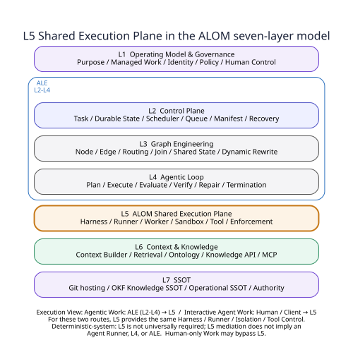
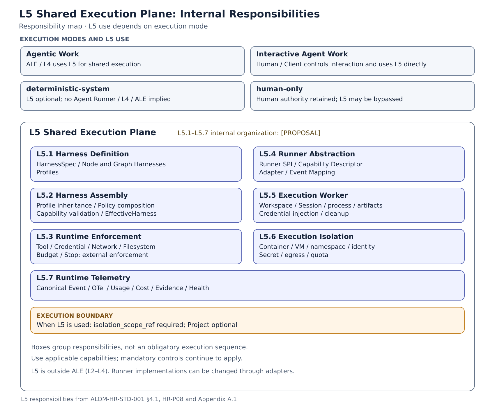
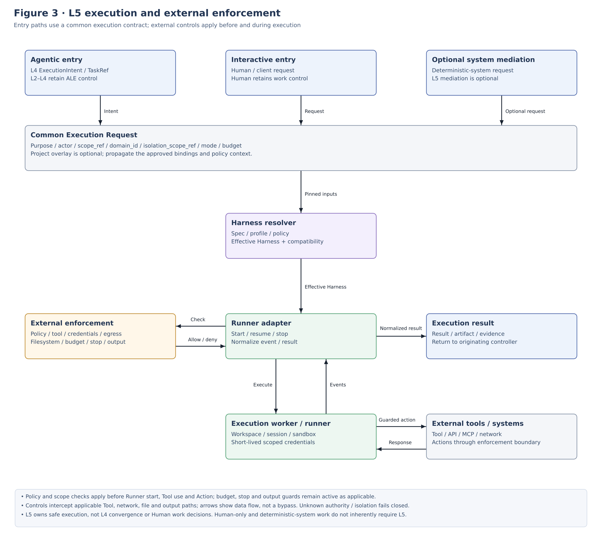
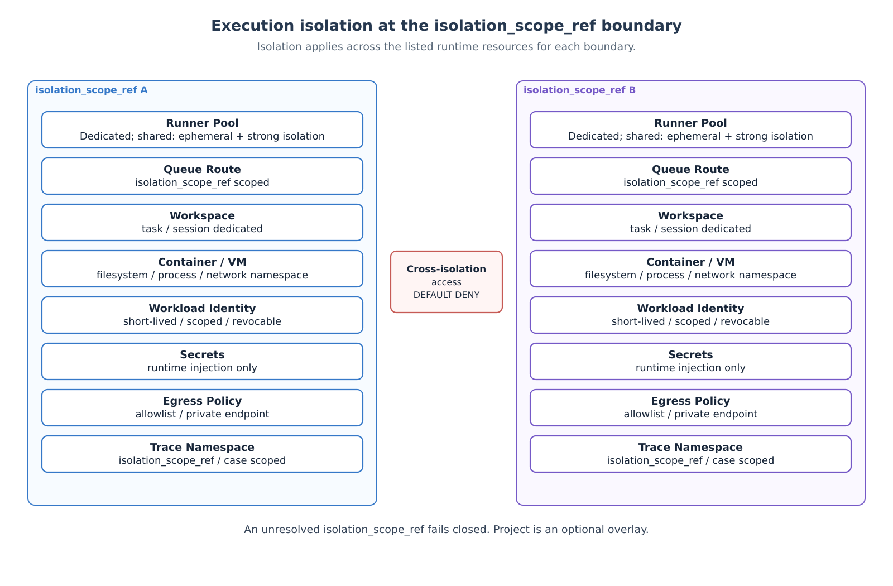

**IMPLEMENTATION STANDARD**

ALOM L5 Shared Execution Plane

Implementation Architecture Standard

Harness Specification / Shared Execution / Enforcement / Runner Adapter / Worker / Isolation / Telemetry

| Core principle: Make L5 the ALOM Shared Execution Plane, providing Harness / Runner / Execution Worker / Isolation / Tool Enforcement / Telemetry as shared execution capabilities. L5 is available both to ALE-controlled Agentic Work and to Interactive Agent Work whose interaction is primarily controlled by a human; it is not exclusive to ALE. Runner-product-specific sessions, memory, and events MUST NOT become the applying organization's sole canonical source. |
|---------------------------------------------------------------------------------------------------------------------------------------------------------------------------------------------------------------------------------------------------------------------------------------------------------------------------------------------------------------------------|

| **Management item** | **Value** |
|--------------|---------------------------------------------------|
| Document ID | ALOM-HR-STD-001 |
| Version | v0.4-review.20261110 |
| Created | 2026-08-12 |
| Governing standard | ALOM-ARCH-STD-001 v2.5 |
| Scope | ALOM L5 Shared Execution Plane / Harness & Runner |
| Management responsibility | Organization Architecture (Enterprise Architecture) / AI Platform |
| Classification | Public |

*This specification elaborates HAR-01-HAR-06 of the governing standard into implementable design units.*

# Document Control

## 1. Position and Authority Precedence

This implementation standard elaborates L5 ALOM Shared Execution Plane of governing standard ALOM-ARCH-STD-001 v2.5 (ALOM Integrated Architecture Standard v2.5). L5 is a shared execution boundary outside ALE (L2-L4), providing the same Harness / Runner / Isolation / Tool Control / Telemetry to Agentic Work and Interactive Agent Work. deterministic-system does not make L5 globally mandatory. Even when L5 explicitly mediates Worker/Tool/CI/Isolation, that explicit mediation does not imply Agent Runner / L4 / ALE. This document specifies implementation responsibilities, data contracts, repository structure, and acceptance tests without changing the governing standard's MUST / MUST NOT requirements.

- If this document conflicts with the governing standard, ALOM-ARCH-STD-001 v2.5 takes precedence.

- Where laws, contracts, customer NDAs, or security rules are stricter, the stricter rule takes precedence.

- Items marked \[PROPOSAL\] are implementation details not specified by the governing standard; standardize them through ADR / change request / Eval when adopted.

## 1.1 Common Scope / Isolation

This document's runtime / protected contracts consume CommonScopeContract from `ALOM-PROF-SCOPE-SPEC-001`.

- `scope_ref` is the common canonical scope identity and is required.
- `domain_id` is the permanent operating-domain identity and is required.
- `project_id` is an optional Project overlay / context. Its absence alone MUST NOT cause rejection. A Project MUST NOT be fabricated to satisfy an implementation schema.
- `isolation_scope_ref` is the required runtime / protected isolation boundary. Fail closed when it is unresolved.
- Runtime isolation MUST NOT be inferred solely from `project_id`. Bind Queue / state / worker / sandbox / tool / credential / repository / cache / retrieval / Trace / L7 access to explicit `isolation_scope_ref` and authorization policies.
- Do not relax Authority conflict, Human-required, mandatory assurance, HITL timeout, no-relaxation, or cross-isolation denial.
L5 ExecutionRequest carries Common Scope and runtime `isolation_scope_ref`. sandbox / worker / tool / credential isolation uses explicit boundaries and does not require Project.

Basis and category: \[STD\] \[S1\] Inherits document control, the seven-layer Layer View, the ALE = L2-L4 Subsystem View, L5 Shared Execution, P-03, HAR-01-06, and OPS-01-06 from ALOM-ARCH-STD-001 v2.5 (ALOM Integrated Architecture Standard v2.5).

## 2. Sources and Design Categories

| **ID** | **Material** | **Use in this document** |
|--------|-------------------------------------------------------------------------|-----------------------------------------------------------------------------------------------------------------------------------------------------------------|
| \[S1\] | ALOM-ARCH-STD-001 v2.5-review.20261110 (ALOM Integrated Architecture Standard v2.5-review.20261110) | Non-effective alignment candidate; controlled authority remains v2.5. Inherits the seven-layer Layer View, ALE = L2-L4, L5 ALOM Shared Execution Plane, Interactive Agent Work, Security, NFR, OPS, and Harness / Runner Contracts. |
| \[S2\] | ALOM-LOOP-STD-001 v0.6-review.20261110 / ALOM-ARCH-STD-001 v2.5-review.20261110 (related specifications) | Alignment references for state machines, resumption, Runner Adapter, and Trace. |
| \[S3\] | ALOM-KNW-STD-001 v0.4-review.20261110 / ALOM-SSOT-STD-001 v0.5 (related specifications) | Alignment references for Knowledge / MCP / SSOT boundaries. |

The related specifications are references for alignment with current content; this does not imply identity with the historical sources of the original material.

| **Design categories** \[STD\] = inherited from the governing standard; \[REF\] = reference elements based on existing original materials; \[Alignment\] = confirmation of correspondence with public specifications / this document, without asserting identity with historical sources; \[PROPOSAL\] = implementation details added by this document. |
|------------------------------------------------------------------------------------------------------------------------|

## 3. Contents

- 1 Purpose and Scope

- 2 Fixed Definitions and Responsibility Boundaries

- 3 Shared Execution Plane Architecture Principles

- 4 Overall ALOM Stack and Internal L5 Structure

- 5 Harness Specification

- 6 Harness Assembly / Effective Harness

- 7 Runtime Enforcement

- 8 Runner Adapter / Capability

- 9 Execution Worker / Isolation

- 10 Tool, MCP, and Context Integration

- 11 State / Checkpoint / Recovery

- 12 Trace / Telemetry / Evidence

- 13 Security / NDA / Supply Chain

- 14 Repository, CI/CD, and Versioning

- 15 Physical Deployment Reference Configuration

- 16 Acceptance Gates and Conformance Tests

- 17 Implementation Roadmap and Backlog

- Appendix A Minimum Data Contracts

- Appendix B HarnessSpec Example

- Appendix C Runner SPI Example

- Appendix D Governing Requirement Mapping

# 1. Purpose and Scope

## 1.1 Purpose

This document defines responsibilities, structure, contracts, physical placement, security, portability, and acceptance criteria for implementing ALOM L5 Shared Execution Plane as a shared execution foundation owned by the applying organization and independent of any particular Agent product or ALE implementation. L5 does not own what is iterated and converged under which conditions. It owns where authorized execution requests run safely, which Runner / Tool / Credential they use, and which isolation boundary contains them.

| Design goal: When switching Cursor / Claude Code / Codex / custom Agent Runtime, the applying organization retains purpose, authority, Context, Tool, Eval, Trace, stopping and recovery, and NDA boundaries for both Agentic Work and Interactive Agent Work. L5 safety enforcement, Runner contracts, and Evidence semantics do not change depending on whether ALE is present. |
|-----------------------------------------------------------------------------------------------------------------------------------------------------------------------------------------------------------------------------------------------------------------------------------------------------|

## 1.2 In Scope

- Node / Graph Harnesses executing L4 ExecutionIntents received from ALE-controlled Agentic Work.

- Interactive Agent Work in which Human / Client primarily controls the interaction and uses L5 directly without ALE.

- Runner Adapters connecting Cursor CLI / SDK, Claude Code / Agent SDK, Codex, and similar products, and Execution Workers using CI runners, Kubernetes Jobs, Ephemeral VMs, and similar infrastructure.

- Execution control for MCP / API / CLI Tools, short-lived credentials, Sandbox, and Network / Filesystem Isolation.

- Checkpoint / Resume / Cancel / Rollback, Trace / Usage / Artifact / Evidence.

## 1.3 Out of Scope

- Task durable state, Graph topology / routing / join, and Agentic Loop plan / evaluate / repair / termination semantics owned by ALE in L2-L4.

- Design of internal LLM reasoning algorithms and model weights.

- Internal implementation of OKF/RAG/Ontology Runtime itself and canonical business-system data design. However, consumption contracts from Harness and update boundaries through Tool / Action Gateway are in scope.

Basis and category: \[STD\] \[S1\] Inherits Chapter 1, Section 3.2 Fixed Definitions, L5 ALOM Shared Execution Plane, ALE = L2-L4, Interactive Agent Work, and L6 / L7 boundaries.

# 2. Fixed Definitions and Responsibility Boundaries

| **Term** | **Fixed definition** | **Not equivalent to** |
|-----------------------------|--------------------------------------------------------------------------------------------------------------------------------------------------------------------------------------------------------------------|---------------------------------------------------------------|
| Harness | An execution envelope surrounding a Node / Work Unit or Graph, specifying and enforcing Prompt, Context, Memory, Tool permissions, Sandbox, Hook, Eval, Budget, and stopping conditions as a versioned specification. Applied in L5 to both Agentic and Interactive Work. | Runner product itself / only a Prompt |
| Node Harness | An execution specification surrounding one Node. | Graph routing |
| Graph Harness | An execution envelope enforcing L3-owned Shared State / Handoff / Routing / Join / Recovery / Graph Eval / Cancellation contracts in the L5 execution environment. | L3 Graph semantics / a single Node Prompt |
| Agent Runner | An interchangeable engine that actually executes Agent loops, such as Cursor / Claude / Codex / custom Agent runtime. | CI runner / ALE / L5 Shared Execution Plane |
| Runner Adapter | An interchange layer normalizing Runner-specific session / event / usage / error / artifact into the common ALOM Execution Contract. | Runner itself / L5 Shared Execution contract / L4 Loop semantics |
| Execution Worker | A physical/logical Worker launching Agent Runners. Handles Workspace, process, container/VM, credential injection, and cleanup. | Agent Runner |
| CI Runner | CI job execution infrastructure such as a CI runner. An implementation option for Execution Worker. | ALOM Agent Runner |
| Effective Harness | The final Harness Manifest resolved from organization-wide (Enterprise) / OperatingDomain / UseCase / Node / Task settings and optional Project overlays, then pinned at execution time. Runtime isolation uses `isolation_scope_ref`. | Original Harness template |
| ALOM Shared Execution Plane | ALOM L5. An execution boundary shared by Agentic Work and Interactive Agent Work, providing Harness, Runner Adapter, Execution Worker, Sandbox, Tool / MCP, Credential, Network / Filesystem enforcement, and Runtime Telemetry. | ALE / Agentic Loop / a particular Runner product |
| Interactive Agent Work | ALOM Managed Work in which humans primarily control the outer iteration through dialogue, additional instructions, and confirmation, using L5 Harness / Runner directly. Native loops inside Runners are allowed. | Agentic Work / Human-only Work |
| Execution Request | An execution request normalizing an Agentic Entry L4 ExecutionIntent or Interactive Entry Human / Client request into the common L5 entry contract with purpose / scope / actor / policy / harness / budget / trace. | L2 TaskContract itself / only a Prompt |

| **Avoiding terminology collisions** This document distinguishes Agent Runner, Execution Worker, and CI Runner explicitly. Producer Runner, responsible for Knowledge materialization, belongs to the CI / Execution Worker side and is distinct from Agent Runner. |
|-----------------------------------------------------------------------------------------------------------------------------------------------------------------------------------------------------------------|

**Basis and category:** \[STD\] \[S1\] Section 3.2 Fixed Definitions, P-03. \[Alignment\] \[S3\] Producer materialization boundary. \[PROPOSAL\] Physical placement of Producer Runner and the three-way classification into Agent Runner / Execution Worker / CI Runner.

# 3. Shared Execution Plane Architecture Principles

| **ID** | **Principle** | **Normative requirement** |
|--------|------------------|-------------------------------------------------------------------------------------------------------------------------------------------------------------------|
| HR-P01 | Harness ownership by the applying organization | Manage Harness Spec, Policy, Trace Schema, Checkpoint, and Adapter Contract as canonical assets of the applying organization. |
| HR-P02 | Runner replaceability | Runner-product-specific state is not the applying organization's sole canonical source; convert it into common contracts through Runner Adapters. |
| HR-P03 | External enforcement | Establish fail-closed behavior at external enforcement points such as Credential, Tool Gateway, Network, and Filesystem, without relying solely on Prompt instructions. |
| HR-P04 | Least privilege and short lifetime | Restrict privileges by work / purpose / isolation_scope_ref / time; apply task according to Mode and Project only when present. Revoke on completion / cancellation. |
| HR-P05 | Reproducibility | Link Execution Request / Task Contract, Effective Harness digest, Runner/Model, Source revision, Eval, and Trace. |
| HR-P06 | Bounded execution | L5 physically enforces caller-supplied hard limits such as time, cost, tokens, concurrency, and stop. L4 owns Agentic Work convergence semantics; Human / Client owns human-led iteration. |
| HR-P07 | Living Artifact | Harness / Adapter / Policy are code/config assets that pass through change requests, Eval, progressive rollout, and rollback. |
| HR-P08 | NDA boundaries | Separate Repository, Runner pool, Queue, Workspace, Compute, Identity, Secret, Egress, and Trace at `isolation_scope_ref` boundaries. Project is an optional overlay. |
| HR-P09 | State independence | For Agentic Work, L2 Control Plane Canonical Checkpoint takes precedence over Runner sessions. For Interactive Work, do not equate Runner sessions with the canonical source of L2 Task/Loop state. |
| HR-P10 | Observability | Normalize Runner/Tool/Hook/Approval/Error/Usage into Canonical Events and correlate them through Trace ID. |
| HR-P11 | Shared execution | Bring Agentic Entry and Interactive Entry into the same L5 boundary; do not create entry-specific safety standards for Harness / Isolation / Tool / Credential / Trace. |
| HR-P12 | ALE not required | Do not require Interactive Agent Work to generate L2-L4 ALE Task / Graph / Loop state. Retain ALOM controls including L1 Managed Work, purpose, scope, policy, and trace. |

**Basis and category:** \[STD\] HR-P02=P-03/HAR-03; HR-P07=HAR-06/OPS; HR-P08=P-08/SEC. \[PROPOSAL\] HR-P03 and HR-P09 explicitly defined as detailed L5 principles.

# 4. Overall ALOM Stack and Internal L5 Structure

Retain the governing standard's seven-layer Layer View. In the Subsystem View, ALE comprises L2-L4; L5 is the independent ALOM Shared Execution Plane outside ALE. In the Execution View, Agentic Work follows ALE→L5 and Interactive Agent Work follows Human / Client→L5. Internally, L5 decomposes into common implementation responsibilities.



Figure 1. ALOM Seven-Layer View / ALE Subsystem View and the Position of L5

Basis and category: \[STD\] \[S1\] Seven-layer Layer View, ALE = L2-L4 Subsystem View, L5 Shared Execution, and Interactive Agent Work.

## 4.1 Seven Internal L5 Sublayers



Figure 2. Detailed L5 ALOM Shared Execution Plane Architecture

| **Sublayer** | **Name** | **Responsibilities** |
|--------|---------------------|------------------------------------------------------------------|
| L5.1 | Harness Definition | Declaratively define HarnessSpec, Node/Graph Harnesses, and Profiles. |
| L5.2 | Harness Assembly | Profile inheritance, Policy composition, Capability validation, EffectiveHarness generation. |
| L5.3 | Runtime Enforcement | External enforcement of Tool, Credential, Network, Filesystem, Budget, and Stop. |
| L5.4   | Runner Abstraction  | Runner SPI, Capability Descriptor, Adapter, Event Mapping.      |
| L5.5 | Execution Worker | Workspace, Session, process, artifacts, credential injection, cleanup. |
| L5.6   | Execution Isolation | container/VM, namespace, identity, secret, egress, quota.       |
| L5.7   | Runtime Telemetry   | Canonical Event, OTel, Usage, Cost, Evidence, Health.           |

**Basis and category:** \[STD\] L5 responsibilities retained. \[PROPOSAL\] Internal structuring into L5.1-L5.7.

# 5. Harness Specification

## 5.1 HarnessSpec Structure

HarnessSpec is a declarative configuration asset enabling reproducible runtime behavior, versioned in Git. Define Node Harness and Graph Harness separately, referencing common Profiles, to establish a common enforcement boundary across Agentic / Interactive entry differences.

| **Section** | **Main fields** | **Requirement** |
|--------------------|-------------------------------------------|----------|
| metadata | harness_id, version, owner, compatibility | Required |
| prompt_profile | role / instruction / output contract ref | Required |
| context_profile | source, ACL, freshness, token budget | Required |
| memory_profile | scope, lifetime, persistence, redaction | Conditional |
| model_policy | role, allowed runner/model, fallback | Required |
| tool_policy | allow/deny, capability, args, data class | Required |
| sandbox_profile | filesystem, process, resource quota | Required |
| network_policy | egress allowlist, endpoint class | Required |
| secret_policy | credential profile, TTL, audience | Required |
| hook_profile | pre/post tool, event, stop hook | Recommended |
| eval_profile | deterministic/private/oracle/human refs | Required |
| budget_policy | time/token/cost/iteration/concurrency | Required |
| termination_policy | success/stop/escalate/repeated failure | Required |
| trace_policy | required fields, retention, redaction | Required |

**Basis and category:** \[STD\] Integrates Prompt/Context/Memory/Tool/Hook/Sandbox/Eval/termination from HAR-01 with Task Contract budgets. \[PROPOSAL\] Explicit model/network/secret/trace Profiles.

## 5.2 Node Harness

- Each Node / Work Unit has a versioned HarnessRef.

- Node Harness does not own Graph topology. L3 owns Graph topology / routing / join / rewrite semantics; L5 Graph Harness enforces L3-established contracts in the execution environment.

- At runtime, HarnessResolver resolves EffectiveHarness and records its digest in Trace.

## 5.3 Graph Harness

| **Element** | **Design** |
|---------------------|----------------------------------------------------------------------------------------------------------|
| shared_state_schema | Validate and enforce access to L3-defined Shared State schema / classification in L5. |
| handoff_schema | Enforce L3-defined input/output artifacts, required evidence, and owners through transfer, schema validation, and redaction. |
| routing_policy | Resolve L3-established routing decisions / runner requirements into runtime capabilities. L5 does not change route semantics. |
| join_policy | Enforce artifact/state visibility, isolation, and handoff required to satisfy L3 join conditions. |
| recovery_policy | Safely execute restart / compensation / rollback requests decided by L2/L3/L4 at the execution boundary. |
| graph_eval | Provide the execution environment and artifact/evidence retrieval for L3 Graph-level eval. Pass/fail semantics remain with L3/L4. |
| cancellation | Propagate upper-level stop/cancel to child Nodes / Runners / Tools with fail-closed behavior. |
| dynamic_rewrite | Revalidate capability / privilege containment of the post-rewrite Manifest approved by L3 before execution. |

**Basis and category:** \[STD\] HAR-02. Dynamic rewrite constraints specify the connection to Graph Engineering requirements.

# 6. Harness Assembly / Effective Harness

## 6.1 Composition Precedence

<table>
<colgroup>
<col style="width: 100%" />
</colgroup>
<thead>
<tr class="header">
<th>Organization-wide standard (Enterprise Baseline)<br />
↓ (Mandatory: cannot be relaxed at lower levels)<br />
Operating Domain (required / domain_id)<br />↓<br />Organization / Customer / Project (rank 30; parallel optional overlays)<br />
↓<br />
UseCase / Process (rank 40; parallel optional overlays)<br />
↓<br />
Node / Graph Harness<br />
↓<br />
Task Override (permitted mutable fields only)<br />
↓<br />
Effective Harness + digest</th>
</tr>
</thead>
<tbody>
</tbody>
</table>

| **Composition principle** Lower-level Profiles MUST NOT relax higher-level Policies. For deny, classification, NDA, A0-A4 ceilings, prohibited Tools, and prohibited egress, prioritize the stricter value. |
|----------------------------------------------------------------------------------------------------------------------------------------------------|

## 6.2 Harness Resolver

<table>
<colgroup>
<col style="width: 100%" />
</colgroup>
<thead>
<tr class="header">
<th>resolve(<br />
execution_request,<br />
task_contract (when applicable),<br />
harness_ref,<br />
project_profile (optional),<br />
policy_snapshot,<br />
runner_capabilities<br />
) -&gt; EffectiveHarnessManifest</th>
</tr>
</thead>
<tbody>
</tbody>
</table>

| **Category** | **Contract** |
|------------|---------------------------------------------------------------------------------------------|
| input | execution_request / harness_ref / policy_snapshot / runner capabilities; task_contract and project_profile when applicable. Receive Common Scope (scope_ref / domain_id) and runtime isolation_scope_ref. |
| validation | schema / inheritance / conflict / required capability / data classification                 |
| output     | effective_harness_id / digest / resolved profiles / denied overrides / compatibility result |
| trace      | harness_ref + effective_harness_digest + policy_ref + adapter version                       |

**Basis and category:** \[PROPOSAL\] Adds a Resolver implementing versioned Harnesses and Policy inheritance from the governing standard.

# 7. Runtime Enforcement

Harnesses MUST have enforcement points, beyond configuration. Prohibitions MUST NOT rely solely on a Runner's self-reporting.

> **Figure 3 mode note:** Adapter and executor labels apply according to the selected Execution Mode. An explicitly mediated deterministic-system route does not imply an Agent Runner; Sections 1 and Appendix A.1 retain that distinction.



[Open Figure 3 at full size](figures/ALOM-HR-STD-001-fig3-current.svg)

*Figure 3. Standard Execution Flow and External Enforcement Points*

| **Enforcement point** | **Responsibility** | **Trigger point** |
|--------------------|-----------------------------------------------------------------|--------------------------------|
| Policy Enforcement | Evaluate purpose / project / autonomy / classification / exception | Before Runner startup, Tool use, and Action |
| Tool Gateway | allowlist, argument schema, rate/cost, idempotency, HITL | Tool invoke |
| Secrets Broker | Inject short-lived credentials at runtime; prohibit plaintext exposure | credential request |
| Egress Enforcement | domain / private endpoint / proxy / DNS policy                  | network connect                |
| Filesystem Guard | Prohibit writes outside the workspace; mount policy, read-only base | file access |
| Budget Controller | time/token/cost/iteration/concurrency limits | continuous |
| Stop Controller    | policy deny / human stop / budget / repeated failure            | async stop                     |
| Output Guard | Inspect secret / PII / customer / cross-isolation (including cross-PJ) / unsafe action content | artifact/output |

**Basis and category:** \[STD\] SEC-01-04, HAR-05, NFR-10. \[PROPOSAL\] Consolidation as L5 Runtime Enforcement.

# 8. Runner Adapter / Capability

## 8.1 Runner Adapter SPI

Runner Adapter is the sole connection layer that prevents product differences from leaking above L5's common Execution Contract. Use the same Runner SPI, Canonical Events, and Artifact / Usage / Error normalization for Agentic Entry and Interactive Entry. Inherit the minimum contract from governing standard B.2 and add health / capability / checkpoint mapping.

| **operation** | **input**                                                       | **output**                   |
|---------------|-----------------------------------------------------------------|------------------------------|
| start | ExecutionRequest + EffectiveHarness + WorkspaceRef + CredentialRefs; TaskContract when applicable | SessionRef + initial state |
| resume        | CheckpointRef / SessionRef                                      | resumed state                |
| cancel / stop | SessionRef + reason + deadline                                  | terminal state + evidence    |
| status        | SessionRef                                                      | normalized RunnerStatus      |
| event         | model/tool/hook/approval/error/native event                     | Canonical RunnerEvent / span |
| artifact      | path/hash/mime/classification                                   | ArtifactRef                  |
| usage         | token/cost/time/compute                                         | NormalizedUsage              |
| result        | native status/summary/artifact/eval refs                        | CommonRunnerResult           |
| health        | adapter/runner endpoint                                         | health + degraded reason     |
| capabilities  | adapter/version                                                 | RunnerCapabilityDescriptor   |

**Basis and category:** \[STD\] \[S1\] B.2 Runner Adapter Contract. \[PROPOSAL\] Adds status/health/capabilities.

## 8.2 Runner Capability Descriptor (illustrative, not product specifications)

<table>
<colgroup>
<col style="width: 100%" />
</colgroup>
<thead>
<tr class="header">
<th>runner_type: example-runner<br />
adapter_version: "0.1.0"<br />
capabilities:<br />
resume: true<br />
streaming_events: true<br />
hooks: true<br />
mcp: true<br />
subagents: conditional<br />
usage_reporting: partial<br />
filesystem_control: external<br />
network_control: external<br />
limits:<br />
max_concurrent_sessions: 8<br />
compatibility:<br />
harness_schema: ["0.1"]</th>
</tr>
</thead>
<tbody>
</tbody>
</table>

| Pre-execution conformance: Before selecting a Runner, L5 checks whether it satisfies the required capabilities of the applicable Effective Harness. Apply the same decision to Agentic Entry and Interactive Entry. A Runner that does not satisfy them MUST NOT be selected. |
|-------------------------------------------------------------------------------------------------------------------------------------------------------------------------------------------------------------|

**Basis and category:** \[PROPOSAL\] Capability Descriptor explicitly handles product capability differences.

## 8.3 Adapter Responsibilities and Product Differences

| **Adapter** | **Responsibilities** | **Boundary** |
|----------------|--------------------------------------------------------------------------------|-----------------------------------------------------------|
| Runtime Adapter | Convert runtime-specific session / tool / output / hook / usage and similar data into common contracts. | Do not make runtime-specific rules / sessions ALOM canonical sources or let product updates propagate into the core schema. |
| Identity binding | Separate user identity from shared production workload identity. | Separate workforce OAuth from shared production workload identity. |
| Custom Adapter | Connect a custom runtime to the same SPI. | Satisfy the minimum Trace/stop/usage contract. |

**Basis and category:** \[STD\] Runner Adapter Contract in \[S1\]. \[PROPOSAL\] Convert runtime-specific differences into common contracts and separate workload identity.

# 9. Execution Worker / Isolation

## 9.1 Execution Worker Responsibilities

- Create/clone/mount dedicated Workspaces and pin Source revisions.

- Obtain and inject Task-scoped Workload Identity / short-lived credentials.

- Launch Agent Runner processes / containers / VMs; enforce resource quotas and monitor health.

- Connect Artifact / log / trace collectors.

- Create Checkpoints / snapshots and perform graceful termination on cancellation.

- On termination, revoke credentials, clean up workspace/secrets, and preserve evidence.

## 9.2 Isolation Model



*Figure 4. isolation_scope_ref / NDA Boundaries and Execution Isolation (Project is an optional overlay)*

| **Boundary** | **Mandatory requirement** |
|------------|--------------------------------------------------------------------------------------------------|
| Repository | Access boundary per `isolation_scope_ref`; cross-isolation search default deny. |
| Runner | Isolation-specific service account / runner pool / queue route. Shared use requires ephemeral + strong isolation. |
| Compute | Separate container/VM and filesystem/process/network namespaces per session. |
| Network | egress allowlist, private endpoint, DNS/proxy policy. Direct connections to unknown/public MCP prohibited. |
| Identity | Separate human/service/agent/delegator; short-lived token, scope, revocation. |
| Secrets | Runtime injection from secret manager; plaintext exposure in Prompt/Context/artifact/log prohibited. |
| Trace | Access, retention, export, and redaction per `isolation_scope_ref` / case. |

**Basis and category:** \[STD\] \[S1\] Section 9.1 Isolation Model, HAR-04, SEC-01-02.

# 10. Tool, MCP, and Context Integration

## 10.1 Tool Runtime

| **Tool Registry field** | **Meaning** |
|-------------------------|----------------------------------------------|
| tool_id | Unique ID / version |
| capability | Capability unit such as read / write / execute / deploy |
| input_schema | Permitted arguments and constraints |
| output_schema | Result structure and classification |
| risk_level | Input to autonomy / HITL decisions |
| data_classification | Data classes that may be handled |
| credential_profile | Type / scope of short-lived credentials |
| allowed_purposes | Purpose Registry reference |
| rate_limit / cost_limit | Execution limits |
| idempotency             | key / replay policy                          |
| rollback | Undo/compensation mechanism |
| requires_human | Synchronous/asynchronous Human Gate |

| **Tool boundary** MCP is an access boundary for Tool/Knowledge/Source, not the Harness itself. Harness specifies which MCP Tools may be used for which purposes, with which arguments and permissions. |
|-----------------------------------------------------------------------------------------------------------------------------------------------------------------|

**Basis and category:** \[STD\] HAR-05, SEC-01/02. \[Alignment\] \[S3\] MCP Gateway is the boundary for authentication, authorization, Tool Policy, and audit.

## 10.2 Boundaries with Context / OKF / Ontology

<table>
<colgroup>
<col style="width: 100%" />
</colgroup>
<thead>
<tr class="header">
<th>Harness Context Policy<br />
↓<br />
Context Builder (L6)<br />
├─ Git/OKF Knowledge SSOT<br />
├─ KNW-02 Compatibility: hybrid Retrieval MUST<br />
├─ Ontology Runtime<br />
├─ Source MCP / Live Query<br />
└─ Operational Read Adapter<br />
↓<br />
Context Pack + provenance + revision</th>
</tr>
</thead>
<tbody>
</tbody>
</table>

- Harness owns Context acquisition rules, not canonical Knowledge content.

- RAG / Ontology Index / Runner Memory are derived artifacts, not SSOT.

- Context Pack retains source path / commit SHA / freshness / ACL / classification.

**Basis and category:** \[STD\] \[S1\] P-06, KNW-01-04, derived-artifact boundaries. \[Alignment\] \[S3\] MCP live / Approved OKF canonical. Current KNW-02 hybrid MUST is not relaxed.

# 11. State / Checkpoint / Recovery

## 11.1 Separation of Agentic Checkpoint and Interactive Session

<table>
<colgroup>
<col style="width: 100%" />
</colgroup>
<thead>
<tr class="header">
<th>Agentic Work: L2 Control Plane Canonical Checkpoint<br />
├─ task_state / graph_state / loop_state<br />
├─ workspace_ref / source_revision<br />
├─ artifact_refs / context_manifest<br />
├─ effective_harness_ref + digest<br />
├─ policy_ref / eval_ref / trace_id<br />
└─ runner_session_ref # optional / replaceable<br />
<br />
Interactive Agent Work: L5 Execution Session<br />
├─ managed_work_ref / interaction_id<br />
├─ effective_harness_ref + digest<br />
├─ workspace_ref / artifact_refs<br />
├─ policy_ref / trace_id<br />
└─ runner_session_ref # execution continuity only; not L2/L4 canonical state</th>
</tr>
</thead>
<tbody>
</tbody>
</table>

| Principle: For Agentic Work, aim to enable resumption with another Runner from L2 Control Plane Canonical Checkpoint + Workspace + Artifact + Source revision, even if the Runner session is lost. For Interactive Agent Work, a Runner session is execution state for continuing interaction and is not equivalent to the canonical source of L2 Task / L4 LoopRun. |
|----------------------------------------------------------------------------------------------------------------------------------------------------------------------------------------------------------------------------------------------------------------------------------------|

**Basis and category:** \[STD\] P-12 portability, NFR-09 Runner switching, G-Portability. \[PROPOSAL\] Upper-level Checkpoint structure.

## 11.2 State Transitions

<table>
<colgroup>
<col style="width: 100%" />
</colgroup>
<thead>
<tr class="header">
<th>REQUESTED → PREPARING → RUNNING → SUCCEEDED<br />
│ │ ├→ PAUSED → RESUMING ─┐<br />
│ │ ├→ STOPPING → STOPPED │<br />
│ │ ├→ ORPHANED → RECOVERING┘<br />
│ │ └→ FAILED<br />
└→ REJECTED / FAILED_PREPARE<br />
<br />
Note: Convergence states such as EVALUATING / REVISING / HUMAN_REVIEW are not L5-specific states. L4 owns them for Agentic Work; outer control on the Human / Client side owns them for Interactive Agent Work.</th>
</tr>
</thead>
<tbody>
</tbody>
</table>

| **Control** | **Standard behavior** |
|----------|--------------------------------------------------------------------------------------------------------------------------------------------------|
| retry | L5 does not decide blind retries. When the caller (L2/L3/L4 or Human/Client) requests reexecution, revalidate idempotency / budget / isolation before executing. |
| resume | For Agentic Work, revalidate checkpoint compatibility / source drift / policy/eval versions. For Interactive Work, revalidate session / workspace continuity and policy / scope. |
| cancel | Propagate to Graph/Node/Tool; revoke credentials and quarantine artifacts. |
| rollback | For external state changes, use rollback/compensation under Action Gateway / Tool contracts. |
| orphan | Detect Worker loss through lease/heartbeat; quarantine and use Policy to determine whether reexecution is allowed. |

**Basis and category:** \[STD\] Loop convergence, SEC-06, G-Loop. \[Alignment\] \[S2\] State-machine and resumption requirements. \[PROPOSAL\] Orphan/lease details.

# 12. Trace / Telemetry / Evidence

## 12.1 Canonical Event

The table is the minimum field inventory: include values applicable to the execution path and event type, while retaining mandatory trace, purpose, actor, scope, and applicable control evidence. Do not invent absent Task, Graph, Loop, or Node identifiers. For L5 execution, `harness_ref` is required as specified in Appendix A.1; `graph_ref` is required when an L3 Graph is used. Record unavailable native events as missing rather than guessing values.

| **Category** | **Minimum fields** |
|------------|--------------------------------------------------------------------------------------------------------------|
| identity | trace_id, span_id, timestamp; parent_trace_id and task_id / graph / loop / node IDs when applicable |
| purpose | purpose_id, actor_id, delegator_id, scope_ref, domain_id, isolation_scope_ref; use_case_id and project_id when applicable |
| version | harness_ref, effective_harness_digest, policy_ref; runner, adapter, model, graph_ref and source_ref when applicable; commit SHA for Git sources |
| execution  | tool_ref, args_hash, credential_ref, execution_result, artifact_ref, worker/session                          |
| evaluation | eval_ref, oracle_ref, result, threshold, defect_class, review_record                                         |
| control    | iteration, deadline, budgets, autonomy, stop_signal, rollback_ref, HITL state                                |
| governance | classification, retention, deletion_due, exception, case, remedy, approval                                   |
| usage      | token, cost, time, compute, queue/wait                                                                       |
| outcome    | business outcome, SLO impact, verification, feedback                                                         |

**Basis and category:** \[STD\] Inherits \[S1\] Section 8.2 Minimum Trace Packet, adding effective_harness_digest / adapter / worker as L5 details.

## 12.2 Event Normalization

<table>
<colgroup>
<col style="width: 100%" />
</colgroup>
<thead>
<tr class="header">
<th>Cursor / Claude / Codex / Custom native event<br />
↓<br />
Adapter Event Mapper<br />
↓<br />
Canonical RunnerEvent / OTel Span<br />
↓<br />
Trace Ledger ── SIEM / Metrics / Audit / Evidence</th>
</tr>
</thead>
<tbody>
</tbody>
</table>

- Propagate Trace ID / Span ID across services, runners, tools, CI, and Action Gateway.

- If native events cannot be obtained, explicitly mark them as missing; do not fill gaps by inference.

- Hook failures must not cause fail-open behavior for controls critical to audit or safety.

**Basis and category:** \[STD\] OTel context propagation, NFR-04. \[PROPOSAL\] Explicit rules for missing native events.

# 13. Security / NDA / Supply Chain

## 13.1 Security Baseline

| **ID** | **Control** | **Requirement** |
|-----------|-------------------------|-----------------------------------------------------------------------------|
| HR-SEC-01 | Default deny | Deny repository/data/tool/network/credential/action without explicit permission. |
| HR-SEC-02 | Short-lived privilege | Restrict by task/purpose/time; revoke on completion/cancellation. |
| HR-SEC-03 | Untrusted input | Treat Prompt injection, documents, and tool output as outside the trust boundary. |
| HR-SEC-04 | Output guard | Inspect secret/PII/customer/cross-isolation content (including cross-PJ). |
| HR-SEC-05 | Runner image provenance | Record image/dependency/adapter/MCP/tool digests and provenance. |
| HR-SEC-06 | Quarantine | Coordinate credential revocation, worker/runner quarantine, and graph stopping on incidents. |
| HR-SEC-07 | Break-glass | Two-party approval, scope/time limits, recording of all events, retrospective review, automatic restoration. |

**Basis and category:** \[STD\] Apply \[S1\] SEC-01-07 to L5.

## 13.2 Supply Chain Manifest

<table>
<colgroup>
<col style="width: 100%" />
</colgroup>
<thead>
<tr class="header">
<th>execution_supply_chain:<br />
runner_image_digest: sha256:...<br />
adapter_version: 0.1.0<br />
tool_registry_version: ...<br />
mcp_server_digests: [...]<br />
harness_digest: sha256:...<br />
policy_ref: ...<br />
eval_ref: ...<br />
source_commit: ...</th>
</tr>
</thead>
<tbody>
</tbody>
</table>

**Basis and category:** \[PROPOSAL\] Specifies SEC-05 provenance/digest in the execution Manifest.

# 14. Repository, CI/CD, and Versioning

## 14.1 Recommended Repository Structure

<table>
<colgroup>
<col style="width: 100%" />
</colgroup>
<thead>
<tr class="header">
<th>alom-runtime/<br />
├─ schemas/<br />
│ ├─ task-contract.schema.json<br />
│ ├─ harness.schema.json<br />
│ ├─ effective-harness.schema.json<br />
│ ├─ runner-event.schema.json<br />
│ └─ runner-capability.schema.json<br />
├─ harness/<br />
│ ├─ node/<br />
│ ├─ graph/<br />
│ └─ profiles/{sandbox,network,tool,eval,trace}/<br />
├─ adapters/<br />
│ ├─ cursor/<br />
│ ├─ claude/<br />
│ ├─ codex/<br />
│ └─ contract/<br />
├─ worker/<br />
├─ enforcement/<br />
├─ telemetry/<br />
├─ tests/{conformance,portability,security}/<br />
├─ deploy/<br />
└─ docs/adr/</th>
</tr>
</thead>
<tbody>
</tbody>
</table>

**Basis and category:** \[PROPOSAL\] Implementation package structure.

## 14.2 Versioning and Change-Request Gates

| **Subject** | **Standard** |
|--------------|----------------------------------------------------------------------------------|
| schema | semver; breaking changes require a major version. Update the adapter compatibility matrix. |
| harness      | version + immutable release ref + digest.                                       |
| adapter | Independent version; record compatibility with runner native versions. |
| worker image | Pin digest; mutable latest is prohibited. |
| policy/eval | Reference from harness through version refs. |
| Required change-request items | reason / impact / migration / rollback / eval / owner / approval / compatibility |

- Schema validation / policy lint / forbidden capability check

- Harness resolver golden test

- Adapter contract test / native event mapping test

- Sandbox / egress / secret isolation test

- Private Eval / deterministic regression

- Runner portability baseline test

- SBOM / image / dependency scan

**Basis and category:** \[STD\] HAR-06, OPS-01-05. \[PROPOSAL\] Detailed CI items.

# 15. Physical Deployment Reference Configuration

## 15.1 Phase 1 Minimum Configuration

| **Component** | **Phase 1 policy** |
|-----------------------------------|--------------------------------------------------------------------------------------------------------------------------------------------|
| Git hosting | Harness/Adapter/Schema repository, change request/CI/CODEOWNERS, Task trigger |
| ALE (L2-L4) | For Agentic Work. L2 Task / Scheduler / State, L3 Graph, and L4 Loop send ExecutionIntent to L5. L5 itself is outside ALE. |
| L5 Shared Execution Plane | Harness Resolver / Runtime Enforcement / Runner Adapter / ephemeral worker / isolation / telemetry, shared by Agentic and Interactive Work. |
| Interactive Client / Agent Runner | Interactive Entry from IDE / Chat / CLI / UI and interchangeable Agent Runners such as Cursor / Claude / Codex. |
| MCP/Tool Gateway | Minimum required Tools for Git hosting, issue-tracking systems, DBs, and similar resources. Writes require HITL in principle or are prohibited. |
| Trace | OTel Collector + export to Trace store / SIEM |
| Knowledge | Git / OKF checkout and Source MCP within the relevant scope. KNW-02 Compatibility requires hybrid Vector + Full-text + Graph/Metadata retrieval. |

| **Physical decomposition policy** Do not make every responsibility an independent service from the outset. Separate logical responsibilities, then physically decompose according to load, NDA, availability, and operational maturity. |
|------------------------------------------------------------------------------------------------------------------------------|

**Basis and category:** \[Alignment\] \[S3\] Policy of not making every component an independent Service initially. \[STD\] L5/SEC/NFR.

## 15.2 Candidates for Separation at Scale

- Harness Registry / Resolver Service

- Central Policy Decision / Enforcement Point

- Dedicated Runner Pools by customer/classification

- Artifact / Checkpoint Object Store

- Trace Ledger / Evidence Store

- Capability Registry / Adapter release service

- Central Tool Registry / Secrets Broker / Egress Proxy

# 16. Acceptance Gates and Conformance Tests

## 16.1 Shared Execution Plane-Specific Gates

| **Gate** | **Pass conditions** | **On failure** |
|------------------|----------------------------------------------------------------------------------------------------------------------------------------------------------------|-----------------------------------|
| G-HR-Schema | HarnessSpec/Task/EffectiveHarness/RunnerEvent schemas can be validated. | Release prohibited |
| G-HR-Isolation | 0 isolation violations involving cross-isolation, filesystem, network, secret, or trace access. | Isolation onboarding prohibited |
| G-HR-Tool | Test allow/deny, argument validation, credentials, egress, idempotency, and rollback. | Disable Tool |
| G-HR-Stop | Stops for budget/policy/human/repeated failure operate fail-closed. | A0 only |
| G-HR-Resume | Resume from checkpoint with the same Runner, preserving state/artifact/trace. | Return to pilot |
| G-HR-Portability | Preserve baseline task/eval/trace/artifacts with another Runner Adapter. | Single Runner only |
| G-HR-Telemetry | 100% required Trace fields, OTel correlation, usage/cost attribution. | Execution prohibited |
| G-HR-SupplyChain | Verify provenance of runner image/adapter/tool/MCP/harness digests. | Release prohibited |
| G-HR-Rollback | Successful rollback drill for Harness/Adapter changes. | Production prohibited |
| G-HR-DualIngress | Both Agentic Entry and Interactive Entry satisfy identical Harness resolution, Policy, Tool, Credential, Isolation, and Trace standards; the Interactive route does not require ALE-specific state. | Suspend Interactive use / release prohibited |

**Basis and category:** \[STD\] Elaborates G-Isolation/G-Tool/G-Loop/G-Trace/G-Portability and NFR-02/04/08/09 for L5.

## 16.2 Minimum Acceptance Metrics

| **ID** | **Metric** | **Criterion** |
|-----------|-----------------------------------|----------------------------------------------|
| HR-NFR-01 | cross-isolation/NDA boundary violations | 0 |
| HR-NFR-02 | Unauthorized Tool/Network/Credential execution | 0 |
| HR-NFR-03 | Required Trace field completeness | 100% |
| HR-NFR-04 | stop/rollback drills | 100% success for applicable scenarios |
| HR-NFR-05 | Runner switching | Preserve baseline task/eval/trace/artifacts |
| HR-NFR-06 | Orphan worker detection | Detect and quarantine within the defined SLO |
| HR-NFR-07 | Harness release regression | 100% of required cases can be rerun |
| HR-NFR-08 | HITL timeout auto approve | 0 / 100% fail-closed |
| HR-NFR-09 | Control bypass through Interactive route | 0 / 100% L5 enforcement equivalent to the Agentic route |

**Basis and category:** \[STD\] Primarily inherits NFR-02/04/07/08/09/10. HR-NFR-06 is a \[PROPOSAL\] requiring a concrete SLO in the applicable Profile.

# 17. Implementation Roadmap and Backlog

## 17.1 Recommended Roadmap

| **Phase** | **Main artifacts** | **Decision criterion** |
|------------------|------------------------------------------------------------------------------------------------------------------------------|---------------------------------|
| Phase 0 Design Baseline | ExecutionRequest / Harness schemas, Runner SPI, Trace Events, terminology, one Node Harness, Agentic / Interactive entry contracts. | Contracts and tests first |
| Phase 1 MVP | 1 PJ, A0/A1, 1 Runner Adapter, ephemeral worker, Tool Gateway, Trace, stop. Connect Agentic Entry and Interactive Entry to the same L5. | Branch/PR only; merge/deploy prohibited |
| Phase 2 Control | Harness Resolver, Policy/Secret/Egress, Private Eval, checkpoint/resume, HOTL. | Isolation/rollback |
| Phase 3 Portability | Second Runner Adapter, Capability Registry, portability drill, migration report. | NFR-09 achieved |
| Phase 4 Scale | multi-PJ pools, HA, capacity, chargeback, central registry, SLO/on-call. | Production operation |

Basis and category: \[STD\] MVP covers 1-3 repositories/PJs, A0/A1, and branch/PR only. L5 applies identical enforcement to Agentic Entry and Interactive Entry. \[Alignment\] \[S1\] MVP baseline. \[PROPOSAL\] Phased L5 introduction.

## 17.2 Implementation Epics H1-H8

| **Epic** | **Name** | **Main artifacts** | **Governing requirements** |
|----------|-----------------------|------------------------------------------------------|---------------|
| H1       | Harness Specification | schema, node/graph spec, profile, validator          | HAR-01/02     |
| H2       | Harness Resolver      | inheritance, EffectiveHarness, digest, compatibility | P-07/OPS      |
| H3       | Enforcement           | policy/tool/secret/egress/fs/budget/stop             | SEC/HAR-05    |
| H4       | Runner SPI            | contract, event mapping, health, capability          | HAR-03        |
| H5 | Runner Adapters | Cursor or Claude as first adapter; second adapter | P-03/NFR-09 |
| H6       | Execution Plane       | worker, workspace, container/VM, identity, artifact  | HAR-04        |
| H7       | Runtime Control       | checkpoint, resume, cancel, orphan, rollback         | G-Loop/NFR-08 |
| H8       | Telemetry             | OTel, Trace normalize, usage/cost, evidence          | NFR-04/Trace  |

# Appendix A. Minimum Data Contracts

## A.1 Execution Request Contract \[PROPOSAL\]

| **field** | **type** | **Requirement** | **Meaning** |
|-------------------------|-----------------------------|---------------|--------------------------------------------------------|
| execution_id | string | Required when L5 is used | Required L5 execution identity when L5 is used. |
| task_id | string | agentic-only | L2 Task correlation. task_id is agentic-only and MUST NOT be required for deterministic-system. |
| system_execution_ref | string | Conditional | SystemExecutionRecord correlation when deterministic-system uses L5 mediation. |
| execution_mode | human-only / interactive-agent / agentic / deterministic-system | Required | Entry type: agentic=ALE/L4; interactive-agent=Human/Client; human-only may bypass L5. deterministic-system does not make L5 globally mandatory. |
| purpose_id | string | Required | Reference to an authorized purpose |
| scope_ref / domain_id | string | Required | Common Scope identity / permanent operating domain |
| isolation_scope_ref | string | Required | Runtime / protected isolation boundary; fail closed if unresolved |
| project_id | string | Optional | Project overlay/context; absence alone does not cause rejection |
| actor_id / delegator_id | string | Required | Actor and delegating actor |
| autonomy_level | A0-A4 | Required | Permitted autonomy |
| graph_ref / harness_ref | version ref | Conditional | harness_ref is required when L5 is used; graph_ref is required when an L3 Graph is used, not for every Agentic Loop. |
| policy_ref / eval_ref | version ref | Required/conditional | policy is required; eval references depend on use case / caller. |
| deadline / budgets | time/token/cost/concurrency | Required | Execution limits enforced by L5; iteration-convergence semantics remain with the caller. |
| source/bundle refs | path+commit/digest | Conditional | Context version |
| trace_id | W3C-compatible id | Required | Correlation identifier |

Basis and category: \[STD\] Inherits \[S1\] L5 Shared Execution / HAR-01-05 / minimum Trace requirements. \[PROPOSAL\] ExecutionRequest envelope providing a common entry for Agentic / Interactive / deterministic-system. L5 use by deterministic-system does not imply Agent Runner / L4 / ALE.

## A.2 Effective Harness Manifest \[PROPOSAL\]

<table>
<colgroup>
<col style="width: 100%" />
</colgroup>
<thead>
<tr class="header">
<th>effective_harness_id: "eh-..."<br />
harness_ref: "dev.code-change@1.2.0"<br />
harness_digest: "sha256:..."<br />
policy_ref: "policy@..."<br />
isolation_scope_ref: "scope://customer-a/project-a"<br />
project_profile_ref: null  # optional overlay; omit when project-less<br />
resolved_at: "..."<br />
runner_requirements:<br />
resume: true<br />
mcp: true<br />
enforcement:<br />
tool_policy_ref: "..."<br />
network_policy_ref: "..."<br />
secret_policy_ref: "..."<br />
sandbox_profile_ref: "..."<br />
budgets:<br />
max_iterations: 12<br />
max_duration_sec: 1800<br />
max_cost: 10<br />
termination:<br />
repeated_failure_limit: 3</th>
</tr>
</thead>
<tbody>
</tbody>
</table>

Note: max_iterations / repeated_failure_limit in this example illustrate values for caller-supplied limits physically enforced by L5 (HR-P06). Determining identical failures and transitioning to ESCALATED are not L5-specific states; L4 owns them for Agentic Work (ALOM-LOOP-STD-001 Section 6.2). This note adds no normative requirement.

## A.3 Common Scope golden cases

These examples illustrate Scope propagation; they are not complete ExecutionRequests or CommonScopeContract payloads. Real requests must include the complete applicable Common Scope, authorization information, and other fields required by the ExecutionRequest.

```yaml
# Finance project-less ExecutionRequest
execution_request:
  execution_mode: interactive-agent
  scope_ref: scope://company/domain/finance/work/expense-approval
  domain_id: finance
  project_id: null
  isolation_scope_ref: scope://company/finance
---
# SI Customer + Project
execution_request:
  execution_mode: agentic
  scope_ref: scope://company/domain/system-integration/customer/customer-a/project/core-renewal/work/code-review
  domain_id: system-integration
  customer_id: customer-a
  project_id: core-renewal
  isolation_scope_ref: scope://customer-a/core-renewal
# unresolved isolation_scope_ref => deny / fail-closed
```

# Appendix B. HarnessSpec Example

<table>
<colgroup>
<col style="width: 100%" />
</colgroup>
<thead>
<tr class="header">
<th>apiVersion: alom/v0.1<br />
kind: NodeHarness<br />
metadata:<br />
id: dev.code-change<br />
version: "1.2.0"<br />
owner: ai-platform<br />
context:<br />
sources: [workspace, okf, git_hosting]<br />
max_tokens: 120000<br />
model:<br />
role: executor<br />
runner_requirements:<br />
streaming_events: true<br />
tools:<br />
allow: [filesystem.read, filesystem.write, git.diff, test.run, git_hosting.create_change_request]<br />
deny: [git.merge, production.deploy]<br />
sandbox:<br />
filesystem: workspace-only<br />
privilege: non-root<br />
network:<br />
default: deny<br />
allow_profiles: [git-hosting-project, model-api, approved-mcp]<br />
budget:<br />
max_iterations: 12<br />
max_duration_sec: 1800<br />
max_cost: 10<br />
eval:<br />
deterministic: [schema, lint, unit-test]<br />
private_eval_ref: dev-code-v3<br />
termination:<br />
success: [eval_passed, ci_passed]<br />
stop: [policy_denied, budget_exceeded, repeated_failure]<br />
trace:<br />
required: true</th>
</tr>
</thead>
<tbody>
</tbody>
</table>

**Basis and category:** \[PROPOSAL\] An example expressing governing-standard HAR-01 as implementable YAML.

Note: max_iterations / stop in this example illustrate values for caller-supplied limits physically enforced by L5 (HR-P06). Determining identical failures and transitioning to ESCALATED are not L5-specific states; L4 owns them for Agentic Work (ALOM-LOOP-STD-001 Section 6.2). This note adds no normative requirement.

# Appendix C. Runner SPI Example

<table>
<colgroup>
<col style="width: 100%" />
</colgroup>
<thead>
<tr class="header">
<th>interface RunnerAdapter {<br />
start(request: ExecutionRequest, harness: EffectiveHarness, workspace: WorkspaceRef): SessionRef;<br />
resume(checkpointOrSession: ResumeRef): SessionRef;<br />
cancel(session: SessionRef, reason: StopReason): TerminalState;<br />
status(session: SessionRef): RunnerStatus;<br />
events(session: SessionRef): AsyncIterable&lt;RunnerEvent&gt;;<br />
artifacts(session: SessionRef): ArtifactRef[];<br />
usage(session: SessionRef): NormalizedUsage;<br />
result(session: SessionRef): RunnerResult;<br />
health(): RunnerHealth;<br />
capabilities(): RunnerCapabilityDescriptor;<br />
}</th>
</tr>
</thead>
<tbody>
</tbody>
</table>

Basis and category: \[STD\] start/resume/cancel/event/artifact/usage/result come from the governing standard. \[PROPOSAL\] Adds common ExecutionRequest entry and status/health/capabilities.

# Appendix D. Governing Requirement Mapping

| **Governing requirement** | **Coverage in this document** | **Treatment** |
|----------------------------------------------|------------------------------------|--------------------------------------------------------|
| HAR-01 Node Harness | Chapter 5 Harness Specification | Inherited and elaborated |
| HAR-02 Graph Harness | Section 5.3 Graph Harness | Inherited and elaborated |
| HAR-03 Runner Adapter | Chapter 8 Runner Adapter | Inherited and elaborated |
| HAR-04 Isolation | Chapter 9 Execution Worker / Isolation | Inherited and elaborated |
| HAR-05 Tool control | Chapters 7 / 10 | Inherited and elaborated |
| HAR-06 Living artifact | Chapter 14 Repository / CI/CD | Inherited and elaborated |
| SEC-01-07 | Chapters 7 / 9 / 13 | Applied |
| NFR-02/04/08/09/10 | Chapter 16 | Applied |
| OPS-01-06 | Chapters 14 / 17 | Applied |
| P-03 Runner replaceability | Chapters 2 / 3 / 8 / 11 | Core principle |
| P-06 SSOT boundaries | Chapter 10 | Retain Knowledge/Runner Memory as derived artifacts |
| P-07 Reproducibility and traceability | Chapters 6 / 12 | Adds EffectiveHarness digest |
| P-08 NDA / isolation separation | Chapters 9 / 13 | Specifies Execution isolation through isolation_scope_ref |
| P-12 Portability | Chapters 8 / 11 / 16 | Second Adapter and migration drills |
| L5 Shared Execution / Interactive Agent Work | Chapters 1 / 2 / 3 / 4 / 8 / 11 / 15 / 16 | Explicit Agentic / Interactive entries and common enforcement |

# References

- \[S1\] ALOM-ARCH-STD-001 v2.5 (normative baseline).

- \[S2\] Related specifications (alignment references): ALOM-LOOP-STD-001 v0.6-review.20261110 / ALOM-ARCH-STD-001 v2.5-review.20261110.

- \[S3\] Related specifications (alignment references): ALOM-KNW-STD-001 v0.4-review.20261110 / ALOM-SSOT-STD-001 v0.5.

| Promotion conditions for the next version: v0.4 is a detailed-design Draft aligned with the seven-layer Layer View, ALE=L2-L4 Subsystem View, L5 ALOM Shared Execution Plane, and exact-four Execution Mode set of ALOM Integrated Architecture Standard v2.5. It becomes a v1.0 candidate after implementing ExecutionRequest Schema, Harness Schema, Runner SPI, first Adapter, Agentic/Interactive/deterministic-system dual-ingress, and Isolation/Stop/Trace/Portability tests, and incorporating measured results and ADRs. |
|------------------------------------------------------------------------------------------------------------------------------------------------------------------------------------------------------------------------------------------------------------------------------------------------------------------------------------------------------------------|

