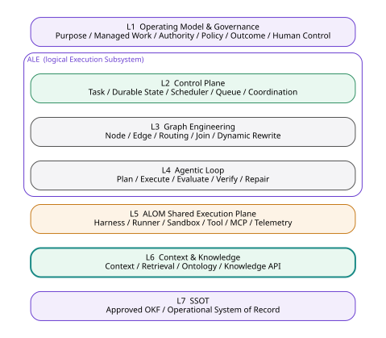
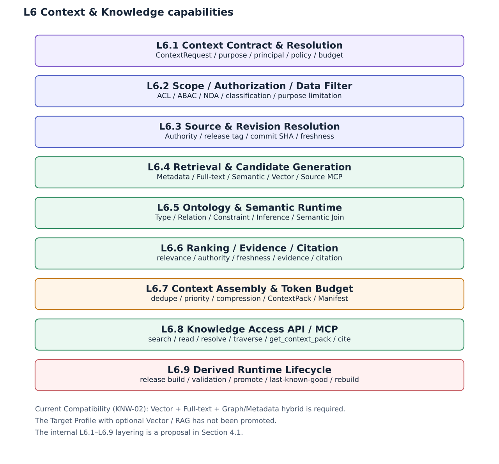
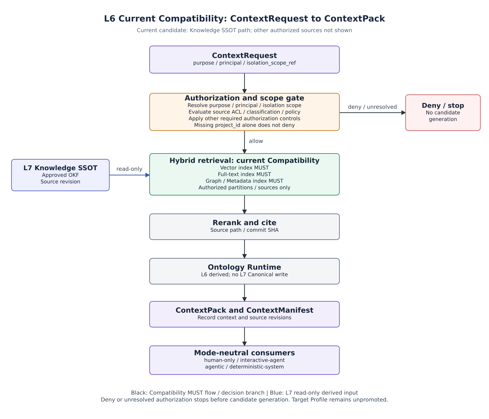
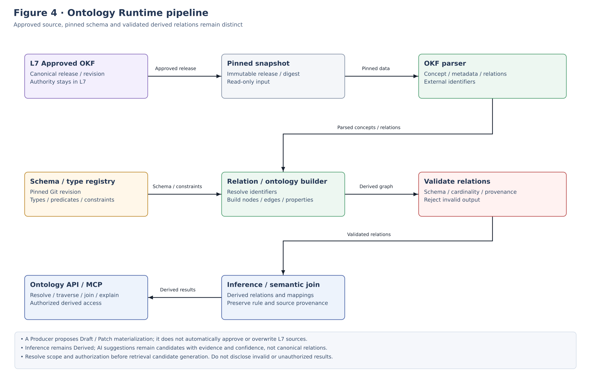
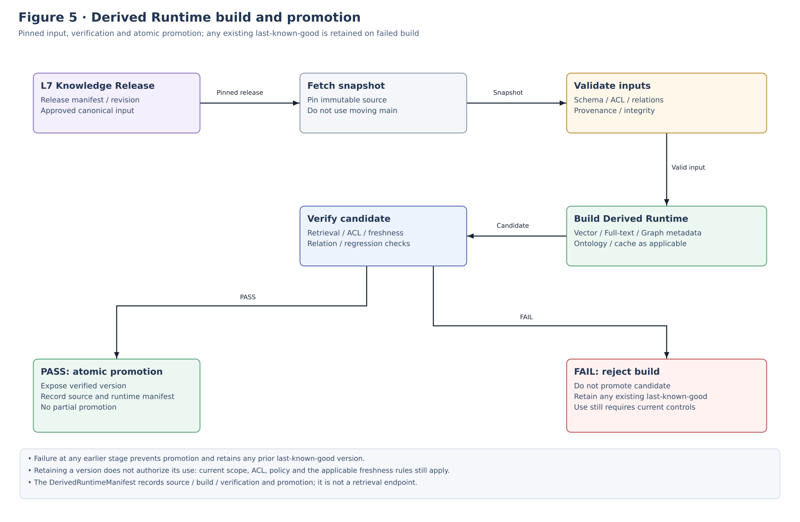
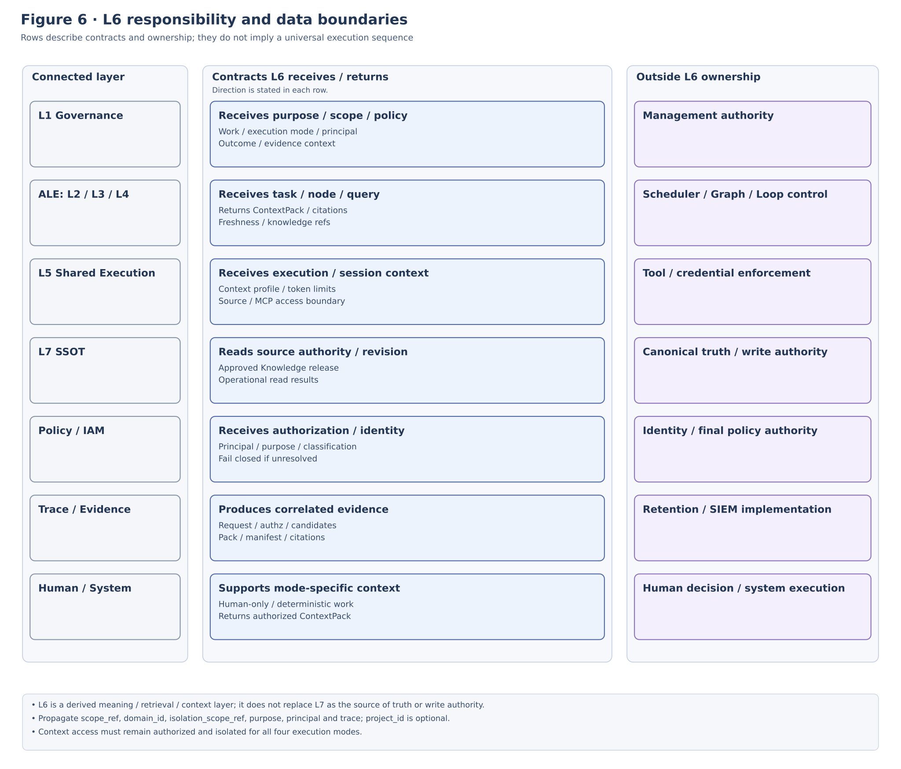
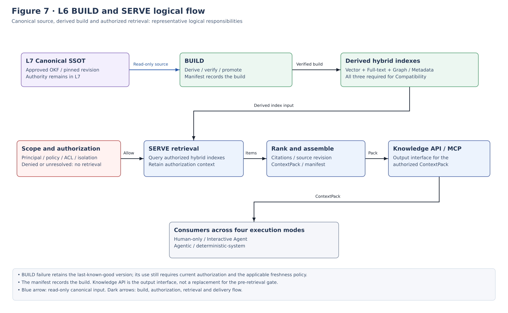
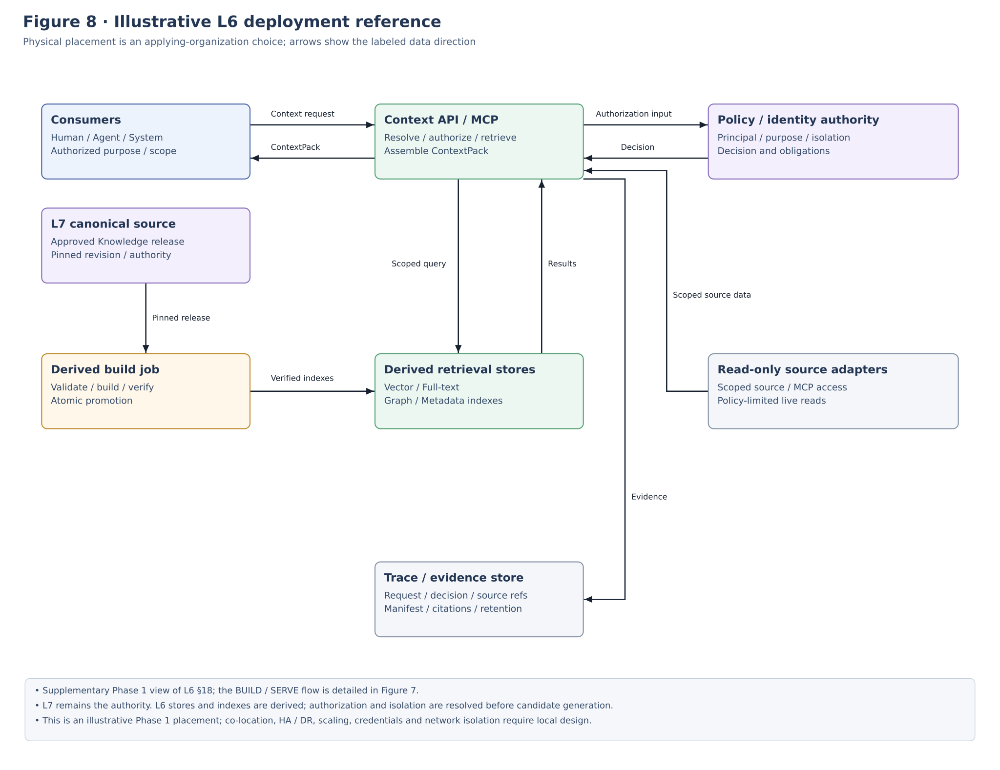

**IMPLEMENTATION STANDARD**

**ALOM Context & Knowledge**

**Implementation Architecture Standard**

**Context Contract / Authorization / Retrieval / Ontology / Context Pack / Knowledge API / Derived Runtime**

| **Core principle** L6 is the Meaning / Retrieval / Context Runtime owned by the applying organization. It transforms L7 Knowledge / Operational SSOT into reproducible Context Packs based on purpose, principal, authority, version, freshness, semantic relationships, and token budget. RAG / Vector / Ontology Index / Cache are not authoritative sources; maintain a Knowledge Contract independent of Agent products. |
|-----------------------------------------------------------------------------------------------------------------------------------------------------------------------------------------------------------------------------------------------------------------------------------------------------------------------------------|

| **Management item** | **Value** |
|--------------|-------------------------------------------------------------------|
| Document ID | ALOM-KNW-STD-001 |
| Version | v0.4-review.20261110 (aligned with ALOM v2.5 / exact-four Execution Mode) |
| Created | 2026-08-13 |
| Governing standard | ALOM-ARCH-STD-001 v2.5 |
| Scope | ALOM L6 Context & Knowledge / Meaning / Retrieval / Context Runtime |
| Owner | Organization Architecture (Enterprise Architecture) / AI Platform |
| Classification | Public |

This specification details KNW-01 through KNW-13 of the governing standard as implementable responsibilities, contracts, Derived Runtimes, security controls, and acceptance tests.

# Document Control

## Version Control / History

| **Version** | Date | **Category** | **Changes** |
| -------- | ------ | ---------- | -------------- |
| Draft v0.4 | 2026-09-06 | Minor revision | Alignment with ALOM v2.4 / exact-four Execution Mode. |
| Draft v0.4 | 2026-09-15 | Meaning-preserving errata | Unambiguously align current Compatibility with the ARCH v2.4 KNW-02 hybrid MUST. Target Vector/RAG MAY has not been promoted. Record TB-T-06 observation 3 and express Target exemptions through heading / first-cell structure. The active DerivedRuntimeManifest example uses placeholder lineage. Locally correct the closed enumerations in Section 1.1 / Responsibility Boundary / CK-P14 / Appendix C to exact-four. |

## 1. Position and Order of Authority

This implementation standard details the L6 Context & Knowledge Runtime of the ALOM Integrated Architecture Standard v2.5. L6 is the Meaning / Retrieval / Context Layer outside ALE (L2-L4), shared by the L5 ALOM Shared Execution Plane, Human-only Work, deterministic-system Work, and Agentic Work under ALE control. Without changing the governing standard's MUST / MUST NOT requirements, this document specifies Context Contracts, authorization, Retrieval, Ontology, Context Packs, Knowledge APIs, the Derived Runtime lifecycle, Trace, security, portability, and acceptance criteria.

- In a conflict with the governing standard, ALOM-ARCH-STD-001 v2.5 takes precedence.

- Where laws, contracts, customer NDAs, or security/privacy policies impose stricter requirements, the stricter rules take precedence.

- Items marked \[PROPOSAL\] are implementation details absent from the governing standard or differing between existing sources. Standardize them through ADR / change request / Eval when adopting them.

- Do not designate RAG, a Vector DB, Graph DB, Embedding Model, LLM, or Agent Client as L6's authoritative source or an indispensable single product.

- L6 reads with inherited L7 Authority, but has no Authority to update Knowledge SSOT / Operational SSOT.

## 1.1 Common Scope / Isolation

The runtime / protected contracts in this document consume the CommonScopeContract in `ALOM-PROF-SCOPE-SPEC-001`.

- `scope_ref` is the required common canonical scope identity.
- `domain_id` is the required permanent operating-domain identity.
- `project_id` is an optional Project overlay / context. Do not reject a request solely because it is absent. Do not synthesize a Project to satisfy an implementation schema.
- `isolation_scope_ref` is the required runtime / protected isolation boundary. Fail closed if it cannot be resolved.
- Do not infer runtime isolation solely from `project_id`. Bind Queue / state / worker / sandbox / tool / credential / repository / cache / retrieval / Trace / L7 access to explicit `isolation_scope_ref` and authorization policy.
- Do not relax Authority conflict, Human-required, mandatory assurance, HITL timeout, no-relaxation, or cross-isolation denial requirements.
L6 ContextRequest / ContextPack carries Common Scope. Partition authorization / cache / retrieval / citation by explicit isolation. Fail closed when `isolation_scope_ref` / authority / ACL cannot be resolved. Do not deny retrieval solely because `project_id` is absent.

Basis / category: \[STD\] \[S1\] Inherits Document Control, P-01, P-06, P-07, P-08, P-12, and KNW-01 through KNW-13. \[REF\] \[S5\] L6/L7 Meaning versus Truth boundary.

## 2. Sources and Design Categories

| **ID** | **Source** | **Use in this document** |
|--------|------------------------------------------------------------|------------------------------------------------------------------------------------------------------------------------------------|
| S1 | ALOM-ARCH-STD-001 v2.5-review.20261110 | Non-effective alignment candidate; controlled authority remains v2.5. Inherits the seven-layer Layer View, ALE=L2-L4, L5 Shared Execution, L6 KNW-01 through KNW-13, P-01/02/06/07/08/12/14, SEC, NFR, and OPS. |
| S2 | ALOM-ARCH-STD-001 v2.5-review.20261110 / ALOM-SSOT-STD-001 v0.5 (related specifications) | References for checking Canonical / Derived, Producer / MCP, and Context Pack / Knowledge API. |
| S3 | ALOM-LOOP-STD-001 v0.6-review.20261110 | Aligns context query / knowledge ref / citation / freshness from L4 to L6 within ALE, context_manifest_ref, and the Agentic Work boundary. |
| S4 | ALOM L5 Shared Execution Plane Implementation Architecture Standard (ALOM-HR-STD-001 v0.4-review.20261110) | Aligns the two Agentic / Interactive entry paths, L5 Context selection, Execution correlation, Tool/MCP, NDA/Isolation, Trace, and the L6 usage boundary. |
| S5 | ALOM-SSOT-STD-001 v0.5 | References L6 = Meaning/Retrieval/Context, L7 = Truth/Authority/Record, Release Manifest, Read Adapter, and Derived rebuild. |

Related specifications are references for checking current content; this does not establish their identity with the historical sources of the original document.

Design categories: \[STD\] = inherited from the governing standard; \[REF\] = reference elements based on the original document's existing sources; \[Cross-check\] = checks correspondence with public specifications and this document, without establishing identity with historical sources; \[PROPOSAL\] = detailed L6 design added in this document.

## 3. Known Normative Differences and Their Treatment

| **Important: The governing standard for current Compatibility is ALOM-ARCH-STD-001 v2.5. KNW-02 makes hybrid Vector + Full-text + Graph / Metadata retrieval a MUST. Human Decision formally adopted Option A. This is neither implementation acceptance nor promotion to v1.0. Target Profile descriptions do not make current Compatibility optional. Unpromoted next-version candidates are confined to the following Target Profile table row and sections headed Target Profile.** |
|---------------------------------------------------------------------------------------------------------------------------------------------------------------------------------------------------------------------------------------------------------------------------------------------------------------------------------------------------------------------------------------------------------------------------|

| **Profile** | **Position** | **Requirements** |
|-----------------------------|-----------------------------------|-------------------------------------------------------------------------------------------------------------------------------------------------|
| Compatibility Profile | Strict conformance to the current governing standard ALOM-ARCH-STD-001 v2.5 (KNW-02 hybrid MUST. Decision 5676092783. Target Profile remains unpromoted) | Implement Vector + Full-text + Graph/Metadata hybrid retrieval, rerank, citation, source path, and commit SHA. |
| Target Profile \[PROPOSAL\] | Candidate for the next standard (not promoted) | Require Metadata / Full-text / Semantic / Ontology / Live Query as Retrieval capabilities; Vector / RAG is optional depending on scale and cross-source retrieval requirements. |

## 4. Contents

- 1 Purpose and Scope

- 2 Fixed Definitions and Responsibility Boundaries

- 3 Context & Knowledge Architecture Principles

- 4 Overall ALOM Stack and Internal L6 Layers

- 5 Context Contract / Request Resolution

- 6 Scope / Authorization / Data Filter

- 7 Source / Authority / Revision Resolution

- 8 Retrieval & Candidate Generation

- 9 Ontology & Semantic Runtime

- 10 Ranking / Evidence / Citation

- 11 Context Assembly / Token Budget / Context Pack

- 12 Knowledge Access API / MCP

- 13 Derived Runtime Lifecycle / Manifest

- 14 Knowledge Materialization / Producer Boundary

- 15 Integration with L1 / ALE (L2-L4) / L5 / L7 / Trace

- 16 Security / NDA / Privacy / Cache

- 17 Repository / CI/CD / Versioning

- 18 Physical Deployment Reference Configuration

- 19 Nonfunctional Requirements / SLO / Observability

- 20 Acceptance Gates and Conformance Tests

- 21 Implementation Roadmap and Backlog

- Appendix A Minimum Data Contracts

- Appendix B YAML / API Contract Examples

- Appendix C Governing Requirement Mapping

- Appendix D Technology Mapping

- Appendix E References and Conditions for Promotion to the Next Version

# 1. Purpose and Scope

## 1.1 Purpose

This document defines the standard for implementing the ALOM L6 Context & Knowledge Runtime as a Meaning / Retrieval / Context Layer owned by the applying organization and independent of LLM / Agent Client / Retrieval products. L6 sits outside ALE (L2 Control Plane / L3 Graph Engineering / L4 Agentic Loop) and safely resolves Canonical Knowledge and Operational State held by L7 according to purpose, Managed Work, Execution Mode, principal, authority, NDA, classification, version, freshness, semantic relationships, Evidence, and token budget. Its purpose is to provide Context Packs and Knowledge APIs usable by Human-only / Interactive Agent / Agentic / Deterministic-system Managed Work.

| **Design goal** The applying organization can retain ContextRequest, authorization boundaries, Knowledge revisions, Citations, ContextPack Manifests, Ontology semantics, and Trace when changing Cursor / Claude / Codex / custom Agents, Vector DB / Graph DB / Embedding Model / Retrieval Engine. |
|-----------------------------------------------------------------------------------------------------------------------------------------------------------------------------------------------------------------------------------------------------------------|

## 1.2 In Scope

- Standard contracts for ContextRequest / ContextPack / ContextManifest / Citation / KnowledgeRef.

- Context scope resolution using purpose, actor/delegator, Common Scope (`scope_ref` / `domain_id` / required runtime `isolation_scope_ref`, optional `project_id`), ACL/ABAC, classification, and agent_usage.

- Resolution of Git hosting (e.g., GitHub) / OKF releases, commit SHA, bundle digest, Operational Authority / revision / freshness.

- Retrieval combining Metadata, Full-text, Local Semantic Search, Vector, Ontology / Graph, and Source MCP / Read Adapter.

- Ontology Schema / Type Registry, Canonical Relation, Validation, Inference, Semantic Join, Graph Traverse.

- Reranking, Evidence resolution, Citation, token budgets, deduplication, compression, and Context Pack generation.

- Knowledge API / MCP Gateway and usage contracts for Cursor / Claude Code / Codex / internal Agents.

- Build, verification, atomic promotion, last-known-good, and rebuild of Derived Index / Ontology Runtime / Cache.

- Contract boundaries with L1 Managed Work / Policy, ALE (L2/L3/L4), L5 ALOM Shared Execution Plane, L7, Trace/Evidence, and IAM.

## 1.3 Out of Scope

- Authority to approve or update Knowledge SSOT, and transaction authority for Operational SSOT (L7).

- Agentic Loop plan / execute / evaluate / verify / repair / termination (L4).

- Graph topology, routing, join, dynamic rewrite(L3).

- Physical enforcement of Tool / Credential / Network / Filesystem / Sandbox controls (L5).

- LLM internal reasoning, chain-of-thought, model weights, and Embedding model internal algorithms.

- Automatic approval or direct updates to the protected default branch by a Producer.

- Treating RAG / Vector / Graph / Cache as Canonical Knowledge.

Basis / category: \[STD\] \[S1\] L6, P-06, KNW-01 through KNW-13. \[REF\] \[S3\]\[S4\]\[S5\] L4/L5/L7 out-of-scope boundaries.

# 2. Fixed Definitions and Responsibility Boundaries

| **Term** | **Fixed definition** | **Not equivalent to** |
|-----------------------------|-------------------------------------------------------------------------------------------------------------------------------------------|----------------------------------|
| Context & Knowledge Runtime | Derived Runtime that searches, interprets, and contextualizes L7 authoritative sources based on purpose, principal, authority, version, freshness, and semantic relationships. | Knowledge SSOT / Agent Memory |
| ContextRequest | Structured request specifying the purpose, principal, scope, query, source, freshness, revision, and budget needed by a task. | A natural-language query alone |
| ContextPack | Reproducible derived artifact bundling the Knowledge / Operational Evidence needed for one Managed Work / execution / step, with sources, versions, and usage constraints. | Authoritative Knowledge / the entire Prompt |
| ContextManifest | Manifest pinning the ContextPack's input conditions, source revisions, runtime versions, candidates/exclusions, and digest. | KnowledgeReleaseManifest |
| KnowledgeRef | Standard identification referencing a concept / bundle / source / revision / citation. | A model's conversation memory |
| Retrieval Runtime | Derived retrieval interface that generates and ranks candidates using metadata / full-text / semantic / vector / graph / live query. | SSOT |
| Ontology Runtime | Derived semantic Runtime that interprets OKF Concepts / Relations at runtime as types, constraints, inference, Semantic Join, and Traverse. | Graph DB / Knowledge SSOT |
| Canonical Relation | Relation explicitly present in Approved OKF whose source / revision / review is traceable. | AI Suggested / Inferred relation |
| Derived Relation | Relation derived by rules / runtime inference and handled separately from Canonical content. | An approved authoritative source |
| Citation | Evidence reference linking the source, concept, revision, and path/locator used by a Context item to an answer / Trace. | A URL alone |
| DerivedRuntimeManifest | Manifest recording source releases, build versions, ACL snapshots, verification, and promotion for Index / Ontology / Cache. | The Knowledge version itself |

| **Responsibility boundary: L6 = Meaning / Retrieval / Context. L7 = Truth / Authority / Record. ALE is the logical Execution Subsystem comprising L2-L4; L5 is the ALOM Shared Execution Plane. Neither is part of L6. Human-only / Interactive Agent / Agentic / Deterministic-system Managed Work can use L6 through the same purpose / scope / revision / citation contracts, but L6 does not own decisions about which source is authoritative or who may update it, execution convergence, or Tool enforcement.** |
|-----------------------------------------------------------------------------------------------------------------------------------------------------------------------------------------------------------------------------------------------------------------------------------------------------------------------------------------------------------------------------------------------------------|

Basis / category: \[STD\] \[S1\] KNW-01 through KNW-13. \[REF\] \[S5\] Fixed L6/L7 boundary and absence of Authority in Derived Runtimes.

# 3. Context & Knowledge Architecture Principles

| **ID** | **Principle** | **Normative requirement** |
|------------|-------------------------------|----------------------------------------------------------------------------------------------------------------------------------------------------------------------------------------------------------------------------------|
| **CK-P01** | Applying-organization ownership of Context semantics | Manage the semantics of ContextRequest, ContextPack, Manifest, and Citation as schema / config / code, without delegating them to Agent / RAG product-specific formats. |
| **CK-P02** | No transfer of Authority | L6 references L7 Authority. Do not transfer authoritative-source privileges to RAG / Ontology / Graph / Cache / generated answers. |
| **CK-P03** | Purpose before retrieval | Resolve purpose / principal / `isolation_scope_ref` / optional `project_id` / classification / policy before the query and restrict scope before retrieval candidate generation. |
| **CK-P04** | Authorization end-to-end | Propagate original-source permissions to retrieval, rerank, cache, prompt, and output; do not rely solely on filtering after retrieval. |
| **CK-P05** | Revision pinning | Resolve Canonical Knowledge to release tag / commit SHA / digest, and Operational data to authority / revision / observed_at; pin them in the ContextManifest. |
| **CK-P06** | Retrieval pluggability | Abstract Retrieval as capabilities so metadata / full-text / semantic / vector / graph / live query can be replaced and combined. |
| **CK-P07** | Ontology explainability | Track Relation trust level, rule_ref, source revision, runtime version, and confidence; do not confuse Canonical / Derived / Suggested. |
| **CK-P08** | Evidence-first ranking | Rank using authority, freshness, scope fit, relation, evidence, and citation as well as similarity. Authorization is a hard filter, not a score. |
| **CK-P09** | Bounded context | Give Context token / item / source / latency budgets; do not place all Knowledge into a Prompt without bounds. |
| **CK-P10** | Derived rebuildability | Make Index / Ontology / Cache reproducible from pinned releases and retain the last-known-good version if a build fails. |
| **CK-P11** | Trace by default | Correlate request, authorization, retrieval candidates, ranking, exclusion, ContextPack, manifest, and citation using trace_id. |
| **CK-P12** | NDA / isolation | Separate Repository, Index partition, cache key, identity, credential, and Trace at the `isolation_scope_ref` boundary; deny cross-scope joins by default. `project_id` is an optional overlay. |
| **CK-P13** | Client portability | Cursor / Claude / Codex / internal Agents use shared Knowledge API / MCP contracts; do not make a Client-specific Index the only Knowledge interface. |
| **CK-P14** | Execution-mode neutral access | Do not implement L6 as a Knowledge Plane dedicated to ALE. Make it accessible through the same Knowledge Contract to Human-only, Interactive Agent, Agentic, and Deterministic-system Managed Work; treat mode-specific task/session/human-work correlation as conditional references. |

Basis / category: \[STD\] P-01/P-06/P-07/P-08/P-12 and KNW-01 through KNW-13. \[Cross-check\] \[S2\]\[S5\] Compatibility hybrid MUST (Target remains unpromoted) / Derived rebuild / Project boundary. \[PROPOSAL\] Reorganization into CK-P01 through CK-P13.

# 4. Overall ALOM Stack and Internal L6 Layers



Figure 1. Position of L6 Context & Knowledge in the ALOM seven-layer model

L6 receives L1 work / purpose / execution_mode / policy context; Task / trace context from ALE's L2 (Agentic Work); L3 node / graph context demand; L4 context query / knowledge ref / citation / freshness; and execution / Effective Harness / context constraints from the L5 ALOM Shared Execution Plane. It constructs authorized Context from L7 Knowledge / Operational SSOT. Human-only Work can access L6 directly through the L1 management boundary; Interactive Agent Work primarily accesses it through L5; Agentic Work accesses it through ALE and L5. deterministic-system Work is correlated using SystemExecutionRecord / system_execution_ref. L6 itself does not own ALE control/convergence, Tool enforcement, or SSOT authority.

Basis / category: \[STD\] \[S1\] Section 4.2 Seven-Layer Model and Section 5.6 L6. \[REF\] \[S3\]\[S4\]\[S5\] Adjacent-layer boundaries.

## 4.1 Nine Internal L6 Sublayers



Figure 2. Detailed L6 Context & Knowledge architecture

| **Layer** | **Name** | **Responsibility** |
|--------|-------------------------------------|------------------------------------------------------------------------------------------------------|
| L6.1 | Context Contract & Resolution | Declare and resolve ContextRequest, purpose / actor / project / policy / source / budget. |
| L6.2 | Scope / Authorization / Data Filter | Enforce ACL / ABAC / NDA / classification / purpose limitation / agent_usage through pre/post filters. |
| L6.3 | Source & Revision Resolution | Resolve Authority, release tag, commit SHA, bundle digest, and Operational revision / freshness. |
| L6.4 | Retrieval & Candidate Generation | Generate authorized candidates from Metadata / Full-text / Local Semantic / Vector / Source MCP, etc. |
| L6.5   | Ontology & Semantic Runtime         | Type / Relation / Constraint / Validation / Inference / Semantic Join / Traverse / explain.         |
| L6.6 | Ranking / Evidence / Citation | Evaluate candidates using relevance / authority / freshness / relation / evidence and resolve citations. |
| L6.7 | Context Assembly & Token Budget | Perform dedupe, prioritization, compression, token allocation, and ContextPack / ContextManifest generation. |
| L6.8 | Knowledge Access API / MCP | Provide search / read / resolve / traverse / get_context_pack / cite, etc., independently of Clients. |
| L6.9   | Derived Runtime Lifecycle           | release-based build, validation, regression, atomic promotion, last-known-good, rebuild.            |

Basis / category: \[STD\] Retains L6 responsibilities. \[PROPOSAL\] Internal layering into L6.1 through L6.9.

# 5. Context Contract / Request Resolution

## 5.1 ContextRequest

L6 accepts a ContextRequest, not merely a search string. A ContextRequest uses L1 work_id / purpose / execution_mode / policy / authorization context as its common foundation. Depending on the Execution Mode, it conditionally bundles ALE task / graph / loop correlation, L5 execution / session / context budget / source constraints, a HumanWorkRecord reference for Human-only work, or SystemExecutionRecord / system_execution_ref for deterministic-system work. L6 does not assume task_id exists and supports the same Knowledge Contract for Managed Work that does not pass through ALE.

| **Field** | **Requirement** | **Meaning** |
|------------------------------------------|----------|----------------------------------------------------------------------------------------------------------------------------------------------------------------------------|
| context_request_id | Required | Unique Context request. |
| trace_id / work_id | Required | Cross-ALOM correlation. work_id identifies L1 Managed Work; trace_id identifies Knowledge usage / execution Trace. |
| execution_mode | Required | human-only / interactive-agent / agentic / deterministic-system. Must match the L1 ManagedWorkDefinition. hybrid is not an Execution Mode. |
| task_id / execution_ref / human_work_ref / system_execution_ref | Conditional | Correlation reference by Execution Mode: agentic uses task_id; interactive-agent uses L5 execution/session; human-only uses HumanWorkRecord; deterministic-system uses SystemExecutionRecord / system_execution_ref. Do not require task_id when ALE is not involved. |
| purpose_id | Required | Purpose of use. References Purpose Registry / Policy. |
| actor_id / delegator_id | Required | Principal and delegating principal. |
| scope_ref / domain_id | Required | Common Scope identity / permanent operating domain. |
| isolation_scope_ref | Required | Runtime / protected isolation boundary. If unresolved, fail closed without starting retrieval. |
| project_id | Optional | Project overlay/context. Do not deny solely because it is absent. Do not create a synthetic Project. |
| tenant_id | Optional | Compatibility/routing metadata. Not an isolation key on its own. |
| query / intent | Required | Retrieval objective. Free text + structured intent is permitted. |
| classification_ceiling | Required | Highest information classification that may be retrieved. |
| sources | Required | Candidate sources such as knowledge / operational / workspace. |
| freshness_policy | Required | max_age / stale behavior / valid time. |
| revision_policy | Required | pinned / current / at_time, etc. |
| token_budget | Required | Maximum tokens / items / source share. |
| latency_budget | Recommended | Synchronous response time limit. Combine with a degradation policy for exceeding it. |
| context_profile_ref | Recommended | Standard profile by Use case / Harness. |

<table>
<colgroup>
<col style="width: 100%" />
</colgroup>
<thead>
<tr class="header">
<th>context_request:<br />
context_request_id: ctxreq-001<br />
trace_id: trace-001<br />
work_id: work-dev-code-review<br />
execution_mode: interactive-agent<br />
task_id: null<br />
execution_ref: exec-001<br />
purpose_id: dev.code-review<br />
actor_id: user-123<br />
delegator_id: user-123<br />
scope_ref: scope://company/domain/system-integration/customer/customer-a/project/project-x/work/dev-code-review<br />
domain_id: system-integration<br />
tenant_id: customer-a<br />
project_id: project-x<br />
isolation_scope_ref: scope://customer-a/project-x<br />
query: "Impact scope of authentication API changes"<br />
classification_ceiling: confidential<br />
sources: [knowledge, operational]<br />
freshness_policy: {max_age: 24h, stale: mark}<br />
revision_policy: {knowledge: pinned, operational: current}<br />
token_budget: {max_tokens: 30000, max_items: 40}</th>
</tr>
</thead>
<tbody>
</tbody>
</table>

## 5.2 Resolution order



Figure 3. Current Compatibility resolution flow from ContextRequest to ContextPack (current candidate diagram; Vector / Full-text / Graph/Metadata indexes are each MUST requirements in the hybrid retrieval node).

Arrows: Black indicates the Compatibility MUST flow. Blue indicates read-only derived input from L7. Lines are orthogonal and do not cross text.

- If purpose / principal / `isolation_scope_ref` cannot be resolved, deny / fail closed without starting retrieval. Do not deny solely because `project_id` is absent.

- Resolve a Context Profile with applying organization-wide scope (Enterprise) → OperatingDomain as permanent anchors; Organization / Customer / Project are parallel optional overlays. Specificity is not a parent tree. UseCase / Managed Work / Execution Mode / Harness / Consumer are more local overlays. Record final values in the ContextManifest. \[PROPOSAL\]

- Even when repeating the same Managed Work / ContextRequest, Operational data with revision_policy=current may have a different observed_at; the ContextManifest therefore provides reproducibility.

Basis / category: \[STD\] KNW-01 and P-02/P-07/P-08/P-14. \[REF\] \[S3\]\[S4\] context_manifest_ref / L5 execution correlation / source-bundle refs. \[PROPOSAL\] Execution-mode neutral ContextRequest schema.

# 6. Scope / Authorization / Data Filter

## 6.1 Authorization model

L6 MUST NOT implement Knowledge access by retrieving first and hiding results afterward. Evaluate principal, delegator, purpose, `isolation_scope_ref`, source ACL, classification, agent_usage, and legal / contract restrictions before candidate generation; restrict the partition / source query itself as necessary. `project_id` is an optional overlay, not an isolation key on its own.

| **Stage** | **Required controls** | **On failure** |
|------------------|----------------------------------------------------------------------------------------------------|----------------------------------|
| Pre-filter | isolation_scope membership, source ACL, purpose, classification, agent_usage, retention / legal constraint | Deny without generating candidates |
| Retrieval | Use only authorized partitions / credentials / Source MCP scopes | Deny per source / partial |
| Rerank | Preserve candidates' authz context; do not reintroduce unauthorized candidates | candidate drop |
| Cache | Include isolation_scope_ref / principal class / purpose / revision in the key boundary | cache miss / deny |
| Context Assembly | Revalidate item-level policy, freshness, and purpose fit | exclude + reason |
| Output | Guard secret / PII / cross-isolation / policy-restricted content | redact / deny / human escalation |

## 6.2 Non-disclosure of existence

- Do not return titles, counts, similarity scores, or the existence of relations for unauthorized Concepts / Documents to unauthorized principals.

- For cross-isolation joins / ontology traversal, do not reveal even the existence of an edge unless both endpoints' `isolation_scope_ref` values are authorized.

- Include negative authorization tests in release gates, with cross-isolation leakage of 0 as the acceptance criterion.

Basis / category: \[STD\] KNW-05, P-08, and SEC. \[REF\] \[S5\] Derived Index pre-filter / partition / key boundary; prohibition on relying solely on post-retrieval filtering.

# 7. Source / Authority / Revision Resolution

## 7.1 Knowledge revision

Do not implicitly reference a moving main branch for Canonical Knowledge. For critical uses, resolve release tag → commit SHA → bundle digest through a KnowledgeReleaseManifest. A Context item MUST have source_revision in addition to concept_id and source path.

## 7.2 Operational revision

Do not replicate all Operational SSOT records into OKF. Retrieve authority_id, entity_id, revision, observed_at, classification, freshness, and source_ref through an L7 Read Adapter / Source MCP. L6 incorporates the result into a ContextItem, while L7 owns Operational canonicality.

| **Source class** | **Revision rule**                              | **Context recording**                               |
|------------------|------------------------------------------------|-----------------------------------------------------|
| Approved OKF     | release tag → commit SHA → digest              | bundle_id / concept_id / commit_sha / digest / path |
| Git workspace    | checkout commit / branch ref                   | repo / commit / workspace ref                       |
| Ticket / SaaS    | source revision / updated_at                   | authority_id / entity_id / revision / observed_at   |
| DB / API         | transaction / row version / snapshot timestamp | authority_id / query ref / observed_at / freshness  |
| Observability    | time window / sample / event id                | source ref / observed_at / window / aggregation     |
| Derived Index    | DerivedRuntimeManifest version                 | runtime_id / source_release / build_digest          |

## 7.3 Freshness

- Consider valid_from / valid_until / review_due / last_verified / source lifecycle; explicitly mark or exclude stale content.

- Freshness policies may set different limits by source class. Examples: release pin for Policy, current for Tickets, minutes for monitoring.

- Do not assume that unknown freshness means current.

Basis / category: \[STD\] KNW-06 and P-07. \[REF\] \[S5\] KnowledgeReleaseManifest / OperationalReadResult.

# 8. Retrieval & Candidate Generation

## 8.1 Retrieval capability model

| **Method** | **Primary use** | **Canonicality** | **Initial adoption** |
|-----------------------|------------------------------------------------------------------------|----------------------|------------------------------------------------|
| Metadata Search | Exact search by type / status / owner / classification / domain / freshness | Derived lookup | Required |
| Full-text Search | API names, error codes, proper names, identifiers | Derived index | Required |
| Local Semantic Search | Semantic exploration of checked-out Code + OKF | Client edge index | Recommended |
| Vector Search / RAG | Semantic similarity, cross-source retrieval, shared rerank | Derived index | Required in Compatibility Profile / optional in Target |
| Ontology / Graph | Dependencies, relations, impact, semantic exploration | Derived runtime view | Required capability |
| Live Source Query | Current values from Tickets / DB / Monitor, etc. | L7 authority read | Only for necessary sources |

## 8.2 Candidate contract

<table>
<colgroup>
<col style="width: 100%" />
</colgroup>
<thead>
<tr class="header">
<th>retrieval_candidate:<br />
candidate_id: cand-001<br />
source_class: canonical_knowledge<br />
concept_id: system.identity-api<br />
source_ref: okf://project-x/systems/identity-api<br />
source_revision: abcdef123456<br />
runtime_ref: retrieval@2026.08.11.1<br />
relevance: 0.82<br />
authority: canonical<br />
freshness: valid<br />
classification: internal<br />
relation_evidence: [depends_on:database.identity]<br />
citation_locator: concepts/systems/identity-api.md#authentication</th>
</tr>
</thead>
<tbody>
</tbody>
</table>

## 8.3 Retrieval orchestration

- Multiple retrievers may run in parallel to generate candidates, but bound fan-out, timeout, cost, and source count. \[PROPOSAL\]

- If Retrieval partially fails, explicitly record source coverage / degraded status in the ContextManifest.

- Even when an LLM rewrites a query, do not expand purpose / authorized scope.

- Prohibit chunking / embedding pipelines that lose a candidate's source revision / authorization provenance.

Basis / category: \[STD\] KNW-02 / 05 / 06. \[Cross-check\] \[S2\] Local semantic search / Compatibility hybrid MUST (Target remains unpromoted) / central retrieval trigger. \[PROPOSAL\] Capability abstraction / target profile.

# 9. Ontology & Semantic Runtime



[Open Figure 4 at full size](figures/ALOM-KNW-STD-001-fig4-current.svg)

Figure 4. Standard Ontology Runtime pipeline

## 9.1 Ontology components

| **Technology element** | **Responsibility** | **Canonical / derived** | **Minimum implementation example** |
|---------------------------------|---------------------------------------------------------------------------|-----------------|-----------------------------------|
| OKF Parser | Extract Concepts, metadata, relations, and external identifiers from Markdown/YAML | Derived processing | Python / TypeScript parser |
| Ontology Schema / Type Registry | Define Types, Predicates, source/target types, cardinality, constraints, and direction | Schema is authoritative in Git | YAML / JSON Schema |
| Relation Resolver | Resolve Concept IDs, aliases, and external identifiers | Derived processing | RDB lookup / in-memory map |
| Ontology Builder | Normalize Approved OKF into Nodes/Edges/Properties | Derived | SQLite / PostgreSQL / Graph Store |
| Validation Engine | Validate types, relations, cardinality, and referential integrity | Derived determination | JSON Schema + custom rules |
| Inference Engine | Derive permitted derived relations from explicit relations | Derived | Rule engine / graph traversal |
| Semantic Join | Connect OKF Concepts to Git hosting/ticket/DB/monitor identifiers | Derived mapping | external_identifiers + MCP |
| Ontology API / MCP | resolve / traverse / validate / infer / join / explain | Derived access | MCP server / REST API |

## 9.2 Relation trust level

| **Level** | **Type** | **Treatment** | **Canonicalization** |
|-----------|-------------------------|-----------------------------------------------------------------------------|---------------------|
| L1 | Explicit / Canonical | Explicit in Approved OKF. Retain source/revision/review. | Authoritative |
| L2 | Deterministic Extracted | Extracted from code/schema/config, etc., by a Producer. | Permitted after Draft → review |
| L3 | Rule Inferred | Derived at Runtime by Ontology rules. Retain rule_ref/input relation/runtime version. | Not permitted; remains Derived |
| L4 | AI Suggested | Semantically inferred by an LLM, etc. Require evidence/confidence. | Not permitted; Candidate only |

## 9.3 Semantic Join

- Connect OKF Concepts and Operational Sources to the same concept through external identifiers / mappings.

- Ambiguous joins carry confidence and candidate state; do not automatically adopt them into high-impact context.

- Cross-isolation identifier mapping (including cross-PJ) is prohibited by default and permitted only with explicit policy / legal basis / approval.

Basis / category: \[STD\] KNW-03 and 08 through 13. \[REF\] \[S5\] Relation trust levels and absence of Authority in Ontology Runtime.

# 10. Ranking / Evidence / Citation

## 10.1 Ranking model

Final ranking MUST NOT depend solely on similarity. Combine authority / freshness / scope fit / relation strength / evidence quality / citation availability. The following is a conceptual model; calibrate weights using Private Eval / use case profiles. \[PROPOSAL\]

<table>
<colgroup>
<col style="width: 100%" />
</colgroup>
<thead>
<tr class="header">
<th>final_score = relevance<br />
* authority_factor<br />
* freshness_factor<br />
* scope_fit<br />
* relation_strength<br />
* evidence_quality</th>
</tr>
</thead>
<tbody>
</tbody>
</table>

| **Hard rule** Authorization / NDA / classification is not a score. Remove unauthorized candidates from the candidate set instead of merely lowering their scores. |
|---------------------------------------------------------------------------------------------------------------------------------------|

## 10.2 Evidence precedence

| **Priority** | **Example** | **Treatment** |
|----------|-------------------------------------------------------------|---------------------------------------------------------------------|
| 1 | Approved canonical knowledge / direct operational authority | Highest priority, but stale / scope-mismatched content may be excluded. |
| 2 | Deterministic extracted evidence | High trust if source revision and extraction rule are traceable. |
| 3 | Rule inferred relation | Explicitly mark as Derived; include input relations / rules in the citation chain. |
| 4 | AI suggested relation / summary | Supporting candidate. Do not use as the sole basis for high-impact decisions. |

## 10.3 Citation Resolver

- Knowledge citations must resolve concept_id, bundle_id, commit SHA, and path / anchor.

- Operational citations must include authority_id, entity_id, revision / observed_at, and source_ref.

- When a Derived relation is used, its explanation must trace to canonical input relations and rule / runtime versions.

- For summaries that lose citation locators, lower evidence_quality or exclude them according to the usage profile.

Basis / category: \[STD\] KNW-02/09/11/13 and P-07. \[PROPOSAL\] Evidence precedence / ranking model.

# 11. Context Assembly / Token Budget / Context Pack

## 11.1 Context assembly

- Deduplicate candidates while retaining their canonical / operational / derived evidence categories.

- If multiple revisions of the same Concept coexist, follow the revision policy; do not merge while ambiguity remains.

- Context budgets may include max_items / max_sources / per-source share / max_age / latency in addition to tokens. \[PROPOSAL\]

- Compression / summarization must preserve source / citation / classification / exclusions.

- A Context Pack is an independent data contract convertible for a Runner / model, rather than a Prompt.

## 11.2 ContextPack minimum

<table>
<colgroup>
<col style="width: 100%" />
</colgroup>
<thead>
<tr class="header">
<th>context_pack:<br />
context_pack_id: cp-001<br />
context_request_id: ctxreq-001<br />
trace_id: trace-001<br />
purpose_id: dev.code-review<br />
scope_ref: scope://company/domain/system-integration/customer/customer-a/project/project-x/work/dev-code-review<br />
domain_id: system-integration<br />
tenant_id: customer-a<br />
project_id: project-x<br />
isolation_scope_ref: scope://customer-a/project-x<br />
generated_at: 2026-08-11T20:30:00+09:00<br />
budget: {max_tokens: 30000, used_tokens: 21840}<br />
knowledge_release:<br />
bundle_id: enterprise-architecture<br />
release_tag: okf-v2026.08.11<br />
commit_sha: abcdef123456<br />
digest: sha256:...<br />
items:<br />
- id: item-001<br />
kind: canonical_knowledge<br />
concept_id: system.identity-api<br />
source_revision: abcdef123456<br />
authority: canonical<br />
freshness: valid<br />
citation_ref: cite-001<br />
inclusion_reason: direct_match<br />
exclusions:<br />
stale: 4<br />
budget: 3<br />
context_manifest_digest: sha256:...</th>
</tr>
</thead>
<tbody>
</tbody>
</table>

Do not include the existence or count of objects unauthorized for the ContextPack recipient in the ContextPack. If exclusion audit records are retained, protect them with applicable authorization and do not disclose them to unauthorized recipients.

## 11.3 ContextManifest reproducibility

| **Record** | **Purpose** |
|---------------------------------------|------------------------------------|
| request digest | Pin input conditions |
| policy / authz decision refs | Reproduce the permitted usage scope |
| source releases / revisions | Pin Knowledge / Operational points in time |
| retriever / ontology runtime versions | Reproduce derived processing |
| candidate / ranking summary | Explain selection reasons |
| exclusion summary | Explain exclusion reasons |
| token allocation / compression refs | Reproduce Context reduction |
| manifest digest | Maintain consistency with Trace / artifacts |

Basis / category: \[STD\] KNW-01/02/04/05/06 and P-07. \[Cross-check\] \[S2\]\[S3\] Context Pack / context_manifest_ref. \[PROPOSAL\] Detailed ContextManifest contract.

# 12. Knowledge Access API / MCP

## 12.1 Standard operations

| **Operation** | **Responsibility** | **Side effects** |
|-----------------------------|----------------------------------------------------------|------------------|
| knowledge.search | authorized candidate search / filters / ranking | None |
| knowledge.read | Retrieve a concept / document / fragment at a specified revision | None |
| knowledge.resolve | Resolve concept / alias / external identifier / authority | None |
| knowledge.traverse | Explore ontology relations / neighbors / paths within scope | None |
| knowledge.semantic_join | Semantically connect canonical concepts to operational sources | None |
| knowledge.get_context_pack | Generate ContextPack/Manifest from ContextRequest | Derived artifacts only |
| knowledge.cite | Resolve source / revision / locator / evidence chain | None |
| knowledge.validate_relation | Validate relation type / constraints / existence / authorization | None |
| knowledge.explain_relation | Return the basis for canonical / inferred / suggested relations | None |

## 12.2 API input baseline

- Include principal / actor / delegator, `isolation_scope_ref`, optional `project_id`, purpose, classification ceiling, policy ref, and trace id in a common envelope.

- For reads without a specified revision, resolve current / latest only if the use case profile permits it; always return the actual resolved revision.

- Keep MCP Tool schemas and REST / gRPC contracts semantically consistent; do not depend on Client-specific hidden privileges or session state.

## 12.3 Error taxonomy \[PROPOSAL\]

| **Code** | **Meaning** | **Client behavior** |
|-----------------------------|--------------------------------------|---------------------------------------------------|
| UNAUTHORIZED_SCOPE | project / source / item is outside authorized scope | Reassess scope / approval without retrying |
| AMBIGUOUS_REVISION | Revision resolution is not unique | pin / human decision |
| STALE_SOURCE | Does not satisfy freshness policy | mark / alternate source / stop |
| DERIVED_RUNTIME_UNAVAILABLE | index / ontology runtime unavailable | last-known-good / direct canonical read / degrade |
| CONTEXT_BUDGET_EXCEEDED | token/items/latency budget exceeded | Reduce according to profile / human review |
| CITATION_UNRESOLVED | Evidence locator cannot be resolved | Treat as insufficient evidence |

Basis / category: \[STD\] KNW-13 and P-12. \[Cross-check\] \[S2\] Knowledge API / MCP client independence. \[PROPOSAL\] Operation / error taxonomy.

# 13. Derived Runtime Lifecycle / Manifest



[Open Figure 5 at full size](figures/ALOM-KNW-STD-001-fig5-current.svg)

Figure 5. Derived Runtime Build / Verify / Atomic Promotion

## 13.1 Build boundary

- Critical Derived Runtimes obtain pinned snapshots from KnowledgeReleaseManifest instead of referencing a moving main branch directly.

- Follow Fetch → Validate → Build → Verify → Atomic Promote; do not expose partial runtimes.

- If a new build fails, retain the existing last-known-good version.

- Associate source releases and runtime versions of RAG / Vector / Full-text / Ontology / Graph / Cache with Trace.

## 13.2 DerivedRuntimeManifest

<table>
<colgroup>
<col style="width: 100%" />
</colgroup>
<thead>
<tr class="header">
<th>derived_runtime_manifest:<br />
runtime_id: knowledge-runtime-prod<br />
runtime_version: 0.1.0<br />
source:<br />
bundle_id: enterprise-architecture<br />
release_tag: okf-v2026.08.11<br />
commit_sha: abcdef123456<br />
bundle_digest: sha256:...<br />
ontology_schema_version: 1.0.0<br />
retrieval:<br />
fulltext_version: 2026.08.11.1<br />
vector_version: vec-idx-2026.08.11.1-placeholder<br />
embedding_model_ref: embedding-model://example/text-embedding-placeholder@rev1<br />
authorization:<br />
policy_version: policy-17<br />
partition_schema_version: 3<br />
verification:<br />
suite_ref: knw-regression@0.1<br />
result: pass<br />
promotion:<br />
status: active<br />
promoted_at: 2026-08-11T20:00:00+09:00</th>
</tr>
</thead>
<tbody>
</tbody>
</table>

Note: Compatibility examples with `verification.result: pass` / `promotion.status: active` must include Vector lineage. The `vector_version` / `embedding_model_ref` above are illustrative placeholders, not actual deployment authority or an adopted model. They do not make the capability optional.

## 13.3 Rebuildability

| **Derived component** | **Input Authority** | **Rebuild requirements** |
|------------------|------------------------------------------------|-------------------------------------------------------------------|
| Ontology Runtime | KnowledgeReleaseManifest | Type / Relation / Inference views can be rebuilt from the same release. |
| Full-text | Approved OKF release | Regenerate from canonical content. |
| Vector / RAG | Approved OKF release + embedding config | Rebuild after deleting the index. |
| Graph Store | Canonical / extracted relations + runtime rule | Do not make the Graph itself an SSOT. |
| Cache | Context request + revision-aware key | Discardable. Prevent contamination by stale / cross-isolation data (including cross-PJ). |
| Cursor checkout | tag / commit SHA | Make the checked-out revision traceable. |

Basis / category: \[STD\] KNW-04/07/10/11 and P-12. \[REF\] \[S5\] KnowledgeReleaseManifest / Atomic Promotion / rebuild.

# 14. Knowledge Materialization / Producer Boundary

A Producer does not compete with L6's query-side runtime. It is a write-side subsystem that materializes information with high reuse value as Draft OKF / Patch Proposals instead of merely returning current Source values. L6 reads Approved releases and does not bypass L7's approval workflow.

| **Actor** | **Permitted** | **Prohibited** |
|--------------------|------------------------------------------------|--------------------------------------------------|
| Agent | Issue / branch / patch / change-request proposal | Direct write to the protected default branch / auto approve |
| Producer | Draft / Patch Proposal based on source revision | Automatic promotion to Approved |
| Ontology Runtime | Derived relation / explain / traverse | Updating a Canonical Relation without review |
| RAG / Indexer      | Derived index build                            | Knowledge source update                          |
| L6 Context Runtime | read / retrieve / assemble / cache             | L7 Operational write / Knowledge merge authority |

## 14.1 Materialization vs Live Query

| **Subject** | **Producer / Canonicalize** | **Live Query** |
|-----------------------------|------------------------------------|----------------------------|
| Design decisions / ADR / Runbook | Materialize in OKF for finalized, repeated use | Usually unnecessary |
| Current Ticket Status / Assignee | Normally unnecessary | Source MCP / Read Adapter |
| Enduring knowledge after incident resolution | Incident / Playbook Draft → Review | Read Tickets live while resolution is in progress |
| DB Schema / Data meaning | Candidate for OKF materialization | Read current values live |
| High-frequency Logs / Metrics | Do not materialize every record in OKF | Observability source query |
| Finalized Alert rules / SLOs | Candidate for OKF materialization | Read current measurements live |

Basis / category: \[Cross-check\] \[S2\]\[S5\] Producer = materialization / MCP = live access; AI proposal only. \[PROPOSAL\] Explicit L6 write-side boundary.

# 15. Integration with L1 / ALE (L2-L4) / L5 / L7 / Trace



[Open Figure 6 at full size](figures/ALOM-KNW-STD-001-fig6-current.svg)

Figure 6. Responsibility and data boundaries between L6 and adjacent layers

| **Connected layer** | **Contracts L6 receives / returns** | **Not owned by L6** |
|----------------------------------|----------------------------------------------------------------------------------------|---------------------------------------------------------|
| L1 Operating Model & Governance | work_id / purpose_id / execution_mode / principal / policy / outcome and evidence context | Applying-organization management (Corporate Management) authority |
| L2 Control Plane (part of ALE) | task_id / trace_id / durable refs / scheduling context (Agentic Work) | platform-wide scheduler / canonical task state |
| L3 Graph Engineering (part of ALE) | node / shared context demand, handoff knowledge refs | topology / routing / join / rewrite |
| L4 Agentic Loop (part of ALE) | context query, knowledge ref, citation, freshness, ContextPack | plan / eval / verify / repair / termination |
| L5 ALOM Shared Execution Plane   | execution_id / session ref, context profile, token/source limits, MCP access boundary  | tool / credential / network / filesystem enforcement    |
| L7 SSOT                          | Knowledge release / OperationalReadResult / authority / revision                       | truth / authority / record / write control              |
| Policy / IAM                     | principal / purpose / authz decision / classification policy                           | final policy authority / identity lifecycle             |
| Trace / Evidence                 | request / authz / candidate / ranking / pack / manifest / citation events              | retention store / SIEM implementation                   |

## 15.1 Required propagation

- Propagate purpose_id, work_id, execution_mode, Common Scope (`scope_ref` / `domain_id` / required `isolation_scope_ref`, optional `project_id`), actor/delegator, and trace_id from L1 / Consumer through L6 to Source / MCP / Trace. Conditionally correlate task_id / graph_run_id / loop_run_id for Agentic Work, execution_id / session_ref for Interactive Agent Work, human_work_ref for Human-only Work, and system_execution_ref / SystemExecutionRecord for deterministic-system Work.

- Make ContextManifestRef referenceable from L4 LoopRun, L5 Execution / EffectiveHarness, L1 HumanWorkRecord / Managed Work Evidence, and Trace.

- L6 does not issue write intents to the L7 Action Gateway. Operational writes use the authorized L5 → L7 Action Gateway boundary. L5 enforces L4 ExecutionIntent for Agentic Work and authorized Human / Client execution requests for Interactive Agent Work. Writes from Human-only Work also follow L7's authorized business boundary.

- When an L4 Verifier checks business facts, use canonical reads from L7 Operational SSOT / Oracle rather than inferences from L6 retrieval.

Basis / category: \[STD\] P-02/P-06/P-07/P-14, KNW, and SSOT. \[REF\] \[S3\]\[S4\]\[S5\] ALE / Shared Execution / SSOT contracts.

# 16. Security / NDA / Privacy / Cache

## 16.1 Security baseline

| **ID** | **Control** | **L6 requirement** |
|-----------|--------------------|-------------------------------------------------------------------------------------------------------------------------------------------------------|
| CK-SEC-01 | Default deny | Do not return repository / source / index / relation / cache / context items without explicit authorization. |
| CK-SEC-02 | Short-lived access | Limit Source MCP / API credentials to purpose / work / isolation_scope_ref / execution context / TTL. Apply Project scope when a Project exists; Execution Mode-specific task/session references are conditional. |
| CK-SEC-03 | Untrusted content | Treat documents / prompt injection / tool output as outside the trust boundary; separate instructions from evidence. |
| CK-SEC-04 | Cross-isolation isolation | Separate index partitions, cache keys, ontology edges, and trace access by `isolation_scope_ref`. `project_id` is an optional overlay, not an isolation key. |
| CK-SEC-05 | Output guard | Check for secret / PII / customer / restricted content before ContextPack / output. |
| CK-SEC-06 | Provenance | Record runtime image / parser / indexer / embedding / schema / MCP versions in the Manifest. |
| CK-SEC-07 | Fail-closed | Do not continue by guessing when Policy / authority / revision / ACL cannot be resolved. |

## 16.2 Cache rules \[PROPOSAL\]

- Include `isolation_scope_ref`, authorization class, purpose, source revision, and runtime version in cache keys. `project_id` is optional context, not a cache isolation key.

- Do not share raw ContextPacks between principals with different permissions.

- Support invalidation on Canonical release updates, ACL / classification changes, and retention / deletion events.

- Even on a Cache hit, reevaluate source freshness / policy validity according to the profile.

## 16.3 Privacy / deletion

- Derived indexes / caches / Context artifacts inherit source retention / deletion / legal hold policies.

- When a deletion or correction is finalized in the Canonical source, make removal / rebuild in Derived Runtimes traceable.

- Define ContextPack retention periods according to Managed Work / execution / evidence requirements; do not default to indefinite retention.

Basis / category: \[STD\] KNW-05, P-08, and SEC-01 through SEC-07. \[REF\] \[S5\] Prohibition on cross-scope access / cache and index separation. \[PROPOSAL\] Cache invalidation / privacy propagation details.

# 17. Repository / CI/CD / Versioning

## 17.1 Recommended Repository Structure

<table>
<colgroup>
<col style="width: 100%" />
</colgroup>
<thead>
<tr class="header">
<th>alom-context-knowledge/<br />
├─ schemas/<br />
│ ├─ context-request.schema.json<br />
│ ├─ context-pack.schema.json<br />
│ ├─ context-manifest.schema.json<br />
│ ├─ knowledge-ref.schema.json<br />
│ ├─ citation.schema.json<br />
│ └─ derived-runtime-manifest.schema.json<br />
├─ context/<br />
│ ├─ resolver/<br />
│ ├─ authorization/<br />
│ ├─ revision/<br />
│ ├─ ranking/<br />
│ └─ assembly/<br />
├─ retrieval/<br />
│ ├─ metadata/<br />
│ ├─ fulltext/<br />
│ ├─ semantic/<br />
│ ├─ vector/<br />
│ └─ source-mcp/<br />
├─ ontology/<br />
│ ├─ schema/<br />
│ ├─ parser/<br />
│ ├─ resolver/<br />
│ ├─ builder/<br />
│ ├─ validation/<br />
│ ├─ inference/<br />
│ └─ join/<br />
├─ api/<br />
│ ├─ rest/<br />
│ └─ mcp/<br />
├─ lifecycle/<br />
│ ├─ build/<br />
│ ├─ verification/<br />
│ └─ promotion/<br />
├─ adapters/{git_hosting,redmine,database,observability}/<br />
├─ profiles/<br />
├─ evals/<br />
├─ tests/{conformance,authz,retrieval,ontology,rebuild,portability}/<br />
├─ deploy/<br />
└─ docs/adr/</th>
</tr>
</thead>
<tbody>
</tbody>
</table>

## 17.2 Versioning

| **Subject** | **Standard** |
|----------------------|-----------------------------------------------------------------------------------------------|
| Context / API schema | semver. Breaking changes require a major version. Update the Client compatibility matrix. |
| Context Profile | versioned config + immutable release ref. Review the impact of purpose / source / budget changes. |
| Ontology Schema | semver. Relation regression is required for predicate / cardinality / direction changes. |
| Retriever / Ranker | Independent version. Compare using golden query / citation / ACL regression. |
| Embedding Model | Record version / dimension / preprocessing / index compatibility only when Vector is used. |
| Derived Runtime | Pin source release + build version + manifest digest. |
| Policy / ACL schema | Independent version. Require cross-isolation negative tests (including cross-PJ). |

## 17.3 CI / Change-Request Gate

- Schema validation / backward compatibility / forbidden field / secret scan.

- Context resolver golden test / deterministic manifest digest test.

- Authorization negative tests / cross-isolation leakage tests (including cross-PJ) / existence disclosure tests.

- Retrieval golden query / citation completeness / stale handling / source revision propagation.

- Ontology type / relation / cardinality / inference / semantic join regression.

- Derived build reproducibility / last-known-good / atomic promotion rollback.

- Consumer contract tests covering at least two of L5 Agent Client, Human/Service Client, and reference harness; plus correlation negative/positive tests for human-only / interactive-agent / agentic / deterministic-system.

- Portability tests (recommended: make at least one Vector / Graph / Retrieval backend reproducible using an alternative implementation). \[PROPOSAL\]

Basis / category: \[STD\] OPS-01 through OPS-06 and P-07/P-10/P-12. \[REF\] \[S4\]\[S5\] Living Artifact / change-request gate / Derived rebuild. \[PROPOSAL\] L6-specific CI.

# 18. Physical Deployment Reference Configuration



[Open Figure 7 at full size](figures/ALOM-KNW-STD-001-fig7-current.svg)

Figure 7. L6 Context & Knowledge BUILD / SERVE logical flow (current candidate diagram; Vector / Full-text / Graph/Metadata indexes are each MUST requirements in the hybrid retrieval node).

Arrows: Blue indicates read-only input from L7 to BUILD. Black indicates MUST build, followed by fail-closed ACL BEFORE retrieval as in fig3, then MUST serve. DerivedRuntimeManifest records BUILD; it is not a retrieval interface. Knowledge API is the output interface after SERVE, not a subsequent authorization gate. Lines are orthogonal and do not cross text.



[Open Figure 8 at full size](figures/ALOM-KNW-STD-001-fig8-physical-reference.svg)

Figure 8. Illustrative L6 physical deployment reference for Phase 1. Services and stores may be co-located; deployment topology, isolation, scaling, high availability and disaster recovery require design by the applying organization.

## 18.1 Phase 1 Minimum Configuration

| **Component** | **Phase 1 policy** |
|---------------------------|-------------------------------------------------------------------------------------------------------|
| Git hosting / OKF | Approved OKF for the applicable scope, with release tag / commit SHA. Specify a Project when applicable; apply the Scope / Isolation and authorization requirements in Section 1.1. |
| Knowledge API / MCP | May start with one service providing ContextRequest and search/read/context/cite. |
| Context Runtime | May implement resolver / authorization / revision / assembly as logical modules in one process. |
| Retrieval | Compatibility acceptance requires Vector + Full-text + Graph/Metadata hybrid as a MUST. A Phase 1 physical starting configuration that does not satisfy this is pre-conformance, not acceptance. |
| Ontology Runtime | Start with PostgreSQL / SQLite / in-memory graph, etc. Do not require a Graph DB. |
| Source MCP / Read Adapter | Read-only connectors for necessary sources such as issue-tracking systems / DB / Observability. |
| Trace                     | OTel Collector + Trace/Evidence Store / SIEM export.                                                 |

## 18.2 Candidates for Separation at Scale

- Knowledge API Gateway / AuthZ Policy service.

- Central Context Runtime / Retriever orchestration.

- Ontology Runtime service / relation store.

- Full-text / Vector indexing service.

- Index partitions / dedicated worker pools by Project / Customer.

- Revision-aware shared cache.

- Derived Build / Promotion controller.

## 18.3 HA / DR

- A Derived Runtime failure is not an SSOT failure. A design that can degrade to last-known-good or canonical direct reads is recommended.

- During Canonical release / Source System outages, do not implicitly switch Authority to another source.

- Define separate SLOs for Context API HA and Derived backend HA.

- Verify rebuild RTO / cache warmup / source connector failover through drills.

Basis / category: \[Cross-check\] \[S2\]\[S4\]\[S5\] Initial logical separation with physical consolidation; Compatibility hybrid MUST (Target remains unpromoted); Derived Runtime last-known-good. \[PROPOSAL\] Phased L6 deployment.

# 19. Nonfunctional Requirements / SLO / Observability

## 19.1 NFR

| **Area** | **Minimum requirement** | **Example measurements** |
|----------------|-------------------------------------------------------------------------|-------------------------------------------------|
| Availability | Set SLOs by use for Knowledge Access / ContextPack generation | API availability / dependency availability |
| Latency | Measure authorization / retrieval / ontology / assembly separately | p50/p95/p99 search / context latency |
| Freshness | Retain source revision / observed_at / stale state on every item | stale ratio / observed_at age |
| Integrity | Verify release / digest / manifest / citation chain | digest mismatch / unresolved citation |
| Auditability | Correlate request → authz → candidate → context → answer through Trace | trace completeness / missing provenance |
| Isolation      | cross-isolation leakage 0                                               | negative authz / join / cache tests             |
| Portability | Rebuild Derived Runtimes from releases | rebuild success / backend swap |
| Recoverability | last-known-good / degrade / rebuild                                     | recovery drill / RTO                            |
| Cost | Observe retrieval / embedding / model / source query costs | cost per ContextPack / Managed Work / execution |
| Quality | Eval golden queries / citations / ontology relations / context usefulness | precision@k / citation coverage / eval pass |

## 19.2 Canonical telemetry \[PROPOSAL\]

| **Event family** | **Representative events** |
|------------------|----------------------------------------------------------------------------------|
| Context          | context.requested / resolved / assembled / budget_exceeded / degraded            |
| Authorization    | knowledge.authz.allowed / denied / cross_scope.denied                            |
| Retrieval        | retrieval.started / candidate / completed / partial / timeout                    |
| Revision         | revision.resolved / ambiguous / stale / unavailable                              |
| Ontology         | ontology.relation.validated / inferred / join_candidate / traverse_denied        |
| Citation         | citation.resolved / unresolved / evidence_chain_built                            |
| Derived runtime  | runtime.build.started / verified / promoted / rejected / rollback                |
| Security         | cache_scope_violation / existence_disclosure_blocked / source_credential_expired |

## 19.3 Trace minimum

- Require context_request_id / context_pack_id / manifest_digest / trace_id / work_id / execution_mode as correlation keys; retain mode-specific refs (task_id / execution_ref / human_work_ref) conditionally.

- Permanent retention of full candidate text is not required, but retain source ref / revision / score summary / exclusion reason according to the audit profile.

- When using LLM query rewrites / summaries, include their model / prompt / version in the evidence chain.

Basis / category: \[STD\] NFR / P-07 and KNW-04 through KNW-07. \[REF\] \[S4\]\[S5\] OTel / Trace / rebuild observability. \[PROPOSAL\] L6 event families.

# 20. Acceptance Gates and Conformance Tests

| **Gate** | **Subject** | **Pass condition** |
|-----------|-------------------------------|-------------------------------------------------------------------------------------------------------------------------------------------------------------------------------------------------------|
| **G6-01** | Contract | ContextRequest / ContextPack / Manifest schemas are version-controlled and pass golden contract tests. |
| **G6-02** | Purpose / Scope | If purpose / actor / isolation_scope_ref is unknown, fail closed without starting retrieval. Do not fail closed solely because project_id is absent. |
| **G6-03** | Cross-isolation deny | Do not disclose the existence of documents / relations / caches / citations under another `isolation_scope_ref`. |
| **G6-04** | Revision | Knowledge items resolve to release / commit SHA / digest. |
| **G6-05** | Freshness | Do not mistake stale / unknown freshness for current; mark / exclude according to the profile. |
| **G6-06** | Retrieval | The governing standard's Compatibility Profile satisfies Vector + Full-text + Graph/Metadata hybrid retrieval and rerank/citation. |
| **G6-07** | Target retrieval \[PROPOSAL\] | Knowledge Contracts remain valid through Metadata/Full-text/Ontology/Live Query even with a Vector-disabled profile. |
| **G6-08** | Ontology trust | Canonical / Extracted / Inferred / Suggested relations are clearly separated. |
| **G6-09** | Inference provenance | Derived relations can be explained through rule_ref / input relation / runtime version. |
| **G6-10** | Context budget | token/items/source budgets are not exceeded; degradation / exclusion is recorded in the Manifest. |
| **G6-11** | Citation | Principal Context items used in answers resolve to source / revision / locator. |
| **G6-12** | Derived promotion | Builds that fail verification do not become active; last-known-good is retained. |
| **G6-13** | Rebuild | The active Derived Runtime can be rebuilt from the same release. |
| **G6-14** | Consumer portability | At least two Consumer types (e.g., a Client through L5 Shared Execution + a Human/Service Client, or a reference harness) pass the same Knowledge API contract. |
| **G6-15** | Trace | request / authz / retrieval / context / citation / manifest are correlated with the same trace_id. |
| **G6-16** | No authority transfer | L6 / Ontology / RAG credentials cannot write to the protected default branch or perform Operational writes. |
| **G6-17** | Execution mode neutrality | For human-only / interactive-agent / deterministic-system, ContextRequest is valid through work_id / trace_id / purpose / scope even without task_id; agentic can correlate task_id. deterministic-system correlates through system_execution_ref / SystemExecutionRecord. L6 MUST NOT require ALE as a dependency. |

## 20.1 Evidence required

- CI pipeline / test report / negative authorization test / golden query results.

- ContextPack / ContextManifest samples and evidence of source revision / citation resolution.

- DerivedRuntimeManifest, promotion / rollback log, rebuild report.

- Ontology validation / inference / semantic join regression result.

- Portability / client contract test report.

Basis / category: \[STD\] KNW-01 through KNW-13, P-06/07/08/12, and SEC/NFR/OPS. \[PROPOSAL\] Detailed as G6-01 through G6-17.

# 21. Implementation Roadmap and Backlog

## 21.1 Recommended Roadmap

| **Phase** | **Principal deliverables** | **Decision criterion** |
|---------------------------|------------------------------------------------------------------------------------------------------------------------|----------------------------|
| Phase 0 Design baseline | ContextRequest / ContextPack / Manifest / Citation schemas, Knowledge API, Ontology relation trust, ADR for differences from governing KNW-02 | Establish contracts first |
| Phase 1 Project-local MVP | 1 PJ, OKF release on Git hosting, local semantic/full-text, Source MCP, ACL, revision/citation, Trace | A partial MVP is pre-conformance. Do not mark Compatibility acceptance complete before satisfying hybrid MUST |
| Phase 2 Context Runtime | Central Context Builder, Metadata, token budget, ContextPack, negative authz, freshness, last-known-good | Reproducibility / control |
| Phase 3 Ontology | Type Registry, Relation Resolver, Validation, Traverse, Semantic Join, Inference provenance | Semantic / impact exploration |
| Phase 4 Central Retrieval | Cross-repository retrieval, rerank, centralization of Compatibility MUST Vector/Full-text/Graph-Metadata, search telemetry | Scale determines deployment, not whether to adopt Vector |
| Phase 5 Organization-wide scale (Enterprise Scale) | multi-PJ federation, HA, central policy, cache, SLO/on-call, migration drill | production operating model |

## 21.2 Implementation Epics K1-K9

| **Epic** | **Name** | **Principal deliverables** | **Governing requirements** |
|----------|-------------------------|----------------------------------------------------------|-----------------|
| K1       | Context Contract        | request/pack/manifest/citation schemas                   | KNW-01 / P-07   |
| K2       | Authorization & Scope   | ACL/ABAC/pre-filter/negative tests                       | KNW-05 / P-08   |
| K3       | Revision & Freshness    | release resolver / operational revision / stale policy   | KNW-06 / P-07   |
| K4       | Retrieval Runtime       | metadata/full-text/semantic/vector adapter/rerank        | KNW-02          |
| K5       | Ontology Runtime        | schema/parser/resolver/builder/validation/inference/join | KNW-03 / 08-13 |
| K6       | Context Assembly        | budget/dedupe/compression/context pack                   | KNW-01          |
| K7       | Knowledge API / MCP     | client-neutral tools / auth envelope / errors            | KNW-13 / P-12   |
| K8       | Derived Lifecycle       | manifest/build/verify/promote/rebuild                    | KNW-04/07/10    |
| K9       | Telemetry & Portability | OTel/evals/backend swap/client compatibility             | P-07/P-12/NFR   |

Basis / category: \[Cross-check\] \[S2\]\[S4\]\[S5\] Phased introduction / Compatibility hybrid MUST (Target remains unpromoted) / portability. \[PROPOSAL\] K1-K9 backlog.

# Appendix A. Minimum Data Contracts

## A.1 ContextRequest

| **field** | **type** | **Requirement** | **Meaning** |
|------------------------------------------|---------------|----------|-----------------------------------------------|
| context_request_id | string | Required | Unique request |
| trace_id / work_id | string | Required | Cross-ALOM correlation / Managed Work |
| execution_mode | enum | Required | human-only / interactive-agent / agentic / deterministic-system |
| task_id / execution_ref / human_work_ref / system_execution_ref | string/ref | Conditional | Correlation by Execution Mode. task_id is unnecessary when ALE is not involved |
| purpose_id | string | Required | Purpose of use |
| scope_ref / domain_id | string | Required | Common Scope / operating domain |
| isolation_scope_ref | string | Required | Runtime isolation. Fail closed if unresolved |
| project_id | string | Optional | Project overlay. Do not reject solely because it is absent |
| tenant_id | string | Optional | Compatibility/routing metadata |
| actor_id / delegator_id | string | Required | Principal / delegating principal |
| query | string/object | Required | Natural language + structured intent |
| classification_ceiling | enum | Required | Maximum information classification |
| sources | list | Required | knowledge / operational / workspace |
| freshness_policy | object | Required | max_age / stale action |
| revision_policy | object | Required | pinned / current / at_time |
| token_budget | object | Required | tokens / items / per-source |
| policy_ref | version ref | Recommended | Authorization / usage rules |
| context_profile_ref | version ref | Recommended | Standard resolution profile |

## A.2 ContextItem

| **field** | **Meaning** |
|-------------------------------------|-------------------------------------------------------------|
| item_id / kind | Identifier within Context / canonical knowledge / operational / derived |
| source_ref / source_revision | Original information and version |
| authority / trust_level             | canonical / extracted / inferred / suggested                |
| classification / scope | Information classification and isolation_scope_ref (optional project_id) |
| freshness                           | valid / stale / unknown + observed_at                       |
| retrieval_score / evidence_score | Candidate evaluation |
| citation_ref                        | source locator                                              |
| inclusion_reason / exclusion_reason | Selection explanation |
| relation_evidence                   | ontology relation / path / rule refs                        |

## A.3 ContextManifest

| **group** | **Required records** |
|---------------|-------------------------------------------------------------------------------------------------|
| identity      | context_request_id / context_pack_id / trace_id / work_id / execution_mode / mode-specific refs |
| scope         | purpose / actor / scope_ref / domain_id / isolation_scope_ref / optional project_id / policy refs |
| source        | release tags / commit SHAs / authority revisions / observed_at                                  |
| runtime       | retriever / ontology / ranker / compression versions                                            |
| authorization | decision refs / partition / classification policy                                               |
| selection     | candidate counts / exclusions / coverage / degradation                                          |
| budget        | token/items/source/latency budget + consumed                                                    |
| integrity     | manifest digest / generated_at / signature optional                                             |

# Appendix B. YAML / API Contract Examples

## B.1 Context Profile

<table>
<colgroup>
<col style="width: 100%" />
</colgroup>
<thead>
<tr class="header">
<th>apiVersion: alom/v0.1<br />
kind: ContextProfile<br />
metadata:<br />
id: dev.code-review<br />
version: 0.1.0<br />
scope:<br />
classification_ceiling: confidential<br />
cross_project: deny<br />
retrieval:<br />
metadata: required<br />
fulltext: required<br />
local_semantic: preferred<br />
vector: required<br />
ontology: required<br />
live_sources: [git_hosting, redmine]<br />
freshness:<br />
canonical_knowledge: pinned<br />
ticket: 15m<br />
budget:<br />
max_tokens: 30000<br />
max_items: 40<br />
max_sources: 6<br />
ranking:<br />
require_citation: true<br />
stale_penalty: 0.4<br />
security:<br />
pre_authorization: required<br />
output_guard: required<br />
trace:<br />
required: true</th>
</tr>
</thead>
<tbody>
</tbody>
</table>

### Target Profile proposal example

An unpromoted proposal example. It does not make the current Compatibility contract in B.1 optional.

```yaml
retrieval:
  vector: optional
```

## B.2 Knowledge API envelope

<table>
<colgroup>
<col style="width: 100%" />
</colgroup>
<thead>
<tr class="header">
<th>request_envelope:<br />
principal:<br />
actor_id: user-123<br />
delegator_id: user-123<br />
scope:<br />
scope_ref: scope://company/domain/system-integration/customer/customer-a/project/project-x/work/dev-code-review<br />
domain_id: system-integration<br />
tenant_id: customer-a<br />
project_id: project-x<br />
isolation_scope_ref: scope://customer-a/project-x<br />
purpose_id: dev.code-review<br />
work_id: work-dev-code-review<br />
execution_mode: interactive-agent<br />
execution_ref: exec-001<br />
policy_ref: policy@17<br />
classification_ceiling: confidential<br />
trace_id: trace-001<br />
operation:<br />
name: knowledge.get_context_pack<br />
input_ref: ctxreq-001</th>
</tr>
</thead>
<tbody>
</tbody>
</table>

## B.3 Common Scope golden cases

These examples check Scope propagation; they are not complete ContextRequests. Actual requests must include the mandatory Common Scope and authorization information required by the applicable contracts.

```yaml
# Finance project-less ContextRequest
context_request:
  scope_ref: scope://company/domain/finance/work/expense-approval
  enterprise_id: company
  domain_id: finance
  work_id: expense-approval
  classification: confidential
  project_id: null
  isolation_scope_ref: scope://company/finance
  purpose_id: expense-approval
---
# SI Customer + Project
context_request:
  scope_ref: scope://company/domain/system-integration/customer/customer-a/project/core-renewal/work/code-review
  enterprise_id: company
  domain_id: system-integration
  work_id: code-review
  classification: confidential
  customer_id: customer-a
  project_id: core-renewal
  isolation_scope_ref: scope://customer-a/core-renewal
# missing isolation_scope_ref => deny / fail-closed before retrieval
```

# Appendix C. Governing Requirement Mapping

| **Governing requirement** | **Corresponding sections** | **Treatment** |
|----------------------------------------------|----------------------------------|---------------------------------------------------------------------------------------------------------------------------|
| KNW-01 Context Builder | 5 / 6 / 7 / 11 | Inherited and detailed |
| KNW-02 RAG | 8 / 10 / 20 | Inherited as Compatibility Profile. Target Profile is \[PROPOSAL\] |
| KNW-03 Ontology Runtime | 9 | Inherited and detailed |
| KNW-04 Derived status | 13 / 17 | Inherited and detailed |
| KNW-05 ACL | 6 / 16 / 20 | Inherited and detailed |
| KNW-06 Freshness | 7 / 11 / 20 | Inherited and detailed |
| KNW-07 Last good | 13 / 18 / 20 | Inherited and detailed |
| KNW-08 Ontology Schema | 9 / 17 | Inherited and detailed |
| KNW-09 Relation provenance | 9 / 10 | Inherited and detailed |
| KNW-10 Ontology Builder | 9 / 13 | Inherited and detailed |
| KNW-11 Inference boundary | 9 / 10 | Inherited and detailed |
| KNW-12 Semantic Join | 9 / 16 | Inherited and detailed |
| KNW-13 Ontology access | 12 | Inherited and detailed |
| P-06 SSOT boundary | 2 / 7 / 13 / 14 / 15 | Core principle |
| P-07 reproducibility                         | 5 / 7 / 11 / 13 / 19             | ContextManifest / revision / trace                                                                                        |
| P-08 NDA/Isolation Scope                                  | 6 / 16 / 20                      | pre-filter / partition / negative test                                                                                    |
| P-12 portability                             | 3 / 12 / 13 / 17 / 20            | Client/backend portability                                                                                                |
| SEC-01 through SEC-07 | 6 / 16 / 20 | Applied to L6 |
| NFR / OPS                                    | 17 / 19 / 20 / 21                | SLO / change / operation                                                                                                  |
| ARCH v2.3 ALE / L5 / Execution Mode boundary (pins the migration reference from v2.2 to the current boundary) | 1 / 2 / 3 / 4 / 5 / 15 / 18 / 20 | Explicitly places L6 outside ALE and defines the mode-neutral Knowledge Contract for Human-only / Interactive / Agentic / Deterministic-system and the L5 Shared Execution boundary. |

# Appendix D. Technology Mapping

| **Area** | **Required technology category** | **Implementation examples (nonnormative)** | **Authoritative source / principal record** |
|----------------------|-----------------------------------------------------|------------------------------------------------|----------------------------------------------|
| Context Contract     | JSON/YAML Schema / API contract                     | JSON Schema / Pydantic / TypeScript            | ContextRequest / ContextPack / Manifest      |
| Identity/AuthZ | OIDC / Workload Identity / PDP/PEP | Existing IdP / OPA or Cedar equivalent | actor/delegator / authz decision |
| Metadata / Full-text | RDB / search index                                  | PostgreSQL / FTS / search engine               | DerivedRuntimeManifest                       |
| Local Semantic | Client workspace index | Cursor semantic search, etc. | Client derived index |
| Vector                   | Embedding / Vector index                            | pgvector / vector service                      | Derived index + model ref                    |
| Ontology             | Type registry / relation resolver / graph traversal | PostgreSQL / SQLite / in-memory / Graph DB     | Schema + runtime manifest                    |
| Knowledge API        | REST / MCP                                          | FastAPI / TypeScript MCP                       | API version / trace                          |
| Source Access | MCP / Read Adapter / API | Git hosting / issue-tracking system / DB / Observability adapters | source revision / observed_at |
| Cache | revision-aware KV / cache | Redis, etc. | cache key / invalidation event |
| Trace                | OpenTelemetry / Trace Ledger                        | OTel Collector / SIEM                          | Trace / Evidence                             |
| Build/Promotion      | CI/CD / artifact / manifest                         | CI / Kubernetes Job                     | DerivedRuntimeManifest / verification report |

# Appendix E. References and Conditions for Promotion to the Next Version

## E.1 References

- \[S1\] Related standard (current reference): ALOM-ARCH-STD-001 v2.5-review.20261110 (ALOM Integrated Architecture Standard).

- \[S2\] Related specifications (cross-check references): ALOM-ARCH-STD-001 v2.5-review.20261110 / ALOM-SSOT-STD-001 v0.5.

- \[S3\] ALOM Agentic Loop Implementation Architecture Standard v0.5 (ALOM-LOOP-STD-001, 2026-08-13).

- \[S4\] Related standard (current reference): ALOM L5 Shared Execution Plane Implementation Architecture Standard (ALOM-HR-STD-001 v0.4-review.20261110).

- \[S5\] ALOM SSOT Implementation Architecture Standard v0.3 (ALOM-SSOT-STD-001, 2026-08-12).

## E.2 Conditions for Promotion to the Next Version

| **v1.0 candidate criteria: v0.4 is a detailed design draft aligned with the seven-layer Layer View, ALE=L2-L4 Subsystem View, L5 Shared Execution, and Execution Mode-independent L6 usage boundaries of ALOM Integrated Architecture Standard v2.5. It becomes a v1.0 candidate after implementing ContextRequest / ContextPack / Manifest schemas; Knowledge API / MCP for 1 Project; Human-only / Interactive / Agentic / deterministic-system correlation tests; ACL / NDA negative tests; release/commit revision pinning; Citation; Ontology Runtime; Derived build / last-known-good; Trace; and at least 1 baseline use case, then incorporating measured acceptance-gate results and ADRs. A Human Decision formally adopted hybrid MUST for KNW-02 Compatibility. Target Vector/RAG MAY remains unpromoted.** |
|-------------------------------------------------------------------------------------------------------------------------------------------------------------------------------------------------------------------------------------------------------------------------------------------------------------------------------------------------------------------------------------------------------------------------------------------------------------------------------------------------------------------------------------------------------------------------------------------------------------------------------------------------------------------------------------------------|

