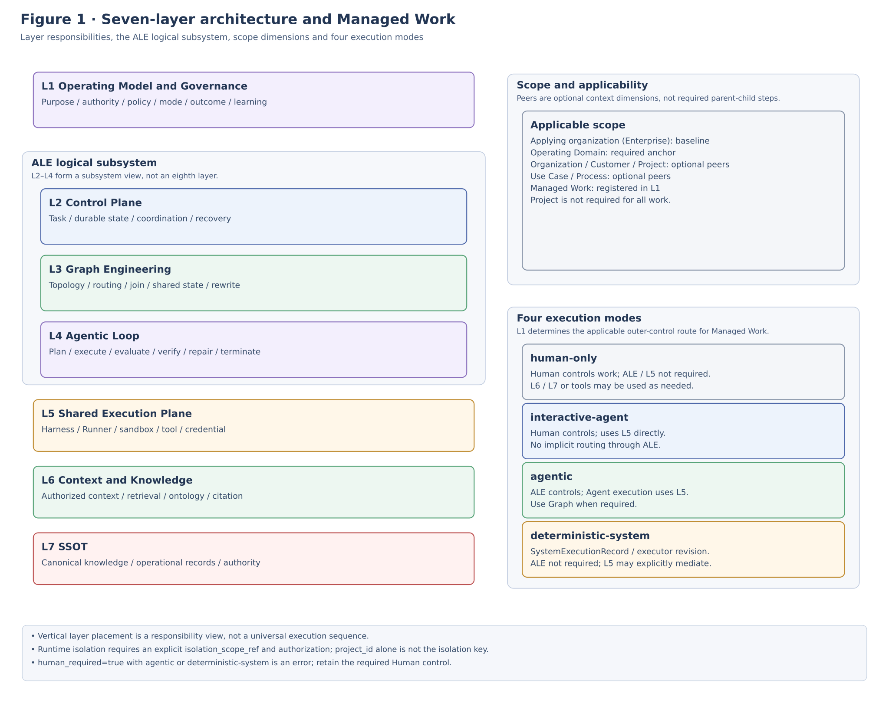
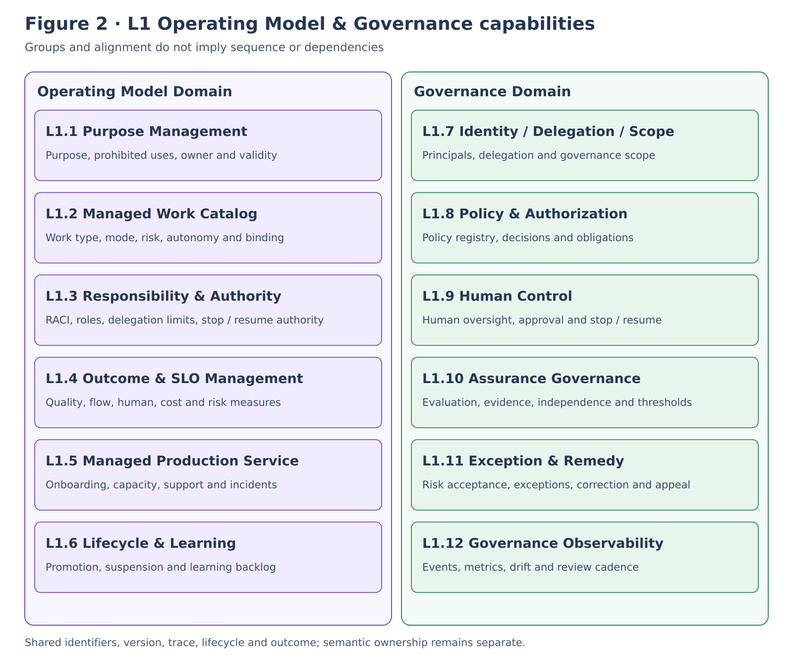
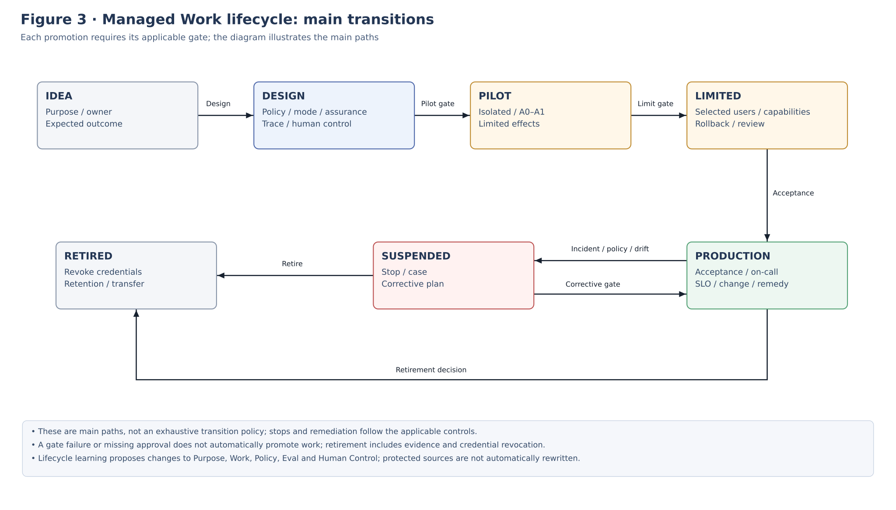
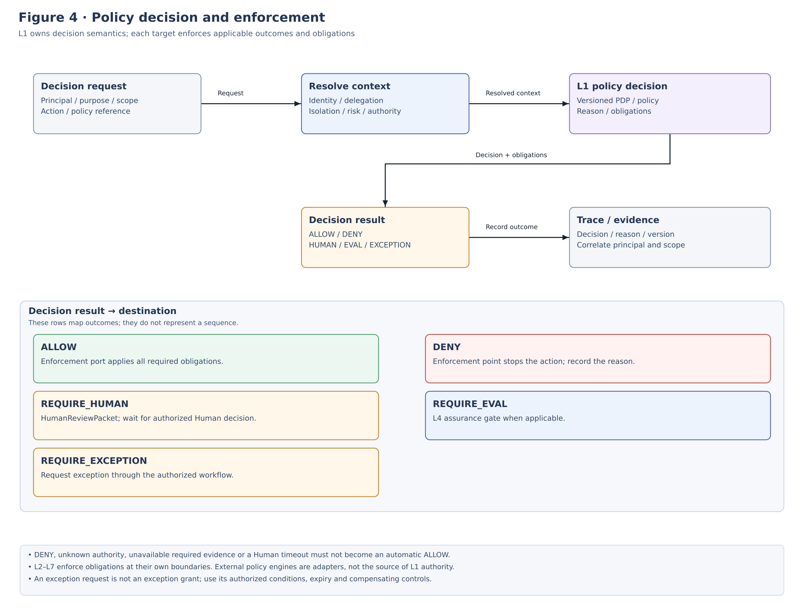
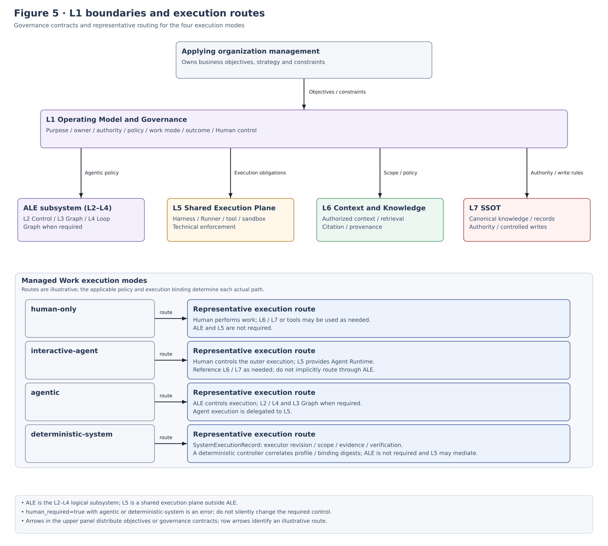
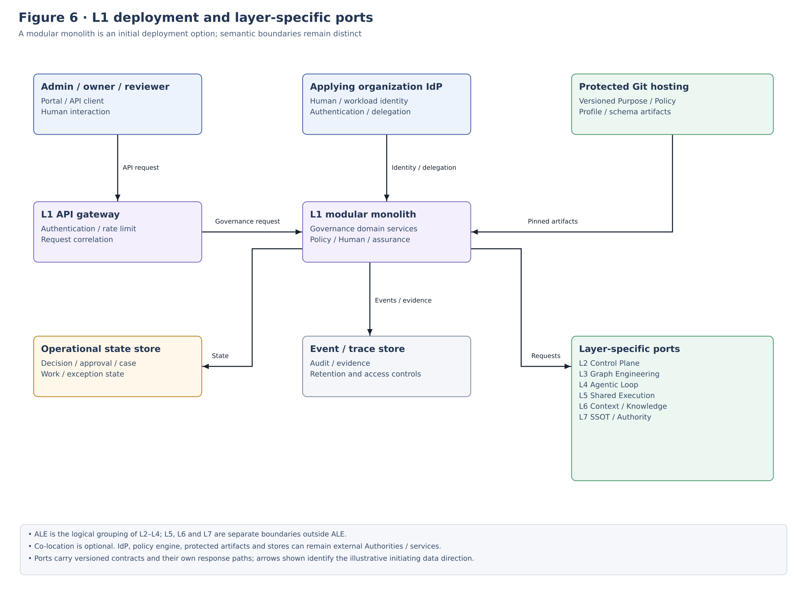

**IMPLEMENTATION STANDARD**

**ALOM L1**

**Operating Model & Governance**

**Implementation Architecture Standard**

Purpose / Managed Work / Authority / Outcome / Identity / Policy / Human Control / Assurance / Remedy / Learning

| **Core principle** Implement L1 as a Management & Governance Plane owned by the applying organization, providing Why / Who / Control / Measure and Execution Modes for ALOM Managed Work. Management of the applying organization itself remains external to ALOM. L1 receives Business Objectives and converts production activities into manageable contracts, controls, and outcome metrics. Treat ALE as the logical Execution Subsystem spanning L2-L4 and L5 as the ALOM Shared Execution Plane. |
|---------------------------------------------------------------------------------------------------------------------------------------------------------------------------------------------------------------------------------------------------------------------------------------------------------------------------------------------------------------|

| **Management item** | **Value** |
|--------------|----------------------------------------------|
| Document ID | ALOM-L1-STD-001 |
| Version | v0.7-review.20261110 |
| Created | 2026-08-13 |
| Governing standard | ALOM-ARCH-STD-001 v2.5 |
| Scope | ALOM L1 Operating Model & Governance |
| Management responsibility | Organization Architecture (Enterprise Architecture) / AI Platform |
| Shared responsibility | Business Owner / Security and Privacy / Quality |
| Classification | Public |

This specification elaborates the L1 requirements of the ALOM Integrated Architecture Standard v2.5 into implementable responsibilities, contracts, Execution Mode decisions, decision flows, physical configurations, and acceptance tests. ALE/L5 boundaries follow governing standard v2.5.

# **Document Control**

## **1. Position and Authority Precedence**

- This document elaborates L1 Operating Model & Governance of the ALOM Integrated Architecture Standard v2.5. It does not change the governing standard's MUST / MUST NOT requirements.

- If a conflict arises with the governing standard, ALOM-ARCH-STD-001 v2.5 takes precedence. Where laws, contracts, customer NDAs, or security and privacy rules are stricter, the stricter rule takes precedence.

- \[PROPOSAL\] denotes implementation details not specified by the governing standard. Standardize them through ADR / change request / Eval when adopted.

- Do not designate a particular IAM, Policy Engine, Workflow, or Dashboard product as the applying organization's canonical source for L1. Its canonical sources are standard contracts, versioned Artifacts, and formal Decision / Approval / Exception / Remedy records.

2026-10-27 v0.6: This version applies the scope model in ALOM-PROF-SCOPE-SPEC-001 v0.3 (required Operating Domain anchor, parallel optional overlays at rank 30 / rank 40, single values, optional `project_id`, and `isolation_scope_ref`) to the Section 1.x Profile Engineering overview, DraftProfileBundle terminology, Scope boundaries, GovernanceScope example, Security, NFR, Gates, and appendices.

| **Fixed boundary** Do not bring final Corporate Management decisions on Strategy, Market, Product, Pricing, M&A, Capital Allocation, Revenue/Profit Target, or similar matters into L1. L1 references them as Business Objective / Demand / Constraint and converts them into operating conditions for ALOM Managed Work. |
|--------------------------------------------------------------------------------------------------------------------------------------------------------------------------------------------------------------------------------------------------------------------|

## **2. Sources and Design Categories**

| **ID** | **Material** | **Use in this document** |
|--------|----------------------------------------------------------------|--------------------------------------------------------------------------------------------------------------------------------|
| S1 | ALOM-ARCH-STD-001 v2.5-review.20261110 | Non-effective alignment candidate; controlled authority remains v2.5. Inherits the seven layers, ALE=L2-L4, L5 Shared Execution, ALOM Managed Work, and OM/GOV/HUM/SEC/NFR/OPS. |
| S4 | ALOM Agentic Loop Implementation Architecture Standard / ALOM-LOOP-STD-001 v0.6-review.20261110 | Aligns the L1/L4 boundary, convergence control within ALE, and Eval/HumanReviewPacket/Termination/Remedy. |
| S6 | ALOM Context & Knowledge Implementation Architecture Standard / ALOM-KNW-STD-001 v0.4-review.20261110 | Aligns the L1/L6 boundary, purpose-before-retrieval, and scope/ACL. |
| S7 | ALOM SSOT Implementation Architecture Standard / ALOM-SSOT-STD-001 v0.5 | Aligns the L1/L7 boundary, Authority, Controlled Write, and Verification. |

The current authority for S1 is ALOM-ARCH-STD-001 v2.5, as stated in the management table.

# **Contents**

| **Chapter** | **Content** |
|--------|-------------------------------------------------|
| 1 | Purpose and Scope |
| 2 | Fixed Definitions and Responsibility Boundaries |
| 3 | L1 Architecture Principles |
| 4 | Overall ALOM Stack and Internal L1 Structure |
| 5      | Purpose Management                              |
| 6      | Managed Work Catalog                            |
| 7      | Responsibility & Authority                      |
| 8      | Outcome & SLO Management                        |
| 9      | Managed Production Service                      |
| 10     | Lifecycle & Learning                            |
| 11     | Identity / Delegation / Scope                   |
| 12     | Policy & Authorization                          |
| 13     | Human Control                                   |
| 14     | Assurance Governance                            |
| 15     | Exception / Break-glass / Remedy                |
| 16     | Governance Observability & Closed-loop Learning |
| 17 | Integration Boundaries with L2-L7 and Corporate Management |
| 18     | Canonical Data / Contract / Authority           |
| 19     | API / Event Architecture                        |
| 20     | Repository / CI/CD / Versioning                 |
| 21 | Physical Deployment Reference Configuration |
| 22     | Security / NDA / Privacy                        |
| 23 | Nonfunctional Requirements / SLO / Operations |
| 24 | Acceptance Gates and Conformance Tests |
| 25 | Implementation Roadmap and Backlog |
| Appendix A | Minimum Data Contracts |
| Appendix B | YAML / API Contract Examples |
| Appendix C | Governing Requirement Mapping |
| Appendix D | Technical Element Mapping |

# **1. Purpose and Scope**

## **1.1 Purpose**

L1 also contains Profile Engineering & Generation, an internal Subsystem that semiautomatically converts the applying organization's Canonical Rulebook and Business Mission / Objective / Demand / Constraint provided by its Corporate Management into Operating Profiles for Business (Operating Domain) / Organization, Customer, and Project (optional overlays) / Lifecycle / Managed Work / Execution. Outputs remain Draft; only human-approved Effective Profiles are reflected in the Managed Work Catalog and execution contracts.

This document defines the standard for implementing ALOM L1 Operating Model & Governance as the top-level Management & Governance Plane managing production and work performed by humans, AI Agents, deterministic automation, and external systems. L1 registers ALOM Managed Work, structures purpose, owner, authority, execution_mode, policy, human control, assurance, outcome, SLO, lifecycle, remedy, and learning, and distributes these as consistent contracts to L2-L7. Execution Mode specifies the routes for Human-only, Interactive Agent, Agentic, and deterministic-system work. L1 controls use of ALE (L2-L4) for Agentic Work and direct use of L5 ALOM Shared Execution Plane for Interactive Agent Work. deterministic-system is non-Agentic, does not require ALE (L2-L4), and does not make L5 globally mandatory.

The design goal is for the applying organization to retain the meanings of ALOM Managed Work's Why / Who / Control / Measure, responsibility, decisions, evidence, outcome measurement, and remedy even when IdP, Policy Engine, Workflow, Agent, Runner, or Knowledge products change.

## **1.2 In Scope**

- Profile Engineering & Generation: Mission intake, Rule/Standard resolution, Applicability, Organization/Role/Responsibility, Lifecycle/Process, Managed Work, Execution Suitability, Binding, Validation, Human Approval, and Profile Registry.

- Registration and versioning of ALOM Managed Work Purpose, Owner, Authority, Execution Mode, Risk, Autonomy, Outcome, SLO, Budget, and Lifecycle.

- Identity and Delegation for Human / Service / Agent / Workload / Delegator.

- Resolution of Tenant / Customer / Project / NDA / Classification / Purpose / Resource scope.

- Decision semantics for Policy, Human Control, Assurance, Exception, and Remedy.

- Evidence / Outcome registration and Review for Managed Work, including Human-only Work.

- Management of Operational Outcome, SLO, Capacity, Incident, Cost, Human Effort, and Governance Metrics.

- Distribution of Management/Governance Contracts to L2-L7 and Closed-loop Learning.

## **1.3 Out of Scope**

- Final Corporate Management decisions on business strategy, market selection, product / pricing strategy, M&A, capital policy, organization-wide capital allocation, and revenue / profit targets.

- Organization-wide personnel / compensation systems and organizational governance itself by boards or supervisory bodies. However, bringing production and work within those functions into Managed Work is in scope.

- L2 Control Plane Queue / Scheduler / Durable State, L3 Graph topology, L4 Loop convergence, L5 ALOM Shared Execution Plane physical Runner / Tool / Sandbox enforcement, L6 Knowledge internals, and L7 Canonical Authority.

- Design of internal LLM reasoning, model weights, or chain-of-thought.

## **1.4 Units of Conformance**

Conformance units are the ALOM applying organization/PJ, Use Case, ALOM Managed Work, Execution Mode, Human Workflow, Governance Profile, Policy Release, Human Control Rule, Assurance Policy, Outcome/SLO Profile, Lifecycle State, and Exception / Remedy Case. L1 registration defines the applicability boundary for ALOM Managed Work; using ALE or L5 is not itself a prerequisite. Figure 1 reuses Section 4.1 Baseline Architecture of governing standard ALOM-ARCH-STD-001 v2.5 as its baseline diagram, overlaying the seven-layer Layer View, ALE Subsystem View, and L1 conformance / Execution Mode boundaries.

[Open Figure 1 at full size](figures/ALOM-L1-STD-001-fig1-current.svg)

Figure 1. ALOM 7-Layer baseline architecture, ALE logical Subsystem, and L1 conformance boundary (based on ALOM-ARCH-STD-001 v2.5 Section 4.1).

## 1.5 ALOM Applicability and Execution Mode

Determine ALOM applicability by whether the relevant production or work unit is registered in L1 as ALOM Managed Work and has a management contract and Evidence path, not by its execution actor or use of AI. L1 also resolves execution_mode to human-only / interactive-agent / agentic / deterministic-system and determines the execution route. hybrid is not an Execution Mode. Work Type deterministic is not equivalent to execution_mode deterministic-system. ALE is a logical Execution Subsystem comprising L2 Control Plane, L3 Graph Engineering, and L4 Agentic Loop, not a Layer itself. L5 ALOM Shared Execution Plane is not exclusive to ALE; Interactive Agent Work can also use it directly.

- human-only: A human controls the outer execution. ALE/L5 are not required; correlate execution and outcomes through HumanWorkRecord / Evidence.

- interactive-agent: A human controls the outer execution and interacts with Agent Runtime directly through L5 ALOM Shared Execution Plane. interactive-agent does not pass through ALE.

- agentic: ALE controls the outer execution using L2 Control Plane, L3 Graph Engineering, and L4 Agentic Loop capabilities. agentic requires ALE (L2-L4) and delegation of execution to L5.

- deterministic-system: A deterministic program/service/system is the primary executor. deterministic-system does not require ALE (L2-L4) and does not make L5 globally mandatory. Explicit L5 mediation does not imply Agent Runner / L4 / ALE. Correlate execution through SystemExecutionRecord. task_id is agentic-only and MUST NOT be required for deterministic-system. deterministic-system does not reuse HumanWorkRecord as its execution record. SystemExecutionRecord correlates profile / binding / executor revision / evidence and does not acquire Human/Business/L7 Authority. human_required=true together with execution_mode=deterministic-system is an ERROR.

- ALOM Managed Work must identify at least purpose, owner, authority, policy, outcome/evidence, and lifecycle, and be subject to L1 registration, control, and Review.

- Human-only Work is ALOM Managed Work whose primary outcome generation or work performance is undertaken by humans. Neither ALE nor L5 Shared Execution Plane is required for execution to be valid. Deterministic Tools, external Systems, L6 Context & Knowledge, and L7 SSOT may be used as needed.

- Human Task is a unit of decision, approval, or work assigned to a human within an ALE execution context for Agentic Work or a human-led session for Interactive Agent Work; distinguish it from independent Human-only Work.

- Unregistered ad-hoc work, general manual work, and merely viewing or referencing L6/L7 are not, by themselves, ALOM Managed Work.

# **2. Fixed Definitions and Responsibility Boundaries**

Profile Engineering & Generation: An implementation Subsystem that compiles the L1-owned Operating Model contract from Mission and Canonical Rulebook into a form that can be generated as Draft, validated, and approved. It is not an eighth Layer.

DraftProfileBundle: A non-authoritative artifact bundling candidate structures for Business (Operating Domain) / Organization, Customer, and Project (optional overlays) / Lifecycle / Managed Work / Execution, together with Provenance, unresolved decisions, and validation results.

EffectiveProfile: An approved Profile that has passed Human Approval, pins source revision / compiler version / schema version / approval / digest, and is available for Runtime reference.

| **Term** | **Fixed definition** | **Not equivalent to** |
|---------------------------------|--------------------------------------------------------------------------------------------------------------------------------------------------------------------------------------------------------------------------------------------------------------------------------------------------------------|------------------------------------------------------------|
| L1 Operating Model & Governance | L1 defines Why / Who / Control / Measure for ALOM Managed Work and distributes these as Management / Governance Contracts to subordinate Layers. | All of Corporate Management / Dashboard / IAM alone |
| ALOM Managed Work | A production or work unit registered within L1's management boundary, with identifiable and controllable purpose, owner, authority, policy, and outcome/evidence. | Only Agent Tasks / merely referencing L6 or L7 |
| Human Work | A general term for activities in which humans produce outcomes, make decisions, approve, operate, verify, or perform other work, whether or not registered in ALOM. | Being ALOM Managed Work / Human-only Work |
| Human-only Work | ALOM Managed Work whose primary outcome generation or work performance is by a Human and for which ALE and L5 ALOM Shared Execution Plane are not required execution components. It is subject to L1 management of purpose, owner, authority, policy, outcome/evidence, and lifecycle. Use of L6 Context & Knowledge, L7 SSOT, deterministic Tools, and external Systems is optional. | General manual work / Human Task / merely referencing L6 or L7 |
| Human Task | A Work Unit requiring human decisions, approval, work, checking, or similar activity within an ALE execution context for Agentic Work or a human-led session for Interactive Agent Work. Correlates with the state, Evidence, and Control of its parent Work/Task/Loop/Session. | Human-only Work / Human Control Policy itself |
| Human Workflow | A work route connecting one or more Human-only Work units or human decision steps under L1 management of purpose, authority, policy, outcome/evidence, and lifecycle. ALE Orchestration is not required. | Graph topology / merely a procedure document |
| PurposeRecord | A Versioned Artifact fixing the relevant Work's purpose, prohibited uses, owner, validity period, and Business Objective reference. | The applying organization's management strategy itself |
| ManagedWorkDefinition | A Canonical definition declaring Work type, execution mode, risk, autonomy, SLO, budget, state, and binding. | TaskRun / ticket body |
| ResponsibilityAssignment | A contract assigning responsibility for definition / execution / outcome / risk / approval / stop / resume and similar matters to Roles. | Only a username |
| GovernanceProfile | An applicable Profile for scope, autonomy ceiling, policy, human, assurance, exception, remedy, trace, and similar conditions. | A Policy Engine-specific DSL |
| PolicyDecision | A decision of ALLOW / DENY / REQUIRE_HUMAN / REQUIRE_EVAL / REQUIRE_EXCEPTION and obligations in response to structured input. | Free-text LLM judgment |
| OutcomeSpec | A contract defining Operational Outcomes such as quality, Flow, Human Effort, Cost, and Risk, and their measurement methods. | Revenue / Profit itself |
| LifecycleRecord | A record retaining states from IDEA to RETIRED, Gates, approvals, and Suspension/Retirement evidence. | Merely a status column |
| RemedyCase | A remedy Case tracking correction, objection, deletion, rollback, independent reconsideration, and explanation. | Only technical Incidents |
| ALE (Agent Loop Engine) | A logical Execution Subsystem comprising ALOM L2 Control Plane, L3 Graph Engineering, and L4 Agentic Loop. Controls durable Task coordination, organization of multiple Work Units, and iterative convergence of a single Work Unit through contracts owned by the applying organization. | L2 alone / L5 Shared Execution Plane / Agent Runner product |
| ALOM Shared Execution Plane | L5. Provides shared execution capabilities including Harness / Runner / Execution Worker / Sandbox / Tool / Credential / Runtime Telemetry, used by both Agentic Work through ALE and human-led Interactive Agent Work. | ALE itself / Agentic Loop / a standalone Runner product |
| Execution Mode | The outer control method that L1 determines for each Managed Work. Standard values are human-only / interactive-agent / agentic / deterministic-system, determining the execution entry point and required Layers/Subsystems. hybrid is not an Execution Mode. | Work Type / Autonomy Level / Runner internal mode |
| Interactive Agent Work | execution_mode=interactive-agent. Managed Work in which humans control the outer execution and interact with Agent Runtime on L5 Shared Execution Plane to produce outcomes. Do not equate a Runner's internal loop with L4 Agentic Loop. | Agentic Work / a single LLM interaction |
| Agentic Work | execution_mode=agentic. Managed Work in which ALE controls the outer execution and bounds planning, organization, evaluation, repair, and stopping. Agent execution is delegated to L5. | Interactive Agent Work / merely autonomous behavior inside a Runner |

| **Responsibility boundaries** L1 = Management / Governance semantics. L2 = Durable Coordination (Control Plane). L3 = Work topology. L4 = Work convergence. L5 = ALOM Shared Execution / Technical Enforcement. L6 = Authorized Context. L7 = Canonical Authority / Record. ALE is a logical Subsystem grouping L2-L4, neither an eighth Layer nor another name for L2 alone. |
|------------------------------------------------------------------------------------------------------------------------------------------------------------------------------------------------------------------------------------------------------------------------------------------------------------------------------------------|

# **3. L1 Architecture Principles**

L1-P13 Profile engineering: Be able to convert Business Mission into an Operating Profile conforming to the applying organization's standards.

L1-P14 Draft-only generation: AI/Generator can propose Profile Drafts but has no final Authority to make them Effective.

L1-P15 Human-required preservation: Do not automatically replace Work requiring Human Authority with Agentic execution where that requirement arises from interpersonal relationships, customer approval, quality accountability, or legal / contractual responsibility.

L1-P16 Reproducible profile: Pin Mission, Rule revision, Applicability decision, compiler/schema version, and approval; ensure semantic reproducibility from the same inputs.

| **ID** | **Principle** | **Normative requirement** |
|--------|----------------------------------|---------------------------------------------------------------------------------------------------------------------------------------|
| L1-P01 | ALOM scope discipline | L1 is limited to production management for ALOM Managed Work and does not own Corporate Management decision authority. |
| L1-P02 | Managed Work first | Determine ALOM applicability by registration of purpose/owner/policy/outcome as Managed Work in L1, not by the execution actor. |
| L1-P03 | Contracts owned by the applying organization | Do not delegate the meanings of Purpose / Work / Policy / Decision / Outcome / Lifecycle / Remedy to product-specific state. |
| L1-P04 | Purpose before privilege | Resolve purpose / principal / scope before permission granting, retrieval, Action, or Tool execution. |
| L1-P05 | Default deny / fail-closed | If any required Identity, scope, policy, approval, authority, or other condition cannot be resolved, do not authorize the operation; do not assume the unresolved condition is satisfied. |
| L1-P06 | Risk-proportionate human control | Place HITL/HOTL/HIC according to A0-A4, impact, reversibility, uncertainty, authority, and evaluation disagreement. |
| L1-P07 | Independent assurance | Do not pass work solely on Generator self-evaluation; independently deploy Private Eval / Deterministic / Oracle / Human checks as required. |
| L1-P08 | No silent exception | Policy deviations are Exceptions / Break-glass events carrying scope, TTL, owner, reason, and compensating control. |
| L1-P09 | Outcome multidimensionality | Separate Quality / Flow / Human Effort / Cost / Risk; do not optimize for a single KPI alone. |
| L1-P10 | Trace by default | Correlate Decision / Approval / Exception / Outcome / Stop / Remedy / Review through trace_id / case_id. |
| L1-P11 | Living operating artifact | Purpose / Work / Policy / Profile / Outcome / Lifecycle rules go through change request, Eval, progressive rollout, rollback, and review. |
| L1-P12 | Portability | Preserve standard contracts and acceptance semantics when changing IdP / Policy Engine / Workflow / Dashboard. |
| L1-P17 | Layer / Subsystem separation | Manage the seven-layer Layer View and ALE Subsystem View as separate classification axes; do not define L2 as ALE itself. |
| L1-P18 | Explicit execution routing | Require execution_mode in ManagedWorkDefinition; deterministically resolve ALE/L5 routes for human-only / interactive-agent / agentic / deterministic-system. |

# **4. Overall ALOM Stack and Internal L1 Structure**

L1 places Operating Model Domain and Governance Domain within the same Layer. Do not treat them as one monolithic service. Separate their Semantic Ownership while sharing common identifiers, Version, Trace, Lifecycle, and Outcome.

Figure 2. Twelve L1 Operating Model & Governance capabilities grouped by responsibility. Grouping and alignment do not imply a sequence or dependencies; see §4.1 for the full responsibilities and canonical records.

[Open Figure 2 at full size](figures/ALOM-L1-STD-001-fig2-current.svg)

## **4.1 Twelve Internal L1 Capabilities**

| **No.** | **Capability** | **Main responsibilities** | **Main canonical source / record** |
|---------|-------------------------------|-------------------------------------------------------------|--------------------------------------|
| L1.1 | Purpose Management | Purpose, prohibited uses, Owner, validity period, external Business Objective reference | PurposeRecord |
| L1.2 | Managed Work Catalog | Work type, execution mode, risk, autonomy, binding, state | ManagedWorkDefinition |
| L1.3    | Responsibility & Authority    | RACI, Role, Delegation ceiling, Stop/Resume authority       | ResponsibilityAssignment             |
| L1.4 | Outcome & SLO | Define Quality/Flow/Human/Cost/Risk, SLOs, and measurement methods | OutcomeSpec / SLOProfile |
| L1.5    | Managed Production Service    | Onboarding, capacity, support, incident, change, review     | ServiceProfile                       |
| L1.6    | Lifecycle & Learning          | IDEA-RETIRED, promotion/suspension, learning backlog       | LifecycleRecord                      |
| L1.7    | Identity / Delegation / Scope | Principal, Delegation, Tenant/PJ/NDA/Classification         | Principal / GovernanceScope          |
| L1.8    | Policy & Authorization        | Policy Registry, PDP, Decision, Obligation                  | GovernancePolicy / PolicyDecision    |
| L1.9    | Human Control                 | HITL/HOTL/HIC, Approval, Stop/Resume/Rollback               | HumanReviewPacket / ApprovalDecision |
| L1.10 | Assurance Governance | Eval/Oracle/Evidence requirements, independence, thresholds | AssurancePolicy |
| L1.11   | Exception & Remedy            | Risk Acceptance, Break-glass, Correction/Appeal/Rollback    | ExceptionGrant / RemedyCase          |
| L1.12   | Governance Observability      | Event, Metric, Drift, Review cadence, closed-loop feedback  | GovernanceEvent / ReviewRecord       |

## 4.2 Profile Engineering & Generation Subsystem

Place Mission Intake / Rule Resolution / Applicability / Organization Modeling / Lifecycle Modeling / Work Decomposition / Execution Suitability / Runtime Binding / Compiler / Validator / Approval Workflow / Effective Profile Registry / Drift Monitor as a design stage before L1's internal capabilities. These do not replace existing L1 capabilities; they expand approved Profiles into Purpose, Managed Work, Authority, Policy, Human Control, and Outcome/SLO inputs.

| Capability | Responsibility | Main artifact |
|---------------------------------|-----------------------------------------------|------------------------------------------|
| Mission Intake | Normalize Mission and Constraints; establish scope | MissionSpec |
| Rule Resolution | Resolve Rulebook from L6/L7 with Authority/Revision | RuleResolutionSet |
| Applicability | Decide applicability / exclusions / conditions / precedence | ApplicabilityDecision |
| Organization/Lifecycle Modeling | Generate Unit/Role/Responsibility/Phase/Gate | OrganizationProfile / LifecycleProfile |
| Work Decomposition | Generate Managed Work candidates | ManagedWorkProfile\[\] |
| Execution Suitability | Determine human-only / interactive-agent / agentic / deterministic-system | ExecutionSuitabilityResult |
| Binding | Resolve references to L2-L7 contracts | ExecutionBinding |
| Compiler/Validator | Compose Profiles; check schema/conformance/conflicts | DraftProfileBundle / ValidationReport |
| Approval/Registry               | Human Review/Approval, Effective release      | ApprovalRecord / EffectiveProfile |

# **5. Purpose Management**

## **5.1 PurposeRecord**

All ALOM Managed Work MUST resolve to a purpose_id. Purpose does not replicate the applying organization's strategy. It normalizes why the Work is performed, what is prohibited, who is accountable, and when it is valid into an actionable level of detail within ALOM.

| **Item** | **Requirement** |
|----------|--------------------------------------------------------------------------------|
| Identity | Uniquely establish purpose_id, version, and owner. |
| Purpose | Describe the Work's expected outcome in business terms, separately from the Task Prompt. |
| Prohibitions | Specify prohibited_purposes / forbidden_effects. |
| Boundary | Allow references to tenant / domain / present overlays (organization / customer / project / usecase / process) / `isolation_scope_ref` / classification. |
| Validity | Provide valid_from / valid_until / review_due. |
| External linkage | business_objective_ref is a reference only; do not replicate the Corporate Management canonical source. |

<table>
<colgroup>
<col style="width: 100%" />
</colgroup>
<thead>
<tr class="header">
<th>apiVersion: alom/v1 
kind: PurposeRecord 
metadata: 
id: dev.maintenance.fix 
version: 1.0.0 
objective: "Complete incident remediation safely" 
prohibited: [direct-production-change] 
owner: team-app-a 
validity: {from: 2026-08-12, review_due: 2026-11-12} 
business_objective_ref: corp-objective://delivery/quality</th>
</tr>
</thead>
<tbody>
</tbody>
</table>

## **5.2 Purpose Resolver**

At the Task/Work entry point, resolve purpose_id from ManagedWorkDefinition and actor context instead of sending a free-text request directly to Policy. Unresolvable purpose, multiple candidates, or conflict with prohibited purposes must fail closed and return to Human Review or Work registration.

# **6. Managed Work Catalog**

## **6.1 Work Model**

| **Execution Mode** | **Outer controller** | **Standard execution route** | **ALE / L5** |
|--------------------|--------------------|------------------------------------------------------------------------|--------------------------------------|
| human-only | Human | Human → L6/L7, deterministic Tools, or external Systems as needed | ALE: No / L5: No (optional Tool use is allowed) |
| interactive-agent | Human | Human → L5 Shared Execution → Agent Runner; reference L6/L7 as needed | ALE: No / L5: Yes |
| agentic | ALE | L2 Control → L3 Graph (when required) → L4 Agentic Loop → L5 Shared Execution | ALE: Yes / L5: Yes for Agent execution |
| deterministic-system | deterministic program/service/system | SystemExecutionRecord + executor revision + scope + evidence + verification. Correlate profile digest / binding digest with SystemExecutionRecord. L5 MAY explicitly mediate Worker/Tool/CI/Isolation | ALE: No / L5: No (optional explicit L5 mediation is allowed) |

Work Type (such as human / agent / hybrid / deterministic / external-legacy) is a classification orthogonal to Execution Mode. Work Type describes what constitutes the work; Execution Mode describes who owns the outer control loop. Work Type deterministic is not equivalent to execution_mode deterministic-system. hybrid is not an Execution Mode.

## **6.2 ManagedWorkDefinition**

ManagedWorkDefinition is the design-time canonical definition of Work, distinct from TaskRun or LoopRun. It retains at least owner, purpose, work_type, execution_mode, risk_class, autonomy_ceiling, outcome_ref, SLO, budget, lifecycle_state, and execution_binding. Resolve execution_mode from human-only / interactive-agent / agentic / deterministic-system. The binding fixes whether to use the HumanWorkRecord route, L5 Shared Execution Profile, ALE entrypoint, or SystemExecutionRecord route.

<table>
<colgroup>
<col style="width: 100%" />
</colgroup>
<thead>
<tr class="header">
<th>kind: ManagedWorkDefinition 
metadata: {id: dev.code-maintenance, version: 2.2.0} 
purpose_ref: dev.maintenance.fix@1.0.0 
owner: app-maintenance-owner 
work_type: hybrid 
execution_mode: agentic 
risk_class: medium 
autonomy_ceiling: A2 
outcome_ref: outcome.dev-maintenance@1.0 
slo_ref: slo.dev-maintenance@1.0 
execution_binding: 
ale_entrypoint: graph://dev-maintenance@3 
shared_execution_profile: execution://dev-agent@2 
governance_profile: gov://dev.code-change@2</th>
</tr>
</thead>
<tbody>
</tbody>
</table>

## **6.3 Registration Gate**

## 6.3.1 Profile-generated Registration Gate

A ManagedWorkDefinition generated by Profile Engineering can be registered only if source Mission/Rule revision, Execution Suitability, Human Control, Outcome/SLO, Authority, L2-L7 Binding, ValidationReport, and ApprovalRecord are resolvable. Registration must fail closed if unresolved rules/conflicts remain.

- Purpose is valid.

- Owner / Risk Owner / Stop Authority are assigned.

- Policy / Governance Profile is resolvable.

- Execution Mode and execution_binding are consistent, with no contradictions such as requiring ALE for human-only, implicitly routing interactive-agent through ALE, unresolved ALE for agentic, or requiring ALE/task_id for deterministic-system. human_required=true together with execution_mode=deterministic-system is an ERROR.

- Outcome / Evidence requirements are defined.

- Human-only Work has a HumanWorkRecord / Evidence Submission route and can correlate Outcome / Evidence with ManagedWorkDefinition.

- Mandatory Gates for the Lifecycle state are satisfied.

## 6.4 Human-only Work Applicability Requirements

Human-only Work is a Managed Work type that makes human-led production and work within ALOM's management boundary reproducible, auditable, and improvable without assuming ALE or Agent Runtime. Being Human-only does not itself establish ALOM applicability. The following conditions establish it as ALOM Managed Work.

- ManagedWorkDefinition is registered; work_id, execution_mode=human-only, purpose_id, and owner are established; ALE/L5 is not a required binding.

- ResponsibilityAssignment identifies Execution Owner, Outcome Owner, required Risk Owner, and Stop / Resume Authority.

- GovernanceProfile / Policy is resolvable; applicable scope, classification, prohibitions, and Human Control conditions are explicit.

- OutcomeSpec / SLOProfile or equivalent completion and quality conditions are defined; required Evidence and Review conditions are explicit.

- HumanWorkRecord or equivalent Evidence Submission correlates execution actor, execution period, referenced information, decision / operation results, Outcome, and Evidence with work_id / purpose_id.

- Whether L6 Context & Knowledge, L7 SSOT, external Systems, or deterministic Tools are used is not an applicability condition. When used, retain revision / authority / source references in HumanWorkRecord as required.

- General manual work, ad-hoc work, and merely viewing Knowledge/SSOT that are not registered as ALOM Managed Work are not treated as Human-only Work.

Boundary with Human Task: Approval, decision, and work assigned to humans during ALE execution for Agentic Work or during a human-led Interactive Agent Work session are Human Tasks. Human Tasks correlate with execution state in parent TaskRun / GraphRun / LoopRun / Session and similar records, and are distinct from the independent Human-only Work execution route.

## 6.5 Interactive Agent Work Applicability Requirements

Interactive Agent Work is Managed Work in which a human owns the outer control through conversation, additional instructions, adoption decisions, and stopping, directly using an Agent Runner on L5 ALOM Shared Execution Plane. Do not equate tool-use/retry/session loops inside a Runner with L4 Agentic Loop.

- Pin execution_mode=interactive-agent in ManagedWorkDefinition and resolve the L5 execution profile / Harness / Runner capability.

- A Human is the primary decision maker for continue / modify / accept / stop; the applying organization's ALE does not autonomously continue Plan→Evaluate→Repair→Terminate.

- Policy, Scope, Context, Tool, Trace, and Outcome/Evidence follow L1 contracts and are physically enforced in L5.

- Promotion to autonomous iterative convergence requires changing execution_mode to agentic and explicitly assigning an ALE binding.

## 6.6 Agentic Work Applicability Requirements

Agentic Work is Managed Work in which ALE owns the outer control and bounds execution using the applying organization's semantics in L2 Control Plane, L3 Graph Engineering, and L4 Agentic Loop. Use L3 Graph capabilities according to Work topology; delegate Agent Runtime execution to L5 Shared Execution Plane.

- Pin execution_mode=agentic in ManagedWorkDefinition; resolve ALE entrypoint, success/stopping conditions, budget, and human/eval gates.

- Preserve Semantic Ownership: L2 for Task/Durable State/Scheduler, L3 for Topology/Routing/Join, and L4 for Plan/Evaluate/Verify/Repair/Termination.

- Treat L5 as a shared Execution Plane outside ALE, not an internal ALE Layer; Runner-specific sessions must not become ALE Canonical State.

# **7. Responsibility & Authority**

L1 separates actor Identity from responsibility roles. Who is assigned a role may be resolved through an IdP, but which Role has which Decision Authority is versioned as the applying organization's L1 contract.

| **Role** | **Minimum responsibilities** |
|--------------------|----------------------------------------------|
| Managed Work Owner | Ultimate accountability for purpose, scope, outcomes, and Lifecycle. |
| Definition Owner | Responsibility for changes to Work / Policy / Outcome definitions. |
| Execution Owner | Day-to-day execution, SLO, capacity, and incidents. |
| Risk Owner | risk acceptance, exceptions, and residual risk. |
| Approver | Approve/reject/modify at Human Gates. |
| Stop Authority | Initiate Stop / Suspend. |
| Resume Authority | Decide resumption after remediation. |
| Retirement Owner | Retirement, including credentials, knowledge, and retention. |

## **7.1 Authority Matrix**

Authority depends on Purpose / Scope / Action / Risk Class / Autonomy / Time. Do not grant permanent administrative privileges solely by Role name; resolve them through Delegation and PolicyDecision at runtime.

# **8. Outcome & SLO Management**

L1 defines ALOM Operational Outcomes. Corporate Outcomes such as Revenue / Profit may be referenced, but L1 does not attribute or guarantee them as its direct KPIs. Manage Business Outcome Model separately as the connection model to the external ALOM environment.

| **Dimension** | **Representative metrics** | **Purpose** |
|------------------|---------------------------------------------------|------------|
| Quality | acceptance, defect, rework, eval pass | Outcome quality |
| Flow | throughput, lead time, cycle time, WIP | Delivery capacity |
| Human | human effort, touch time, HITL load, escalation | Human workload |
| Economics | AI cost, human cost, cost/accepted outcome | Production cost |
| Risk / Assurance | policy deny, incident, oracle mismatch, remedy | Control quality |
| Learning | reuse, repeat failure, policy effectiveness, debt | Improvement capability |

## **8.1 OutcomeSpec**

OutcomeSpec defines what qualifies as an outcome, rather than merely what can be measured. Pin measurement Source, denominator, time Window, Accepted Outcome conditions, Evidence requirements, and Freshness.

## **8.2 SLO**

SLOs include Governance SLOs as well as Service Levels. Examples: Policy Decision latency, Approval timeout, Stop propagation, Trace completeness, Exception expiry, and Remedy case traceability.

# **9. Managed Production Service**

When operating Managed Work in Production, manage Onboarding, Capacity, Support, Incident, Change, and Review as a Managed Production Service, beyond merely registering it in a Catalog.

| **Capability** | **Minimum requirements** |
|----------------|------------------------------------------------------------------------------------|
| Onboarding | Validate Purpose/Work/Policy/Outcome/Lifecycle together and generate initial Gates. |
| Capacity | Make Human / Agent / Runner capacity, quotas, backlog, and concurrency visible. |
| Support | Specify Owner, on-call/escalation, and support window. |
| Incident | Connect to Stop, isolation, rollback, and remedy. |
| Change | Change request, impact, eval, progressive rollout, rollback. |
| Review | Periodically review SLO, risk, cost, human effort, exception/remedy, and knowledge freshness. |

# **10. Lifecycle & Learning**

[Open Figure 3 at full size](figures/ALOM-L1-STD-001-fig3-current.svg)

Figure 3. Standard ALOM Managed Work Lifecycle and Main Transitions

| **State** | **Main activities** | **Promotion / Exit Gate** |
|------------|--------------------------------------------------------------------------------------------------------------------|-------------------------------|
| IDEA | Purpose, owner, targets, prohibitions, expected Outcome | PurposeRecord |
| DESIGN | Design Policy, Execution Mode, ALE (Control/Graph/Loop) / L5 Shared Execution as needed, Knowledge, Eval, Trace, and HITL | ADR / Threat model / schemas |
| PILOT | A0/A1, isolated, read-only or limited to branch/PR | 0 unapproved external changes |
| LIMITED | Limited PJs/users, selected A2 capabilities, HOTL, rollback | SLO / incident review |
| PRODUCTION | Passed acceptance Gates, on-call, capacity, change, remedy | release approval |
| SUSPENDED | Major incident, policy deviation, evaluation degradation, missing Trace | stop / case / corrective plan |
| RETIRED | Credential revocation, binding termination, retention/deletion, knowledge transfer | retirement evidence |

## **10.1 Closed-loop Learning**

Lifecycle review consumes Trace / Outcome / Incident / Exception / Remedy / Debt and returns change Proposals to Purpose, WorkDefinition, Policy, Eval, Human Control, and SLO. AI may generate Proposals but does not write directly to the protected default branch.

# **11. Identity / Delegation / Scope**

## **11.1 Principal & Delegation**

| **Subject** | **Minimum requirement** |
|------------|--------------------------------------------------------------------------|
| Human      | actor_id, org, role, authn context, MFA/assurance level.                |
| Service    | service principal, owner, purpose binding, rotation.                    |
| Agent      | agent_id, runtime/model class, delegator, task/purpose scope.           |
| Workload   | ephemeral workload identity, TTL, audience, revocation.                 |
| Delegation | Record delegator→delegatee, purpose, scope, capability, TTL, and revocation. |

## **11.2 GovernanceScope**

> **Partial illustrative excerpts:** These examples are field excerpts, not complete CommonScopeContracts or executable requests. Actual inputs must satisfy the applicable schema/version, scope_ref, enterprise_id, domain_id, isolation_scope_ref, runtime work_id, classification, authorization, and required contract fields. Project is optional; do not invent missing values.

<table>
<colgroup>
<col style="width: 100%" />
</colgroup>
<thead>
<tr class="header">
<th>scope: 
tenant_id: customer-a 
project_id: project-x 
isolation_scope_ref: scope://customer-a/project-x 
purpose_id: dev.code-review 
classification_ceiling: confidential 
cross_project: deny 
resource_domains: 
repositories: [project-x/*] 
knowledge: [project-x/*] 
tools: [git_hosting.project-x] 
trace_access: project-only</th>
</tr>
</thead>
<tbody>
</tbody>
</table>

| **Required** Cross-isolation boundaries (different `isolation_scope_ref`, including cross-project / cross-customer) and NDA boundaries must not rely solely on UI filters. Propagate Scope through L2 Control Plane state/queue, L5 Shared Execution runner/container/network/secret, L6 index/cache, L7 authority, and Trace access. |
|----------------------------------------------------------------------------------------------------------------------------------------------------------------------------------------------------------------|

# **12. Policy & Authorization**

[Open Figure 4 at full size](figures/ALOM-L1-STD-001-fig4-current.svg)

Figure 4. Standard Policy Decision / Authorization Flow (connection sources and destinations shown explicitly)

## **12.1 Policy Model**

| **Policy Category** | **Main decision subjects** |
|-----------------------|------------------------------------------------------------|
| Purpose | Permitted purposes, prohibited purposes, use case owner, risk owner. |
| Data / Classification | data class, PII, customer/NDA, retention/deletion.        |
| Tool / Action         | capability, arguments, target, precondition, rollback.    |
| Autonomy              | A0-A4 ceiling, allowed effect, human control.            |
| Budget / Time         | cost, token, duration, retry, deadline.                   |
| Assurance             | Eval, Oracle, Evidence, threshold, independence.          |
| Exception / Remedy    | exception owner, TTL, compensating control, case/redress. |

## **12.2 PDP / Enforcement Boundary**

L1 owns the Policy Decision Point and Decision semantics. L2-L7 enforce obligations within their respective responsibility boundaries. Policy Engine products are Adapter implementations, not the ALOM Policy Contract itself.

| **Decision** | **Meaning** | **Typical action** |
|-------------------|------------------------------------|-------------------------------------------------------|
| ALLOW | Authorized; may carry obligations. | Enforce Trace / Eval / Read-after-write and other obligations. |
| DENY | Not authorized. | Stop the Action; record the reason and Policy version. |
| REQUIRE_HUMAN | Human judgment required. | Generate HumanReviewPacket. Agentic work waits durably in L2 Control Plane; other modes wait within a bound enforced by their Human Workflow, interactive session, or deterministic executor controller. |
| REQUIRE_EVAL | Additional assurance required. | Agentic work uses L4 Eval/Verify Gate; other modes use the independent mode-specific assurance required by AssurancePolicy. |
| REQUIRE_EXCEPTION | Not permitted by ordinary Policy, but an exception may be requested. | Exception workflow. |

# **13. Human Control**

## **13.1 Human Gate Trigger Conditions**

Profile Engineering MUST be able to set Human-required for customer negotiation, customer request / requirement approval, contractual expressions of intent, independent quality decisions, major exception approval, Production Go/No-Go, and similar work, even when Agents are technically capable of performing it. Include these in Execution Suitability regression tests.

| **ID** | **Condition** | **Decision example** |
|--------|------------|--------------------------------------------------------------|
| HUM-01 | Irreversibility | Rollback impossible or recovery cost exceeds the threshold. |
| HUM-02 | High impact | Production, customers, money, contracts, legal matters, HR, safety, confidential data. |
| HUM-03 | Authority | Privileged credentials, privilege escalation, network/data boundary changes. |
| HUM-04 | Uncertainty | confidence / evidence completeness / freshness below thresholds. |
| HUM-05 | Deviation | Policy exceptions, unregistered Tools, cross-isolation access (including cross-PJ), signs of prohibited uses. |
| HUM-06 | Failure to converge | Identical failures, retries, rewrites, cost, or time reach thresholds. |
| HUM-07 | Evaluation disagreement | generator / evaluator / oracle / human judgments disagree. |
| HUM-08 | Remedy | A complaint, correction, objection, deletion, or reconsideration case begins. |

## **13.2 Decision Packet**

| **Category** | **Required fields** |
|----------|-------------------------------------------------------------------|
| Identity | work_id, trace_id, purpose_id, use_case_id (when the UseCase overlay applies), actor/delegator. task_id applies only to agentic work; other modes correlate through the applicable HumanWorkRecord, session, or SystemExecutionRecord reference |
| Request | requested_action, target, arguments summary, requested time |
| Reason | Necessity within the plan, expected effect, success conditions |
| Evidence | source, revision, eval, oracle, confidence, freshness |
| Impact | data/system/customer/financial scope, reversibility, blast radius |
| Alternatives | no-action, lower-impact option, degraded-operation option, postponement |
| Recovery | rollback plan, read-after-write verification, owner |
| Decision | APPROVE / REJECT / MODIFY / ESCALATE / STOP, reason, deadline |

When the approval deadline is exceeded, fail-closed is the default. Processing MUST NOT transition to automatic approval or unconditional retry.

# **14. Assurance Governance**

L1 does not execute evaluation logic itself. It defines in AssurancePolicy which Work/Action requires which Eval / Oracle / Evidence, together with thresholds, independence, and conflict handling.

| **Assurance Type** | **Owning Layer / responsibility** | **What L1 defines** |
|---------------------|------------------------------------------|----------------------------------------------------|
| Deterministic Check | L4 / CI / Validator | Required checks, severity, pass/fail thresholds |
| Private Eval        | L4 Eval Runtime                          | eval_ref, case set, threshold, critical failure    |
| External Oracle     | L4 Verifier / L7 Operational SSOT        | oracle_ref, freshness, verification rule           |
| Human Review | L1 Human Control + mode-specific waiting (L2 Control Plane for agentic work) | Trigger conditions, required role, timeout, decision options |
| Independent Review | L1 Remedy/Assurance | Reviewer separated from the original decision process, closure evidence |

## **14.1 Independence Rule**

For critical Use Cases, Generator self-scoring alone is not sufficient evidence for a pass. Specify required independence in AssurancePolicy; connect Evaluator/Oracle disagreement to Human Control or Stop as HUM-07.

# **15. Exception / Break-glass / Remedy**

## **15.1 ExceptionGrant**

| **Item** | **Required content** |
|-----------------------|--------------------------------------------------------|
| policy_ref | Policy/Rule from which the exception deviates. |
| reason | Justification. |
| scope | tenant / `isolation_scope_ref` (including any present project overlay) / purpose / resource / action. |
| ttl | Automatic expiration deadline. |
| owner                 | Risk Owner.                                           |
| approvals | Two-party approval or equivalent for high-impact cases. |
| compensating_controls | Monitoring, read-only operation, restricted credentials, post verification, and similar controls. |
| post_review | Formal review/change request within the deadline. |

## **15.2 Remedy**

| **Remedy Type** | **Minimum capabilities** |
|-------------------------|--------------------------------------------------------------|
| Correction | Correct misinformation, incorrect decisions, or incorrect state; track regeneration of derived artifacts. |
| Objection / Appeal | Accept objections from users and affected parties as Cases. |
| Deletion / Restriction | Apply retention, deletion, and usage restrictions to source / derived / context / trace. |
| Rollback / Compensation | Undo or compensate for side effects and verify Canonical state. |
| Independent Review | Reconsideration by a Reviewer independent of the original decision process. |
| Explanation | Make policy, evidence, decision, impact, and remediation explainable. |

# **16. Governance Observability & Closed-loop Learning**

L1 is more than a configuration Repo. It observes control effectiveness and Operational Outcomes of Managed Work and feeds necessary changes back into Versioned Artifacts.

| **Observation** | **Representative Metric / Signal** | **Feedback Target** |
|-----------------|----------------------------------------------|-------------------------------|
| Policy          | deny rate, obligation failure, policy drift  | Policy / Profile              |
| Human Control | HITL load, timeout, modify/reject rate | Human Rule / Work Design |
| Assurance       | eval fail, oracle mismatch, false accept     | Eval / Threshold              |
| Exception | Count, exceeded TTL, recurrence | Policy / Risk / Training |
| Remedy | case time, closure completeness, recurrence | Policy / Process / Knowledge |
| Outcome         | quality, flow, cost, human effort            | Work / ALE / Shared Execution |
| Knowledge       | freshness, citation miss, authority conflict | L6/L7 / Work Design           |
| Lifecycle       | suspension, rollback, promotion failure      | Lifecycle Gate / Standard     |

## **16.1 Review Cadence**

Periodically review risk, SLO, incidents, cost, debt, HITL load, exceptions, remedy, knowledge freshness, and policy drift; feed results into revisions of Purpose / Work / Policy / Eval / Process. Emergency changes require post review and a formal change request within 24 hours.

# **17. Integration Boundaries with L2-L7 and Corporate Management**

[Open Figure 5 at full size](figures/ALOM-L1-STD-001-fig5-current.svg)

Figure 5. L1 governance distribution to ALE and L5-L7, and representative routes for all four Execution Modes in Sections 1.5 / 6.1. Applicable policies and bindings govern actual use.

## **17.1 Corporate Management Boundary**

Management of the applying organization (Corporate Management) retains Authority for Business Mission / Objective / Demand / Constraint. Profile Engineering converts them into an Operating Model, but does not generate or substitute for final decisions on Strategy / Market / Pricing / Investment / Contract execution and similar matters.

| **Input/output** | **Direction** | **Content** | **Authority** |
|---------------------|----------------|---------------------------------------------------------|----------------------|
| Business Objective | Applying organization → L1 | References to purpose, demand, priorities, and constraints | Corporate Management |
| Managed Work Design | Within L1 | purpose / owner / policy / outcome / lifecycle | L1 |
| Operational Outcome | L1 → applying organization | capacity / quality / lead time / cost / risk / evidence | ALOM measurement |
| Corporate Outcome | Within the applying organization | revenue / margin / market / capital return | External to ALOM |

Because ALE is a logical Subsystem grouping L2-L4, L1 distributes contracts to the respective Semantic Ownership of L2/L3/L4, rather than delegating responsibilities to ALE as one undifferentiated whole. L5 has a separate contract as the shared Execution Plane outside ALE.

## **17.2 Layer Boundary Matrix**

| **Layer** | **What L1 determines** | **What the other Layer owns** |
|--------------------------------|-------------------------------------------------------------------------------------------------|--------------------------------------------------------------------------------|
| L2 Control Plane (ALE) | purpose, policy_ref, budget, autonomy, human/eval gates, ALE entry conditions for execution_mode=agentic | Task, Manifest, Queue, Scheduler, Durable State, Approval wait |
| L3 Graph Engineering (ALE) | Permitted scope, risk ceiling, required evidence | Topology, Routing, Join, Rewrite, Graph completion |
| L4 Agentic Loop(ALE)         | success/eval/assurance/stop policy                                                              | Plan/Execute/Eval/Verify/Repair/Termination                                    |
| L5 ALOM Shared Execution Plane | Permitted capabilities, prohibited Actions, obligations, Execution Bindings for interactive-agent / agentic | Physical Harness / Runner / Worker / Tool / Credential / Network / FS / Sandbox enforcement |
| L6 Knowledge                   | purpose, scope, classification, ACL ceiling                                                     | Retrieval, Ontology, ContextPack                                               |
| L7 SSOT | controlled-write conditions, approval/verification requirements | Authority, Canonical Read/Write, Transaction/Revision |

# **18. Canonical Data / Contract / Authority**

v0.7 is a normative draft revision for unified Profile approval status and its admission boundary; independent review and formal approval remain pending.

## **18.1 Separation of Authority**

Profile Authority: Draft Profiles are non-authoritative. Place Effective Profile Authority in human-approved releases / protected default branch / Approved Profile Registry; do not treat Generator / LLM / Retrieval Index as canonical sources.

| **Information** | **Canonical Authority** | **Notes** |
|---------------------------------------------------------------|------------------------------------|---------------------------------------------------------------------------------------------------------|
| Purpose / Work / Policy / Profile / Role / Outcome Definition | Protected default branch in Git hosting (for example, GitHub) | Change request / CODEOWNERS / release tag. |
| Human Identity | Applying organization's IdP | L1 references it and normalizes it into Principal. |
| Workload Identity | Workload Identity Provider | Short-lived / audience / revoke. |
| PolicyDecision | Decision Store / Event Store | Retain policy version and input digest. |
| Approval                                                      | Approval Ledger                    | actor / role / reason / evidence.                                                                      |
| Exception                                                     | Exception Store                    | TTL / scope / controls / post review.                                                                  |
| Remedy                                                        | Remedy Case Ledger                 | case lifecycle / closure evidence.                                                                     |
| Outcome Actual | Metric / Operational System | Pin Source/Window/Denominator in OutcomeSpec. |
| Trace / Evidence | Trace Ledger / Evidence Store | L1 references/correlates it but may not tamper with it. |
| HumanWorkRecord / Human Evidence | Work Record Store / Evidence Store | Correlate Human-only Work execution actor, execution period, references, decisions / operations, and Outcome / Evidence with work_id / purpose_id. |

### **18.1.1 Unified Profile Approval Management**

The Approval Ledger immutably retains Profile Human Decisions, ApprovalRecords and invalidations. L1 manages one authoritative current approval status and Release approval eligibility derived from that history and its validity, bound to the review case, candidate identity and digest, scope, policy snapshot and validation. Workflow and Registry use this same authority and MUST NOT maintain independent authoritative approval states. Workflow progress, Registry admission/serving state and Dashboard displays are not approval authorities. Human decision authority and segregation of duties remain in force; Registry and automation do not make Human Decisions.

The initial contract binds one review case to one immutable candidate identity, one approved release intent, and one logical admission target, with at most one new admission commit per case. A logical target includes Registry identity and the applicable namespace/scope/target/channel. Different targets require a new candidate identity, a new case, and Human approval explicitly covering each target; identical content bytes and digest and applicable validation/evidence may be reused. All cases share the same L1 approval authority. An authorized replay of the same completed request returns its original result; rollback and Runtime resolve are separate operations governed by their existing gates. See Workflow §§5.2/6 and Registry §§7.2.1/7.3.

Invalidation or closure of eligibility by REJECT or REVISE and Registry admission for that case MUST be ordered at the same authoritative serialization boundary. A decision and its closure, or an admission and its effective marker, are each indivisible. A preliminary lookup, cache or asynchronous event delivery alone does not establish this guarantee. Recover an unknown commit outcome using the original operation identity; do not infer a result. The recommended initial implementation uses a shared strongly consistent store supporting one transaction for case state and Registry commit subjects. No product or physical instance count is prescribed; another design must prove equivalent commit ordering and recovery. If the guarantee cannot be established, do not perform a new admission. See Workflow §10.4 and Registry §7.2.1.

## **18.2 Standard Contracts**

Define at least the following Contracts as Schemas owned by the applying organization: PurposeRecord, ManagedWorkDefinition, ExecutionBinding, ResponsibilityAssignment, Principal, Delegation, GovernanceScope, GovernanceProfile, GovernancePolicy, PolicyDecision, HumanReviewPolicy, HumanReviewPacket, ApprovalDecision, AssurancePolicy, ExceptionGrant, RemedyCase, OutcomeSpec, SLOProfile, LifecycleRecord, GovernanceEvent, and HumanWorkRecord.

# **19. API / Event Architecture**

## **19.1 L1 API Surface**

Profile API provides at least generateDraft, validate, submitReview, approve/reject, resolveEffective, diff, recompile, and detectDrift; correlate every operation with actor/purpose/profile/source revision/trace.

| **API** | **Purpose** |
|-------------------------------------|----------------------------------------------------------------------------------|
| purpose.resolve / get | Resolve and retrieve Purpose. |
| work.register / resolve / get | Register and resolve Managed Work. |
| human_work.record / evidence.submit | Register Human-only Work execution records, referenced information, and Outcome / Evidence correlations. |
| authority.resolve | Resolve Role / responsibility / decision authority. |
| governance.decide | Generate PolicyDecision. |
| human.submit / decide               | HumanReviewPacket / ApprovalDecision.                                           |
| assurance.resolve | Resolve required Eval / Oracle / Evidence. |
| exception.request / grant / revoke | Time-limited exceptions. |
| remedy.open / update / close        | RemedyCase.                                                                     |
| outcome.get_spec / report | Retrieve Outcome definitions and report actual results. |
| lifecycle.evaluate / transition | Evaluate Gates and transition state. |
| execution.resolve | Resolve Execution Mode and Human/ALE/L5 execution entry points / bindings from ManagedWorkDefinition. |

## **19.2 GovernanceEvent**

Normalize all Decision/Approval/Exception/Stop/Remedy/Lifecycle/Outcome reviews into Canonical Events; retain event_id, event_type, timestamp, actor, purpose/work, refs, before/after, reason, and trace_id/case_id.

# **20. Repository / CI/CD / Versioning**

## **20.1 Recommended Repository Structure**

<table>
<colgroup>
<col style="width: 100%" />
</colgroup>
<thead>
<tr class="header">
<th>alom-l1/ 
├─ schemas/ 
│ ├─ purpose.schema.json 
│ ├─ managed-work.schema.json 
│ ├─ responsibility.schema.json 
│ ├─ governance-profile.schema.json 
│ ├─ policy.schema.json 
│ ├─ policy-decision.schema.json 
│ ├─ human-review.schema.json 
│ ├─ human-work-record.schema.json 
│ ├─ assurance.schema.json 
│ ├─ exception.schema.json 
│ ├─ remedy.schema.json 
│ ├─ outcome.schema.json 
│ └─ lifecycle.schema.json 
├─ operating-model/{purpose,work,authority,outcome,service,lifecycle}/ 
├─ governance/{identity,scope,policy,human,assurance,exception,remedy}/ 
├─ ports/{control,graph,loop,shared-execution,knowledge,ssot,trace}/ 
├─ bindings/{human-only,interactive-agent,agentic,deterministic-system}/ 
├─ profiles/ 
├─ evals/ 
├─ tests/ 
├─ deploy/ 
└─ docs/adr/</th>
</tr>
</thead>
<tbody>
</tbody>
</table>

## **20.2 Change Gate**

- The standard path is Issue → branch → change request → schema/static test → policy/work regression → CODEOWNERS → merge → release tag.

- Manage compatibility of Purpose / Work / Policy / Outcome / Lifecycle rules through a version matrix.

- Changes to high-impact Policy, autonomy ceiling, Human Gates, Break-glass, or Remedy require Security / Business Owner approval.

- AI-generated changes are limited to Proposals/change requests; AI does not write directly to the protected default branch.

- Associate release tag / artifact digest / policy decision version with Trace.

## **20.3 Mandatory CI Tests**

Additional Profile Engineering tests are mandatory: schema validation, golden generation, rule conflict fail-closed, Human-required regression, cross-isolation isolation (including cross-PJ), Mission→Rule→Work traceability, and compiler portability.

Perform at least: Schema validation, duplicate ID, owner missing, invalid authority, execution_mode / execution_binding consistency, prohibition on requiring ALE for human-only, prohibition on implicit ALE routing for interactive-agent, unresolved-ALE negative test for agentic, prohibition on requiring ALE/task_id for deterministic-system, human_required+deterministic-system ERROR, HumanWorkRecord schema / required evidence, unregistered-Human-work negative test, policy golden allow/deny/human/eval/exception, cross-isolation negatives (including cross-PJ), HUM decision table, exception expiry, remedy lifecycle, outcome definition, lifecycle transition, backward compatibility, and second-adapter portability.

# **21. Physical Deployment Reference Configuration**

[Open Figure 6 at full size](figures/ALOM-L1-STD-001-fig6-current.svg)

Figure 6. L1 Physical Deployment Reference Configuration (Layer-specific Integration Ports; ALE=L2-L4 logical grouping)

## **21.1 Initial Recommendation**

Deploy Profile Generation Service (Mission Interpreter / Rule Resolver / Suitability Evaluator / Compiler / Validator) and Profile Review UI/API as L1 control-side components, integrating with L6 Knowledge API/MCP, L7 OKF/Rulebook in Git hosting, L1 Governance API, and Approved Profile Registry.

Initially build L1 as a Modular Monolith, separating semantic boundaries between Domain Services in code. Avoid premature Microservice decomposition; appropriately externalize only Authority/Stores such as PolicyDecision, Approval/Exception/Remedy, Identity, and Trace. Implement L2-L7 connections as Layer-specific Ports without hiding ALE behind one monolithic Port, while treating ALE (L2-L4) as a logical Subsystem in ExecutionBinding.

| **Component** | **Initial implementation candidate** | **Separation condition** |
|--------------------------|----------------------------------|-----------------------------------------|
| L1 API / Domain Services | Single Service / Modular Monolith | When organizational responsibility / SLO / scale becomes independent. |
| Config Artifact | Protected default branch in Git hosting | Always separate. |
| Operational RDB | PostgreSQL or similar | Partition according to Decision/Case workloads. |
| IdP / Workload ID | Existing IdP of the applying organization | Use as an external Authority. |
| Policy Engine Adapter | OPA/Cedar equivalent or custom implementation | Interchangeable through Adapter contracts. |
| Event / Trace | Event bus + Trace/Evidence store | Separate according to tamper-resistance / retention requirements. |

# **22. Security / NDA / Privacy**

| **Control** | **Mandatory requirement** |
|--------------------|----------------------------------------------------------------------------------------------------------------------------------------|
| Default deny | Do not permit read/write/action if Identity/scope/policy/authority is unresolvable. |
| NDA / Isolation Scope separation | Propagate `isolation_scope_ref` (including PJ / customer) end to end through Repository, L2 state/queue, L5 Shared Execution runner/network/identity/secret, L6 index/cache, L7 authority, and trace. |
| Credential | Short-lived Credentials restricted by work / purpose / isolation_scope_ref / time. Apply task according to Mode and Project only when present. Revoke on completion / cancellation. |
| Secrets | Use references/tokens rather than outputting secret values into Prompt/Trace. |
| Break-glass | Require scope/TTL/dual approval/compensating control/post review. |
| Privacy | Define purpose limitation, minimality, retention/deletion, and objection/remedy in Profiles. |
| Audit | Correlate Decision/Approval/Exception/Remedy/Policy version. |

# **23. Nonfunctional Requirements / SLO / Operations**

| **ID** | **Metric** | **Criterion** |
|-----------|-------------------------|---------------------------------------------------------------------------------------------------------------------------------------------------------|
| L1-NFR-01 | Decision availability | Fail closed on failure of PDP/Approval/Trace required for a Production Action. |
| L1-NFR-02 | Scope isolation | 0 cross-isolation (different `isolation_scope_ref`, including cross-project / cross-customer) / tenant boundary violations. |
| L1-NFR-03 | Decision determinism | Identical effect/reason/obligation for identical input + Policy version. |
| L1-NFR-04 | Human timeout safety | 0 automatic allows on timeout. |
| L1-NFR-05 | Trace completeness | 100% correlation of required Decision / Approval / Exception / Remedy events and HumanWorkRecord / Evidence for Human-only Work. |
| L1-NFR-06 | Exception expiry | 100% of expired Grants revoked and ordinary permissions restored. |
| L1-NFR-07 | Release reproducibility | 100% of baseline decision / lifecycle / outcome suite can be rerun. |
| L1-NFR-08 | Stop / Rollback drill | 100% success for applicable Scenarios. |
| L1-NFR-09 | Portability | Preserve baseline semantics with a second Policy Engine/IdP Adapter. |
| L1-NFR-10 | Remedy traceability | 100% correlation of case→decision→action→evidence→closure. |
| L1-NFR-11 | Execution mode routing | Identical ManagedWorkDefinition + binding version resolves to a unique human-only / interactive-agent / agentic / deterministic-system route, without fallback to prohibited ALE/L5 routes. |

# **24. Acceptance Gates and Conformance Tests**

Profile Engineering acceptance requires an E2E test that generates Organization/Lifecycle/Managed Work/Profiles equivalent to one Project from a real applying organization's Rulebook, retains customer negotiation, requirement approval, quality decisions, and Go/No-Go as Human-required, and binds Agentic/Interactive Work to L2-L7.

| **Gate** | **Test** | **Pass conditions** |
|-----------------------|-------------------------------------------------------------------------------------------------|-----------------------------------------------------------------------------------------|
| G1-01 Managed Work | Purpose/Owner/Authority/Outcome/Lifecycle | 0 missing required fields; unregistered Work is not treated as applying ALOM. |
| G1-02 Identity | Separate human/service/agent/delegator; token expiry/revoke | Deny stale/cross-tenant principals. |
| G1-03 Scope | Cross-isolation (different `isolation_scope_ref`, including cross-project / cross-customer) / classification / purpose negative tests | 0 boundary violations. |
| G1-04 Policy | allow/deny/human/eval/exception golden cases | Deterministic for identical input + version. |
| G1-05 Human           | HUM-01-08, timeout, stop/rollback/resume                                                       | auto allow 0, Decision Packet complete.                                                |
| G1-06 Assurance | generator/evaluator/oracle separation and disagreement | Enforce independent assurance for critical Use Cases. |
| G1-07 Exception | TTL, approval, scope, compensating control | 100% revocation and restoration of ordinary permissions. |
| G1-08 Remedy | objection/correction/deletion/rollback/re-review | Complete case trace and closure evidence. |
| G1-09 Outcome | Separate Quality/Flow/Human/Cost/Risk; source/window | Reproducible denominator, definition, and source revision. |
| G1-10 Lifecycle | Promotion/Suspend/Retire transitions | 0 invalid transitions; 100% Gate evidence. |
| G1-11 Failure         | PDP/IdP/Approval/Trace outage                                                                   | write/action fail-closed.                                                              |
| G1-12 Portability | Second Adapter/Engine | Preserve baseline contract/decision semantics. |
| G1-13 Human-only Work | Register Human-only Managed Work without requiring ALE/L5; execution records, Evidence, and exclusion of unregistered work | 100% HumanWorkRecord / Evidence correlation; 0 missing required management contracts; unregistered work is not treated as applying ALOM. |
| G1-14 Execution Mode | Routing for human-only / interactive-agent / agentic / deterministic-system; binding-missing and mode-mismatch negative tests | 0 required ALE/L5 for human-only; 0 implicit ALE routing for interactive-agent; 0 unresolved ALE for agentic; 0 required ALE/task_id for deterministic-system; human_required+deterministic-system ERROR. |

| Production Gate: Do not apply high-impact Use Cases in Production until applicable G1-01-G1-14 Gates pass. Unmet MUST, violated MUST NOT, or failed critical Gates are NON-CONFORMANT and require stopping, remediation, and reevaluation. |
|------------------------------------------------------------------------------------------------------------------------------------------------------------------------------------|

# **25. Implementation Roadmap and Backlog**

## **25.1 Recommended Roadmap**

| **Phase** | **Main artifacts** | **Decision criterion** |
|---------------------------------|--------------------------------------------------------------------------------------------------------------------------------------|--------------------------------|
| Phase 0 Contract First | Purpose / Work / ExecutionBinding / Principal / Scope / Policy / Decision / Outcome / Lifecycle / Remedy schemas; Layer/Subsystem boundaries | Fix contracts and tests first. |
| Phase 1 Managed Work Foundation | Purpose Registry, Work Catalog, Execution Mode Resolver, HumanWorkRecord / Evidence Submission, Outcome, A0/A1 | Establish what is managed by ALOM. |
| Phase 2 Basic Governance | Identity, PJ Scope, Default Deny, PDP, Delegation | Unauthorized operations cannot be performed. |
| Phase 3 Human & Assurance | A2, HITL/HOTL/HIC, Eval/Oracle Gate, Stop/Resume | Pass Human/stop drills. |
| Phase 4 Managed Production | SLO, Capacity, Incident, Cost/Human Effort, Lifecycle | Ready for Production operation. |
| Phase 5 Exception & Remedy | Break-glass, Risk Acceptance, Remedy, Independent Review | Effective remedy for high-impact Use Cases. |
| Phase 6 Federation | multi-PJ/NDA, Policy inheritance, Central Registry | 0 cross-isolation violations (including cross-PJ) / SLO achieved. |
| Phase 7 Closed-loop Learning | Outcome/Trace/Debt→Policy/Work/Eval revisions | Continuous improvement. |

## **25.2 Implementation Epics**

| **Epic** | **Name** | **Main artifacts** |
|----------|--------------------------|--------------------------------------------------------------------------------------------------|
| E1       | Purpose & Work           | PurposeRecord / ManagedWorkDefinition / ExecutionBinding / HumanWorkRecord / registry / resolver |
| E2       | Authority & Identity     | RACI / Role / Principal / Delegation / Scope                                                     |
| E3       | Policy Decision          | Policy/Profile/schema/PDP/obligation/adapter                                                     |
| E4       | Human Control            | HITL/HOTL/HIC / packet / approval / stop                                                         |
| E5       | Assurance                | Eval/Oracle/Evidence / independence / conflict                                                   |
| E6       | Outcome & Service        | OutcomeSpec / SLO / capacity / incident / cost                                                   |
| E7       | Lifecycle                | state machine / promotion / suspension / retirement                                              |
| E8       | Exception & Remedy       | risk acceptance / break-glass / case / re-review / explanation                                   |
| E9       | Telemetry & Learning     | event / metric / drift / review / learning backlog                                               |
| E10      | Portability & Federation | multi-PJ / 2nd adapter / migration / compatibility                                               |

# **Appendix A. Minimum Data Contracts**

> **Partial illustrative excerpts:** These examples are field excerpts, not complete CommonScopeContracts or executable requests. Actual inputs must satisfy the applicable schema/version, scope_ref, enterprise_id, domain_id, isolation_scope_ref, runtime work_id, classification, authorization, and required contract fields. Project is optional; do not invent missing values.

| **Contract** | **Minimum responsibilities** |
|--------------------------|--------------------------------------------------------------------------------------------------------------------------------------------------------------------------------------------------------------------------------------------------|
| PurposeRecord            | purpose_id / version / objective / prohibited / owner / validity / business_objective_ref                                                                                                                                                        |
| ManagedWorkDefinition    | work_id / purpose / owner / work_type / execution_mode / risk / autonomy / outcome / slo / budget / state / execution_binding                                                                                                                    |
| ResponsibilityAssignment | role / subject_ref / responsibility / authority / scope / valid_from-to                                                                                                                                                                          |
| Principal                | actor/service/agent/workload/delegator / org / authn context                                                                                                                                                                                     |
| Delegation               | delegator / delegatee / purpose / scope / capability / ttl / revoke                                                                                                                                                                              |
| GovernanceScope | scope_ref / enterprise_id / domain_id / `isolation_scope_ref` / work_id at runtime / tenant / project_id (optional overlay) / purpose / classification / resource / cross-isolation rule |
| GovernancePolicy         | policy_id / version / owner / conditions / effect / obligations                                                                                                                                                                                  |
| PolicyDecision           | decision_id / policy_ref / subject / scope / resource / effect / obligations / ttl                                                                                                                                                               |
| HumanReviewPacket        | reason / evidence / options / impact / reversibility / deadline                                                                                                                                                                                  |
| ApprovalDecision         | approval_id / actor / decision / reason / policy / evidence / timestamp                                                                                                                                                                          |
| AssurancePolicy          | required eval/oracle/evidence / threshold / independence / conflict                                                                                                                                                                              |
| ExceptionGrant           | policy / reason / scope / ttl / owner / controls / approvals                                                                                                                                                                                     |
| RemedyCase               | trigger / subject / affected party / protection / review / remedy / closure                                                                                                                                                                      |
| OutcomeSpec              | dimension / metric / source / denominator / window / acceptance / evidence                                                                                                                                                                       |
| SLOProfile               | indicator / target / window / owner / breach action                                                                                                                                                                                              |
| LifecycleRecord          | state / transition / gate / approver / evidence / timestamp                                                                                                                                                                                      |
| GovernanceEvent          | event_id / type / time / actor / refs / before-after / reason / trace                                                                                                                                                                            |
| HumanWorkRecord          | record_id / work_id / purpose_id / actor_id / started_at / completed_at / input_refs / knowledge_revision_refs / operational_refs / decision_or_action_ref / outcome_ref / evidence_refs / policy_ref / exception_ref / trace_id / review_status |
| ExecutionBinding         | execution_mode / human_work_profile / ale_entrypoint / shared_execution_profile / governance_profile / validity / version                                                                                                                        |

# **Appendix B. YAML / API Contract Examples**

> **Partial illustrative excerpts:** These examples are field excerpts, not complete CommonScopeContracts or executable requests. Actual inputs must satisfy the applicable schema/version, scope_ref, enterprise_id, domain_id, isolation_scope_ref, runtime work_id, classification, authorization, and required contract fields. Project is optional; do not invent missing values.

## **B.1 GovernanceProfile**

<table>
<colgroup>
<col style="width: 100%" />
</colgroup>
<thead>
<tr class="header">
<th>apiVersion: alom/v1 
kind: GovernanceProfile 
metadata: {id: dev.code-change, version: 1.0.0} 
scope: 
classification_ceiling: confidential 
cross_project: deny 
autonomy: {max_level: A2} 
policy: 
default_effect: deny 
allowed_tools: [filesystem.read, git.diff, test.run, git_hosting.create_change_request] 
denied_actions: [git.merge, production.deploy] 
human: 
hitl_on: [high_impact, privilege_escalation, policy_exception] 
timeout_action: stop 
assurance: 
deterministic: required 
private_eval_ref: dev-code-v3 
external_oracle: ci 
exception: {max_ttl: PT1H, dual_approval: true} 
remedy: {objection: enabled, correction: enabled, independent_review: required} 
trace: {required: true}</th>
</tr>
</thead>
<tbody>
</tbody>
</table>

## **B.2 Governance Decision API**

<table>
<colgroup>
<col style="width: 100%" />
</colgroup>
<thead>
<tr class="header">
<th>request: 
principal: {actor_id: user-123, agent_id: agent-42, delegator_id: user-123} 
scope: {tenant_id: customer-a, project_id: project-x, isolation_scope_ref: "scope://customer-a/project-x", purpose_id: dev.code-change} 
operation: {action: git_hosting.create_change_request, target: repo://project-x/app} 
risk: {autonomy_level: A1, classification: confidential} 
trace_id: tr-001 
response: 
decision_id: pd-001 
effect: ALLOW 
obligations: [trace, private_eval] 
policy_ref: governance@1.0.0 
expires_at: 2026-08-12T03:30:00+09:00</th>
</tr>
</thead>
<tbody>
</tbody>
</table>

## B.3 HumanWorkRecord(Human-only Work)

For Human-only Work, use HumanWorkRecord as the minimum record correlating execution and Evidence, instead of ALE TaskRun or an Agent session. Limit its content to what is necessary for purpose fulfillment and audit; it is not intended for excessive behavioral surveillance.

<table>
<colgroup>
<col style="width: 100%" />
</colgroup>
<thead>
<tr class="header">
<th>apiVersion: alom/v1 
kind: HumanWorkRecord 
metadata: 
record_id: hwr-20260812-001 
work_id: ops.manual-release 
purpose_id: ops.release.execute 
actor_id: user-123 
execution: 
mode: human-only 
started_at: 2026-08-12T09:00:00+09:00 
completed_at: 2026-08-12T09:25:00+09:00 
references: 
knowledge_revision_refs: [okf://release-runbook@sha256:...] 
operational_refs: [change://CHG-20260812-01] 
decision_or_action_ref: evidence://action/... 
outcome_ref: outcome://ops.release/accepted 
evidence_refs: [evidence://checklist/..., evidence://verification/...] 
governance: 
policy_ref: policy://ops.release@3 
exception_ref: null 
trace_id: trace-... 
review_status: completed</th>
</tr>
</thead>
<tbody>
</tbody>
</table>

# **Appendix C. Governing Requirement Mapping**

| **Governing requirement** | **Coverage in this document** | **Treatment** |
|----------------------------------|--------------------|------------------------------------------------------------------------------|
| OM-01 Purpose | Chapter 5 | Inherited and elaborated |
| OM-02 Managed Work Catalog | Chapter 6 | Inherited and elaborated |
| OM-03 Responsibility / Authority | Chapter 7 | Inherited and elaborated |
| OM-04 Outcome | Chapter 8 | Inherited and elaborated |
| OM-05 Managed Service | Chapter 9 | Inherited and elaborated |
| OM-06 Lifecycle | Chapter 10 | Inherited and elaborated |
| GOV-01 Identity | Chapter 11 | Elaborates Identity / Delegation / Scope design as L1 responsibilities |
| GOV-02 Isolation Scope separation | Chapters 11/22 | scope propagation / negative test |
| GOV-03 Policy | Chapter 12 | Policy Registry / PDP / Decision |
| GOV-04 Human control | Chapter 13 | HITL/HOTL/HIC / Decision Packet |
| GOV-05 Independent assurance | Chapter 14 | AssurancePolicy / Eval / Oracle |
| GOV-06 Remedy | Chapter 15 | Exception / Remedy / Redress |
| HUM-01-08 | Chapters 13/24 | Converts trigger conditions into acceptance tests |
| SEC-01-07 | Chapters 11/12/15/22/24 | Default deny / NDA / Break-glass |
| NFR-01-10 | Chapters 23/24 | Specifies L1 acceptance metrics |
| OPS-01-06 | Chapters 10/16/20/23/25 | Version / change request / rollout / emergency / review |
| ARCH-02 ALE / L5 boundary | Chapters 1/2/3/6/17/18/24 | Elaborates ALE=L2-L4 logical Subsystem, L5=Shared Execution, and Execution Mode routing |

# **Appendix D. Technical Element Mapping**

| **Capability** | **Required technical category** | **Implementation example (nonnormative)** | **Canonical source / main record** |
|----------------------|-------------------------------------------------------|----------------------------------------------|---------------------------------------------|
| Purpose / Work | Config Registry / Schema / Resolver / Work Record API | Git hosting + JSON/YAML + L1 API / Evidence Store | Purpose / Work Definition / HumanWorkRecord |
| Authority / Identity | Role Registry / IdP / Workload ID / Delegation | OIDC/SAML, SPIFFE equivalent | Role / Principal / Delegation |
| Policy | Policy Registry / PDP / Adapter | OPA/Rego, Cedar equivalent | Policy / PolicyDecision |
| Human Control | Workflow / Queue / Decision UI / Stop Port | Approval Workflow, Console | Packet / Approval |
| Assurance            | Eval Registry / Oracle Connector / Evidence Rule      | Eval runner / CI / external API              | AssurancePolicy / Eval refs                 |
| Outcome / SLO        | Metric Catalog / Telemetry / Dashboard                | OTel / metrics DB / BI                       | OutcomeSpec / SLO / Metric refs             |
| Lifecycle            | State Machine / Gate Engine / Review Scheduler        | workflow / rules                             | LifecycleRecord                             |
| Exception / Remedy   | Case Management / TTL / Review                        | ticket/case service                          | ExceptionGrant / RemedyCase                 |
| Observability        | Event Bus / Trace / Audit / Drift                     | OTel / SIEM / Event store                    | GovernanceEvent / Review                    |
| Change / Version | Git / change request / CI / CODEOWNERS / Release | Git hosting | commit SHA / release tag |

