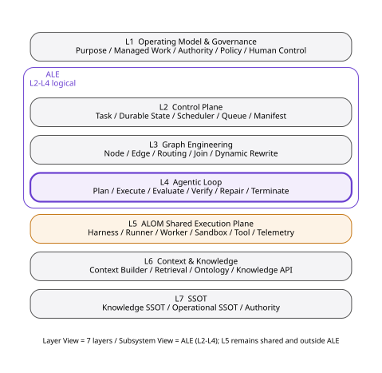
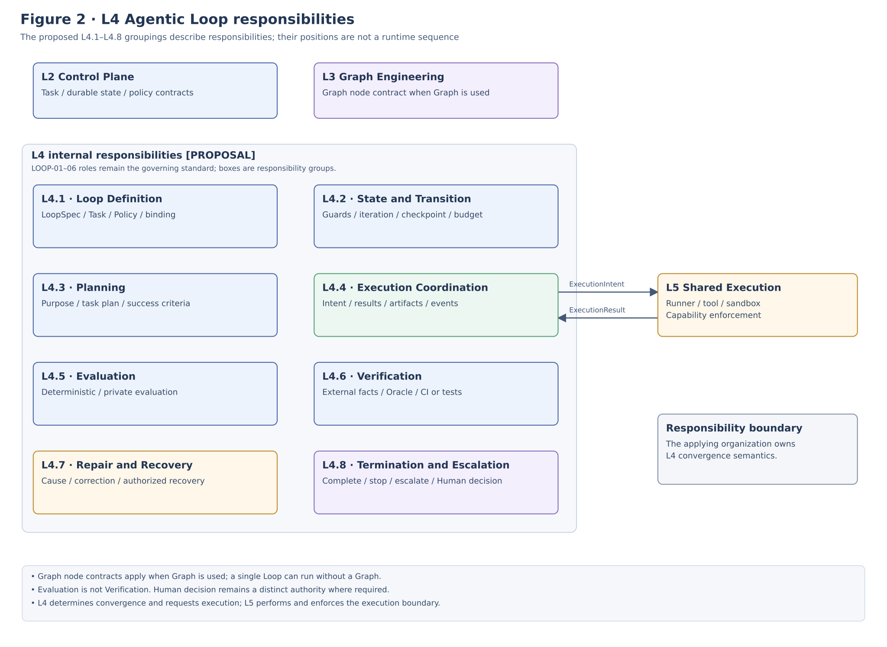
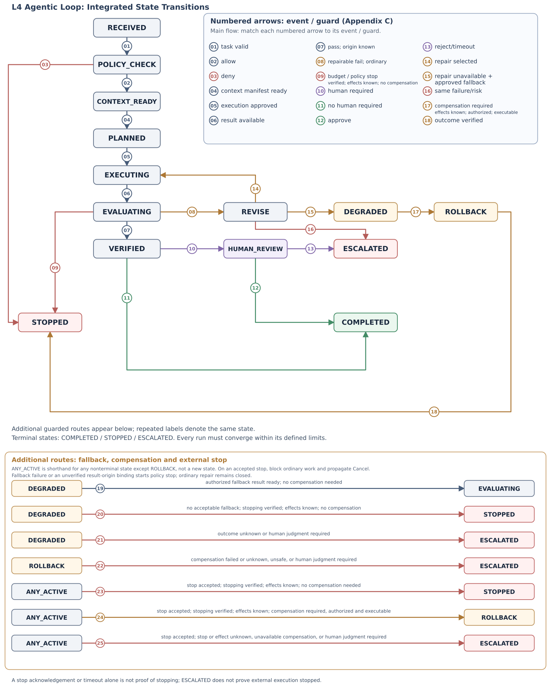
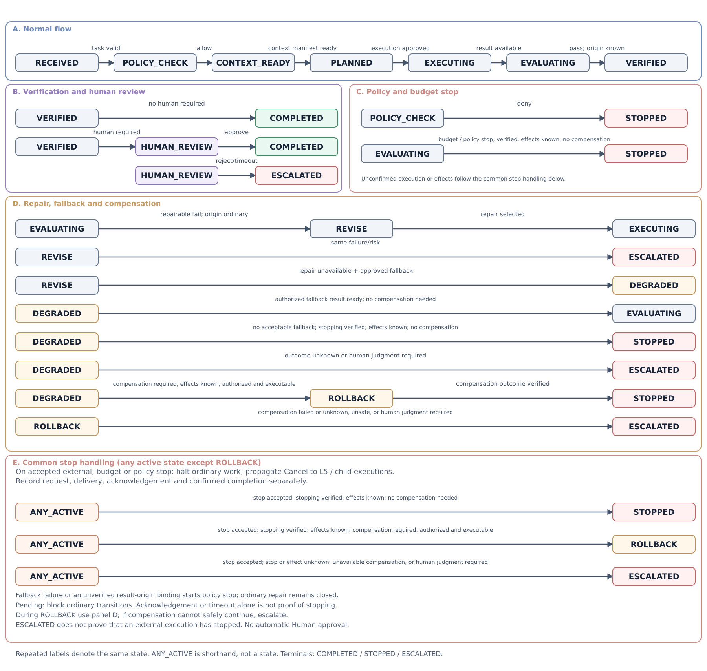
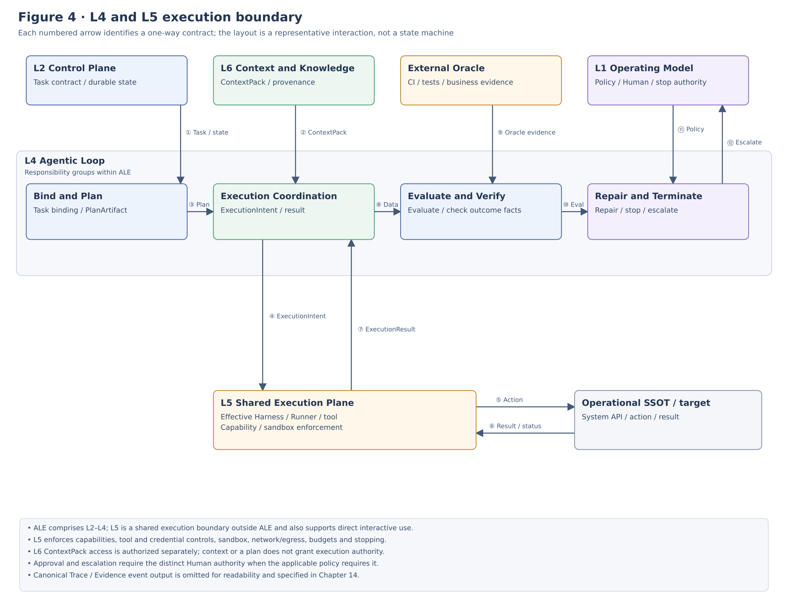

**ALOM Agentic Loop
Implementation Architecture Standard**

**Loop Contract / State Machine / Planning / Evaluation / Verification / Repair / Termination**

**IMPLEMENTATION STANDARD**

| Core baseline Implement L4 Agentic Loop as convergence-control semantics owned by the applying organization, forming ALE (Agent Loop Engine) together with L2 Control Plane and L3 Graph Engineering. Planning, execution, evaluation, verification, repair, and termination must always converge within bounds through durable state, independent evaluation, budgets, stopping, human control, and Trace. Keep L5 ALOM Shared Execution Plane outside ALE and delegate actual Agent execution to it as a shared capability. |
|----------------------------------------------------------------------------------------------------------------------------------------------------------------------------------------------------------------------------------------------------------------------------------------------------------------------------------------------------------------------------------------|

| **Control item** | **Value** |
|--------------|------------------------------------------------------------------------|
| Document ID | ALOM-LOOP-STD-001 |
| Version | v0.6-review.20261110 |
| Created | 2026-08-12 |
| Parent standard | ALOM-ARCH-STD-001 v2.5 |
| Scope | ALOM L4 Agentic Loop / ALE Loop Runtime (ALE = logical L2–L4 Subsystem) |
| Accountable function | Organization Architecture (Enterprise Architecture) / AI Platform |
| Information classification | Public |

This specification elaborates the parent standard's LOOP-01–LOOP-06 and G-Loop, and its boundary definition of ALE as a logical L2–L4 Subsystem, into implementable responsibilities, contracts, state machines, and acceptance tests.

# Document Control

## 1. Position and Order of Authority

This implementation standard elaborates L4 Agentic Loop in ALOM-ARCH-STD-001 v2.5 (ALOM Integrated Architecture Standard v2.5). It treats the parent standard's Layer View (L1–L7) and Subsystem View (ALE = L2–L4) separately and specifies L4 implementation responsibilities, state transitions, data contracts, evaluation/verification, repair, termination conditions, repository structure, and acceptance tests.

- ALOM-ARCH-STD-001 v2.5 takes precedence in the event of a conflict with the parent standard.

- Where laws and regulations, contracts, customer NDAs, or security rules impose stricter requirements, the stricter rules take precedence.

- Items marked \[PROPOSAL\] are implementation details not specified in the parent standard. Standardize them through ADR / change request / Eval when adopting them.

- Runner product or Workflow Framework specifications must not be treated as the applying organization's canonical Loop specification.

- ALE is not a layer name. It is a logical Execution Subsystem combining L2 Control Plane, L3 Graph Engineering, and L4 Agentic Loop. L5 ALOM Shared Execution Plane is not contained within ALE.

## 1.1 Common Scope / Isolation

The runtime / protected contracts in this document consume CommonScopeContract from `ALOM-PROF-SCOPE-SPEC-001`.

- `scope_ref` is the common canonical scope identity and is required.
- `domain_id` is the persistent operating-domain identity and is required.
- `project_id` is optional Project overlay / context. Its absence alone must not cause rejection. Do not synthesize a Project merely to satisfy an implementation schema.
- `isolation_scope_ref` is the mandatory runtime / protected isolation boundary. Fail closed if it is unresolved.
- Do not infer runtime isolation from `project_id` alone. Bind Queue / state / worker / sandbox / tool / credential / repository / cache / retrieval / Trace / L7 access to explicit `isolation_scope_ref` and authorization policy.
- Do not relax Authority-conflict controls, Human-required, mandatory assurance, HITL timeout, no-relaxation, or cross-isolation denial.
L4 LoopRun inherits Common Scope from L2/L3. Convergence semantics are scope-neutral and introduce no new mandatory Project requirement.

Basis/category: \[STD\] \[S1\] Inherits document control, P-03, P-04, P-07, P-09, P-12, LOOP-01–06, and OPS-01–06.

## 2. Sources and Design Categories

| **ID** | **Source** | **Use in this document** |
|--------|-------------------------------------------------------------------------|-----------------------------------------------------------------------------------------------------------------------------------------------------|
| \[S1\] | ALOM-ARCH-STD-001 v2.5-review.20261110 (ALOM Integrated Architecture Standard v2.5-review.20261110) | Non-effective alignment candidate; controlled authority remains v2.5. Inherits the seven-layer Layer View, ALE = L2–L4 Subsystem View, L4, LOOP-01–06, Eval, Human Control, Trace, NFR, and OPS. |
| \[S2\] | ALOM L5 Shared Execution Plane Implementation Architecture Standard (ALOM-HR-STD-001 v0.4-review.20261110, formerly Harness & Runner v0.2) | Reference for Harness / Runner / Worker / Sandbox / Tool implementation responsibilities. Prefer the current L5 name, ALOM Shared Execution Plane. |
| \[S4\] | ALOM-KNW-STD-001 v0.4-review.20261110 / ALOM-SSOT-STD-001 v0.5 (related specifications) | Cross-check for Knowledge SSOT and Live Query / MCP boundaries. |

| **Design categories** \[STD\] = inherited from the parent standard; \[REF\] = reference elements based on existing source materials; \[CROSS-CHECK\] = correspondence with public specifications, not a claim of identity with historical sources; \[PROPOSAL\] = implementation detail added in this document. Related specifications are cross-check references for current content. |
|------------------------------------------------------------------------------------------------------------------------|

Related specifications are cross-check references for current content and do not imply identity with the original historical sources.

# Contents

1 Purpose and Scope

2 Fixed Definitions and Responsibility Boundaries

3 Agentic Loop Architecture Principles

4 Overall ALOM Stack and Internal L4 Structure

5 Loop Definition / Contract

6 State Machine / Transition Control

7 Planning

8 Execution Coordination and the L5 Shared Execution Boundary

9 Evaluation / Verification

10 Repair / Recovery

11 Termination / Escalation / Human Control

12 Graph / Context / Policy / SSOT Integration

13 State / Checkpoint / Idempotency / Concurrency

14 Trace / Evidence / Telemetry

15 Security / NDA / Governance

16 Repository / CI/CD / Versioning

17 Reference Physical Deployment

18 Acceptance Gates and Conformance Tests

19 Implementation Roadmap and Backlog

Appendix A Minimum Data Contracts

Appendix B LoopSpec Example

Appendix C State Transition Matrix

Appendix D Parent Requirement Mapping

# 1. Purpose and Scope

## 1.1 Purpose

This document defines standards for implementing ALOM L4 Agentic Loop as a reproducible, auditable, and stoppable Runtime owned by the applying organization that controls ALE convergence, rather than as an internal retry loop in an LLM or Agent product. ALE comprises L2 Control Plane, L3 Graph Engineering, and L4 Agentic Loop. Within ALE, L4 owns the semantics governing the conditions under which one Work Unit iterates, converges, stops, or escalates.

| **Design goal** The applying organization must retain the Loop's purpose, state, success conditions, evaluation, verification, repair, budgets, stopping, human decisions, and Trace when replacing Cursor / Claude / Codex / a custom Agent Runtime. |
|-----------------------------------------------------------------------------------------------------------------------------------------------------------------------------------|

## 1.2 In Scope

- The Agentic Loop of a single Work Unit within ALOM Managed Work that ALE manages as Agentic Work; the Work Unit corresponds to a Graph Node when a Graph is used.

- Iterative control of Plan / Execute / Evaluate / Verify / Repair / Termination.

- Pass/fail and branching control for Private Eval, Deterministic Eval, External Oracle, and Human Review.

- Checkpoint / Resume / Cancel / Rollback / Escalation and convergence limits such as time, token, cost, and iteration ceilings.

- Contract boundaries with L2 Control Plane / L3 Graph Engineering inside ALE and L5 ALOM Shared Execution Plane, L6 Context & Knowledge, and L1 Operating Model & Governance outside ALE.

## 1.3 Out of Scope

- Design of internal LLM reasoning algorithms, chain-of-thought, or model weights.

- Outer iterative control for Interactive Agent Work in which humans lead the interaction and use L5 ALOM Shared Execution Plane directly. Interactive Agent Work does not require L4 / ALE.

- Design of overall Graph topology, fan-out / join, and dynamic rewrite (L3).

- Physical enforcement of Runner Adapter, Sandbox, and Tool/Network/Credential controls (L5).

- Internal implementation of OKF / RAG / Ontology Runtime (L6).

- Canonical data design for business systems (L7).

Basis/category: \[STD\] \[S1\] Seven-layer Layer View, ALE = L2–L4 Subsystem View, L4 Agentic Loop, Graph ≠ Loop, and the L5 Shared Execution boundary. \[REF\] \[S2\] Harness / Runner implementation responsibilities.

# 2. Fixed Definitions and Responsibility Boundaries

| **Term** | **Fixed definition** | **Not equivalent to** |
|-------------------------|---------------------------------------------------------------------------------------------------------------------------------------------------------|-------------------------------------------------|
| Agentic Loop | A control loop that repeats Observe / Plan / Act / Evaluate / Verify / Repair until success, stop, or Escalation conditions are met. | Unlimited retry / Runner-internal loop |
| LoopSpec | An asset defining Loop roles, success conditions, evaluation, repair policy, budgets, and termination conditions as a versioned specification. | Prompt / HarnessSpec |
| LoopRun | A Loop execution instance for one Task, correlating state, iteration, artifact, eval, verification, budget, and checkpoint. | Runner session |
| Planner | The role that structures purpose, assumptions, Task decomposition, success conditions, risk, tool plan, budget, and stop conditions. | Graph topology owner |
| Executor | The role that delegates permitted execution intents to L5 and correlates artifacts and events with LoopRun. | Tool enforcement / Runner |
| Evaluator | Evaluates quality and classifies defects using Private Eval / rubric / deterministic checks. | Generator self-scoring alone |
| Verifier | Verifies that required outcomes hold through Oracles such as CI, tests, schemas, actual data, authorization logs, and external results. | LLM judge |
| Repair | Selects bounded corrections addressing causes, and checks repeated failures, remaining budget, and expanding impact. | blind retry |
| Termination | The decision mechanism that determines the terminal outcome based on success, major risk, pending approval, time, tokens, cost, iterations, repeated failures, and similar conditions. | Unconstrained decisions by the Agent itself |
| HumanReviewPacket | A decision task that structures rationale, evidence, options, impact, reversibility, and deadline for human judgment. | A mere approval queue |
| ALE (Agent Loop Engine) | The logical Execution Subsystem in ALOM comprising L2 Control Plane, L3 Graph Engineering, and L4 Agentic Loop, responsible for admitting, organizing, and iteratively converging Agentic Work. | L2 alone / L5 Shared Execution Plane / all of ALOM |
| Agentic Work | ALOM Managed Work whose outer iteration and convergence control is owned by ALE and which executes under the L4 Agentic Loop state machine, evaluation, verification, and termination conditions. | Interactive work using only a Runner-internal agent loop |
| Interactive Agent Work | Work in which humans lead continuation, additional instructions, and termination of an interaction, directly using the L5 Shared Execution Plane Harness / Runner as needed. | Agentic Work that requires ALE / L4 |

Basis/category: \[STD\] \[S1\] 3.2 Fixed definitions and 5.5 LOOP-01–06. \[CROSS-CHECK\] \[S1\] and corresponding sections of this document: HUMAN REVIEW is a decision task with rationale, evidence, options, scope of impact, and reversibility. \[PROPOSAL\] Explicit LoopSpec / LoopRun implementation contracts.

# 3. Agentic Loop Architecture Principles

| **ID** | **Principle** | **Requirement** |
|--------|--------------------------|-----------------------------------------------------------------------------------------------------------------------------------------------------------------|
| AL-P01 | Loop semantics owned by the applying organization | Manage the state machine and success/failure/repair/termination conditions as schema/config/code owned by the applying organization; do not delegate them to Runner-specific behavior. |
| AL-P02 | Deterministic transitions | Determine state transitions and budget/stop decisions through a Transition Function over structured inputs; never transition solely on free-form LLM text. |
| AL-P03 | Separate generation and evaluation | Do not pass solely on Generator self-evaluation; combine Private Eval / deterministic checks / independent evaluators. |
| AL-P04 | Independent verification of actual outcomes | Separate evaluation passes from real-world success; verify applicable use cases through External Oracle / CI / tests / Operational SSOT. |
| AL-P05 | Bounded convergence | Set ceilings for time, tokens, cost, iterations, repeated failures, replanning, and similar measures; prohibit unlimited retry. |
| AL-P06 | Cause-directed Repair | Repair must be the minimum change addressing the defect/root cause; scope expansion requires an explicit Policy / Human Gate. |
| AL-P07 | Durable state | Retain Loop state / checkpoints above the Runner session, enabling resumption after worker loss / Runner replacement. |
| AL-P08 | L2 persistence boundary | L4 owns Loop domain semantics but delegates Canonical durable-state persistence and scheduler/queue responsibilities to the L2 Control Plane inside ALE. |
| AL-P09 | L5 Shared Execution boundary | L4 generates ExecutionIntent; execution and enforcement of Tool/Credential/Network/Filesystem/Sandbox controls occur fail-closed in L5 ALOM Shared Execution Plane outside ALE. |
| AL-P10 | Trace by default | Correlate state transitions, plan, execution, eval, verify, repair, human decisions, and termination through trace_id. |
| AL-P11 | Human fail-closed | If timeout / unavailability occurs when HITL is required, transition to stop or Escalation without automatic approval. |
| AL-P12 | Portability | Maintain contracts that preserve baseline LoopSpec, Eval, Trace, artifacts, and terminal semantics when the Runner / model / workflow engine changes. |
| AL-P13 | ALE Subsystem boundary | ALE is the logical L2–L4 Subsystem; do not equate L4 with ALE itself. Do not conflate Layer View and Subsystem View. |
| AL-P14 | Execution Mode boundary | L4 applies to Agentic Work. In Interactive Agent Work humans lead outer iteration and may use L5 directly, so do not forcibly create a LoopRun. |

Basis/category: \[STD\] \[S1\] Seven-layer Layer View, ALE Subsystem definition, P-03, P-04, P-05, P-07, P-09, P-12, LOOP-03–06, NFR-05/08/09/10. \[CROSS-CHECK\] \[S2\]\[S1\] and corresponding sections of this document: durable state above Runner state and external enforcement. \[PROPOSAL\] Reorganized as AL-P01–14.

# 4. Overall ALOM Stack and Internal L4 Structure



Figure 1 Position of L4 in the ALOM Seven-Layer View and ALE Subsystem View

In Layer View, L4 is an independent responsibility boundary among seven layers. In Subsystem View, L2 Control Plane, L3 Graph Engineering, and L4 Agentic Loop form ALE. L4 receives L2 Task / durable-state contracts and, when a Graph is used, L3 Graph node contracts, determines how one Work Unit converges, and delegates actual Agent execution to L5 ALOM Shared Execution Plane outside ALE. L4 itself does not own Graph topology, Tool enforcement, or Knowledge SSOT.

Fixed views: Layer View: L1–L7 are responsibility boundaries. Subsystem View: ALE = L2–L4. Execution View: Agentic Work follows ALE → L5; Interactive Agent Work uses L5 directly as needed.

Basis/category: \[STD\] \[S1\] Seven-layer Layer View, ALE = L2–L4 Subsystem View, and the L5 Shared Execution boundary.

## 4.1 Eight Internal L4 Sublayers



[Open Figure 2 at full size](figures/ALOM-LOOP-STD-001-fig2-current.svg)

Figure 2 Detailed L4 Agentic Loop Architecture

| **Layer** | **Name** | **Responsibility** |
|--------|----------------------------|---------------------------------------------------------------------------------------------------------|
| L4.1 | Loop Definition & Contract | Declare LoopSpec, Task/Harness/Policy/Eval Binding, Graph Binding when used, and Compatibility. |
| L4.2 | State & Transition Control | Manage the state machine, transition guards, iterations, checkpoints, and budget state. |
| L4.3 | Planning | Capture purpose, assumptions, decomposition, success conditions, risk, tool plan, and stop conditions in PlanArtifact. |
| L4.4 | Execution Coordination | Pass ExecutionIntent to L5 ALOM Shared Execution Plane and correlate results, artifacts, and events with LoopRun. |
| L4.5 | Evaluation | Deterministic / Private Eval, rubric, critical failures, and defect classification. |
| L4.6 | Verification | Verify actual outcomes using External Oracle and CI/tests/schemas/actual data/authorization logs/external outcomes. |
| L4.7 | Repair & Recovery | Cause-directed repair, replanning, rollback/compensation, repeated-failure and blast-radius management. |
| L4.8 | Termination & Escalation | Determine COMPLETED / STOPPED / ESCALATED, human decisions, and budget/timeout/stop outcomes. |

Basis/category: \[STD\] \[S1\] Preserves LOOP-01–06 roles. \[PROPOSAL\] Internal structure L4.1–L4.8.

# 5. Loop Definition / Contract

## 5.1 LoopSpec Structure

| **Section** | **Principal fields** | **Requirement** |
|----------------|---------------------------------------------------------------------|----------|
| metadata | loop_id, version, owner, compatibility | Required |
| binding | graph_ref, harness_ref (L5), policy_ref, eval_ref | Binding and harness_ref / policy_ref / eval_ref required; graph_ref required when a Graph is used. |
| planning | planner_profile, max_replans, output_schema | Required |
| execution | allowed_execution_modes, artifact_contract | Required |
| evaluation | deterministic refs, private_eval_ref, thresholds, critical failures | Required |
| verification | oracle refs, required verification, freshness | Conditional |
| repair | repair classes, same_failure_limit, scope expansion policy | Required |
| budget | max_duration, max_token, max_cost, max_iterations, max_concurrency | Required |
| termination | success, stop, escalate, approval rules | Required |
| trace | required events, evidence refs, retention/redaction refs | Required |

Version LoopSpec in Git; at Task execution, resolve it with Task Contract / L5 Effective Harness / Policy / Eval and, when a Graph is used, Graph Node; pin EffectiveLoopManifest. Lower-level overrides must not relax higher-level Policy or autonomy ceilings. Reference the L5 Harness as a Shared Execution Plane execution contract, not an internal ALE definition.

Basis/category: \[STD\] \[S1\] LOOP-01/06, P-07, OPS-01/02. \[REF\] \[S2\] Harness Effective Manifest pattern. \[PROPOSAL\] LoopSpec / EffectiveLoopManifest.

Do not implicitly create a Graph to fill an absent graph_ref for a single Loop without a Graph. When a Graph is used, pin the corresponding Graph / Node contracts and revisions.

## 5.2 Binding to Task Contract

| **Task Contract field** | **Use in L4** |
|-------------------------|----------------------------------------------|
| task_id / trace_id | LoopRun identification and Trace correlation. |
| purpose_id | Purpose limitation for planning, Tool, Context, and Human Gate. |
| Common Scope / isolation_scope_ref | Inherited from L2. `project_id` is an optional overlay. Runtime isolation is `isolation_scope_ref`. |
| actor_id / delegator_id | Attribution of responsibility and HumanReviewPacket. |
| autonomy_level | Ceiling governing execution/stop/HITL. |
| graph_ref / harness_ref | graph_ref pins the L3 Graph contract and revision when Graph is used and may be absent for a single Loop without a Graph. harness_ref pins the L5 Harness contract and revision. |
| policy_ref / eval_ref   | transition guard / pass criteria.           |
| deadline / budgets | Hard ceilings enforced by the Termination Controller. |
| source/bundle refs | Reproducibility of Plan/Eval/Verify. |

# 6. State Machine / Transition Control

The normal sequence of standard states is RECEIVED → POLICY_CHECK → CONTEXT_READY → PLANNED → EXECUTING → EVALUATING → VERIFIED. From VERIFIED, transition to COMPLETED if Human Review is unnecessary, or to HUMAN_REVIEW if required; approve leads to COMPLETED and reject / timeout leads to ESCALATED. A repairable failure of ordinary execution branches to REVISE; return to EXECUTING only when repair is selected. If continued repair is inappropriate and an approved fallback path is used, transition to DEGRADED. When no compensation is needed, evaluate the authorized fallback result in EVALUATING and apply the same Verification and required Human Gate as for normal completion. If the normal completion conditions cannot be met, use STOPPED when stopping is verified, or ESCALATED when the result is unknown or human judgment is needed. When compensation is required, enter ROLLBACK only if the affected side effects are known and it is authorized and executable; verify its outcome before STOPPED.

On entry to EVALUATING, bind an immutable subject reference that uniquely identifies the newly accepted result and its `evaluation_origin` in the same committed state update before any evaluation decision, and record the binding as evidence. Set the origin to `ordinary` for an ordinary result from EXECUTING and to `approved_fallback` for an authorized fallback result from DEGRADED; do not reuse a previous evaluation’s value. Preserve the subject reference and origin together through checkpoint and resume. If their binding is missing, inconsistent, or cannot be verified, do not proceed to success or ordinary repair; initiate a fail-closed policy stop. If evaluation of an approved fallback fails, also initiate a policy stop; do not resume ordinary repair or blindly retry the fallback. Block ordinary transitions while the stop is accepted and verified, then follow the common stop branches in Appendix C for stopping, authorized compensation, or escalation.

When an external stop is accepted, prevent new ordinary work and dispatch, and propagate Cancel to the affected L5 and child executions in accordance with the L2 control event and L3 propagation contract. Record the request, targets, delivery, acknowledgement, and completion separately; record the determination when there are no targets. Sending Cancel or reaching a timeout alone is not proof that execution stopped. Once stopping is verified and the affected side effects are known, enter STOPPED if no compensation is needed, or ROLLBACK if compensation is required, authorized and executable. Enter ESCALATED if stopping or side effects remain unknown, compensation fails or is unknown, or human judgment is required. ESCALATED does not prove that external execution has stopped. Do not resume ordinary work; hand over unresolved targets, effects, and evidence.

While stop handling is pending, the run may remain in its current nonterminal state, but ordinary transitions are blocked; only the stop branches in Appendix C may proceed. Treat duplicate stop requests idempotently, reconcile targets and outcomes, and do not blindly repeat an external effect of unknown outcome. Serialize stop and completion against canonical state: an accepted stop cannot be overwritten by a later ordinary completion or Human approval. Do not rewrite a terminal state already committed; retain later information as evidence. A further stop during ROLLBACK starts no ordinary work and requires reassessment of compensation safety and authority; enter ESCALATED if safe continuation is not possible. Waiting, reconciliation, and compensation are bounded; if the result remains unknown at the deadline, enter ESCALATED. Never treat a Human timeout as automatic approval.

Basis/category: \[STD\] Inherits the standard states from \[S1\] 5.4 L4 Agentic Loop. \[PROPOSAL\] Defines the REVISE → DEGRADED guard as continued repair unavailable with an approved fallback path, and aligns Figure 3 with the Transition Matrix in Appendix C.



Figure 3. Standard Agentic Loop State Machine and Convergence Branches - Integrated Overview

> **Guard legend for both Figure 3 views:** `pass; origin known` abbreviates EvaluationResult PASS, a verified binding between the current immutable result and evaluation_origin, and PASS for every required VerificationResult. Required Oracle FAIL or UNAVAILABLE blocks VERIFIED and COMPLETED. Recheck required verification validity immediately before completion, including after Human Review. Ordinary repair is permitted only for ordinary-origin, repairable failure with remaining budget. An UNAVAILABLE wait is bounded by an explicit deadline; expiry, nonrepairable failure, exhausted budget, or approved-fallback failure follows the existing policy-stop, authorized-compensation, or ESCALATED routes. Include this legend whenever either figure is exported separately.



Figure 3a. Standard Agentic Loop State Machine and Convergence Branches - Detailed Transition Lanes

## 6.1 Transition Function

next_state = transition(
current_state, event, policy_decision, eval_result, evaluation_origin, verification_result,
budget_state, failure_history, human_state, stop_signal
)

- Version permitted transitions as a transition table / code.

- Fail closed on prohibited transitions and record a transition_denied event in Trace.

- LLM outputs may be candidate guard inputs but must not be the sole basis of the final transition decision.

- Terminal states are COMPLETED / STOPPED / ESCALATED. Every Task must reach one within the defined limits.

- Figure 3 and the Transition Matrix in Appendix C must represent identical transition definitions; release is prohibited if a discrepancy is detected.

## 6.2 Budget State

| **Budget** | **Example** | **When exceeded** |
|--------------|------------------------------|--------------------------------|
| time | deadline / max_duration_sec | STOPPED or ESCALATED |
| token        | max_input/output/total token | STOPPED / degraded model route |
| cost         | task cost budget             | STOPPED / HITL for extension   |
| iteration    | max_iterations               | ESCALATED / STOPPED            |
| same failure | repeated_failure_limit       | ESCALATED                      |
| replan       | max_replans                  | HUMAN_REVIEW / STOPPED         |

Basis/category: \[STD\] \[S1\] LOOP-06, P-09, NFR-05. \[CROSS-CHECK\] \[S1\] and corresponding sections of this document: branch to REVISE/HUMAN REVIEW/STOPPED using defect class, remaining budget, iteration count, repeated-failure count, and Oracle availability.

# 7. Planning

The Planner generates a structured PlanArtifact that subsequent execution, evaluation, verification, and human decisions can reference, rather than storing free-form thoughts. This standard does not require preservation of the internal reasoning process itself.

| **PlanArtifact field** | **Content** |
|------------------------|------------------------------------------------|
| objective | Translate the Task Contract purpose into an executable outcome. |
| assumptions\[\] | Assumptions, unresolved matters, and dependencies. |
| steps\[\] | Execution order, inputs/outputs, and expected artifacts. |
| success_criteria\[\] | Pass conditions corresponding to Eval/Verify. |
| risks\[\] | Impact, reversibility, uncertainty, and authority. |
| tool_plan\[\] | Required capabilities. Actual permission is revalidated in L5. |
| context_needs\[\] | Context / Knowledge requested from L6. |
| budget_allocation | Limits per step / iteration. |
| stop_conditions\[\] | Early-stop conditions identified by the Planner. |

| **Requirement** Tools / Context / scope requested by the Planner do not grant authority. L1 Policy / L5 Enforcement / L6 ACL must independently authorize them. |
|-----------------------------------------------------------------------------------------------------------------------------------------------|

Basis/category: \[STD\] \[S1\] LOOP-01, P-05, P-07. \[PROPOSAL\] PlanArtifact schema.

# 8. Execution Coordination and the L5 Shared Execution Boundary



[Open Figure 4 at full size](figures/ALOM-LOOP-STD-001-fig4-current.svg)

Figure 4 Contract Boundary between L4 Execution Coordination and L5 ALOM Shared Execution Plane (Separate Requests and Responses)

Reading the diagram: all arrows are one-way, and each number identifies the connection source → destination and the transferred contract. At the L4/L5 boundary, ExecutionIntent from L4 → L5 (④) and ExecutionResult from L5 → L4 (⑦) use separate lines. At the L5/Operational SSOT boundary, Action (⑤) and Result (⑥) are also separate. Canonical Event output to Trace/Evidence is omitted for readability and specified in Chapter 14.
The L4 Executor does not directly own Tools. It passes a Plan-based ExecutionIntent to the Effective Harness in L5 ALOM Shared Execution Plane. L5 physically enforces Runner / Tool / Credential / Network / Filesystem / Sandbox controls, normalizes the results, and returns them to L4. L5 is not exclusive to ALE; it also provides direct-use paths for Interactive Agent Work.

| **Responsibility** | **L4** | L5 ALOM Shared Execution Plane |
|-----------------|---------------------------------------------|----------------------------------------------------|
| What to execute | ExecutionIntent, expected artifact, step id | Receive and check capabilities |
| Where / How | Requirements only | worker / workspace / container/VM / runner session |
| Tool permission | Declare required capabilities | Enforce allow/deny, args, credential, and egress |
| Budget | Pass remaining budget | Measure runtime usage and enforce hard limits |
| Stop | stop decision / cancel request | Stop session/process/tool fail-closed |
| Result | Apply ExecutionResult to the state machine | Normalize native result/event/artifact into the common contract |

Basis/category: \[STD\] \[S1\] LOOP-02 and the L5 ALOM Shared Execution Plane boundary. \[REF\] \[S2\] Runtime Enforcement / Runner Adapter.

# 9. Evaluation / Verification

## 9.1 Evaluation

The Evaluator assesses output quality and returns defect class, severity, confidence, evidence, and recommended action as well as pass/fail. Generator self-evaluation alone must not produce a pass.

| **Evaluation type** | **Example** | **Role** |
|-------------------------|-----------------------------------------------|------------------------------------------|
| Deterministic | schema, lint, static check, invariant | Deterministic conformance. |
| Private Eval | applying-organization-specific cases, rubric, hidden regression | Purpose, quality, and risk tolerance. |
| Independent Model Judge | separate model / separate prompt / blind evaluator | Supporting semantic evaluation. Avoid using it as the sole final decision. |
| Critical Failure Rule | security breach, prohibited action, data leak | fail / stop regardless of score. |

## 9.2 Verification

The Verifier uses an External Oracle or business facts to check whether the required state or outcome actually holds, rather than merely appearing satisfactory under evaluation.

| **Oracle / Verification** | **Example** |
|---------------------------|--------------------------------------------------------|
| CI / Test                 | unit / integration / E2E / build result                |
| Schema / Data             | DB constraint / API response / reconciliation          |
| Security / Permission     | authorization log / access decision / signature        |
| Operations                | SLO / metric / deployment state / alert clearance      |
| Business outcome          | transaction state / accepted outcome / customer result |
| Human evidence | approval record, inspection, signed decision |

| **Separation principle** Eval Pass ≠ Verified. Eval addresses quality and conformance; Verify addresses facts establishing the outcome. Applicable use cases must not transition to COMPLETED until both are satisfied. |
|--------------------------------------------------------------------------------------------------------------------------------------------------------|

Basis/category: \[STD\] \[S1\] LOOP-03/04, P-04, G-Eval. \[CROSS-CHECK\] \[S1\] and corresponding sections of this document: combination of deterministic verification + Private Evals + Oracle.

# 10. Repair / Recovery

Repair is not another name for retry. It selects corrections with limited impact based on defect classification and root-cause hypotheses. Before re-execution, check remaining budget, repeated-failure count, blast radius, authority, and Oracle availability.

| **Defect class** | **Standard response example** | **Retry permitted** |
|-----------------------|---------------------------------------------------------------------|-----------------------|
| TEST_FAILURE | Minimum change addressing the failing test. | Conditional |
| SCHEMA_FAILURE | Correct schema/format. | Yes |
| MISSING_CONTEXT | Retrieve additional context from L6. Re-evaluate Policy for scope expansion. | Conditional |
| TOOL_FAILURE | Classify as transient / permanent; revalidate capabilities for another tool/runner. | Conditional |
| POLICY_DENIED | Automatic bypass prohibited. Request an authority change or exception review. | No |
| ORACLE_MISMATCH | Analyze the cause of the discrepancy between output and actual result. | Conditional |
| AMBIGUOUS_REQUIREMENT | Escalate through HumanReviewPacket. | No |
| RUNNER_FAILURE | Resume from Checkpoint using the same or a different Runner. | Yes (idempotency required) |

## 10.1 Repair Decision

RepairDecision {
defect_ref, root_cause_candidate, strategy, scope_delta, expected_effect,
remaining_budget, repeated_failure_count, requires_replan, requires_human,
rollback_ref, next_state
}

Basis/category: \[STD\] \[S1\] LOOP-05, P-09. \[CROSS-CHECK\] \[S1\] and corresponding sections of this document: branching to avoid blind retry. \[PROPOSAL\] Defect classes / RepairDecision schema.

# 11. Termination / Escalation / Human Control

| **Condition** | **Standard transition** | **Notes** |
|----------------------------------------|--------------------------|---------------------------------------------------------------------------|
| success + required verification pass | COMPLETED | Enter HUMAN_REVIEW first if a Human Gate is required. |
| major risk / prohibited condition | STOPPED or ESCALATED | Automatic continuation prohibited. |
| human approval required | HUMAN_REVIEW | Package decision inputs. |
| HITL timeout | STOPPED / ESCALATED | Automatic approval prohibited. |
| deadline / budget exceeded | STOPPED / ESCALATED | Terminate after confirming stopping and any compensation. A Human Gate is required if the applicable Profile permits an extension. |
| same failure limit | ESCALATED | Do not continue repeating a failure of unknown cause. |
| repair unavailable + approved fallback | DEGRADED | Stop ordinary repair and transition only to an approved fallback / compensation path. |
| external stop / HOTL | STOPPED / ESCALATED | Propagate Cancel to L5 / child executions. Use the intermediate ROLLBACK state for required, authorized compensation. |

## 11.1 HumanReviewPacket

| **field** | **Content** |
|--------------------|-----------------------------------------------|
| reason | Why a human decision is required. |
| evidence_refs      | Plan / artifact / Eval / Oracle / Trace.     |
| options\[\] | Approve, reject, revise, stop, change scope, etc. |
| impact | Targets, blast radius, irreversibility, and effects on rights/customers. |
| reversibility      | rollback / compensation / snapshot.          |
| deadline           | HITL timeout.                                |
| recommended_action | Clearly distinguish AI proposals as proposals. |

Basis/category: \[STD\] \[S1\] LOOP-06, P-05, NFR-10, G-Human. \[CROSS-CHECK\] \[S1\] and corresponding sections of this document: decision inputs for the Human Review Packet.

# 12. Graph / Context / Policy / SSOT Integration

| **Integration target** | **Requests from L4** | **Not owned by L4** |
|-------------------------------------------|-----------------------------------------------------------------------|-------------------------------------------------------------------------------|
| L1 Operating Model & Governance           | policy decision, autonomy, HITL/HOTL/HIC, exception                   | IAM / Policy SSOT / final human authority                                     |
| L2 Control Plane (inside ALE) | Task/LoopRun persistence, queue, scheduler, lease, checkpoint storage | platform-wide scheduling / durable store implementation |
| L3 Graph Engineering (inside ALE) | Node input/output, dependency, cancellation, graph invariant | fan-out/join/topology/dynamic rewrite |
| L5 ALOM Shared Execution Plane (outside ALE) | ExecutionIntent, cancel/resume, artifact/usage/event | Tool/Credential/Network/Filesystem/Sandbox enforcement, Runner implementation |
| L6 Context & Knowledge                    | context query, knowledge ref, citation, freshness                     | OKF/RAG/Ontology runtime / index / ACL implementation                         |
| L7 Operational SSOT                       | read/verify/action intent via gateway                                 | transaction/business record canonicality                                      |
| Trace/Evidence                            | canonical LoopEvent / evidence refs                                   | retention storage / SIEM implementation                                       |

| **Knowledge boundary** Do not treat Runner Memory or model conversation history as Knowledge SSOT. Assemble Context from L6 according to purpose / scope and correlate Source revision / commit / freshness with Trace. |
|----------------------------------------------------------------------------------------------------------------------------------------------------------------------------------------------------|

Basis/category: \[STD\] \[S1\] P-06, P-07, seven-layer Layer View, ALE = L2–L4, and the L5 Shared Execution boundary. \[REF\] \[S4\] Knowledge SSOT and Live Query / MCP boundaries.

# 13. State / Checkpoint / Idempotency / Concurrency

## 13.1 Canonical Loop State

Define Loop domain state in L4 schemas and persist it durably in the L2 Control Plane State Store inside ALE. A Runner session is an external reference on the L5 side, not Canonical Loop state.

| **State group** | **Principal fields** |
|-----------------|--------------------------------------------------------------------|
| identity        | loop_run_id, task_id, loop_ref, trace_id                           |
| control         | state, iteration, replan_count, repeated_failure_count             |
| binding         | graph_ref (when a Graph is used), harness_ref, policy_ref, eval_ref, context_manifest_ref |
| work            | plan_ref, current_step, artifact_refs                              |
| assurance       | eval_refs, verification_refs, defect_history, evaluation_origin (while EVALUATING) |
| budget          | deadline, token/cost/iteration consumed/remaining                  |
| human           | human_review_ref, approval_state                                   |
| recovery        | checkpoint_ref, rollback_ref, last_idempotency_key                 |
| terminal        | stop_reason, escalation_reason, completed_at                       |

## 13.2 Checkpoint

- Baseline checkpoint candidates are after PLANNED, before and after external side effects, after Eval/Verify completes, before a Human Gate, and before termination.

- Checkpoints include Loop state, artifact/evidence refs, and a Runner resume token if available, but must not depend solely on the Runner resume token. Preserve the subject reference and evaluation_origin binding through EVALUATING checkpoints and recovery; if missing, inconsistent, or unverifiable, do not resume ordinary repair or completion and initiate a policy stop.

- During recovery, re-evaluate Policy / Harness / source freshness and do not reuse obsolete permissions or secrets.

## 13.3 Idempotency / Concurrency

- Attach an idempotency_key and operation identity to ExecutionIntents with external side effects.

- Detect duplicate leases for the same task / step and suppress duplicate execution.

- Concurrency must satisfy both L3/L2 ceilings and the L4 budget. If concurrent steps are allowed within one Loop, agree join semantics with L3.

Basis/category: \[STD\] \[S1\] G-Loop, NFR-05/08, P-07. \[REF\] \[S2\] checkpoint/resume/cancel. \[PROPOSAL\] Checkpoint timing and idempotency details.

# 14. Trace / Evidence / Telemetry

L4 does not require storage of detailed internal reasoning about what was thought. It records the structured rationale needed for decisions, inputs, outputs, execution, evaluation, approvals, exceptions, repairs, and results as canonical events.

| **Event family** | **Representative event** |
|------------------|--------------------------------------------------------------------------------------|
| Lifecycle        | loop.received, policy.checked, context.ready, planned, completed, stopped, escalated |
| Plan             | plan.created, plan.revised, assumption.added                                         |
| Execution        | execution.requested, execution.started, execution.result, artifact.created           |
| Evaluation       | eval.started, eval.result, defect.classified                                         |
| Verification     | verify.started, verify.result, oracle.unavailable                                    |
| Repair           | repair.decided, replan.requested, rollback.requested                                 |
| Human            | human.review.requested, approved, rejected, timeout                                  |
| Budget/Stop      | budget.warning, budget.exceeded, stop.signal, cancel.propagated                      |

## 14.1 Minimum Trace Packet

| **Category** | **Required fields** |
|------------|-----------------------------------------------------------------------------------------------|
| Identity | trace_id, parent_trace_id/span_id, task_id, loop_run_id, event_type, timestamp |
| Purpose and actors | purpose_id, actor_id, delegator_id, scope_ref, domain_id, isolation_scope_ref, project_id (optional) |
| Versions and inputs | loop_ref, graph_ref (when a Graph is used), harness_ref, policy_ref, eval_ref, runner/model, source refs, input_hash |
| Execution | step_id, tool_ref, arguments_hash, execution_result, artifact_ref |
| Evaluation | eval_ref, oracle_ref, result, threshold, confidence, defect_ref, review_record, evaluation_origin (for evaluation events) |
| Control | state_before/after, iteration, deadline, budget_state, stop_signal, rollback_ref |
| Governance | classification, retention_rule, exception_ref, case_id, remedy_ref |

Basis/category: \[STD\] \[S1\] P-07, NFR-04, G-Trace. \[CROSS-CHECK\] \[S1\] and corresponding sections of this document: minimum Trace Packet.

# 15. Security / NDA / Governance

| **Subject** | **L4 requirement** |
|-----------------|-------------------------------------------------------------------------------------------------------------------------------------------------|
| Isolation / NDA | LoopRun requires L2 Common Scope and runtime `isolation_scope_ref`, and propagates them to Context/Runner/Trace/Artifact. Do not reject LoopRun solely because `project_id` is absent. The Loop itself must not expand scope across isolation boundaries. |
| Identity | Separate actor/delegator from Agent/Service identity, and include the accountable party in HumanReviewPacket. |
| Authorization | Do not bypass Policy denied through Repair; transition to STOPPED / HUMAN_REVIEW / exception process. |
| Secrets | Do not store secret values in L4 state. Reference only credential_ref. |
| External Action | Do not permit execution Intent for irreversible or high-impact Actions until autonomy / HITL / Action Gateway requirements are met. |
| Incident | Prioritize Loop stop and evidence preservation when major risk / trace loss / policy deviation is detected. |
| Break-glass | Limit scope/time, record all events, and conduct post-event review. Do not silently make permanent changes to LoopSpec. |

Basis/category: \[STD\] \[S1\] P-05/P-08/P-11, SEC-01–07, HUM-01–08.

# 16. Repository / CI/CD / Versioning

## 16.1 Recommended Repository Structure

alom-agentic-loop/
├─ schemas/{loop-spec,loop-run,plan,eval,verify,repair,termination,event}/
├─ loop/{model,state_machine,transitions,controller}/
├─ planning/
├─ execution/
├─ evaluation/
├─ verification/
├─ repair/
├─ termination/
├─ ports/{control_plane,graph,shared_execution,context,policy,oracle,human,trace}/
├─ profiles/
├─ evals/
├─ tests/{conformance,convergence,failure,resume,portability}/
├─ deploy/
└─ docs/adr/

Basis/category: \[PROPOSAL\] Implementation package structure. Place Runner Adapter / Execution Worker implementations in the L5 Shared Execution repository; L4 holds only ports/contracts.

## 16.2 Versioning / Change Request Gate

| **Subject** | **Standard** |
|----------------------|----------------------------------------------------------------------------------------------------|
| LoopSpec | semver + immutable release ref. Breaking transition/contract changes require a major version. |
| transition table | Corresponds to the LoopSpec version; golden transition tests are required. |
| schema | semver. Retain a backward/forward compatibility matrix. |
| eval / oracle config | Independent version refs. Attach a regression report for threshold changes. |
| repair policy | Version defect classes / scope expansion / same-failure limits. |
| Required change request content | reason / impact / migration / rollback / eval / owner / approval / compatibility / state migration |

## 16.3 Mandatory CI Checks

- Schema validation / LoopSpec lint / forbidden transition check.

- Exhaustive state-machine / property tests: terminal convergence, prohibited transitions, and budget overrun.

- Planner output schema / ExecutionIntent contract test.

- Private Eval / deterministic regression / Oracle mismatch test.

- Repair repeated-failure / scope expansion / policy-denied test.

- Checkpoint/resume/cancel/idempotency test.

- L5 Runner portability baseline tests (preserve L4 semantics).

Basis/category: \[STD\] \[S1\] OPS-01–05, G-Loop/G-Eval/G-Portability. \[PROPOSAL\] Detailed L4 CI checks.

# 17. Reference Physical Deployment

## 17.1 Minimum Phase 1 Configuration

| **Component** | **Phase 1 policy** |
|--------------------------------------------|----------------------------------------------------------------------------------------------------------------------------------------------|
| Git hosting (e.g., GitHub) | Repository for LoopSpec/schema/state-transition/eval assets, change requests/CI/CODEOWNERS. |
| Control Plane (L2 / inside ALE) | Task API, Scheduler/Queue, LoopRun/Checkpoint Store, lease/idempotency, Trace coordination. |
| Agentic Loop Runtime (L4 / inside ALE) | State Machine Controller, Planner, Eval/Verify adapters, Repair/Termination. It may initially share a deployable with L2/L3, while keeping responsibility contracts separate. |
| ALOM Shared Execution Plane (L5 / outside ALE) | Effective Harness + 1 Runner Adapter + ephemeral worker + Tool Gateway. Available to both Agentic Work and Interactive Agent Work. |
| Context & Knowledge (L6) | Git / OKF checkout and Source MCP for the applicable scope. KNW-02 Compatibility requires hybrid retrieval using Vector + Full-text + Graph/Metadata. |
| Eval / Oracle | CI/Test + Private Eval. Additional Oracle/HITL for high-impact actions. |
| Trace                                      | OTel Collector + Trace/Evidence Store/SIEM export.                                                                                          |

| **Physical separation policy** Do not turn L4.1–L4.8 into independent services at the outset. Separate logical responsibilities/contracts and physically split them according to load, NDA requirements, availability, independent evaluation, and operational maturity. |
|----------------------------------------------------------------------------------------------------------------------------------------------------|

## 17.2 Candidates for Separation at Scale

- Loop Registry / Resolver Service

- Durable State Machine / Transition Service

- Planner Service / Model Router

- Independent Eval Runner

- Oracle Connector Service

- Human Review / Escalation Service

- Budget / Cost Metering

- Trace / Evidence Ledger

- Checkpoint / Artifact Object Store

Basis/category: \[REF\] \[S2\] Policy against making all responsibilities independent services at the outset. \[STD\] L2–L6 boundaries and NFR.

# 18. Acceptance Gates and Conformance Tests

## 18.1 Agentic Loop-Specific Gates

| **Gate** | **Pass condition** | **On failure** |
|------------------|-----------------------------------------------------------------------------------------------------------------------------------------------------------|---------------------------------|
| G-AL-Schema | LoopSpec/LoopRun/Plan/Eval/Verify/Repair/Termination/Event schemas can be validated. | Release prohibited |
| G-AL-State | All permitted/prohibited transitions and terminal states are automatically tested. | Return to pilot |
| G-AL-Convergence | All baseline scenarios reach COMPLETED/STOPPED/ESCALATED within limits. | Production prohibited |
| G-AL-Eval | Passing is not based solely on Generator self-evaluation; Private/Deterministic Eval is reproducible. | Release prohibited |
| G-AL-Verify | Does not reach COMPLETED when a required Oracle mismatches or is Unavailable. | Restrict to A0/A1 |
| G-AL-Repair | Infinite retries of the same failure: 0; scope expansion passes a policy/human gate. | Stop repair automation |
| G-AL-Budget | Fail closed when time/token/cost/iteration/same-failure ceilings are exceeded. | Production prohibited |
| G-AL-Human | Exercise HITL packets, timeout fail-closed, and stop/rollback/resume. | Restrict to A0/A1 |
| G-AL-Resume | Resume from checkpoint while preserving state/artifact/eval/trace. | Return to pilot |
| G-AL-Cancel | External stop propagates to L5 execution and leaves no orphans. | Production prohibited |
| G-AL-Portability | Preserve baseline Loop semantics/Eval/Trace/artifacts with another Runner/Model. | Restrict to a single Runner |
| G-AL-Boundary | Contract tests verify ALE = L2–L4 and L5 = Shared Execution boundaries. Direct L5 use by Interactive Agent Work does not incorrectly create a LoopRun; Agentic Work passes through L4. | Architecture conformance failure |

Basis/category: \[STD\] Elaborates \[S1\] G-Loop/G-Eval/G-Human/G-Trace/G-Portability and NFR-04/05/07/08/09/10 for L4.

## 18.2 Minimum Acceptance Metrics

| **ID** | **Metric** | **Criterion** |
|-----------|------------------------------|-------------------------------------------------------------|
| AL-NFR-01 | Loop terminal convergence | 100% of applicable tasks reach a terminal state within defined limits. |
| AL-NFR-02 | Unlimited retry | 0 cases. |
| AL-NFR-03 | Required Trace fields | 100%. |
| AL-NFR-04 | required Oracle bypass | 0 cases. |
| AL-NFR-05 | Automatic approval on HITL timeout | 0 cases; fail-closed 100%. |
| AL-NFR-06 | stop/rollback/resume drill | 100% success for applicable scenarios. |
| AL-NFR-07 | release Eval reproducibility | 100% of required cases can be rerun. |
| AL-NFR-08 | Runner switch | Preserves baseline task/eval/trace/artifact/terminal semantics. |

# 19. Implementation Roadmap and Backlog

## 19.1 Recommended Roadmap

| **Phase** | **Principal deliverables** | **Decision criteria** |
|----------------------|---------------------------------------------------------------------------------------------------------|------------------------------|
| Phase 0 Design baseline | LoopSpec, LoopRun, Transition Table, Task Binding, Eval/Verify/Trace schemas, 1 baseline loop. | Fix contracts and tests first. |
| Phase 1 Minimal Loop | Plan → Execute → Deterministic Eval → Complete/Stop. 1 PJ, A0/A1. Fix the L4 → L5 Shared Execution contract. | branch/PR or read-only. |
| Phase 2 Closed Loop | Private Eval, Oracle, Repair, replan, budget, checkpoint/resume. | blind retry 0; guaranteed convergence. |
| Phase 3 Governance | HITL/HOTL, Escalation, Rollback, Incident/Remedy. | Human/stop drills pass. |
| Phase 4 Portability | Second Runner/Model, migration drill, state portability report. | Achieve the equivalent of NFR-09. |
| Phase 5 Scale | multi-PJ, HA, capacity, chargeback, central registry, SLO/on-call. | Production operation. |

Basis/category: \[STD\] \[S1\] Recommends an MVP limited to 1–3 repositories/PJs, A0/A1, and branch/PR operations. \[CROSS-CHECK\] \[S2\]\[S1\] and corresponding sections of this document: M1–M3/Scale. \[PROPOSAL\] Reorganized into L4 initiatives.

## 19.2 Implementation Epics L1–L9

| **Epic** | **Name** | **Principal deliverables** | **Parent requirements** |
|----------|-------------------------|-------------------------------------------------|-------------------|
| L1       | Loop Contract           | LoopSpec/LoopRun/schema/resolver                | LOOP-01–06/P-07  |
| L2       | State Machine           | transition/guard/terminal/budget                | LOOP-06/G-Loop    |
| L3       | Planning                | PlanArtifact/planner port/replan                | LOOP-01           |
| L4       | Execution Coordination  | ExecutionIntent/Result/L5 Shared Execution port | LOOP-02/HAR       |
| L5       | Evaluation              | Private/Deterministic Eval/defect               | LOOP-03/P-04      |
| L6       | Verification            | Oracle connector/verification result            | LOOP-04           |
| L7       | Repair                  | defect/root cause/repair/retry guard            | LOOP-05/P-09      |
| L8       | Human & Termination     | HITL packet/escalation/stop                     | LOOP-06/HUM       |
| L9       | State/Trace/Portability | checkpoint/idempotency/OTel/2nd runner test     | P-07/NFR-04/08/09 |

# Appendix A. Minimum Data Contracts

## A.1 LoopRun

LoopRun {
loop_run_id, task_id, loop_ref, trace_id, state, iteration, replan_count,
plan_ref, current_step, artifact_refs\[\], eval_refs\[\], verification_refs\[\], evaluation_origin?,
defect_history\[\], budget_state, checkpoint_ref, human_review_ref,
stop_reason, escalation_reason, created_at, updated_at
}

## A.2 EvaluationResult

EvaluationResult {
eval_run_id, eval_ref, subject_ref, evaluation_origin: ordinary\|approved_fallback, result: PASS\|FAIL\|ERROR, score?, threshold?,
critical_failure: bool, defects\[\], confidence?, evidence_refs\[\], evaluator_ref, timestamp
}

## A.3 VerificationResult

VerificationResult {
verification_id, oracle_ref, subject_ref, result: PASS\|FAIL\|UNAVAILABLE,
observed_state, expected_state, source_revision?, freshness?, evidence_refs\[\], timestamp
}

## A.4 TerminationDecision

TerminationDecision {
decision_id, terminal_state: COMPLETED\|STOPPED\|ESCALATED, reason_code,
triggering_conditions\[\], budget_state, eval_refs\[\], verification_refs\[\],
human_review_ref?, rollback_ref?, decided_at
}

Basis/category: \[PROPOSAL\] Turns Loop State/Eval/Trace/Checkpoint from the parent standard into minimum implementable contracts.

# Appendix B. LoopSpec Example

This is a partial illustrative excerpt. It omits some principal fields listed in §5.1, including `metadata.compatibility`, `planning.output_schema`, and `execution.allowed_execution_modes`, and does not claim to be a complete, deployable, or schema-validated LoopSpec. Supply and validate all fields required by the applicable contract before use.

```yaml
apiVersion: alom/v0.1  
kind: AgenticLoop  
metadata:  
  id: dev.code-change  
  version: "1.0.0"  
  owner: ai-platform  
binding:  
  harness_ref: dev.code-change@1.2.0  
  policy_ref: dev-policy@3.1  
  eval_ref: dev-code-v3  
planning:  
  planner_profile: standard  
  max_replans: 3  
execution:  
  artifact_contract: [git-diff, test-report]  
evaluation:  
  deterministic: [schema, lint, unit-test]  
  private_eval_ref: dev-code-v3  
  critical_failures: [secret-leak, forbidden-path]  
verification:  
  required: [ci]  
repair:  
  same_failure_limit: 2  
  allow_scope_expansion: false  
budget:  
  max_iterations: 10  
  max_duration_sec: 1800  
  max_cost: 10  
termination:  
  success: [eval_passed, ci_passed]  
  stop: [policy_denied, budget_exceeded]  
  escalate: [same_failure_limit, ambiguous_requirement]  
trace:  
  required: true  
```

Basis/category: \[PROPOSAL\] Example turning LOOP-01–06 and existing HarnessSpec / Task Contract patterns into L4 YAML.

# Appendix C. State Transition Matrix

| **Current** | **Event/Guard** | **Next** | **Required Evidence** |
|---------------|----------------------------------------|---------------|---------------------------------|
| RECEIVED      | task valid                             | POLICY_CHECK  | Task Contract                   |
| POLICY_CHECK  | allow                                  | CONTEXT_READY | PolicyDecision                  |
| POLICY_CHECK  | deny                                   | STOPPED       | deny reason                     |
| CONTEXT_READY | context manifest ready                 | PLANNED       | ContextManifest                 |
| PLANNED       | execution approved                     | EXECUTING     | PlanArtifact/EffectiveHarness   |
| EXECUTING     | result available                       | EVALUATING    | ExecutionResult/Artifact / evaluation_origin = ordinary |
| EVALUATING    | eval PASS; origin bound; all required verification PASS                     | VERIFIED      | EvaluationResult / evaluation_origin / required VerificationResult(s) |
| EVALUATING    | repairable fail; origin ordinary       | REVISE        | Defect/RepairDecision / evaluation_origin |
| EVALUATING    | budget/policy stop + stopping verified, effects known, no compensation | STOPPED | TerminationDecision / stop evidence |
| VERIFIED      | verification valid; human required     | HUMAN_REVIEW  | HumanReviewPacket               |
| VERIFIED      | verification valid; no human required                      | COMPLETED     | VerificationResult              |
| HUMAN_REVIEW  | approve; required verification valid                                | COMPLETED     | ApprovalRecord                  |
| HUMAN_REVIEW  | reject/timeout                         | ESCALATED     | ReviewRecord                    |
| REVISE        | repair selected                        | EXECUTING     | RepairDecision                  |
| REVISE        | repair unavailable + approved fallback | DEGRADED      | RepairDecision/FallbackDecision |
| REVISE        | same failure/risk                      | ESCALATED     | FailureHistory                  |
| DEGRADED      | authorized fallback result ready; no compensation needed | EVALUATING | FallbackDecision / result / authority / evaluation_origin = approved_fallback |
| DEGRADED      | no acceptable fallback; stopping verified; effects known; no compensation | STOPPED | FallbackDecision / stop evidence |
| DEGRADED      | outcome unknown or human judgment required | ESCALATED | FallbackDecision / unresolved evidence |
| DEGRADED      | compensation required, effects known, authorized and executable | ROLLBACK | FallbackDecision / authority / plan |
| ANY_ACTIVE    | stop accepted; stopping verified; effects known; no compensation needed | STOPPED | Stop request / targets / stop evidence |
| ANY_ACTIVE    | stop accepted; stopping verified; effects known; compensation required, authorized and executable | ROLLBACK | Stop evidence / authority / compensation plan |
| ANY_ACTIVE    | stop accepted; stop or effect unknown, unavailable compensation, or human judgment required | ESCALATED | Stop evidence / unresolved targets and effects |
| ROLLBACK      | compensation outcome verified          | STOPPED       | RollbackEvidence / verification |
| ROLLBACK      | compensation failed or unknown, unsafe, or human judgment required | ESCALATED | RollbackEvidence / unresolved outcome |

`ANY_ACTIVE` denotes a nonterminal state other than ROLLBACK; it is not a new state. Block ordinary transitions in the current state while stop evidence is pending. Use the ROLLBACK rows during compensation. Budget / policy stops also follow the common stop handling when executions or effects remain unverified. `stop accepted` includes external, budget and policy stops accepted under the applicable Policy. A failed fallback evaluation or unavailable evaluation_origin initiates policy stop rather than routing the evaluation failure into ordinary repair. An unconfirmed stop or an unknown compensation outcome is not evidence for STOPPED.

Basis/category: \[STD\] Standard state names are inherited from \[S1\]. \[PROPOSAL\] Detailed event/guard/evidence definitions.

# Appendix D. Parent Requirement Mapping

| **Parent requirement** | **Coverage in this document** | **Treatment** |
|---------------------------|----------------------------------|-----------------------------------------------------------------------------------|
| LOOP-01 Planner | 5 / 7 / Appendix B | Inherited and elaborated |
| LOOP-02 Executor | 8 / Appendix A | Inherited and elaborated |
| LOOP-03 Evaluator | 9.1 / 18 | Inherited and elaborated |
| LOOP-04 Verifier | 9.2 / 18 | Inherited and elaborated |
| LOOP-05 Repair | 10 / 18 | Inherited and elaborated |
| LOOP-06 Termination | 6 / 11 / 18 | Inherited and elaborated |
| G-Loop | 6 / 13 / 18 | Elaborates state/checkpoint/retry/timeout/budget/termination/resume/cancel |
| G-Eval                    | 9 / 18                           | Deterministic/Private/Oracle/regression                                           |
| G-Human / NFR-10          | 11 / 18                          | HITL timeout fail-closed                                                          |
| P-03 / P-12 / NFR-09      | 3 / 8 / 18                       | Runner/model portability                                                          |
| P-07 / NFR-04             | 13 / 14                          | reproducibility / Trace                                                           |
| P-09 / NFR-05             | 6 / 10 / 18                      | bounded convergence                                                               |
| OPS-01–06                | 16 / 19                          | version/change/rollout/operation                                                  |
| v2.5 ALE / Layer boundary (established and retained in v2.3; v2.2→v2.3 migration is historical context) | 1 / 2 / 3 / 4 / 8 / 12 / 17 / 18 | Elaborates ALE = L2–L4, L5 = ALOM Shared Execution, and the boundary with Interactive Agent Work |

## References

\[S1\] ALOM Integrated Architecture Standard v2.5 (ALOM-ARCH-STD-001, 2026-08-12).

\[S2\] Related standard (current reference): ALOM L5 Shared Execution Plane Implementation Architecture Standard (ALOM-HR-STD-001 v0.4-review.20261110). Harness & Runner v0.2 is the former name, retained as naming history.

\[S4\] Related specifications (cross-check references): ALOM-KNW-STD-001 v0.4-review.20261110 / ALOM-SSOT-STD-001 v0.5.

| Criteria for promotion to the next version: v0.6 is a detailed-design Draft aligned with the ALOM seven-layer Layer View, ALE = L2–L4 Subsystem View, and L5 Shared Execution boundary. It becomes a v1.0 candidate once measured acceptance-gate results and ADRs are incorporated for LoopSpec/schemas, state machine, 1 baseline loop, Private Eval, Oracle, Checkpoint/Resume, Stop/HITL, Trace, Runner portability, and the Agentic / Interactive execution boundary. |
|----------------------------------------------------------------------------------------------------------------------------------------------------------------------------------------------------------------------------------------------------------------------------------------------------------------------------------------------------------------------------------------|

