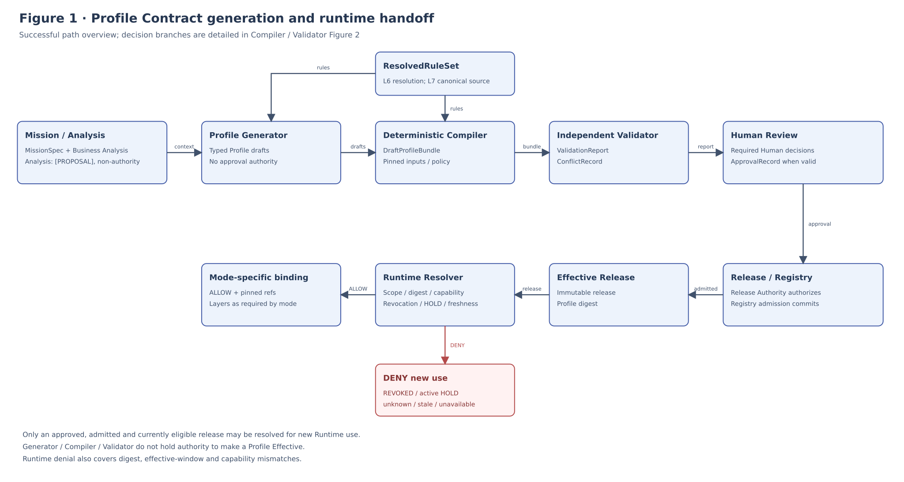
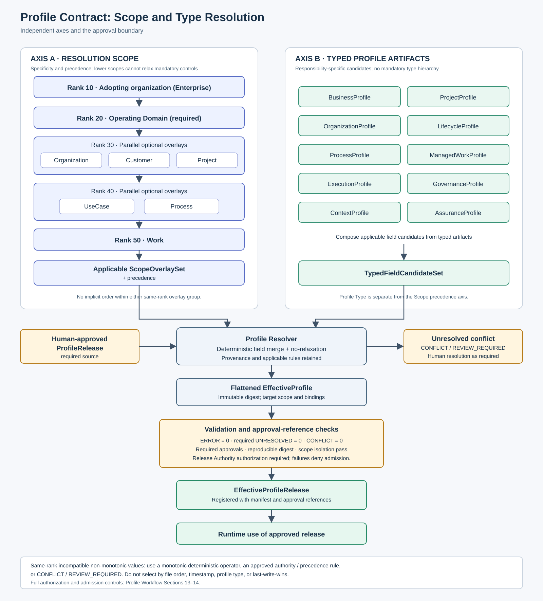
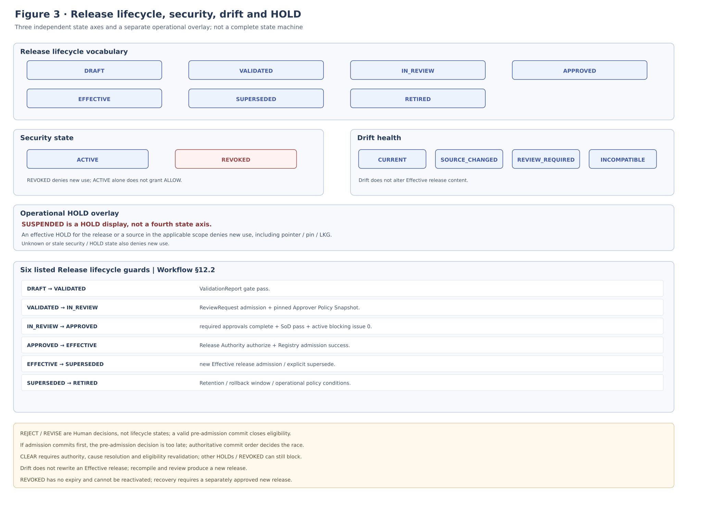

*CONTROLLED SPECIFICATION*

# ALOM Profile Contract & Resolution Specification

**Profile Schema / Scope Overlay / Merge Semantics / Effective Profile / Runtime Binding / Release**

> Core principle: Define an Operating Profile as an Executable Operating Contract that ALOM Runtime can resolve, pin, and validate, rather than merely as a generated artifact. Separate Profile Type from Resolution Scope, and define field-level merge, no-relaxation, Conflict, EffectiveProfile, and Release/Drift/Rollback as deterministic contracts.

| Management item | Value |
| --- | --- |
| Document ID | ALOM-PROF-CONTRACT-SPEC-001 |
| Version | v0.5-review.20261108 |
| Created | 2026-08-13 |
| Governing standard | ALOM-ARCH-STD-001 v2.5 |
| Related standards | ALOM-L1-STD-001 v0.7-review.20261110 / ALOM-PROF-STD-001 v0.4-review.20261109 |
| Scope | ALOM L1 Profile Engineering & Generation / Profile Resolver / Effective Profile Registry |
| Owner | Organization Architecture (Enterprise Architecture) / AI Platform |
| Co-owners | Business Owner / Quality / Security and Privacy / Project Management |
| Classification | Public |

This specification prioritizes application to the adopting organization's work while externalizing organization-specific logic as Schema/Rule/Overlay, so the same Profile Contract can be reused in future PaaS/SaaS offerings. Provider Control Plane, billing, and general-purpose Multi-tenant Provisioning are outside the scope of this version.

# Document Control

## 1. Position and Authority Precedence

- This specification elaborates PROF-01-08 in ALOM-ARCH-STD-001 v2.5-review.20261110 and Profile Model / Compilation / Approval / Drift in ALOM-PROF-STD-001 v0.4-review.20261109 into Profile Contract and Resolution semantics.
- This specification does not add an eighth Layer. Profile Engineering & Generation is an implementation Subsystem of L1 Operating Model & Governance and does not change Authority in L2-L7.
- If this specification conflicts with an existing standard, the governing standard v2.5 takes precedence. Treat remaining v2.2 references in L2-L7 and Profile Engineering documents as predating the governing-standard update, and give precedence to the v2.5 seven-layer/ALE/L5/Profile boundaries and the exact-four Execution Modes.
- [STD] identifies material inherited from the governing standard; [REF] identifies reuse of existing implementation standards; [PROPOSAL] identifies detailed contracts first fixed by this specification.

> Fixed boundary: Profile Resolver / Compiler / Generator / Dashboard do not have Authority to make Profiles Effective. Effective Profile Authority resides in the Human-approved release, protected default branch, and Approved Profile Registry.

## 2. Sources and Design Classification

| ID | Source | Use in this specification |
| --- | --- | --- |
| S1 | ALOM-ARCH-STD-001 v2.5-review.20261110 (ALOM Integrated Architecture Standard) | Non-effective alignment candidate; controlled authority remains v2.5. Seven layers, ALE=L2-L4, L5 Shared Execution, PROF-01-08, Human Control. |
| S2 | ALOM-L1-STD-001 v0.7-review.20261110                | Managed Work, Execution Mode, Profile Authority, Registration Gate. |
| S3 | ALOM-PROF-STD-001 v0.4-review.20261109 | Profile Types and Scope overlays, Resolution, Compiler, Validation, Approval, Drift, minimum contract. |
| S4 | ALOM-GRAPH-STD-001 v0.4-review.20261110 | EffectiveGraphManifest and reference patterns for resolver/compatibility/no-relaxation. |
| S5 | ALOM-LOOP-STD-001 v0.6-review.20261110 | LoopSpec, Agentic Work, Human Review, bounded convergence. |
| S6 | ALOM-HR-STD-001 v0.4-review.20261110 | EffectiveHarness, Runner/Tool enforcement, interactive/agentic entry points. |
| S7 | ALOM-KNW-STD-001 v0.4-review.20261110 | Context/Rule resolution, Authority/Revision/Citation, non-authoritative Derived data. |
| S8 | ALOM-SSOT-STD-001 v0.5 | Knowledge/Operational Authority, Controlled Write, Revision/Verification. |

## 3. Document Status and Adoption Policy

> Adopter-first: This version is complete when one actual work item of an adopting organization can be profiled from the organization's Rulebook and Mission and, after Human Review, resolved to L1-L7 as an Effective Profile. SaaS/PaaS-specific functions may be added later only without breaking the Profile Contract.

# Contents

| Section | Content |
| --- | --- |
| 1 | Purpose and Scope |
| 2 | Fixed Definitions and Responsibility Boundaries |
| 3 | Profile Contract Principles |
| 4 | Contract Architecture |
| 5 | Profile Type and Resolution Scope |
| 6 | Resolution Inputs and Precedence |
| 7 | Field-level Merge Semantics |
| 8 | Conflict / No-relaxation |
| 9 | EffectiveProfile Contract |
| 10 | Runtime Binding Contract |
| 11 | Validation / Conformance |
| 12 | Lifecycle / Drift / Recompile / Rollback |
| 13 | Version / Compatibility / Migration |
| 14 | Repository / API / Event |
| 15 | Initial MVP / Acceptance Gate |
| Appendix A | Minimum Data Contract |
| Appendix B | YAML Example |
| Appendix C | Merge Matrix |
| Appendix D | Mapping to Higher-Level Requirements |

# 1. Purpose and Scope

## 1.1 Purpose

This specification defines ALOM Operating Profile structure, resolution order, inheritance/composition, conflict handling, transition to Effective, Runtime Binding, and Release/Drift/Rollback as contracts that enable implementers to reproduce the same result. Do not pass Profile Generator free-text output directly to Runtime; convert it into an Executable Operating Contract through a deterministic Compiler/Resolver and an independent Validator.

## 1.2 In Scope

- Schema boundaries of ProfileBundle / EffectiveProfile / EffectiveProfileRelease / ProfileReleaseManifest.
- Resolution Scope: adopting organization as a whole (Enterprise) -> Operating Domain (required) -> Organization / Customer / Project (rank 30, parallel optional overlays) -> UseCase / Process (rank 40, parallel optional overlays) -> Work (ALOM-PROF-SCOPE-SPEC-001 CommonScopeContract).
- Type boundaries of Business/Project/Organization/Lifecycle/Process/ManagedWork/Execution/Governance/Context/Assurance Profiles.
- Field-level merge, no-relaxation, conflict, source/precedence/provenance.
- Execution Binding for human-only / interactive-agent / agentic / deterministic-system.
- Profile schema/compiler/release version, migration, drift, rollback.
- Minimum contracts for Profile API / Registry / CI / Trace.

## 1.3 Out of Scope

- Management decisions on Business Mission itself.
- LLM internal reasoning / chain-of-thought.
- Internal Runtime implementation within each L2-L7 Layer.
- Customer-facing SaaS Subscription/Billing/Provider Control Plane.
- Final staffing and personnel-evaluation decisions for real people.

## 1.4 Design Goal

> Design goal: Reproduce the same semantic EffectiveProfile and digest from the same Mission, Canonical Rule release, Profile inputs, and Compiler version. Preserve Profile semantics even when the LLM/Runner/Workflow Engine changes.

# 2. Fixed Definitions and Responsibility Boundaries

| Term | Fixed definition | Not to be equated with |
| --- | --- | --- |
| ProfileBundle | Release-candidate unit bundling design-time Profiles, source refs, unresolved items, validation, and approval status. | A single giant YAML / EffectiveProfile |
| ScopeOverlay | Delta contract that adds to, tightens, or explicitly selects among higher-level conditions for a particular scope. [PROPOSAL] | Profile Type itself |
| Profile Resolver | Deterministic Component that selects the scope chain and Profiles/Overlays and applies precedence/merge/no-relaxation. [PROPOSAL] | LLM / Human Approver |
| EffectiveProfile | Flattened immutable execution contract for a target scope/work generated by the Resolver from Human-approved source releases. | Draft Profile / Runtime state |
| EffectiveProfileRelease | Effective Release entity registering EffectiveProfile + ProfileReleaseManifest + Approval refs in the Registry. [PROPOSAL] | Dashboard read model |
| ProfileReleaseManifest | Manifest pinning source revisions, compiler/schema versions, validation, approvals, digest, and effective window. | Profile content |
| Resolution Scope | Axis of application specificity: adopting organization as a whole (Enterprise) / Operating Domain / Organization, Customer, Project (rank 30 parallel overlays) / UseCase, Process (rank 40 parallel overlays) / Work. | Profile Types such as Business/Project |
| No-relaxation | Principle that lower scopes do not relax higher-level prohibitions, authority ceilings, minimum Gates, classification, NDA, or mandatory Human conditions. | Simple last-write-wins |
| Conflict | Rule/Profile differences that cannot simultaneously hold and whose meaning cannot be preserved by automatic tightening. | Warning |
| Drift | State requiring reassessment after a change to Mission/Rule/Schema/Binding sources referenced by an Effective Profile. | Automatic Runtime change |

> Responsibility boundary: Profile Type identifies what the contract covers. Resolution Scope identifies where it applies. Keep the two separate and do not force Customer/UseCase into a proliferation of new Profile Types.

# 3. Profile Contract Principles

| ID | Principle | Normative requirement |
| --- | --- | --- |
| PCR-P01 | Canonical & Revision pinned | Resolve each Rule/Standard used for Effective status to an Authority and immutable revision. |
| PCR-P02 | Deterministic resolution | Make scope selection / precedence / merge / conflict / digest reproducible from the same input. |
| PCR-P03 | No silent relaxation | A lower scope must not implicitly weaken a higher-level mandatory control. |
| PCR-P04 | Human authority preserved | Do not automatically turn Human-required matters, Authority, or Responsibility conflicts over to Agents or resolve them by automatic selection. |
| PCR-P05 | Explicit execution mode | Every Managed Work uniquely resolves to human-only / interactive-agent / agentic / deterministic-system. |
| PCR-P06 | References over duplication | Bind L2-L7 Graph/Loop/Harness/Context/Authority definitions through revisioned refs rather than copying them into a Profile. |
| PCR-P07 | Immutable effective release | Do not modify an Effective release; operate through a new Release or rollback pointer. |
| PCR-P08 | Drift does not auto-deploy | Source drift detection generates a recompile/review request but does not automatically change the Production Profile. |
| PCR-P09 | Strict schema | Do not silently ignore unknown/invalid fields; determine their validity with the validator according to schema version. |
| PCR-P10 | Adopter-first, service-ready | Do not implement SaaS features unnecessary to the adopting organization, and do not embed scope/version/API in organization-specific code. |

# 4. Contract Architecture



Figure 1. Reference flow for Profile Contract generation, transition to Effective, and Runtime resolution

Diagram reading: arrows transfer contracts / Authority. The upper row is input, the middle is Design-time, and the lower row is Runtime. Only a Human-Approved EffectiveProfileRelease reaches Runtime.

## 4.1 Separation of Design-time and Runtime

| Category | Primary contracts | Authority / nature |
| --- | --- | --- |
| Design-time input | MissionSpec / BusinessAnalysisModel / ResolvedRuleSet | Mission Owner / L7 Rulebook / Draft analysis |
| Generated draft | Typed Profiles / ScopeOverlay / DraftProfileBundle | Non-Authority / Proposal |
| Validation | ValidationReport / ConflictRecord / Diff | Independent Validator / Rule Engine |
| Approval | ApprovalRecord | Human Authority |
| Release | EffectiveProfile / ProfileReleaseManifest | Approved Profile Registry |
| Runtime | profile_ref + effective_profile_digest + binding refs | L1 Resolver + each L2-L7 Authority |

## 4.2 Relationship to the Business Analysis Model

> [PROPOSAL] During initial adoption, treat the Business Analysis Model as a non-Authority input upstream of the Profile Generator. Retain interview, document analysis, and current-work observation results, Evidence, confidence, and unresolved items; do not directly promote them to an official Profile.

# 5. Profile Type and Resolution Scope

## 5.1 Typed Profile Artifacts

| Profile Type | Responsibility | Representative unit of change |
| --- | --- | --- |
| BusinessProfile | Mission/service boundary/Outcome/Business Owner | Business / Service |
| ProjectProfile | Project objectives / contract / delivery / risk / governance | Project |
| OrganizationProfile | Unit/Role/Responsibility/Authority/assignment constraint | Organization |
| LifecycleProfile | Phase/entry/exit/gate/mandatory artifact | Operating Domain / methodology |
| ProcessProfile | Process input/output/review/criteria | Process |
| ManagedWorkProfile | purpose/owner/mode/risk/evidence/binding | Work/UseCase |
| ExecutionProfile | ALE/L5/Harness/Runner/Tool/budget constraints | Work/Node |
| GovernanceProfile | Policy/Human Control/Approval/Exception/Stop | Work/Scope |
| ContextProfile | Knowledge roots/freshness/citation/scope | Work/Scope |
| AssuranceProfile | Eval/Review/Oracle/criteria/independence | Work/Gate |

`BusinessProfile` corresponds to `OperatingDomainProfile` in ALOM-PROF-SCOPE-SPEC-001 §3 (the required anchor for a persistent Operating Domain, `domain_id`). The Profile Type name remains unchanged in this version. Organization, Customer, and Project Profiles are independent optional context overlays under this anchor; Project is not a mandatory parent hierarchy.

## 5.2 Resolution Scope Specificity

> **Figure 2 reading note:** Crossings near the explanatory notes are not join nodes. Organization, Customer and Project are optional peer scope overlays; functional Profile Types are not additional precedence ranks.



Figure 2. Separation of Resolution Scope and Profile Type

How to read the figure: Scope (specificity rank) determines applicability and precedence; Profile Type is the set of candidate artifacts by responsibility. These two axes are independent and converge only in the Profile Resolver.

| Scope | Purpose | Required for MVP |
| --- | --- | --- |
| Adopting organization as a whole (Enterprise) | Authority ceilings, prohibitions, and minimum standards common to the adopting organization as a whole | Yes |
| Operating Domain | Operating conditions specific to a persistent Operating Domain (business / Service / organization-wide function). `domain_id` is required. | Yes |
| Organization | Responsibility, Authority, role, and SoD overlay. Independent of Project. | Optional |
| Customer | Additional constraints such as customer contracts and NDAs. Optional for application solely within the organization. | Optional |
| Project | Project-specific conditions, risk, and delivery. Optional for persistent work without a Project. | Optional |
| UseCase | Conditions specific to a business use case | Optional |
| Process | Conditions specific to a process (parallel to UseCase at the same rank 40) | Optional |
| Work | Final specialization for the Managed Work unit | Yes |

Organization / Customer / Project (rank 30) and UseCase / Process (rank 40) are parallel overlays at the same specificity rank within each group, with no implicit order among them. If overlays at the same rank propose incompatible non-monotonic values, they must not be selected by file order / timestamp / profile type / last-write-wins; use a monotonic and deterministic field operator, an approved Authority / precedence rule, or CONFLICT / REVIEW_REQUIRED (ALOM-PROF-SCOPE-SPEC-001 §6.2). `project_id` (and `organization_id` / `customer_id` / `usecase_id` / `process_id`) is optional and must not be rejected solely because it is absent, unless the selected rule explicitly requires it for the Managed Work. Do not synthesize a Project to satisfy an implementation schema. Reject a missing `domain_id` (ALOM-PROF-SCOPE-SPEC-001 §5.1 / §10.2). Each scope kind field is a single value (ID or null), not a list. Split work spanning departments into Managed Work for each department (ALOM-PROF-SCOPE-SPEC-001 §5.1).

> Inconsistency addressed: The controlled baseline of the Profile standard previously listed both a Profile structure, Business→Project→Organization→..., and a Resolution order, adopting organization as a whole (Enterprise)→Business→Customer→Project→UseCase→Work. The proposed Profile standard revision separates Profile Type responsibilities from Scope precedence. Under ALOM-PROF-SCOPE-SPEC-001, Scope precedence is adopting organization as a whole (Enterprise)→Operating Domain (required)→Organization / Customer / Project (rank 30, parallel, optional overlays)→UseCase / Process (rank 40, parallel, optional)→Work; Project is not a mandatory stage. The two earlier chains are historical source descriptions.

# 6. Resolution Inputs and Precedence

## 6.1 Resolver Input

ProfileResolutionRequest example

This illustration is a field excerpt, not a complete ProfileResolutionRequest or CommonScopeContract. A real request must carry the complete applicable Common Scope and authorization information; resolve legacy field names using the versioned mapping before validation.

```yaml
kind: ProfileResolutionRequest
schema_version: "1.0"
target:
  scope:
    enterprise: company
    business: system-integration
    project: example-alom-pilot
    usecase: requirements-review
    work: requirements.customer-approval
  effective_at: "2026-08-13T00:00:00+09:00"
inputs:
  profile_release: profile-release://example-alom/1.0.0
  mission_revision: mission://example-alom@7
  rule_releases:
    - okf-release://company-rules/2026.08
runtime_capabilities_ref: capability://alom-runtime@1
requested_by: principal://profile-resolver
```

Note: Retain the existing YAML key name `business:` in the example above; do not rename it. It corresponds to Operating Domain (`domain_id`, ALOM-PROF-SCOPE-SPEC-001 §3) in the text.

## 6.2 Precedence

| Precedence axis | Order / rule |
| --- | --- |
| Rule Authority | Give precedence to Authority / precedence defined by the Rulebook, including applicable laws, contracts, NDAs, and mandatory rules of the adopting organization. Refer semantic Conflicts to a Human. |
| Scope specificity | Adopting organization as a whole (Enterprise) < Operating Domain < Organization / Customer / Project (same rank 30, no implicit order among them) < UseCase / Process (same rank 40) < Work. A lower scope may only add, tighten, or make a permitted explicit selection. Handle incompatible non-monotonic values at the same rank using a monotonic, deterministic operator, an approved Authority / precedence rule, or CONFLICT / REVIEW_REQUIRED; do not select by file order / timestamp / profile type / last-write-wins. |
| Revision | Within the same release, use only the revision pinned in the Manifest. Do not replace it merely because another is newer. |
| Exception | Apply only if an explicit ExceptionGrant satisfies scope / TTL / authority, and record it in the Manifest. |

## 6.3 Resolution Procedure

1. Normalize the target scope (CommonScopeContract: `scope_ref` / `enterprise_id` / `domain_id` are required; overlay IDs are single-valued and included only when present).
2. Select the Approved Profile release and ScopeOverlay.
3. Validate source / authority / revision / schema compatibility.
4. Fix Rule precedence and ApplicabilityDecision.
5. Apply the merge operator for each field group.
6. Validate the no-relaxation invariant.
7. Detect semantic Conflicts involving Authority / Responsibility / Binding and similar matters.
8. Check L2-L7 binding refs against revision / capability.
9. Generate a flattened EffectiveProfile and calculate its canonical digest.
10. Check ValidationReport and Approval refs, then register the EffectiveProfileRelease.

# 7. Field-level Merge Semantics

[PROPOSAL] Fix the merge operator for each field group to eliminate differences in interpretation among Profile Compilers. Do not use general last-write-wins.

| Field group | Representative fields | Operator | Normative requirement |
| --- | --- | --- | --- |
| Identity / descriptive | id/title/description/labels | NEAREST_EXPLICIT | Use the explicit value at the lower scope. The id is fixed for each target. |
| Mandatory set | required_gates/evidence/approvers | UNION | Cannot be removed at a lower scope. |
| Prohibition | prohibits/deny_tools/deny_actions | UNION | Prohibitions accumulate. Only an ExceptionGrant can provide limited relief. |
| Allowed capability | allowed_tools/capabilities | INTERSECTION | Only capabilities permitted by both upper and lower scopes. |
| Autonomy ceiling | autonomy_ceiling | MOST_RESTRICTIVE | For A0<A1<A2<A3<A4, use the smaller value. |
| Risk class | risk_class | MOST_SEVERE | Use the higher risk under the organization-defined ordinal, such as low < medium < high. |
| Classification | classification | MOST_RESTRICTIVE | Use the stricter classification. |
| Budget ceiling | cost/token/time/concurrency ceilings | MIN_CEILING | Use the smaller upper limit. |
| Validity | valid_from/valid_until | INTERSECTION_WINDOW | The common validity period. An empty set is a Conflict. |
| Owner / Authority | owner/approver/stop_authority | EXPLICIT_OR_CONFLICT | Do not choose among multiple Authority candidates arbitrarily. |
| Execution Mode | execution_mode | SUITABILITY_GUARDED_SELECT | Only an explicit selection consistent with Suitability / Human-required / Autonomy. |
| Binding refs | graph/loop/harness/context/authority refs | NEAREST_COMPATIBLE | Replacement by a lower-scope ref is permitted, provided schema / capability / authority compatibility is satisfied. |
| SLO / Criteria | threshold/operator | METRIC_SEMANTIC | Follow the operator defined for the metric, such as MIN for max latency and MAX for min quality. An undefined operator is a Conflict. |
| Source / Provenance | source_refs/rule_refs | UNION_DEDUP | Retain all inputs and reasons for exclusion in a traceable form. |

> Prohibition: If a Resolver implementation does not recognize a field name, it must not silently overwrite or ignore the unknown field. Return ERROR if no merge policy exists for the corresponding schema version.

# 8. Conflict / No-relaxation

## 8.1 Conflict classes

| Class | Example | Automatic resolution |
| --- | --- | --- |
| STRICTER_WINS | Budget ceiling, classification, mandatory gate | Allowed only when the semantics are monotonic tightening. |
| AUTHORITY_CONFLICT | PM approval vs. department head approval | Not allowed. Human Decision Packet. |
| RESPONSIBILITY_CONFLICT | Multiple accountable roles for the same Work | Not allowed. |
| CONTRACT_INTERPRETATION | Interpretation of applicability of a customer contract and an organization standard | Generally not allowed. |
| BINDING_INCOMPATIBLE | LoopSpec requires a Harness capability that is unavailable | Not allowed. Validation ERROR. |
| VALIDITY_EMPTY | The intersection of validity periods is empty | Not allowed. |
| MODE_CONFLICT | human_required=true but agentic | Not allowed. Retain Human-required. |
| MODE_CONFLICT_DS | human_required=true but deterministic-system | Not allowed. Retain Human-required. |

## 8.2 No-relaxation invariants

- Do not relax prohibitions, classification, NDA scope, or privilege ceilings at a lower scope.
- Do not promote mandatory Human authority / Human-required Work to agentic or deterministic-system.
- Do not remove mandatory Quality Gate / Evidence / Approval.
- Do not exceed the upper-scope Autonomy ceiling.
- Do not transfer L7 Authority / Controlled Write to the Profile side.
- Do not replace L5 Tool / Credential / Network enforcement with Prompt instructions.

## 8.3 ConflictRecord

```yaml
kind: ProfileConflictRecord
conflict_id: conflict://profile/example-alom/0042
class: AUTHORITY_CONFLICT
target_ref: work://requirements/customer-approval
sources:
  - rule://project-standard/approval@abc123
  - rule://quality-standard/approval@def456
resolution: HUMAN_REQUIRED
status: OPEN
human_decision_ref: null
```

# 9. EffectiveProfile Contract

## 9.1 Properties of EffectiveProfile

- A flattened contract fully resolved for a specific target scope / work.
- Pins source Mission / Rule / Profile revisions.
- Has zero unresolved required conditions.
- Has a unique execution_mode and binding.
- Can be generated only from a Human-approved ProfileRelease.
- Has an immutable digest and can be referenced from RuntimeManifest / Trace.

## 9.2 Minimum fields

| Group | Required fields |
| --- | --- |
| Identity | effective_profile_id / schema_version / release_version / target_ref / digest |
| Provenance | mission_ref / source_profile_refs / rule_refs / compiler_version / resolution_policy_version |
| Scope | scope_ref / enterprise / domain / organization? / customer? / project? / usecase? / process? / work / isolation_scope_ref / classification / NDA |
| Management | purpose_ref / owner / responsibility / authority / outcome_ref / slo_refs |
| Execution | execution_mode / work_type / risk_class / autonomy_ceiling / budget |
| Human Control | human_required / approvers / stop_authority / review_policy / exception_route |
| Bindings | ale_entrypoint / graph_ref / loop_ref / shared_execution_profile / harness_ref / context_profile / authority_refs. The requirement for each field follows the Execution Mode-specific contract (§10.1). |
| Assurance | criteria / eval_refs / verification_refs / evidence_requirements |
| Validity | effective_from / effective_until / supersedes / rollback_candidate |
| Validation | validation_report_ref / approval_refs / conflict_count=0 |

## 9.3 Digest

> [PROPOSAL] Calculate an organization-standard Hash, such as SHA-256, over canonical serialization whose ordering has been normalized according to the schema. Record the Hash algorithm and canonicalization version in the Manifest. Reproducing the same digest from the same semantic contract is an acceptance criterion.

# 10. Runtime Binding Contract

## 10.1 Binding by Execution Mode

| Execution Mode | Required Runtime Binding | ALE/L5 |
| --- | --- | --- |
| human-only | purpose / owner / human_work_profile / authority_refs / evidence requirements. context_profile when needed. | ALE / L5 not required (L6 / L7 and deterministic Tool as needed) |
| interactive-agent | shared_execution_profile + harness_ref + context_profile + authority_refs + Human control | ALE: No / L5: Yes |
| agentic | ale_entrypoint + graph_ref(optional) + loop_ref + shared_execution_profile + harness_ref + context_profile + authority_refs | ALE: Yes / L5: Yes when an Agent executes |
| deterministic-system | SystemExecutionRecord + executor revision + scope + evidence + verification. Correlate profile digest / binding digest with SystemExecutionRecord. | ALE / L5 not required (optional explicit L5 mediation permitted) |

## 10.2 Binding resolution rules

- A Profile does not duplicate the bodies of GraphSpec / LoopSpec / HarnessSpec / ContextPack / Authority definitions; it retains version ranges or immutable revision refs.
- Validate schema / capability / authority compatibility when making it Effective.
- At Runtime task admission, the L1 Resolver pins effective_profile_digest and binding_digest by mode: L2 RuntimeManifest for agentic, L5 Execution Request for interactive-agent, HumanWorkRecord header for human-only, and SystemExecutionRecord for deterministic-system.
- Even if the Profile release is updated during execution, a started Task retains its pinned digest. Follow the L1 / L2 stop policy only for a serious Security revoke. [PROPOSAL]

## 10.3 Binding mismatch

| Inconsistency | Decision |
| --- | --- |
| agentic but no loop_ref / ale_entrypoint | ERROR |
| interactive-agent but no L5 shared_execution_profile | ERROR |
| human_required=true and execution_mode=agentic | ERROR |
| human_required=true and execution_mode=deterministic-system | ERROR |
| deterministic-system but no correlation with SystemExecutionRecord / executor revision / evidence / profile digest / binding digest | ERROR |
| deterministic-system reuses task_id / HumanWorkRecord as a required execution record | ERROR |
| L7 write required but no authority / action gateway ref | ERROR |
| Insufficient Harness capability | ERROR |
| Context source outside scope | ERROR / fail-closed |

# 11. Validation / Conformance

| Category | Minimum checks |
| --- | --- |
| Schema | required / enum / type / unknown field / version. |
| Source | Rule / Profile / Binding sources resolve to Authority + Revision. |
| Precedence | Record precedence and denied overrides for every applicable Rule / Overlay. |
| Merge | Field merge operators are defined and deterministic. |
| No-relaxation | Zero removals or relaxations of mandatory controls. |
| Responsibility | Zero missing Owner / Approver / Stop authority. |
| Execution | Mode and ALE / L5 bindings are consistent. |
| Human | Zero misplacements of Human-required into agentic or deterministic-system. |
| Assurance | Zero missing mandatory Gate / Evidence / Eval / Verify. |
| Security | Zero scope / NDA / classification violations. |
| Traceability | Mission→Rule→Profile→EffectiveProfile→Binding is traceable. |
| Reproducibility | Digest is reproducible with the same input / Compiler. |

## 11.1 Severity

| Severity | Making Effective |
| --- | --- |
| ERROR | Not permitted |
| REVIEW_REQUIRED | Permitted only after Human resolution |
| WARNING | Approver decision |
| INFO | Permitted |

> Gate: Register an EffectiveProfileRelease in the Registry only if ERROR=0, required UNRESOLVED=0, CONFLICT=0, required Approvals are satisfied, the digest is reproducible, and scope isolation passes.

# 12. Lifecycle / Drift / Recompile / Rollback



Figure 3. Separation of Profile Release Lifecycle, Security state, and Drift health (the table in §12.1 contains the current rules).

## 12.1 Lifecycle State and Drift State

| Axis | State | Meaning |
| --- | --- | --- |
| Release lifecycle | DRAFT / VALIDATED / IN_REVIEW / APPROVED / EFFECTIVE / SUPERSEDED / RETIRED | History of Human Approval and Release. |
| Security state | ACTIVE / REVOKED | For REVOKED, deny new use with precedence over pointer / pin / LKG. RevocationRecord is the evidence. Do not apply this denial to ACTIVE. |
| Drift health | CURRENT / SOURCE_CHANGED / REVIEW_REQUIRED / INCOMPATIBLE | Source / compatibility health of the Effective release. This work does not change the Drift vocabulary. |

`SUSPENDED` is an operational hold display that does not change the three axes above. When an OperationalHoldRecord has an effective HOLD for the relevant release / source / scope, the Resolver denies new use with precedence over pointer / pin / LKG. Releasing the hold requires an explicit CLEAR by an authorized person and a record of cause resolution and eligibility revalidation; it is not released automatically.

## 12.2 Drift trigger

- Mission revision change
- Canonical Rulebook release/revision change
- Profile schema / merge policy change
- Binding contract / capability change
- Authority / assignment constraint change
- Serious post-release incident / Human override pattern

## 12.3 Recompile flow

Drift → Impact Analysis → Draft Recompile → Semantic Diff → Validation → Human Review → New Release → Effective pointer update. Do not directly rewrite the current Effective Profile because of a source change.

## 12.4 Rollback

- Rollback returns the Effective pointer to an earlier APPROVED immutable release.
- Do not re-edit the old Release body.
- New Tasks resolve the release after rollback; started Tasks retain their pinned digest.
- Record the rollback reason, actor, affected scope, and incident / evidence in the Trace.
- For a Security / Authority revoke, set Security state to REVOKED rather than perform an ordinary rollback, and the existing stop / recovery policy may be applied. Retain Release lifecycle history. An ordinary rollback does not clear a revoke. Rollback is prohibited if the old release also shares the revoked source / authority. A RevocationRecord has no expiry, and a revoked release must not be reactivated. Recovery requires validation of corrected source / authority and issuance of a separate new release through Human Approval.

# 13. Version / Compatibility / Migration

## 13.1 Independent Versions

| Version | Scope | Normative requirement |
| --- | --- | --- |
| profile_schema_version | Profile/Overlay/EffectiveProfile schema | Contract shape. |
| compiler_version | Resolver / Compiler implementation | Track algorithm corrections even with the same schema. |
| resolution_policy_version | merge/no-relaxation policy | Track field semantics. |
| profile_release_version | Business / Project and other ProfileBundle releases | Human-approved unit of change. |
| binding_contract_version | L1↔L2-L7 binding contract | Runtime compatibility. |

## 13.2 Compatibility policy

| Change | Criteria |
| --- | --- |
| Patch | Corrections that do not change meaning. Verify semantic equivalence of golden digests. |
| Minor | Optional / additive field. Do not silently ignore it in old Compilers / Validators; make it explicit in the compatibility matrix. |
| Major | Breaking changes such as required / enum / merge semantics. Migration required. |
| Compiler change | Old-release reproduction tests + golden cases + human-required regression. |
| Binding change | Each Layer's adapter capability matrix and dry-run validation. |

## 13.3 Migration

- Version-control migration as a pure transformation that explicitly identifies source→target schema versions.
- Repeat Validation / Conformance / semantic diff after migration.
- Retain Validator / Compiler artifacts or reproducible build information that can reconstruct old Effective releases.
- Do not automatically promote breaking migration to Production.

# 14. Repository / API / Event

## 14.1 Repository baseline

```text
alom-profile-contract/
  schemas/
    common/
    overlays/
    profiles/
    effective/
    release/
  resolution-policies/
  validators/
  migrations/
  examples/
  golden-tests/

alom-profiles/
  business/
  projects/
  organizations/
  lifecycles/
  processes/
  managed-work/
  overlays/
  releases/
```

## 14.2 API baseline

| API | Responsibility |
| --- | --- |
| profile.compile | Resolved inputs→Draft ProfileBundle |
| profile.validate | Schema/Conformance/Conflict |
| profile.diff | Release/Effective semantic diff |
| profile.review.request | Human review packet |
| profile.review.decide | Approve/Reject/Revise |
| profile.release | Approved→immutable release |
| profile.resolve | target scope→EffectiveProfile |
| profile.drift.check | source changes→impact/drift |
| profile.rollback | Switch Effective pointer to previous approved release [PROPOSAL] |

## 14.3 Event baseline

| event_type | Minimum contents |
| --- | --- |
| profile.compiled | input refs / compiler / draft digest |
| profile.validation.completed | report / severity counts |
| profile.review.decided | actor / role / decision / reason |
| profile.release.effective | release / effective profile digest / window |
| profile.drift.detected | changed source / impacted refs |
| profile.rollback.executed | from/to release / actor / reason; inherit all mandatory ALLOW event fields from ALOM-PROF-REG-STD-001 §15.2. Terminal DENY emits profile.rollback.denied with its own mandatory fields. |
| profile.resolved | target / release / effective digest / trace_id |

# 15. Initial MVP / Acceptance Gate

## 15.1 MVP scope

> MVP: Start with one Operating Domain, one Project overlay, one group of UseCases, and one real work activity. Implement adopting-organization-wide (Enterprise) / Operating Domain / UseCase / Work scopes and the Project overlay, Profile Compiler / Validator / Review / Registry, and L1-L7 bindings. Use Customer scope only for Projects that need it.

| Phase | Deliverable | Completion criteria |
| --- | --- | --- |
| P0 Contract | This specification + JSON Schema + merge policy | schema/golden tests pass |
| P1 Rulebook | Approved OKF release of the adopting organization's standard | 100% of Rule sources resolve to a revision |
| P2 Adopter Analysis | BusinessAnalysisModel + MissionSpec | Make unresolved items explicit and obtain Human confirmation |
| P3 Draft Profile | Business/Project/Org/Lifecycle/Work Profiles | Reproduce semantics with the same input |
| P4 Effective Release | Validation + Human Approval + EffectiveProfile | Zero ERROR / Conflict and pinned digest |
| P5 Runtime Binding | Representative Work for human-only / interactive-agent / agentic / deterministic-system | mode/binding mismatch 0 |
| P6 Operational Learning | Dashboard + drift/recompile/rollback drill | Demonstrate source change→impact identification→new release / rollback |

## 15.2 Acceptance Gates

| Gate | Test | Pass criteria |
| --- | --- | --- |
| PC-G01 | Determinism | EffectiveProfile digest matches with the same input / source / compiler / policy. |
| PC-G02 | No-relaxation | Zero relaxations of prohibitions / mandatory Human / minimum Gate / Autonomy ceiling. |
| PC-G03 | Human-required regression | Mandatory Human involvement, such as customer negotiation / requirements approval / quality judgment / Go-No-Go, does not change to agentic or deterministic-system. |
| PC-G04 | Conflict safety | Zero silent selection of Authority / contract-interpretation Conflicts. |
| PC-G05 | Binding completeness | Every Managed Work has a unique execution_mode, and required binding refs resolve. |
| PC-G06 | Source traceability | Every Effective field is traceable back to source / profile / rule / provenance. |
| PC-G07 | Schema compatibility | Major / minor / patch matrix and migration test. |
| PC-G08 | Drift | Identify impacted profiles / work from tracked source changes. |
| PC-G09 | Rollback | Roll the pointer back to a previous approved release and reflect it in new Tasks. |
| PC-G10 | Scope isolation | 100% deny in negative tests for cross-isolation between scopes with different `isolation_scope_ref` values (different `isolation_scope_ref`, including cross-project / cross-customer). |

# Appendix A. Minimum Data Contracts

| Contract | Minimum responsibilities |
| --- | --- |
| ScopeOverlay | overlay_id / scope / target_ref / source_ref / revision / field_patches / precedence / validity / approval_status |
| ProfileResolutionRequest | target scope / effective_at / profile_release / mission_revision / rule_releases / runtime_capabilities_ref / requested_by |
| ResolutionDecision | path / field / operator / candidates / selected / denied_overrides / source_refs / reason |
| ProfileConflictRecord | conflict_id / class / target_ref / sources / resolution / status / human_decision_ref |
| EffectiveProfile | id / schema_version / release_version / target / provenance / management / execution / human_control / bindings / assurance / validity / digest |
| EffectiveProfileRelease | effective_profile_ref / release_manifest_ref / approval_refs / registry_revision / effective_window / state. `state` is Release lifecycle history (DRAFT…RETIRED), not Security state. Express serving denial due to revoke through RevocationRecord / Security state; do not add a second required field to this envelope. |
| ProfileReleaseManifest | bundle_digest / source releases / compiler / resolution_policy / model refs / validation / approvals / effective window / hash metadata |
| ProfileRollbackRecord | Inherit every mandatory field, ALLOW/DENY condition, approved_by and reason contract from ALOM-PROF-REG-STD-001 Appendix A; this row is not a reduced wire schema. |

# Appendix B. YAML Example

This is an illustrative excerpt, not a complete schema-conformant EffectiveProfile. The CommonScopeContract and runtime isolation requirements are defined in ALOM-PROF-SCOPE-SPEC-001. No complete EffectiveProfile schema is supplied with this edition.

```yaml
apiVersion: alom/v1
kind: EffectiveProfile
metadata:
  id: effective://example-alom/requirements.customer-approval/1.0.0
  schema_version: "1.0"
  release_version: "1.0.0"
  digest:
    algorithm: sha256
    canonicalization: alom-json-c14n-v1
    value: "<digest>"
target:
  enterprise: company
  business: system-integration
  project: example-alom-pilot
  usecase: requirements-review
  work: requirements.customer-approval
  # Note: Keep the existing `business:` key name (corresponds to Operating Domain; ALOM-PROF-SCOPE-SPEC-001 §3).
provenance:
  mission_ref: mission://example-alom@7
  profile_release_ref: profile-release://example-alom/1.0.0
  compiler_version: "0.1.0"
  resolution_policy_version: "0.1.0"
execution:
  work_type: hybrid
  execution_mode: human-only
  risk_class: high
  autonomy_ceiling: A0
human_control:
  human_required: true
  owner: role://project-leader
  approvers: [role://project-leader]
  stop_authority: role://project-manager
bindings:
  context_profile: context://example-alom/requirements@1
  authority_refs:
    - authority://requirements-approval@1
assurance:
  required_evidence: [review-record, approval-decision]
validity:
  effective_from: "2026-08-13T00:00:00+09:00"
validation:
  report_ref: validation://example-alom/1.0.0
  conflicts: 0
  errors: 0
```

# Appendix C. Merge Matrix

This table summarizes the rules in section 7. For implementation, resolution-policies/profile-v1.yaml is the candidate machine-readable source of truth. [PROPOSAL]

| Group | Operator | Relaxation |
| --- | --- | --- |
| Identity / descriptive | NEAREST_EXPLICIT | Conditional |
| Mandatory set | UNION | Prohibited |
| Prohibition | UNION | Prohibited |
| Allowed capability | INTERSECTION | Prohibited |
| Autonomy ceiling | MOST_RESTRICTIVE | Prohibited |
| Risk class | MOST_SEVERE | Prohibited |
| Classification | MOST_RESTRICTIVE | Prohibited |
| Budget ceiling | MIN_CEILING | Prohibited |
| Validity | INTERSECTION_WINDOW | Conditional |
| Owner / Authority | EXPLICIT_OR_CONFLICT | Conditional |
| Execution Mode | SUITABILITY_GUARDED_SELECT | Conditional |
| Binding refs | NEAREST_COMPATIBLE | Conditional |
| SLO / Criteria | METRIC_SEMANTIC | Conditional |
| Source / Provenance | UNION_DEDUP | Conditional |

# Appendix D. Mapping to Higher-Level Requirements

| This specification | Source requirement | Elaboration |
| --- | --- | --- |
| PCR-P01/P02/P06 | PROF-P01/P09/P12, L6/L7 | Canonical source, deterministic resolver, reference contracts. |
| PCR-P03/P04/P05 | PROF-P05/P06/P08, L1 Human Control | No-relaxation, Human-required, Execution Mode. |
| PCR-P07/P08 | PROF-P11, Dashboard | Immutable release, Drift→Recompile→Review. |
| EffectiveProfile | Profile Engineering Effective Profile / L1 Profile Authority | Clarify the flattened immutable contract and Release entity. |
| ScopeOverlay | Profile Engineering 6.1/6.3 | Separate the Profile Type structure from the adopting-organization-wide (Enterprise)→...→Work Resolution axis. |
| Merge Matrix | Graph/Harness Effective Manifest pattern | Apply field-level semantics and compatibility / no-relaxation to Profiles. |
| Rollback | L2/L5 rollback/last-known-good pattern + Dashboard Learning | Add rollback of the Profile release pointer. |

> v0.2 completion criteria: Using a Reference Profile based on the adopting organization's real Rulebook and Mission, reproduce ScopeOverlay→Resolution→EffectiveProfile→Human Approval→L1-L7 Binding→Drift / Recompile / Rollback end to end and verify PC-G01-10 of this specification.

# Version Control / History

| Date | Category | Content | Document version |
| --- | --- | --- | --- |
| 2026-09-15 | meaning-preserving editorial errata | Added the deterministic-system row copied from L1 §6.1 to §10.1. human_required+deterministic-system remains ERROR. The previous closed-three were human-only / interactive-agent / agentic. | Draft v0.3 |
| 2026-09-15 | meaning-preserving editorial errata | Locally aligned the §10.1 deterministic-system row and §10.2 pin destinations with the existing SystemExecutionRecord / profile-binding digest contract. Corrected the same omission in the L1 §6.1 summary. | Draft v0.3 |
| 2026-09-18 | meaning-preserving editorial errata | Normalized the current alias for the approval record identifier to canonical ApprovalRecord. Contract semantics, Authority / SoD / lifecycle are unchanged. | Draft v0.3 |
| 2026-09-19 | normative lifecycle/security-state alignment | Removed REVOKED from the Release lifecycle and added RETIRED. Fixed Security state ACTIVE / REVOKED as an independent axis. Drift vocabulary is unchanged. | Draft v0.4 |
| 2026-10-27 | normative scope-model alignment | Applied the ALOM-PROF-SCOPE-SPEC-001 Draft v0.3 scope model to §1.2 / §2 / §5.1 / §5.2 (heading and Figure 2 caption) / §6.1 / §6.2 / §6.3 / §9.2 / §15.1 / PC-G10 / Appendix B. Operating Domain (`domain_id`) is required; Organization / Customer / Project (rank 30) and UseCase / Process (rank 40) are parallel optional overlays; each scope kind is single-valued; `project_id` is optional; `isolation_scope_ref` is required at runtime. | Draft v0.5 |

