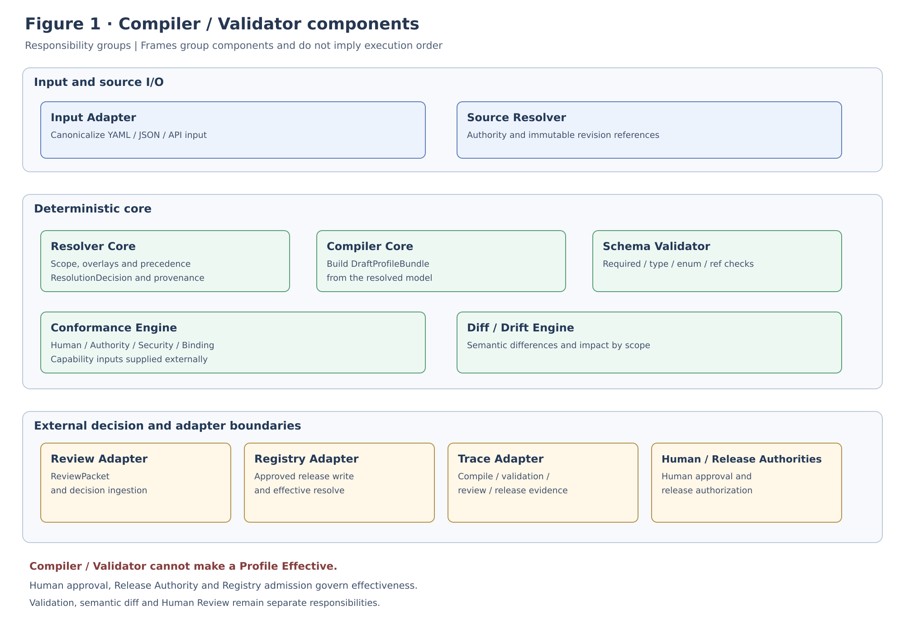
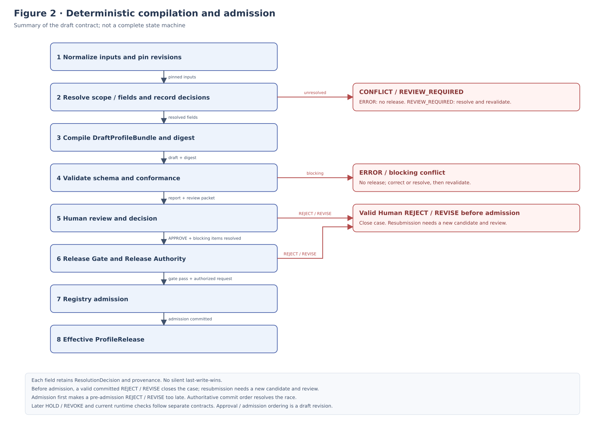
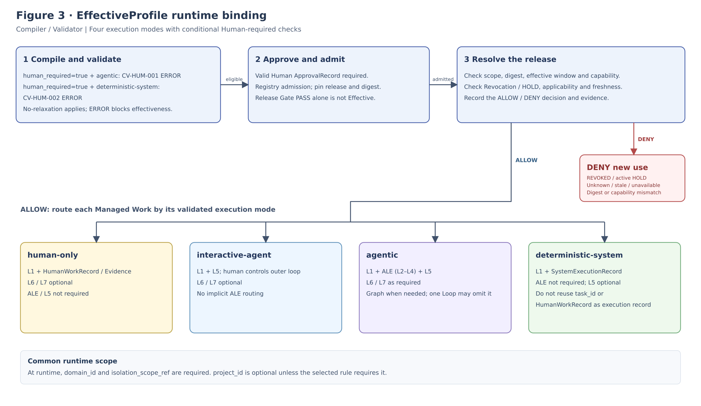

**IMPLEMENTATION SPECIFICATION**

**ALOM Profile**

**Compiler & Validator**

**Implementation Specification**

Resolver / Compiler / Validator / Conformance / Semantic Diff / Release Gate

| **Core principle** Implement Profile Contract as an executable, deterministic compilation and validation foundation. Generate a DraftProfileBundle from Mission, Rules, Business Analysis, and Typed Profiles, and permit promotion to an Effective Profile Release only after independent Validation and Human Review. Compiler/Validator has no Authority and reproduces the same semantic result from identical inputs. |
|-----------------------------------------------------------------------------------------------------------------------------------------------------------------------------------------------------------------------------------------------------------------------------------------------------------------------------------------------|

| **Management item** | **Value**                                                                  |
|--------------|-----------------------------------------------------------------------------|
| **Document ID**  | ALOM-PROF-CV-SPEC-001                                                       |
| **Version**       | v0.4-review.20261110                                                                  |
| **Created**   | 2026-08-13                                                                  |
| **Governing standard** | ALOM-ARCH-STD-001 v2.5                                                      |
| **Related standards** | ALOM-PROF-STD-001 v0.4-review.20261109 / ALOM-PROF-CONTRACT-SPEC-001 v0.5-review.20261108                   |
| **Target**     | Profile Resolver / Compiler / Validator / Conformance / Diff / Release Gate |
| **Owner** | Organization Architecture (Enterprise Architecture) / AI Platform                                       |
| **Joint responsibility** | Business Owner / Quality / Security and Privacy / Project Management           |
| **Classification** | Public |

# Document Control

## 1. Position and Authority Precedence

- This specification turns PROF-01-08 of ALOM Integrated Architecture Standard v2.5; Compilation/Validation/Approval of Profile Engineering & Generation v0.4; and Resolution/Merge/EffectiveProfile and the REVOKED/HOLD serving gate of Profile Contract & Resolution Specification v0.5 into implementable Components/APIs.

- Profile Compiler / Resolver / Validator / Diff Engine / API are implementation Subsystems of L1 Operating Model & Governance, not an eighth Layer.

- Compiler/Validator has no Authority to make a Profile Effective. Authority for becoming Effective comes from a Human-approved release + protected default branch / Approved Profile Registry.

- An LLM/Generator may generate candidate structures, but field-level merge, no-relaxation, severity decisions, digest generation, and final release gate decisions are not delegated to free-form reasoning.

- ALOM-ARCH-STD-001 v2.5 takes precedence in conflicts with governing standards. Where laws, contracts, customer NDAs, or Security/Privacy rules are stricter, the stricter constraints take precedence.

| **Fixed boundary** The Compiler assembles; the Validator determines validity; Human Authority decides whether to make the result Effective. These three responsibilities MUST NOT be consolidated into one Component or one AI decision. |
|------------------------------------------------------------------------------------------------------------------------------------------------------------------------------------|

## 2. Sources and Design Classification

| **ID** | **Source**                                         | **Use in this specification**                                                                 |
|--------|--------------------------------------------------|------------------------------------------------------------------------------------|
| **S1** | ALOM-ARCH-STD-001 v2.5-review.20261110 (ALOM Integrated Architecture Standard)                 | Non-effective alignment candidate; controlled authority remains v2.5. Seven Layers, ALE=L2-L4, L5 Shared Execution, PROF-01-08, Human Control. |
| **S2** | ALOM-L1-STD-001 v0.7-review.20261110                       | Managed Work, Execution Mode, Authority, Registration Gate.                       |
| **S3** | ALOM-PROF-STD-001 v0.4-review.20261109 | Compilation Pipeline, Validation categories/severity, Approval, CI, Deployment.   |
| **S4** | ALOM-PROF-CONTRACT-SPEC-001 v0.5-review.20261108 | Resolution scope, field merge, no-relaxation, EffectiveProfile, API/Event, PC-G01-10. |
| **S6** | ALOM-CTL-STD-001 v0.4-review.20261110<br />ALOM-GRAPH-STD-001 v0.4-review.20261110<br />ALOM-LOOP-STD-001 v0.6-review.20261110<br />ALOM-HR-STD-001 v0.4-review.20261110<br />ALOM-KNW-STD-001 v0.4-review.20261110<br />ALOM-SSOT-STD-001 v0.5 | Runtime binding compatibility and Context/Authority/Shared Execution boundaries.            |

## 3. Document Status

v0.3 fixes Component responsibilities, Pure Core, APIs, Error Model, Repository, CI, and acceptance tests at a level sufficient to start an Adopter-first Reference Implementation. It does not mandate a particular cloud or Agent product.

2026-10-27 v0.4: incorporates the ALOM-PROF-SCOPE-SPEC-001 v0.3 scope model (required Operating Domain anchor, parallel optional overlays at rank 30 / rank 40, single values, optional `project_id`, and `isolation_scope_ref`) into §1.2 / §7.1 / §9.1 / §10 / §17 / §18 / Appendix C. This was a normative revision, not meaning-preserving errata.

# Contents

| **Chapter**    | **Content**                                          |
|-----------|---------------------------------------------------|
| **1**     | Purpose and Scope                                    |
| **2**     | Fixed Definitions and Responsibility Boundaries                                |
| **3**     | Architecture Principles                                |
| **4**     | Logical Component Architecture                            |
| **5**     | Input Contracts                                          |
| **6**     | Normalization / Source Resolution                 |
| **7**     | Profile Resolution / Merge Engine                 |
| **8**     | Compilation                                       |
| **9**     | Validation / Conformance                          |
| **10**    | Conflict / Severity / Error Model                 |
| **11**    | Execution Suitability & Human-required Regression |
| **12**    | Semantic Diff / Drift / Impact                    |
| **13**    | Human Review / Release Gate                       |
| **14**    | EffectiveProfile / Registry Integration                   |
| **15**    | API / Event Contract                              |
| **16**    | Repository / Module Architecture                  |
| **17**    | CI/CD / Golden Tests                              |
| **18**    | Security / NDA / Scope Isolation                  |
| **19**    | Observability / Trace                             |
| **20**    | Nonfunctional Requirements / SLO                                      |
| **21**    | Physical Deployment Reference Configuration                              |
| **22**    | Representative Profile Application Example                 |
| **23**    | Acceptance Gates                                        |
| **24**    | Implementation Roadmap                                  |
| **Appendix A** | Minimum Data Contracts                                    |
| **Appendix B** | Validation Rule Catalog                           |
| **Appendix C** | API Examples                                             |
| **Appendix D** | Governing Requirement Mapping                                      |

# 1. Purpose and Scope

## 1.1 Purpose

This specification defines implementation contracts for the Profile Compiler & Validator, which deterministically resolves MissionSpec, RuleResolutionSet, BusinessAnalysisModel, Typed Profile inputs, and ScopeOverlay to generate a DraftProfileBundle / ValidationReport / EffectiveProfile candidate. The goal is to transform AI-generated candidates into a Build Pipeline that reproduces the same semantic result from the same inputs, source revisions, and compiler/resolution policy, rather than passing the candidates directly to Runtime.

## 1.2 In Scope

- Input normalization, revision pinning, source provenance validation.

- Resolve Resolution Scope across organization-wide (Enterprise)→Operating Domain (required)→Organization / Customer / Project (rank 30, parallel optional overlays)→UseCase / Process (rank 40, parallel and optional)→Work (ALOM-PROF-SCOPE-SPEC-001).

- field-level merge operator, precedence, no-relaxation, ConflictRecord.

- Compile Business/Project/Organization/Lifecycle/Process/ManagedWork/Execution/Governance/Context/Assurance Profiles.

- Schema Validator, Conformance Engine, Binding compatibility, Human-required regression.

- ValidationReport, semantic diff, drift impact, release candidate digest.

- Generate HumanReviewPackets for the Review/Approval API and hand off releases to the Approved Profile Registry.

- Reusable implementation boundaries as a CLI / Library / REST API.

## 1.3 Out of Scope

- Management decisions about the Business Mission itself, final Rulebook approval, and assignment/evaluation of actual people.

- LLM internal reasoning, chain-of-thought, and model weights.

- Internal Runtime implementations of L2-L7.

- SaaS subscription/billing/provider control plane.

- Dashboard UI itself. API contracts for Review/Validation displays are in scope, however.

## 1.4 Completion State

| **Initial MVP Done** Given a contract development Reference Profile, reproduce the same Draft/Effective digest from the same source revisions; pass Human-required regression, Scope isolation, and Conflict safety checks; and generate an Effective release manifest after Human Approval. |
|---------------------------------------------------------------------------------------------------------------------------------------------------------------------------------------------------------------------------------------------------|

# 2. Fixed Definitions and Responsibility Boundaries

| **Term**                 | **Fixed definition**                                                                                      | **Not equivalent to**            |
|--------------------------|---------------------------------------------------------------------------------------------------|---------------------------------|
| **Resolver Core**        | Pure Core that resolves Scope, overlays, rules, precedence, and field operators and generates ResolutionDecisions.   | LLM selector / Profile Registry |
| **Compiler Core**        | A deterministic build component that assembles Typed Profiles from resolved inputs into a consistent DraftProfileBundle. | Generator / Human Approver      |
| **Schema Validator**     | Validates structure, types, and reference forms using JSON Schema or equivalent mechanisms.                                              | Business conformance decisions        |
| **Conformance Engine**   | Checks semantic requirements such as Authority, Human-required, Binding, Assurance, and Security.                 | Schema Validator alone            |
| **Semantic Diff Engine** | Calculates semantic differences between Profiles/Effective releases and the affected scope/work.                                 | Text diff alone                |
| **Release Gate**         | Checks Validation severity, conflicts, and approval validity to determine eligibility for release handoff.              | Human Approval itself          |
| **Golden Case**          | A regression case with pinned inputs/source/compiler/policy and expected semantic output/digest.                     | A mere unit test fixture         |
| **Effective Digest**     | Hash of the canonically serialized EffectiveProfile. Used for Runtime correlation.                          | The Git commit SHA itself          |

# 3. Architecture Principles

| **ID**     | **Principle**                | **Normative requirement**                                                                                  |
|------------|-------------------------|-------------------------------------------------------------------------------------------|
| **CV-P01** | Pure Core               | Separate Resolver/Compiler/critical validation from external I/O; return the same output for the same input.     |
| **CV-P02** | Deterministic Build     | Do not implicitly introduce clock/random/model responses into semantic compile results.                  |
| **CV-P03** | Authority Separation    | Do not grant Generator/Compiler/Validator Authority to make a Profile Effective.                            |
| **CV-P04** | Fail Closed             | Return ERROR or REVIEW_REQUIRED if Authority/revision/conflict/security/human gate cannot be resolved. |
| **CV-P05** | No Relaxation           | Lower-level overlays do not relax prohibitions, mandatory human requirements, minimum gates, or autonomy ceilings.   |
| **CV-P06** | Explainable Resolution  | Retain operator, candidates, selected/denied values, sources, and reasons for every field decision.            |
| **CV-P07** | Canonical Serialization | Normalize field order, nulls, set ordering, and timestamps before calculating the digest.                    |
| **CV-P08** | Independent Validation  | Separate successful compilation from passing validation.                                                   |
| **CV-P09** | Semantic Diff           | Evaluate release differences by field meaning and their impact on mode/binding/human gates.                   |
| **CV-P10** | Portable Contract       | Maintain the implementation as a library/API/schema independent of UI/LLM/Runner.                               |

# 4. Logical Component Architecture



Figure 1. Profile Compiler & Validator logical components

| **Component**          | **Responsibilities**                                                          | **I/O characteristics**                   |
|------------------------|-------------------------------------------------------------------|-------------------------------|
| **Input Adapter**      | Convert YAML/JSON/API input to the canonical internal model.             | I/O boundary                  |
| **Source Resolver**    | Pin Rule/standard/profile references to Authority + immutable revision. | I/O + cache                   |
| **Resolver Core**      | Scope chain / merge / conflict / precedence.                     | Pure core                     |
| **Compiler Core**      | Resolved model→DraftProfileBundle.                               | Pure core                     |
| **Schema Validator**   | required/enum/ref/schema version.                                | Pure core                     |
| **Conformance Engine** | Human/Authority/Binding/Security/Assurance/Traceability.         | Pure core + capability inputs |
| **Diff/Drift Engine**  | before/after semantic diff, source impact.                       | Pure core                     |
| **Review Adapter**     | HumanReviewPacket / decision ingest.                             | I/O boundary                  |
| **Registry Adapter**   | Approved release write / Effective resolve.                      | I/O boundary                  |
| **Trace Adapter**      | Record compile/validation/review/release events.                     | I/O boundary                  |

# 5. Input Contracts

| **Input**                 | **Required**     | **Minimum content**                                              | **Authority**          |
|---------------------------|--------------|-----------------------------------------------------------|------------------------|
| **MissionSpec**           | Yes          | mission_id / scope / objective / constraints / revision   | Applying organization / L1 input     |
| **RuleResolutionSet**     | Yes          | rule_id / authority / revision / applicability / priority | L6/L7 resolved         |
| **BusinessAnalysisModel** | MVP Yes      | observed process / evidence / confidence / unresolved     | Non-authority analysis |
| **Typed Profile Inputs**  | Yes          | Business/Project/Org/Lifecycle/Process/Work and related Profiles             | Draft/Profile source   |
| **ScopeOverlay\[\]**      | As needed    | scope / field_patches / precedence / revision             | Approved/Draft source  |
| **RuntimeCapabilities**   | At Validation | graph/loop/harness/context/authority capability/version   | L2-L7                 |
| **ResolutionPolicy**      | Yes          | field operator / precedence / no-relaxation rules         | Managed by the applying organization  |
| **CompilerManifest**      | Yes          | compiler/schema/policy build version                      | Build authority        |

| **Prohibited** High BusinessAnalysisModel confidence alone does not justify creating a new Rule/Authority. Retain UNRESOLVED items as unresolved; do not implicitly convert them into Profiles. |
|-------------------------------------------------------------------------------------------------------------------------------------------------------|

# 6. Normalization / Source Resolution

## 6.1 Canonical input normalization

- Normalize YAML/JSON representation differences into internal types. Fix set/list semantics in the Schema and canonically sort unordered sets.

- Make ID case/whitespace normalization explicit. Do not silently resolve ambiguous aliases.

- Specify timezones for date/time values. The deterministic semantic Profile digest covers versioned semantic content; volatile generation timestamps are not automatically injected into that content. A time defined as a semantic field remains included according to the applicable schema. Manifest/envelope and signed-payload digests follow their own versioned definitions and may include timestamps. Do not reinterpret existing signed payloads, approvals, or digests; changes to their scope require versioned canonicalization, compatibility and migration.

- Distinguish null, UNRESOLVED, and NOT_APPLICABLE for undefined values.

## 6.2 Revision pinning

Resolve Knowledge/Rule/Profile sources to commit SHA / immutable revision / bundle digest, not tag names alone, and pin them in the ProfileReleaseManifest. Multiple candidate Authorities or an unknown revision produce ERROR.

# 7. Profile Resolution / Merge Engine

## 7.1 Scope specificity rank

Resolution scope follows organization-wide (Enterprise)→Operating Domain (required)→Organization / Customer / Project (rank 30, parallel optional overlays)→UseCase / Process (rank 40, parallel and optional)→Work (ALOM-PROF-SCOPE-SPEC-001 §6.2). Organization / Customer / Project (rank 30) and UseCase / Process (rank 40) are parallel overlays within their respective specificity ranks, with no implicit ordering among them. When overlays of the same rank propose incompatible non-monotonic values, do not select by file order / timestamp / profile type / last-write-wins. Use a monotonic, deterministic field operator, an approved Authority / precedence rule, or CONFLICT / REVIEW_REQUIRED (ALOM-PROF-SCOPE-SPEC-001 §6.2). `project_id` (and `organization_id` / `customer_id` / `usecase_id` / `process_id`) is optional. Absence alone MUST NOT cause rejection unless a selected rule explicitly requires it for that Managed Work. Do not synthesize a Project to satisfy an implementation schema. Reject a missing `domain_id` (ALOM-PROF-SCOPE-SPEC-001 §5.1 / §10.2). Each scope kind field is single-valued (an ID or null), never a list. Split work spanning departments into a Managed Work per department (ALOM-PROF-SCOPE-SPEC-001 §5.1). Profile Type is independent of Scope; do not use type names such as BusinessProfile as scope precedence.

## 7.2 Field operator baseline

| **Operator**                   | **Purpose**                     | **Behavior**                                                   |
|--------------------------------|------------------------------|------------------------------------------------------------|
| **UNION** | Required gates / evidence and accumulating prohibitions | Accumulate the field-defined mandatory requirements or prohibitions as a deduplicated union. Deny takes precedence. |
| **INTERSECTION** | Upper-bound allowlists such as `allowed_tools` / `capabilities`, and target scope | Only values permitted by both higher and lower levels. An empty set is ERROR. |
| **MOST_RESTRICTIVE**           | Risk/control/retention and similar fields     | Select the strictest value in the predefined order.                             |
| **MIN_CEILING**                | Autonomy/budget/timeout ceilings  | The minimum ceiling. Lower levels cannot expand it.                               |
| **EXPLICIT_OR_CONFLICT**       | Authority/owner/approver and similar fields   | Do not automatically select among multiple valid candidates.                             |
| **SUITABILITY_GUARDED_SELECT** | execution_mode               | Select only candidates that pass Suitability + Human-required guards. |
| **REPLACE_ALLOWED**            | Descriptions/optional metadata and similar fields     | Lower-level replacement is allowed only for fields explicitly designated by the Schema.                 |

Each field uses its operator declared in the applicable schema/policy; an unknown operator is ERROR, never an implicit UNION. Distinguish an unspecified value from an explicit empty set and apply the existing schema/policy to absence. For example, higher {read} and lower {write} yield an empty intersection and ERROR; higher {read, write} and lower {read} yield {read}. An applicable deny still forbids read. A non-monotonic same-rank Authority conflict requires an approved decision rule or CONFLICT.

## 7.3 ResolutionDecision

For each field resolution, record path / operator / candidates / selected / denied_overrides / source_refs / precedence / reason. Every EffectiveProfile field MUST be traceable to this provenance.

# 8. Compilation



Figure 2. Deterministic Compilation / Validation Pipeline

## 8.1 Stage sequence

1\. Normalize inputs and pin revisions.

2\. Resolve applicability and scope overlays.

3\. Resolve each field with explicit operator and produce ResolutionDecision\[\].

4\. Build typed intermediate models.

5\. Compile the DraftProfileBundle and pre-Effective Profile candidate to be validated and reviewed.

6\. Canonical serialize and compute the draft digest; pin the candidate and Profile identities and their respective digests for review under their contracts.

7\. Run Schema Validator and Conformance Engine independently.

8\. Generate ValidationReport / ConflictRecord / HumanReviewPacket for the same review candidate.

9\. After the required Human approval, assemble the release manifest from the same approved candidate and Profile. Release Service prepares the ReleaseRequest and Release Authority authorizes it; these actions MUST NOT recompile or alter Profile content.

10\. Registry adapter writes only through the approved release path; Registry admission remains a separate decision.

The pre-review candidate is not an Effective release. Approval of source releases is separate from Human approval of this candidate. The precise inclusion and timing of `approval_refs` / `release_version` in the Profile and digests require a versioned schema and canonicalization contract, with compatibility and migration review; this sequence does not assume inclusion or exclusion. Registry MUST deny new admission when the required linkage among the approved candidate, Profile, manifest, approval, and target cannot be verified.

## 8.2 Determinism constraints

- Do not use current time, random UUIDs, or unordered map iteration for semantic output within the Compiler core.

- If generated IDs are needed, derive stable IDs from source IDs + target scope + version, or separate them into manifest metadata outside the semantic digest.

- Pin LLM output as an input artifact from the Generator stage. Do not make additional LLM calls inside the compiler.

- Use golden tests to verify identical EffectiveProfile digests for the same input refs + same compiler + same policy.

# 9. Validation / Conformance

| **Category**       | **Representative checks**                                          | **Severity criteria**          |
|--------------------|-------------------------------------------------------|---------------------------|
| **Schema**         | required / enum / ref / version / type                | Invalid=ERROR              |
| **Source**         | All Rules/Standards resolve to Authority + immutable revision | Missing=ERROR                |
| **Precedence**     | ResolutionDecision/ConflictRecord for conflicting Rules           | silent selection=ERROR    |
| **Responsibility** | Owner/Approver/Stop authority                         | Missing mandatory item=ERROR            |
| **Execution**      | Mode and ALE/L5 binding/capability                       | mismatch=ERROR            |
| **Human**          | Human-required Work is not incorrectly assigned to Agentic or deterministic-system execution | Violation=ERROR                |
| **Assurance**      | mandatory gate/review/evidence                        | Missing mandatory item=ERROR            |
| **Security**       | Scope (required `domain_id`, single-valued scope kinds)/NDA/classification/tool permission | Violation=ERROR                |
| **Traceability**   | Mission→Rule→Profile→Work→Binding                     | Missing=ERROR/WARNING        |
| **Compatibility**  | schema/compiler/binding version matrix                | Breaking change without migration=ERROR |

## 9.1 Control-state evidence for a review / release ValidationReport

A ValidationReport used for review or release SHALL identify the candidate and Profile identity and digest, the intended release target, any existing releases actually in scope for the query, shared sources, applicable scope, and validation inputs. Do not require an identifier for a formal release that does not yet exist. It SHALL include or bind, through immutable references whose integrity can be verified, evidence of the evaluated RevocationRecord / OperationalHoldRecord revisions and their applicable release / source / scope. Where HOLD / CLEAR records exist, distinguish the relevant hold_id and action_id. Make the authoritative query source, retrieval and observation time, freshness justification, applicability outcome, and blocking reasons traceable. Even when no records apply, require evidence that the query was complete and fresh. Do not fabricate unavailable revisions or records.

REVOKED, an active HOLD, unavailable retrieval, UNKNOWN, STALE, or unverifiable applicability or completeness is blocking, even when other ERROR counts are zero. A trusted external adapter supplies these facts; the Compiler does not acquire Authority. Validation-time evidence alone does not establish future eligibility: re-query the applicable state before Workflow release authorization and again before Registry admission.

This is a logical evidence contract aligned with Workflow RAR-C01 / RAR-C04. It does not rewrite the existing SignedReleaseRequest wire fields, signed bytes, prior approvals, or Effective releases. Any new machine-readable fields or migration of existing reports require separate schema versioning, compatibility, and migration verification.

## 9.2 Severity

| **Severity**        | **Meaning**                                                  | **Eligibility to become Effective** |
|---------------------|-----------------------------------------------------------|-----------------|
| **ERROR**           | Normative violation, missing Authority, Security conflict, invalid binding | Not permitted            |
| **REVIEW_REQUIRED** | Ambiguous Rule, important AI interpretation, responsibility/exception decision                       | Permitted after Human resolution   |
| **WARNING**         | Recommendations, noncritical omissions, optimization candidates                        | Approver's decision      |
| **INFO**            | Explanations, provenance, non-blocking notes                       | Permitted              |

# 10. Conflict / Severity / Error Model

| **Code**       | **Example**                                  | **Default**              |
|----------------|-----------------------------------------|--------------------------|
| **CV-SRC-001** | Authority unresolved                    | ERROR / fail-closed      |
| **CV-SRC-002** | Revision not immutable                  | ERROR                    |
| **CV-MRG-001** | EXPLICIT_OR_CONFLICT multiple candidate | ERROR or REVIEW_REQUIRED |
| **CV-NRL-001** | No-relaxation violation                 | ERROR                    |
| **CV-HUM-001** | Human-required promoted to agentic      | ERROR                    |
| **CV-HUM-002** | Human-required promoted to deterministic-system | ERROR              |
| **CV-BND-001** | Required runtime binding missing        | ERROR                    |
| **CV-SEC-001** | Cross-scope/NDA violation               | ERROR                    |
| **CV-CMP-001** | Breaking schema without migration       | ERROR                    |
| **CV-DIF-001** | Diff source provenance incomplete       | REVIEW_REQUIRED          |

Scope checks (ALOM-PROF-SCOPE-SPEC-001 §10.2 / §10.3): missing `domain_id` and list values in scope kind fields (organization / customer / project / usecase / process) are ERRORs. Incompatible non-monotonic values from overlays of the same rank are sent to CONFLICT / REVIEW_REQUIRED as CV-MRG-001 (ERROR or REVIEW_REQUIRED; silent selection prohibited). Absence of `project_id` / `organization_id` / `customer_id` / `usecase_id` / `process_id` alone MUST NOT produce ERROR / REVIEW_REQUIRED, unless a selected rule explicitly requires it for that Managed Work. Accept a single `process_id`.

Error responses contain code / severity / target_path / message / source_refs / candidate_values / remediation_hint / trace_id. Do not expose exception stacks or secrets through the API.

# 11. Execution Suitability & Human-required Regression

## 11.1 Mode guard

| **Mode**              | **Compiler conditions**                                                                    | **Minimum Binding**                        |
|-----------------------|-------------------------------------------------------------------------------------|----------------------------------------|
| **human-only**        | Retain Human ownership/decisions/interactions. Agent assistance may be limited to context/evidence. | L1 + optional L6/L7                    |
| **interactive-agent** | The human primarily controls the outer iteration and termination.                                                      | L1 + L5 + optional L6/L7               |
| **agentic** | ALE can own outer iterative convergence without violating the Human-required guard. | L1 + ALE (L2 entry and L4 Loop; L3 Graph when used) + L5 (required when an Agent executes); L6/L7 as required |
| **deterministic-system** | ALE (L2-L4) is not required. L5 is not globally required. Correlate through SystemExecutionRecord / executor / evidence. Do not reuse task_id / HumanWorkRecord. Do not violate the Human-required guard. | L1 + SystemExecutionRecord / executor / evidence; L5 optional explicit mediation; optional L6/L7 |

L6/L7 service invocation is distinct from a binding reference. The required `context_profile` and `authority_refs` follow ALOM-PROF-CONTRACT-SPEC-001 §10.1 and ALOM-RUNTIME-BIND-SPEC-001 §8.2: interactive-agent and agentic require both; human-only requires `authority_refs` and uses `context_profile` when needed. Applicable Authority is never waived.

## 11.2 Regression pack

- Maintain fixed Human-required cases such as final agreement on customer requirements, contract decisions, quality Go/No-Go, Release approval, and major exception approval.

- CI MUST test that their execution_mode does not change to agentic or deterministic-system when Compiler/Policy/Schema/Model changes.

- Output the Human-required decision rationale and source rule revision in the ValidationReport.

# 12. Semantic Diff / Drift / Impact

| **Diff class**     | **Example**                             | **Handling**                              |
|--------------------|------------------------------------|---------------------------------------|
| **STRUCTURE**      | Work/Phase/Role additions and removals            | List impacted scopes                    |
| **AUTHORITY**      | Approver/Stop authority changes        | REVIEW_REQUIRED or higher                   |
| **EXECUTION_MODE** | Changes among human/interactive/agentic      | Mandatory Human review                      |
| **AUTONOMY**       | A-level ceiling changes                | Check relaxation against no-relaxation rules               |
| **BINDING**        | Graph/Loop/Harness/Context reference changes | capability dry-run                    |
| **ASSURANCE**      | Gate/Eval/Evidence changes             | quality/security review               |
| **SOURCE**         | Rule revision changes only              | INFO/WARNING if there is no semantic impact |
| **SLO**            | Threshold/window/source changes        | Owner approval                        |

Drift checks reverse-map changes to tracked source revisions to impacted profiles/works and generate recompile targets. Return impacts based on field provenance, not merely "source changed".

# 13. Human Review / Release Gate

## 13.1 HumanReviewPacket

- Mission / target scope / applicable rule releases.

- Generated Profile list, Managed Works, execution modes, and Suitability rationale.

- Lists of ERROR / REVIEW_REQUIRED / WARNING / Conflict items.

- Human-required Works and Human Control points.

- Semantic diff from the previous version and the source rules that caused it.

- Compiler/schema/resolution policy/model versions and digest.

- Approve / Reject / Revise options, impact scope, and cancellation/rollback feasibility.

## 13.2 Release Gate logic

| **Condition**                          | **Requirement**            |
|-----------------------------------|---------------------|
| **Validation ERROR count**        | 0                   |
| **Unresolved blocking conflict**  | 0                   |
| **Required approvals**            | All Approved        |
| **EffectiveProfile digest**       | Pinned            |
| **Source revisions**              | Pinned to immutable revisions   |
| **Runtime binding dry-run**       | Pass for the required mode |
| **Scope isolation negative test** | pass                |
| **Human-required regression**     | pass                |

| **Release Authority** A PASS from the Release Gate does not automatically make a Profile Effective. Send a release request to the Approved Profile Registry only after a valid Human ApprovalRecord exists. |
|-------------------------------------------------------------------------------------------------------------------------------------------------------------|

# 14. EffectiveProfile / Registry Integration

> **Figure 3 legend:** `optional L6/L7` means optional service invocation, not optional binding references. Human-only always requires authority_refs; context_profile is required when the work needs context. Interactive-agent and agentic require both context_profile and authority_refs. The Agentic +L5 lane shows the Agent-execution case, where L5 is required. Include this legend whenever the figure is exported separately.



Figure 3. L1-L7 Runtime Binding of EffectiveProfile

## 14.1 Registry write

Allow writes to the Profile Registry only through the Approved release path. Store Drafts/Validation results separately and do not confuse them with the Effective pointer. Rollback switches the pointer to a previous approved release, but rechecks RevocationRecord / OperationalHoldRecord for the candidate release and shared sources/scopes before resolving new Tasks. REVOKED, an active HOLD, unavailable state, or unknown freshness prohibits new use even through switching to an older release or LKG.

## 14.2 Runtime resolve

The Runtime Resolver accepts target scope, effective_at, requested work/usecase, and required capabilities and resolves a candidate EffectiveProfileRelease and digest. Before returning it, retrieve all applicable RevocationRecords and append-only OperationalHoldRecords for the target release and shared sources/scopes from authoritative sources. Distinguish each OperationalHoldRecord event by hold_id + action_id. Check each CLEAR's target hold_id, authorization, evidence of cause resolution and revalidation, and state, freshness, and applicability. A CLEAR for another hold_id does not remove an uncleared HOLD. REVOKED or even one active HOLD takes precedence over pointer / pin / LKG / rollback and denies new use. Unavailable records, unknown freshness/applicability, digest mismatch, expired release, and capability mismatch also fail closed; retain denial reasons and record refs as evidence. A HOLD is not lifted automatically: an explicit CLEAR by an authorized actor, resolution of the cause, and evidence of eligibility revalidation are all required. REVOKED is not cleared by CLEAR or rollback; issue a separate new release through Human Approval.

# 15. API / Event Contract

| **API**                    | **Request overview**                               | **Response overview**                              |
|----------------------------|-----------------------------------------------|-----------------------------------------------|
| **profile.compile**        | Mission + rule refs + profile inputs + target | DraftProfileBundle + draft_digest + decisions |
| **profile.validate**       | draft/profile ref + runtime capabilities      | ValidationReport + ConflictRecord\[\]         |
| **profile.diff**           | from_release + to_candidate                   | SemanticDiff + ImpactSet                      |
| **profile.review.request** | candidate + validation + diff                 | HumanReviewPacket                             |
| **profile.review.decide**  | packet + actor + role + decision + reason     | ApprovalRecord                                |
| **profile.release**        | approved candidate + approvals                | ProfileReleaseManifest / release ref          |
| **profile.resolve** | ProfileResolveRequest from ALOM-PROF-REG-STD-001 | RuntimeResolveResponse in Appendix A. Inherit common fields and all mandatory ALLOW fields from ProfileResolveResponse in ALOM-PROF-REG-STD-001; do not include success payloads in DENY. |
| **profile.drift.check**    | changed source refs                           | Impacted profiles/work + recompile plan       |
| **profile.rollback** | All mandatory payload fields and the envelope of ProfileRollbackRequest in ALOM-PROF-REG-STD-001 Appendix A | ProfileRollbackResult from ALOM-PROF-REG-STD-001. For both ALLOW/DENY, store ProfileRollbackRecord, CAS/control-state evidence, the immutable terminal result, and outbox in the transaction defined in its §19.2. Switch the pointer only for ALLOW. For pending states, persistence failures, or authentication/identity errors, return progress/transport errors rather than fabricating terminal results. |

## 15.2 Events

| **event_type**                   | **Minimum content**                                             |
|----------------------------------|----------------------------------------------------------|
| **profile.compiled**             | input refs / compiler / policy / draft digest / trace_id |
| **profile.validation.completed** | report ref / severity counts / trace_id                  |
| **profile.review.decided**       | actor / role / decision / reason / packet ref            |
| **profile.release.effective**    | release / effective digest / window / approvals          |
| **profile.drift.detected**       | changed source / impacted refs / severity                |
| **profile.rollback.executed** | ALLOW only. Inherit all mandatory fields and non-null committed values from ALOM-PROF-REG-STD-001 §15.2, preserving request reason / decision reason_code / approved_by unchanged. |
| **profile.rollback.denied** | Terminal DENY only. Inherit all mandatory fields and null conditions from ALOM-PROF-REG-STD-001 §15.2; publish from the outbox committed atomically with the denial record/result. Do not publish for pending states. |
| **profile.resolved**             | target / release / effective digest / consumer trace     |

# 16. Repository / Module Architecture

Recommended logical Repository structure. It is language-independent, but separates Pure Core from I/O Adapters.

```text
alom-profile-engine/
  schemas/
  resolution-policies/
  src/
    core/
      resolver/
      compiler/
      validator/
      conformance/
      diff/
      canonicalization/
    ports/
      knowledge/
      registry/
      trace/
      review/
    adapters/
      git_hosting_okf/
      profile_registry/
      rest_api/
      cli/
  migrations/
  examples/
  golden-tests/
  negative-tests/
  human-required-regression/
```

## 16.2 Reference implementation profile \[PROPOSAL\]

Python 3.12 is a candidate for the initial MVP Reference Implementation, with the core implemented as a standard library and REST API/CLI as adapters. A configuration supporting JSON Schema validation, canonical JSON serialization, and SHA-256 digests is recommended. The specification does not mandate a language.

# 17. CI/CD / Golden Tests

| **Test**                      | **Minimum condition**                                                 |
|-------------------------------|--------------------------------------------------------------|
| **Schema validation**         | All examples/profiles pass                                       |
| **Golden compile**            | Same semantic result/digest for identical input/source/compiler/policy |
| **Conflict tests**            | 0 silent selections under ambiguity/conflict                                 |
| **No-relaxation**             | 0 relaxations of prohibitions/Human requirements/minimum Gates/autonomy ceilings                  |
| **Human-required regression** | Customer approvals, Quality decisions, and similar activities do not change to agentic or deterministic-system |
| **Scope isolation**           | 100% deny for cross-isolation negative tests between scopes with different `isolation_scope_ref` (different `isolation_scope_ref`, including cross-project / cross-customer) |
| **Scope model**               | Pass ALOM-PROF-SCOPE-SPEC-001 §10.3 golden cases 1-9, including acceptance of persistent work without a Project, rejection of missing `domain_id`, CONFLICT / REVIEW_REQUIRED for same-rank conflicts, acceptance of a single `process_id`, and rejection of list values |
| **Traceability**              | Every Effective field traces back to its source decision                     |
| **Compatibility**             | major/minor/patch + migration matrix pass                    |
| **Runtime binding**           | Capability dry-run passes for all four representative modes                          |
| **Rollback**                  | Restore the pointer to a previous approved release                        |

Change request merging requires 100% of critical tests to pass. Explain in a review comment/ADR that a Golden digest change represents an intended semantic change.

# 18. Security / NDA / Scope Isolation

- Compiler job identities normally have read-only source access. Separate release write credentials into another Service/role.

- Propagate `isolation_scope_ref`, and Customer/Project overlays and NDA scope where present, to inputs, cache keys, work directories, artifacts, traces, and registry namespaces.

- Deny cross-scope source references during precompile validation. Do not fill missing information from other scopes.

- Retain secrets as credential_ref/secret policy references rather than expanding them into Profile bodies.

- Do not expose restricted source text to unauthorized users in Validation/Conflict messages.

# 19. Observability / Trace

| **Metric / Trace**                 | **Purpose**                         |
|------------------------------------|----------------------------------|
| **compile_count / latency**        | Profile build performance                |
| **validation_error_count by code** | Standard/input quality                    |
| **review_required_count**          | Human workload/ambiguous Rules               |
| **conflict_count by source**       | Rulebook quality                     |
| **digest_mismatch_count**          | Reproducibility failures                       |
| **drift_impacted_work_count**      | Change impact                         |
| **release_success/rollback**       | Operational quality                         |
| **trace_id + source refs**         | Mission→Rule→Profile→Release traceability |

# 20. Nonfunctional Requirements / SLO

| **Area**          | **Initial MVP criteria**                                                                     |
|-------------------|------------------------------------------------------------------------------------------|
| **Determinism**   | PC-G01: 100% digest equality for identical inputs                                                        |
| **Safety**        | PC-G02-04 critical violation 0                                                          |
| **Binding**       | PC-G05 mismatch 0                                                                        |
| **Traceability**  | PC-G06 Effective field provenance 100%                                                   |
| **Compatibility** | PC-G07 migration/golden pass                                                             |
| **Drift**         | PC-G08: changed source→impact can be resolved                                                     |
| **Rollback**      | PC-G09: recovery to a previous approved release is possible                                               |
| **Isolation**     | PC-G10 negative test 100% deny                                                           |
| **Availability**  | Compiler execution may be asynchronous. Runtime Resolver/Registry must align with SLOs for L1 execution dependencies.             |
| **Performance**   | Compile/validate the initial Example Delivery Profile within a time that does not impede interactive Review. Fix numerical thresholds after measurement. |

# 21. Physical Deployment Reference Configuration

In Phase 1, Compiler/Validator may coexist within one Profile Generation Service, but their module boundaries remain separate. Because Effective Profile Registry/Runtime Resolver are Production runtime dependencies, provide higher availability and last-known-good support than for the Generation service.

| **Deployment unit**     | **Content**                             | **At scale**          |
|-------------------------|--------------------------------------|---------------------|
| **Profile API Service** | compile/validate/diff/review request | scale out stateless |
| **Compiler Worker**     | pure compile + source cache          | Queue can be separated       |
| **Validation Worker**   | schema/conformance/regression        | parallelizable      |
| **Profile Registry**    | approved releases/effective pointer  | HA + backup         |
| **Runtime Resolver**    | read-only resolve/cache/LKG          | HA / low latency    |
| **Trace Store**         | compile/validation/release events    | central audit       |

# 22. Representative Profile Application Example

Treat the adopting organization's Reference Profile as the initial golden integration case. If Rulebook revisions, Authority mapping, SLOs, or similar items are UNRESOLVED, treat the Profile as PRE-EFFECTIVE / BLOCKED. This Compiler / Validator does not fill gaps arbitrarily; it reports them as blocking items in the ValidationReport.

## 22.1 Minimum integration scenario

1\. The adopting organization prepares and loads the MissionSpec and Profile inputs for the application example.

2\. Resolve a provisional approved test Rulebook fixture to an immutable revision.

3\. Compile Managed Works and determine exactly one of human-only / interactive-agent / agentic / deterministic-system for each.

4\. Resolve ALE+L5 bindings for representative agentic Works such as MW-03.

5\. Protect customer agreement, quality decisions, and Go-No-Go with Human-required regression tests.

6\. Report UNRESOLVED SLO/Authority as ERROR or REVIEW_REQUIRED.

7\. Generate a test Effective release after Human fixture approval.

8\. Exercise drift→diff→recompile→rollback after a Rule revision change.

# 23. Acceptance Gates

| **Gate**   | **Test**              | **Pass condition**                                                 |
|------------|-----------------------|--------------------------------------------------------------|
| **CV-G01** | Deterministic compile | Identical draft/effective digests for the same input/source/compiler/policy |
| **CV-G02** | Conflict safety       | silent selection 0                                           |
| **CV-G03** | No-relaxation         | 0 relaxations of critical fields                                       |
| **CV-G04** | Human-required        | 0 conversions of fixed Human Work to agentic or deterministic-system        |
| **CV-G05** | Binding completeness  | Every Managed Work has a unique mode and resolved required refs                   |
| **CV-G06** | Source traceability   | 100% provenance for all Effective fields                            |
| **CV-G07** | Schema compatibility  | major/minor/patch + migration pass                           |
| **CV-G08** | Scope isolation       | cross-scope negative test 100% deny                          |
| **CV-G09** | Release authority     | 0 Effective releases without Human approval                        |
| **CV-G10** | Drift/Rollback        | Demonstrate source change impact→new release→rollback. Deny every new use through pointer/pin/LKG/rollback when REVOKED, under an active HOLD, or when state is unavailable/freshness unknown. |

| Negative case | Pass condition |
|---|---|
| RevocationRecord marks the target release or shared source/scope REVOKED | Deny profile.resolve / rollback / LKG and record the record reference |
| An applicable OperationalHoldRecord is HOLD | Deny new use, including pointer / pin / LKG |
| Hold state unavailable, freshness unknown, or scope unknown | fail-closed, auto allow 0 |
| Missing CLEAR authorization, cause resolution, or eligibility revalidation | Keep HOLD in effect and deny resolve |
| Only one of overlapping HOLDs is CLEARed while another remains uncleared | resolve / LKG / rollback deny |

# 24. Implementation Roadmap

| **Phase** | **Artifacts**                          | **Completion criteria**                                    |
|-----------|-------------------------------------|-------------------------------------------------|
| **CV-P0** | Core data models + canonicalization | Schema examples pass / stable digest            |
| **CV-P1** | Resolver Core                       | merge/conflict/no-relaxation golden pass        |
| **CV-P2** | Compiler Core                       | Reproduce DraftProfileBundle from test fixtures supplied by the adopting organization               |
| **CV-P3** | Validator + Conformance             | ERROR/REVIEW_REQUIRED catalog + regression pass |
| **CV-P4** | Diff/Drift                          | source change→impact + semantic diff            |
| **CV-P5** | Review/Release API                  | Human approval gate + manifest                  |
| **CV-P6** | Registry/Resolver adapter | Compare field names/required conditions in the ALLOW/DENY resolve schemas of ALOM-PROF-REG-STD-001 and CV. Reject missing success fields, replacement by aliases, and success payloads in DENY. For both rollback decisions, reconcile all Request/Record/Result/Event contracts and atomic persistence/retransmission with ALOM-PROF-OPS-RUNBOOK-001 §19.2 R-17. |
| **CV-P7** | E2E integration                     | CV-G01-10 pass                                 |

# Appendix A. Minimum Data Contracts

| **Contract**               | **Minimum fields**                                                                                      |
|----------------------------|---------------------------------------------------------------------------------------------------------|
| **CompileRequest**         | target / mission_ref / rule_release_refs / profile_inputs / overlays / compiler_manifest / requested_by |
| **CompileResult**          | draft_profile_bundle / draft_digest / resolution_decisions / conflict_refs / trace_id                   |
| **ValidationReport**       | report_id / target / checks\[\] / severity_counts / blocking / source_refs / compiler / validator       |
| **ValidationFinding**      | code / severity / path / message / source_refs / candidates / remediation_hint                          |
| **SemanticDiff**           | from/to / field_changes / classification / impacted_work / source_causes                                |
| **HumanReviewPacket**      | candidate / validation / diff / human_required / approvals_required / options / rollbackability         |
| **ReleaseRequest** | Inherit all 20 mandatory ReleaseRequest fields from ALOM-PROF-WF-SPEC-001 Appendix A, including schema_version/canonicalization_version, and the JSON type/RFC8785 JCS/SHA-256/signature rules in §13.4. Pass them to the minimum admission contract in ALOM-PROF-REG-STD-001 using the §13.3 mapping. Do not submit a partial payload containing only candidate_digest / validation_ref. profile_ref / profile_digest / manifest_ref / manifest_digest / expected_registry_revision / control_state_evidence_ref / trace_id are also mandatory. |
| **RuntimeResolveResponse** | Use the same field names and required conditions as ProfileResolveResponse in ALOM-PROF-REG-STD-001 Appendix A. Common fields: decision(ALLOW/DENY) / resolve_reason / security_record_refs / hold_record_refs / control_state_evidence_ref / resolve_id / trace_id. ALLOW requires all of effective_profile_ref / release_ref / profile_digest / manifest_digest / registry_revision / effective_window / binding_refs / capability_result / served_from. DENY returns no success payload. |
| **ProfileRollbackRequest** | Inherit all 17 payload fields, JSON types/RFC8785 JCS/SHA-256, and envelope from ALOM-PROF-REG-STD-001 Appendix A. Do not use partial requests for a new pointer switch. |
| **ProfileRollbackRecord** | Inherit all mandatory fields, actual ALLOW/DENY result/null conditions, and approved_by / request reason / decision reason_code from ALOM-PROF-REG-STD-001 Appendix A. Do not omit atomic persistence for either decision. |
| **ProfileRollbackResult** | Inherit all mandatory fields and immutable terminal result/persisted retransmission contracts from ALOM-PROF-REG-STD-001 Appendix A. Do not reduce DENY to reason and refs alone. |

Discriminate responses by decision=ALLOW or decision=DENY. Both include resolve_reason, security_record_refs, hold_record_refs, control_state_evidence_ref, resolve_id, and trace_id. resolve_id identifies each ALLOW/DENY ResolveDecision; trace_id correlates the processing sequence. control_state_evidence_ref links to the queried release/source/scope, retrieval results, any retrieved registry_revision, observation time, freshness justification, and evidence that all applicable records were retrieved. Even when no records apply, evidence of a complete, fresh query is required. For DENY caused by retrieval failure/UNKNOWN/STALE, use empty arrays for record refs not retrieved and require the reason/evidence of retrieval failure. Do not fabricate unavailable revisions or records. DENY must not contain the ALLOW-only effective_profile_ref/release_ref/profile_digest/manifest_digest/registry_revision/effective_window/binding_refs/capability_result/served_from or the optional effective_profile payload. Return access-protected evidence references without disclosing confidential record contents. Retain ALLOW's mandatory fields with the same names and meanings as in ALOM-PROF-REG-STD-001 Appendix A. An effective_profile payload may be added only to ALLOW and must not replace mandatory effective_profile_ref or profile_digest. Do not replace profile_digest with the alias digest.

# Appendix B. Validation Rule Catalog

Minimum Rule ID prefixes: SRC(Source), SCH(Schema), MRG(Merge), NRL(No-relaxation), AUT(Authority), HUM(Human), EXE(Execution), BND(Binding), ASR(Assurance), SEC(Security), TRC(Traceability), CMP(Compatibility), DIF(Diff/Drift). Manage the rule catalog as a versioned artifact in the implementation.

# Appendix C. API Examples

The request and response below are illustrative excerpts, not complete schema-conformant CompileRequest or CompileResult payloads. The response illustrates the case in which the omitted mandatory inputs and applicable scope requirements have been supplied. Actual payloads must meet Appendix A and ALOM-PROF-SCOPE-SPEC-001; these excerpts do not define wire-field aliases.

```http
POST /v1/profile/compile
{
  "target": {"business":"example-delivery","project":"pilot-001"},
  "mission_ref": "mission.example.example-delivery.v0.1",
  "rule_release_refs": ["rulebook@sha256:..."],
  "profile_inputs_ref": "git:...@<sha>",
  "resolution_policy": "profile-resolution-policy/v1",
  "compiler_version": "0.1.0"
}

200 -> {
  "draft_profile_ref": "draft:...",
  "draft_digest": "sha256:...",
  "validation_state": "NOT_RUN",
  "trace_id": "..."
}
```

Note: retain the existing key `"business"` in `target` in the API example above; do not rename it. It corresponds to the Operating Domain (`domain_id`, ALOM-PROF-SCOPE-SPEC-001 §3) in the text.

# Appendix D. Governing Requirement Mapping

| **Governing requirement**                             | **This specification** |
|------------------------------------------|------------|
| **PROF-01 Mission/Rule inputs**             | 5,6        |
| **PROF-02 Draft generation**             | 7,8        |
| **PROF-03 Suitability**                  | 11         |
| **PROF-04 Human-required protection**           | 11,17,23   |
| **PROF-05 Validation/Conformance**       | 9,10       |
| **PROF-06 Human Approval**               | 13         |
| **PROF-07 Effective release/provenance** | 14,15,19   |
| **PROF-08 Drift/Recompile**              | 12,15,23   |
| **PC-G01-10**                           | 17,20,23   |

