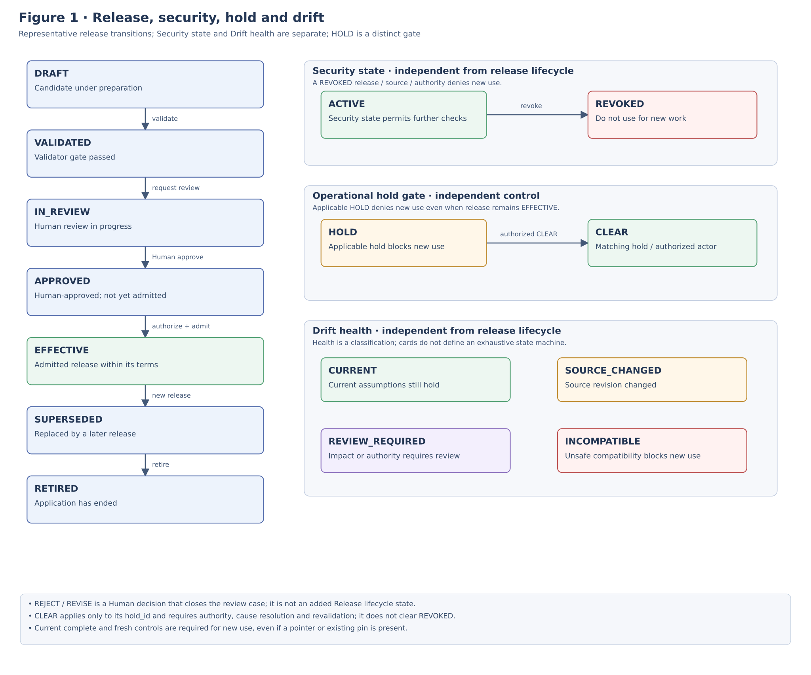
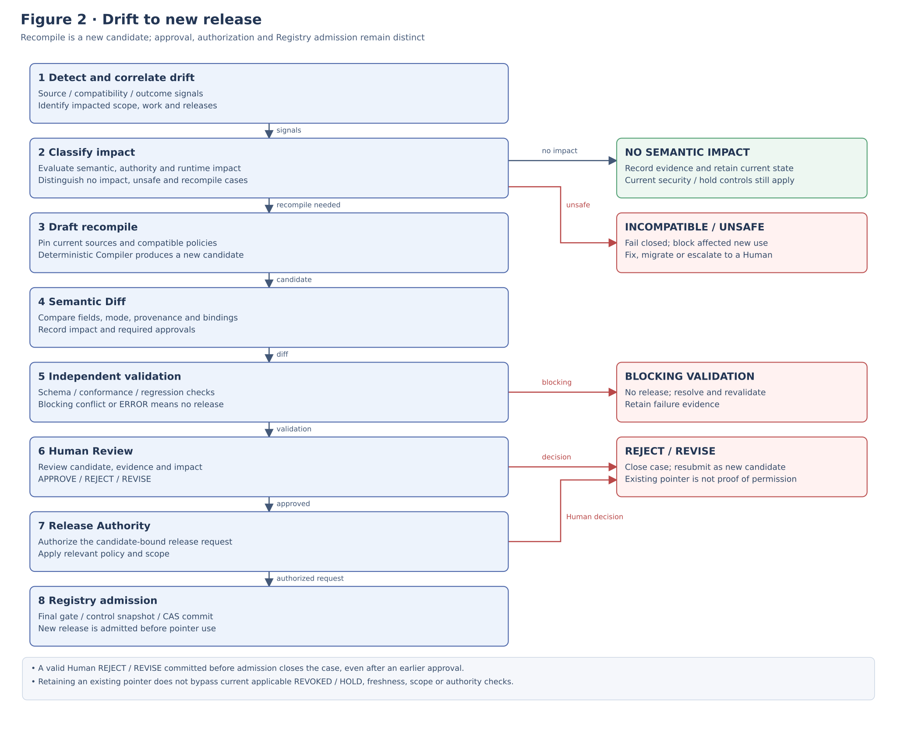
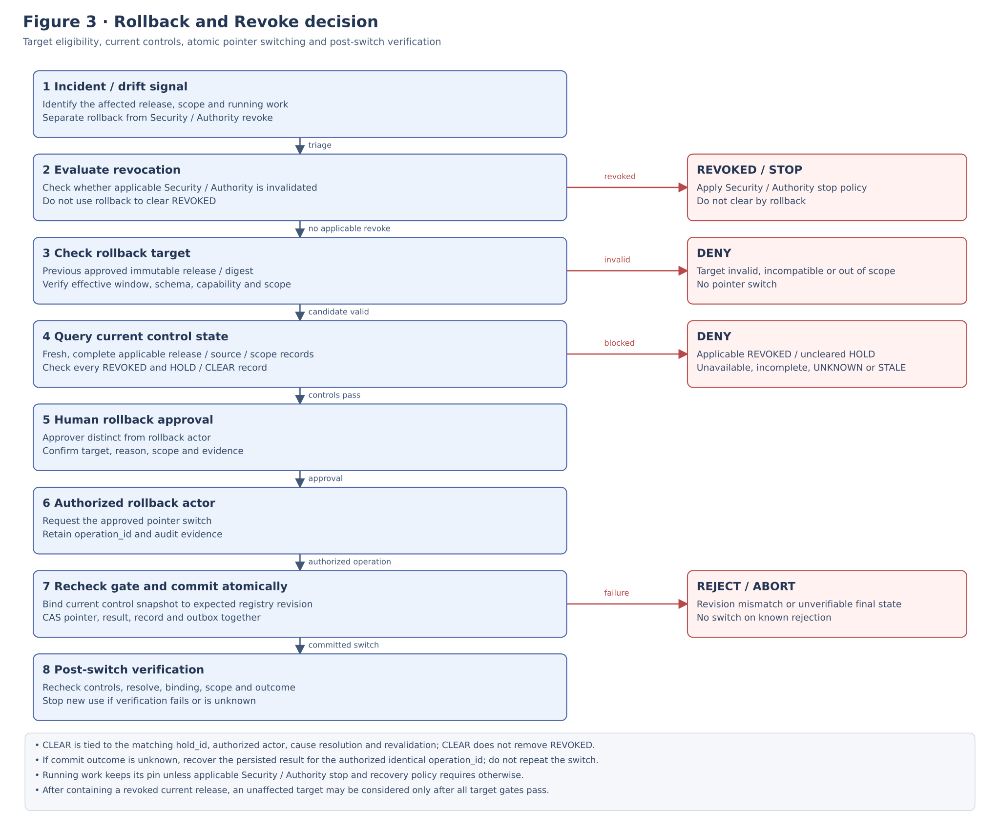

**OPERATIONS RUNBOOK**

**ALOM Profile**

**Drift / Recompile / Rollback**

**Operations Runbook**

Drift Detection / Impact Analysis / Semantic Diff / Recompile / Release / Rollback / Recovery

| **Core principle** Operate Effective Profiles as immutable releases and detect changes to Mission, Rulebook, Schema, Binding, Authority, and observed results as Drift. Do not directly rewrite the current Effective Profile; apply changes through the closed loop Impact Analysis → Draft Recompile → Semantic Diff → Independent Validation → Human Review → New Release. On failure, distinguish pointer rollback to a previous APPROVED release from Security state REVOKED + stop/recovery when Security / Authority is revoked. |
|-------------------------------------------------------------------------------------------------------------------------------------------------------------------------------------------------------------------------------------------------------------------------------------------------------------------------------------------------------------------------------------------------------------------------------------------------------------------|

| **Management item** | **Value**                                                                     |
|--------------|--------------------------------------------------------------------------------|
| Document ID      | ALOM-PROF-OPS-RUNBOOK-001                                                      |
| Version           | v0.5-review.20261109                                                     |
| Created       | 2026-08-13                                                                     |
| Governing standard     | ALOM-ARCH-STD-001 v2.5                                                         |
| Key related specifications | ALOM-PROF-CONTRACT-SPEC-001 v0.5-review.20261108 / ALOM-PROF-CV-SPEC-001 v0.4-review.20261110                  |
| Scope         | ALOM L1 Profile Operations / Drift / Recompile / Rollback                      |
| Owner     | Organization Architecture (Enterprise Architecture) / AI Platform                                          |
| Joint responsibility     | Business Owner / Quality / Security and Privacy / Project Management / Operations |
| Classification | Public |

This Runbook fixes Adopter-first routine operational procedures. Provider Control Plane, billing, and generic Multi-tenant Provisioning are out of scope. Separate product-specific operations from operational contracts so Profile Contract / release / drift / rollback semantics can be reused in future PaaS/SaaS offerings.

# **Document Control**

## **1. Position and Authority Precedence**

- Do not change the Release lifecycle, Security state, Drift health, Recompile flow, or Rollback semantics defined by the governing Profile Contract & Resolution Specification v0.5. This Runbook does not independently change the Contract.

- Profile Compiler & Validator performs compile / validate / semantic diff but has no Authority to make a Profile Effective. Separate Human Approval from Approved Profile Registry / protected release paths.

- Dashboard is an observation/request interface for drift / review / recompile / rollback. It has no Authority to write directly to Profile Registry, the protected default branch on Git hosting (e.g., GitHub), or L7 Authority.

- Where laws, contracts, customer NDAs, or Security / Privacy rules are stricter, the stricter constraints take precedence.

| **Fixed boundary** Source changes, AI Proposals, Dashboard operations, and Compiler PASS results do not justify automatically updating the current Effective Profile. Change the Effective pointer only through a Human-approved release or Human-approved rollback. |
|----------------------------------------------------------------------------------------------------------------------------------------------------------------------------------------------------------------------------------------------|

## **2. Sources and Design Classification**

| **ID** | **Source**                                              | **Use in this document**                                                                          |
|--------|-------------------------------------------------------|-------------------------------------------------------------------------------------------|
| S1     | ALOM-ARCH-STD-001 v2.5-review.20261110 (ALOM Integrated Architecture Standard)                      | Non-effective alignment candidate; controlled authority remains v2.5. Governing requirements for seven Layers, Profile Engineering, Human Control, Authority, and Trace. |
| S2     | ALOM-PROF-STD-001 v0.4-review.20261109 | Foundation for Mission→Rule→Profile, Draft-only generation, Human Approval, and living artifacts / drift.        |
| S3     | ALOM-PROF-CONTRACT-SPEC-001 v0.5-review.20261108 | Lifecycle / Security state / Drift states, trigger, Recompile flow, immutable release / pointer rollback. |
| S4     | ALOM-PROF-CV-SPEC-001 v0.4-review.20261110 | Deterministic compile, Validation severity, Semantic Diff, drift impact, rollback test.  |
| S5     | ALOM-L1-STD-001 v0.7-review.20261110                            | Managed Work, Execution Mode, Authority, Lifecycle / Learning / Human Control.           |
| S7     | ALOM-KNW-STD-001 v0.4-review.20261110 ALOM-SSOT-STD-001 v0.5 | Rulebook revisions and the boundary between Authority / Context / Canonical sources and derived runtime.     |

\[STD\] = inherited from governing/existing specifications; \[RUNBOOK\] = operational procedures added here; \[PROPOSAL\] = operational details whose names or thresholds are not yet fixed in current specifications. Finalize PROPOSAL items through ADR / Review at adoption.

## **3. Document Status and Completion Criteria**

v0.1 is complete when, for at least one Adopter Effective Profile, it is possible to (1) resolve affected scopes from Rule / Mission changes, (2) produce deterministic recompilation and semantic diffs, (3) pass independent validation and Human Review, (4) switch to a new release, (5) roll back to a previous approved release, and (6) verify the distinction between running tasks' pinned digests and new-task resolution, with all Evidence traceable through Trace.

# **Contents**

| **Chapter** | **Content**                            |
|--------|-------------------------------------|
| 1      | Purpose and Scope                      |
| 2      | Fixed Definitions and Responsibility Boundaries                  |
| 3      | Operational Principles                            |
| 4      | Release lifecycle / Drift health    |
| 5      | Drift Triggers and Detection                |
| 6      | Impact Analysis / Classification    |
| 7      | Recompile Procedure                      |
| 8      | Semantic Diff Review                |
| 9      | Validation / Human Review / Release |
| 10     | Rollback Decision                       |
| 11     | Rollback Execution                       |
| 12     | Handling Running Tasks / New Tasks      |
| 13     | Revoke / Emergency / Fail-closed    |
| 14     | Role / SoD / Escalation             |
| 15     | Trace / Evidence / Records          |
| 16     | Monitoring / SLO / Dashboard        |
| 17     | Failure Scenario / Troubleshooting  |
| 18     | Routine Operations and Change Windows                    |
| 19     | Drill / Test / Acceptance           |
| 20     | Illustrative Delivery Scenario            |
| A      | Drift Triage Checklist              |
| B      | Recompile Checklist                 |
| C      | Rollback Checklist                  |
| D      | Minimum Record / Event Contracts             |
| E      | Governing Requirement Mapping                        |

# **1. Purpose and Scope**

## **1.1 Purpose**

This Runbook defines standard procedures for operating ALOM Operating Profiles as living operating artifacts that can be safely updated as Canonical sources, Runtime capabilities, Authority, and observed performance change, rather than as one-time static configurations. It closes the process from Drift detection through impact analysis, recompilation, diff review, approval, Release, Rollback, and emergency Revoke using contracts, evidence, and Human authority owned by the applying organization.

## **1.2 In Scope**

- Changes to Mission revisions, Canonical Rulebook releases/revisions, Profile schema / merge policy, binding contracts / capabilities, and Authority / assignment constraints.

- Profile Drift signals arising from major post-release incidents, repeated Human overrides, or deterioration in Outcome / Assurance.

- Impact analysis of affected scopes / works / fields / bindings / approvals / authorities in Effective Profiles.

- Draft Recompile, Semantic Diff, Independent Validation, Human Review, Approved Release, and Effective pointer switching.

- Rollback to a previous APPROVED immutable release and post-rollback verification.

- Emergency paths involving Security / Authority revocation; handling running tasks / new tasks; Trace / Evidence / Dashboard operations.

## **1.3 Out of Scope**

- Details of the Profile Generator's generation algorithms.

- Internal rollback / recovery semantics of L2-L7 Runtimes. Coordination required by a Profile release switch is in scope, however.

- Operational SSOT transaction rollback itself. Do not equate Profile rollback with business data rollback.

- Final Strategy / Pricing / Capital Allocation and similar decisions by management of the applying organization.

# **2. Fixed Definitions and Responsibility Boundaries**

| **Term**          | **Fixed definition**                                                                                                            | **Not equivalent to**                                         |
|-------------------|-------------------------------------------------------------------------------------------------------------------------|--------------------------------------------------------------|
| Drift             | A state in which an Effective Profile's sources, compatibility, or observed fitness have changed from the assumptions at release time.                 | Git commit counts or Dashboard display differences alone                     |
| Release lifecycle | The approval/Release history axis: DRAFT / VALIDATED / IN_REVIEW / APPROVED / EFFECTIVE / SUPERSEDED / RETIRED.                    | Security state / Drift health                                |
| Security state    | ACTIVE / REVOKED. REVOKED denies new use with precedence over pointer / pin / LKG. RevocationRecord is the evidence. This denial does not apply to ACTIVE. | Release lifecycle / Drift health                             |
| Operational hold | The SUSPENDED operational gate stopping new use for Incidents, Rule changes, or similar causes. An active HOLD in OperationalHoldRecord is the evidence. | Overwriting Security REVOKED / lifecycle |
| Drift health      | The health axis: CURRENT / SOURCE_CHANGED / REVIEW_REQUIRED / INCOMPATIBLE. This unit does not change the Drift vocabulary.                | Release lifecycle / Security state                           |
| Recompile         | Reconstruct a Draft candidate by giving the deterministic Compiler the latest pinned inputs/sources/policies.                | Direct editing of the current Effective Profile                                    |
| Semantic Diff     | A record comparing the semantic differences between the old Effective Profile and candidate by field / provenance / mode / binding / authority / assurance. | String diff alone                                             |
| Rollback          | An operation returning the Effective pointer to a previous APPROVED immutable release.                                                   | Editing an old release's body or rolling back Operational SSOT transactions |
| Revoke            | A control making a release unavailable and, where necessary, requiring stop/recovery of running work.                                       | Normal rollback                                                |
| Pinned Digest     | The immutable EffectiveProfile digest referenced by an already-started Work/Task.                                                       | A configuration that always references latest                                   |
| LKG               | last-known-good: an APPROVED immutable release validated as a recovery candidate.                                                  | Merely the immediately preceding version                                               |

| **Critical boundary** Release lifecycle, Security state, and Drift health are three independent axes. An EFFECTIVE release may be SOURCE_CHANGED / REVIEW_REQUIRED / INCOMPATIBLE. Security state REVOKED does not overwrite lifecycle history. A Drift signal does not change the current Effective body; it remains immutable until a Human-approved new release is established. |
|--------------------------------------------------------------------------------------------------------------------------------------------------------------------------------------------------------------------------------------------------------------------|

# **3. Operational Principles**

| **ID**  | **Principle**                  | **Normative requirement**                                                                                                                     |
|---------|---------------------------|------------------------------------------------------------------------------------------------------------------------------|
| OPS-P01 | Immutable Effective       | Do not modify Effective release bodies. Express changes as a new release or pointer rollback.                                  |
| OPS-P02 | Source pinning            | Pin Mission / Rule / Schema / Policy / Binding / Authority refs to immutable revisions for reproducibility.                |
| OPS-P03 | No auto-effective         | Do not connect source changes, Compiler PASS, AI proposals, or Dashboard actions to automatic activation as Effective.                                |
| OPS-P04 | Deterministic recompile   | Reproduce the same semantic result/digest from identical input refs + compiler + resolution policy.                                |
| OPS-P05 | No-relaxation regression  | Allow 0 relaxations of Human-required, prohibitions, NDA, classification, autonomy ceilings, or mandatory gates/evidence.                     |
| OPS-P06 | New vs running separation | New tasks resolve the Effective pointer; running tasks normally retain their pinned digests.                                     |
| OPS-P07 | Fail-closed               | Do not allow new execution with unresolved Authority, incompatible bindings, scope/NDA violations, or digest mismatch.                    |
| OPS-P08 | Rollback is not revoke    | For Security/Authority invalidation, evaluate Security state REVOKED + stop/recovery rather than relying only on rollback.                            |
| OPS-P09 | Trace completeness        | Correlate trigger→impact→diff→validation→review→release/rollback→verification in one change/trace chain.                 |
| OPS-P10 | Human authority / SoD     | Separate permissions for compilation, validation, approval, and registry pointer changes. Apply maker-checker controls at least to high-risk changes. |

# **4. Release lifecycle / Drift health**

[Open Figure 1 at full size](figures/ALOM-PROF-OPS-RUNBOOK-001-fig1-current.svg)

*Figure 1. Separation of Release lifecycle / Security state / Drift health (the current normative model is the table in §2).*

| **Drift health** | **Meaning**                                                                     | **Standard response**                                          |
|------------------|------------------------------------------------------------------------------|-------------------------------------------------------|
| CURRENT          | The Effective release's source/compatibility assumptions remain current within the known scope.         | Normal operations                                              |
| SOURCE_CHANGED   | A referenced source revision/release changed. Semantic impact is undetermined or unreviewed. | Start Impact Analysis                                |
| REVIEW_REQUIRED  | Human judgment is required for semantic differences, responsibilities, Human Control, exceptions, important AI interpretations, or similar matters.     | Human Review of the new release is required                    |
| INCOMPATIBLE     | Schema / binding / authority / security / migration or similar requirements are not satisfied.             | Fail closed for new execution. Decide on migration / fix / revoke |

# **5. Drift Triggers and Detection**

## **5.1 Standard Triggers**

| **Trigger class** | **Example**                                                                                                 | **Minimum correlation keys**                          |
|-------------------|--------------------------------------------------------------------------------------------------------|-------------------------------------------|
| Mission           | Business Mission / Objective / Demand / Constraint revision change                                     | mission_ref / revision                    |
| Rulebook          | Canonical Rulebook release / revision change                                                           | rule_ref / release tag / commit SHA       |
| Profile Contract  | profile_schema_version / merge / no-relaxation / resolution policy change                              | schema / policy version                   |
| Runtime Binding   | binding_contract_version / required capability / Graph / Loop / Harness / Context compatibility change | binding ref / capability manifest         |
| Authority         | Authority descriptor / assignment / approver / stop authority / delegation constraint change           | authority_ref / revision                  |
| Observed Fitness  | post-release incident / repeated Human override / assurance disagreement / outcome degradation         | incident / override / eval / outcome refs |

## **5.2 Detection Rules**

- Detect Canonical source release/tag/revision updates through events or periodic reconciliation. Do not assess drift solely from the current value of a moving branch.

- Drift Monitor compares source revisions with EffectiveProfile provenance and reverse-maps affected profile candidates.

- Dashboard / Learning signals are observations, not source authority. Require evidence refs to Incident / Trace / Outcome.

- Consolidate duplicate signals using idempotency keys and correlate them to one DriftCase. \[RUNBOOK\]

| **Recommended operation** Do not end handling of Rulebook / Authority revision changes with an L6/L7 health alert. Always correlate affected Effective Profiles to a Profile Drift signal. |
|-------------------------------------------------------------------------------------------------------------------------------------------------------------|

# **6. Impact Analysis / Classification**

## **6.1 Impact Analysis Order**

1.  Verify the changed source's Authority and immutable revision.

2.  Identify EffectiveProfileReleases whose provenance contains that source.

3.  Determine affected scopes from target scope (enterprise / domain / any organization, customer, project, usecase, and process overlays / work, plus `isolation_scope_ref`).

4.  Identify affected fields / Managed Works / Execution Modes / Human Control / Bindings / Assurance / Validity.

5.  Separate exposure of new tasks from running tasks.

6.  Determine whether semantic recompilation is required or CURRENT can be restored with no semantic impact.

## **6.2 Impact domain**

| **Domain**               | **Representative fields**                                                                   |
|--------------------------|----------------------------------------------------------------------------------|
| Management               | purpose / owner / responsibility / authority / outcome / SLO                     |
| Execution                | execution_mode / work_type / risk / autonomy / budget                            |
| Human Control            | human_required / approvers / stop authority / review policy / exception route    |
| Bindings                 | ALE entry / Graph / Loop / Shared Execution / Harness / Context / Authority refs |
| Assurance                | criteria / eval / verification / evidence requirements                           |
| Security / Scope         | NDA / classification / project/customer scope / tool privilege                   |
| Validity / Compatibility | effective dates / schema / compiler / resolution policy / binding contract       |
| Traceability             | Mission→Rule→Profile→Work→Binding provenance / digest chain                   |

## **6.3 Operational Response Class \[PROPOSAL\]**

| **Class**            | **Condition**                                                                            | **Standard response**                                      |
|----------------------|-------------------------------------------------------------------------------------|---------------------------------------------------|
| D0 / Informational   | Metadata/descriptions or similar changes proven not to affect the semantic digest             | Retain evidence and mark CURRENT.                         |
| D1 / Recompile       | Semantic change without prohibitions, Authority, Human-required, or binding breaks   | scheduled recompile→diff→validation→review.      |
| D2 / Controlled Hold | Affects Human Control / autonomy / assurance / execution mode / authority assignment | Hold new high-risk work and prioritize review.       |
| D3 / Emergency       | Security / Authority revocation, NDA breach risk, incompatible binding, or major incident   | Fail closed; use Security state REVOKED / stop/recovery as necessary. |

D0-D3 are operational classifications in this Runbook and do not replace the existing Profile Contract severities ERROR / REVIEW_REQUIRED / WARNING / INFO. Validation severity is the formal Effective gate.

# **7. Recompile Procedure**

[Open Figure 2 at full size](figures/ALOM-PROF-OPS-RUNBOOK-001-fig2-current.svg)

*Figure 2. Standard flow from Drift to Recompile / Release. Branch target nodes explicitly state decision reasons and actions.*

## **7.1 Pre-check**

| **Step** | **Check**                 | **Minimum Evidence**                                                                               |
|----------|--------------------------|-------------------------------------------------------------------------------------------------|
| 1        | Assign a unique DriftCase       | change_ref / source_old / source_new / detected_at / scope hint                                 |
| 2        | Source pin               | Pin new Mission / Rule / Schema / Binding / Authority to immutable revisions                   |
| 3        | Current release snapshot | Retrieve current effective release / digest / previous approved candidate / runtime compatibility |
| 4        | Execution exposure       | Identify running tasks / new tasks / execution modes / risk classes                                    |
| 5        | Change window            | For D2/D3, ensure approver / on-call / rollback authority availability                                         |

## **7.2 Compile command / API pattern \[PROPOSAL\]**

<table>
<colgroup>
<col style="width: 100%" />
</colgroup>
<thead>
<tr class="header">
<th>POST /profiles/recompile 
{ 
"target_ref": "project://example-org/pilot-a", 
"current_release_ref": "profile-release://example-org/pilot-a@1.4.0", 
"trigger_ref": "rule-change://quality-standard@2026.08.13", 
"source_revision_set": { 
"mission": "mission://example-org/pilot-a@7", 
"rulebook": ["okf://company/quality-standard@sha256:..."], 
"binding_contract": "binding://alom/example@1.1" 
}, 
"dry_run": true, 
"trace_id": "tr-profile-drift-..." 
}</th>
</tr>
</thead>
<tbody>
</tbody>
</table>

Finalize API names during implementation to match existing Profile API contracts. The essential contract is the meaning of target / current release / trigger / immutable source set / dry-run / trace.

## **7.3 Recompile Execution Rules**

- Do not introduce current time, random UUIDs, or unordered iteration into Compiler core semantic output.

- Do not introduce additional LLM / Generator judgments into Compiler core. If AI output is used, pin its revision/digest as an input artifact.

- Separate compile results into DraftProfileBundle / candidate EffectiveProfile / ResolutionDecision\[\] / ConflictRecord\[\] / ValidationReport / SemanticDiff.

- Do not change the current Effective pointer when recompilation fails.

# **8. Semantic Diff Review**

## **8.1 Minimum Diff Display**

| **Item**          | **Requirement**                                                            |
|-------------------|---------------------------------------------------------------------|
| Field path        | Example: /managed_work/MW-14/execution_mode                              |
| Before / After    | Old Effective value / candidate value                                      |
| Change type       | ADD / REMOVE / CHANGE / REBIND / AUTHORITY_CHANGE / VALIDITY_CHANGE |
| Source provenance | old/new source_ref + revision + ResolutionDecision                  |
| Policy effect     | no-relaxation / precedence / mandatory / optional                   |
| Runtime effect    | required capability / binding compatibility / new task effect       |
| Human effect      | human_required / approver / stop authority / independent review     |
| Severity          | ERROR / REVIEW_REQUIRED / WARNING / INFO                            |
| Reviewer decision | accept / reject / revise + reason                                   |

## **8.2 Human-required Regression**

- Always compare Human-required Works such as customer demand/requirements approval, final quality decisions, and Production Go/No-Go to ensure they have not been promoted to agentic or deterministic-system. Human-required -> deterministic-system is a no-relaxation regression.

- Removing Human-required=true, omitting Approver/Stop Authority, or consolidating independent Review is ERROR.

- Check increases in autonomy ceiling, expanded Tool capability, and relaxed NDA/classification against no-relaxation invariants.

| **Prohibited** Do not interpret a small text diff as low risk. Even one changed field is high risk if it affects Authority, Human Control, Execution Mode, Tool privileges, or NDA. |
|------------------------------------------------------------------------------------------------------------------------------------------------------------------------------------------|

# **9. Validation / Human Review / Release**

## **9.1 Release Gate**

| **Condition**                  | **Requirement**              |
|---------------------------|-----------------------|
| ERROR                     | 0                     |
| required UNRESOLVED       | 0                     |
| CONFLICT                  | 0                     |
| Required Approval         | Satisfied                  |
| Digest reproducibility    | Reproducible from identical inputs        |
| Scope isolation           | negative test pass    |
| Runtime binding dry-run   | Pass for the required mode |
| Human-required regression | pass                  |
| Source revisions          | Pinned to immutable revisions    |

## **9.2 Human Review Packet**

- Change reason / trigger / affected scope / affected work.

- Semantic Diff and severity summary.

- Changes to Human-required / Authority / Security / Assurance.

- ValidationReport / regression / binding dry-run / scope isolation evidence.

- Expected impact, deployment window, rollback target, and post-release verification plan.

- Approve / Reject / Revise options and reversibility.

## **9.3 Release**

- Proceed to the Approved release path only after a valid Human ApprovalRecord exists.

- A new release retains an immutable digest and source/compiler/resolution/binding versions.

- Update the Effective pointer atomically and record current / previous / changed_at / actor / approval_ref. \[RUNBOOK\]

- After Release, perform post-release verification of Runtime Resolver resolution, digest, capability, and scope.

# **10. Rollback Decision**

[Open Figure 3 at full size](figures/ALOM-PROF-OPS-RUNBOOK-001-fig3-current.svg)

*Figure 3. Rollback and Revoke decision flow. Separate Security / Authority revocation from normal rollback. REVOKED is a Security state, not a subsequent Release lifecycle node. The historical DOCX image is retained without regenerating its rendered pixels; the public draft figure is a separately defined summary.*

## **10.1 Conditions for Choosing Rollback**

- The new release caused missed validation, runtime incompatibility, unexpected behavior, or Outcome / SLO degradation, and a previous APPROVED release remains valid, compatible, and unrevoked. \[RUNBOOK\]

- Business data in Operational SSOT need not be rolled back; restoring the Profile pointer can restore safety for new execution.

- The rollback target's sources, authorities, and bindings are currently resolvable. \[RUNBOOK\]

## **10.2 Conditions for Choosing Revoke / Hold Instead of Rollback**

- Security / Authority itself is revoked, and the old release references the same invalid Authority.

- NDA / classification / privilege boundaries are defective, requiring a stop that includes running work.

- The previous approved release is incompatible with current bindings, schema, or mandatory policy.

- The incident cause would remain after rollback, or rollback cannot compensate for incorrect Operational SSOT state.

# **11. Rollback Execution**

## **11.1 Pre-Execution Checklist**

| **Check**      | **Requirement**                                                                |
|---------------|-------------------------------------------------------------------------|
| Target        | Identify a previous APPROVED immutable release_ref / digest                 |
| Validity | All control gates in §11.1.1 pass, and effective window / source authority / freshness can be verified |
| Compatibility | Verify compatibility with current Runtime Resolver / required capabilities / schema    |
| Scope         | Determine affected project/usecase/work and cross-scope impacts                 |
| Running work  | List pinned releases/digests and risks                                  |
| Approval      | Separate rollback actor from approver and approve reason / incident / evidence |
| Verification  | Prepare post-rollback checks of resolve / binding / scope / outcome      |

### **11.1.1 Rollback target control gate**

- DRR-C01: Determine the rollback target's release_ref / digest and all applicable sources/scopes; retrieve authoritative RevocationRecords and OperationalHoldRecords. REVOKED takes precedence over pointer / pin / LKG and DENIES new use.

- DRR-C02: Evaluate every applicable OperationalHoldRecord by hold_id + action_id. If even one active HOLD remains applicable to release / source / scope, DENY pointer switching and new use through rollback / LKG.

- DRR-C03: Correlate CLEAR only with a HOLD having the same hold_id. Require an authorized actor's action_id, evidence of cause resolution, and eligibility revalidation. Do not clear another HOLD with one CLEAR. CLEAR does not remove REVOKED.

- DRR-C04: DENY unavailable / UNKNOWN / STALE state, unverifiable freshness, or uncorrelatable release / source / scope. Even the absence of HOLDs must be verified through a complete, fresh authoritative query. Do not substitute old cache data or LKG for this decision.

- DRR-C05: Bind expected_registry_revision to registry_revision from the complete authoritative DRR-C01-04 snapshot immediately before pointer switching. All applicable release/source/scope REVOKED/HOLD/CLEAR changes and pointer changes advance the same monotonic registry_revision in ALOM-PROF-REG-STD-001. Gate evaluation and pointer write must succeed within the same atomic CAS/transaction conditioned on that revision. On mismatch or unverifiable final state, DENY without changing the pointer. Do not retry by substituting the expected value alone. Record query revision / CAS expected revision / observed revision / observation time / freshness justification / hold_id / action_id / source / scope / release / decision reason under the same trace_id. Evaluate DRR-C01-04 again during post-verification. If a gate fails after the switch, stop new use and do not record recovery as successful.

## **11.2 Pointer switch**

- Only when every control gate in §11.1.1 and Human rollback approval hold, switch the Effective pointer from the approved from release to a previous APPROVED release in an atomic CAS/transaction conditioned on the same expected_registry_revision as the queried control state. Under ALOM-PROF-REG-STD-001 §19.2, commit the pointer, new registry_revision, RollbackRecord, CAS evidence, operation_id terminal result, and audit outbox together. Abort the entire transaction if required records cannot be persisted. Do not change the pointer if a control-state change causes a revision mismatch, authoritative final verification is impossible, or any other gate fails. CAS on the pointer value alone is insufficient; do not attach an old snapshot to a new expected revision. Retransmission of the same operation_id returns the persisted result; do not repeat the switch when the result is unknown. Do not edit the old release body.

- Retain the current release as SUPERSEDED or with Release lifecycle history appropriate to the incident; do not delete it. For Security/Authority defects, consider Security state REVOKED. Normal rollback does not clear revocation.

- Rollback events follow the minimum contract in ALOM-PROF-REG-STD-001 §15.2. Record actor / approved_by (approver) / reason (request reason) / reason_code (decision reason) / scope (affected scope) / incident_ref / from_release (before_release) / to_release (requested target) / actual_after_release (observed after_release) / decided_at (decision timestamp) / trace_id. Match reason to the original request and RollbackRecord, reason_code to Result/Record, and approved_by to verified approval evidence and RollbackRecord. For DENY, do not record the requested target as the actual switched-to release. Set unobserved actual_after_release to null.

- If cache / resolver projections exist, detect stale resolution using pointer version / an ETag equivalent. \[RUNBOOK\]

## **11.3 Post-Rollback Verification**

| **Area**     | **Pass conditions**                                                                        |
|--------------|--------------------------------------------------------------------------------------|
| Registry     | effective pointer = rollback target                                                  |
| Resolver | Return the rollback release + expected digest for target scope/work only if all control gates in §11.1.1 pass. Otherwise DENY new resolution and LKG use |
| Binding      | Required capabilities pass for human-only / interactive-agent / agentic / deterministic-system                   |
| Security | After switching, recheck all applicable REVOKED/HOLD states and state freshness, as well as NDA / classification / privilege / authority refs. Stop new use on violations or uncertainty |
| New task | Only new tasks passing control gates pin the rollback digest; DENY does not return a valid digest |
| Running task | Existing tasks' pinned digests have not changed unintentionally                                |
| Trace        | Incident→approval→pointer switch→verification is traceable in one trace/change chain |
| Outcome      | Check minimum smoke / SLO / error signals                                           |

# **12. Handling Running Tasks / New Tasks**

| **Target**                  | **Standard behavior**                                                                                                                 | **Caution**                                     |
|---------------------------|--------------------------------------------------------------------------------------------------------------------------|----------------------------------------------|
| New Task                  | Resolve the rollback/new Effective pointer through Runtime Resolver and pin its digest in RuntimeManifest / Trace.             | Do not continually re-resolve latest during execution.       |
| Running Agentic Task      | Normally retain the EffectiveProfile digest from startup.                                                                      | Verify the pin in L2 TaskRun / RuntimeManifest. |
| Running Interactive Agent | Retain profile/harness/context constraints pinned to the session/execution. For high-risk changes, a Human decides stop/restart. | Do not make the L5 native session the sole canonical source.       |
| Human-only Work           | Record the applicable profile/version and authority in HumanWorkRecord. The Human owner decides whether work may continue after a major Authority change.  | Do not automatically replace it merely because L6/L7 references change.      |

| **Exception** When continuation is unacceptable, such as Security / Authority revocation, NDA breach risk, or seriously unsafe tool permissions, stop/recovery takes precedence over retaining the pinned digest. Record the stop reason, impact, and restart conditions as Evidence. |
|-----------------------------------------------------------------------------------------------------------------------------------------------------------------------------------------------------------------------|

# **13. Revoke / Emergency / Fail-closed**

## **13.1 Emergency state**

- When INCOMPATIBLE is detected, default deny / fail closed for new execution.

- To enter SUSPENDED for an Incident, Rule change, or similar cause, record HOLD in OperationalHoldRecord for the target release/source/scope. Resolver denies new use with precedence over pointer / pin / LKG. Identify impacts on running work; the Human owner decides stop/drain. Lift the hold only after resolving the cause, revalidating the current release's eligibility, and an authorized actor recording CLEAR for the target HOLD. Do not lift it automatically.
- For Security / Authority revocation, set the current release's Security state to REVOKED, identify affected running work, and apply stop/cancel/recovery policy as appropriate. Retain Release lifecycle history as EFFECTIVE / SUPERSEDED / RETIRED. RevocationRecord has no expiry; revoked releases are not reactivated. Recovery requires validation of corrected sources/authorities and Human Approval of a separate new release.

- Even when creating an emergency exception profile, do not omit Draft→Validation→Human Approval. Predefine review SLAs and approver sets for emergency paths. \[RUNBOOK\]

- Break-glass includes scope / TTL / actor / approver / reason / compensating control / post review and is not merged directly into a permanent profile.

## **13.2 Fail-closed error examples**

| **Error**                         | **Standard response**                        |
|-----------------------------------|-------------------------------------|
| Authority unresolved              | Reject new Tasks / escalate to a Human |
| Revision not immutable            | Recompile reject                    |
| No-relaxation violation           | Release ERROR                       |
| Human-required→agentic            | Release ERROR                       |
| Human-required→deterministic-system | Release ERROR / no-relaxation regression |
| Required binding missing          | Release ERROR / runtime reject      |
| Cross-scope / NDA violation       | Compile / resolve reject            |
| Breaking schema without migration | INCOMPATIBLE / release block        |
| Digest mismatch                   | Runtime resolve reject / incident   |

# **14. Role / SoD / Escalation**

| **Role**                     | **Responsibilities**                                             | **Separation boundary**                                 |
|------------------------------|------------------------------------------------------|----------------------------------------------|
| Drift Monitor / Platform     | Detect signals, open cases, correlate sources           | Cannot approve Effective status                       |
| Profile Operator             | Impact Analysis, recompile request, rollback request | Does not complete approve + pointer change alone |
| Compiler / Validator Service | deterministic compile / validation / diff            | Has no Authority                         |
| Business Owner               | Purpose, business responsibility, and impact acceptance                             | Does not decide Security overrides alone           |
| Quality                      | assurance / quality gate / human-required review     | Validation independent of the generator                     |
| Security and Privacy            | NDA / classification / privilege / revoke decisions       | Joint approval of high-risk exceptions                       |
| Project Manager / Work Owner | affected work / schedule / user communication        | Cannot remove technical gates alone                     |
| Release Approver             | Final approval of new releases / rollbacks                    | Maintain maker-checker separation                         |
| Operations / On-call         | pointer switch, verification, incident coordination  | Do not edit release content directly                 |

## **14.1 Escalation**

| **Class** | **Minimum Escalation**                                         | **Operation**                                          |
|-----------|-------------------------------------------------------------|---------------------------------------------------|
| D0        | Profile Operator                                            | Normal change record                                |
| D1        | Work Owner + Approver                                       | scheduled review                                  |
| D2        | Business Owner + Quality + relevant Authority               | priority review / hold                            |
| D3        | Security/Privacy + Business/Operational Authority + On-call | immediate fail-closed / revoke / incident command |

# **15. Trace / Evidence / Records**

| **Record**       | **Minimum content**                                                                                |
|------------------|---------------------------------------------------------------------------------------------|
| DriftCase        | drift_case_id / trigger_type / source_old/new / detected_at / affected scope / status       |
| ImpactReport     | affected_profile / work / field / runtime / running_task / response class / evidence refs   |
| CompileManifest  | input refs / compiler_version / resolution_policy_version / schema / draft digest           |
| SemanticDiff     | before/after / field path / source refs / severity / reviewer decision                      |
| ValidationReport | rule codes / severity / error / unresolved / conflict / regression / binding / isolation    |
| ApprovalRecord   | actor / role / decision / reason / timestamp / SoD / conditions                             |
| ReleaseManifest  | release_ref / digest / source refs / approval refs / effective_from / rollback_candidate    |
| RollbackRecord | All mandatory ProfileRollbackRecord fields from ALOM-PROF-REG-STD-001 Appendix A (including approved_by), plus running_task_policy / verification_ref. decision / control_state_evidence_ref / cas_evidence_ref / trace_id are mandatory for both success and denial. Distinguish requested to_release from observed actual_after_release. For DENY, new registry_revision is null. |
| RevokeRecord     | release / reason / authority/security refs / affected running work / stop/recovery evidence |

Rollback CAS evidence follows the cas_evidence_ref contract in ALOM-PROF-REG-STD-001 Appendix A, separating queried, expected, observed, and newly resulting revisions. For query failure or unverifiable final state, retain unavailable values as null with reasons. verification_ref, available only after success, MUST NOT substitute for query/CAS evidence on denial.

decision=ALLOW in RollbackRecord means the switch transaction committed. At commit, verification_ref may be null (post-verification PENDING); do not fabricate subsequent success. Persist post-verification as a separate immutable Verification record correlated to the same operation_id/trace_id; do not overwrite the RollbackRecord/CAS evidence from commit time. Do not declare recovery successful when verification is incomplete or failed. Failure to persist a denial record does not permit switching; stop with an unresolved outcome. Bind requests/results to ProfileRollbackRequest/ProfileRollbackResult in ALOM-PROF-REG-STD-001 Appendix A. Use profile.rollback.executed/profile.rollback.denied from its §15.2 for success/denial audit events. Correlate decision, operation_id, payload_digest, event_id, and record/result references to the same operation.

## **15.1 Minimum Trace Chain**

<table>
<colgroup>
<col style="width: 100%" />
</colgroup>
<thead>
<tr class="header">
<th>source_revision_change 
-&gt; drift_case_id 
-&gt; impact_report_ref 
-&gt; recompile_run_id 
-&gt; semantic_diff_ref 
-&gt; validation_report_ref 
-&gt; human_review_ref 
-&gt; approved_release_ref 
-&gt; effective_pointer_change_ref 
-&gt; post_release_verification_ref 
-&gt; outcome / incident / rollback_ref</th>
</tr>
</thead>
<tbody>
</tbody>
</table>

# **16. Monitoring / SLO / Dashboard**

| **Metric**                    | **Meaning**                                                      | **Source**            |
|-------------------------------|---------------------------------------------------------------|-----------------------|
| profile.drift_count           | Drifted Effective profiles / scope                            | L1 Drift Monitor      |
| drift_impacted_work_count     | Number of Managed Works affected by a changed source                 | Compiler / Impact     |
| profile.approval_turnaround   | review requested→decision duration                            | L1 Approval           |
| profile.post_release_incident | Incidents associated with an Effective release                           | Trace / Outcome       |
| profile.manual_override_rate  | manual suitability/profile overrides / decisions              | L1 Profile Review     |
| profile.conformance_rate      | validation+conformance pass / reviewed profiles               | Validator             |
| profile.source_traceability   | source/compiler/approval/digest refs resolved / required refs | L1/L6/L7              |
| digest_mismatch_count         | Digest reproducibility / resolver mismatches                                | Compiler / Runtime    |
| release_success / rollback    | Release / rollback operational quality                                 | Registry / Operations |

## **16.1 SLO Policy**

- Determine specific detection latency, review turnaround, and rollback time in the target Effective Profile / internal operational SLOs. This Runbook does not fix numerical values.

- Set separate SLOs for D3 emergencies and normal changes. Prioritize completing fail-closed actions and reaching Human Authority. \[PROPOSAL\]

- Do not optimize metrics solely for increasing agentic candidate ratio as a success KPI. Read them alongside Conformance / Human Control / Incident / Outcome.

# **17. Failure Scenario / Troubleshooting**

| **Symptom**                                     | **Primary cause**                                                       | **Response**                                                                           |
|----------------------------------------------|----------------------------------------------------------------|------------------------------------------------------------------------------------|
| Rule changed but affected profile not found  | Missing provenance / inverse index                                | Check source_traceability. If unavailable, fail safely and discover the scope manually. |
| Recompile digest changes unexpectedly        | non-determinism / source pin drift / compiler version mismatch | Compare input manifest and compiler/policy versions. Run golden tests.               |
| Diff provenance incomplete                   | Equivalent to CV-DIF-001                                                | Repair the source decision chain before sending for Human Review.                             |
| Validation passes but runtime bind fails     | capability inventory stale / binding contract drift            | Mark INCOMPATIBLE and block release. Update the Runtime binding dry-run.                  |
| Rollback pointer switched but resolver stale | cache / projection stale                                       | Check pointer version and invalidate cache / read LKG. Reject stale resolution.    |
| Running task uses unsafe old profile         | Security/Authority revoke after task start                     | Identify task pins and stop/cancel/recover.                                           |
| Previous release no longer valid             | Authority / schema / binding drift                             | Rollback prohibited. Hold + fix-forward / emergency approved profile.                   |
| Repeated manual override after release       | suitability / work design mismatch                             | Create a Learning Item and consider recompilation as D1/D2 drift.                           |

# **18. Routine Operations and Change Windows**

## **18.1 Routine Cadence \[PROPOSAL\]**

| **Cadence**                 | **Target**                                                            | **Activity**               |
|-----------------------------|---------------------------------------------------------------------|------------------------|
| Event-driven                | Rule / Authority / schema / binding / incident signal               | Open a DriftCase immediately    |
| Daily                       | open DriftCase / failed compile / INCOMPATIBLE / rollback state     | Operations review      |
| Weekly                      | manual override / post-release incident / unresolved recurrence     | Profile fitness review |
| Release window              | D1/D2 new release / rollback rehearsal                              | Approver + Operations  |
| Quarterly or policy-defined | old rollback candidates / revoked release / trace retention / drill | Lifecycle review       |

## **18.2 Change window package**

- Change / drift case summary

- Semantic Diff

- ValidationReport

- Human Review / ApprovalRecord

- release + rollback target

- running task exposure

- post-release / post-rollback verification steps

- communication target / owner / escalation contacts

# **19. Drill / Test / Acceptance**

| **Test**                     | **Action**                             | **Pass conditions**                                                  |
|------------------------------|--------------------------------------|----------------------------------------------------------------|
| R-01 Source drift            | Update the Rulebook revision             | Affected profiles/works are resolved and become SOURCE_CHANGED         |
| R-02 Deterministic recompile | Compile identical inputs twice           | Semantic results/digests match                                  |
| R-03 Human regression        | Relax a Human-required Rule in a change candidate | Block release with ERROR                                         |
| R-04 Binding break           | Remove a required capability           | INCOMPATIBLE / new task fail-closed                            |
| R-05 Review path             | REVIEW_REQUIRED diff                 | Effective pointer remains unchanged before a Human decision                     |
| R-06 Release                 | Release the approved candidate        | New tasks pin the new digest                                  |
| R-07 Rollback | Simulate an incident in the new release | Recover to a valid previous approved target; execute every R-11-R-17 denial case, nonapplicable-scope normal control, conflict-free CAS normal control, commit failure, and retransmission case |
| R-08 Running task            | Keep existing Tasks running during rollback        | Running tasks retain their digests                                  |
| R-09 Revoke                  | Authority revoke                     | current release Security state REVOKED + affected task stop/recovery          |
| R-10 Traceability            | Trace the operation sequence                     | 100% correlation of trigger→impact→diff→approval→release/rollback→verify |
| R-11 Revoked target | Mark target P1 REVOKED | Pointer unchanged; DENY new use through rollback / LKG; revocation evidence retained |
| R-12 Held target | Apply an active HOLD to target P1 | Pointer unchanged; DENY new use through rollback / LKG; hold_id + action_id evidence retained |
| R-13 Overlapping holds | Validly CLEAR only H1 among H1/H2 | H2 remains active; pointer unchanged; DENY new use through rollback / LKG; retain correlation evidence for all HOLDs/CLEARs |
| R-14 Unavailable state | Individually inject unavailable / UNKNOWN / STALE | Pointer unchanged; DENY new use through rollback / LKG; retrieval/freshness failure evidence retained |
| R-15 Source/scope control | Run the scope-selector cases in §19.2 R-15a–R-15d, including both RELEASE and SOURCE records, each record type, and match / definite nonmatch / unknown applicability. | DENY applicable or uncorrelatable cases; permit the definite-nonmatch control only when every other gate passes. Preserve the source/release/scope and decision evidence. |
| R-16 Control-state race | Run §19.2 R-16 for every specified control-state change and final-verification failure between the authoritative query and pointer write. | Reject using the snapshot-revision-bound CAS/final check, leave the pointer unchanged, deny new rollback/LKG use, and preserve revision and denial evidence. The unchanged-state control switches and resolves exactly once. |
| R-17 Rollback durability | Run the failure, retry, authorization, contract-field, event, and post-verification matrix in §19.2 R-17. | Preserve atomicity and a single immutable result, correctly distinguish ALLOW / terminal DENY / indeterminate outcomes, deduplicate redelivered events, and do not declare recovery successful before successful post-verification. |

## **19.1 Runbook Acceptance Gate**

| **Gate** | **Area**     | **Completion criteria**                                          |
|----------|--------------|-------------------------------------------------------|
| DRR-G01  | Impact       | Reproducibly resolve changed source→affected profile/work |
| DRR-G02  | Determinism  | same inputs/compiler/policy→same digest 100%          |
| DRR-G03  | Safety       | No-relaxation / Human-required violation 0            |
| DRR-G04  | Authority    | 0 pointer updates before Human approval                  |
| DRR-G05 | Rollback | Verify valid-target recovery; unchanged pointers and denied new rollback/LKG use in R-11-R-14; source/scope denial and the nonapplicable-scope normal control in R-15; control-state revision conflict denial and the unchanged-state normal control in R-16; commit atomicity, retransmission, outbox delivery, and post-verification boundaries in R-17; and all evidence |
| DRR-G06  | Isolation    | 100% deny for cross-isolation (different `isolation_scope_ref`, including cross-project / cross-customer) / NDA negative tests |
| DRR-G07  | Runtime      | Verify profile pin semantics for new/running tasks      |
| DRR-G08  | Emergency    | revoke + stop/recovery drill pass                     |
| DRR-G09  | Trace        | 0 missing required refs across all record chains                   |
| DRR-G10  | Render / Ops | On-call staff/operators can reproduce Runbook procedures    |

## 19.2 Cross-scope, race, and rollback durability test matrix

Use the same approved target P1, current release P2, scope, source, and digest for comparable cases. Unless explicitly testing an invalid record, conform to the RevocationRecord and OperationalHoldRecord contracts in ALOM-PROF-REG-STD-001 Appendix A. OperationalHoldRecord target_kind is RELEASE or SOURCE; RevocationRecord uses release_or_source_ref and scope. Scope is an applicability selector, not a separate target_kind. Inject unavailable / UNKNOWN / STALE as query or freshness outcomes, not as new record kinds or actions.

**R-15a — Applicable shared source:** With P1 itself ACTIVE and without an active HOLD, separately inject a RevocationRecord or SOURCE HOLD for a shared source actually used by P1, with a matching scope. Verify unchanged pointer, denial of new rollback/LKG use, and evidence matching the source and scope. Checking only release_ref fails.

**R-15b — Definite source-scope nonmatch:** Change only the source record's scope so it definitely does not match. With all other gates passing, verify P2 → P1 pointer switch, successful P1 resolve, and evidence of the nonmatch. A nonapplicable record alone must not deny P1.

**R-15c — Release-target scope matrix:** For the target release P1, separately test a RevocationRecord and a RELEASE HOLD, each with matching and definitely nonmatching scope, for four combinations. Matching cases leave the pointer unchanged and deny new rollback/LKG use. Definitely nonmatching cases permit normal recovery only when all other gates pass. Retain record-type / P1 / scope-correlation evidence. Do not ignore scope only for release revocations; do not add target_kind to RevocationRecord or create scope-only HOLDs.

**R-15d — Unknown applicability:** Separately inject missing or ambiguous applicability scope for source/scope control records. Treat uncertainty as fail-closed rather than as a nonmatch; verify unchanged pointer, denial of new rollback/LKG use, and correlation-failure evidence.

**R-16 — Control-state race:** After an authoritative snapshot passes all gates and before the pointer write, separately add each applicable RELEASE/SOURCE REVOKED/HOLD and advance registry_revision. Separately inject unavailable, UNKNOWN, and STALE final-verification results. Verify rejection by CAS or final verification bound to the queried control-state revision; unchanged pointer; denial of new rollback/LKG use; no effective event; and expected / observed revision and denial-reason evidence. A pointer-only CAS or replacing the expected revision alone fails. With no state change and every other gate passing, verify exactly one P2 → P1 switch and successful P1 resolve.

**R-17 — Rollback durability and adapter contract:** Individually inject failure before commit, including record / CAS-evidence / outbox persistence; lost response just after successful commit; process stop before outbox delivery; and process stop before post-verification. Separately exercise identical-request retry, concurrent submission of the same operation_id, a different payload under the same ID, and a read-only caller.

- Before a failed commit, verify unchanged pointer/revision and no ALLOW. After a committed switch, verify that pointer, revision, record, CAS evidence, immutable terminal result and outbox are persisted together and an identical retry returns the original result without a second switch. A different payload yields CONFLICT; a result-read-only caller cannot perform a new execution. An unresolved outcome cannot be bypassed with a new operation_id. Failure to save a DENY stops as indeterminate without permitting a switch. Post-verification PENDING or failure is not successful recovery.
- Test individual mutation of pointer_key, delegator, approval_refs and evidence_refs and mismatch of the retrieved original request and digest. Reject each altered payload under the same operation_id. For a mismatch of the retrieved original request or digest, reject without executing or returning a saved terminal result. Verify all 17 ProfileRollbackRequest payload fields and every mandatory terminal-result field under ALOM-PROF-REG-STD-001 Appendix A.
- For both ALLOW and terminal DENY, compare every mandatory Request / Record / Result / Event field and persist / retransmit behavior. Only ALLOW emits profile.rollback.executed; only terminal DENY emits profile.rollback.denied. Verify all mandatory event fields and unchanged event_id on redelivery; consumers deduplicate redelivery. Request reason remains unchanged in Record / Event; decision reason_code matches Result / Record / Event.
- Verify Event approved_by, scope, from_release, actual_after_release and decided_at against verified approval evidence, records and the actual outcome. Preserve the request reason, decision reason, and approval principals on retransmission. ALLOW Record/Event require nonnull actual_after_release equal to committed to_release and nonnull registry_revision equal to the actual commit. DENY requires both keys, registry_revision=null and actual_after_release equal to the actual observation or null if unobserved. Reject missing or mismatched canonical Record/Event approved_by and an empty ALLOW approved_by array; do not invent unverified DENY approvers.
- Apply the same request / record / result / event and ALLOW / DENY persistence and retry tests to the Compiler / Validator rollback adapter.

For each case retain evidence for release / source / scope, all applicable hold_id / action_id values, query revision / observation time / freshness basis, pointer before and after, resolve result, decision reason, and trace_id. Also inject a control-gate failure after a switch; stop new use and do not record recovery as successful.

After a successful commit, change REVOKED/HOLD state or registry_revision, then replay the identical request. Authenticate and authorize result access before returning the saved terminal result; do not perform a new switch or rerun current execution gates. A past ALLOW is not current runtime authorization. New use still requires the current applicable gates. This matrix does not replace the separate Workflow admission, Human Approval, Release Authority, or signature requirements.

# **20. Illustrative Delivery Scenario**

## **20.1 Scenario: Quality Rule revision**

Assume the Canonical Rulebook applied to an Example Delivery Profile's Quality Gate is updated to clarify that Human Authority makes the final Quality decision. If the old Effective Profile was already human-only, semantic changes may be limited. However, review evidence requirements or approver sets may change, so open a DriftCase and perform recompile / diff.

7.  Pin the Rulebook release revision immutably.

8.  Identify affected MW-14 Quality Gate / related approval/evidence fields.

9.  Regression-test that the candidate preserves human_required=true / human-only / final Authority.

10. Inspect additions to evidence_required in Semantic Diff.

11. Issue a new release after Validation passes and Quality / Business approvers review it.

12. Verify after release that Quality Gate work resolves the new digest.

## **20.2 Scenario: Runner capability regression**

If an L5 capability required by Agentic test/code work disappears, binding compatibility drift occurs even without Profile source changes. Mark affected agentic work INCOMPATIBLE and fail closed for new Tasks. Rollback to a previous approved profile will not recover operation if it requires the same capability; perform binding migration / alternative Harness / Execution Mode review instead.

# **Appendix A. Drift Triage Checklist**

☐ trigger_ref and source old/new revisions are present.

☐ Source Authority can be verified.

☐ Affected EffectiveProfileReleases can be reverse-mapped.

☐ Affected scopes / works / fields / bindings have been identified.

☐ New-task and running-task exposure have been separated.

☐ Security / Authority revocation has been checked.

☐ A D0-D3 response class has been assigned.

☐ trace_id / drift_case_id have been issued.

# **Appendix B. Recompile Checklist**

☐ Current release/digest and source revision set have been snapshotted.

☐ All sources have immutable pins.

☐ Compiler/schema/resolution/binding versions are pinned.

☐ Deterministic Draft recompilation has completed.

☐ Semantic Diff has complete provenance.

☐ Human-required / no-relaxation regression pass.

☐ ERROR=0 / required UNRESOLVED=0 / CONFLICT=0.

☐ scope isolation / runtime binding dry-run pass.

☐ Human Review Packet and rollback target are prepared.

☐ Release occurred only after a valid Human ApprovalRecord existed.

☐ Post-release resolver / digest / binding / outcome have been checked.

# **Appendix C. Rollback Checklist**

☐ Incident/defect and rollback rationale are recorded.

☐ Security / Authority is not revoked, or a separate revoke path has been selected.

☐ Rollback target is an APPROVED immutable release.

☐ Target is compatible with current Authority / Runtime / schema.

☐ Affected scopes / new tasks / running tasks have been checked.

☐ Human rollback approval is valid.

☐ All applicable REVOKED/HOLD records have been checked by hold_id + action_id, release / source / scope, and freshness. Only valid CLEARs for the same hold_id were applied.

☐ Pointer switching occurred only when §11.1.1 held and CAS succeeded using expected_registry_revision from the complete control-state snapshot. Revision mismatch or unverifiable final state left the pointer unchanged and DENIED new rollback/LKG use. The expected value was not substituted alone.

☐ All control gates were checked after switching. New tasks resolved the rollback digest only on PASS. DENY resulted in stopping new use and recording the reason.

☐ Running tasks' pinned digests did not change unintentionally.

☐ post-rollback verification pass.

☐ Trace / Incident / Learning Item have been updated.

# **Appendix D. Minimum Record / Event Contracts**

<table>
<colgroup>
<col style="width: 100%" />
</colgroup>
<thead>
<tr class="header">
<th>kind: ProfileDriftCase 
id: drift://profile/example-org/pilot-a/20260813-001 
status: REVIEW_REQUIRED 
trigger: 
type: RULEBOOK_REVISION_CHANGE 
ref: okf://company/quality-standard@sha256:NEW 
previous_ref: okf://company/quality-standard@sha256:OLD 
affected: 
profile_releases: [profile-release://example-org/pilot-a@1.4.0] 
works: [work://quality/final-gate] 
fields: [/managed_work/MW-14/evidence_required] 
response_class: D2 
trace_id: tr-profile-drift-...</th>
</tr>
</thead>
<tbody>
</tbody>
</table>

<table>
<colgroup>
<col style="width: 100%" />
</colgroup>
<thead>
<tr class="header">
<th>kind: ProfileRollbackRecord 
operation_id: rollback://profile/example-org/pilot-a/20260813-001 
pointer_key: example-org/pilot-a/requirements.customer-approval/stable 
request_payload_ref: request://rollback/allow-001 
payload_digest: sha256:5234bda37fe46911d276f5fd83af19a77af494ff4931f072f144b59decdce0e1 
from_release: profile-release://example-org/pilot-a@1.5.0 
to_release: profile-release://example-org/pilot-a@1.4.0 
actual_after_release: profile-release://example-org/pilot-a@1.4.0 
scope: project://example-org/pilot-a 
actor: user://profile-operator 
reason: post_release_incident 
reason_code: ROLLBACK_COMMITTED 
incident_ref: incident://alom/20260813-017 
evidence_refs: [evidence://rollback/20260813-001] 
decision: ALLOW 
control_state_evidence_ref: evidence://rollback/control-state/1842 
cas_evidence_ref: evidence://rollback/cas/1842-1842-1843 
registry_revision: 1843 
timestamp: "2026-08-13T10:00:00+09:00" 
approved_by: [user://release-approver] 
running_task_policy: keep_pinned_unless_stop_required 
verification_ref: null 
trace_id: tr-profile-rollback-20260813-001</th>
</tr>
</thead>
<tbody>
</tbody>
</table>

cas_evidence_ref for the successful example above: `{ "query_registry_revision": 1842, "expected_registry_revision": 1842, "observed_registry_revision": 1842, "result_registry_revision": 1843, "cas_status": "SUCCEEDED", "observed_at": "2026-08-13T10:00:00+09:00", "reason": "all gates passed and CAS committed" }`.

This table is the RollbackRecord at switch commit. verification_ref=null indicates post-verification PENDING. When post-verification completes, persist a separate immutable record (verification_ref, outcome, checked_at, evidence_refs) correlated to operation_id/trace_id. Declare recovery successful only when evidence supports outcome=PASS; do not rewrite the original RollbackRecord as successfully verified.

CAS conflict denial example: `{ "operation_id": "rollback://attempt/denied-001", "pointer_key": "S/work/default/stable", "request_payload_ref": "request://rollback/denied-001", "payload_digest": "sha256:d9a712a7fa227e1ca8b02bd963a30ecc74ece5099f718e837624d22d7d91c6ab", "from_release": "release://P2", "to_release": "release://P1", "actual_after_release": "release://P2", "scope": "scope://S", "actor": "user://operator", "reason": "post_release_incident", "reason_code": "CAS_REVISION_MISMATCH", "incident_ref": "incident://I", "evidence_refs": ["evidence://attempt/denied-001"], "decision": "DENY", "control_state_evidence_ref": "evidence://control-state/1842", "cas_evidence_ref": "evidence://cas/denied-001", "registry_revision": null, "timestamp": "2026-08-13T10:00:00+09:00", "trace_id": "trace-denied-001", "approved_by": ["user://release-approver"], "running_task_policy": "keep_pinned_unless_stop_required", "verification_ref": "verify://pointer-not-written/denied-001" }`.

cas_evidence_ref for the denial example above: `{ "query_registry_revision": 1842, "expected_registry_revision": 1842, "observed_registry_revision": 1843, "result_registry_revision": null, "cas_status": "MISMATCH", "observed_at": "2026-08-13T10:00:00+09:00", "reason": "control state changed before CAS" }`. For an unverifiable final state, use observed_registry_revision=null / cas_status=UNAVAILABLE / result_registry_revision=null. Do not fill in values that were not retrieved.

The kind/event names above are \[PROPOSAL\]. During implementation, align with ALOM-PROF-WF-SPEC-001, ALOM-PROF-REG-STD-001, ALOM-RUNTIME-BIND-SPEC-001, and the API / Event Contracts defined at adoption. Preserve the semantic contracts: immutable release, source provenance, approval, trace, and new/running separation.

# **Appendix E. Governing Requirement Mapping**

| **Source**                                        | **This document**           | **Handling**                                                                     |
|---------------------------------------------------|--------------------|------------------------------------------------------------------------------|
| ALOM-PROF-CONTRACT-SPEC-001 v0.5-review.20261108 §12 (reconciliation) | 4 / 5 / 7 / 10-13 | Reconcile Lifecycle / Drift state, triggers, Recompile flow, and Rollback semantics. |
| Profile Contract no-relaxation / EffectiveProfile | 6 / 8 / 9 / 12     | Preserve Human-required, Authority, NDA, autonomy, and mandatory gates.            |
| Compiler & Validator §12-14 / PC-G08/09          | 6-11 / 19         | Operationalize Semantic Diff, drift impact, Registry, and rollback to a previous approved release. |
| Observation / Learning in this document (reconciliation) | 5 / 15 / 16 / 18 | Profile-to-runtime traceability, drift closed loop, Learning Items, and observation. |
| L1 Human Control / Lifecycle                      | 9 / 13 / 14        | Human Authority, stop/recovery, closed-loop learning.                       |
| L6/L7 Authority / Canonical source                | 5 / 6 / 13         | Resolve Rule / Authority revisions as the source of truth.                    |

| **v0.1 completion** This Runbook fixes the procedures for safely operating ongoing Profile changes. |
|--------------------------------------------------------------------------------------------------------------------------------------------------------------------------------------------------------------------------------------------------------------------------|

# Version Control / History

| Date | Category | Content | Document version |
| --- | --- | --- | --- |
| 2026-09-19 | normative lifecycle/security-state alignment | Remove REVOKED from Release lifecycle and add RETIRED. Fix Security state ACTIVE/REVOKED as an independent axis. Do not change the Drift vocabulary. | Draft v0.3 |
| 2026-09-26 | normative downstream control alignment | Apply all applicable REVOKED/HOLD records, CLEAR correlation, and freshness to rollback procedures, post-verification, and drills. | Draft v0.4 |
| 2026-10-27 | normative scope-model alignment | Apply the ALOM-PROF-SCOPE-SPEC-001 Draft v0.3 scope model to §6.1 / §19.1 DRR-G06. Operating Domain (`domain_id`) is required. Organization / Customer / Project (rank 30) and UseCase / Process (rank 40) are parallel optional overlays. Each scope kind is single-valued; `project_id` is optional; `isolation_scope_ref` is required at runtime. | Draft v0.5 |

