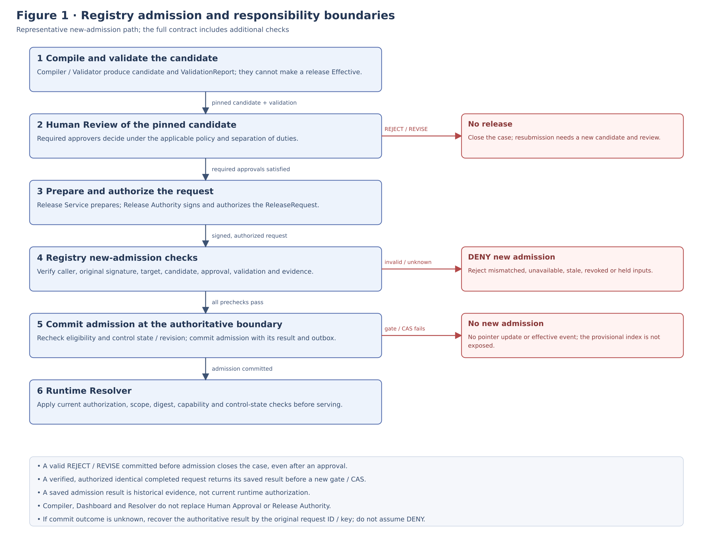
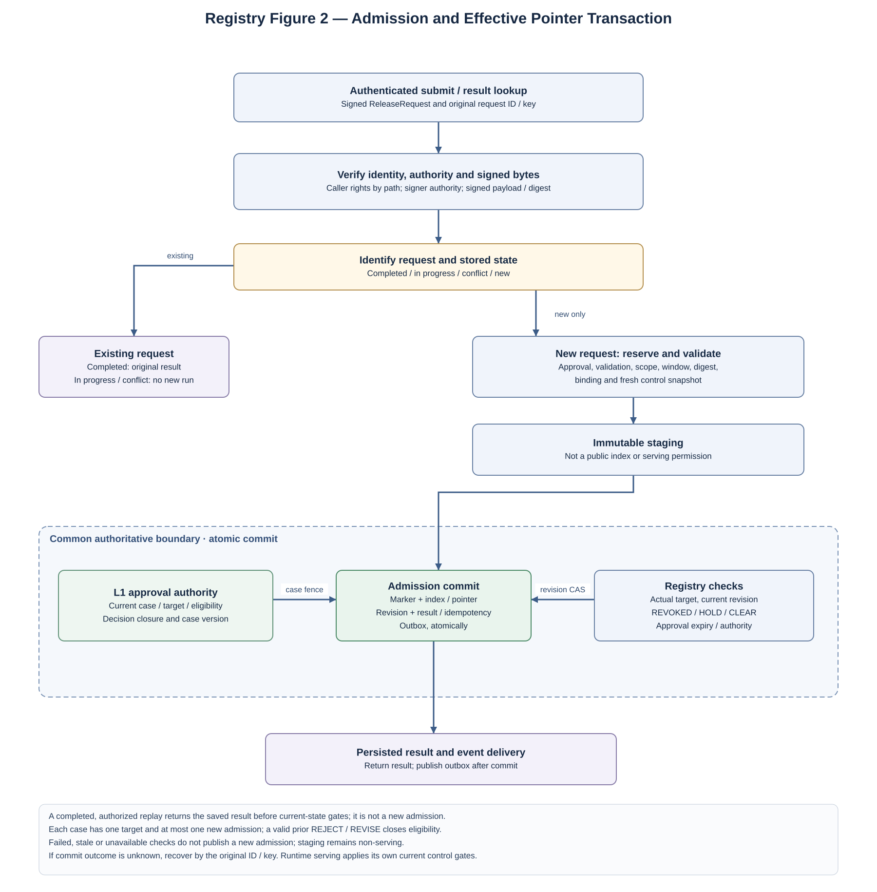
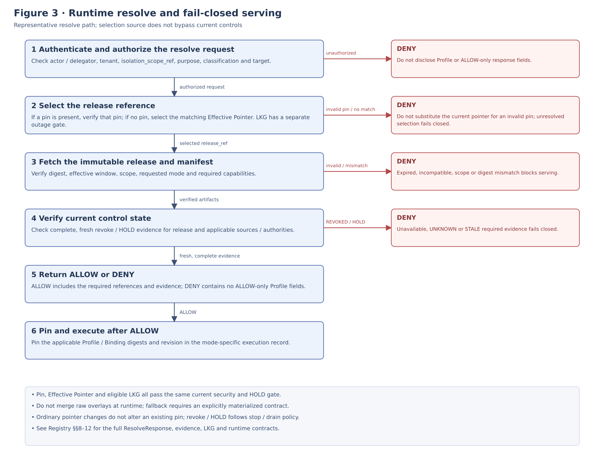
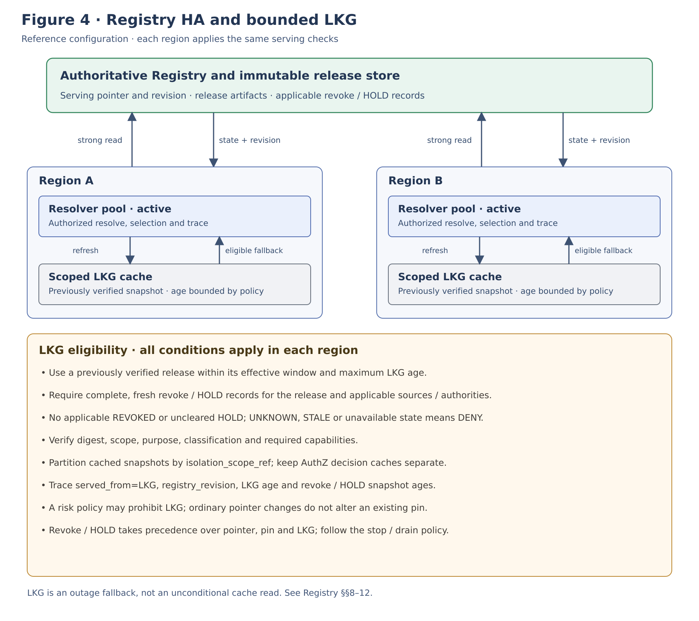
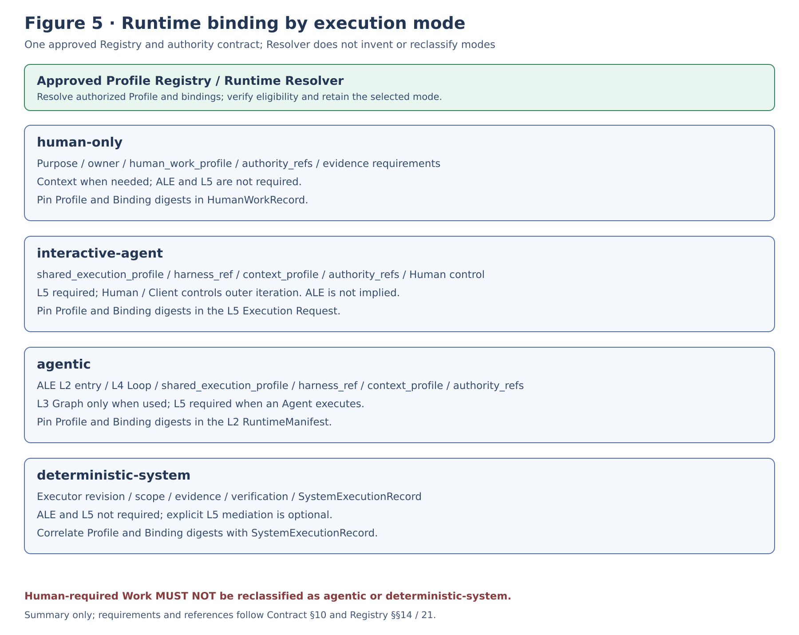

**IMPLEMENTATION STANDARD**

**ALOM Profile Registry
& Runtime Resolver**

**Implementation Architecture Standard**

Effective Profile Registry / Runtime Resolve / HA / Last Known Good / Pinning / Rollback / Trace

| **Core principle** Register Human-approved immutable Effective Profile Releases in an Approved Profile Registry owned by the applying organization. The Runtime Resolver deterministically resolves them based on target scope / effective time / requested work / capability. Registry / Resolver has no Authority to generate or approve Profiles and pins release_ref / digest / registry_revision at execution start. It supports HA and Last Known Good, but fails closed for revocation, expiration, scope mismatch, or digest mismatch. |
|----------------------------------------------------------------------------------------------------------------------------------------------------------------------------------------------------------------------------------------------------------------------------------------------------------------------------------------------------------------------------------------------------------------------------------------------------------------------------|

| **Management item** | **Value** |
|--------------|---------------------------------------------------------------------------------------------------------------|
| Document ID | ALOM-PROF-REG-STD-001 |
| Version | v0.5-review.20261110 |
| Created | 2026-08-13 |
| Governing standard | ALOM-ARCH-STD-001 v2.5 |
| Related standards | ALOM-L1-STD-001 v0.7-review.20261110 / ALOM-PROF-STD-001 v0.4-review.20261109 / ALOM-PROF-CONTRACT-SPEC-001 v0.5-review.20261108 / ALOM-PROF-CV-SPEC-001 v0.4-review.20261110 |
| Scope | ALOM L1 Profile Registry / Runtime Resolver / Runtime Control |
| Owner | Organization Architecture (Enterprise Architecture) / AI Platform |
| Joint responsibility | Business Owner / Quality / Security/Privacy / Operations / Project Management |
| Classification | Public |

Adopter-first / Profile-driven / Runtime-stable

# Document Control

## 1. Position and Order of Authority

- This document details PROF-01 through PROF-08 of ALOM Integrated Architecture Standard v2.5 and Effective Profile / Profile Authority / Registration Gate in L1 Operating Model & Governance v0.7 as implementation boundaries for Profile Registry and Runtime Resolve.

- Profile Registry / Runtime Resolver is an implementation Capability of L1 Operating Model & Governance, not an eighth Layer. It does not change the existing boundaries: ALE comprises L2-L4, and L5 is the ALOM Shared Execution Plane.

- Profile Generator / Compiler / Validator / Registry / Runtime Resolver / Dashboard does not replace Human Approval. A Human-approved release establishes the decision to become Effective; Registry functions as the Authority for distributing and referencing approved artifacts.

- Runtime Resolver does not freely generate new Rule interpretations or field-level merges from runtime requests. In principle, it selects precompiled, validated EffectiveProfileReleases, verifies their content and digests, and returns them.

- If this document conflicts with the governing standard, ALOM-ARCH-STD-001 v2.5 takes precedence. Where laws, contracts, customer NDAs, or Security/Privacy policies are stricter, the stricter constraints take precedence.

- \[STD\] indicates inheritance from governing/existing standards; \[REF\] indicates reuse of existing implementation specifications; \[PROPOSAL\] indicates Registry/Resolver-specific implementation details added here.

| **Fixed boundary** Compiler assembles Profiles; Validator determines validity; Human Authority decides whether they become Effective. Registry distributes approved releases immutably, and Runtime Resolver selects and pins approved releases. These responsibilities MUST NOT be combined into a single AI judgment. |
|------------------------------------------------------------------------------------------------------------------------------------------------------------------------------------------------------------------------------------------------------------------|

## 2. Sources and Design Categories

| **ID** | **Source** | **Use in this document** |
|--------|---------------------------------------------------------------|------------------------------------------------------------------------------------------------------------------------------|
| S1 | ALOM-ARCH-STD-001 v2.5-review.20261110 (ALOM Integrated Architecture Standard) | Non-effective alignment candidate; controlled authority remains v2.5. Seven layers, ALE=L2-L4, L5 Shared Execution, PROF-01 through PROF-08, Human Approval → Effective Profile Registry. |
| S2     | ALOM-L1-STD-001 v0.7-review.20261110                                    | EffectiveProfile, Profile Authority, Profile API, Registration fail-closed, Governance SLO.                                 |
| S3 | ALOM-PROF-STD-001 v0.4-review.20261109 | Profile lifecycle, Human Review/Approval, Profile Provenance; design HA/LKG because Registry/Resolver are Production execution dependencies. |
| S4     | ALOM-PROF-CONTRACT-SPEC-001 v0.5-review.20261108 | EffectiveProfile / Release / Manifest / digest / scope resolution / rollback / pinning.                                     |
| S5 | ALOM-PROF-CV-SPEC-001 v0.4-review.20261110 | Registry writes only through the Approved release path; runtime resolve; fail closed for REVOKED/HOLD and unknown state, as well as digest/expired/capability conditions. |
| S6 | L2 Control Plane: ALOM-CTL-STD-001 v0.4-review.20261110 L3 Graph Engineering: ALOM-GRAPH-STD-001 v0.4-review.20261110 L4 Agentic Loop: ALOM-LOOP-STD-001 v0.6-review.20261110 L5 Shared Execution Plane: ALOM-HR-STD-001 v0.4-review.20261110 L6 Context & Knowledge: ALOM-KNW-STD-001 v0.4-review.20261110 L7 SSOT: ALOM-SSOT-STD-001 v0.5 | Responsibility boundaries for Runtime Binding and Task/Graph/Loop/Harness/Context/Authority. |

## 3. Document Status and Dependencies

v0.1 establishes the Serving Control required for an Adopter-first Profile-driven MVP. It does not incorporate the UI, SoD, or operational implementation of the Review / Approval / Release Workflow in ALOM-PROF-WF-SPEC-001. The Registry write contract accepts ApprovalRecord / ValidationReport / ProfileReleaseManifest / ReleaseRequest as input contracts.

If the final ALOM-PROF-WF-SPEC-001 specification adds or tightens approval requirements, Registry updates its admission rules without relaxing that Approval Policy. Draft / In-review artifacts awaiting approval and Approved-but-not-released artifacts MUST NOT enter the Runtime Resolver candidate set.

v0.5 is a normative draft revision for the unified approval/admission commit boundary; independent review and formal approval remain pending.

# Contents

| **Section** | **Content** |
|--------|------------------------------------------|
| 1 | Purpose and Scope |
| 2 | Fixed Definitions and Responsibility Boundaries |
| 3 | Registry / Resolver Architecture Principles |
| 4 | Logical Architecture |
| 5      | Effective Profile Registry Data Model    |
| 6      | Identity / Namespace / Scope Model       |
| 7      | Release Admission / Registry Write Path  |
| 8      | Runtime Resolve Contract / Semantics     |
| 9      | Pinning / Consistency / Determinism      |
| 10     | HA / Replication / Last Known Good       |
| 11     | Cache / Edge Resolver / Degraded Mode    |
| 12     | Failure / Revoke / Fail-closed           |
| 13     | Security / NDA / Isolation               |
| 14     | L1-L7 Runtime Binding                   |
| 15     | API / Event Contract                     |
| 16     | Storage / Index / Schema / Migration     |
| 17     | Physical Deployment Reference            |
| 18     | Observability / SLO / Capacity           |
| 19     | Drift / Recompile / Rollback Integration |
| 20     | Repository / CI/CD / Release Engineering |
| 21     | Acceptance Gate / Conformance Test       |
| 22     | Implementation Roadmap / Backlog         |
| Appendix A | Minimum Data Contracts |
| Appendix B | YAML / API Examples |
| Appendix C | Error / Reason Codes |
| Appendix D | Governing Requirement Mapping / Technology Mapping |

# 1. Purpose and Scope

## 1.1 Purpose

This document defines implementation standards for the Approved Profile Registry and Runtime Resolver so Production Runtimes can resolve ALOM Operating Profiles that have become Effective through Human Approval in a stable, reproducible, auditable manner.

The design goal is for the applying organization to reproduce which Profile Release was Effective at what time and scope, and which digest / binding / authority an execution referenced, even after changing Profile Generator, Compiler, LLM, Agent Runner, Graph/Workflow Engine, or Dashboard products.

## 1.2 In Scope

- Admission, verification, and registration of Approved EffectiveProfileRelease / ProfileReleaseManifest / ApprovalRecord.

- Runtime lookup of Effective releases by the scope defined in ALOM-PROF-SCOPE-SPEC-001: applying organization-wide scope (Enterprise) → Operating Domain (required) → Organization / Customer / Project (rank 30, parallel optional overlays) → UseCase / Process (rank 40, parallel optional overlays) → Work.

- Immutable release store, Effective Pointer, Registry Revision, activation window, supersedes / rollback candidate.

- Runtime Resolver API, Scope/AuthZ, capability compatibility, digest verification, pinning.

- Active-active read, replication, Last Known Good, cache, degraded/fail-closed.

- Binding references by Execution Mode: human-only / interactive-agent / agentic / deterministic-system.

- Integration with Profile drift / recompile / rollback / revoke.

- Trace / Metrics / SLO / incident evidence.

## 1.3 Out of Scope

- Management decisions about Business Missions, authoritative Rulebook management, and Profile Draft generation.

- Internal implementation of field-level merge, semantic diff, and validation rules in Profile Compiler / Validator.

- Detailed Human Review UI, SoD, and Approve/Reject/Revise workflows.

- Internal implementation of each L2-L7 Runtime, LLM internal reasoning, and Agent Runner internal state.

- Provider SaaS subscription/billing/global tenant provisioning. Consider only API/Schema portability for future expansion.

## 1.4 Conformance Units

| **Conformance unit** | **Required artifacts / conditions** |
|------------------------------|----------------------------------------------------------------------------------------------------|
| Profile Registry Service     | Immutable release store / Effective pointer / Registry revision / admission evidence               |
| Runtime Resolver Service     | ResolveRequest / ResolveResponse / AuthZ / digest verify / capability check / pin semantics        |
| HA / LKG                     | replication / health / LKG eligibility / failover / negative test                                  |
| Runtime Consumer integration | Pin effective_profile_ref / release_ref / digest / registry_revision in RuntimeManifest / Trace |
| Operations                   | rollback/revoke/drift event, metrics, runbook, acceptance evidence                                 |

# 2. Fixed Definitions and Responsibility Boundaries

| **Term** | **Fixed definition** | **Not equivalent to** |
|---------------------------|------------------------------------------------------------------------------------------------------------------------------------------------------------|--------------------------------------------------|
| Approved Profile Registry | Profile distribution Authority owned by the applying organization, holding Human-approved immutable EffectiveProfileReleases and serving state (Effective Pointer / Registry Revision). | Profile Generator / Review UI / Draft repository |
| EffectiveProfile | Runtime-referenceable contract fully resolved for a particular target/work, with source revisions / approval / validation / binding / digest pinned. | DraftProfileBundle / ScopeOverlay |
| EffectiveProfileRelease | Release unit associating EffectiveProfile with Release Manifest, approval refs, effective window, and registry state. | Git branch / mutable record |
| Effective Pointer | Small mutable serving record pointing to the approved release to resolve for a scope/target and effective time. | Profile content |
| Registry Revision | Monotonically increasing revision of Registry serving state, included in runtime responses and Trace to identify the pointer state used for resolution. | A substitute for Git commit SHA |
| Runtime Resolver | Read-oriented service that deterministically selects a release matching target/scope/time/work/capability exclusively from Approved Registry and returns it after digest verification. | Profile Compiler / LLM Rule Interpreter |
| Pinning | Contract that fixes release_ref / digest / registry_revision at execution start and does not automatically apply pointer changes during execution to existing runs. | Continually tracking latest |
| Last Known Good (LKG) | Release snapshot most recently verified successfully that still meets validity/revoke/operational hold/scope conditions. Limited fallback during Registry outages. | Arbitrary old cache |
| Revoke | Enforced state excluding a release from runtime selection due to Security/Authority/contract violations, etc. | Ordinary rollback |
| Rollback | Operation returning the Effective Pointer to an earlier APPROVED immutable release, effective for new executions. | Rewriting Profile content |

| **Responsibility boundary** At Runtime entry, the Runtime Resolver selects which approved Profile to use; it does not newly generate or interpret whether that Profile is correct. Compiler/Validator owns Semantic merge / Validation, Human Authority owns the Effective decision, and L7 owns business Truth. |
|-----------------------------------------------------------------------------------------------------------------------------------------------------------------------------------------------------------------------------------------------------------------------|

# 3. Registry / Resolver Architecture Principles

| **ID** | **Principle** | **Normative requirement** |
|---------|-----------------------------|------------------------------------------------------------------------------------------------------------------------------------------|
| PRR-P01 | Human-approved only | Registry writes only through a release path with a valid ApprovalRecord and Validation PASS. Prohibit serving registration of Draft / warning-only candidates. |
| PRR-P02 | Immutable content | EffectiveProfile content is a content-addressed immutable artifact. Publish changes as new releases and switch only pointers. |
| PRR-P03 | Read resolver non-authority | Runtime Resolver only selects and verifies approved artifacts. Prohibit Rule interpretation, free-text completion, and silent defaults. |
| PRR-P04 | Pin before execute | Pin release_ref / digest / registry_revision in RuntimeManifest / Trace before external side effects or long-running execution begin. |
| PRR-P05 | Strong pointer consistency | Update Effective Pointers through atomic CAS / transactions; do not allow two current values due to split brain. |
| PRR-P06 | LKG is constrained | LKG fallback is permitted only when all conditions hold: within validity, not revoked, no operational hold, digest verified, and scope/purpose compatible. |
| PRR-P07 | Fail-closed on uncertainty | digest mismatch, expired, revoked, active/unknown operational hold, scope mismatch, required capability missing, and authority ambiguity are resolve errors. |
| PRR-P08 | Mode-neutral serving | Return all Execution Modes—human-only / interactive-agent / agentic / deterministic-system—from the same Profile Contract; do not change the Authority contract depending on whether ALE is involved. Registry/Resolver only serves the pre-approved exact-four set and MUST NOT invent/reclassify modes. |
| PRR-P09 | Traceable selection | Record request, selected release, registry revision, reason, cache/LKG, and capability result for each resolve decision in Canonical Events. |
| PRR-P10 | Portable contract | Preserve ProfileRelease / ResolveRequest / ResolveResponse semantics when changing Storage/DB/Cache/Cloud products. |

# 4. Logical Architecture

Place Profile Registry & Runtime Resolver as a Serving Capability on the L1 control side. Review/Approval/Release forms the write side; Runtime Resolver forms the read side. Separate both clearly from Profile Compiler/Validator.

Figure 1. Representative responsibility boundaries for Registry admission and runtime serving. Approval, authorization and committed admission are distinct; authorized replay of an identical completed request returns its saved result under §7.3. Current serving uses the exact-four mode set in PRR-P08.

[Open Figure 1 at full size](figures/ALOM-PROF-REG-STD-001-fig1-current.svg)

## 4.1 Component responsibility

| **Component** | **Responsibility** | **Prohibitions** |
|----------------------------|------------------------------------------------------------------------------------------|--------------------------------------|
| Release Admission API | Verify approval/validation/manifest/digest/effective window and start the write transaction. | Creating or relaxing Approval |
| Registry Write Coordinator | Register in the immutable store, update indexes, perform pointer CAS, and issue registry revisions. | In-place updates to Profile bodies |
| Immutable Release Store | Store EffectiveProfile / Manifest / Evidence refs by content address. | Mutable current state |
| Effective Pointer Store | Authoritative serving pointer from target/scope/time to release_ref. | Holding Profile semantics |
| Runtime Resolver           | AuthZ, lookup, release fetch, digest verify, capability check, response pin.            | runtime merge / AI inference         |
| LKG Cache | Retain verified releases and pointer snapshots within limits. | Fallback to revoked/expired artifacts |
| Registry Event Publisher | Publish release/effective/rollback/revoke/resolve events. | Replacing the source of truth |

# 5. Effective Profile Registry Data Model

## 5.1 Registry object model

| **Object**              | **Key / Identity**               | **Mutable?** | **Authority / Use**                                           |
|-------------------------|----------------------------------|--------------|---------------------------------------------------------------|
| EffectiveProfile | effective_profile_id + digest | No | Execution contract content. Content-addressed. |
| ProfileReleaseManifest | release_ref + manifest_digest | No | Evidence for source/compiler/validation/approval/effective window. |
| EffectiveProfileRelease | release_ref | No | Release envelope for Profile + Manifest + approval refs. |
| EffectivePointer | scope_key + target_ref + channel | Yes | Currently served release_ref. Updated through CAS. |
| RegistryRevision | registry_revision | append only | Monotonic revision for pointer/state changes. |
| RevocationRecord | release_ref + revoke_id | append only | Immediately exclude from resolve candidates. |
| OperationalHoldRecord | hold_id + action_id | append only | Control new use of target release/source/scope through HOLD/CLEAR. |
| RollbackRecord          | operation_id                     | append only  | from/to/actor/reason/incident/evidence.                      |
| ResolveDecision         | resolve_id                       | append only  | runtime selection evidence.                                  |

## 5.2 Canonical identity

\[PROPOSAL\] Separate profile/release logical IDs from immutable digests. Logical IDs support Human/System references; digests identify content; registry_revision versions the serving state.

<table>
<colgroup>
<col style="width: 100%" />
</colgroup>
<thead>
<tr class="header">
<th>effective_profile_id: effective://company/si/pilot-001/requirements.customer-approval/1.0.0 
release_ref: profile-release://company/si/pilot-001/1.0.0 
profile_digest: sha256:&lt;canonical-profile-digest&gt; 
manifest_digest: sha256:&lt;release-manifest-digest&gt; 
registry_revision: 1842 
pointer_key: company/si/pilot-001/requirements-review/requirements.customer-approval/stable</th>
</tr>
</thead>
<tbody>
</tbody>
</table>

## 5.3 State separation

| **Axis** | **Example states** | **Important rules** |
|-------------------|-------------------------------------------------|---------------------------------------------------------------|
| Release lifecycle | APPROVED / EFFECTIVE / SUPERSEDED / RETIRED | EFFECTIVE denotes serving eligibility. Profile bodies are immutable. The full historical axis is in Contract Section 12.1 (DRAFT…IN_REVIEW are not admitted). |
| Drift state | CLEAN / WARNING / RECOMPILE_REQUIRED / BLOCKING | Do not automatically update Profile bodies because of Drift. The vocabulary difference from Contract's CURRENT…INCOMPATIBLE is a parked residual. |
| Security state | ACTIVE / REVOKED | Security axis from Contract. REVOKED takes precedence over pointers and causes immediate denial. |
| Serving health | PRIMARY / LKG / DEGRADED | LKG is a distribution state independent of the profile lifecycle. |

Operational hold is an additional serving gate that does not rewrite the three state axes. If a target release/source/scope has an uncleared HOLD, display `SUSPENDED` and deny new resolves. Clearing one of multiple HOLDs does not resume service while another uncleared HOLD remains.

# 6. Identity / Namespace / Scope Model

## 6.1 Scope key

Retain the Profile Contract Resolution Scope (specificity rank); Registry indexes target scopes of compiled EffectiveProfiles. Runtime Resolver does not arbitrarily expand requested scope.

| **Scope**  | **MVP**  | **Resolver behavior**                                                    |
|------------|----------|--------------------------------------------------------------------------|
| Applying organization-wide scope (Enterprise) | Required | Shared ceiling / baseline for the entire applying organization. Does not directly replace Work Profiles. |
| Operating Domain | Required | Index key for a permanent Operating Domain (`domain_id`). Formerly labeled Business. |
| Organization | Optional | Organization overlay. A key only when present. |
| Customer | Optional | Required key when customer contracts/NDAs apply. No cross-customer fallback when absent. |
| Project | Optional | Project overlay. A key only when present. Do not reject resolve solely because it is absent (unless a selected rule requires it). The isolation boundary is `isolation_scope_ref`. |
| UseCase | Optional | Business use-case conditions. |
| Process | Optional | Process conditions (parallel with UseCase at rank 40). |
| Work | Required | Final concrete target for Managed Work. |

Organization / Customer / Project (rank 30) and UseCase / Process (rank 40) are parallel overlays within their respective specificity ranks, with no implicit ordering among peers. If overlays at the same rank propose incompatible nonmonotonic values, selection MUST NOT depend on file order / timestamp / profile type / last-write-wins. Use a monotonic deterministic field operator, an approved Authority / precedence rule, or CONFLICT / REVIEW_REQUIRED (ALOM-PROF-SCOPE-SPEC-001 Section 6.2). `project_id` (and `organization_id` / `customer_id` / `usecase_id` / `process_id`) is optional; do not reject solely because it is absent unless a selected rule explicitly requires it for the Managed Work. Do not synthesize a Project to satisfy an implementation schema. Reject missing `domain_id` (ALOM-PROF-SCOPE-SPEC-001 Sections 5.1 / 10.2). Each scope kind field takes a single value (ID or null), not a list. Split work spanning departments into Managed Work for each department (ALOM-PROF-SCOPE-SPEC-001 Section 5.1).

## 6.2 Namespace isolation

- Profile object keys, pointer keys, cache keys, event partitions, and metrics labels include tenant and `isolation_scope_ref` (including any customer / project overlays present).

- Shared profiles across isolation boundaries (different `isolation_scope_ref`, including cross-project / cross-customer) require an explicit shared namespace and policy allow. Do not cross NDA boundaries through implicit parent-scope fallback.

- Correlate Resolver request actor/delegator/purpose/classification ceiling with L1 AuthZ; do not relax data access ceilings in the Profile.

# 7. Release Admission / Registry Write Path

Registry writes cross a Production Authority boundary and therefore undergo stricter synchronous verification than the read path. The concrete Human Review/Approval UI is external, but write admission MUST validate ApprovalRecord.

Figure 2. Registry Write Path and Effective Pointer updates

## 7.1 Admission conditions

| **ID** | **Check** | **Pass condition** |
|--------|-------------------------------------|------------------------------------------------------------------|
| A1 | ProfileReleaseManifest schema valid | Required fields / version / digest algorithm are recognized. |
| A2     | Validation PASS                     | ERROR 0, required conflict 0, Human-required regression PASS.   |
| A3 | Approval complete | ApprovalRecord satisfies the required approver set / SoD / validity. |
| A4 | Source pinned | Mission/Rule/Profile source revisions are immutably pinned. |
| A5 | Digest verified | Matches the digest recomputed using the canonicalization version. |
| A6 | Binding compatible | Required L2-L7 capabilities / contract versions are available. |
| A7 | Scope isolation | Satisfies target namespace / `isolation_scope_ref` policy (including any customer / project overlays present). |
| A8 | Effective window valid | When until is non-null, require from \< until; otherwise apply the selected contract's open-ended-window policy. Satisfy overlap policy. |
| A9 | Current control-state gate | Verify all REVOKED/HOLD records, CLEAR correlation, and freshness for the target release/source/authority and applicable scope against an authoritative snapshot immediately before submit/admission. DENY for active REVOKED/HOLD, unavailable/UNKNOWN/STALE state, or unresolvable correlation. Do not reuse an old PASS from authorization time. |
| A10 | Control-state-bound pointer CAS | Admit / switch pointers only when the registry_revision of the snapshot verified in A9 matches the request's expected_registry_revision and still matches at write-transaction commit. DENY on mismatch or inability to perform final verification; do not merely substitute a new expected value. |

## 7.2 Write transaction

1.  Before reservation or staging, verify the authenticated submit caller and formal delegation for release.submit capability and the Registry write role in the target namespace/scope. Do not substitute the payload actor's or signer's privileges for the caller's; DENY read-only, other-scope, or unknown-privilege principals. Then retrieve the original SignedReleaseRequest through signed_release_request_ref and verify the JSON types/schema_version/canonicalization_version of all 20 fields in ALOM-PROF-WF-SPEC-001 Section 13.4; the recomputed SHA-256 of RFC8785 canonical bytes against payload_digest; the Profile Release Authority signature/privileges; and agreement between every payload field and its admission-converted value. DENY modifications, missing signatures, or unavailable content, including for the signed expected_registry_revision/control_state_evidence_ref; establish request_id / idempotency_key. Next check the saved result / in-progress state in Section 7.3. If an identical request is complete, return its original result and finish without rerunning the current-state gate/CAS. Only if unregistered, atomically reserve the request and proceed to step 2.

2.  Reverify Approval / Validation / source revision / digest / binding and obtain A9's complete, fresh authoritative control-state snapshot and registry_revision. Check agreement with the request's expected_registry_revision; DENY admission if unavailable/UNKNOWN/STALE or if the control gate fails.

3.  Put the immutable release object into content-addressed staging using put-if-absent. A staging blob alone creates neither a public release index nor Runtime eligibility. Even when reusing a blob with the same digest, verify the requested bytes/digest match and all admission gates pass.

4.  Create the release index only as a provisional change within the same atomic transaction as the CAS/pointer/idempotency result/outbox in steps 5-6; do not expose it before commit. Do not overwrite an existing finalized index.

5.  Finalize the control-state gate and pointer CAS in one atomic transaction, conditional on the same expected_registry_revision as the A9 query snapshot. All revoke/HOLD/CLEAR and pointer changes advance the same registry_revision, so changes after the query cause rejection through CAS mismatch. On failure, perform no admission/pointer update or effective event; do not retry merely by substituting a new expected value. CAS/gate rejection also aborts the provisional index; the operation must not alter finalized indexes/pointers. Remaining staging blobs stay private and nonserving; a legitimately reauthorized new request may verify and reuse the same content.

6.  Save the public release index, new registry_revision, finalized admission result, completed idempotency record, and profile.release.effective outbox event in the same atomic commit as the pointer CAS in step 5. Persist the result before sending the response; never leave a successfully updated pointer without its result.

7.  Publish events, propagate replicas, invalidate caches, and respond with the acknowledged revision.

## 7.2.1 Commit with Unified Approval State

Registry uses the authoritative current eligibility from L1 unified approval management. A historical ApprovalRecord, Workflow display, cache, event or successful preliminary lookup alone does not substitute for approval eligibility at final commit. Order Workflow §10.4 REJECT/REVISE Decision and eligibility closure, invalidation and admission at one serializable authoritative boundary. If REJECT/REVISE commits first, deny new admission for that case/candidate, including a previously signed request; if admission commits first, do not commit the pre-admission REJECT/REVISE. REVOKED/HOLD have separate authority and contracts.

At the commit in steps 5–6, establish that eligibility matches the requested review case, candidate identity/digest, scope, policy snapshot, validation, required approvals and SoD; it must be valid at that time and not closed or invalidated. One case has one logical target and at most one new admission commit; a different request ID cannot admit it twice. Atomically commit the per-case admitted marker with the pointer/index, revision, terminal result, idempotency completion and outbox. Evaluate approval expiry at commit with a trusted clock; if a reference, lookup, time or boundary cannot be established, do not perform a new admission. Delayed Decision-history or display projections do not bypass the authoritative boundary. An authorized replay of the same completed request finishes first through the §7.3 saved-result path and is not a new admission.

Match the `target_registry` in the original signed ReleaseRequest, the immutable intent approved by the Human under Workflow §6.3, the Registry's own trusted identity, and the namespace/scope/target_ref/channel resolved from the approved candidate and signed Manifest/Profile. Pin the Manifest digest in the signed payload after approval; do not create a circular Human Decision dependency. Deny new admission if any is ambiguous, mismatched or unavailable, or if a UI display alone cannot establish binding to the Decision. Do not establish the real receiver or current state solely from a client-supplied Host or preliminary lookup. If an old contract does not uniquely determine a required selector from immutable evidence and signed references, a versioned contract and migration or new review is required.

Do not change the 20 fields or signed bytes of the existing SignedReleaseRequest v1. Resolve the immutable ApprovalRecord→ReviewRequest reference chain using approval_record_ref and the ApprovalRecord review_case_id, and match candidate_ref/candidate_digest, verify review_case_id, scope, policy snapshot and validation, and match them to the manifest/profile/target scope. A missing, ambiguous, mismatched or unavailable chain denies a new admission. A digest alone does not identify the case.

Use the authoritative Ledger's integrity guarantees to verify that the ApprovalRecord reference and record_digest identify the same immutable record and that its review_case_id resolves to the unique immutable ReviewRequest under Workflow §5.2. Do not permit ID reassignment, resolution to a different Request, or alteration of record/case bindings. Merely displaying the same ID string or fetching a mutable unsigned referent does not establish integrity. If an existing history cannot establish the immutable binding, do not perform a new admission; use an auditable migration or re-review.

The existing expected_registry_revision continues to protect REVOKED/HOLD/CLEAR and pointer CAS. The recommended initial implementation uses a shared store that validates the L1 case version and Registry revision within one strongly consistent transaction and commits Decision/closure or admission/marker, pointer/index, result/idempotency and outbox. Do not silently add a case-version field to the signed payload. Another design must prove the same ordering for Decision/closure and admission, including external authority/source changes, legacy-writer fencing and freedom from bypass across commits, failures and retries. Do not silently add, change or reinterpret signed fields. A wire-schema change requires a separately versioned contract and migration. If commit outcome is unknown, do not invent ALLOW or DENY; recover the authoritative result using the original request ID/key. Preserve §7.3 submit permissions, the read-only route and saved-result replay, as well as current runtime REVOKED/HOLD checks.

During migration, stop or fence legacy writers and resolve in-progress or unknown operations using their original IDs. Reconstruct existing eligibility from verifiable case, Human Decision, target, scope and policy history; stop new admission and re-review subjects that cannot be verified. When migrating a verifiable legacy Decision to versioned evidence, retain immutable references to the original evidence proving the target binding at Decision time and the verification results, and distinguish the migration authority's attestation from the original Human signature. Do not fabricate a Human decision, its time or a signature on the new payload. Resume only after every path, including legacy writers, is proven to participate in the shared boundary. Preserve already committed admissions and history, and do not invent a post-admission REVOKED solely because of migration. Existing runtime Security/Operational gates continue separately.

## 7.3 Idempotency

For retries, first verify the SignedReleaseRequest signature, payload digest, admission-converted values, request_id/key match, and permission to read the result. If request_id/payload_digest bound to namespace/actor and idempotency_key differs, return PROFILE_IDEMPOTENCY_CONFLICT. For a completed identical request, return all fields of the saved ReleaseAdmissionResult in Appendix A unchanged (including the common payload_digest; effective_profile_digest/release_ref/registry_revision/admitted_at retain the actual commit values for ALLOW and null for DENY), then finish before reevaluating current-revision agreement, freshness, or REVOKED/HOLD. This re-presents a historical admission result and does not grant current runtime permission. Do not perform another CAS, issue another revision, or emit another effective event; continue applying the Runtime Resolver's current-state gate.

Atomically serialize reservations and completed-result storage for the same key. Only an unregistered request may acquire a reservation once and proceed to new admission; if an identical request is in progress, return in-progress without starting another admission. If state is indeterminate/unavailable, stop rather than assuming unregistered or completed DENY. Commit successful results with pointer updates/outbox; persist terminal denials before responding as well. Do not rerun while the existence of a completion record is unknown or automatically delete in-progress records to reuse keys.

Acceptance verification: If the response is lost immediately after initial success at revision r issues r+1, retrying the same signed request returns the original success result. Retries after subsequent HOLD/REVOKED/revision updates likewise return the same historical result; current Runtime resolve separately DENYs. Different payloads with the same key produce CONFLICT; concurrent identical requests execute once, with others returning in-progress/saved results; retrying terminal DENY returns the same DENY; unavailable result lookup causes no new execution. In every case, verify no duplicate pointer update, revision issuance, or effective event. Reject new submits by read-only principals possessing valid signatures, other-scope requests by write principals, and confusion between signer and caller privileges; verify read-only routes create no reservations. When injecting a CAS conflict after provisional index creation in step 4, verify no public index, pointer update, or effective event. Include a positive control that, after terminal denial, legitimately resubmits the same release_id/digest with a new ID/key and succeeds exactly once without index collision.

A dedicated route for reading saved results/progress is authorized by read permission on the target result; even if unregistered, it must not transition into reservation/staging/admission. The profileRelease.submit/Registry write API route requires permission to invoke that write API even when returning a completed result. For new execution, verify the signer's Profile Release Authority release.authorize privilege separately from the authenticated submit caller's release.submit/Registry write role. Possession of a signed request or result-read permission alone does not authorize new execution.

# 8. Runtime Resolve Contract / Semantics

## 8.1 Resolve input

| **Group** | **Required fields** | **Purpose** |
|----------------|----------------------------------------------------|---------------------------------|
| Identity | actor_id / delegator_id / tenant / `isolation_scope_ref` | User principal / NDA / scope. |
| Purpose | purpose_id / managed_work_ref | Purpose limitation / L1 registration. |
| Target | enterprise / domain / organization? / customer? / project? / usecase? / process? / work | Specify the exact target. |
| Time | effective_at | Historical reproduction or current resolution. |
| Execution | requested_execution_mode / required_capabilities | Mode and binding compatibility. |
| Pin preference | pinned_release_ref? / expected_digest? | Explicit pin for resume / reproduction. |
| Trace | trace_id / task_id? | Execution correlation. |

## 8.2 Selection precedence

Regardless of whether a candidate comes from a pinned release, Effective Pointer, or LKG, verify Security revocation and Operational hold for the target release and the applicable scopes of sources recorded in its manifest before returning it. REVOKED or an uncleared HOLD overrides the selection source and causes denial; fail closed if state cannot be confirmed.

8.  If explicit pinned_release_ref is present, return that release only if ACTIVE / not revoked / without hold / scope compatible / digest compatible.

9.  If no pin exists, retrieve the Effective Pointer corresponding to exact target + effective_at.

10. Verify the pointed-to release's manifest / validity / security state / operational hold / digest / capability.

11. Parent-scope fallback is available only when the Profile Contract explicitly publishes it as materialized fallback; do not merge raw overlays at runtime.

12. Fail closed for unresolved selection, multiple current releases, capability mismatch, expiration, revocation, uncleared/unknown hold, or digest mismatch.

## 8.3 Runtime sequence

Figure 3. Representative Runtime Resolve Sequence. Pin, pointer and eligible LKG all remain subject to current control checks; the complete response and evidence contracts are in §§8–12.

[Open Figure 3 at full size](figures/ALOM-PROF-REG-STD-001-fig3-current.svg)

## 8.4 Resolve response

Distinguish responses using decision=ALLOW or decision=DENY. Both include resolve_reason, security_record_refs, hold_record_refs, control_state_evidence_ref, resolve_id, and trace_id. resolve_id identifies each ALLOW/DENY ResolveDecision; trace_id correlates the overall processing sequence. control_state_evidence_ref links to queried release/source/scope, retrieval results, any retrieved registry_revision, observation time, freshness basis, and evidence of complete retrieval of applicable records. Even when no records apply, require evidence of a complete, fresh query. For DENY due to unavailable/UNKNOWN/STALE state, use empty arrays for unretrieved record refs and require failure reasons/evidence. Do not fabricate unretrieved revisions or records. DENY must not contain the ALLOW-only effective_profile_ref/release_ref/profile_digest/manifest_digest/registry_revision/effective_window/binding_refs/capability_result/served_from fields or the optional effective_profile payload. Return permission-protected evidence references without disclosing confidential record content. Required ALLOW fields retain the same names and meanings as Appendix A of ALOM-PROF-REG-STD-001. effective_profile payload may be added only to ALLOW; it does not replace required effective_profile_ref or profile_digest. Do not replace profile_digest with an alias named digest.

| **Field** | **Meaning** |
|-------------------------------------|--------------------------------------------------------|
| effective_profile | Fully resolved Profile payload, permitted only as an addition to ALLOW. Does not replace required effective_profile_ref/profile_digest. |
| effective_profile_ref / release_ref | immutable identity.                                   |
| profile_digest / manifest_digest | Identity of content / evidence. |
| registry_revision                   | serving state revision.                               |
| effective_window | Time window for which the resolution is valid. |
| binding_refs | Bindings such as graph/loop/harness/context/authority. |
| capability_result | Compatibility determination for required capabilities. |
| served_from                         | PRIMARY / REPLICA / LKG.                              |
| resolve_reason | Decision basis such as pointer/pin/rollback. |
| trace_id / resolve_id | Audit correlation. |

# 9. Pinning / Consistency / Determinism

## 9.1 Pin before execute

New Tasks / Human Work / Interactive executions / Agentic executions pin EffectiveProfileRelease before execution conditions can change. Each entry point, including L2 TaskRun, L5 ExecutionRequest, and HumanWorkRecord, records the same release_ref / digest in Trace.

## 9.2 In-flight behavior

| **Change** | **Already-started execution** | **New execution** |
|----------------------|-----------------------------------------------------|------------------------------------------------|
| New release becomes effective | Continue with pinned release | Resolve new pointer |
| Ordinary rollback | Normally retain pin. Explicit rebind is permitted at a safe boundary. | Resolve release after rollback |
| security revoke | STOP / human review / safe recovery according to Policy. | Deny revoked release |
| registry failover | Continue if pinned payload/digest remains available. | Resolve under Primary/LKG rules |
| drift warning | Risk policy determines whether to continue. No automatic switch. | Return current release if no new release exists, or apply block policy |

## 9.3 Deterministic response

\[PROPOSAL\] Golden tests must return the same release_ref / digest / reason code for the same Registry Revision, ResolveRequest semantic input, and Policy/Capability snapshot. Express time dependencies through effective_at; do not make server current time a hidden input.

# 10. HA / Replication / Last Known Good

## 10.1 Availability target

Design Runtime Resolver availability to exceed Profile Generation Service availability. Production execution depends on resolve, so make the read path redundant while prioritizing consistency on the write path.

Figure 4. HA / LKG reference configuration. Both regions apply the same eligibility checks, including fresh control-state evidence and denial of revoked or held releases; see §§8–12 for the complete contracts.

[Open Figure 4 at full size](figures/ALOM-PROF-REG-STD-001-fig4-current.svg)

## 10.2 Consistency profile

| **Data** | **Recommended consistency** | **Reason** |
|------------------------------|-------------------------------------------|--------------------------------------------------|
| Immutable Profile / Manifest | Eventual replicas permitted + digest verification | Content is immutable. Lag does not change it into incorrect content. |
| Effective Pointer | Strong / quorum / linearizable equivalent | Prevent split-brain current pointers. |
| Revocation | strong + push invalidation | Takes precedence over pointers for safety. |
| Operational Hold | strong + push invalidation | HOLD/CLEAR takes precedence over pointer / pin / LKG. |
| Registry Revision | monotonic | Resolve evidence and replica-lag determination. |
| Metrics/analytics | eventual | Not Authority. |

## 10.3 LKG eligibility

- LKG is the release snapshot that last passed successful resolve / digest verification / policy checks.

- LKG eligibility: effective_at is within validity; revoke and operational hold snapshots are both fresh; no uncleared HOLD exists; scope/purpose/classification matches; required capabilities are satisfied; and the digest is verified.

- Risk profiles must specify maximum LKG age, revoke freshness, and hold freshness. If `now - hold_snapshot_at` exceeds the hold freshness limit, or the hold snapshot's time/target scope cannot be confirmed, deny LKG with HOLD_STATE_UNKNOWN. High-impact Work may prohibit LKG and fail closed.

- When using LKG, always record served_from=LKG, registry_revision, lkg_age, revoke_snapshot_age, and hold_snapshot_age in Trace.

## 10.4 \[PROPOSAL\] baseline SLO

| **Metric** | **Initial MVP target** | **Notes** |
|--------------------------------|----------------------------------------------|------------------------------------------------|
| Resolver availability | 99.95% / month | Measure and adjust during the adoption pilot. |
| Resolve latency | p95 \<= 100ms / p99 \<= 250ms (region-local) | Manage Profile payload size limits separately. |
| Pointer activation propagation | \<= 30s to all healthy resolvers             | strong pointer source + cache invalidation.   |
| Revocation propagation | \<= 10s target | High impact. Global deny mode may be selected on failure. |
| Operational hold propagation | \<= 10s target | Scoped invalidation for HOLD/CLEAR. |
| RPO: effective pointer | 0 | Loss of approved pointer updates is unacceptable. |
| RTO: resolver region failover | \<= 5 min | Verify in drills including LKG/replicas. |

# 11. Cache / Edge Resolver / Degraded Mode

## 11.1 Cache key

Cache keys include target scope / work / effective_at bucket / requested mode / required capability set / registry_revision. If actor-specific information is included in keys, explicitly define the boundary for reusing authorization results.

## 11.2 Cache safety

- Separate Profile payload caches from AuthZ decision caches.

- Pointer / revoke / hold / clear changes advance registry_revision and invalidate cache/LKG for the affected scope. Release-targeted HOLD/CLEAR discards entries for that release; source-targeted HOLD/CLEAR discards entries across the impacted scope, including LKG. A resolver unable to receive invalidation events stops cache serving after its staleness budget is exceeded. While hold state cannot be confirmed, deny new use, including LKG.

- Cache entries retain release_ref / digest / manifest_digest / registry_revision / fetched_at / verified_at.

- Do not share cache namespaces across isolation boundaries (different `isolation_scope_ref`, including cross-project / cross-customer). Shared enterprise artifacts also pass through scope-aware read policy.

## 11.3 Degraded modes

| **Mode** | **Conditions** | **Permitted** | **Prohibited** |
|-----------------|-------------------------------------------|--------------------------------------------|--------------------------------------|
| NORMAL | Primary/quorum healthy | Normal resolve | None |
| REPLICA_READ | Primary read path degraded | Verified replica + current revision quorum | Unconditional adoption of stale pointers |
| LKG | Registry lookup unavailable | eligible LKG only | expired/revoked/active or unknown hold/unknown revoke state |
| PINNED_CONTINUE | Existing run retains profile payload/digest | Continue pinned execution | Start new unpinned tasks |
| FAIL_CLOSED | authority/digest/scope/capability unknown | Stop / Human Review | Guessing / automatic fallback |

# 12. Failure / Revoke / Fail-closed

## 12.1 Failure taxonomy

| **Code class** | **Example** | **Default treatment** |
|----------------------|--------------------------------------------------|-------------------------------------------------------------------|
| REGISTRY_UNAVAILABLE | quorum/endpoint unavailable | Evaluate LKG eligibility; block if ineligible. |
| POINTER_CONFLICT | Multiple current pointers in the same scope | fail-closed + incident. |
| DIGEST_MISMATCH | payload/manifest hash mismatch | Immediate deny + integrity incident. |
| RELEASE_EXPIRED | effective_until exceeded | deny. |
| RELEASE_REVOKED      | security/authority revoke                        | deny / in-flight stop policy.                                    |
| RELEASE_SUSPENDED | Uncleared HOLD on target release/source/scope | Deny new use / stop/drain policy for running work. |
| HOLD_STATE_UNKNOWN | Missing or insufficiently fresh hold state | Fail closed / confirm Authority. |
| SCOPE_DENIED         | tenant / `isolation_scope_ref` mismatch          | deny + security trace.                                           |
| CAPABILITY_MISMATCH | Required graph/loop/harness/context versions unavailable | Deny / explicitly select an alternative approved release if available. |
| REVISION_STALE | Resolver replica-lag limit exceeded | Retry primary/quorum; evaluate LKG conditions. |
| UNKNOWN_SCHEMA | Runtime does not support schema migration | deny / compatibility gate. |

## 12.2 Revoke / operational hold precedence

Revoke and Operational hold take precedence over Effective Pointer / pin / LKG. Resolver does not return a release even if a pointer references it when it is revoked or SUSPENDED. Ordinary rollback returns a pointer to a previous approved release; however, if that release also contains a revoked/held source or authority, block instead of rolling back. `REVOKED`, formerly described as a Release lifecycle token in Contract / Ops, has the same meaning as Security state in this standard.

RevocationRecord has no expires field; do not reactivate a REVOKED release. Recovery requires fixing and verifying the problematic source/authority and issuing a separate new release through Human Approval. OperationalHoldRecord consists of append-only HOLD and CLEAR events, with CLEAR identifying the target hold_id. CLEAR requires authorization by the operations authority for the target scope and validation evidence of cause resolution and current release eligibility. Uncleared HOLDs do not expire automatically, and CLEAR does not remove REVOKED.

## 12.3 Break-glass

\[PROPOSAL\] During Registry outages, break-glass uses a preapproved emergency profile, LKG policy, or manual human-only fallback; it does not improvise new Profiles. Require Trace for actor, reason, expiry, affected scope, and retrospective review.

# 13. Security / NDA / Isolation

| **Control** | **Required design** |
|-------------------|----------------------------------------------------------------------------------------------------------------|
| Authentication | Separate Human / Service / Agent principals and use short-lived credentials. |
| Authorization | Decide using purpose + actor/delegator + tenant / `isolation_scope_ref` + profile classification + operation(read/write). |
| Write SoD | Inherit separation of release admission/write roles and approver roles from ALOM-PROF-WF-SPEC-001 policy. |
| NDA isolation | Preserve `isolation_scope_ref` boundaries (including project / customer) across registry namespaces / encryption keys / caches / event partitions / metrics labels. |
| Encryption | In-transit / at-rest. Profiles reference credential_ref instead of storing secrets directly. |
| Supply chain | Manage registry service images, schemas, migrations, and canonicalization libraries as signed artifacts. |
| Audit | Correlate write/resolve/rollback/revoke/break-glass with actor/reason/trace. |
| Data minimization | ResolveResponse returns only Profile fields or secure refs required by the consumer. |

## 13.1 Negative tests

- Resolve customer B's profile with customer A's token → 0 successes.

- A request for `isolation_scope_ref` Y hits a cache entry for `isolation_scope_ref` X (e.g., project X) → 0.

- Direct call from Dashboard/BFF to a Registry write endpoint → deny.

- Effective Pointer update using Compiler service credentials → deny.

- Request a revoked release through pinned_release_ref → deny.

# 14. L1-L7 Runtime Binding

Figure 5. EffectiveProfile Runtime Binding by Execution Mode. The figure summarizes Contract §10.1 and Registry §§14 and 21; Graph is conditional on use and L5 is conditional on Agent execution for agentic mode.

[Open Figure 5 at full size](figures/ALOM-PROF-REG-STD-001-fig5-current.svg)

## 14.1 human-only

The approved Profile provides purpose / owner / human_work_profile / authority_refs / evidence requirements; context_profile is referenced when needed. ALE / L5 is not required. Resolver returns Profile and Binding references under the ALLOW response contract in §8.4.

## 14.2 interactive-agent

Resolver returns shared_execution_profile / harness_ref / context_profile / authority_refs, and L5 Shared Execution Plane enforces execution. Human/Client owns the outer iteration control; do not implicitly add L2-L4 ALE.

## 14.3 agentic

The approved Profile provides ale_entrypoint / loop_ref / shared_execution_profile / harness_ref / context_profile / authority_refs / eval requirements. graph_ref is referenced when L3 Graph is used; L5 is required when an Agent executes. L2 Task Admission pins the Profile and Binding digests in RuntimeManifest, and L4 and any L3 / L5 used inherit the applicable Profile pin.

## 14.4 Layer integration matrix

| **Layer / Subsystem** | **Principal references resolved from Profile** | **Not owned by Registry/Resolver** |
|------------------------|-----------------------------------------------------------------------|----------------------------------------|
| L1                     | purpose/owner/responsibility/execution mode/human control/outcome/SLO | Business Strategy / approval decision  |
| L2 Control             | task admission/manifest/budget/authority refs                         | Task durable state                     |
| L3 Graph               | graph_ref/node/human task binding                                     | Topology/routing semantics             |
| L4 Loop                | loop_ref/eval/termination/human review policy                         | Convergence semantics                  |
| L5 Shared Execution    | shared_execution_profile/harness/tool ceiling                         | Tool/credential/network enforcement    |
| L6 Context & Knowledge | context_profile/knowledge scope/freshness                             | Knowledge meaning/retrieval runtime    |
| L7 SSOT                | authority_refs/action boundary/read refs                              | Truth/record/write authority           |

## 14.5 deterministic-system

Resolver resolves references to the approved deterministic-system Profile without inventing or reclassifying its mode. Execution requires executor revision / scope / evidence / verification and correlates Profile and Binding digests with SystemExecutionRecord. ALE / L5 is not required. Explicit L5 mediation is optional and does not implicitly add an Agent Runner or L2–L4.

# 15. API / Event Contract

## 15.1 API baseline

| **API** | **Responsibility** | **Authority** |
|--------------------------------------------------|-------------------------------|--------------------------------|
| POST /v1/profile-registry/releases               | approved release admission    | write role + approval evidence |
| POST /v1/profile-registry/releases/{id}/activate | effective pointer CAS         | release authority path only    |
| POST /v1/profile-registry/releases/{id}/revoke   | security/authority revoke     | authorized governance role     |
| POST /v1/profile-registry/holds                  | operational HOLD             | authorized operations role     |
| POST /v1/profile-registry/holds/{id}/clear       | explicit CLEAR + revalidation | authorized operations role     |
| POST /v1/profile-registry/rollback | Return the saved result for a verified identical ProfileRollbackRequest; only new requests proceed to switching gates | Result replay: authenticated actor/delegator + scoped result read. New execution: scoped write role + Human rollback approval also required |
| GET /v1/profile-registry/rollback/{operation_id} | Read saved ProfileRollbackResult or IN_PROGRESS/UNKNOWN progress. Do not reserve/switch even if unregistered | scope-authorized result read |
| POST /v1/profile/resolve                         | runtime resolve               | read consumer                  |
| GET /v1/profile-registry/releases/{id}           | immutable release read        | scope-authorized               |
| GET /v1/profile-registry/pointers/{key}          | serving state / revision      | scope-authorized               |
| GET /v1/profile-registry/health                  | health/revision lag/LKG state | operations                     |

## 15.2 Canonical events

| **event_type** | **Minimum content** |
|-----------------------------------|------------------------------------------------------------------------------|
| profile.registry.release.admitted | release_ref/digests/validation/approval refs/actor                           |
| profile.release.effective         | pointer key/from/to/registry_revision/effective window                       |
| profile.resolved                  | request scope/release/digest/registry_revision/served_from/capability result |
| profile.resolve.denied            | reason code/scope/requested release/revision                                 |
| profile.registry.lkg.used         | scope/release/registry_revision/lkg_age/revoke_snapshot_age/hold_snapshot_age/reason |
| profile.release.revoked           | release/reason/authority/affected scopes                                     |
| profile.release.hold.placed       | action_id/hold_id/target_kind(RELEASE or SOURCE)/release_or_source_ref/scope/reason/actor/authority_ref/registry_revision/trace_id |
| profile.release.hold.cleared      | action_id/hold_id/target_kind(RELEASE or SOURCE)/release_or_source_ref/scope/actor/authority_ref/validation_ref/registry_revision/trace_id |
| profile.rollback.executed | decision=ALLOW, event_id/operation_id/request_payload_ref/payload_digest/pointer_key/from_release/to_release/actual_after_release/scope/actor/approved_by/reason/reason_code/incident_ref/evidence_refs/rollback_record_ref/rollback_result_ref/registry_revision/decided_at/trace_id. All fields are required; actual_after_release is the committed to_release, and registry_revision is the nonnull value issued by this operation's actual commit. Recording only requested values, or omitting/nulling finalized values, is prohibited. |
| profile.rollback.denied | decision=DENY, event_id/operation_id/request_payload_ref/payload_digest/pointer_key/from_release/to_release/actual_after_release/scope/actor/approved_by/reason/reason_code/incident_ref/evidence_refs/rollback_record_ref/rollback_result_ref/registry_revision/decided_at/trace_id. All fields are required; registry_revision=null. actual_after_release is the actual observed value, or null if unobserved; do not substitute the requested target. |
| profile.registry.failover         | from/to region/revision/lag/result                                           |

Publish HOLD/CLEAR events through an outbox from the committed transaction for OperationalHoldRecord and registry_revision. If event target_kind is RELEASE, Resolver immediately invalidates cache/LKG for that release and scope; if SOURCE, it invalidates cache/LKG throughout the impacted scope. A source → release reverse index is not required. For missing/delayed events, apply the staleness budget in Section 11.2 and hold freshness limit in Section 10.3; fail closed when state is unknown.

Finalize rollback audit events in the same commit as the record/result/outbox in Section 19.2. Only ALLOW emits profile.rollback.executed; only terminal DENY emits profile.rollback.denied. Do not describe denial as executed/effective. Assign event_id once when finalizing the outbox and retain the same event_id/operation_id/payload_digest/decision on redelivery. Consumers deduplicate by event_id and verify record/result references and operation digest match. Do not create terminal events for indeterminate or unpersistable results. Both events retain reason unchanged from the canonical request and RollbackRecord; reason_code matches the decision reason in the same Result/Record. approved_by is an array of approval principals established from verified approval evidence referenced by the request's approval_refs. Store it in the same commit as the canonical ProfileRollbackRecord's required approved_by, and keep it consistent with the Runbook RollbackRecord. ALLOW approved_by is a nonempty array including verified Human approval principals. If no approval principals can be confirmed for DENY, use an empty array; do not fabricate unverified approval. Pin these values in the outbox as well; do not change them on redelivery.

## 15.3 Error envelope

The following is an example Runtime resolve denial response. Terminal admission ALLOW/DENY follows ReleaseAdmissionResult in Appendix A and Appendix B.3; distinguish these from indeterminate processing and transport errors.

<table>
<colgroup>
<col style="width: 100%" />
</colgroup>
<thead>
<tr class="header">
<th>{ 
"decision": "DENY", 
"resolve_reason": "PROFILE_RELEASE_REVOKED", 
"security_record_refs": ["revoke://profile/2026-0813-04"], 
"hold_record_refs": [], 
"control_state_evidence_ref": "evidence://registry/control-state/1842/revoke-check", 
"resolve_id": "resolve-denied-example", 
"error": { 
"code": "PROFILE_RELEASE_REVOKED", 
"message": "Requested profile release is not eligible for runtime use", 
"reason_ref": "revoke://profile/2026-0813-04", 
"requested_target": "work://requirements.customer-approval", 
"requested_release_ref": "profile-release://example-alom/1.0.0", 
"observed_registry_revision": 1842, 
"retryable": false 
}, 
"trace_id": "trace-..." 
}</th>
</tr>
</thead>
<tbody>
</tbody>
</table>

# 16. Storage / Index / Schema / Migration

## 16.1 Logical storage

| **Store** | **Content** | **Recommended characteristics** |
|----------------------|------------------------------------------------------|---------------------------------------------------|
| Release Object Store | EffectiveProfile / Manifest / evidence pointers      | immutable, content-addressed, replicated          |
| Pointer DB           | scope/target/channel→release_ref + revision          | transaction/CAS/strong consistency                |
| Revocation Store     | release/source/authority revoke                      | strong read, fast invalidation                    |
| Resolve Index        | target/work/time window/capability→candidate release | derived; rebuildable from release + pointer state |
| LKG Cache            | verified profile/pointer/revoke snapshot             | encrypted, scoped, bounded TTL                    |
| Audit/Trace Store    | write/resolve/failover/rollback events               | append-oriented; retention policy                 |

## 16.2 Schema compatibility

Resolver allow-lists profile schema_version / release_manifest_version / canonicalization_version. Deny unknown major versions; permit compatible minor versions through explicit compatibility tests.

## 16.3 Migration rule

13. Add new schema/registry schemas in a backward-compatible manner.

14. Deploy the Read resolver first and pass dual-read / compatibility tests.

15. Do not migrate release objects in place; generate new serializations as separate artifacts.

16. Migrate pointer schemas through registry revisions and transactions; prepare a rollback plan.

17. Compare semantic results/digest selection between old/new implementations using golden resolve cases.

# 17. Physical Deployment Reference

## 17.1 Initial MVP

\[PROPOSAL\] Initially, implementation may use modular components within an L1 Profile Control Service, but separate Runtime Resolver at a boundary that can have independent SLOs / health endpoints / deployment units. Write paths are infrequent and strongly consistent; read paths are frequent and low-latency, giving them different scaling characteristics.

| **Tier** | **Component** | **Deployment / characteristics** |
|-----------|----------------------------|------------------------------------------------------------|
| Ingress   | API Gateway / Service Auth | OIDC/workload identity, rate limit, scope routing.        |
| Read      | Resolver Pool xN           | stateless, horizontal scale, region-local cache.          |
| Write     | Registry Write Coordinator | single logical writer or consensus leader, idempotency.   |
| State     | Pointer / Revocation / Operational Hold DB | multi-AZ strong consistency.                              |
| Artifacts | Immutable Release Store | Multi-AZ replicated object store / Git release mirror permitted. |
| Cache     | LKG / Profile Cache        | per-region encrypted cache, scope partition.              |
| Events    | Outbox + Event Bus         | profile events, cache invalidation, dashboard projection. |
| Ops       | Trace/Metrics/Alerting     | resolve/activation/revoke/failover observability.         |

## 17.2 Network / trust boundaries

- Do not expose write endpoints directly to public/user-facing networks. Permit only service identities on the L1 Human Approval/Release path.

- Read endpoints are used by L2/L5/Human Work services, but verify consumer identity and scope.

- Prohibit direct reads/writes to Registry DB/Object Store; use APIs/Ports.

- Dashboard uses read projections / L1 Profile APIs and does not hold direct Registry write credentials.

# 18. Observability / SLO / Capacity

## 18.1 Required metrics

| **Metric** | **Dimension** | **Use** |
|-----------------------------------|--------------------------------|-------------------------------------|
| profile_resolve_latency           | region/mode/served_from/result | Runtime SLO.                       |
| profile_resolve_error_total       | reason_code/scope class        | fail-closed / dependency analysis. |
| registry_revision_lag             | resolver/region                | replica/cache stale.               |
| profile_lkg_use_total             | region/work risk/lkg_age       | degraded reliance.                 |
| profile_activation_latency        | release/region                 | pointer propagation.               |
| profile_revocation_latency        | release/region                 | security control.                  |
| profile_digest_mismatch_total     | store/region                   | integrity incident.                |
| profile_capability_mismatch_total | consumer/capability            | binding drift.                     |
| profile_rollback_total            | scope/reason                   | release quality.                   |
| profile_registry_availability     | region/path read/write         | SLO / capacity.                    |

## 18.2 Trace fields

Resolve / write / rollback / revoke retains at least actor/delegator, purpose/work, scope, release_ref, profile_digest, manifest_digest, registry_revision, served_from, reason, policy_ref, trace_id, and latency. Detailed chain-of-thought is out of scope.

## 18.3 Capacity model

\[PROPOSAL\] Estimate Read QPS from Task/Work start, resume, Human work open, and Interactive session start. Do not retrieve Profile bodies at every step; use secure local references after pinning and do not call Resolver in proportion to tokens/LLM calls.

# 19. Drift / Recompile / Rollback Integration

## 19.1 Drift

Correlate Rulebook/Mission/Authority/Resource revision changes with the current EffectiveProfile as profile.drift.detected, but Registry does not automatically rewrite current releases. Preserve the path Drift → impact → recompile → semantic diff → validation → Human Review → new release.

## 19.2 Rollback

Bind rollback operation_id to the canonical payload_digest of ProfileRollbackRequest in Appendix A, including actor/delegator, scope, from/to release, approvals/evidence, and expected_registry_revision. Different requests using the same ID produce CONFLICT. Verify the canonical original request/digest/all-field identity specified in Appendix A, authentication, and read permission for the target result; return saved terminal results before current-state gates without repeating the switch. Only unprocessed new operations check write permission, Human rollback approval, and all gates, then atomically reserve execution. Prohibit concurrent execution of the same operation or bypass through another operation_id while processing/results are unknown; wait for the authoritative transaction outcome. Result-read-only callers do not reserve or switch. A saved ALLOW is a historical switching result, not current usage permission or successful post-verification.

18. Rollback targets must be previous APPROVED immutable releases.

19. Immediately before rollback, reverify all REVOKED/HOLD records, CLEAR correlation, validity, and freshness for the target release/source/authority and applicable scope against an authoritative snapshot; bind expected_registry_revision to that snapshot's registry_revision. DENY if unavailable/UNKNOWN/STALE or any gate fails.

20. In one atomic CAS/transaction conditional on the same expected_registry_revision as the verified snapshot, commit the Effective Pointer, new registry_revision, ProfileRollbackRecord, CAS evidence, terminal result for operation_id, and audit-event outbox together. Persist and verify the object referenced by control_state_evidence_ref before commit; persist the cas_evidence_ref object within this transaction. If records/evidence/outbox cannot be persisted, abort everything; do not allow a pointer-only switch or finalized ALLOW. If control-state changes cause revision mismatch or final verification is impossible, leave the pointer unchanged and DENY; do not retry merely by substituting a new expected value.

21. New executions resolve the rollback release. Existing executions retain their pins, with explicit stop/rebind when necessary.

22. Successful ProfileRollbackRecord and audit-event outbox were committed in step 20 and do not depend on separate writes after CAS. On denial, leave the pointer unchanged and commit the DENY ProfileRollbackRecord, query/CAS evidence including unavailability, denial audit outbox, and terminal result in one transaction. If persistence fails or commit outcome is unknown, stop as indeterminate rather than fabricating terminal DENY/ALLOW. Retain decision, requested target and actual pointer observations, control_state_evidence_ref, cas_evidence_ref, and trace_id according to Appendix A. Make outbox delivery resumable; handle duplicate delivery idempotently using event_id and operation_id. Do not record DENY as successful switching or issuance of a new revision.

## 19.3 Emergency revoke vs rollback

| **Event** | **Response** | **Reason** |
|-------------------------------|-----------------------------------------------|---------------------------------------------------------------------------|
| Ordinary release regression | Rollback | Return the serving pointer if the previous approved release is safe. |
| Rule/Authority compromise | Revoke + Block / Human fallback | Previous releases may contain the same source, so rollback alone is insufficient. |
| Registry corruption suspicion | Fail-closed + integrity recovery | Reverify LKG hash/revoke snapshots as well. |
| Capability backend outage | approved alternate release / mode degradation | Use only alternatives permitted by the Profile. Prohibit improvised binding changes. |

# 20. Repository / CI/CD / Release Engineering

## 20.1 Repository baseline

<table>
<colgroup>
<col style="width: 100%" />
</colgroup>
<thead>
<tr class="header">
<th>alom-profile-runtime/ 
schemas/ 
registry/ 
resolve/ 
events/ 
src/ 
admission/ 
registry/ 
resolver/ 
revocation/ 
lkg/ 
authz/ 
compatibility/ 
trace/ 
adapters/ 
pointer_store/ 
object_store/ 
cache/ 
event_bus/ 
tests/ 
contract/ 
golden/ 
isolation/ 
failover/ 
revoke/ 
rollback/ 
deploy/ 
example-mvp/ 
docs/ 
adr/ 
runbooks/</th>
</tr>
</thead>
<tbody>
</tbody>
</table>

## 20.2 CI gates

| **Gate** | **Required checks** |
|-------------|-----------------------------------------------------------------------|
| Schema      | JSON/YAML schema compatibility / unknown major rejection              |
| Determinism | golden ResolveRequest→release_ref/digest/reason                       |
| Authority   | unapproved release write deny / dashboard direct write deny           |
| Security | Cross-isolation negative tests (different `isolation_scope_ref`, including cross-project / cross-customer) / secret scan / dependency scan |
| Integrity   | digest/canonicalization vectors / tamper test                         |
| HA          | replica lag / region failover / LKG eligibility drill                 |
| Revoke/Hold | Revoke/hold denial for pointer/pin/LKG; authority and revalidation for HOLD → CLEAR; source-targeted scope-wide eviction / propagation tests |
| Rollback    | previous approved release CAS / in-flight pin behavior                |
| Performance | resolve latency / cache hit / cold read                               |
| Migration   | old/new registry schema dual-read / rollback                          |

## 20.3 Deployment strategy

Resolver may use progressive rollout / canary deployment, but stop rollout if old/new Resolvers return different semantic results for the same Registry Revision. Do not casually introduce dual writers into Write Coordinator; retain a single logical writer / consensus.

# 21. Acceptance Gate / Conformance Test

| **Gate** | **Test** | **Pass condition** |
|----------|-----------------------------|----------------------------------------------------------------------------------------|
| PRR-G01 | Authority boundary | Compiler/Dashboard/Resolver credentials cannot make unapproved releases Effective. |
| PRR-G02 | Approved-only serving | Zero successful resolves of Draft/IN_REVIEW/APPROVED-but-not-released artifacts. |
| PRR-G03 | Deterministic resolve | Identical revision/input/capability produces identical release_ref/digest/reason. |
| PRR-G04 | Digest integrity | A 1-byte alteration causes resolve denial. |
| PRR-G05 | Scope isolation | Zero successful cross-isolation resolves (different `isolation_scope_ref`, including cross-project / cross-customer). |
| PRR-G06 | Human-required preservation | Zero omissions or relaxations of Profile human_required / authority by Resolver. |
| PRR-G07 | Pinning | Zero automatic digest changes to in-flight Tasks after pointer updates. |
| PRR-G08 | Rollback | Reproduce new Tasks using the rollback release and old Tasks retaining their pins. |
| PRR-G09 | Revoke / hold precedence | Deny resolve if the current pointer / explicit pin references a revoked or held release. CLEAR requires authority and revalidation. |
| PRR-G10 | LKG safety | Zero LKG use when expired/revoked/hold active or unknown/scope mismatched/digest invalid. |
| PRR-G11 | HA | Recover within SLO after resolver instance/zone loss; zero duplicate current pointers. |
| PRR-G12 | Revision monotonicity | Zero revision regression for pointer/rollback/revoke/HOLD/CLEAR changes. |
| PRR-G13 | Capability compatibility | Required binding capability mismatch yields ERROR. |
| PRR-G14 | Trace completeness | 100% of required fields for resolve/write/rollback/revoke/HOLD/CLEAR. |
| PRR-G15 | Portability | API semantics/golden results survive changes of store/cache implementation. |

## 21.1 Illustrative delivery scenario

For initial acceptance, select at least 1 representative Managed Work from the adopting organization for each mode—human-only / interactive-agent / agentic / deterministic-system—and resolve mode-specific Bindings from the same Profile Registry. Verify that Human-required Work, such as customer requirements approval, does not change to agentic or deterministic-system. Agentic Work uses the ALE L2 entry and L4 Loop with L5; verify L3 Graph when used. Pin profile / binding digests in each mode's execution records. L6/L7 bindings follow the contracts of each mode and the applicable Profile. Do not uniformly require context_profile / authority_refs for deterministic-system.

# 22. Implementation Roadmap / Backlog

| **Phase** | **Name** | **Principal deliverables** | **Promotion conditions** |
|-----------|-----------------------|--------------------------------------------------------------|-------------------------------------|
| R0        | Contract              | ResolveRequest/Response, Registry object, Event/Error schema | schema/golden fixture pass          |
| R1        | Single-node Registry  | immutable store + pointer + admission + resolve              | PRR-G01-07                         |
| R2        | Security/Isolation    | AuthZ, namespace, negative tests, revocation                 | PRR-G05/G09                         |
| R3        | HA Read Path          | resolver pool, replica, revision lag, cache                  | PRR-G11/G12                         |
| R4        | LKG/Degraded          | LKG eligibility, fail-closed, drill                          | PRR-G10                             |
| R5        | Runtime Binding       | L1/L2/L5/Human Work consumers, pin/trace                     | PRR-G06/G07/G13/G14                 |
| R6        | Rollback/Drift        | rollback/revoke/drift event integration                      | PRR-G08/G09                         |
| R7        | Example Delivery E2E       | human-only / interactive-agent / agentic / deterministic-system + failure/failover cases | PRR-G01-15                         |
| R8        | Operational hardening | SLO, capacity, runbook, backup/restore, chaos drill          | Pilot Activation readiness |

## 22.1 Connection to the Next Stage

This document establishes the control plane through which Runtimes reliably resolve approved Profiles.

# Appendix A. Minimum Data Contracts

| **Contract** | **Minimum fields** |
|--------------------------------|----------------------------------------------------------------------------------------------------------------------------------------------------------------------------------------|
| ProfileReleaseAdmissionRequest | request_id/idempotency_key/release_ref/profile_ref/profile_digest/manifest_ref/manifest_digest/validation_ref/approval_refs/effective_window/expected_registry_revision/actor/trace_id/control_state_evidence_ref/signed_release_request_ref |
| ReleaseAdmissionResult | Common: request_id / release_id / payload_digest / status(ADMITTED or DENIED) / decision(ALLOW or DENY) / reason_code / decision_evidence_ref / decided_at / trace_id. For ADMITTED=ALLOW only: registry_revision / release_ref / effective_profile_digest / admitted_at are required with actual commit values. For DENIED=DENY, these four success-only fields are null; do not fabricate values. |
| EffectivePointer               | pointer_key/target/scope/channel/release_ref/effective_from/effective_until/registry_revision/updated_at/updated_by                                                                    |
| RegistryRevision               | revision/previous_revision/operation_ref/changed_keys/timestamp/digest                                                                                                                 |
| ProfileResolveRequest          | actor/delegator/purpose/work/target_scope/effective_at/requested_mode/required_capabilities/pinned_release_ref?/expected_digest?/trace_id                                              |
| ProfileResolveResponse | Common: decision(ALLOW/DENY)/resolve_reason/security_record_refs/hold_record_refs/control_state_evidence_ref/resolve_id/trace_id. ALLOW only: effective_profile_ref/release_ref/profile_digest/manifest_digest/registry_revision/effective_window/binding_refs/capability_result/served_from. DENY returns no success payload. |
| RevocationRecord               | revoke_id/release_or_source_ref/scope/reason/authority/valid_from/trace_id                                                                                                    |
| OperationalHoldRecord          | action_id/hold_id/action(HOLD or CLEAR)/target_kind(RELEASE or SOURCE)/release_or_source_ref/scope/reason/actor/authority_ref/incident_ref/evidence_refs/validation_ref?(CLEAR required)/registry_revision/timestamp/trace_id |
| ProfileRollbackRecord | operation_id/request_payload_ref/payload_digest/pointer_key/from_release/to_release/actual_after_release/scope/actor/approved_by/reason/reason_code/incident_ref/evidence_refs/decision(ALLOW or DENY)/control_state_evidence_ref/cas_evidence_ref/registry_revision/timestamp/trace_id. All fields are required. to_release is the requested target. For ALLOW, actual_after_release is committed to_release; registry_revision is the nonnull value newly issued by this operation. For DENY, registry_revision is null; actual_after_release is the actual observation, or null if unobserved; do not substitute the requested target. approved_by is the array of approval principals verified through the request's approval_refs. ALLOW requires a nonempty array including verified Human approval principals; use an empty array only when approval principals cannot be confirmed for DENY. |
| ProfileRollbackRequest | canonical payload: schema_version/canonicalization_version/operation_id/actor/delegator(null allowed)/scope/pointer_key/from_release/to_release/approval_refs[]/evidence_refs[]/reason/incident_ref/control_state_evidence_ref/expected_registry_revision/requested_at/trace_id. envelope: request_payload_ref/payload_digest. Include every payload field in the digest. |
| ProfileRollbackResult | operation_id/request_payload_ref/payload_digest/pointer_key/decision(ALLOW or DENY)/reason_code/rollback_record_ref/control_state_evidence_ref/cas_evidence_ref/registry_revision/decided_at/trace_id. All fields are required. ALLOW registry_revision is the nonnull actual commit value; DENY uses null. Store every field as an immutable terminal result and return it unchanged on retries. |
| LKGSnapshot                    | scope/pointer_key/release_ref/profile_digest/registry_revision/verified_at/revoke_snapshot_at/hold_snapshot_at/valid_until                                                                              |

Rollback control_state_evidence_ref retains the queried release/source/scope, all applicable records, query revision, time, freshness, and retrieval outcome. cas_evidence_ref retains query_registry_revision / expected_registry_revision / observed_registry_revision / result_registry_revision / cas_status(SUCCEEDED, MISMATCH, UNAVAILABLE, NOT_ATTEMPTED) / observed_at / reason. If a value could not be retrieved, record null and the reason; do not fabricate unretrieved revisions. Both evidence references and decision/trace_id remain required for DENY; result_registry_revision is null, with no pointer write/effective event by this operation. Distinguish actual pointer observations, including effects of concurrent operations, from the fact that this operation did not write.

ProfileRollbackRequest uses schema_version profile-rollback-request/1 and canonicalization_version RFC8785. Payload is a JSON object containing only the 17 fields listed above. Reject duplicate keys, unknown fields, missing required fields, and incorrect types. Match actor/delegator to authenticated principals and legitimate delegation. scope is a canonical scope ref; pointer_key is a nonempty string identifying a unique EffectivePointer through scope_key/target_ref/channel in Section 6. Before a new switch, verify agreement with scope/from_release; reject ambiguous or inconsistent targets. Each ref is a string identifying an immutable object; approval_refs/evidence_refs are nonempty string arrays; delegator is a string or null; expected_registry_revision is a nonnegative safe integer. Reject rounding that loses precision. Preserve values, including requested_at/trace_id, and array order on retries. payload_digest is SHA-256 of UTF-8 bytes canonicalized with RFC 8785 JCS, formatted as sha256:lowercase-hex. request_payload_ref identifies immutable storage of the same canonical bytes; do not include envelope ref/digest in the payload and create self-reference. Verify the fetched original's recomputed digest, transmitted payload, envelope, and authenticated principal agree before looking up saved results for operation_id. Unavailable references, digest mismatch, or unknown canonicalization prohibit both new execution and returning saved results. JCS definition.

ProfileRollbackRecord and ProfileRollbackResult operation_id/request_payload_ref/payload_digest identify the same verified request. Persist the canonical request ref/digest in the execution reservation from Section 19.2; bind terminal record/result/outbox in the same commit as pointer CAS. The result's rollback_record_ref and control_state_evidence_ref/cas_evidence_ref identify persistent records of the same decision. ALLOW reason_code is ROLLBACK_COMMITTED; a DENY from CAS conflict uses CAS_REVISION_MISMATCH; other denials identify causes with applicable PROFILE_* codes in this document. In-progress, unknown-result, and authentication/identity errors return progress or transport errors without fabricating/overwriting terminal results. Saved ALLOW establishes only a historical switch; it is not Authority for current use or post-verification. ProfileRollbackRecord reason retains the canonical request's reason unchanged as the request rationale. Store the decision reason separately in reason_code and match Result/Event reason_code for the same operation. Do not overwrite request-derived reason with denial codes.

ReleaseAdmissionResult is the immutable terminal result of an admission operation reserved after establishing signature/request identity. release_id is the requested target, and payload_digest is the signed ReleaseRequest digest; neither grants current usage permission. reason_code states success/denial reasons; decision_evidence_ref identifies permission-protected evidence for gates/queries/CAS/unavailability; decided_at is the original decision time. Return all fields unchanged on retries. Do not fabricate and persist IN_PROGRESS, unavailable results, signature/authentication errors, or key conflicts as terminal results; distinguish them as in-progress or transport errors without overwriting results for existing keys.

# Appendix B. YAML / API Examples

## B.1 Effective Pointer

<table>
<colgroup>
<col style="width: 100%" />
</colgroup>
<thead>
<tr class="header">
<th>apiVersion: alom.profile.registry/v1 
kind: EffectivePointer 
metadata: 
key: company/si/pilot-001/requirements-review/requirements.customer-approval/stable 
registry_revision: 1842 
target: 
enterprise: company 
business: system-integration 
project: pilot-001 
usecase: requirements-review 
work: requirements.customer-approval 
release_ref: profile-release://example-alom/1.0.0 
effective_from: 2026-08-15T00:00:00+09:00 
effective_until: null 
state: ACTIVE</th>
</tr>
</thead>
<tbody>
</tbody>
</table>

## B.2 Resolve request/response

The following request is an illustrative field excerpt, not a complete ResolveRequest. Actual requests must include the Common Scope and authorization information required by the applicable contracts.

<table>
<colgroup>
<col style="width: 100%" />
</colgroup>
<thead>
<tr class="header">
<th>POST /v1/profile/resolve 
{ 
"principal": { 
"actor_id": "user-123", 
"delegator_id": "user-123", 
"tenant_id": "example", 
"project_id": "pilot-001", 
"isolation_scope_ref": "scope://example/pilot-001" 
}, 
"purpose_id": "requirements.confirm", 
"managed_work_ref": "work://requirements.customer-approval", 
"target": { 
"enterprise": "company", 
"business": "system-integration", 
"project": "pilot-001", 
"usecase": "requirements-review", 
"work": "requirements.customer-approval" 
}, 
"effective_at": "2026-08-20T10:00:00+09:00", 
"requested_execution_mode": "human-only", 
"required_capabilities": ["context.v1", "authority-ref.v1"], 
"trace_id": "trace-001" 
} 
 
200 -&gt; { 
"decision": "ALLOW", 
"security_record_refs": [], 
"hold_record_refs": [], 
"control_state_evidence_ref": "evidence://registry/control-state/1842/no-applicable-controls", 
"resolve_id": "resolve-allowed-example", 
"manifest_digest": "sha256:...", 
"effective_window": {"from": "2026-08-20T00:00:00+09:00", "until": "2026-09-20T00:00:00+09:00"}, 
"capability_result": {"compatible": true}, 
"effective_profile_ref": "effective://example-alom/requirements.customer-approval/1.0.0", 
"release_ref": "profile-release://example-alom/1.0.0", 
"profile_digest": "sha256:...", 
"registry_revision": 1842, 
"served_from": "PRIMARY", 
"resolve_reason": "EFFECTIVE_POINTER", 
"binding_refs": { 
"context_profile": "context://project/pilot-001", 
"authority_refs": ["authority://customer-requirement-approval"] 
}, 
"trace_id": "trace-001" 
}</th>
</tr>
</thead>
<tbody>
</tbody>
</table>

## B.3 Admission terminal response

Successful admission example: `{ "request_id": "release-request://example-dev/allow-001", "release_id": "profile-release://example-dev/1.0.0", "payload_digest": "sha256:c6ab57a5df6cc8a4cbc31f552c7606df32e019bcf94ec505481db9794a72bdc6", "status": "ADMITTED", "decision": "ALLOW", "reason_code": "ADMISSION_COMMITTED", "decision_evidence_ref": "evidence://admission/allow-001", "decided_at": "2026-08-13T10:00:00+09:00", "trace_id": "trace-allow-001", "registry_revision": 1843, "release_ref": "profile-release://example-dev/1.0.0", "effective_profile_digest": "sha256:bbbbbbbbbbbbbbbbbbbbbbbbbbbbbbbbbbbbbbbbbbbbbbbbbbbbbbbbbbbbbbbb", "admitted_at": "2026-08-13T10:00:00+09:00" }`.

Terminal admission denial example: `{ "request_id": "release-request://example-dev/deny-001", "release_id": "profile-release://example-dev/1.0.0", "payload_digest": "sha256:e44e5b8b323057b24577b128816562afead5cb818abf73e8729755b8013ef303", "status": "DENIED", "decision": "DENY", "reason_code": "PROFILE_RELEASE_SUSPENDED", "decision_evidence_ref": "evidence://admission/deny-001/hold", "decided_at": "2026-08-13T10:00:00+09:00", "trace_id": "trace-deny-001", "registry_revision": null, "release_ref": null, "effective_profile_digest": null, "admitted_at": null }`.

## B.4 Rollback request / terminal result

RollbackRequest example allow-001: request_payload_ref=`request://rollback/allow-001`, payload_digest=`sha256:5234bda37fe46911d276f5fd83af19a77af494ff4931f072f144b59decdce0e1`, canonical payload=`{"actor":"user://profile-operator","approval_refs":["approval://rollback/allow-001"],"canonicalization_version":"RFC8785","control_state_evidence_ref":"evidence://rollback/control-state/1842","delegator":null,"evidence_refs":["evidence://rollback/20260813-001"],"expected_registry_revision":1842,"from_release":"profile-release://example-org/pilot-a@1.5.0","incident_ref":"incident://alom/20260813-017","operation_id":"rollback://profile/example-org/pilot-a/20260813-001","pointer_key":"example-org/pilot-a/requirements.customer-approval/stable","reason":"post_release_incident","requested_at":"2026-08-13T10:00:00+09:00","schema_version":"profile-rollback-request/1","scope":"project://example-org/pilot-a","to_release":"profile-release://example-org/pilot-a@1.4.0","trace_id":"tr-profile-rollback-20260813-001"}`.

RollbackResult example allow-001: `{"cas_evidence_ref":"evidence://rollback/cas/1842-1842-1843","control_state_evidence_ref":"evidence://rollback/control-state/1842","decided_at":"2026-08-13T10:00:00+09:00","decision":"ALLOW","operation_id":"rollback://profile/example-org/pilot-a/20260813-001","payload_digest":"sha256:5234bda37fe46911d276f5fd83af19a77af494ff4931f072f144b59decdce0e1","pointer_key":"example-org/pilot-a/requirements.customer-approval/stable","reason_code":"ROLLBACK_COMMITTED","registry_revision":1843,"request_payload_ref":"request://rollback/allow-001","rollback_record_ref":"record://rollback/allow-001","trace_id":"tr-profile-rollback-20260813-001"}`.

RollbackRequest example denied-001: request_payload_ref=`request://rollback/denied-001`, payload_digest=`sha256:d9a712a7fa227e1ca8b02bd963a30ecc74ece5099f718e837624d22d7d91c6ab`, canonical payload=`{"actor":"user://operator","approval_refs":["approval://rollback/denied-001"],"canonicalization_version":"RFC8785","control_state_evidence_ref":"evidence://control-state/1842","delegator":null,"evidence_refs":["evidence://attempt/denied-001"],"expected_registry_revision":1842,"from_release":"release://P2","incident_ref":"incident://I","operation_id":"rollback://attempt/denied-001","pointer_key":"S/work/default/stable","reason":"post_release_incident","requested_at":"2026-08-13T10:00:00+09:00","schema_version":"profile-rollback-request/1","scope":"scope://S","to_release":"release://P1","trace_id":"trace-denied-001"}`.

RollbackResult example denied-001: `{"cas_evidence_ref":"evidence://cas/denied-001","control_state_evidence_ref":"evidence://control-state/1842","decided_at":"2026-08-13T10:00:00+09:00","decision":"DENY","operation_id":"rollback://attempt/denied-001","payload_digest":"sha256:d9a712a7fa227e1ca8b02bd963a30ecc74ece5099f718e837624d22d7d91c6ab","pointer_key":"S/work/default/stable","reason_code":"CAS_REVISION_MISMATCH","registry_revision":null,"request_payload_ref":"request://rollback/denied-001","rollback_record_ref":"record://rollback/denied-001","trace_id":"trace-denied-001"}`.

# Appendix C. Error / Reason Codes

| **Code** | **Meaning** | **Retry** |
|------------------------------|----------------------------------------------|----------------------|
| ADMISSION_COMMITTED | Success: the signed request's admission result, public index, pointer, revision, and outbox were atomically finalized. Separate from current Runtime usage permission. | Same request: saved result only |
| ROLLBACK_COMMITTED | Success: rollback pointer/revision/record/CAS evidence/result/outbox were finalized in one commit. | Same operation: saved result only |
| CAS_REVISION_MISMATCH | Rollback expected_registry_revision differs from the revision at commit. No pointer switch. | Same operation: saved DENY only; new request requires all gates |
| PROFILE_NOT_FOUND | No eligible release for target scope/work | No |
| PROFILE_RELEASE_EXPIRED | Outside validity window | No |
| PROFILE_RELEASE_REVOKED      | revoke state                                 | No                   |
| PROFILE_RELEASE_SUSPENDED | Uncleared operational hold | No |
| PROFILE_HOLD_STATE_UNKNOWN | Hold state cannot be confirmed | Conditional |
| PROFILE_DIGEST_MISMATCH      | integrity fail                               | No                   |
| PROFILE_SCOPE_DENIED         | NDA/scope/AuthZ deny                         | No                   |
| PROFILE_CAPABILITY_MISMATCH | Required runtime capability unavailable | Conditional |
| PROFILE_REGISTRY_UNAVAILABLE | registry read unavailable                    | Yes; LKG eligibility |
| PROFILE_POINTER_CONFLICT     | multiple current / consistency issue         | No                   |
| PROFILE_REVISION_STALE       | replica lag/stale cache                      | Yes; quorum/primary  |
| PROFILE_SCHEMA_UNSUPPORTED   | unknown incompatible schema                  | No                   |
| PROFILE_LKG_NOT_ELIGIBLE     | LKG validity/revoke/scope failure            | No                   |
| PROFILE_IDEMPOTENCY_CONFLICT | same key different payload                   | No                   |

# Appendix D. Governing Requirement Mapping / Technology Mapping

| **Mapped source** | **Sections** | **Implementation details** |
|-----------------------------------------|------------------|---------------------------------------------------------------|
| PROF-06 Human Approval                  | 7 / 12 / 21      | unapproved serving 0, ApprovalRecord admission                |
| PROF-07 Effective release/provenance    | 5 / 7 / 8 / 15   | release/manifest/digest/registry revision/trace               |
| PROF-08 Drift/Recompile                 | 19 / 20          | new release path, no in-place mutation                        |
| L1 Profile Authority                    | 2 / 7 / 13       | Human-approved release + protected source + Approved Registry |
| L1 Reproducible Profile                 | 8 / 9 / 21       | effective_at + registry revision + digest pin                 |
| Profile Contract EffectiveProfile       | 5 / 8 / A/B      | schema/identity/binding/validity                              |
| Profile Contract Rollback               | 9 / 19           | previous approved pointer switch + in-flight pin              |
| Compiler/Validator Registry Integration | 7 / 15           | approved-only write / profile.resolve boundary                |
| Security/NDA                            | 6 / 12 / 13 / 21 | namespace/AuthZ/cache negative tests                          |
| Runtime availability                    | 10 / 11 / 18     | HA/LKG/failover/SLO                                           |

## D.2 Technology Mapping

| **Capability** | **Implementation candidates** | **Authority** |
|-------------------------|------------------------------------------------------------|-------------------------------------|
| Immutable release store | Object Storage / Git release mirror / content-addressed DB | Profile content Authority           |
| Effective Pointer       | Transactional RDB/KV/consensus store                       | Serving Authority                   |
| Runtime Resolver        | Stateless service + deterministic selection core           | Read-only selection                 |
| LKG Cache | Redis/embedded encrypted cache, etc. | Derived fallback; non-authority |
| AuthZ                   | L1 Policy/Identity integration                             | Scope/purpose enforcement           |
| Event                   | Transactional outbox + event bus                           | Projection/cache invalidation/trace |
| Observability           | OpenTelemetry + metrics/logs                               | Operational evidence                |
| Deployment | Kubernetes/VM/managed container, etc. | Product-neutral |

| **End of v0.1** This standard may be promoted to an implementation baseline after resolving representative human-only / interactive-agent / agentic / deterministic-system Work from the same Registry in the Example Delivery Pilot and obtaining PRR-G01 through PRR-G15 acceptance evidence. |
|----------------------------------------------------------------------------------------------------------------------------------------------------------------------------------------------------------------------------|

# Version Control / History

| Date | Category | Content | Document version |
| --- | --- | --- | --- |
| 2026-09-15 | meaning-preserving editorial errata | Align Section 22 R7 with exact-four + failure/failover. | Draft v0.2 |
| 2026-09-19 | normative lifecycle/security-state alignment | Map Security state ACTIVE/REVOKED semantically to the independent axis in Contract Section 12.1. Retain the serving subset of Release lifecycle. Drift vocabulary difference remains a parked residual. | Draft v0.3 |
| 2026-10-27 | normative scope-model alignment | Incorporate the scope model from ALOM-PROF-SCOPE-SPEC-001 Draft v0.3 into Sections 1.2 / 6.1 / 6.2 / 7.1 A7 / 8.1 / 11.2 / 12.1 / 13 / 13.1 / 20.2 / 21 PRR-G05 / B.2. Operating Domain (`domain_id`) is required; Organization / Customer / Project (rank 30) and UseCase / Process (rank 40) are parallel optional overlays; each scope kind is single-valued; `project_id` is optional; `isolation_scope_ref` is required at runtime. | Draft v0.4 |

