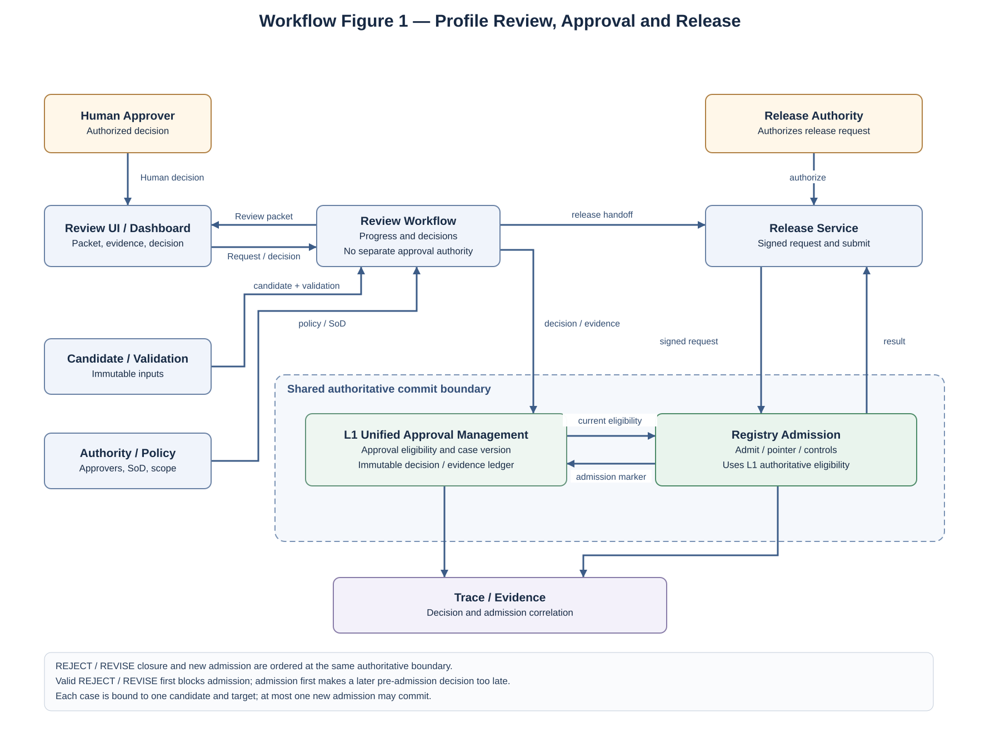
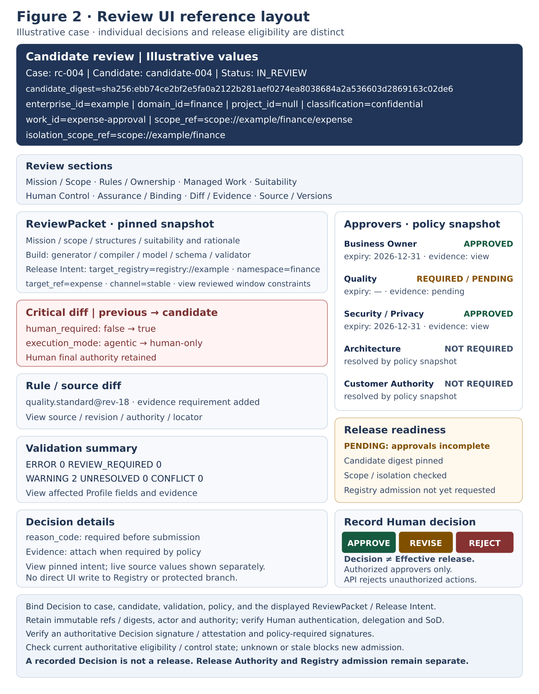
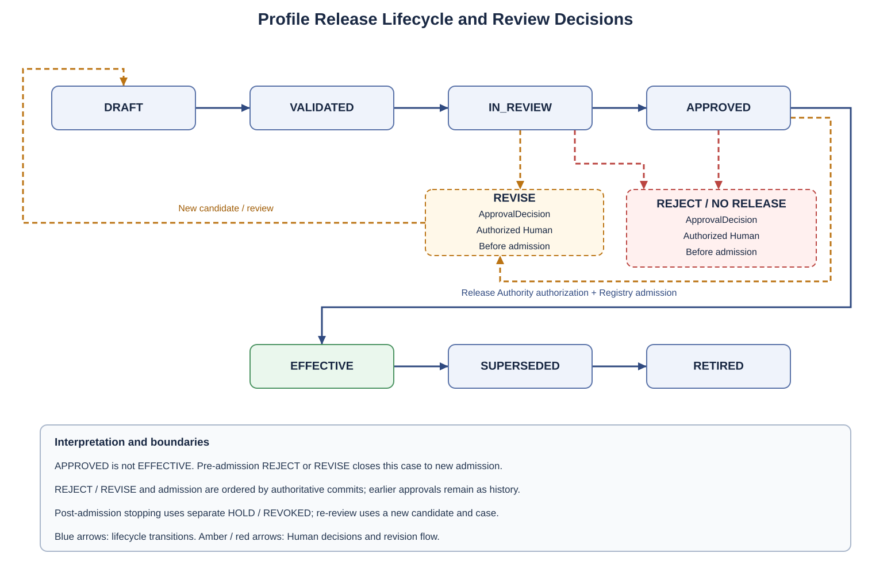

**SPECIFICATION**

**ALOM Profile**

**Review / Approval / Release Workflow**

**Specification**

Review UI / Segregation of Duties / Approve / Reject / Revise / Release Authority / Evidence

| **Core principle** Humans review the rationale, differences, Suitability, Human Control, and Rule provenance of a Validated Profile candidate, then Approve / Reject / Revise through an Approver set that satisfies SoD. Bind approval to an immutable candidate digest. Registration in the Approved Profile Registry is permitted only after Profile Release Authority authorizes the ReleaseRequest. Generator / Compiler / Validator / Dashboard / Registry do not replace Human Approval. |
|--------------------------------------------------------------------------------------------------------------------------------------------------------------------------------------------------------------------------------------------------------------------------------------------------------------------------------------------------------------------------------------------------------------------------------------|

| **Management item** | **Value**                                                                       |
|--------------|----------------------------------------------------------------------------------|
| **Document ID**  | ALOM-PROF-WF-SPEC-001                                                            |
| **Version**       | v0.7-review.20261110                                                                       |
| **Created**   | 2026-08-13                                                                       |
| **Governing standard** | ALOM-ARCH-STD-001 v2.5                                                           |
| **Related standards** | ALOM-L1-STD-001 v0.7-review.20261110 / ALOM-PROF-STD-001 v0.4-review.20261109 / ALOM-PROF-CONTRACT-SPEC-001 v0.5-review.20261108 |
| **Target**     | ALOM L1 Profile Review / Approval / Release Workflow / Human Control             |
| **Owner** | Organization Architecture (Enterprise Architecture) / AI Platform                                            |
| **Joint responsibility** | Business Owner / Quality / Security and Privacy / Project Management / Operations   |
| **Classification** | Public |

Adopter-first / Human-control / Profile-driven. Make an Effective Profile for representative work the first completion criterion. Separate UI from Authority so the same Review / Approval Contract can be reused in future PaaS/SaaS offerings.

# **Document Control**

## **1. Position and Authority Precedence**

> • This specification turns PROF-01-08 of ALOM Integrated Architecture Standard v2.5, Human Control / Profile Authority in L1 Operating Model & Governance v0.7, and Human Review / Approval / Lifecycle in Profile Engineering & Generation v0.4 into Review Workflow contracts.
>
> • Profile Engineering & Generation is an L1 implementation Subsystem and adds no eighth Layer. It does not change the boundaries ALE=L2-L4 and L5=ALOM Shared Execution Plane.
>
> • Generator / Compiler / Validator / Dashboard / Registry / Runtime Resolver do not replace Human Approval and have no Authority to make a Profile Effective.
>
> • Profile Review is a Human Control process correlating Profile candidate, Validation, Rule/Authority, ApprovalDecision, and ReleaseRequest; it is not merely an operation in the Review UI.
>
> • In conflicts among governing standards, laws, contracts, customer NDAs, and Security/Privacy rules, the higher-authority or stricter constraints take precedence.
>
> • In this specification, \[STD\] denotes inheritance from governing/existing standards, \[REF\] denotes reuse of existing implementation specifications, and \[PROPOSAL\] denotes Workflow-specific implementation details added here.

| **Fixed boundary** Approve does not generate or modify Profile content. If content changes are needed during Review, use Revise, generate a new candidate digest, and repeat Review. Release Authority may submit an approved candidate to the Registry but cannot change the approved content. |
|--------------------------------------------------------------------------------------------------------------------------------------------------------------------------------------------------------------------------------------------------------|

## **2. Sources and Design Classification**

| **ID** | **Source**                                                      | **Use in this specification**                                                                              |
|--------|---------------------------------------------------------------|-------------------------------------------------------------------------------------------------|
| S1     | ALOM-ARCH-STD-001 v2.5-review.20261110 (ALOM Integrated Architecture Standard)                              | Non-effective alignment candidate; controlled authority remains v2.5. PROF-01-08, Human Control, seven Layers / ALE / L5 boundaries, fail-closed. |
| S2     | ALOM-L1-STD-001 v0.7-review.20261110                                    | Profile Authority, Approval/Registry, HumanReviewPacket / ApprovalDecision.                    |
| S3     | ALOM-PROF-STD-001 v0.4-review.20261109 | Approval Gate, mandatory Review UI information, Lifecycle, Provenance, Trace Events.                         |
| S4     | ALOM-PROF-CONTRACT-SPEC-001 v0.5-review.20261108 | Validation Gate, Release lifecycle, EffectiveProfileRelease, digest, no-relaxation.            |
| S5     | ALOM-PROF-CV-SPEC-001 v0.4-review.20261110 | Validated candidate, ValidationReport; Registry writes only through Approved release paths.           |
| S6 | ALOM-RULEBOOK-STD-001 v0.4-review.20261110 (reconciliation reference) | Reconcile the boundary between Authority / Revision / Rulebook Release and Profile Review / Approval. |
| S8     | ALOM-PROF-REG-STD-001 v0.5-review.20261110 | Admission inputs: ApprovalRecord / ValidationReport / ProfileReleaseManifest / ReleaseRequest. |

S6 in this document is a reference for reconciliation with the current specification; this does not mean it is identical to the historical source of the original document.

## **3. Document Status and Dependencies**

| **Adopter-first** ALOM-PROF-WF-SPEC-001 is complete when a Validated candidate can be inspected in the Review UI, the required approver set resolved from the Rulebook, Human decisions satisfying SoD recorded, and the Approved release safely handed off to the Registry by Release Authority. |
|-----------------------------------------------------------------------------------------------------------------------------------------------------------------------------------------------------------------------------------------------------|

The subsequent Profile Registry & Runtime Resolver assumes this specification and uses ApprovalRecord / ValidationReport / ProfileReleaseManifest / ReleaseRequest as admission inputs. Even if subsequent documents have already been authored, they MUST NOT relax this specification's approval conditions.

v0.4 is a semantic revision applying CV v0.3 ValidationReport and authoritative REVOKED/HOLD/freshness checks to ReviewPacket, release authorization, and negative acceptance cases. It inherits v0.3's separation of Release lifecycle and independent Security state.

v0.7 is a normative draft revision for unified approval management and REJECT/admission ordering; independent review and formal approval remain pending.

### **3.1 ALOM-PROF-WF-SPEC-001 Completion Criteria**

> • ReviewPacket can present Mission / Scope / Rule provenance / Diff / Execution Suitability / Human Control / Validation without omissions.
>
> • Required approver sets and conditional approvers can be resolved reproducibly from Rulebook / Authority Registry.
>
> • SoD can be checked mechanically, and inappropriate self-approval between the candidate's creator/modifier and final approver can be rejected.
>
> • Approve / Reject / Revise are bound to candidate_digest and policy snapshot; after Revise, the new candidate undergoes Review again.
>
> • Release Authority and Registry admission do not relax ApprovalDecision and fail closed for missing or no-longer-valid approval, or digest mismatch.
>
> • The Review→Decision→Approval→Release→Registry Evidence chain can be traced through trace_id / review_case_id / release_id.

### **3.2 Input/Output Boundaries**

| **Boundary**        | **Main inputs / outputs**                                | **Authority**                                 |
|-----------------|--------------------------------------------------|-----------------------------------------------|
| Review Intake   | candidate / ValidationReport / policy snapshot   | Profile Repository / Validator / L1 Authority |
| Human Decision  | ReviewPacket → ApprovalDecision / ApprovalRecord | Resolved Human Approver                       |
| Release         | Approved candidate → ReleaseRequest              | Profile Release Authority                     |
| Serving Handoff | ReleaseRequest → admission result / release_ref  | Approved Profile Registry                     |

# **Contents**

| **Chapter** | **Content**                                     |
|--------|----------------------------------------------|
| 1      | Purpose and Scope                               |
| 2      | Fixed Definitions and Responsibility Boundaries                           |
| 3      | Workflow Architecture Principles                  |
| 4      | Logical Architecture / Authority Separation    |
| 5      | Review Intake / Preconditions                |
| 6      | ReviewPacket Contract                        |
| 7      | Review UI Specification                               |
| 8      | Approver Resolution / Approval Policy        |
| 9      | Segregation of Duties(SoD)                 |
| 10     | Approve / Reject / Revise Decision Semantics |
| 11     | Exception / Waiver / Break-glass             |
| 12     | Approval Lifecycle / State Transition        |
| 13     | Release Authority / ReleaseRequest           |
| 14     | Registry Admission / Runtime Handoff         |
| 15     | Re-review / Approval Invalidation            |
| 16     | Provenance / Trace / Evidence                |
| 17     | Security / NDA / Privacy                     |
| 18     | API / Event / Contract Architecture          |
| 19     | Repository / CI/CD / Versioning              |
| 20     | Observability / SLO                          |
| 21     | Physical Deployment Reference Configuration                         |
| 22     | Acceptance Gates and Conformance Tests                         |
| 23     | Implementation Roadmap and Backlog                 |
| Appendix A | Minimum Data Contracts                               |
| Appendix B | YAML Contract Examples                                  |
| Appendix C | Reason Code / Error Code                     |
| Appendix D | SoD / RACI Matrix                            |
| Appendix E | Governing Requirement and Technical Element Mapping             |

# **1. Purpose and Scope**

## **1.1 Purpose**

This specification defines Workflow contracts for humans to Review ALOM Operating Profile Draft / Validated candidates on the basis of reproducible evidence and responsibility boundaries, record Approve / Reject / Revise, and safely register approved releases in the Approved Profile Registry.

Review is not limited to reading content on a screen. Fix Candidate identity, Validation, Rule provenance, Approver set, SoD, Decision, Exception, Release Authority, and Trace/Evidence as one Human Control chain.

## **1.2 In Scope**

> • Review Requests and ReviewPackets for Validated ProfileBundle / EffectiveProfile candidates.
>
> • Display and verification of Mission / Scope / Rulebook release / Managed Work / Execution Suitability / Human Control / Assurance / Binding / Diff.
>
> • Resolution of required approver sets from Rulebook / Authority Registry.
>
> • Approve / Reject / Revise decisions, reasons, Evidence, signatures, deadlines, and repeated Review.
>
> • Segregation of Duties (SoD) and prevention of self-approval, single-person approval, and actions beyond authority.
>
> • Explicit, time-limited, scope-limited handling of Exception / Waiver / Break-glass.
>
> • ReleaseRequest authorization and Registry admission handoff by Profile Release Authority.
>
> • Trace / Evidence / Observability for Human decisions, releases, denials, and invalidations.

## **1.3 Out of Scope**

> • Internal generation/checking algorithms of Profile Generator / Compiler / Validator.
>
> • Internal HA, LKG, and runtime resolve implementations of Approved Profile Registry / Runtime Resolver.
>
> • Internal implementations of L2-L7 Runtimes.
>
> • Final decisions on Strategy / Pricing / Capital Allocation / Revenue-Profit Target and similar matters by management of the applying organization (Corporate Management).
>
> • Actual personnel assignment/evaluation itself. This specification covers Role / Authority mapping; personnel decisions remain with a separate Authority.
>
> • SaaS/PaaS Subscription/Billing/Provider Control Plane.

## **1.4 Design Goals**

| **Design goal** For the same candidate digest and Approval Policy Snapshot, reproduce who approved what and on which grounds. If candidate / rule / scope / validation changes after approval, return to Review without reusing the existing approval. |
|----------------------------------------------------------------------------------------------------------------------------------------------------------------------------------------------------------------------------------------------|

# **2. Fixed Definitions and Responsibility Boundaries**

| **Term**                  | **Fixed definition**                                                                                                                                      | **Not equivalent to**                        |
|---------------------------|---------------------------------------------------------------------------------------------------------------------------------------------------|---------------------------------------------|
| Review Candidate          | A Validated ProfileBundle / EffectiveProfile candidate and its immutable candidate_digest. Content remains unchanged during Review.                           | Draft free-form / Runtime Effective release |
| ReviewRequest             | A request to start Review. Contains candidate_ref, validation_ref, scope, requester, and policy snapshot source.                                           | ApprovalDecision                            |
| ReviewPacket              | A display/API contract bundling Mission, Rules, Diff, Suitability, Human Control, Validation, Evidence, and Approver requirements for Human decision-making.        | A free-form summary alone                              |
| Approval Policy Snapshot  | Required roles, quorum, SoD, exception, and expiry conditions fixed when review starts. Resolve them from Rulebook / Authority.                                  | UI hard-coded values                         |
| Approver                  | A Human Principal authorized to approve, reject, or request revision of a Profile candidate.                                                                       | Generator / Validator / Registry            |
| ApprovalDecision          | An Approve / Reject / Revise decision recorded and bound to the candidate digest.                                                                            | A UI click event alone                         |
| ApprovalRecord            | An audit record bundling the required approver set, each Decision, Evidence, Policy Snapshot, and candidate digest.                                               | A single approval flag                          |
| Profile Release Authority | The authorized Principal that submits a release candidate with all required Approvals to the Registry. It has no Authority to modify content.                                        | Approved Profile Registry                   |
| ReleaseRequest | A request to submit an approved candidate to the Registry. Minimum fields follow all 20 fields in Appendix A. Bind JSON including schema_version / canonicalization_version to the JCS/digest contract in §13.4. Include the approved Profile's profile_ref / profile_digest, the Manifest's manifest_ref / manifest_digest, and expected_registry_revision / control_state_evidence_ref / trace_id fixed at final authorization and revalidated at submit/admission. It links the approved candidate to a control-state snapshot without creating new Human Approval. | ApprovalRecord / Effective Profile itself |
| ExceptionGrant            | An approved record of a limited deviation from normal Policy, with Authority, rationale, scope, expiry, and compensating controls.                                           | silent override                             |

| **Responsibility boundary** Compiler assembles. Validator determines validity. Human Approver decides eligibility to become Effective. Release Authority submits approved artifacts. Registry distributes immutable releases. These five responsibilities MUST NOT be consolidated into a single AI decision. |
|--------------------------------------------------------------------------------------------------------------------------------------------------------------------------------------------------------------------------------------------------------|

# **3. Workflow Architecture Principles**

| **ID**  | **Principle**                   | **Normative requirement**                                                                                                  |
|---------|----------------------------|-----------------------------------------------------------------------------------------------------------|
| RAR-P01 | Human Authority            | A Profile becomes an Effective candidate only after Human Review / Approval.                                      |
| RAR-P02 | Immutable Review Candidate | Changing candidate content after Review starts is prohibited; changes require a new digest and a new Review.                                 |
| RAR-P03 | Evidence-first             | Decisions must make Mission / Rule / Diff / Validation / Suitability / Evidence available for reference.                |
| RAR-P04 | Policy-resolved Approvers  | Resolve Approver sets from Rulebook / Authority Registry; do not hard-code them in the UI.                        |
| RAR-P05 | No-relaxation              | Review does not implicitly relax mandatory Human requirements, prohibitions, minimum gates, or autonomy ceilings.              |
| RAR-P06 | SoD                        | At minimum, separate the candidate creator/modifier from the final approver. For high risk, also separate Release Authority. |
| RAR-P07 | Decision Binding           | Bind ApprovalDecision to candidate_digest / validation_digest / scope / policy_snapshot.           |
| RAR-P08 | Fail-closed                | Release is prohibited with ERROR / required UNRESOLVED / CONFLICT / scope violation / unresolved authority.       |
| RAR-P09 | UI Non-Authority           | Dashboard / Review UI are derived interfaces calling Profile APIs; they do not write directly to Registry / the protected default branch.  |
| RAR-P10 | Release ≠ Approval         | APPROVED is not yet EFFECTIVE. EFFECTIVE is reached only after Release Authority and Registry admission complete.                   |
| RAR-P11 | Traceability               | Trace Mission→Rule→Candidate→Validation→Review→Approval→Release→Registry through trace_id.                   |
| RAR-P12 | Adopter-first Portability | Establish the process first for the adopting organization's work and preserve the Decision Contract when products/UIs change.                       |

# **4. Logical Architecture / Authority Separation**

Place Profile Review / Approval / Release as a Human Control capability within L1 Profile Engineering & Generation. Review UI provides access to L1 Profile APIs, Workflow owns review progress, unified approval management and the Approval Ledger own approval status and evidence, and Release Service handles Registry handoff.

Figure 1. Logical architecture for Profile Review / Approval / Release. Arrows explicitly show the directions of ReviewRequest / candidate / ApprovalDecision / ReleaseRequest / admission result; they do not represent containment.

## **4.1 Capability Responsibility**

| **Capability**              | **Responsibilities**                                                                             | **Canonical status / Authority**             |
|-----------------------------|--------------------------------------------------------------------------------------|------------------------------------|
| Review UI / Dashboard       | Display ReviewPacket, Diff, Evidence drill-down, and Decision input.                      | Not authoritative                       |
| Review Workflow Service     | review progress, assignments, deadlines and decision collection; read approval status from unified approval management. | Workflow progress                     |
| Authority / Policy Resolver | Resolve required approver set, SoD, exception path, and release authority.                 | References L1/L6/L7 Authority       |
| Approval Ledger             | Immutable records of ApprovalDecision / ApprovalRecord / invalidation / evidence refs. | Human decision evidence            |
| Unified Approval Management | Manage approval status, Release eligibility and the ordering of their changes and admission. | L1 approval authority; only authorized Humans make Human Decisions. |
| Release Service             | Build a ReleaseRequest from the approved candidate, then authorize and submit it.               | Release orchestration              |
| Profile Registry            | Admission / serving of approved immutable releases.                                  | Approved release serving authority |
| Trace / Evidence Store      | Correlate review / decision / release / denial / incident.                               | Trace/Evidence authority           |

# **5. Review Intake / Preconditions**

## **5.1 Review Entry Conditions**

| **Area**      | **Entry condition**                                                                                                        |
|---------------|---------------------------------------------------------------------------------------------------------------------|
| Candidate     | candidate_id / candidate_digest / ProfileBundle / EffectiveProfile candidate are pinned.                     |
| Validation    | A ValidationReport exists. ERROR=0 is the normal precondition for starting Review; expose REVIEW_REQUIRED / WARNING in the Packet. |
| Rule Source   | Applicable Rulebook releases/revisions/Authorities are resolved.                                                         |
| Scope         | Organization-wide (Enterprise) / Operating Domain (required `domain_id`) / any Organization, Customer, Project, UseCase, and Process overlays (each single-valued) / Work scope and `isolation_scope_ref` are fixed. Do not reject Review entry solely because Project is absent (ALOM-PROF-SCOPE-SPEC-001 §5.1). |
| Human Control | There are no incorrect human_required / execution_mode / mandatory gate assignments.                                                   |
| Provenance    | Mission / Rule / Profile input / compiler / validator / model / source digest are traceable.                          |

## **5.2 ReviewRequest Admission**

> • The Requester must have review.request authority and read permission for the target scope.
>
> • Workflow does not create duplicate active reviews for the same candidate_digest. Retries return the same ReviewCase through idempotency_key.
>
> • Fail closed if candidate_digest / validation_digest / policy_source_revision is unavailable or mismatched.
>
> • Split or deny candidates that mix cross-project / customer NDA scopes.

Bind each `review_case_id` uniquely and immutably to its registered ReviewRequest and its candidate reference/digest, validation reference, scope and policy source. Do not reassign an ID to different content or accept multiple different Requests for one ID. Fail closed for review and new admission if the authoritative binding or its evidence is inconsistent or unavailable. The ApprovalRecord reference must resolve verifiably to the same case, Decisions and policy snapshot. This does not add a field to SignedReleaseRequest.

The initial contract binds one case to one immutable candidate identity, the release intent in §6.3 and one logical admission target. The normalized Registry identity and applicable namespace/scope/target_ref/channel uniquely identify the logical target. A different target requires a different candidate identity, case and Human approval covering that target; content bytes/digest and validation/evidence may be reused when applicable and fresh. Do not automatically transfer the old case's Decisions or approvals. Separately verify cross-scope authorization and isolation.

Retain the prohibition on duplicate active reviews for the same digest. Exclude a case after a valid REJECT/REVISE or admission commits, or after an auditable policy-authorized closure, regardless of the Release lifecycle display. Establish the closure reason and case version in the unified authority, not from delayed events or stale Workflow displays. After closure, allow resubmission with the same digest only under a new candidate identity and case, required revalidation and Human Review. Do not reopen the old case.

# **6. ReviewPacket Contract**

## **6.1 Required Content**

| **Section**           | **Required ReviewPacket content**                                                                  |
|-----------------------|--------------------------------------------------------------------------------------------|
| Identity              | review_case_id, candidate_id, candidate_digest, profile release candidate version, scope. |
| Mission / Scope       | Mission, Objective/Demand/Constraint, and applicable Business/Project/UseCase/Work.                 |
| Rule Provenance       | Rulebook release, source revision, authority, applicability, precedence, exception route. |
| Profile Summary       | Organization / Role / Responsibility / Lifecycle / Managed Work / Runtime Binding.        |
| Execution Suitability | human-only / interactive-agent / agentic / deterministic-system assignments, human_required, rationale, and supporting Rules. A conflict between human_required and deterministic-system is blocking.           |
| Assurance             | mandatory Gate / Eval / Verify / Evidence, Validation severity summary.                   |
| Issues                | ERROR / REVIEW_REQUIRED / WARNING / UNRESOLVED / CONFLICT.                                |
| Diff                  | Differences from the previous Effective release / candidate and the Rule/source changes causing them.              |
| Build Provenance      | Generator / model / compiler / schema / validator version, input/source digests.          |
| Approval Requirements | required roles, quorum, SoD constraints, expiry, conditional approver.                    |
| Release Intent        | normalized target_registry, namespace/scope/target_ref/channel, approved effective-window constraints, supersedes, rollback target.                              |

| **\[STD\] Required display** The Review UI must not omit Mission/Scope, Rulebook release/revision, generated structures, Execution Suitability and rationale, mandatory Gate/Approval/Exception routes, UNRESOLVED/CONFLICT/WARNING, differences from the previous version, Generator/Compiler/Model, or Validation results. |
|----------------------------------------------------------------------------------------------------------------------------------------------------------------------------------------------------------------------------------------------------------------------|

## **6.2 Packet Snapshot**

ReviewPacket is a snapshot taken when review is requested. Pin revisions so changes to referenced sources do not alter the meaning of the display. Show current live-source values separately as supplementary information; do not confuse them with the snapshot supporting the Decision.

## **6.3 Release Intent and Decision Evidence Binding**

Pin the Release Intent and ReviewPacket shown to the Human before a Decision as versioned immutable payloads, verifiably binding the case ID, candidate identity/digest, validation, policy snapshot and logical admission target. Bind each Decision to immutable references and digests of the packet/intent actually displayed, the actor/authority, decision and case version. Verify the authenticated Human action, required signature, delegation, SoD and policy validity; a service attestation does not relax any Human-signature requirement under the applicable policy. The ApprovalRecord binds the same case, packet/intent and immutable Decision references/digests. Matching case ID strings or mutable references alone do not prove the approved subject.

Evidence used for a new admission MUST meet the versioned Decision/Record contract in Appendix A. Encode each payload as JSON under its versioned schema and compute SHA-256 over the RFC 8785 JCS UTF-8 bytes, expressed as `sha256:` plus lowercase hex. Keep record_digest, storage reference and signature envelope outside the Record payload to avoid self-reference. Preserve array order as part of the payload and fix canonical ordering by version for any schema-defined set arrays. Reject duplicate keys, unknown versions, invalid types and digest mismatches. Protect the authenticated Human Decision with an authoritative signature/attestation bound to the trusted key and version; specify allowed keys/algorithms, verification and rotation in the implementation contract. Evidence that cannot be verified cannot authorize a new admission.

Handle the effective window within the Human-reviewed constraints and §15.1 policy. Do not require another Human approval solely for a change for which policy permits release-only re-authorization; re-review any change beyond the approved constraints or to the target. Registry §7.2.1 establishes correspondence between release intent and the signed request.

# **7. Review UI Specification**

Review UI may be integrated with the Dashboard's Operating Profile Management screen, while Authority remains with L1 Profile API / Human Approval. The following are implementation-independent information architecture requirements.

Figure 2. Illustrative Review UI with a required approval pending. The candidate digest and target values are examples. Before a Human decides, show the actual pinned ReviewPacket, Release Intent, target, reviewed window constraints, validation and policy. Bind the Decision to these and the review case and candidate as specified in §6.3.

[Open Figure 2 at full size](figures/ALOM-PROF-WF-SPEC-001-fig2-current.svg)

## **7.1 Screen Requirements**

| **ID** | **Requirement**                                                                                      |
|--------|-----------------------------------------------------------------------------------------------|
| UI-01  | Always display candidate identity / digest / status / scope.                                     |
| UI-02  | Highlight changes to Human-required / execution mode as Critical Diffs.                           |
| UI-03  | Provide drill-down to Rule source / revision / authority / locator.                             |
| UI-04  | Aggregate Validation ERROR / REVIEW_REQUIRED / WARNING / CONFLICT and link to the affected Profile fields. |
| UI-05  | Display the required approver set and each decision's status / expiry / evidence.                       |
| UI-06  | Validate reason_code and required Evidence before submitting Approve / Reject / Revise.                 |
| UI-07  | Deny unauthorized operations in the API as well as hiding unauthorized buttons.                                            |
| UI-08  | Provide no direct write path to Registry / the protected default Git branch.                                |
| UI-09  | On Mobile, prioritize Decision summaries, Critical Diffs, and Approver status; provide detail through drill-down.       |

# **8. Approver Resolution / Approval Policy**

## **8.1 Approver Set Resolution**

Under the Profile Engineering standard, making a ProfileBundle Effective requires approval from at least the Business/PJ Owner and, as necessary, Quality, Security/Privacy, Architecture, and Customer Authority. Resolve necessity and Authority from Rulebook / Authority Registry; this specification does not fix organization or person names.

| **Role category**        | **When required**                                                               | **Decision scope**                                                        |
|--------------------------|------------------------------------------------------------------------|---------------------------------------------------------------------|
| Business / Project Owner | Required as a rule                                                          | Mission / scope / responsibility / outcome / operating acceptance. |
| Quality                  | Required according to Rule / risk / gate conditions                                 | Quality Gate / independent review / release quality.               |
| Security and Privacy        | Required according to classification / AI / data / external transmission conditions | Security / Privacy / NDA / data handling.                          |
| Architecture             | Required according to binding / platform / architecture impact conditions           | L1-L7 binding / shared platform / technical constraint.            |
| Customer Authority       | Required according to contract / acceptance / customer-owned decision conditions    | Customer demands, requirements approval, acceptance, Go/No-Go, and related decisions.                             |

## **8.2 Approval Policy Snapshot**

> • Fix required roles / quorum / ordering / SoD / decision expiry / exception route when review starts.
>
> • If the Policy source revision changes, notify active reviews of the impact; major changes trigger approval invalidation / re-review.
>
> • Record delegator / delegation_ref / expiry in ApprovalDecision for person/Role delegations.
>
> • If an Approver is unavailable, the UI MUST NOT select another person automatically. Resolve formally authorized substitutes through Authority Resolver.

# **9. Segregation of Duties(SoD)**

SoD is a control that separates Authority for candidate generation, validation, approval, and release to prevent self-approval or unvalidated release. It is not merely a UI restriction prohibiting one person from operating multiple screens.

| **ID** | **Rule**                                                                                                   | **Classification**                           |
|--------|------------------------------------------------------------------------------------------------------------|------------------------------------|
| SOD-01 | Separate the Candidate author/modifier from the final Approver.                                                   | \[PROPOSAL\] Initial MVP baseline |
| SOD-02 | Generator / Compiler have no Approval Authority.                                                    | \[STD\]/\[REF\]                    |
| SOD-03 | Validator results do not replace ApprovalDecision.                                                        | \[STD\]/\[REF\]                    |
| SOD-04 | Registry / Runtime Resolver have no Approval Authority.                                             | \[STD\]/\[REF\]                    |
| SOD-05 | Prohibit configurations in which the Release executor is the sole Approver.                                                  | \[PROPOSAL\]                       |
| SOD-06 | Separate Release Authority and the final Approver for high-risk / customer-facing / Security-critical releases. | \[PROPOSAL\] policy-driven         |
| SOD-07 | Prohibit submit + sole approve under the same delegated identity.                                          | \[PROPOSAL\]                       |
| SOD-08 | Break-glass does not permanently disable normal SoD; require expiry, scope, and retrospective review.                         | \[PROPOSAL\]                       |

| **Implementing SoD** Even when using change request approvals from Git hosting (e.g., GitHub), do not equate native Git hosting roles with ALOM Authority. Maintain ALOM Approval Policy Snapshot and actor/delegation/decision evidence as separate contracts. |
|--------------------------------------------------------------------------------------------------------------------------------------------------------------------------------------------------|

# **10. Approve / Reject / Revise Decision Semantics**

| **Decision** | **Meaning**                                                                            | **Workflow effect**                                                                |
|--------------|-------------------------------------------------------------------------------------|------------------------------------------------------------------------------------|
| APPROVE      | Approve the current candidate within the displayed target, intent, scope / validation / policy snapshot. | Preserve existing candidate_digest signature requirements and bind the §6.3 packet/intent to the Decision. Check completion of the required approver set. |
| REVISE       | Request content changes, additional Evidence, or renewed confirmation of Rule interpretation. | Close the active review as revision-required and re-review using a new candidate identity and case. The digest may remain the same when content bytes are unchanged. |
| REJECT       | Determine that the current candidate is not eligible for Release.                                            | Close the Release path. Resubmission uses a new candidate / new review case.            |

## **10.1 Mandatory Decision Fields**

> • decision, actor_id, role/authority_ref, candidate_digest, validation_digest, policy_snapshot_ref, reason_code, comment, evidence_refs, timestamp, delegation_ref(optional), decision_expiry.

## **10.2 Partial Approval**

Ambiguous partial approval of one ProfileBundle is prohibited. To approve only a particular Work / Scope, split the release unit under the Contract and treat each part as an independent candidate / digest / ApprovalRecord. \[PROPOSAL\]

## **10.3 Effect of Approval**

Approval does not guarantee permanent Profile validity. It is a Human decision for a specific candidate, source revision, scope, and effective intent. Subsequent Rule drift / Authority change / source revocation may trigger Drift / Recompile / Re-review.

## **10.4 Unified Approval State and the REJECT/REVISE Commit Boundary**

L1's unified approval management, backed by the Approval Ledger, is the sole authority for the immutable Decision / ApprovalRecord / invalidation history and the current approval status and Release approval eligibility of its subject. Workflow manages review progress, assignments, deadlines and decision collection; Registry manages admission and serving. Their displays, replicas and events do not replace approval authority. Bind eligibility to the review case, candidate reference and digest, scope, policy snapshot, validation and required approvers/SoD. Mismatched, unavailable, expired or uncertain authority or snapshots cannot authorize a new admission.

When a Human REJECT/REVISE that is valid under the resolved policy during IN_REVIEW or APPROVED commits before admission, record the Decision and close the candidate's Release eligibility and active review for that case in the same authoritative commit. No new admission is allowed even with a previously signed ReleaseRequest. Closure applies to that case and its logical target and does not automatically reopen when the Decision later expires. Validate actor/delegation authority and validity, case version, and candidate/digest/scope/policy/packet/intent bindings at the Decision point; an invalid Decision does not close eligibility. Later expiry of the approver's authority does not implicitly clear an already committed closure.

When admission commits first, reject the pre-admission REJECT/REVISE as too late without rewriting admission or Decision history. Subsequent stopping follows separately authorized REVOKED/HOLD or other applicable contracts. Resubmission requires a new candidate identity and review case, with required revalidation and Human Review. If content is identical, the new candidate may have the same digest. A digest alone does not identify the case and does not reopen the old case.

The winner of a REJECT/REVISE/eligibility change and an admission is determined by authoritative commit order, not arrival time or asynchronous events. The shared serialization, fencing and recovery requirements are in Registry §7.2.1. REJECT/REVISE are Decisions, not additional Release lifecycle states or automatic REVOKED/HOLD settings.

Detect and order §15.1 changes that affect approval eligibility at the same authoritative admission boundary, including external policy/source/authority changes. Do not rely solely on delayed events; do not perform a new admission when the applicable state cannot be established.

# **11. Exception / Waiver / Break-glass**

## **11.1 Severity and Exceptionability**

| **Severity**        | **Release**               | **Handling**                                            |
|---------------------|---------------------------|-----------------------------------------------------|
| ERROR               | Cannot become Effective          | Do not bypass with an Exception. Correct and repeat Validation. |
| CONFLICT            | Cannot become Effective          | Recompile/review after resolving Authority.               |
| required UNRESOLVED | Cannot become Effective          | Fail closed until a Human determines the canonical source.            |
| REVIEW_REQUIRED     | Permitted only after Human resolution | Add Decision / Evidence to ReviewPacket.        |
| WARNING             | Approver's decision             | Acceptance rationale / compensating controls may be recorded.   |
| INFO                | Permitted                        | Reference information.                                          |

## **11.2 ExceptionGrant**

> • Require exception_id / authority_ref / rule_ref / scope / rationale / compensating_controls / valid_from / valid_until / evidence / review_required_after.
>
> • Do not silently bypass mandatory human_required, explicit prohibitions, scope/NDA boundaries, or unresolved Authority through an Exception.
>
> • Reference Exceptions from the candidate and ApprovalRecord; include active exception refs in ReleaseManifest.
>
> • A release containing an expired Exception must not allow new Runtime resolve, or must require Re-review / supersession.

# **12. Approval Lifecycle / State Transition**

Figure 3. Profile Release Lifecycle and Review Decisions. Represent Reject / Revise through Decision records and new candidate generation, without adding custom permanent states to the base lifecycle. The current lifecycle is in §12.1. Security state REVOKED is not drawn as a lifecycle node.

## **12.1 Lifecycle State**

| **State**  | **Meaning**                                              |
|------------|-------------------------------------------------------|
| DRAFT      | Being generated/revised. Not executable.                               |
| VALIDATED  | Meets the Validator's release candidate conditions.       |
| IN_REVIEW  | Under Human Review.                                     |
| APPROVED   | Required approvals satisfied. Not yet Released.                 |
| EFFECTIVE  | Admitted by Registry and effective in the designated scope / window. |
| SUPERSEDED | Replaced by a new release.                                   |
| RETIRED    | No longer applicable.                                            |

Security state `REVOKED` is an independent state axis. `SUSPENDED` is an operational stop implemented through the Registry's OperationalHoldRecord: it denies new use without changing the Release lifecycle. Lifting it requires an explicit CLEAR by an authorized actor and revalidation. Reject / Revise are decisions recorded in ApprovalDecision; neither adds a Release lifecycle node.

## **12.2 Transition Guard**

| **Transition**       | **Guard**                                                          |
|----------------------|--------------------------------------------------------------------|
| DRAFT→VALIDATED      | ValidationReport gate pass.                                       |
| VALIDATED→IN_REVIEW  | ReviewRequest admission + pinned Approver Policy Snapshot.          |
| IN_REVIEW→APPROVED   | required approvals complete + SoD pass + active blocking issue 0. |
| APPROVED→EFFECTIVE   | Release Authority authorize + Registry admission success.         |
| EFFECTIVE→SUPERSEDED | new Effective release admission / explicit supersede.             |
| SUPERSEDED→RETIRED   | Retention / rollback window / operational policy conditions.            |

# **13. Release Authority / ReleaseRequest**

## **13.1 Profile Release Authority**

Profile Release Authority authorizes releasing an approved candidate to the Registry; it does not authorize rewriting Profile content, ApprovalDecision, or ValidationReport. Resolve this Authority from L1 Responsibility / Authority and Rulebook.

## **13.2 Release Readiness**

| **Gate**   | **Condition**                                                                                       |
|------------|------------------------------------------------------------------------------------------------|
| Validation | ERROR=0, required UNRESOLVED=0, CONFLICT=0, scope isolation passes, and the REVOKED/HOLD/freshness gate in §13.2.1 passes.                             |
| Approval   | required approver set complete, SoD pass, approval not expired, candidate digest match.       |
| Provenance | All Mission / Rulebook / compiler / validator / source / approval / bundle digest references are resolved.     |
| Manifest   | ProfileReleaseManifest release_id / version / effective window / supersedes / digest are pinned. |
| Authority  | Release Authority is valid for the target scope / release action.                                       |
| Registry   | Target namespace / scope / schema / capability compatibility can be verified.                      |

### **13.2.1 Authoritative control-state gate**

- RAR-C01: The ALOM-PROF-CV-SPEC-001 v0.4-review.20261110 §9.1 ValidationReport includes input revisions of RevocationRecord / OperationalHoldRecord, all applicable releases / sources / scopes, hold_id + action_id, freshness, and blocking reasons. Treat REVOKED / active HOLD / retrieval failure / UNKNOWN / STALE as blocking. Do not omit this gate even when ERROR=0.

- RAR-C02: For new admission, present control state and evidence in ReviewPacket. Retrieve authoritative state again immediately before Release authorization and separately immediately before submit/admission. DENY ReleaseRequest authorize / submit if even one REVOKED or active HOLD targets the candidate release or a shared source in use and applies to the queried scope, or if state is unavailable/UNKNOWN/STALE or freshness/correlation cannot be verified. Scope is the applicability selector for release/source records in ALOM-PROF-REG-STD-001 Appendix A. Reject control-state changes after ValidationReport creation or authorization; do not pass based only on an old PASS or Human approval. Pin the registry_revision of the complete control-state snapshot at final authorization into expected_registry_revision in the signed payload and require it to match the snapshot re-queried at submit/admission. Do not change the signed payload. In the ALOM-PROF-REG-STD-001 admission transaction, perform pointer CAS conditioned on the same revision as the gate. If revisions differ or final verification is impossible, DENY without admission/pointer update; do not retry by substituting a new expected value alone. Retransmission of the same completed signed request follows the historical-result return path in §13.4 / ALOM-PROF-REG-STD-001 §7.3 and performs no new admission.

- Related standard (RAR-C02 selector locator): ALOM-PROF-REG-STD-001 v0.5-review.20261110 Appendix A.
- Related standard (RAR-C02 admission transaction / gate revision / pointer CAS locator): ALOM-PROF-REG-STD-001 v0.5-review.20261110 §7.2.
- Related standard (RAR-C02 completed idempotent request / saved-result return locator): ALOM-PROF-REG-STD-001 v0.5-review.20261110 §7.3.

- RAR-C03: CLEAR correlates only to a HOLD with the same hold_id and requires an authorized actor's action_id, cause resolution, and eligibility revalidation. Keep other active HOLDs even when some are CLEARed. CLEAR does not remove REVOKED.

- RAR-C04: Make the release / source / scope, all hold_id / action_id values, query revision, observation time, freshness justification, and denial reasons at decision time traceable from ApprovalRecord / ValidationReport / ReleaseRequest through the same trace_id. Do not reuse evidence invalidated by a control-state change.

## **13.3 ReleaseRequest**

ReleaseRequest references ApprovalRecord / ValidationReport / ProfileReleaseManifest / candidate_digest and contains Release Authority's actor / authority_ref / authorization timestamp / idempotency key. Pin the Manifest with manifest_ref / manifest_digest and the approved Profile with profile_ref / profile_digest. Pass control_state_evidence_ref finalized before final authorization, trace_id tracking the same decision, and expected_registry_revision bound to that snapshot to ProfileReleaseAdmissionRequest in ALOM-PROF-REG-STD-001. For new admission, a fresh query immediately before submit/admission verifies the gate and a match with the signed snapshot/revision. Do not accept based only on an old authorization result. MUST NOT recompile Profile content while creating ReleaseRequest.

Map to ALOM-PROF-REG-STD-001 as request_id = release_request_id, release_ref = release_id, approval_refs = [approval_record_ref], actor = release_authority.actor_id. Pass idempotency_key / profile_ref / profile_digest / manifest_ref / manifest_digest / validation_ref / effective_window / expected_registry_revision / control_state_evidence_ref / trace_id under the same names and values. Fix profile_ref / profile_digest as the reference/digest of the EffectiveProfile within the approved candidate; do not assume equality with the candidate_digest of the entire bundle. Verify identity against Manifest / ApprovalRecord / ValidationReport at admission; DENY missing, inconsistent, or unavailable required values. signed_release_request_ref references the original SignedReleaseRequest in §13.4. Registry verifies the original signature and equality of all mapped values. Validate schema_version/canonicalization_version in the signed original, and reject unknown versions during admission mapping as well.

## **13.4 Signature Pinning and Reauthorization**

SignedReleaseRequest is a signature envelope containing immutable payload_ref / payload_digest / signature_ref. payload_ref references an immutable payload containing all mandatory ReleaseRequest fields in Appendix A. Profile Release Authority signs payload_digest calculated under the RFC8785/JCS and SHA-256 contract in this section. signature_ref points to signature evidence that verifies the digest, actor_id, and authority_ref. MUST NOT change the payload after signing, including expected_registry_revision / control_state_evidence_ref / authorized_at / request ID / idempotency key.

The signed ReleaseRequest payload is a JSON object with schema_version=profile-release-request/1, canonicalization_version=RFC8785, and exactly the 20 fields in Appendix A. release_authority is an object containing only actor_id/authority_ref; effective_window contains only from/until. expected_registry_revision is a nonnegative safe integer (0-9007199254740991); reject rounding. expected_registry_revision is the safe integer specified above. All other leaf values are nonempty strings; effective_window.until additionally permits null. authorized_at and non-null effective_window timestamps are RFC3339 strings, fixed before signing and unchanged on retransmission. Reject duplicate keys, unknown fields, missing mandatory fields, type mismatches, non-finite numbers, invalid Unicode, and unknown schema/canonicalization versions. Persist the UTF-8 bytes canonicalized by RFC 8785 JCS immutably at payload_ref. The SHA-256 of those bytes is payload_digest in sha256:lowercase-64-hex format. Sign the UTF-8 bytes of this payload_digest, including its prefix. Signature evidence at signature_ref identifies the signing method, verification key identifier, actor_id, and authority_ref; verify using methods/keys permitted by the Authority descriptor. Keep payload_ref/payload_digest/signature_ref outside the payload to avoid self-reference. YAML is for display only; do not sign bytes with extra display labels or wrappers. Registry recomputes the retrieved original's digest using the same types and JCS rules and accepts only when envelope, signature, and all mapped values match. JCS definition.

profileRelease.submit separately verifies the authenticated caller's release.submit and the Registry writer's write role valid for the target scope (including formal delegation), independently of the signer's release.authorize. It then sends the signed payload unchanged. Following ALOM-PROF-REG-STD-001 §7.3, after verifying signature/request identity/result read permission, query the persisted completed result before evaluating current-state gates. Return the original result if the same request is complete; do not start new admission when it is processing or the query is unavailable. Only new admission for an unregistered request obtains an atomic reservation and re-queries authoritative control state at submit/admission. Proceed to CAS only when the queried revision and applicable record set match the signed snapshot and current freshness and every gate pass. Preserve re-query evidence as append-only evidence linked to signed_release_request_ref, query revision, query results, and trace_id; do not overwrite the signed payload. DENY the request on mismatch/retrieval failure/UNKNOWN/STALE.

If a snapshot or another payload field must change, stop submitting the old signed request and create a request with new release_request_id / idempotency_key / authorized_at. After reevaluating all gates, Profile Release Authority with release.authorize permission reauthorizes and signs the final payload. An actor with only release.submit cannot sign on its behalf. Existing Human Approval may be referenced only if candidate/manifest/approval identity and validity remain intact; changes or invalidation require re-Review under §15. After CAS failure, do not update only the expected value or reuse the old signature. If the old request is processing or its result is unknown, query its status first; do not bypass pending processing with a new ID/key. Start the new request only after confirming terminal denial or non-execution of the old one.

# **14. Registry Admission / Runtime Handoff**

Under the serving contract in ALOM-PROF-REG-STD-001, Registry admits only Human-approved immutable releases. This specification does not define internal Registry HA / LKG; it fixes the minimum contracts passed from Review/Approval/Release.

| **Item**          | **Contract**                                                                                                             |
|-------------------|----------------------------------------------------------------------------------------------------------------------|
| Admission Input   | ApprovalRecord / ValidationReport / ProfileReleaseManifest / ReleaseRequest.                                        |
| Reject Conditions | approval missing/expired, digest mismatch, scope mismatch, revoked authority, schema mismatch, release id conflict. |
| Admission Result | Return ReleaseAdmissionResult from Appendix A. ALLOW contains committed revision/release_ref/effective_profile_digest/admitted_at. DENY sets those fields to null and requires reason_code and decision_evidence_ref. |
| Runtime Rule      | Do not make Draft / IN_REVIEW / APPROVED-but-not-released artifacts Runtime Resolver candidates.                               |
| Idempotency | Use request_id / signed payload_digest bound to namespace/actor + idempotency_key under ALOM-PROF-REG-STD-001 §7.3 as the identity boundary. Return the completed result for the same request. A different request ID or any different signed payload field under the same key is CONFLICT. A legitimately reauthorized request with a new ID/key, after confirming terminal denial or non-execution, is a separate operation; do not collapse it to an old result based only on release_id + Profile digest. |

| **Release Gate** APPROVED means Human decisions are complete; it is not EFFECTIVE. Do not distribute to Runtime until the successful Registry admission event is committed. |
|----------------------------------------------------------------------------------------------------------------------------------------------------|

# **15. Re-review / Approval Invalidation**

## **15.1 Invalidation Trigger**

| **Trigger**                                                        | **Handling**                                                             |
|--------------------------------------------------------------------|----------------------------------------------------------------------|
| candidate_digest change                                            | Always invalidate.                                                  |
| validation_digest change                                           | Invalidate when severity/findings change.                           |
| Rulebook release / critical source revision change                 | Assess impact and invalidate affected fields/approvals.                  |
| scope / customer / project / NDA change                            | Always re-resolve + re-review.                                        |
| execution_mode / human_required / autonomy / mandatory gate change | Always perform a full re-review.                                                |
| Approver authority revoked / expired                               | Invalidate the affected Decision.                                         |
| effective window change                                            | Re-approval or release-only reauthorization, according to Release policy. |
| comment / display-only metadata change                             | Approval may be retained if the semantic digest is unchanged.                           |

## **15.2 Approval Reuse**

Decide Approval reuse from semantic diff and policy, not merely because the previous version was approved. Reuse is prohibited for changes affecting Human-required / Security / Contract / Authority. \[PROPOSAL\]

Do not automatically inherit a previous Human Decision into a new case for a different target or after REJECT/REVISE under §5.2. This limit does not generally abolish other policy-based reuse, including release-only re-authorization permitted by §15.1 in the same case.

# **16. Provenance / Trace / Evidence**

## **16.1 Trace Chain**

An Effective Profile MUST make it possible to reproduce its sources, Compiler / Validator Versions, Rule interpretations, who reviewed which information and made which decisions, and who released it.

| **event_type**                    | **Minimum content**                                        |
|-----------------------------------|-----------------------------------------------------|
| profile.review.requested          | review_case / candidate / requester / policy source |
| profile.review.packet.created     | packet_digest / source revisions                    |
| profile.review.assignment.created | approver / role / authority / due                   |
| profile.review.decision.recorded  | Approve/Reject/Revise / reason / evidence           |
| profile.approval.invalidated      | trigger / affected decisions / candidate            |
| profile.approved                  | approval_record / candidate_digest                  |
| profile.release.requested         | release_request / manifest / authority              |
| profile.release.authorized        | release authority / decision                        |
| profile.release.admitted          | registry_revision / release_ref / digest            |
| profile.release.denied            | reason_code / evidence / retryability               |

## **16.2 Evidence Retention**

> • Cross-reference ReviewPacket snapshot, ApprovalDecision, ExceptionGrant, ReleaseRequest, and admission result through trace_id / profile_release_id.
>
> • Evidence retention and classification follow L1 policy / contract / security rules; do not invent a fixed number of years in this specification.
>
> • Do not use UI screenshots as the sole evidence. Structured Decisions / digests / source refs are canonical.

# **17. Security / NDA / Privacy**

| **Area**           | **Requirement**                                                                                              |
|--------------------|-------------------------------------------------------------------------------------------------------|
| Identity           | Separate Human actors, services, and delegated actors. Do not anonymize decision actors as service accounts. |
| Authorization      | Separate review.read / review.decide / release.authorize / release.submit capabilities.                   |
| Scope              | Propagate tenant / customer / project / NDA / classification into ReviewPacket / decision / trace.        |
| Data Minimization  | Do not copy secrets / credentials / PII unnecessary for Review into the Packet.                                    |
| Cross-isolation    | 0 candidate/evidence listing, search, or decision leakage across different `isolation_scope_ref` values (including different PJs/customers).                                    |
| External AI        | Check agent_usage / external transmission policy before sending a Restricted ReviewPacket to an external model. |
| Audit              | Record actors, sources, and times for decisions, delegations, break-glass, and releases in tamper-resistant records.         |

# **18. API / Event / Contract Architecture**

## **18.1 API candidates**

| **API**                   | **Purpose**                                             | **Write Authority**            |
|---------------------------|------------------------------------------------------|--------------------------------|
| profileReview.request     | Create a ReviewCase for a Validated candidate.             | review.submit authority        |
| profileReview.get         | Retrieve ReviewPacket / status / decisions.             | scope read                     |
| profileReview.decide      | Record Approve / Reject / Revise.                     | resolved approver authority    |
| profileReview.addEvidence | Add review evidence / comments.                     | review participant             |
| profileReview.invalidate  | Invalidate on policy/source/candidate changes. | workflow internal / governance |
| profileRelease.prepare    | Draft a ReleaseRequest from an approved candidate.       | workflow service               |
| profileRelease.authorize | Evaluate all gates for the final payload and sign SignedReleaseRequest. Reauthorization requires the same permission. | release.authorize |
| profileRelease.submit | Verify the caller's release.submit and target-scope Registry write role. Keep the signed payload unchanged, check persisted results first, and run gates/CAS only for new requests. | release.submit + Registry write role |
| profileRelease.status | Read persisted results/progress for the target scope only. Do not transition to reservation/admission even for unregistered requests. | scope read |

## **18.2 Concurrency / Idempotency**

> • Validate review_case_version / candidate_digest for Decisions using optimistic concurrency.
>
> • Retransmission by the same actor with the same idempotency key does not generate a duplicate Decision.
>
> • If candidate digest changes during Review, reject with DECISION_STALE_CANDIDATE and emit an Approval invalidation event.
>
> • ReleaseRequest retransmission follows signed payload/key identity, atomic reservation, and persisted-result return in ALOM-PROF-REG-STD-001 §7.3. Do not convert a historical admission result into current runtime permission, or perform a second pointer update/effective event for the same request.

# **19. Repository / CI/CD / Versioning**

## **19.1 Repository reference**

<table>
<colgroup>
<col style="width: 100%" />
</colgroup>
<thead>
<tr class="header">
<th>alom-profile-control/ 
schemas/ 
review-request.schema.json 
review-packet.schema.json 
approval-decision.schema.json 
approval-record.schema.json 
release-request.schema.json 
policies/ 
approval-policy.schema.json 
sod-policy.yaml 
reason-codes.yaml 
api/ 
events/ 
ui-contract/ 
tests/ 
fixtures/ 
sod/ 
conformance/ 
CODEOWNERS 
ci-pipeline.yml</th>
</tr>
</thead>
<tbody>
</tbody>
</table>

## **19.2 CI Gates**

| **Gate** | **Minimum checks**                                                |
|----------|-------------------------------------------------------------|
| Schema   | required/type/enum/version compatibility.                  |
| Policy   | approver resolution / SoD / no-relaxation golden tests.    |
| Decision | candidate digest binding / stale decision rejection.       |
| Security | scope/NDA negative tests, unauthorized decision 0.         |
| Release  | approved path only / digest mismatch reject / idempotency. |
| Trace    | required event / actor / evidence refs completeness.       |

# **20. Observability / SLO**

| **metric_id**                      | **Definition**                                                   | **Value Class** |
|------------------------------------|------------------------------------------------------------|-----------------|
| profile.approval_turnaround        | review requested→final decision duration.                 | Actual          |
| profile.review_queue_age           | Age of pending ReviewCases.                                 | Actual          |
| profile.revision_cycle_count       | Number of Revise decisions within one candidate family.                       | Actual          |
| profile.sod_violation_count        | Number of SoD denials.                                            | Actual          |
| profile.approval_invalidated_count | Approval invalidation count / triggers.                     | Actual          |
| profile.release_admission_failure  | ReleaseRequest→Registry deny rate.                        | Actual          |
| profile.exception_active_count     | Number of active ExceptionGrants / expiry risk.                   | Actual          |
| profile.source_traceability        | source/compiler/approval/digest refs resolved / required. | Actual          |

| **Measurement boundary** Determine specific thresholds/targets in the Effective / applicable Profile or operational SLOs. This specification fixes metric identity and denominators; do not optimize approval speed alone at the expense of Human Control quality. |
|----------------------------------------------------------------------------------------------------------------------------------------------------------------------------------------|

# **21. Physical Deployment Reference Configuration**

## **21.1 Reference Deployment**

| **Component**              | **Responsibilities**                                                | **Authority**             |
|----------------------------|---------------------------------------------------------|---------------------------|
| Web / Mobile Review UI     | Profile query / diff / decision input.                 | Non-authority             |
| API Gateway / BFF          | AuthN/AuthZ, scope, CSRF/rate limit, UI API.           | Non-authority             |
| Review Workflow Service    | ReviewCase / assignment / state / decision collection. | Workflow state            |
| Approval Ledger            | immutable decision / policy snapshot / evidence refs.  | Approval evidence         |
| Authority / Policy Service | Resolve L1/L6/L7 Authority and Rules.                      | Reference authority       |
| Release Service            | ReleaseRequest prepare / authorize / submit.           | Release orchestration     |
| Profile Registry           | Approved immutable release admission / serving.        | Release serving authority |
| Trace / Evidence Store     | audit / evidence / correlation.                        | Trace authority           |

## **21.2 Deployment Principle**

> • Review Workflow / Approval Ledger / Release Service are logical responsibilities and may coexist in one L1 service in the initial MVP. Preserve Authority / schema / audit boundaries.
>
> • Git hosting change request approval may implement part of the UI/Workflow, but pin Profile candidate digest and ApprovalRecord as ALOM contracts.
>
> • Separate Registry and Review Workflow failure domains so a Review UI outage does not stop runtime resolution of existing Effective Profiles.

# **22. Acceptance Gates and Conformance Tests**

| **Gate** | **Test**                  | **Pass condition**                                                                                  |
|----------|---------------------------|-----------------------------------------------------------------------------------------------|
| RAR-G01  | ReviewPacket completeness | 100% of S3's mandatory UI information + digest / approver requirements is displayed and retrievable through APIs.               |
| RAR-G02  | Approver resolution       | Required approver sets are reproducible from Rulebook / Authority.                              |
| RAR-G03  | SoD enforcement           | Deny author=self + sole approval and unauthorized release.                                   |
| RAR-G04  | Decision binding          | Deny decisions that do not match candidate/validation/policy digests.                        |
| RAR-G05  | Revise semantics          | After Revise, re-review under a new candidate identity and case without automatically inheriting the old approval. Content-byte changes use a new digest; identical bytes may have the same digest. |
| RAR-G06  | Reject safety             | After Reject, neither ReleaseRequest nor Registry admission can succeed.                                |
| RAR-G07  | Blocking issue safety     | 0 Profiles becoming Effective with ERROR / required UNRESOLVED / CONFLICT.                                    |
| RAR-G08  | Human-required regression | 0 implicit Agentic conversions of customer negotiations, requirements approval, quality decisions, Go-No-Go, or similar work.                               |
| RAR-G09  | Release authority         | Deny release authorization by an unauthorized actor even when Approval is complete.                      |
| RAR-G10 | Registry handoff | Deny missing ApprovalRecord / ValidationReport / Manifest / ReleaseRequest and digest mismatch. Reject violations of §13.4's 20-field contract, unknown versions, duplicate/unknown keys, wrong types, unsafe integers, and envelope/signature tampering. For the fixed canonical vectors in Appendix B, verify convergence to identical canonical bytes/digests despite different JSON key order/whitespace, and digest mismatch after alteration of any payload field. |
| RAR-G11  | Scope isolation           | 0 review/evidence leakage across isolation boundaries (different `isolation_scope_ref`, including cross-project / cross-customer).                                                 |
| RAR-G12  | Traceability              | Uniquely trace Mission→Rule→candidate→review→approval→release→registry.                        |
| RAR-G13  | Exception safety          | 0 silent Exception bypasses of mandatory prohibitions/human_required.                        |
| RAR-G14 | Idempotency | 0 duplicate approvals/releases on decision/release retransmission. The same signed request/key returns the original result; changing a non-digest field under the same key also produces CONFLICT. A new ID/key with reauthorization after terminal CAS denial is not bound to the old DENY; evaluate it as new admission only when every gate passes. |
| RAR-G15  | Example Delivery E2E           | Demonstrate one representative Profile from Human Review through Effective admission.                       |
| RAR-G16 | Control-state denial | Individually inject REVOKED / active HOLD / unavailable / UNKNOWN / STALE; verify DENY at release authorize / submit and inspect evidence. |
| RAR-G17 | Overlapping hold / CLEAR | Individually inject CLEAR of only H1 among H1/H2, unauthorized CLEAR, wrong hold_id, unresolved cause, and missing revalidation. DENY while any active HOLD remains. |
| RAR-G18 | Control state changed before commit | Separately inject all 30 combinations: three timing windows (from ValidationReport creation until immediately before authorize / from successful authorize until immediately before submit / from submit's control-state query until immediately before admission CAS) × two targets (candidate RELEASE / shared SOURCE in use) × five states (REVOKED / active HOLD / unavailable / UNKNOWN / STALE). Specify REVOKED/HOLD using matching release_or_source_ref and scope under ALOM-PROF-REG-STD-001; only HOLD has target_kind (RELEASE or SOURCE). Inject unavailable/UNKNOWN/STALE into authoritative query/final verification results. At each timing window, verify DENY, no admission/pointer update or effective event, and recorded query revision, CAS expected/observed revisions, and denial reasons. Checking only at authorize, CAS on the pointer alone, or automatically substituting expected values fails. In the control case with unchanged control state and all other gates passing, verify exactly one successful admission. |
| RAR-G19 | Signed request integrity | DENY modification of snapshot/ref/revision/ID after signing, reuse of old signatures, and re-signing by an actor with only release.submit. After state changes, stop the old request. Only a request with a new ID/key, reevaluation of every gate, and valid reauthorization may be admitted exactly once when Human Approval identity/validity and final CAS hold. The same completed signed request returns its original result without new admission even in the lost-response/subsequent-state-change/concurrent-retransmission cases in ALOM-PROF-REG-STD-001 §7.3. A valid signature does not permit new execution by a read-only caller, a caller from another scope, or a caller missing required write permissions. Do not confuse the signer's permissions with the submit caller's permissions. Status reads alone do not change state. |

| **ALOM-PROF-WF-SPEC-001 completion criteria** The Review / Approval / Release Contract satisfies RAR-G01-G19 and is consistent with the admission contract of the ALOM-PROF-REG-STD-001 Registry. |
|---------------------------------------------------------------------------------------------------------------------------------------------|

# **23. Implementation Roadmap and Backlog**

| **Phase**                | **Primary artifacts**                                                                             | **Promotion conditions**                    |
|--------------------------|--------------------------------------------------------------------------------------------|---------------------------------------|
| P0 Contract              | ReviewRequest / ReviewPacket / ApprovalDecision / ApprovalRecord / ReleaseRequest schema. | Schema tests pass                     |
| P1 Authority             | Rulebook / Authority Resolver + Approval Policy Snapshot.                                 | required role resolution reproducible |
| P2 Review UI             | Diff / Suitability / Human Control / Validation / Evidence / Decision UI.                 | RAR-G01/G08                           |
| P3 SoD / Approval Ledger | assignment / decision / invalidation / delegation.                                        | RAR-G02-G06                          |
| P4 Release Service       | Release Authority / ReleaseRequest / Registry admission.                                  | RAR-G07/G09/G10                       |
| P5 Security / Trace      | NDA isolation / audit / evidence / observability.                                         | RAR-G11/G12/G13                       |
| P6 Example Delivery E2E       | Take a representative Profile from the adopting organization through independent Validation / Human Review / Approval to Effective release.                                 | RAR-G14/G15                           |

## **23.1 Initial Implementation Decision**

The initial MVP may use Git hosting change requests / CODEOWNERS / CI as part of the Review workflow. Keep Approver set / SoD / candidate digest / ApprovalRecord / ReleaseRequest as L1 Profile API contracts, rather than restricting them to Git hosting-specific semantics. This enables future migration to a custom UI / SaaS workflow.

# **Appendix A. Minimum Data Contracts**

| **Contract**           | **Minimum fields**                                                                                                                                                                                                        |
|------------------------|---------------------------------------------------------------------------------------------------------------------------------------------------------------------------------------------------------------------------|
| ReviewRequest          | review_case_id / candidate_ref / candidate_digest / validation_ref / scope / requester / policy_source_ref / idempotency_key / requested_at                                                                               |
| ReviewPacket           | packet_id / candidate_digest / mission_ref / rule_release_refs / profile_summary / diff / suitability / human_control / validation_summary / issues / provenance / approval_requirements / release_intent / packet_digest |
| ApprovalPolicySnapshot | snapshot_id / source_refs / required_roles / quorum / sod_rules / conditional_approvers / exception_policy / decision_expiry / resolved_at                                                                                |
| ApprovalDecision       | decision_id / review_case_id / decision / actor_id / authority_ref / candidate_digest / validation_digest / policy_snapshot_ref / reason_code / comment / evidence_refs / delegation_ref / decided_at / expires_at        |
| ApprovalRecord         | approval_record_id / review_case_id / candidate_digest / policy_snapshot_ref / required_approvers / decisions / completeness / sod_result / exceptions / record_digest                                                    |
| ExceptionGrant         | exception_id / rule_ref / authority_ref / scope / rationale / compensating_controls / evidence_refs / valid_from / valid_until / post_review_required                                                                     |
| ReleaseRequest | schema_version / canonicalization_version / release_request_id / release_id / candidate_ref / candidate_digest / profile_ref / profile_digest / approval_record_ref / validation_ref / manifest_ref / manifest_digest / target_registry / effective_window / release_authority / idempotency_key / authorized_at / expected_registry_revision / control_state_evidence_ref / trace_id |
| SignedReleaseRequest | payload_ref / payload_digest / signature_ref. Pin all mandatory ReleaseRequest fields in an immutable payload and sign according to §13.4. |
| ReleaseAdmissionResult | Common: request_id / release_id / payload_digest / status(ADMITTED or DENIED) / decision(ALLOW or DENY) / reason_code / decision_evidence_ref / decided_at / trace_id. ADMITTED=ALLOW only: require registry_revision / release_ref / effective_profile_digest / admitted_at with actual committed values. For DENIED=DENY, these four success-only fields are null; do not fabricate values. |

Versioned approval evidence for a new admission includes at least the following. Retain the legacy table to interpret old history; it alone does not authorize a new admission. Before implementation, version the exact JSON schemas, types, canonical ordering for set arrays, allowed signatures/keys and verification vectors for these payloads and envelopes; fail closed for undefined versions.

| Versioned contract | Minimum payload or envelope |
| --- | --- |
| `profile-release-intent/1` payload | schema/canonicalization version, normalized target_registry, namespace/scope/target_ref/channel, candidate ref/digest, Human-reviewed effective-window constraints and applicable supersedes/rollback intent. |
| `profile-review-packet/2` payload | schema/canonicalization version, required §6.1 content, case ID, candidate ref/digest, validation ref/digest, policy snapshot ref/digest, intent ref/digest. |
| `profile-approval-decision/2` payload | schema/canonicalization version, decision ID, case ID/version, candidate ref/digest, validation ref/digest, policy snapshot ref/digest, packet ref/digest, intent ref/digest, decision, actor/authority/delegation, reason/evidence, time/expiry. |
| `profile-approval-record/2` payload | schema/canonicalization version, record ID, case ID/version, ReviewRequest ref/digest, candidate ref/digest, validation ref/digest, policy snapshot ref/digest, packet ref/digest, intent ref/digest, required approvers, immutable Decision refs/digests, completeness, SoD result and exceptions. |
| Immutable evidence envelope | subject type/version, payload ref/digest, trusted signature or attestation ref, key ID/version. The Record payload digest is `record_digest` and is not included in its own payload. |

Intent, Packet, Decision and Record reference one another in that order. Do not require the digest of the final Manifest, which is created after approval and may itself reference approvals, in the earlier Intent: that would create a cycle. Verify correspondence between the signed final Manifest and the approved candidate/intent at admission. A Record is a historical approval snapshot and is not current eligibility. Separately verify §6.3 digests and signatures, Human authentication/authority at Decision time, and current state at final commit. If `approval_record_ref` must change, resolve the old in-progress or unknown request first, re-evaluate every gate with a new ID/key and have Release Authority re-authorize and sign. Never overwrite an existing signed payload or immutable reference.

ReleaseAdmissionResult is the immutable terminal result of a reserved admission operation with established signature/request identity. release_id identifies the requested release; payload_digest is the digest of the signed ReleaseRequest. It does not grant current usage permission. reason_code indicates the success/denial reason; decision_evidence_ref points to access-protected evidence of gates/queries/CAS/retrieval failures; decided_at is the original decision time. Return every field unchanged on retransmission. Do not fabricate and persist IN_PROGRESS, unavailable results, signature/authentication errors, or key conflicts as terminal results. Distinguish them as processing states or transport errors, without overwriting the existing key's result.

# **Appendix B. YAML Contract Examples**

<table>
<colgroup>
<col style="width: 100%" />
</colgroup>
<thead>
<tr class="header">
<th>apiVersion: alom/v1 
kind: ApprovalDecision 
metadata: 
decision_id: approval://profile/example-dev/004/business-owner 
review_case_id: review://profile/example-dev/004 
spec: 
decision: APPROVE 
actor_id: user://&lt;actor&gt; 
authority_ref: authority://project/business-owner 
candidate_digest: "sha256:&lt;candidate&gt;" 
validation_digest: "sha256:&lt;validation&gt;" 
policy_snapshot_ref: approval-policy://example-dev/004 
reason_code: PROFILE_ACCEPTED 
evidence_refs: 
- evidence://review/example-dev/004/summary 
decided_at: "2026-08-13T10:00:00+09:00"</th>
</tr>
</thead>
<tbody>
</tbody>
</table>

<table>
<colgroup>
<col style="width: 100%" />
</colgroup>
<thead>
<tr class="header">
<th>schema_version: "profile-release-request/1" 
canonicalization_version: "RFC8785" 
release_request_id: "release-request://example-dev/allow-001" 
release_id: "profile-release://example-dev/1.0.0" 
candidate_ref: "profile-candidate://example-dev/004" 
candidate_digest: "sha256:aaaaaaaaaaaaaaaaaaaaaaaaaaaaaaaaaaaaaaaaaaaaaaaaaaaaaaaaaaaaaaaa" 
profile_ref: "effective://example-dev/requirements.customer-approval/1.0.0" 
profile_digest: "sha256:bbbbbbbbbbbbbbbbbbbbbbbbbbbbbbbbbbbbbbbbbbbbbbbbbbbbbbbbbbbbbbbb" 
approval_record_ref: "approval-record://example-dev/004" 
validation_ref: "validation://example-dev/004" 
manifest_ref: "profile-manifest://example-dev/1.0.0" 
manifest_digest: "sha256:cccccccccccccccccccccccccccccccccccccccccccccccccccccccccccccccc" 
target_registry: "registry://example/profiles" 
effective_window: 
&nbsp;&nbsp;from: "2026-08-13T10:00:00+09:00" 
&nbsp;&nbsp;until: null 
release_authority: 
&nbsp;&nbsp;actor_id: "user://release-authority" 
&nbsp;&nbsp;authority_ref: "authority://profile-release" 
idempotency_key: "e7c19344-e437-43ad-9dbf-51b4fdcf37f7" 
authorized_at: "2026-08-13T10:00:00+09:00" 
expected_registry_revision: 1842 
control_state_evidence_ref: "evidence://registry/control-state/1842/example-dev" 
trace_id: "trace-allow-001"</th>
</tr>
</thead>
<tbody>
</tbody>
</table>

Signature envelope example: `{"payload_digest": "sha256:c6ab57a5df6cc8a4cbc31f552c7606df32e019bcf94ec505481db9794a72bdc6", "payload_ref": "release-request-payload://example-dev/allow-001", "signature_ref": "signature://profile-release/example-dev/allow-001"}`. The flat YAML above is a display example for allow-001. The signed value is the digest calculated from the canonical JSON bytes of the 20 fields below. The following allow/deny vectors are independent illustrative requests; synthetic digests/references are not evidence of actual approval, signatures, or production operations. Admission requires signed_release_request_ref pointing to the original envelope.

ReleaseRequest canonical vector allow-001: payload_digest=`sha256:c6ab57a5df6cc8a4cbc31f552c7606df32e019bcf94ec505481db9794a72bdc6`, canonical payload=`{"approval_record_ref":"approval-record://example-dev/004","authorized_at":"2026-08-13T10:00:00+09:00","candidate_digest":"sha256:aaaaaaaaaaaaaaaaaaaaaaaaaaaaaaaaaaaaaaaaaaaaaaaaaaaaaaaaaaaaaaaa","candidate_ref":"profile-candidate://example-dev/004","canonicalization_version":"RFC8785","control_state_evidence_ref":"evidence://registry/control-state/1842/example-dev","effective_window":{"from":"2026-08-13T10:00:00+09:00","until":null},"expected_registry_revision":1842,"idempotency_key":"e7c19344-e437-43ad-9dbf-51b4fdcf37f7","manifest_digest":"sha256:cccccccccccccccccccccccccccccccccccccccccccccccccccccccccccccccc","manifest_ref":"profile-manifest://example-dev/1.0.0","profile_digest":"sha256:bbbbbbbbbbbbbbbbbbbbbbbbbbbbbbbbbbbbbbbbbbbbbbbbbbbbbbbbbbbbbbbb","profile_ref":"effective://example-dev/requirements.customer-approval/1.0.0","release_authority":{"actor_id":"user://release-authority","authority_ref":"authority://profile-release"},"release_id":"profile-release://example-dev/1.0.0","release_request_id":"release-request://example-dev/allow-001","schema_version":"profile-release-request/1","target_registry":"registry://example/profiles","trace_id":"trace-allow-001","validation_ref":"validation://example-dev/004"}`.

ReleaseRequest canonical vector deny-001: payload_digest=`sha256:e44e5b8b323057b24577b128816562afead5cb818abf73e8729755b8013ef303`, canonical payload=`{"approval_record_ref":"approval-record://example-dev/004","authorized_at":"2026-08-13T10:00:00+09:00","candidate_digest":"sha256:aaaaaaaaaaaaaaaaaaaaaaaaaaaaaaaaaaaaaaaaaaaaaaaaaaaaaaaaaaaaaaaa","candidate_ref":"profile-candidate://example-dev/004","canonicalization_version":"RFC8785","control_state_evidence_ref":"evidence://registry/control-state/1842/example-dev","effective_window":{"from":"2026-08-13T10:00:00+09:00","until":null},"expected_registry_revision":1842,"idempotency_key":"aeb9926f-180c-40dd-b387-bb1a634ba52e","manifest_digest":"sha256:cccccccccccccccccccccccccccccccccccccccccccccccccccccccccccccccc","manifest_ref":"profile-manifest://example-dev/1.0.0","profile_digest":"sha256:bbbbbbbbbbbbbbbbbbbbbbbbbbbbbbbbbbbbbbbbbbbbbbbbbbbbbbbbbbbbbbbb","profile_ref":"effective://example-dev/requirements.customer-approval/1.0.0","release_authority":{"actor_id":"user://release-authority","authority_ref":"authority://profile-release"},"release_id":"profile-release://example-dev/1.0.0","release_request_id":"release-request://example-dev/deny-001","schema_version":"profile-release-request/1","target_registry":"registry://example/profiles","trace_id":"trace-deny-001","validation_ref":"validation://example-dev/004"}`.

Successful admission example: `{ "request_id": "release-request://example-dev/allow-001", "release_id": "profile-release://example-dev/1.0.0", "payload_digest": "sha256:c6ab57a5df6cc8a4cbc31f552c7606df32e019bcf94ec505481db9794a72bdc6", "status": "ADMITTED", "decision": "ALLOW", "reason_code": "ADMISSION_COMMITTED", "decision_evidence_ref": "evidence://admission/allow-001", "decided_at": "2026-08-13T10:00:00+09:00", "trace_id": "trace-allow-001", "registry_revision": 1843, "release_ref": "profile-release://example-dev/1.0.0", "effective_profile_digest": "sha256:bbbbbbbbbbbbbbbbbbbbbbbbbbbbbbbbbbbbbbbbbbbbbbbbbbbbbbbbbbbbbbbb", "admitted_at": "2026-08-13T10:00:00+09:00" }`.

Terminal admission denial example: `{ "request_id": "release-request://example-dev/deny-001", "release_id": "profile-release://example-dev/1.0.0", "payload_digest": "sha256:e44e5b8b323057b24577b128816562afead5cb818abf73e8729755b8013ef303", "status": "DENIED", "decision": "DENY", "reason_code": "PROFILE_RELEASE_SUSPENDED", "decision_evidence_ref": "evidence://admission/deny-001/hold", "decided_at": "2026-08-13T10:00:00+09:00", "trace_id": "trace-deny-001", "registry_revision": null, "release_ref": null, "effective_profile_digest": null, "admitted_at": null }`.

# **Appendix C. Reason Code / Error Code**

Registry admission reason_code shares the vocabulary in ALOM-PROF-REG-STD-001 Appendix C. ADMISSION_COMMITTED / PROFILE_RELEASE_SUSPENDED / PROFILE_IDEMPOTENCY_CONFLICT in the table below have the same meanings. Scope/write-permission denials follow PROFILE_SCOPE_DENIED in ALOM-PROF-REG-STD-001.

| **Code**                 | **Type** | **Meaning**                                        |
|--------------------------|----------|-------------------------------------------------|
| PROFILE_ACCEPTED         | Approve  | Approved with supporting evidence and conditions satisfied.                        |
| PROFILE_REVISE_REQUIRED  | Revise   | Content changes or additional Evidence required.            |
| PROFILE_REJECTED         | Reject   | Current candidate is not eligible for Release.                  |
| APPROVER_NOT_AUTHORIZED  | Error    | No Authority for the target scope/decision.            |
| SOD_VIOLATION            | Error    | Self-approval / sole approval / release SoD violation.   |
| DECISION_STALE_CANDIDATE | Error    | Candidate digest does not match the review snapshot.  |
| VALIDATION_BLOCKING      | Error    | ERROR / CONFLICT / required unresolved.        |
| APPROVAL_INCOMPLETE      | Error    | Required approvers / quorum not satisfied.             |
| APPROVAL_EXPIRED         | Error    | Decision expired.                          |
| ADMISSION_COMMITTED | Success | Admission/index/pointer/result/outbox atomically committed under ALOM-PROF-REG-STD-001. Retransmission returns the same persisted result. |
| PROFILE_RELEASE_SUSPENDED | Error | Admission/new Runtime use denied due to an applicable uncleared HOLD. Follows the same-named code in ALOM-PROF-REG-STD-001. |
| PROFILE_IDEMPOTENCY_CONFLICT | Error | Different request_id or signed payload under the same namespace/actor/key. Do not overwrite the existing result. |
| RELEASE_AUTHORITY_DENIED | Error    | No release.authorize Authority.              |
| RELEASE_DIGEST_MISMATCH  | Error    | Candidate / manifest / registry digest mismatch. |
| SCOPE_ISOLATION_DENIED   | Error    | Tenant / `isolation_scope_ref` / NDA scope mismatch.      |
| EXCEPTION_EXPIRED        | Error    | ExceptionGrant expired.                       |

# **Appendix D. SoD / RACI Matrix**

| **Role / Component**      | **Review** | **Approve** | **Release** | **Note**                                        |
|---------------------------|------------|-------------|-------------|-------------------------------------------------|
| Profile Generator         | R          | \-          | \-          | Generate Draft candidates only.                      |
| Compiler                  | R          | \-          | \-          | Deterministic compile.                         |
| Validator                 | R          | \-          | \-          | ValidationResult. Does not replace Approval.             |
| Review Coordinator        | R          | C           | \-          | Manage ReviewCases / assignments.                  |
| Business/PJ Owner         | C          | A           | C           | baseline required approver.                    |
| Quality                   | C          | A/C         | C           | Required according to Rule / risk.                   |
| Security and Privacy         | C          | A/C         | C           | Required according to scope / data / AI policy.      |
| Architecture              | C          | A/C         | C           | Required according to binding / architecture impact. |
| Customer Authority        | C          | A/C         | \-          | Required according to contract conditions.                  |
| Profile Release Authority | I          | C           | A           | Authorize ReleaseRequest without changing Approval.  |
| Profile Registry          | I          | \-          | R           | Admission/serving. No Human Authority.       |
| Dashboard                 | R(UI)      | \-          | \-          | Display/input only. Direct writes prohibited.               |

Legend: R=Responsible, A=Accountable/Authority, C=Consulted, I=Informed. A/C may have Authority depending on Rulebook conditions.

# **Appendix E. Governing Requirement and Technical Element Mapping**

| **Source**            | **Requirement**                                                                | **This specification**      |
|-----------------------|-------------------------------------------------------------------------|-----------------|
| PROF-06               | Effective only after Draft + Validation + Human Approval                      | 5-14 / 22      |
| PROF-07               | source/compiler/schema/approval/digest Provenance                       | 6 / 16 / A      |
| PROF-08               | Fail closed when Conflict/Authority/Applicability/Human requirements are uncertain             | 5 / 8 / 11 / 22 |
| L1 Human Control      | Approval / Stop / Resume / Authority                                    | 8-13           |
| ALOM-PROF-CONTRACT-SPEC-001 v0.5-review.20261108 (reconciliation) | ERROR=0 / unresolved=0 / conflict=0 / approvals / digest / scope | 5 / 11-14 |
| Review UI / Profile API in this document (reconciliation) | Review UI / approval / Profile API integration | 7 / 18 / 20 |
| ALOM-PROF-REG-STD-001 v0.5-review.20261110 (reconciliation) | ApprovalRecord / ValidationReport / Manifest / ReleaseRequest admission | 13 / 14 / A |

## **E.1 Technical Element Mapping**

| **Capability**      | **Implementation candidates**                                     | **Authority**                 |
|---------------------|--------------------------------------------------|-------------------------------|
| Review UI           | Dashboard / Web UI / Mobile UI                   | Non-authority                 |
| Workflow            | Workflow Engine / application state machine      | L1 Review state               |
| Approver resolution | Policy engine / Authority Registry / OKF rules   | L1/L6/L7 references           |
| Approval evidence   | Approval Ledger / append-only DB / signed record | Human decision evidence       |
| CI / change requests             | Git hosting change requests / CODEOWNERS / CI                      | Implementation candidate only |
| Release             | Release Service / signed ReleaseRequest          | Profile Release Authority     |
| Registry            | Approved Profile Registry                        | Serving authority             |
| Trace               | Trace Ledger / Evidence Store                    | Organization-wide (Enterprise) trace authority    |

| **v0.1 completion** Verify ReviewPacket→Approver Resolution→SoD→Approve/Reject/Revise→Release Authority→Registry admission E2E for a representative Reference Profile. Confirm that Human-required Work does not implicitly change to Agentic execution. |
|---------------------------------------------------------------------------------------------------------------------------------------------------------------------------------------------------------------------------------------------|

# Version Control / History

| Date | Category | Content | Document version |
| --- | --- | --- | --- |
| 2026-09-19 | normative lifecycle/security-state alignment | Record Security state REVOKED as an independent axis; distinguish Reject/Revise as decisions in ApprovalDecision. Do not add a REVOKED node to the Release lifecycle. | Draft v0.3 |
| 2026-09-26 | normative downstream control alignment | Apply CV Draft v0.3 control-state checks to ReviewPacket, release authorization, and denial tests. | Draft v0.4 |
| 2026-10-27 | normative scope-model alignment | Apply the ALOM-PROF-SCOPE-SPEC-001 Draft v0.3 scope model to §5.1 Review entry Scope conditions / §17 / §22 RAR-G11 / Appendix C SCOPE_ISOLATION_DENIED. Operating Domain (`domain_id`) is required. Organization / Customer / Project (rank 30) and UseCase / Process (rank 40) are parallel optional overlays. Each scope kind is single-valued; `project_id` is optional; `isolation_scope_ref` is required at runtime. | Draft v0.6 |

