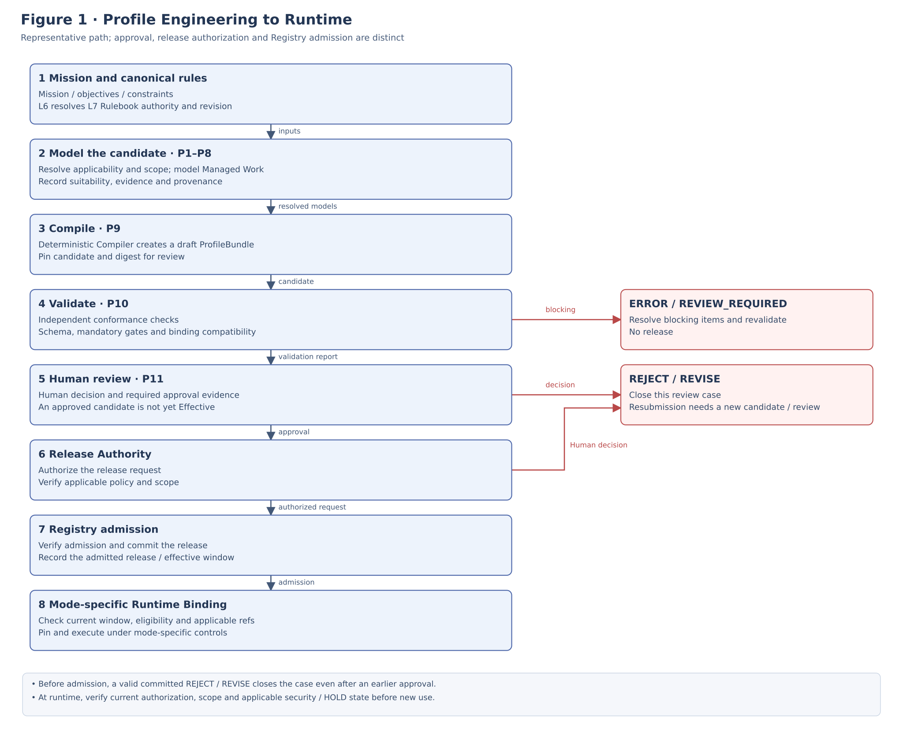
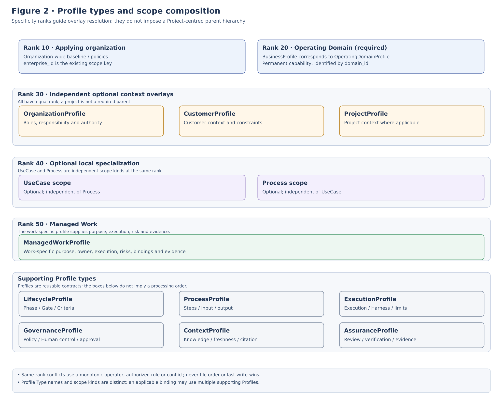
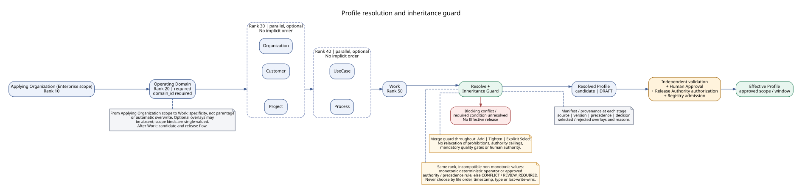
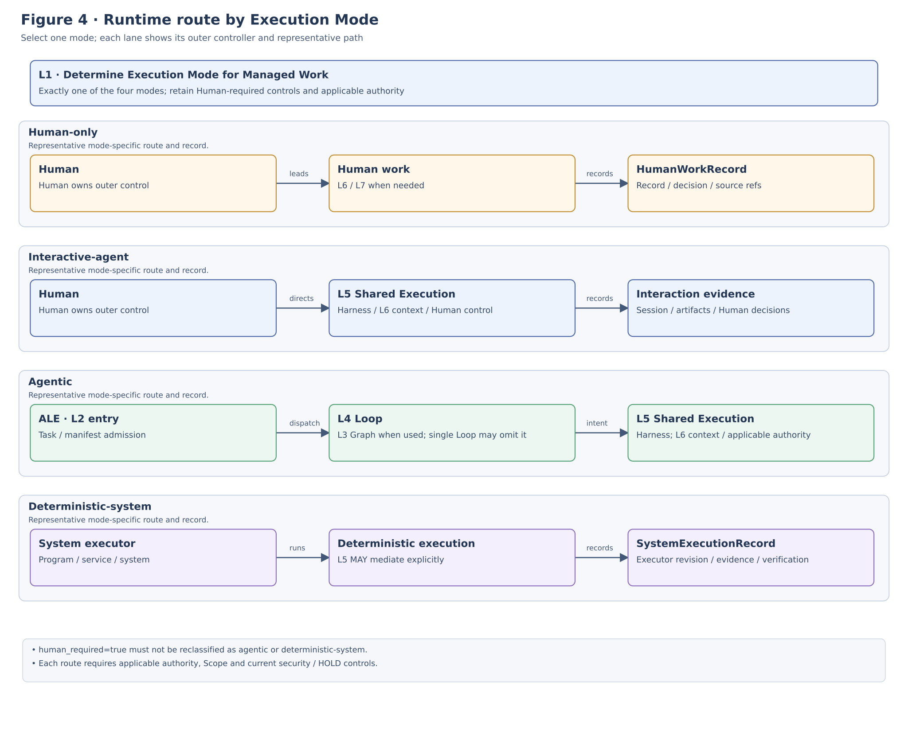

**REFERENCE ARCHITECTURE**

**ALOM Profile Reference Architecture**

*Operating Profile Model / Resolution / Approval / Runtime Binding*

| **Core principle** Profiles generated from Business Mission and Canonical Rulebook are versioned L1 Operating Contracts. Generation produces DRAFT only; a Profile becomes Effective only after independent Validation, Human Review / Approval, Release Authority authorization, and Registry admission. Specify human-only / interactive-agent / agentic / deterministic-system for each Managed Work. Do not implicitly substitute Agent execution for Human Authority. |
|---|

| **Management item** | **Value** |
|---|---|
| Document ID | ALOM-PROFILE-RA-001 |
| Version | v0.4-review.20261109 |
| Created | 2026-08-13 |
| Governing standard | ALOM-ARCH-STD-001 v2.5 |
| Implementation references | ALOM-PROF-STD-001 v0.4-review.20261109 / ALOM-L1-STD-001 v0.7-review.20261110 |
| Scope | ALOM Operating Profile / Profile Engineering & Generation |
| Owner | Organization Architecture (Enterprise Architecture) / AI Platform |
| Classification | Public |

v0.3 records the relationship between Release lifecycle and Security state.

v0.4 incorporates the then-current ALOM-PROF-SCOPE-SPEC-001 v0.3 scope model into Sections 1.3 / 3 / 4 / 5.1 / 11: Operating Domain as a required anchor, parallel optional overlays at ranks 30 and 40, single values, and `isolation_scope_ref`.

# 1. Position and Scope

| **Authority Note** Normative precedence follows the governing standard in the opening management table. Use the Profile Engineering & Generation candidate listed in the implementation references to the extent consistent with that standard. |
|---|

## 1.1 Purpose

This document defines a reference architecture for implementing an applied Profile as a versioned Operating Contract, rather than merely as a configuration file. The contract consistently fixes Business Mission, Rulebook, responsibility, Lifecycle, Managed Work, Execution Mode, Human Control, Assurance, Context, and Runtime Binding.

## 1.2 Fixed Boundaries

- Profile Engineering is an implementation Subsystem of L1 Operating Model & Governance, not an eighth Layer.
- Management of the applying organization (Corporate Management) determines Strategy / Market / Pricing / Capital Allocation and related matters. Profile Engineering converts the given Mission / Objective / Demand / Constraint into Managed Work.
- Profile Generator / Compiler has no Authority and does not automatically promote content to Protected Main or Effective Registry.
- L6 supplies Rule / Knowledge Meaning / Retrieval / Context; L7 retains Canonical Authority / Revision.
- Execution Mode uniquely resolves the runtime route. Implicit fallback is prohibited.

## 1.3 Artifacts

| **Artifact** | **Role** |
|---|---|
| Profile Template Package | Reference package for Business (Operating Domain anchor) / Lifecycle / Process / Managed Work, optional Organization / Project overlays, and supporting Profiles. The generalized template in §4 includes the optional Customer overlay. |
| ProfileBundle | Release unit bundling Profiles, source revision, unresolved items, validation, and approval status. |
| ProfileReleaseManifest | Pins bundle digest, source releases, compiler/schema, approvals, and effective window. |
| Reference Architecture | Defines responsibility boundaries and standard flows for generation / composition / approval / execution binding. |

# 2. Logical Reference Architecture

[Open Figure 1 at full size](figures/ALOM-PROFILE-RA-001-fig1-current.svg)

*Figure 1. Logical architecture from Profile Engineering to Effective Profile and ALOM Runtime. The current Execution Mode set contains exactly four modes.*

- Accept Mission as structured input from management of the applying organization (Corporate Management).
- Resolve Rulebook Authority / Revision / Classification for L7 Canonical Knowledge through L6.
- P1-P8 perform candidate generation and structuring; the P9 Compiler is the deterministic core; the P10 Validator performs independent conformance checks.
- After Human Review / Approval, the Release Authority authorizes a request and the Registry admits and commits the Release. L1 Managed Work / Governance binds to mode-specific execution contracts after current eligibility is checked.

# 3. Profile Model / Hierarchy

[Open Figure 2 at full size](figures/ALOM-PROFILE-RA-001-fig2-current.svg)

*Figure 2. Profile Model hierarchy and separation of supporting Profiles from Managed Work. The current model anchors on a permanent OperatingDomainProfile (BusinessProfile in this table), with Organization / Customer / Project as independent optional context overlays (ALOM-PROF-SCOPE-SPEC-001 Section 4).*

| **Profile** | **Main content** | **Update unit** |
|---|---|---|
| BusinessProfile | Mission, service boundary, Outcome, Business Owner | Business / Service |
| ProjectProfile | Project objective, contract, delivery model, risk, governance | Project |
| OrganizationProfile | Unit, Role, Responsibility, Authority, assignment rule | Organization |
| CustomerProfile | Customer contract, NDA, security and quality constraints (optional) | Customer |
| LifecycleProfile | Phase, entry/exit, gate, mandatory artifact | Domain / methodology |
| ProcessProfile | Process steps, input/output, review | Process |
| ManagedWorkProfile | Purpose, owner, execution, risk, evidence, binding | Work / UseCase |
| ExecutionProfile | ALE/L5/Harness/Runner/Tool/budget | Work / Node |
| GovernanceProfile | Policy, Human Control, Approval, Exception/Remedy | Work / UseCase |
| ContextProfile | Knowledge roots, Authority, Freshness, Citation | Work / UseCase |
| AssuranceProfile | Eval, Review, Oracle, Criteria, Independence | Work / Gate |

`BusinessProfile` corresponds to `OperatingDomainProfile` in ALOM-PROF-SCOPE-SPEC-001 Section 3: the required anchor for a permanent Operating Domain, identified by `domain_id`. The Profile Type name is not renamed. Organization / Customer / Project Profiles are independent optional context overlays under this anchor; Project is not a required parent hierarchy.

# 4. Template and Package Structure

The table below describes this reference architecture's reference package. It separates YAML by Profile type and includes `mission/`, `profiles/business.yaml`, `decisions/`, `approvals/`, and `releases/`. `templates/profile/ALOM-PROFILE-TEMPLATE-003/` is the generalized template based on ALOM-PROF-SCOPE-SPEC-001 Section 11 and can be used directly as an initial Git repository skeleton for a Profile Engineering implementation. Besides `README.md`, that template contains only `bundle.yaml`, `scope.yaml`, and `profiles/`; it does not include `mission/`, `decisions/`, `approvals/`, or `releases/`.

| **Path** | **Kind** | **Main use** |
|---|---|---|
| bundle.yaml | ProfileBundle | Bundle Profiles, source, validation, approval, and provenance |
| mission/mission.yaml | MissionSpec | Mission / scope / outcome / constraints / rulebook roots |
| profiles/business.yaml | BusinessProfile | Business / service objectives and boundaries |
| profiles/project.yaml | ProjectProfile | Project contract / risk / governance (optional) |
| profiles/organization.yaml | OrganizationProfile | Role / Responsibility / Authority / Independence |
| profiles/lifecycle.yaml | LifecycleProfile | Phase / Gate / Criteria / Artifact |
| profiles/process.yaml | ProcessProfile | Process steps / Work sequence / Review |
| profiles/managed-work.yaml | ManagedWorkProfile | Center for Execution Mode and all bindings |
| profiles/execution.yaml | ExecutionProfile | ALE / L5 / Harness / limits |
| profiles/governance.yaml | GovernanceProfile | Policy / Human Control / Approval / Exception |
| profiles/context.yaml | ContextProfile | L6/L7 Context / Authority / Freshness |
| profiles/assurance.yaml | AssuranceProfile | Eval / Oracle / Human Review / Evidence |
| decisions/suitability.yaml | ExecutionSuitabilityResult | Evidence for Human-required and Execution Mode decisions |
| approvals/profile-approval.yaml | ApprovalRecord | Human Review / Decision / Evidence |
| releases/release-manifest.yaml | ProfileReleaseManifest | Immutable manifest for Effective Release |

Note (ALOM-PROF-SCOPE-SPEC-001 Section 11): The generalized template adds `scope.yaml`, `profiles/operating-domain.yaml`, and `profiles/customer.yaml` (optional); `profiles/organization.yaml` and `profiles/project.yaml` are optional. A valid bundle MUST NOT require `profiles/project.yaml`. In the generalized template, `profiles/operating-domain.yaml` corresponds to `profiles/business.yaml` in the reference architecture.

# 5. Profile Resolution / Inheritance

[Open Figure 3 at full size](figures/ALOM-PROFILE-RA-001-fig3-current.svg)

*Figure 3. Effective Profile Resolution and Inheritance Guard. The current order is defined by Section 5.1 and ALOM-PROF-SCOPE-SPEC-001 Section 6.2.*

## 5.1 Resolution Specificity

Compose the Effective Profile according to the specificity ranks in ALOM-PROF-SCOPE-SPEC-001 Section 6.2: applying organization as a whole (Enterprise) -> Operating Domain (required) -> Organization / Customer / Project (rank 30, parallel optional overlays) -> UseCase / Process (rank 40, parallel optional overlays) -> Work. Record source / version / precedence / decision for each stage in the Manifest.

Organization / Customer / Project at rank 30 and UseCase / Process at rank 40 are parallel overlays within their respective specificity ranks, with no implicit order among peers. When same-rank overlays propose incompatible non-monotonic values, selection MUST NOT use file order / timestamp / profile type / last-write-wins. Use a monotonic, deterministic field operator; an approved Authority / precedence rule; or CONFLICT / REVIEW_REQUIRED (ALOM-PROF-SCOPE-SPEC-001 Section 6.2).

`project_id` and `organization_id` / `customer_id` / `usecase_id` / `process_id` are optional; absence alone MUST NOT cause rejection unless a selected rule explicitly requires the field for that Managed Work. A Project MUST NOT be synthesized merely to satisfy an implementation schema. Missing `domain_id` is rejected (ALOM-PROF-SCOPE-SPEC-001 Sections 5.1 / 10.2). Each scope-kind field is a single value, either an ID or null, and does not accept a list. Work spanning departments is split into Managed Work per department (ALOM-PROF-SCOPE-SPEC-001 Section 5.1).

## 5.2 Merge Semantics

| **Rule** | **Normative requirement** |
|---|---|
| Add | A lower Scope may add constraints, artifacts, or Human Gates. |
| Tighten | Risk, Authority, Quality Gate, Classification, and Approval may be made stricter. |
| Explicit Select | One option explicitly permitted at a higher level may be selected. |
| No Relaxation | Prohibitions, Authority ceiling, minimum Quality Gate, and mandatory Human Authority MUST NOT be relaxed. |
| Conflict | A semantic Conflict that cannot be resolved automatically requires Human Decision as CONFLICT. |

| **Fail-closed** Do not permit a Profile to become Effective when Rulebook root, Authority, mandatory applicability, or a Human-required decision is unresolved. Return it to a human as at least REVIEW_REQUIRED / DRAFT_WITH_UNRESOLVED. |
|---|

# 6. Execution Suitability and Execution Mode

| **Axis** | **Assessment** | **Typical outcome** |
|---|---|---|
| Capability | Can an Agent meet quality / SLO? | Human / Interactive if insufficient |
| Delegability | May Authority be delegated to an Agent? | Human Authority if not delegable |
| Human Relationship | Are trust-building, negotiation, or empathy essential? | Human execution |
| Accountability | Must a human retain accountability / legal responsibility? | Human decision / approval |
| Risk / Reversibility | Impact of error and ability to reverse it | Autonomy ceiling / Human Gate |
| Independence | Is independent Review / Quality determination required? | Separate reviewer |
| Evidenceability | Can the result be externally verified? | Affects Agentic suitability |
| Data / Security | NDA / confidentiality / external transmission constraints | Runner/Model constraints or Human |
| Determinism | Can it be standardized and automatically verified? | Suitable for Deterministic / Agentic |

| **Assessment order** Evaluate Human-required conditions first (law, contracts, customer Authority, interpersonal requirements, independence), then Agent capability / evidenceability / risk / reversibility. Do not equate "an Agent can perform it" with "an Agent should perform it." |
|---|

[Open Figure 4 at full size](figures/ALOM-PROFILE-RA-001-fig4-current.svg)

*Figure 4. Outer controller and ALOM Runtime Route by Execution Mode. The current Execution Mode set is the exact four in the opening core principle and ALOM-PROF-CONTRACT-SPEC-001 Section 10.1.*

In the Agentic lane, L3 Graph is a separate layer used for topology when applicable; the note in the L4 Loop box does not make Graph a sublayer of L4. A single Loop may execute without an L3 Graph when no Graph is required.

# 7. Human Control / Assurance / Evidence

## 7.1 Human-required Work

Customer negotiations, approval of customer requests / requirements, final Quality determination, and Go/No-Go may remain Human-required even when Agent assistance is possible. Human-only Work is also managed as L1 Managed Work, including Purpose / Owner / Authority / Policy / Outcome / Evidence / Lifecycle.

| **Human Task Packet field** | **Required content** |
|---|---|
| reason | Why a Human is required |
| required_role | Required Role / Authority |
| context | L6 ContextPack / source revision |
| evidence | Artifacts / evaluations needed for the decision |
| options | Options / impacts |
| reversibility | Reversal / rollback possibilities |
| deadline | Deadline / timeout action |
| output | Decision / artifact / evidence contract |

## 7.2 Assurance

| **Assurance method** | **Example use** |
|---|---|
| Deterministic Eval | schema, lint, test, coverage, trace completeness |
| Private Eval | design-quality rubric, requirements quality, document quality |
| External Oracle | CI, monitor, Operational SSOT, real-environment results |
| Human Review | Technical Review, Quality determination, customer approval |
| Independent Assurance | quality management, Security Review, third-party verification |

| **Independence** Do not pass work solely on the Generator's self-evaluation. For important Work, specify independence of definition / execution / approval in the Profile; leave missing Roles as required but unassigned. |
|---|

# 8. Compilation / Validation / Approval Lifecycle

The core of Profile Engineering comprises a Compiler + Validator that deterministically handle Schema / Applicability / Precedence / Mandatory Gate / Binding consistency, together with human approval; it is not unconstrained AI-generated prose.

| **Stage** | **Input** | **Output / Gate** |
|---|---|---|
| Mission Intake | Mission / Objective / Constraints | MissionSpec |
| Rule Resolution | Mission + L6/L7 Canonical Rulebook | ResolvedRuleSet / ApplicabilityDecision |
| Modeling | Resolved rules | Organization / Lifecycle / ManagedWork / Suitability / Binding |
| Compile | All Profile models | Draft ProfileBundle |
| Validate | Draft ProfileBundle | ERROR / REVIEW_REQUIRED / WARNING / INFO |
| Human Review | Mission / Rules / Diff / Suitability / Unresolved | APPROVE / REJECT / REVISE |
| Release | Approved Bundle / Release Authority authorized request | Registry admission / ProfileReleaseManifest / EFFECTIVE |

## 8.1 Profile State

| **State** | **Meaning** |
|---|---|
| DRAFT | Immediately after generation; not executable. |
| IN_REVIEW | Human Review in progress. |
| APPROVED | Approved, but not yet released. |
| EFFECTIVE | Executable for the specified Scope / period. |
| SUSPENDED | New use stopped by operational hold. |
| SUPERSEDED | Replaced by a new Profile. |
| RETIRED | Application ended. |

`SUSPENDED` indicates an operational stop, such as an Incident or Rule change. While a valid HOLD exists in the Registry's append-only OperationalHoldRecord, the Resolver rejects new use of the applicable release/source/scope with precedence over pointer / pin / LKG. Clearance requires an explicit CLEAR by an authorized person and revalidation; it is not automatic. Release lifecycle and Security state `REVOKED` are not changed. `RETIRED` corresponds to `RETIRED` in the Contract Release lifecycle. `VALIDATED`, which is absent from this table, corresponds to the Contract / WF validator gate between `DRAFT` and `IN_REVIEW`.

## 8.2 Provenance

- Mission revision
- Knowledge release / Rule source revision
- Generator / Compiler / Schema version
- Validation report digest
- Approval actors / roles / timestamps
- ProfileBundle immutable digest

# 9. Runtime Binding - L1-L7

The references below apply when the corresponding layer or feature is used or required by the selected Execution Mode. A single Loop may omit `graph_ref` when no L3 Graph is used. This table does not force Human-only or deterministic-system work through ALE; mode-specific binding requirements are defined in the Runtime Binding specification.

| **Target** | **References fixed in Profile** | **Runtime responsibility** |
|---|---|---|
| L1 Operating Model & Governance | purpose / owner / governance / outcome / execution_mode | Managed Work Why / Who / Control / Measure |
| L2 Control Plane | ale_entrypoint / task contract / manifest constraints | Durable orchestration for Agentic Work |
| L3 Graph Engineering | graph_ref / node type / edge / join / human node | Topology / routing / join across multiple Work Units |
| L4 Agentic Loop | loop_ref / success / eval / repair / termination | Bounded convergence of one Work Unit |
| L5 Shared Execution Plane | shared_execution_profile / harness / runner capability / tool | Shared Agentic / Interactive execution and external enforcement |
| L6 Context & Knowledge | context_profile / knowledge roots / freshness / citation | Meaning / Retrieval / Context Pack |
| L7 SSOT | authority_ref / read-write boundary / verification | Truth / Authority / Record |

| **Binding Error** Mark Profile Validation ERROR when an agentic ALE entrypoint is unresolved, an interactive-agent L5 shared execution profile is unresolved, or Action Gateway / Authority is unknown when an SSOT write is required. |
|---|

## 9.1 Why ManagedWorkProfile Is Central

Runtime Profile resolution starts from Managed Work. This correlates Purpose / Owner / Risk / Autonomy / Outcome / Evidence with Execution / Governance / Context / Assurance references in one place, providing common keys for Dashboard / Trace / Drift / Approval.

# 10. Reference Scenario - External-Customer Systems Development

The acceptance scenario for the Profile Template is a contract-based systems development Project recommended by the Profile Engineering standard as an initial reference. Use the applying organization's Project / Development / Quality / Review / Security standards as the Rulebook. Preserve customer negotiations, requirements approval, Quality Gate, and Go/No-Go as Human-required while assigning analysis / Draft / Test / Evidence generation to Agentic / Interactive execution.

| **Managed Work** | **Execution Mode** | **Human Authority / Agent assistance** |
|---|---|---|
| Customer interview | human-only / interactive-agent | PL/BA leads the interaction; Agent assists with history summaries and issue identification. |
| Request organization and duplication / conflict analysis | agentic | Agent execution is permitted; Human owner is accountable for the Outcome. |
| Requirements Draft | interactive-agent | Requirement Engineer maintains outer control. |
| Technical feasibility analysis | agentic / interactive-agent | Architect is owner; External Oracle / Review are provided. |
| Requirements review | human-only / interactive-agent | Independent Review by PL / Reviewer. |
| Customer requirements approval | human-only | Final Decision by Customer Authority. |
| Design / Test artifact generation | agentic | Use L3/L4/L5 and verify with Eval / CI. |
| Quality Gate / Go-No-Go | human-only | Quality / Project authority decides based on Evidence. |

## 10.1 E2E Provenance

Trace the chain Mission -> Applicable Rule -> Managed Work -> Suitability Decision -> Binding -> Execution/Decision Trace -> Evidence -> Outcome -> Profile Drift using trace_id / profile_ref / work_ref / source revision.

# 11. Conformance / Acceptance Gates

| **Gate** | **Test** | **Pass condition** |
|---|---|---|
| GP-01 Mission | Missing / ambiguous MissionSpec | Required omissions are not treated as completed generation |
| GP-02 Rule Authority | Derived / unapproved source contamination | Zero Authority violations in Effective Profile |
| GP-03 Applicability | condition / precedence / exception | Zero silent selections of unresolved Conflict |
| GP-04 Organization | Role / Responsibility / Authority | Zero missing mandatory responsibilities |
| GP-05 Lifecycle | Phase / Gate / Criteria | Zero omissions of standard mandatory Gates |
| GP-06 Work | Mission -> Work trace | All Work traceable |
| GP-07 Suitability | Human-required / Agentic determination | Zero conversion of mandatory Human work to Agentic |
| GP-08 Binding | Mode consistency with ALE/L5/L6/L7 | Missing / mismatch is ERROR |
| GP-09 Assurance | Quality / Review / Evidence | Zero missing mandatory assurance |
| GP-10 Human Approval | Draft -> Effective | Zero unapproved transitions to Effective |
| GP-11 Provenance | source/compiler/approval/digest | 100% pinned |
| GP-12 Drift | Rulebook version change | Affected Profiles identifiable |
| GP-13 Isolation | Negative test across isolation boundaries (different `isolation_scope_ref`, including cross-project / cross-customer) | Zero boundary violations |
| GP-14 Portability | Different model / engine | Preserve schema / semantics baseline |

## 11.1 Minimum NFRs

- Source traceability: resolve revisions for 100% of Effective Profile Rule / Standard references.
- Human approval safety: zero automatic approvals from Draft to Effective.
- Execution routing: unique execution_mode for every Managed Work.
- Human-required preservation: zero replacement of mandatory Human authority by an Agent.
- Scope isolation: zero cross-isolation violations, meaning different `isolation_scope_ref`, including cross-tenant / customer / project.
- Release reproducibility: any Effective Profile can be reconstructed from the Manifest.

# 12. Implementation Repositories and Recommended Roadmap

## 12.1 Repository Boundary

The repository names below illustrate a division of responsibilities; they do not assert that repositories with these names are publicly available.

| **Repository** | **Responsibility** |
|---|---|
| alom-profile-engineering | schemas / compiler / resolvers / validators / policies / templates / evals / tests / migrations |
| alom-profiles | business (Operating Domain) / projects (optional) / organizations / lifecycles / managed-work / releases |
| `templates/profile/ALOM-PROFILE-TEMPLATE-003/` | Starter package for creating new Profiles |

## 12.2 Roadmap

| **Phase** | **Objective** | **Main artifacts** |
|---|---|---|
| P0 Schema | Fix Profile contract | MissionSpec / ProfileBundle / Suitability schema |
| P1 Rulebook | Structure Canonical Rule | Rule Resolution + Citation + Applicability |
| P2 Generator | Generate SI Project Draft | Operating Domain / Project / Org / Lifecycle / Work |
| P3 Suitability | Human/Interactive/Agentic determination | Decision matrix + Human-required controls |
| P4 Approval | Human Review / Release | Review UI / change request on Git hosting (for example, GitHub) / Effective Registry |
| P5 Runtime Binding | L2-L7 integration | Graph / Loop / Harness / Context bindings |
| P6 Learning | Drift / Outcome feedback | Profile drift + improvement proposal |

| **Starting point** Use an external-customer systems development Project as the first E2E, generating Profiles from the Rulebook of an actual applying organization. Use the Profile Template as a starter for that PoC's input / output contract. |
|---|

# Version Management / History

| Date | Category | Content | Document version |
|---|---|---|---|
| 2026-09-19 | normative lifecycle/security-state alignment | Retain the Profile State table and do not equate SUSPENDED with Security REVOKED. Authority Note follows the opening management table's governing standard without redeclaring its ID/version. | Draft v0.3 |
| 2026-10-27 | normative scope-model alignment | Reflect the ALOM-PROF-SCOPE-SPEC-001 Draft v0.3 scope model in Sections 1.3 / 3 (Figure 2 caption) / 4 / 5 (Figure 3 caption) / 5.1 / 11 GP-13 / 11.1. Operating Domain (`domain_id`) is required; Organization / Customer / Project (rank 30) and UseCase / Process (rank 40) are parallel optional overlays; each scope kind is single-valued; `project_id` is optional; `isolation_scope_ref` is required at runtime. | Draft v0.4 |
| 2026-10-29 | meaning-preserving editorial errata | Replace the template guidance in Sections 4 / 4 note / 12.1 with ALOM-PROFILE-TEMPLATE-003 (`templates/profile/ALOM-PROFILE-TEMPLATE-003/`). Clarify the Section 4 table as a reference package structure, the generalized template's contents, and the correspondence between `profiles/business.yaml` and `profiles/operating-domain.yaml`. No normative change. | Draft v0.4 |
