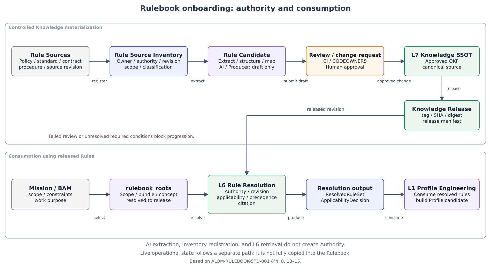
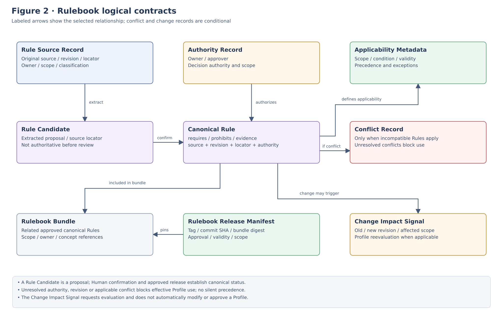
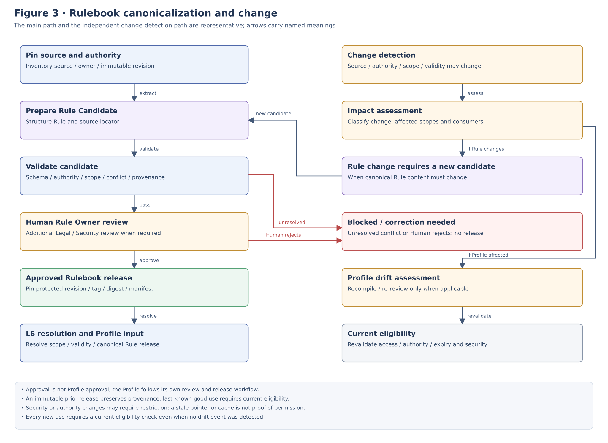

**OPERATION STANDARD**

**ALOM Rulebook Inventory**

**& Canonicalization Operating Standard**

Inventory / Authority / Revision / Applicability / Canonicalization / OKF / Release / Drift

| **Core principle** Standardize the operations for inventorying the applying organization's policies, standards, procedures, and customer/contract constraints as Rule Sources; resolving Authority, Revision, Scope, Applicability, and Precedence; and converting, approving, and releasing them as a Canonical Rulebook that Profile Engineering can use reproducibly. AI/Producer extraction results remain Draft; Authority over Canonical Knowledge remains with L7 and Human Approval. |
|-------------------------------------------------------------------------------------------------------------------------------------------------------------------------------------------------------------------------------------------------------------------------------------------------------------------------------------------------------------------------------|

| **Management item** | **Value** |
|--------------|------------------------------------------------------------------------------------------------------------------------------------|
| **Document ID** | ALOM-RULEBOOK-STD-001 |
| **Version** | v0.4-review.20261110 |
| **Created** | 2026-08-13 |
| **Governing standard** | ALOM-ARCH-STD-001 v2.5 |
| **Related standards** | ALOM-L1-STD-001 v0.7-review.20261110 / ALOM-PROF-STD-001 v0.4-review.20261109 / ALOM-PROF-CONTRACT-SPEC-001 v0.5-review.20261108 / ALOM-BAM-SPEC-001 v0.3-review.20261110 / ALOM-SSOT-STD-001 v0.5 / ALOM-PROF-WF-SPEC-001 v0.7-review.20261110 |
| **Scope** | ALOM L1 Profile Engineering & Generation / L7 Knowledge SSOT / L6 Rule Resolution |
| **Management responsibility** | Knowledge Governance of the applying organization (Enterprise Knowledge Governance) / Organization Architecture (Enterprise Architecture) / AI Platform |
| **Shared responsibility** | Rule Owner / Business Owner / Quality / Security and Privacy / Project Management |
| **Classification** | Public |

## Version History

| **Version** | **Date** | **Category** | **Content** |
| -------- | ---------- | ---------- | ---------- |
| Draft v0.2 | 2026-09-19 | substantive revision | §20 qualified against KNW-02 hybrid MUST. |
| Draft v0.4 | 2026-10-27 | normative scope-model alignment | Applied the scope model in ALOM-PROF-SCOPE-SPEC-001 Draft v0.3 to RuleSourceRecord scope, rulebook_roots overlays, RB-G08, and Customer contract isolation. Operating Domain (`domain_id`) is required. Organization / Customer / Project (rank 30) and UseCase / Process (rank 40) are parallel optional overlays; each scope kind has a single value; `project_id` is optional; `isolation_scope_ref` is required at runtime. |

# Document Control

## 1. Position and Authority Precedence

- This standard turns PROF-01-08 of the ALOM Integrated Architecture Standard v2.5, L1 Profile Engineering & Generation Rule Resolution, L6 Context & Knowledge, and L7 SSOT Authority / Revision / Controlled Write into operating contracts for Rulebook onboarding and canonicalization.

- Rulebook Inventory / Canonicalization is not an eighth Layer. L7 Knowledge SSOT retains Canonical Knowledge Authority; L6 resolves Rules while preserving Authority/Revision/Citation. L1 Profile Engineering consumes them.

- BusinessAnalysisModel, Interviews, observations of current work, and AI extraction may discover Rule candidates, but do not by themselves establish Canonical Rules.

- AI/Producer/Normalizer/Extractor may generate Drafts or Patch Proposals; automatic promotion to Approved OKF, protected default branch, or Rulebook Release is prohibited.

- Where laws, contracts, customer NDAs, or Security/Privacy rules are stricter, prioritize the stricter conditions. However, if specific precedence cannot be determined mechanically and uniquely, mark CONFLICT and require Human Decision.

- Git Commit/change requests are the canonical change history for Knowledge content; do not maintain an independent duplicate change log as a second Canonical history.

| **Fixed boundary** Inventory registration, AI extraction, Confidence, search ranking, Ontology inference, and RAG results do not generate Authority. Establishing a Canonical Rule requires Authority + immutable source revision + human-approved canonicalization + released OKF provenance. |
|---------------------------------------------------------------------------------------------------------------------------------------------------------------------------------------------------------------------------------------------------------|

## 2. Sources and Design Categories

| **ID** | **Material** | **Use in this standard** |
|--------|-------------------------------------------------------|-----------------------------------------------------------------------------------------|
| **S1** | ALOM-ARCH-STD-001 v2.5-review.20261110 (ALOM Integrated Architecture Standard) | Non-effective alignment candidate; controlled authority remains v2.5. Profile Engineering, Human Control, seven-layer/ALE/L5 boundaries. |
| **S2** | ALOM-PROF-STD-001 v0.4-review.20261109 | RuleResolutionSet, Rule structure, Applicability, Precedence, Citation, P1 Rulebook.   |
| **S3** | ALOM-BAM-SPEC-001 v0.3-review.20261110 | Analysis results are non-authoritative; unresolved rulebook_roots block Effective progression and are routed to Step 15 Rulebook Inventory for resolution. |
| **S4** | ALOM-PROF-CONTRACT-SPEC-001 v0.5-review.20261108 | EffectiveProfile pins source rule revisions and requires unresolved=0. |
| **S5** | ALOM-KNW-STD-001 v0.4-review.20261110 | Rule/Context retrieval, Authority/Revision/Citation, Derived non-authority.            |
| **S6** | ALOM-SSOT-STD-001 v0.5 | Approved OKF, Authority Registry, Knowledge Release, tag→SHA→digest, Controlled Write. |

Design categories: \[STD\] = inherited from governing/existing standards; \[REF\] = reuse of existing OKF/SSOT designs; \[PROPOSAL\] = detailed Rulebook onboarding operations fixed by this standard.

Current L6 Compatibility requires Vector + Full-text + Graph/Metadata hybrid MUST under KNW-02. Target Vector/RAG MAY has not been promoted.

# Contents

| **Chapter** | **Content** |
|-----------|-------------------------------------------|
| **1** | Purpose and Scope |
| **2** | Fixed Definitions and Responsibility Boundaries |
| **3** | Rulebook Operating Principles |
| **4** | Overall Architecture / Authority Boundaries |
| **5**     | Rule Source Inventory                     |
| **6**     | Authority / Ownership / Stewardship       |
| **7**     | Revision / Source Snapshot                |
| **8**     | Rule Candidate Extraction                 |
| **9**     | Canonical Rule Contract                   |
| **10**    | Applicability / Scope / Validity          |
| **11**    | Precedence / Conflict / Exception         |
| **12**    | OKF Canonicalization                      |
| **13**    | Review / Approval / Release               |
| **14**    | Rulebook Root / Bundle / Release Manifest |
| **15** | L6 Rule Resolution / Profile Integration |
| **16**    | Change / Drift / Impact                   |
| **17**    | Security / NDA / Privacy                  |
| **18**    | Repository / CI/CD / API / Event          |
| **19**    | Observability / NFR                       |
| **20** | Physical Deployment Reference Configuration |
| **21** | Application Example for Contracted Development |
| **22** | Acceptance Gates |
| **23** | Implementation Roadmap and Backlog |
| **Appendix A** | Minimum Data Contracts |
| **Appendix B** | YAML Examples |
| **Appendix C** | Canonicalization Matrix |

# 1. Purpose and Scope

## 1.1 Purpose

When applying ALOM to the applying organization's work, enable the Profile Generator to reproduce which organizational Rules it applied, at which versions, to which Scope, and why. This standard defines operations from registering scattered Rule Sources in an Inventory, resolving Authority/Revision, converting them into structured Rules, and obtaining human Review through release as Approved OKF Rulebook.

## 1.2 In Scope

- Organization-wide Rule Sources for Policy / Standard / Guideline / Procedure / Criteria / Review / Quality / Security / Project Management / Development / Operations and similar areas.

- Constraints/Rules applicable to ALOM Managed Work from customer contracts, SOWs, customer standards, NDAs, and Project-specific conditions.

- Rule Source Inventory, AuthorityRecord, RuleCandidate, CanonicalRule, ApplicabilityMetadata, Conflict/Exception, RulebookBundle/ReleaseManifest.

- Canonicalization into Git hosting (for example, GitHub)/OKF, change requests/CODEOWNERS/CI/Approval, and Release/tag/SHA/digest.

- Source contracts for rulebook_roots / ResolvedRuleSet passed to L6 Rule Resolution and L1 Profile Engineering.

- ChangeImpactSignals connecting Rule changes to Profile Drift / Recompile.

## 1.3 Out of Scope

- Final decisions on legal or contractual interpretation itself. Escalate to Legal/Contract Authority when needed.

- Replicating all current Operational SSOT values into OKF. Use L7 Read Adapters / Source MCP and similar mechanisms for dynamic state.

- Making RAG/Vector/Graph/Ontology runtimes the Canonical Rulebook source. The presence of a Derived Optional Index does not establish completed Compatibility acceptance.

- AI creating or approving implicit Rules for the applying organization from observed practices.

- Detailed final approval flows for Profile Review / Effective Release (defined in ALOM-PROF-WF-SPEC-001).

# 2. Fixed Definitions and Responsibility Boundaries

| **Term** | **Fixed definition** | **Not equivalent to** |
|---------------------------|------------------------------------------------------------------------------------|-------------------------|
| **Rule Source** | An original Source that may support Rules, such as policies, standards, contracts, procedures, or criteria. | Canonical Rule |
| **Rule Source Inventory** | A Catalogue managing Rule Source location, Owner, Authority, Revision, Scope, and status. | Canonical Knowledge content |
| **Rule Candidate** | A candidate Rule extracted and structured from a Source. Non-canonical before Human confirmation. | Canonical Rule |
| **Canonical Rule** | A Rule whose source/revision/locator/authority/review is traceable within an Approved OKF release. | AI extraction result / RAG result |
| **Rulebook Root** | A Bundle/Concept/Scope reference serving as the starting point for Rule discovery for a Mission/Scope. | Search Query |
| **Rulebook Bundle** | An OKF Bundle distributing and managing related Canonical Rules by Scope/Owner/Operating Domain or similar boundaries. | One monolithic Rule DB |
| **Rulebook Release** | A Knowledge Release immutably pinning a specific Bundle set through tag/SHA/digest. | moving main |
| **AuthorityRecord** | A record resolving canonical status, approver, and decision rights for a particular Rule/Subject. | confidence / popularity |
| **ApplicabilityMetadata** | Metadata enabling mechanical decisions on Rule applicability conditions, scope, validity, exceptions, and similar matters. | LLM judgment alone |
| **RuleConflictRecord** | Conflict and Human resolution evidence when multiple Rules apply simultaneously and are semantically incompatible. | silent precedence |
| **ChangeImpactSignal** | An event indicating that a Rule/Source revision change requires Profile reevaluation. | Automatic Profile modification |

# 3. Rulebook Operating Principles

| **ID** | **Principle** | **Normative requirement** |
|------------|----------------------------|------------------------------------------------------------------------------------|
| **RB-P01** | Authority before use | Resolve 100% of Rules affecting Effective Profiles to Authority+Revision. |
| **RB-P02** | Canonical source only | Reference Rules used to make Profiles Effective from Approved Canonical releases. |
| **RB-P03** | Proposal-only AI | AI/Producer may generate Candidates/Drafts, but does not Approve/Release. |
| **RB-P04** | Provenance by default | Make Rule→Source revision→locator→change request/approval→release traceable. |
| **RB-P05** | No silent conflict | Structure precedence/exception; stop with CONFLICT if automatic resolution is impossible. |
| **RB-P06** | Scope isolation | Carry customer/project/NDA/classification from Inventory through Release/L6. |
| **RB-P07** | Validity explicit | Retain effective_from/until/review_due/deprecated; do not silently use expired content. |
| **RB-P08** | One canonical subject | Do not duplicate the same Rule Subject across multiple canonical sources; use references/overlays. |
| **RB-P09** | Git history canonical | Commit/change requests are canonical for Knowledge content change history. |
| **RB-P10** | Derived non-authority | RAG/Index/Ontology/Cache are regenerable Derived artifacts. |
| **RB-P11** | Immutable releases | Pin Profile inputs to released revisions, not moving main. |
| **RB-P12** | Change triggers impact | Connect source/revision/validity/authority changes to Profile Drift. |
| **RB-P13** | Minimal duplication | Avoid unnecessary duplication of dynamic Sources or full original documents; limit materialization to references and necessary canonical knowledge. |
| **RB-P14** | Adopter-first portability | Establish operation with the applying organization's Rulebook, while externalizing organization-specific differences into Schema/metadata/config. |

# 4. Overall Architecture / Authority Boundaries



Figure 1. Rulebook Onboarding Authority and Consumption Paths

The Materialization Path is Source→Inventory→Candidate→Human Review→Approved OKF→Knowledge Release. The Consumption Path is Mission/BAM→rulebook_roots→L6 Rule Resolution→ResolvedRuleSet→Profile Engineering. Live operational state follows a separate path and is not fully materialized into the Rulebook.

# 5. Rule Source Inventory

## 5.1 Source classes

| **Class** | **Examples** | **Inventory treatment** |
|-------------------------|-------------------------------------------|------------------------------------------------------------------|
| **LAW_REGULATION** | Laws, regulations, public requirements | External authority ref. Human/Legal decision if legal interpretation is needed. |
| **CONTRACT_CUSTOMER** | Contract, SOW, customer standards, NDA | Require applicable scope and version / effective window. Specify Project scope only when applicable. |
| **ENTERPRISE_POLICY** | Organization-wide Policies / rules | Pin the applying organization's owner/approver and current revision. |
| **ENTERPRISE_STANDARD** | Organization-wide standards / Quality / Security / Architecture | Structure applicability conditions and mandatory/optional status. |
| **DOMAIN_STANDARD** | Operating Domain standards | Retain Operating Domain scope and relationships to governing standards. |
| **PROJECT_STANDARD** | PJ-specific standards / Tailoring / Plans | Require Project scope, approval records, and validity. |
| **PROCEDURE_PLAYBOOK** | Procedures/Runbooks/Templates | Classify as Rule or reference procedure. |
| **REFERENCE_GUIDANCE** | Reference materials / Best Practices | Non-mandatory in principle; not automatically adopted as Rules. |
| **OBSERVED_PRACTICE** | Current practices / Interviews | Non-authoritative on the BAM side. Canonicalization requires a separate Decision. |

## 5.2 RuleSourceRecord minimum contract

| **Field** | **Req** | **Meaning** |
|-----------------------------|--------------------|---------------------------------------------|
| **source_id** | MUST | Unique ID |
| **source_class**            | MUST               | Source class                                |
| **title** | MUST | Formal name |
| **source_ref**              | MUST               | Repository/URL/document ref                 |
| **owner** | MUST | Role/Unit responsible for maintenance |
| **authority_record_ref** | MUST for canonical | Canonical status / approval Authority |
| **current_revision** | MUST for canonical | commit/version/date or equivalent |
| **scope** | MUST | enterprise / domain (Operating Domain `domain_id`; formerly business) / organization? / customer? / project? / usecase? / process? |
| **classification** | MUST | Information classification / NDA |
| **validity**                | SHOULD             | effective/review/expiry                     |
| **canonicalization_status** | MUST | Status |
| **rulebook_bundle_ref** | MAY | Containing Bundle |
| **source_hash** | SHOULD | Verification of a pinned snapshot |
| **last_verified_at** | MUST | Inventory freshness |
| **notes** | MAY | Supporting information |

## 5.3 Inventory lifecycle

| **Status** | **Meaning** | **Next Gate** |
|------------------------------|--------------------------------------|-------------------|
| **DISCOVERED** | Only the location is known. | Triage |
| **TRIAGED** | Source class/scope/owner candidates assigned. | Authority resolve |
| **AUTHORITY_PENDING** | Canonical status/Owner/Revision unresolved. | Human resolve |
| **CANONICALIZATION_PENDING** | Source pinned; Rule extraction pending. | Extract/structure |
| **IN_REVIEW** | OKF Draft/change request under review. | Approve/Reject |
| **APPROVED** | Canonicalization approved. | Release |
| **RELEASED** | Available in a Knowledge release. | L6 consumption |
| **DEPRECATED** | No new use; retain replacement reference. | Migration |
| **RETIRED** | Applicability ended; audit reference only. | Archive |

# 6. Authority / Ownership / Stewardship

| **Role** | **Responsibilities** | **Authority** |
|-------------------------------|-----------------------------------------------------|-------------------------------|
| **Rule Owner** | Responsibility for Rule content, application purpose, and revisions. | Source/Rule business owner |
| **Knowledge Steward** | Maintain OKF metadata/provenance/quality. | Canonicalization operation |
| **Approver / CODEOWNER** | Approve canonicalization validity in the change request. | Human decision to Approved |
| **Security/Privacy Reviewer** | Review confidentiality/personal information/NDA/Agent usage. | Review required for the relevant Scope |
| **Profile Engineering** | Resolve/consume Released Rules. | Does not create Rules themselves |
| **L6 Runtime** | Retrieve Rules with Authority/Revision/Citation. | Derived non-authority |
| **L7 SSOT** | Retain Approved OKF / releases / Authority Registry. | Canonical Knowledge authority |
| **AI/Producer** | Extract and structure candidates; detect differences. | No Authority |

| **SoD** At minimum, separate the AI/Producer generating actor from the Canonical Approver. Policy may require additional approval from the Rule Owner and independent Reviewer/Security or similar roles for high-impact Rules. |
|------------------------------------------------------------------------------------------------------------------------------------------------------------|

# 7. Revision / Source Snapshot

- Prefer commit SHA for Git-managed Sources; retain document version/revision ID for document-management platforms.

- For external contracts/customer documents, retain the received version, signature/approval status, effective date, and source locator.

- Rules used for Profile generation MUST resolve to a pinned revision, not merely moving latest.

- For large Sources, enable reproducibility through source_ref + revision + locator + hash without duplicating the entire content.

- When a Source revision changes, generate a new Inventory revision and ChangeImpactSignal rather than overwriting the previous revision.

> RuleSourceSnapshot = {
> source_id, source_ref, revision, observed_at, content_hash,
> scope, classification, authority_record_ref, validity
> }

# 8. Rule Candidate Extraction

## 8.1 Extraction flow

1\. Read a pinned Source revision.

2\. Extract candidate sections/clauses/tables/procedures containing Rules, with locators.

3\. Structure Candidates into requires / prohibits / authority / evidence / applies_when and similar fields.

4\. Mark ambiguous interpretations, multiple interpretations, and missing conditions as UNRESOLVED.

5\. Present differences between original text and Candidate semantics to the Human Reviewer.

6\. Promote to Canonical Rule Draft only after Human confirmation.

## 8.2 AI / Producer boundary

| **Operation** | **Allowed** | **Prohibited** |
|-----------------------|-----------------------------------------|------------------------------------------|
| **Candidate extraction** | Clause detection, classification, summarization, structured output | Implicit creation of new Rules for the applying organization |
| **Applicability candidates** | Extract scope/condition candidates | Finalize applicability while conditions remain unknown |
| **Precedence candidates** | Detect governing-document references / override statements | Silent selection in a conflict |
| **Authority candidates** | Extract candidate approvers / accountable roles from documents | Automatically establish formal Authority |
| **Draft change request** | Create OKF Draft/Patch Proposals | Direct push/auto merge to the protected default branch |

# 9. Canonical Rule Contract



[Open Figure 2 at full size](figures/ALOM-RULEBOOK-STD-001-fig2-current.svg)

Figure 2. Rulebook Inventory / Canonical Rule Logical Contracts

| **Field** | **Req** | **Meaning** |
|---------------------------|--------------------|----------------------------------------------------------|
| **rule_id** | MUST | Stable identifier |
| **rule_type**             | MUST               | policy/process/criteria/role/quality/security/review/etc |
| **title** | MUST | Short Rule name |
| **source_ref**            | MUST               | Canonical source                                         |
| **source_revision** | MUST | Pinned revision |
| **source_locator**        | MUST               | section/page/path                                        |
| **authority_record_ref**  | MUST               | Rule Authority                                           |
| **applies_when** | MUST | Structured applicability conditions; explicitly state unconditional applicability too |
| **requires** | MAY | Required actions/artifacts/roles/gates |
| **prohibits** | MAY | Prohibitions |
| **decision_authority** | MAY | Decision/approval Role |
| **evidence_requirements** | MAY | Required evidence |
| **precedence**            | MUST               | class/rank/relationship                                  |
| **exception_route** | MAY | Exception request/approval route |
| **validity**              | MUST               | effective/review/expiry                                  |
| **scope/classification** | MUST | Isolation conditions |
| **interpretation_status** | MUST               | STRUCTURED/HUMAN_CONFIRMED                               |
| **canonicalization_ref** | MUST | Change request/approval ref |
| **release_ref**           | MUST when released | Rulebook release                                         |

| **Rule atomization** Do not treat one document as one monolithic Rule. Split Rules into semantic units needed for Profile generation, while always retaining a source locator that leads back to the original text. |
|----------------------------------------------------------------------------------------------------------------------------------------------------------|

# 10. Applicability / Scope / Validity

| **Dimension** | **Examples** | **Normative requirement** |
|---------------------------|---------------------------------------|----------------------------------------------------------|
| **Organization-wide (Enterprise) / Business** | Entire organization / business division | Propagate from parent Scope to child Scope. |
| **Customer / Contract** | Customer A / SOW-2026-01 | Do not disclose to or apply to other Customers. |
| **Project / UseCase** | PJ-A / requirements review | Project overlays do not duplicate canonical enterprise rules. |
| **Lifecycle / Process** | requirements / design / release | Structure applicable Phase/Process conditions. |
| **Work / Role** | approval / reviewer | Explicitly state effects on Human-required status or Authority. |
| **Risk / Classification** | high / confidential | No relaxation of stricter constraints. |
| **Temporal** | effective_from/until | No silent use of Rules outside their validity period. |
| **Condition** | amount, system class, customer type, etc. | Conditions that cannot be decided mechanically require UNRESOLVED/Human decision. |

## 10.1 Applicability result

| **State** | **Meaning** | **Profile handling** |
|--------------------|---------------------------------|---------------------------|
| **APPLICABLE** | Conditions satisfied. | Include in ResolvedRuleSet |
| **NOT_APPLICABLE** | Conditions not satisfied. | Record exclusion reason |
| **CONDITIONAL** | Additional conditions/values required. | Hold until conditions are resolved |
| **UNRESOLVED** | Insufficient scope/condition/authority. | Block if Required |
| **CONFLICT** | Incompatible Rules apply simultaneously. | Human resolution required |

# 11. Precedence / Conflict / Exception

Do not fix Precedence solely by document-type name. Governance of the applying organization (Enterprise Governance) manages precedence_class/rank and explicit override relations. If the specific relationship among laws, contracts, and organizational standards is not uniquely determined, mark Conflict.

| **Mechanism** | **Meaning** | **Default** |
|----------------------------|--------------------------------------------|-----------------------------------------|
| **EXPLICIT_OVERRIDE** | A specific Rule explicitly overrides/supplements another Rule. | Highest-priority candidate for mechanical resolution |
| **MORE_RESTRICTIVE** | A governing standard specifies precedence for stricter conditions. | No-relaxation |
| **SCOPE_SPECIFIC_OVERLAY** | Permitted Project/Customer Tailoring. | Do not weaken governing prohibitions/mandatory requirements |
| **TEMPORAL_SUPERSESSION** | A new revision replaces an old revision. | Check the validity period |
| **INCOMPARABLE** | Neither Rule has a basis for precedence. | CONFLICT |
| **EXCEPTION** | A formal exception Decision exists. | exception_ref + validity + approver required |

## 11.1 Conflict resolution record

| **Field** | **Meaning** |
|----------------------------|------------------------------------------------------------------|
| **conflict_id** | Unique ID |
| **rule_refs** | Set of conflicting Rules |
| **conflict_class** | REQUIRES_PROHIBITS / AUTHORITY / CRITERIA / SCOPE / PRECEDENCE, etc. |
| **affected_scope** | Relevant Scope |
| **automatic_resolution**   | NONE / explicit rule only                                        |
| **decision_required_from** | Human Authority                                                  |
| **decision_ref** | Resolution Decision/change request/Exception |
| **validity** | Decision validity period |
| **result**                 | SELECT / COMBINE_STRICTER / EXCEPTION / REJECT / REWRITE         |
| **trace_ref** | Audit evidence |

# 12. OKF Canonicalization

## 12.1 Canonicalization mapping

| **Source** | **OKF conversion policy** | **Considerations** |
|-----------------------|---------------------------------------------------------------|-----------------------------------------------|
| **Existing Markdown/Git** | Enhance existing Concepts to conform to the organization-wide Profile (Enterprise Profile). | Restructuring that changes the original meaning is prohibited. |
| **Word/PDF policies** | Retain source assets; convert necessary Rule Concepts into Markdown/metadata. | page/section locator + source hash. |
| **Contracts/customer standards** | Place in Project/Customer Bundles or Overlays. | NDA / access boundary. |
| **Wiki/Portal** | Pin revision/export before materialization. | Avoid references only to moving pages. |
| **Ticket/Decision** | Materialize only approved Decisions with long-term reuse value. | Prefer Live Query for current state. |
| **Observed practice** | Do not directly convert to Canonical Rules. | Obtain Rule Owner decision and approval as a new Rule. |

## 12.2 Organization-wide Profile (Enterprise Profile) Metadata

- concept_id / type / title / scope / status / owner_team / steward / approver

- classification / review_due / valid_from / valid_until

- source_system / source_ref / source_revision / source.content_hash

- provenance.mode (human / producer / agent-assisted) / producer.name/version

- Necessary extensions for the applying organization, such as agent_usage / related_concepts / project_id / customer_id

| **Canonicality** Mere presence in Object Storage or Git does not make content canonical. It becomes usable as Canonical Rulebook only when Approved status, Authority/Owner, Revision, change request/Approval, and Release Manifest are all present. |
|-----------------------------------------------------------------------------------------------------------------------------------------------------------------------------------------------|

# 13. Review / Approval / Release

## 13.1 Standard flow

> Source fixed
> -\> RuleCandidate / OKF Draft
> -\> Schema + metadata + provenance validation
> -\> Rule Owner / CODEOWNER review
> -\> Security/Quality/Legal review (when required)
> -\> APPROVED on protected default branch
> -\> Rulebook release build
> -\> tag -\> commit SHA -\> bundle digest
> -\> KnowledgeReleaseManifest
> -\> L6 publish / last-known-good

## 13.2 CI / Review checks

| **Check** | **Severity** | **Pass conditions** |
|--------------------------------------|---------------|--------------------------------|
| **Schema / required metadata** | ERROR | 0 missing items |
| **Source revision / locator**        | ERROR         | Critical rule 100%             |
| **Authority / owner**                | ERROR         | canonical rule 100%            |
| **Scope / classification / NDA** | ERROR | 0 boundary violations |
| **Applicability syntax** | ERROR | Successful parse/validation |
| **Conflict / precedence**            | ERROR/REVIEW  | silent unresolved 0            |
| **Link / related concept integrity** | ERROR         | broken critical link 0         |
| **Validity / review_due** | WARNING/ERROR | 0 expired Rules used in new releases |
| **AI provenance** | INFO/REVIEW | Traceable producer/model/version |
| **Change impact metadata** | WARNING | Impact label for semantic changes |

ALOM-PROF-WF-SPEC-001 defines Profile Human Review/Approval/Release. This chapter covers approval on the Knowledge Rulebook side, separately from the Authority to make Profiles Effective.

# 14. Rulebook Root / Bundle / Release Manifest

## 14.1 Rulebook Root

MissionSpec.rulebook_roots are Bundle/Concept/Scope references resolvable to Authority and releases, not free-text search terms. Multiple Roots are allowed, combining organization-wide (Enterprise) / Operating Domain with any present Organization / Customer / Project overlays (Project is optional; ALOM-PROF-SCOPE-SPEC-001 Section 5.1).

> rulebook_roots:
> - ref: okf://enterprise/project-management@release:2026.08
> scope: enterprise
> - ref: okf://customer/acme/contract-rules@release:2026.08.13
> scope: customer/acme
> - ref: okf://project/pj-a/tailoring@release:1.2.0
> scope: project/pj-a

## 14.2 RulebookReleaseManifest

| **Field** | **Meaning** |
|-------------------------------------------------|-----------------|
| **release_id / release_tag** | Release identity |
| **bundle_refs** | Included Bundles |
| **commit_sha** | Pinned Git revision |
| **bundle_digest**                               | snapshot digest |
| **schema_version / enterprise_profile_version** | Validation contract |
| **source_inventory_snapshot_ref** | Inventory snapshot point |
| **approved_by / approval_refs**                 | Human approval  |
| **released_at** | Release time |
| **supersedes** | Previous Release |
| **last_known_good** | LKG designation |
| **classification/scope** | Distribution boundary |

# 15. L6 Rule Resolution / Profile Integration

Follow the Profile Engineering standard's Rule Resolution Flow: Mission/Scope→L6 ContextRequest→Candidate Rules→Applicability/Precedence/Citation→ResolvedRuleSet. Rules used in Effective Profiles MUST resolve to Authority+Revision.

| **Input / Output** | **Minimum content** |
|---------------------------|-------------------------------------------------------------------------------------------|
| **Input Mission/Scope** | mission_id / rulebook_roots / scope_ref / enterprise_id / domain_id / organization_id? / customer_id? / project_id? / usecase_id? / process_id? / work_id? / isolation_scope_ref (runtime) / classification |
| **L6 ContextRequest** | purpose / actor / scope_ref / isolation_scope_ref / project_id? / roots / required release / freshness; inherit all required ContextRequest fields in ALOM-KNW-STD-001 §5.1 |
| **Candidate Rule**        | rule_id / source_ref / revision / citation / authority / metadata                         |
| **ApplicabilityDecision** | APPLICABLE/NOT/CONDITIONAL/UNRESOLVED/CONFLICT + reason                                   |
| **ResolvedRuleSet**       | applicable canonical rules + exclusions + conflicts + source release refs                 |
| **Compiler input**        | ResolvedRuleSet + MissionSpec + AnalysisSnapshot + applicability decisions                |

| **Profile blocking** Rules from Derived/unapproved Sources, with unresolved authority, unpinned revisions, or remaining required CONFLICT/UNRESOLVED decisions MUST NOT be used in Effective Profiles. |
|-------------------------------------------------------------------------------------------------------------------------------------------------------------|

# 16. Change / Drift / Impact



[Open Figure 3 at full size](figures/ALOM-RULEBOOK-STD-001-fig3-current.svg)

Figure 3. Rulebook Canonicalization / Change Lifecycle

## 16.1 Change classes

| **Change**                  | **Impact**                            | **Action**                      |
|-----------------------------|---------------------------------------|---------------------------------|
| **TEXT_EDITORIAL** | No semantic change | digest/new revision, low impact |
| **SEMANTIC_REQUIREMENT** | Change to requires/prohibits/criteria | Recompile affected profiles |
| **APPLICABILITY** | Change to scope/condition | scope impact analysis |
| **AUTHORITY** | Change to owner/approver/decision authority | Human Control/Profile review |
| **PRECEDENCE_EXCEPTION** | Change to override/exception | conflict recompute |
| **VALIDITY** | Change to effective/expiry/review_due | Reassess release eligibility |
| **CLASSIFICATION_NDA** | Change to access boundary | immediate security impact |
| **DEPRECATION_REPLACEMENT** | Rule retirement/replacement | migration + profile drift |

## 16.2 Drift event

> rule.changed {
> rule_id, old_revision, new_revision, change_class,
> affected_scopes, affected_profile_refs?, severity,
> requires_recompile, source_release_ref, trace_ref
> }

ChangeImpactSignal does not automatically modify Profiles. The ALOM-PROF-OPS-RUNBOOK-001 Drift/Recompile/Rollback Runbook details operations for impact→recompile→diff→review→release.

# 17. Security / NDA / Privacy

- Consistently propagate customer/project/NDA scope through Inventory, Draft, Repository, Index, L6 Context, and Trace.

- Do not replicate Restricted content such as contracts or Security Rules into common organization-wide Bundles. Share only required references/derived metadata.

- Check agent_usage / classification / external transmission policy for Sources passed to AI/Producer.

- Do not materialize secrets/PII such as Credentials or personal information into OKF content when unnecessary to establish a Rule.

- For Sources subject to deletion/revocation requests, define a retention Policy reconciling Rule provenance with audit requirements.

- Verify zero retrieval/Context/Release leakage through cross-project negative tests.

# 18. Repository / CI/CD / API / Event

## 18.1 Repository reference

> alom-rulebook/
> inventory/
> sources.yaml
> authorities.yaml
> bundles/
> enterprise/
> business/
> customers/\<customer\>/
> projects/\<project\>/
> rules/
> \<rule-id\>.md
> schemas/
> resolution/
> precedence-policy.yaml
> releases/
> manifests/
> tests/
> fixtures/
> conformance/
> CODEOWNERS
> ci-pipeline.yml

## 18.2 API candidates

| **API** | **Purpose** | **Write Authority** |
|--------------------------|---------------------------------|-----------------------|
| **ruleSource.list/get**  | Inventory query                 | Read only             |
| **ruleSource.register** | Register Source candidates | Inventory steward |
| **rule.extract** | Generate Candidates | Draft only |
| **rule.validate**        | Schema/metadata/conformance     | None                  |
| **rule.submitReview** | Request change-request Review | No approval authority |
| **rule.resolve** | Resolved rules for Mission/Scope | L6 derived |
| **rulebook.release.get** | Retrieve Release/manifest | Read only |
| **rulebook.diff** | Release/Rule differences | None |
| **rulebook.impact** | Candidate Profile impacts | None |

## 18.3 Events

| **Event** | **Trigger** |
|---------------------------------|--------------------------------------|
| **rule.source.discovered** | New Source registration |
| **rule.source.revisionChanged** | Source revision change |
| **rule.candidate.created**      | Draft extraction                     |
| **rule.review.requested** | Change-request Review begins |
| **rule.approved** | Human approval completed |
| **rulebook.release.published**  | Knowledge release                    |
| **rule.deprecated** | Rule deprecated |
| **rule.changed** | semantic/authority/applicability change |
| **rulebook.drift.detected** | Candidate consumer-profile impacts |

# 19. Observability / NFR

| **Metric / SLO** | **Meaning** |
|----------------------------------|------------------------------------------------------|
| **Inventory coverage** | Discovery and Owner/Authority/Revision resolution rate for applicable Rule Sources |
| **Canonicalization lead time** | Time from DISCOVERED→RELEASED |
| **Authority unresolved count** | Number of canonicalization blocks |
| **Citation completeness** | Traceability rate from Canonical Rule to source revision/locator |
| **Expired/stale rule ratio** | Deviations from review_due/validity |
| **Conflict backlog** | Number/age of unresolved Conflicts |
| **Release reproducibility** | Success rate reproducing tag→SHA→digest |
| **Rule-to-profile traceability** | Traceability rate from Rule to affected Profile/Work |
| **Cross-scope deny** | Deny monitoring at NDA / `isolation_scope_ref` boundaries (including Project) |
| **Change impact latency** | Time from source change to impact signal |

- Prioritize resolving the correct Rules at the correct versions and Scope before availability.

- Inventory/Rulebook Dashboards are Read Models, not Authorities.

- Search Indexes must be rebuildable from Approved OKF releases even if lost.

# 20. Physical Deployment Reference Configuration

| **Component** | **Phase 1 implementation** | **Responsibility / canonical status** |
|--------------------------|---------------------------------------|-----------------------------------------|
| **Git hosting** | OKF repository + CI + change request + CODEOWNERS | Approved Rulebook canonical store |
| **Inventory files/DB** | Can start with Git YAML/JSON | Rule source catalogue, not the canonical content source |
| **Producer/Extractor** | CI runner / isolated job | Draft candidate only |
| **Validator**            | CI job                                | Schema/metadata/link/provenance         |
| **L6 Knowledge API/MCP** | Existing L6 runtime | Rule resolution / citation derived |
| **L7 Authority/Release** | Git-hosting release/tag + manifest | Authority/revision/release |
| **Trace/Audit** | Change request/CI + Trace store | Usage/approval/impact evidence |
| **Optional Index** | Full-text/Vector/Graph | Derived; may be added later. Non-SSOT / non-Canonical. Missing hybrid capabilities in Phase 1 means pre-conformance, not Compatibility acceptance. KNW-02 MUST is not relaxed. |

Initially avoid excessive decomposition into physical Services; establish operation with Git hosting + CI + Producer + existing L6/L7 capabilities. Separate logical contracts for future reuse in PaaS/SaaS.

# 21. Application Example for Contracted Development

For an application example in contracted systems development, prepare a Rulebook baseline and explicitly resolve unresolved items in the relevant Profile. If Rulebook roots / Authority or similar items remain unresolved, retain PRE-EFFECTIVE / BLOCKED status. Do not fabricate items for which no real applying-organization Source has been provided.

| **Priority Rulebook root** | **Required canonicalization targets** | **Use in Profiles** |
|----------------------------|---------------------------------------|--------------------------------------------|
| **Project Management** | PJ initiation/planning/change/approval/Gates | Lifecycle / Authority / human work |
| **Development Standard** | Requirements/design/implementation/testing/configuration management | Process / Managed Work / criteria |
| **Quality Standard**       | Review/QG/independent assurance       | Assurance / Quality Gate                   |
| **Security/Privacy**       | classification/access/security review | Execution mode / context / control         |
| **Customer/Contract**      | NDA/SOW/acceptance/customer approval  | Customer scope / Human-required / evidence |
| **Release/Operations** | Go-No-Go/migration/operations handover | Human gate / Verification / rollback |

## 21.1 Activation backlog

| **ID**     | **Task**                                         | **Exit**                                 |
|------------|--------------------------------------------------|------------------------------------------|
| **RB-A01** | Inventory applicable Rule Sources | Owner/revision candidates for 100% of major sources |
| **RB-A02** | Confirm Authority/Owner | critical source authority unresolved=0 |
| **RB-A03** | Convert Project/Development/Quality/Security Rules to OKF | critical Rule citation completeness=100% |
| **RB-A04** | Create Customer/Contract overlay fixture | cross-customer scope test pass |
| **RB-A05** | Create Rulebook Release v0.1 | tag/SHA/digest/approval manifest |
| **RB-A06** | Connect to Mission rulebook_roots | Generate L6 ResolvedRuleSet |
| **RB-A07** | Recompile the applying organization's Profile | Resolve Rulebook root/revision blocks |

# 22. Acceptance Gates

| **Gate** | **Test** | **Pass conditions** |
|------------|-------------------------|-------------------------------------------------------------------------------------|
| **RB-G01** | Inventory coverage | owner/ref/revision for 100% of critical Pilot Sources |
| **RB-G02** | Authority | 0 unresolved authority_record_ref in Canonical Rules |
| **RB-G03** | Canonical source | 0 Draft/Derived Sources mixed into ResolvedRules for Effective Profiles |
| **RB-G04** | Citation                | Critical Rule→source revision+locator 100%                                          |
| **RB-G05** | AI boundary | 0 automatic approvals or direct protected-default-branch writes by AI/Producer |
| **RB-G06** | Applicability | 0 silent defaults for Required conditions |
| **RB-G07** | Conflict | 0 silent selections with unresolved CONFLICT |
| **RB-G08** | Scope/NDA | 0 cross-isolation Rule leakage (different `isolation_scope_ref`, including cross-project / cross-customer) |
| **RB-G09** | Validity | 0 new Effective uses of expired/deprecated Rules |
| **RB-G10** | Release reproducibility | Reproducible tag→commit SHA→bundle digest |
| **RB-G11** | Profile traceability | Rule→ResolvedRuleSet→Profile/Work traceability for 100% of critical items |
| **RB-G12** | Change impact | Identify affected profiles from semantic/authority/applicability changes |
| **RB-G13** | LKG / rollback | Retain last-known-good if a new release fails |
| **RB-G14** | Example Delivery integration | Generate RuleResolutionSet from the application example's main Rulebook roots and resolve Reference Profile blocks |

# 23. Implementation Roadmap and Backlog

| **Phase** | **Artifact** | **Completion conditions** |
|-----------|-----------------------------------|-----------------------------------------------|
| **RB-P0** | Inventory schema / source classes | sample sources validation pass                |
| **RB-P1** | Inventory baseline | Catalogue of Pilot Sources + owner/revision |
| **RB-P2** | Authority resolution              | critical authority unresolved=0               |
| **RB-P3** | Canonicalization pipeline | extract→draft→validate→change request |
| **RB-P4** | Rulebook bundles                  | Project/Development/Quality/Security baseline |
| **RB-P5** | Release pipeline                  | tag/SHA/digest + LKG                          |
| **RB-P6** | L6 Rule Resolution                | Mission roots→ResolvedRuleSet                 |
| **RB-P7** | Change impact                     | rule.changed→affected profile candidate       |
| **RB-P8** | Example Delivery E2E                            | RB-G01-14 pass                               |

| **Related standard** ALOM-PROF-WF-SPEC-001, ALOM Profile Review / Approval / Release Workflow Specification, `ALOM-PROF-WF-SPEC-001` v0.7 already exists. Refer to its contracts for Draft Profile Review UI/Packet, SoD, Approve/Reject/Revise, Exception, and Profile Release Authority. |
|-------------------------------------------------------------------------------------------------------------------------------------------------------------------------------------------------------|

# Appendix A. Minimum Data Contracts

| **Contract** | **Minimum fields** |
|-----------------------------|----------------------------------------------------------------------------------------------------------------------------------------|
| **RuleSourceRecord**        | source_id/class/title/ref/owner/authority_ref/current_revision/scope/classification/validity/status/hash/last_verified                 |
| **AuthorityRecord**         | authority_id/subject/owner/approvers/decision_scope/source_ref/revision/validity                                                       |
| **RuleCandidate**           | candidate_id/source_ref/revision/locator/extracted_text/proposed_rule/ambiguities/provenance                                           |
| **CanonicalRule**           | rule_id/type/source_ref/revision/locator/authority/applies_when/requires/prohibits/evidence/precedence/exception/validity/scope/status |
| **ApplicabilityMetadata**   | scope/conditions/validity/precedence/exception/classification                                                                          |
| **RuleConflictRecord**      | conflict_id/rule_refs/class/scope/decision_required/decision_ref/result/validity                                                       |
| **RulebookBundle**          | bundle_id/version/scope/owner/concept_refs/classification/status                                                                       |
| **RulebookReleaseManifest** | release_id/tag/bundle_refs/commit_sha/digest/schema/profile_version/inventory_snapshot/approval/released_at/supersedes                 |
| **ChangeImpactSignal**      | rule_id/old_rev/new_rev/change_class/scopes/profile_refs/severity/recompile/trace                                                      |

# Appendix B. YAML Examples

This is an illustrative excerpt with placeholders, not a complete schema-validated CanonicalRule or evidence of an actual approval. Before use, apply the selected versioned Rulebook contract, resolve the source revision, applicable scope and Authority, and validate its required fields. The `mr_ref` key is retained as shown; no equivalence to another field name is asserted here.

```yaml
apiVersion: alom/v1  
kind: CanonicalRule  
metadata:  
  rule_id: rule://quality/independent-review  
  status: approved  
  scope: enterprise  
  classification: internal  
source:  
  ref: okf://enterprise/quality-standard  
  revision: "<commit-sha>"  
  locator: "section:<id>"  
  authority_record_ref: authority://quality-standard  
rule:  
  type: review  
  applies_when:  
    project_class: "<configured-value>"  
  requires:  
    - "independent_review"  
  evidence_requirements:  
    - "review_record"  
  precedence:  
    class: enterprise_standard  
    rank: "<enterprise-configured>"  
  interpretation_status: HUMAN_CONFIRMED  
validity:  
  effective_from: "<date>"  
canonicalization:  
  mr_ref: "<change_request>"  
  approval_refs: ["<decision-ref>"]  
release_ref: rulebook-release://example/0.1.0  
```

# Appendix C. Canonicalization Matrix

| **Input state** | **Canonicalize?** | **Required Action** |
|--------------------------------------------------|-------------------|---------------------------------------------|
| **Approved company standard + fixed revision**   | YES               | Rule atomization + metadata + review        |
| **Current company standard, revision unclear**   | BLOCK             | revision/authority resolve                  |
| **Customer contract + signed/approved revision** | YES scoped | `isolation_scope_ref` isolation (including Customer / PJ) + authority |
| **Interview statement only**                     | NO direct         | BAM Claim; Rule Owner decision needed       |
| **Observed common practice**                     | NO direct         | Gap analysis / formalize via policy process |
| **AI summary of policy** | NO direct | Return to the source locator and obtain human confirmation |
| **Wiki current page without version** | BLOCK/conditional | Pin export/snapshot revision |
| **Dynamic ticket status** | NO canonical rule | Live Query; materialize only durable decisions |
| **Deprecated standard**                          | NO new use        | replacement/migration/trace only            |
| **Conflicting approved standards**               | BLOCK             | ConflictRecord + Human resolution           |

