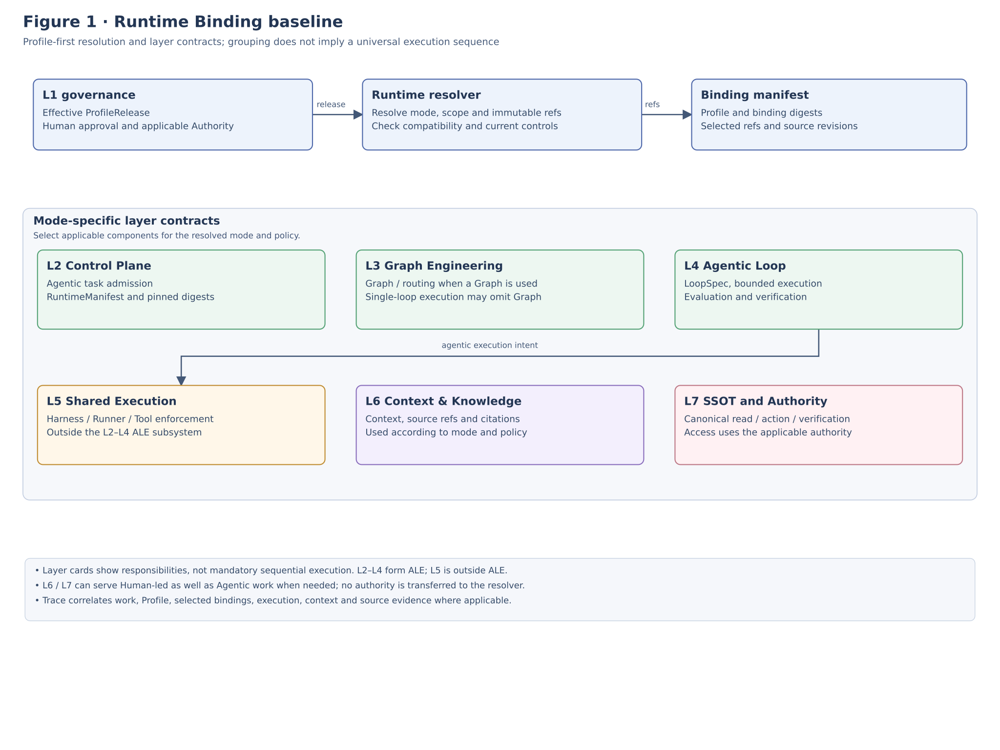
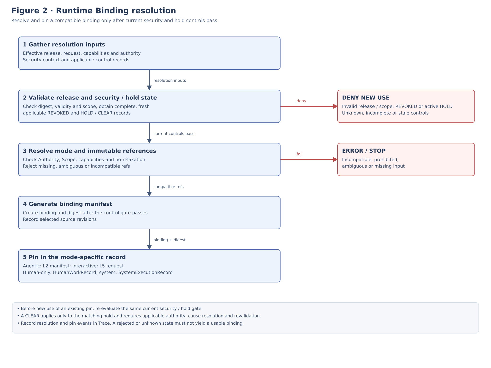
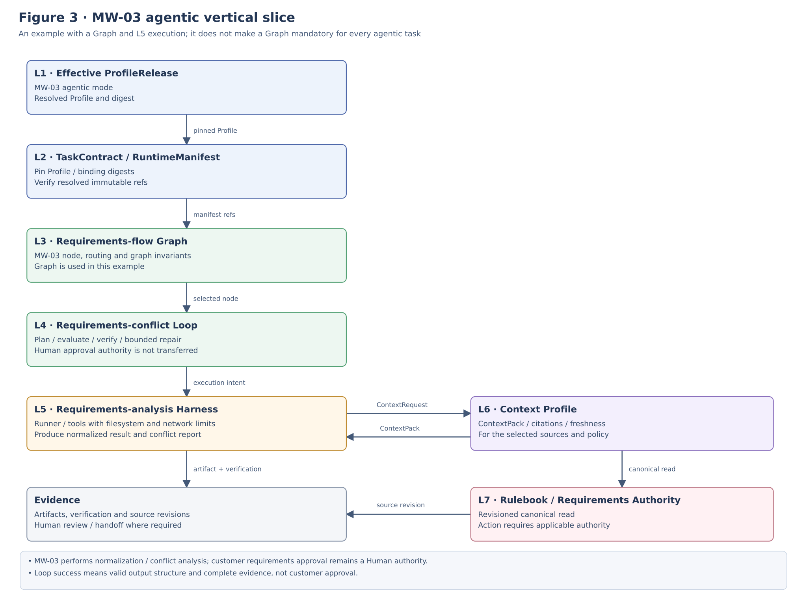
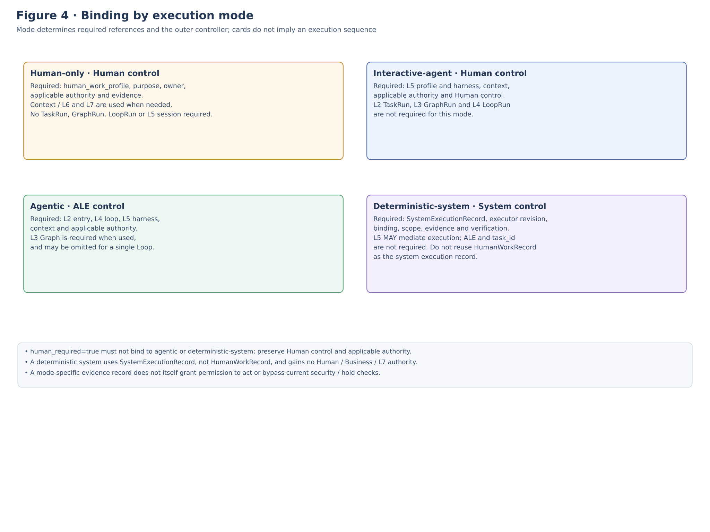

**REFERENCE SPECIFICATION**

**ALOM Runtime Binding**

**Reference Specification**

Effective Profile / ALE / Graph / Loop / Shared Execution / Context / SSOT / Trace

| **Core baseline** Resolve the Managed Work of the Profile being adopted from a Human-approved EffectiveProfile into L1–L7 execution contracts, and pin an immutable binding and digest when execution starts. Correlate references, compatibility, Authority, Scope, and Evidence in one Runtime Binding Baseline without duplicating the canonical Graph / Loop / Harness / Context / SSOT assets. |
|----------------------------------------------------------------------------------------------------------------------------------------------------------------------------------------------------------------------------------------------------------------------------------------------------------------------------------------------------|

| **Control item** | **Value** |
|-----------------------|---------------------------------------------------------------------------------|
| **Document ID** | ALOM-RUNTIME-BIND-SPEC-001 |
| **Version** | v0.4-review.20261109 |
| **Created** | 2026-08-13 |
| **Parent standard** | ALOM-ARCH-STD-001 v2.5 |
| **Principal related specifications** | ALOM-L1-STD-001 v0.7-review.20261110 / ALOM-CTL-STD-001 v0.4-review.20261110 / ALOM-GRAPH-STD-001 v0.4-review.20261110 / ALOM-LOOP-STD-001 v0.6-review.20261110 / ALOM-HR-STD-001 v0.4-review.20261110 / ALOM-KNW-STD-001 v0.4-review.20261110 / ALOM-SSOT-STD-001 v0.5 |
| **Profile contract** | ALOM-PROF-CONTRACT-SPEC-001 v0.5-review.20261108 |
| **Reference Profile** | The Reference Scope example provided in this document |
| **Scope** | ALOM Adoption / Runtime Binding Baseline / Vertical Slice for commissioned work (example) |
| **Accountable function** | Organization Architecture (Enterprise Architecture) / AI Platform |
| **Shared responsibility** | Business Owner / Quality / Security and Privacy / Project & Operations |
| **Information classification** | Public |

This document does not infer or fix implementation products or the Authority of actual people or customers. Resolve actual IDs, Endpoints, Credentials, and Rulebook revisions from approved adoption inputs; fail closed when required inputs are missing.

# **Document Control**

## **1. Position and Order of Authority**

- This specification turns Runtime Binding in the Profile Contract into a concrete reference configuration without changing the responsibility boundaries of the ALOM Integrated Architecture Standard v2.5 or the L1–L7 implementation standards.

- The Profile Resolver / Binding Resolver has no Authority. The legitimacy of an Effective Profile rests with a Human-approved release and the Approved Profile Registry; canonical Knowledge/Operational assets remain under L7 Authority.

- Do not copy GraphSpec / LoopSpec / HarnessSpec / ContextProfile / AuthorityDescriptor bodies into EffectiveProfile. Retain versioned references or immutable revision refs and pin them at Runtime.

- If parent standards, laws and regulations, contracts, customer NDAs, or Security/Privacy rules conflict, the higher-level or stricter constraints take precedence.

- The \[BASELINE\] in this document is a reference implementation candidate for the initial MVP; it does not mandate a particular product, cloud, LLM, or Runner as the sole implementation.

| **Fixed boundaries** L1 determines Execution Mode. human-only does not require ALE/L5; in interactive-agent, the Human is the outer controller and uses L5 directly; in agentic, ALE (L2–L4) is the outer controller and delegates execution to L5. deterministic-system is non-Agentic, does not require ALE (L2–L4), and does not make L5 globally mandatory. Explicit L5 mediation does not imply an Agent Runner / L4 / ALE. hybrid is not an Execution Mode. |
|--------------------------------------------------------------------------------------------------------------------------------------------------------------------------------------------------------------------------|

## **2. Sources and Design Categories**

| **ID** | **Source** | **Use in this document** |
|--------|--------------------------------------------------|----------------------------------------------------------------------------------------|
| S1 | ALOM-ARCH-STD-001 v2.5-review.20261110 | Non-effective alignment candidate; controlled authority remains v2.5. Seven layers, ALE=L2–L4, L5 Shared Execution, Profile Engineering, Human Control. |
| S2     | ALOM-L1-STD-001 v0.7-review.20261110                       | Managed Work, Execution Mode, ExecutionBinding, HumanWorkRecord, Authority / Outcome. |
| S3     | ALOM-CTL-STD-001 v0.4-review.20261110                      | TaskContract, RuntimeManifest, durable state, Admission, pinning.                     |
| S4     | ALOM-GRAPH-STD-001 v0.4-review.20261110                    | GraphSpec, EffectiveGraphManifest, Node type, Graph invariant.                        |
| S5     | ALOM-LOOP-STD-001 v0.6-review.20261110                     | LoopSpec, LoopRun, ExecutionIntent, Eval/Verify/Repair/Termination.                   |
| S6     | ALOM-HR-STD-001 v0.4-review.20261110                       | EffectiveHarness, Runner Adapter, Tool/Credential/Network/Filesystem enforcement.     |
| S7     | ALOM-KNW-STD-001 v0.4-review.20261110                      | ContextRequest, ContextPack, Citation, ContextManifest, revision/freshness.           |
| S8     | ALOM-SSOT-STD-001 v0.5                     | AuthorityDescriptor, Operational Read, ActionIntent, VerificationResult.              |
| S9     | ALOM-PROF-CONTRACT-SPEC-001 v0.5-review.20261108           | EffectiveProfile, Binding refs, mode-specific binding, no-relaxation, drift/pinning.  |

Design categories: \[STD\] = inherited from parent/Layer standards; \[REF\] = adopted from an existing Reference Profile; \[BASELINE\] = initial MVP reference values fixed by this document; \[INPUT\] = actual values supplied by Pilot/Authority/Rulebook; \[UNRESOLVED\] = actual values are not yet fixed and Runtime Admission is not permitted.

## **3. Document Status and Completion Criteria**

v0.3 defines the concrete Binding baseline and the priority deny rules for REVOKED/HOLD in Contract v0.4. It fixes machine-readable contracts and failure conditions; it does not declare the implementation or E2E PoC ready for Production.

| **Completion aspect** | **Completion criteria for this document** |
|----------------------|----------------------------------------------------------------------------------------------|
| Binding completeness | Required references for representative human-only / interactive-agent / agentic / deterministic-system Work are unambiguously defined. |
| Authority safety | Profile/Resolver does not replace L7 Authority, Human-required controls, or L5 enforcement. |
| Reproducibility | profile digest / binding digest / RuntimeManifest / source revisions are reproducibly correlated. |
| Fail-closed | A missing ref / capability mismatch / scope violation / unresolved authority produces ERROR. |
| Portability | The applying organization's Contract is preserved when the Runner/Graph/Knowledge backend is replaced. |
| Testability | Gates support testing of the Vertical Slice, failure, override, drift, and rollback. |

# **Contents**

| **Chapter** | **Content** |
|--------|-----------------------------------------------------|
| 1 | Purpose and Scope |
| 2 | Fixed Definitions and Responsibility Boundaries |
| 3 | Runtime Binding Principles |
| 4 | Overall Binding Baseline Architecture |
| 5      | Binding Resolution / Lifecycle                      |
| 6 | Reference Scope and Representative Managed Work |
| 7 | ID / Version / Revision / Digest Rules |
| 8      | L1 EffectiveProfile Binding                         |
| 9      | L2 Task / RuntimeManifest Binding                   |
| 10     | L3 Graph Binding                                    |
| 11     | L4 Loop Binding                                     |
| 12     | L5 Shared Execution / Harness Binding               |
| 13     | L6 Context & Knowledge Binding                      |
| 14     | L7 SSOT / Authority / Action / Verification Binding |
| 15 | Binding by Execution Mode |
| 16     | E2E Correlation / Trace / Evidence                  |
| 17     | Compatibility / Fail-closed                         |
| 18     | Drift / Rebind / Pinning / Rollback                 |
| 19     | Repository / Config / CI Baseline                   |
| 20     | API / Event Baseline                                |
| 21     | Security / NDA / Isolation                          |
| 22     | Observability / SLO                                 |
| 23 | Acceptance Gates and Conformance Tests |
| 24 | Handoff to the E2E PoC |
| A | Minimum Data Contracts |
| B      | YAML Reference Baseline                             |
| C      | Binding Matrix                                      |
| D      | Unresolved / Input Register                         |

# **1. Purpose and Scope**

## **1.1 Purpose**

This Reference Specification binds a Human-approved EffectiveProfile to L1–L7 as an executable Operating Contract and fixes the Graph / Loop / Harness / Context / Authority used by Runtime in an unambiguous, reproducible, and auditable manner.

A Profile holds reference contracts and does not duplicate Layer-specific canonical assets. At Runtime startup, the L1 Resolver resolves the Profile release and target scope/work, validates L2–L7 schema/capability/authority compatibility, and generates a Binding Manifest.

## **1.2 In Scope**

- Managed Work in the Profile being adopted, and the four Execution Modes: human-only / interactive-agent / agentic / deterministic-system.

- References from EffectiveProfile.bindings to L2 TaskContract / RuntimeManifest, L3 GraphSpec, L4 LoopSpec, L5 Harness, L6 ContextProfile, and L7 Authority.

- Correlation of Profile digest, Binding digest, source revision, schema/capability version, and Trace/Evidence.

- Runtime Admission, compatibility check, fail-closed, pinning, rebind, drift, rollback.

- A minimum Agentic Vertical Slice centered on MW-03 Requirement normalization / conflict analysis.

## **1.3 Out of Scope**

- Final Authority appointments for actual people, customers, or organization-specific Roles.

- Definitive selection of Runner / Workflow / Graph / Vector / LLM products.

- Redefinition of internal algorithms within each Layer.

- Granting canonical-update Authority to the Profile Generator / Runtime Resolver.

- Complete E2E PoC test results or Production Promotion decisions.

| **Design goal** The same EffectiveProfile release and capability snapshot must regenerate the same semantic binding / digest, and executions that have already started must retain their pinned digest after a release update. |
|----------------------------------------------------------------------------------------------------------------------------------------------------------------------------------------------------------------|

# **2. Fixed Definitions and Responsibility Boundaries**

| **Term** | **Fixed definition** | **Not equivalent to** |
|-----------------------------|--------------------------------------------------------------------------------------------------------------|-----------------------------|
| Runtime Binding | The relationship produced by resolving, validating, and pinning EffectiveProfile execution_mode and binding refs to L2–L7 execution contracts. | Duplication of Layer implementations |
| Binding Resolver | A read-only component that resolves references and evaluates compatibility using a Profile release, target, and capability snapshot. | Authority / Compiler |
| Binding Manifest | A single immutable record that pins resolved refs, versions, digests, and capability decisions. | The L2 RuntimeManifest itself |
| RuntimeManifest | A manifest in which L2 pins Context / Policy / Graph / Loop / Harness / SSOT revisions as Task execution conditions. | ProfileRelease |
| EffectiveGraphManifest | The immutable L3 runtime contract produced by resolving GraphSpec and Task/Policy/Loop/Harness/capability. | Workflow native state |
| LoopSpec | An L4 asset defining success, evaluation, repair, budget, and termination conditions for one Work Unit. | Runner-internal retry |
| EffectiveHarness | A Harness that pins Runner / Tool / Credential / Network / Filesystem / Sandbox constraints at runtime in L5. | Prompt |
| ContextProfile | The scope, retrieval, freshness, citation, and budget policy for L6 ContextRequest / ContextPack. | Knowledge SSOT |
| AuthorityDescriptor | The L7 definition that determines the subject and canonical system / read / write boundary. | confidence / search rank |
| Pinned execution | Execution that pins profile/binding/runtime revisions at startup and does not automatically follow subsequent updates. | Always referring to latest |
| Binding capability snapshot | A signed observation of schema/capability/version availability in each Layer, used by the Resolver to evaluate compatibility. | Canonical Authority |

## **2.1 Authority Ownership**

| **Owner** | **Canonical responsibility** | **Treatment in this specification** |
|----------------|-----------------------------------------------------------------------------|-------------------------------------------------------|
| L1 | Purpose / Managed Work / Execution Mode / Human Control / Effective Profile | Binding selection and registration Gate. |
| L2 | Task / Durable State / RuntimeManifest | Pinning at execution startup and orchestration. |
| L3 | Graph topology / routing / join / graph completion | Authority over Graph semantics. |
| L4 | Plan / Eval / Verify / Repair / Termination | Authority over Agentic Loop convergence. |
| L5 | Harness / Runner / Tool / Credential / Network / FS enforcement | Physical enforcement of execution constraints. |
| L6 | Meaning / Retrieval / Context assembly | Assembles Context but has no Knowledge Authority. |
| L7             | Knowledge / Operational Truth / Authority / Transaction                     | Canonical read/write/verification.                   |
| Trace/Evidence | Execution / Decision / Source correlation | Correlates each Layer's records without tampering with them. |

# **3. Runtime Binding Principles**

| **ID** | **Principle** | **Requirement** |
|--------|---------------------------|---------------------------------------------------------------------------------------------------------------------------|
| RB-P01 | Profile-first | Runtime entry starts from an EffectiveProfile release; ad-hoc combinations of Layer refs are prohibited. |
| RB-P02 | Mode determines route | First determine human-only / interactive-agent / agentic / deterministic-system, and never fall back to a prohibited route. |
| RB-P03 | Reference, not copy | Do not duplicate Graph/Loop/Harness/Context/Authority bodies in a Profile. |
| RB-P04 | Immutable pin | Pin profile digest / binding digest / RuntimeManifest / source revision at startup. |
| RB-P05 | No-relaxation | Lower-level bindings must not relax Human-required, classification, NDA, autonomy, mandatory Gates, L7 Authority, or L5 enforcement. |
| RB-P06 | Capability compatibility | Validate schema/version/capability/authority availability both when becoming Effective and at Runtime Admission. |
| RB-P07 | Fail-closed | Missing/ambiguous/incompatible/out-of-scope inputs produce ERROR/STOP without implicit defaults. |
| RB-P08 | Evidence by construction | Make work/profile/task/graph/loop/execution/context/source traceable through trace_id and digest. |
| RB-P09 | No authority transfer | Resolver/Runner/RAG/Graph Engine does not acquire L1/L7/Human Authority. |
| RB-P10 | Portable adapters | Treat product-native IDs as adapter refs, and use the applying organization's contract as the sole semantic baseline. |
| RB-P11 | Change by new revision | Do not overwrite an active binding; issue a new revision + rebind reason + impact + approval. |
| RB-P12 | Security revoke exception | A critical Security/Authority revocation may trigger stop/recovery policy with priority over ordinary pinning. |

# **4. Overall Binding Baseline Architecture**

[Open Figure 1 at full size](figures/ALOM-RUNTIME-BIND-SPEC-001-fig1-current.svg)

**Figure 1 ALOM Runtime Binding Baseline - Correlating references, execution, and Evidence while preserving Layer Authority**

The arrows in Figure 1 show the direction of resolution, execution, and references, not containment. L2–L4 form the logical ALE Subsystem, while L5 is the Shared Execution Plane outside ALE. L6/L7 can be used by Human-only / Interactive Agent as well as Agentic execution.

## **4.1 Reference Deployable Boundary**

| **Deployable/Store** | **Role** | **Availability baseline** |
|-------------------------------------|------------------------------------------------------|-----------------------------------------------|
| Profile Registry / Runtime Resolver | Resolve Effective releases and generate binding candidates. | Production runtime dependency. HA + LKG. |
| L2 Control Plane                    | Task admission, RuntimeManifest pin, durable state. | HA / replay / recovery.                      |
| L3/L4 Runtime | Graph/Loop semantic execution. | May share a deployable with L2; semantic modules remain separate. |
| L5 Shared Execution                 | Harness/Runner/Worker/Tool enforcement.             | Worker failure isolation / retry-safe.       |
| L6 Context Runtime                  | ContextPack / citation / retrieval.                 | Last-known-good derived runtime.             |
| L7 SSOT / Gateway | Canonical read/write/verification. | SLO per source authority. |
| Trace/Evidence                      | cross-layer correlation.                            | append-oriented + integrity.                 |

# **5. Binding Resolution / Lifecycle**

[Open Figure 2 at full size](figures/ALOM-RUNTIME-BIND-SPEC-001-fig2-current.svg)

**Figure 2 Runtime Binding Resolution Flow - Fail closed when compatibility is not satisfied** (Current mode-specific bindings are the exact-four in the §8.2 table and the current Figure 4 in §15.)

## **5.1 Resolution Inputs**

| **Input** | **Required content** | **Source** |
|---------------------------|-----------------------------------------------------------------------------|-------------------------------------|
| EffectiveProfileRelease   | effective_profile_id / release / digest / target / validity / approval refs | L1 Approved Profile Registry        |
| RuntimeCapabilitySnapshot | L2-L7 schema versions / supported capabilities / active revisions | Each Layer adapter / registry |
| RuntimeRequest            | target scope / work / effective_at / actor / purpose / required capability  | L1 entry / L2 ingress / Human entry |
| AuthoritySnapshot         | authority refs / validity / write/read boundary                             | L7 Authority Registry               |
| SecurityContext | tenant / `isolation_scope_ref` (including any existing project overlay) / classification / NDA / delegation / authz | L1/IdP/Policy |
| RevocationRecord | REVOKED status, scope of application, and evidence refs for release/source/authority | L1 Registry / Security Authority |
| OperationalHoldRecord | HOLD/CLEAR history per hold_id + action_id; target release/source/scope; authority; acquisition time; freshness; revalidation refs | canonical operational hold source |

## **5.2 Resolution Steps**

1.  Validate the Profile release's status=EFFECTIVE, validity, target scope, and digest. Retrieve the authoritative RevocationRecord and all OperationalHoldRecords applicable to the release/source/scope by hold_id + action_id. For CLEAR, verify authority for the target hold_id, resolution of the cause, and revalidation evidence. If even one HOLD remains uncleared, a newer CLEAR for a different hold_id must not be treated as clearing it. REVOKED, an active HOLD, inability to obtain all states, or unknown freshness takes precedence over pointer / pin / LKG / rollback candidate selection and denies new use.

2.  Unambiguously determine Execution Mode and enumerate its mandatory refs.

3.  Resolve each ref to an immutable revision or permitted version range, and check it against the capability snapshot.

4.  Check No-relaxation / Authority / Scope / Human-required / Tool enforcement.

5.  Generate the Binding Manifest and binding_digest only after the Security/hold deny gate passes. Pin profile/binding digests in the L2 RuntimeManifest for agentic, the L5 Execution Request for interactive-agent, the HumanWorkRecord header for human-only, and the SystemExecutionRecord for deterministic-system. Re-evaluate the same gate for new use of existing pins as well.

6.  Record profile.resolved / binding.resolved / binding.pinned in Trace.

| **Prohibition** The Resolver must not infer the nearest available ref and silently fall back to it. Restrict NEAREST_COMPATIBLE to candidates satisfying scope, version, capability, and no-relaxation; zero candidates or multiple conflicting candidates produce ERROR. |
|---------------------------------------------------------------------------------------------------------------------------------------------------------------------------------------------------------------------------|

# **6. Reference Scope and Representative Managed Work**

The Reference Scope in this document adopts representative Work from all four Execution Modes in the Binding Baseline. MW-03 is the Primary Vertical Slice.

| **Work** | **Name** | **Mode** | **Candidate owner** | **Binding significance** |
|----------|-----------------------------------------------|-------------------|-----------------------|---------------------------------------------------------|
| MW-03 | Requirement normalization / conflict analysis | agentic | Requirements Engineer | ALE→L5. Results go to the Human owner. Primary Vertical Slice. |
| MW-02 | Customer requirements elicitation | interactive-agent | PL / BA | The Human leads the interaction. The Agent supports summarization, issue extraction, and Trace. |
| MW-06 | Customer requirement approval | human-only | Customer Authority | Final Authority. Agent substitution is prohibited. |
| MW-17 | Deployment | interactive-agent | Release / Ops | High side effects. Approval + L5/L7 enforcement. |
| MW-12 | Test execution / deterministic verification | deterministic-system | QA / Test Engineer | SystemExecutionRecord. ALE/task_id is not mandatory. L5 MAY mediate. |

## **6.1 Primary Vertical Slice - MW-03**

> **Figure 3 baseline:** MW-03 is read-only. The L7 authority note does not authorize Operational write or ActionIntent in this baseline; Section 14.1 still prohibits them.

[Open Figure 3 at full size](figures/ALOM-RUNTIME-BIND-SPEC-001-fig3-current.svg)

**Figure 3 MW-03 Agentic Vertical Slice - Pinned path from profile digest to source revision / evidence**

MW-03 performs normalization and conflict analysis as Agentic Work but has no Authority to approve customer requirements. L7 provides revisioned reads of requirement materials and Rulebooks. L4 success assessment is limited to structural validity of normalized results and the conflict report, and Evidence completeness.

# **7. ID / Version / Revision / Digest Rules**

| **Type** | **Reference Pattern** | **Meaning** |
|-------------------|--------------------------------------------------|-------------------------------------|
| Profile           | effective://example-alom/{work}/{release}       | EffectiveProfile flattened contract |
| Binding           | binding://example-alom/{work}/{binding_version} | Resolved cross-layer references     |
| Graph             | graph://si.requirements-flow/{version}           | L3 GraphSpec                        |
| Loop              | loop://si.requirements-conflict/{version}        | L4 LoopSpec                         |
| Harness           | harness://si.requirements-analysis/{version}     | L5 HarnessSpec                      |
| Context           | context://si.requirements/{version}              | L6 ContextProfile                   |
| Authority         | authority://{scope}/{subject}                    | L7 AuthorityDescriptor              |
| Knowledge release | okf-release://{bundle}/{release}                 | L7 Knowledge release                |
| Task              | task-{ulid/uuid}                                 | L2 TaskRun                          |
| Trace             | trace-{trace-id}                                 | Cross-layer correlation             |

## **7.1 Version Dimensions**

| **Version** | **Subject** | **Compatibility rules** |
|--------------------------------|----------------------------------|-------------------------------------|
| profile_schema_version         | EffectiveProfile shape           | major breaking / migration required |
| profile_release_version        | Human-approved business contract | immutable release                   |
| binding_contract_version       | L1↔L2-L7 binding schema          | consumer compatibility test         |
| graph_schema/spec version      | L3 semantic contract             | range + capability check            |
| loop_schema/spec version       | L4 convergence contract          | range + eval/verify compatibility   |
| harness_schema/spec version    | L5 enforcement contract          | required capabilities must exist    |
| context_schema/profile version | L6 context contract              | scope/freshness/citation capability |
| authority/revision             | L7 canonical boundary            | immutable or validity-pinned        |

## **7.2 Digest**

\[BASELINE\] The default candidate for profile_digest and binding_digest is SHA-256 over canonical serialization. Specify the Hash algorithm and canonicalization version in the Manifest, and require regeneration of the same digest from the same semantic input as a Gate.

<table>
<colgroup>
<col style="width: 100%" />
</colgroup>
<thead>
<tr class="header">
<th>digest: 
algorithm: sha256 
canonicalization: alom-json-c14n-v1 
profile: sha256:&lt;effective-profile&gt; 
binding: sha256:&lt;resolved-binding&gt; 
runtime_manifest: sha256:&lt;task-runtime-manifest&gt;</th>
</tr>
</thead>
<tbody>
</tbody>
</table>

# **8. L1 EffectiveProfile Binding**

## **8.1 EffectiveProfile Required Binding Fields**

| **Group** | **Minimum fields** |
|---------------|------------------------------------------------------------------------------------------------------------------------|
| Identity      | effective_profile_id / schema_version / release_version / target_ref / digest                                          |
| Scope         | scope_ref / enterprise / domain / organization? / customer? / project? / usecase? / process? / work / isolation_scope_ref / classification / NDA                                    |
| Management    | purpose_ref / owner / responsibility / authority / outcome_ref / slo_refs                                              |
| Execution     | execution_mode / work_type / risk_class / autonomy_ceiling / budget                                                    |
| Human Control | human_required / approvers / stop_authority / review_policy / exception_route                                          |
| Bindings      | ale_entrypoint? / graph_ref? / loop_ref? / shared_execution_profile? / harness_ref? / context_profile? / authority_refs? |
| Assurance     | criteria / eval_refs / verification_refs / evidence_requirements                                                       |
| Validity      | effective_from / effective_until / supersedes / rollback_candidate                                                     |
| Validation    | validation_report_ref / approval_refs / conflict_count=0                                                               |

Question marks in the summary do not waive mode-specific requirements: §8.2 defines them. Human ownership and applicable Authority remain mandatory; L7 writes require the applicable Authority and Action Gateway. An Authority reference is distinct from a requirement to invoke an L7 service.

## **8.2 L1 Runtime Decision**

| **Mode**          | **L1 Required Binding**                                                                                            | **L1 must reject when**                                               |
|-------------------|--------------------------------------------------------------------------------------------------------------------|-----------------------------------------------------------------------|
| human-only | human_work_profile + context_profile? + authority_refs + evidence | ALE/L5 made mandatory; Human Authority missing; Evidence path missing |
| interactive-agent | shared_execution_profile + harness_ref + context_profile + authority_refs + Human control | L5 profile missing; Human outer control not established |
| agentic | ale_entrypoint + loop_ref + graph_ref? + shared_execution_profile + harness_ref + context_profile + authority_refs | ALE/Loop missing; human_required=true; Harness/Authority incompatibility |
| deterministic-system | SystemExecutionRecord + executor_ref/revision + binding_ref + evidence/verification refs; L5 optional explicit mediation | ALE/Task/Graph/Loop made mandatory; task_id made mandatory; HumanWorkRecord reused; human_required=true; executor/evidence missing |

# **9. L2 Task / RuntimeManifest Binding**

## **9.1 Admission Binding**

For Agentic Work, pin the effective_profile_digest / binding_digest returned by the L1 Resolver in TaskContract / RuntimeManifest. L2 does not reinterpret the Profile itself; it verifies at the Admission Gate that required refs have been resolved.

| **Field group** | **L2 baseline**                                                                                              |
|-----------------|--------------------------------------------------------------------------------------------------------------|
| identity        | task_id / trace_id / external_request_ref / task_contract_version                                            |
| scope           | purpose_id / tenant_id / domain_id / use_case_id? / process_id? / project_id? / isolation_scope_ref / classification                                           |
| profile         | effective_profile_ref / effective_profile_digest / binding_ref / binding_digest                              |
| binding         | graph_ref? / effective_graph_ref? / loop_refs / harness_refs / context_policy_ref / operational_authority_refs |
| control         | autonomy_level / deadline / policy_ref / human gate / cancellation                                           |
| budget          | duration / cost / token / execution ceilings                                                                 |
| source          | knowledge revisions / operational authority / eval refs                                                      |
| digest          | manifest_digest                                                                                              |

`graph_ref` / `effective_graph_ref` are required when a Graph is used and may be absent for a single Loop without a Graph. L2 entry / Loop and other mode-specific requirements follow §8.2. Do not implicitly create a Graph to fill an absent reference.

## **9.2 L2 Pinning Rule**

- Pin the profile/binding/runtime manifest digests before Task state transitions to BOUND.

- Tasks that have already started retain their pinned digests even if the Profile release is updated while they are RUNNING.

- Rebind generates a new RuntimeManifest revision and records reason, impact, approval, and effective_at in Trace.

- Fail closed on Profile digest mismatch / expired / revoked / capability mismatch.

# **10. L3 Graph Binding**

## **10.1 Reference Graph Baseline**

\[BASELINE\] The minimum candidate Graph structure for the Example Delivery requirements flow is MW-02 → MW-03 → MW-04 → MW-05 → MW-06. MW-03 is AGENT_LOOP, and MW-05/MW-06 are HUMAN_TASK. Preserve Human-required Gates as first-class Nodes in the Graph.

| **Node**               | **Type**                         | **Binding**                                | **Completion / Gate**                 |
|------------------------|----------------------------------|--------------------------------------------|---------------------------------------|
| mw02_elicitation       | HUMAN_TASK / Interactive session | work://MW-02 + optional L5 session         | Human-led conversation evidence       |
| mw03_conflict          | AGENT_LOOP                       | loop://si.requirements-conflict/1.0.0      | normalized artifact + conflict report |
| mw04_draft             | HUMAN/INTERACTIVE TASK           | work://MW-04 + L5                          | draft artifact ready                  |
| mw05_internal_review   | HUMAN_TASK                       | review policy / evidence refs              | independent review decision           |
| mw06_customer_approval | HUMAN_TASK                       | authority://customer/requirements-approval | final approval evidence               |

## **10.2 Graph Invariants**

- Do not reach the requirements baseline terminal without Customer approval Evidence.

- Do not permit routes that skip Human-required Nodes.

- Do not declare Graph complete solely from the collection of Node Eval passes; independently verify mandatory Evidence completeness.

- Do not expand authority/tool/data/network scope through Dynamic Rewrite.

- Use the minimum of GraphSpec max_parallelism and the L2/L4/L5 ceilings as the effective ceiling.

# **11. L4 Loop Binding**

## **11.1 MW-03 LoopSpec Baseline**

| **Item** | **Baseline** |
|--------------------|---------------------------------------------------------------------------------------------------|
| loop_ref           | loop://si.requirements-conflict/1.0.0                                                             |
| purpose            | Requirements normalization / duplicate and conflict analysis                                      |
| success            | normalized requirements schema valid AND conflict classifications complete AND citations resolved |
| deterministic eval | schema validation / duplicate-id check / required evidence check                                  |
| semantic eval      | conflict classification rubric; generator self-score only is insufficient                         |
| verification       | source revision and citation resolution against L7/L6                                             |
| repair             | bounded correction of schema/evidence/classification; blind retry prohibited                      |
| termination        | success OR iteration/time/token/cost exceeded OR same-failure threshold OR Human escalation       |
| human escalation   | source ambiguity / authority implication / unresolved business intent                             |

| **Boundary** L4 drives the MW-03 analysis results toward convergence but has no Authority to declare customer requirements approved. The MW-06 Human decision is established as a separate Graph Gate. |
|--------------------------------------------------------------------------------------------------------------------------------------------------------------|

# **12. L5 Shared Execution / Harness Binding**

## **12.1 EffectiveHarness Baseline**

| **Capability**    | **MW-03 baseline**                                                                |
|-------------------|-----------------------------------------------------------------------------------|
| Runner capability | structured output / filesystem workspace / diff / approved MCP tools              |
| Workspace         | project-scoped ephemeral or controlled workspace                                  |
| Filesystem        | project workspace only; protected config read-only                                |
| Network           | default deny; allow only approved MCP/API endpoints                               |
| Tool              | knowledge.read / source.read / analysis.write_workspace; operational write denied |
| Credential        | short-lived / task-purpose scoped / no plaintext in trace                         |
| Budget | Hard limit is the minimum of the L1/L2/L4 ceilings |
| Artifact          | normalized-requirements + conflict-report + machine-readable evidence refs        |
| Telemetry         | runner/model/tool/usage/artifact/error normalized into canonical execution event  |

## **12.2 Interactive Agent Baseline**

MW-02 / MW-17 in interactive-agent may use L5 directly, but the Human remains the primary decision-maker for continue / modify / accept / stop. Direct L5 use does not bypass L1 Policy, L6 Scope, or L7 Authority.

# **13. L6 Context & Knowledge Binding**

## **13.1 ContextProfile Baseline**

| **Item** | **Baseline** |
|-----------------|------------------------------------------------------------------------------------------------|
| context_ref     | context://si.requirements/1.0.0                                                                |
| scope           | enterprise + example-alom-pilot project + purpose=requirements.analysis                       |
| classification | Must not exceed the effective profile ceiling |
| knowledge roots | approved project/quality/security rulebook + requirement source set                            |
| revision        | canonical knowledge pinned to release/commit SHA                                               |
| freshness       | requirement source latest approved snapshot or explicitly pinned revision                      |
| retrieval       | metadata/full-text/semantic/ontology/live source as profile permits; RAG backend not authority |
| citation        | major statements and conflict evidence must resolve to source_ref + revision + locator         |
| budget          | max items/sources/tokens is bounded and manifest-recorded                                      |
| trace           | ContextRequest / authz / retrieval / ContextPack / citation / manifest same trace_id           |

## **13.2 ContextRequest Correlation**

<table>
<colgroup>
<col style="width: 100%" />
</colgroup>
<thead>
<tr class="header">
<th>context_request: 
work_id: MW-03 
task_id: task-... 
trace_id: trace-... 
purpose_id: requirements.analysis 
project_id: example-alom-pilot 
isolation_scope_ref: scope://example-alom/pilot 
classification_ceiling: confidential 
profile_digest: sha256:... 
binding_digest: sha256:... 
source_revisions: 
- okf-release://company-rules/... 
- source://requirements/...@revision</th>
</tr>
</thead>
<tbody>
</tbody>
</table>

# **14. L7 SSOT / Authority / Action / Verification Binding**

## **14.1 MW-03 Read-only Authority Baseline**

MW-03 reads the Canonical requirements source and Rulebook but has no Operational write / approval Authority. AuthorityDescriptor resolves the canonical system and revision boundary for each source subject.

| **Contract**           | **MW-03 baseline**                                                    |
|------------------------|-----------------------------------------------------------------------|
| AuthorityDescriptor    | requirements source / project rulebook / quality & security standards |
| OperationalReadRequest | scope + purpose + entity/source + consistency requirement             |
| OperationalReadResult  | source revision / observed_at / freshness / payload_ref               |
| ActionIntent           | not permitted for MW-03 baseline                                      |
| VerificationResult     | citation/source revision resolution; no business approval meaning     |

## **14.2 Side-effect Work Baseline - MW-17**

For side-effect Work such as Deployment, even in interactive-agent mode, the L7 Action Gateway validates Authority / Policy / AuthZ / Human Control / idempotency / precondition in addition to L5 Tool enforcement.

| **Action field**   | **Requirement**                                                          |
|--------------------|--------------------------------------------------------------------------|
| target / operation | canonical system and specific operation |
| precondition | approved release / change record / current state / maintenance window, etc. |
| desired_state | State that must hold after execution |
| idempotency_key | Prevent duplicate effects |
| policy / approval  | L1 decision / Human approval refs                                        |
| verification       | read-after-write / External Oracle / expected vs observed                |
| rollback           | rollback_ref / compensating action / stop authority                      |

# **15. Binding by Execution Mode**

[Open Figure 4 at full size](figures/ALOM-RUNTIME-BIND-SPEC-001-fig4-current.svg)

**Figure 4 Runtime Paths by Execution Mode - Distinguishing the outer controller from mandatory Layers**

| **Mode** | **Outer control** | **Required Binding** | **Valid absences** | **Representative Evidence** |
|-------------------|-------------------|---------------------------------------------------------------------------------|-------------------------------------------|---------------------------------------------------------|
| human-only        | Human             | human_work_profile / purpose / owner / authority / evidence; L6/L7 as needed    | TaskRun / GraphRun / LoopRun / L5 session | HumanWorkRecord / decision / source refs                |
| interactive-agent | Human             | L5 shared_execution_profile + harness + context + authority + Human control     | L2 TaskRun / L3 GraphRun / L4 LoopRun     | interaction session / artifacts / human decisions       |
| agentic           | ALE               | L2 entry + L3 graph optional + L4 loop + L5 harness + L6 context + L7 authority | none of mandatory refs                    | Task/Graph/Loop/Execution/Context/Verification evidence |
| deterministic-system | deterministic program/service/system | SystemExecutionRecord + executor revision + scope + evidence + verification; L5 MAY mediate Worker/Tool/CI/Isolation | TaskRun / GraphRun / LoopRun / task_id / HumanWorkRecord as execution record | SystemExecutionRecord / executor / evidence / verification |

| **No-relaxation** Work with human_required=true must not be bound to agentic or deterministic-system. Human-only must not be converted to require L5/ALE without justification. deterministic-system does not reuse HumanWorkRecord as its execution record. SystemExecutionRecord correlates profile / binding / executor revision / evidence. SystemExecutionRecord does not acquire Human/Business/L7 Authority. |
|---------------------------------------------------------------------------------------------------------------------------------------------|

# **16. E2E Correlation / Trace / Evidence**

## **16.1 Canonical Correlation Keys**

| **Key** | **Requirement** | **Purpose** |
|---------------------------------------------|-----------------|----------------------------------------------------|
| work_id | MUST | Primary unit of Managed Work / Outcome / Execution Mode |
| purpose_id | MUST | Purpose limitation / Policy / Context |
| effective_profile_ref + digest              | MUST            | Human-approved operating contract                  |
| binding_ref + digest | MUST | Reproduction of cross-layer refs |
| trace_id | MUST | Event / evidence correlation across all Layers |
| task_id                                     | agentic only    | L2 durable orchestration                           |
| system_execution_ref                        | deterministic-system | SystemExecutionRecord correlation             |
| graph_run_id                                | when graph used | L3 organization                                    |
| loop_run_id                                 | agentic loop    | L4 convergence                                     |
| execution_id / runner_session_ref           | L5 used         | physical execution                                 |
| context_manifest_ref                        | when L6 used    | source/citation reproducibility                    |
| authority / transaction / verification refs | when L7 used    | truth/write/verification                           |

## **16.2 Minimum Evidence Packet - MW-03**

- profile release / profile digest / binding digest / RuntimeManifest digest.

- input requirements source revisions + Rulebook releases.

- ContextPack manifest + citations.

- Runner / model / harness version + tool calls / artifact refs.

- Loop eval / verification / termination reason.

- normalized requirements artifact + conflict report.

- Human owner review / downstream handoff evidence where required.

# **17. Compatibility / Fail-closed**

## **17.1 Binding Compatibility Checks**

| **Class**               | **Condition**                                                 | **Runtime decision**          |
|-------------------------|---------------------------------------------------------------|-------------------------------|
| MODE_CONFLICT | human_required=true && mode=agentic | ERROR / preserve Human-required |
| MODE_CONFLICT_DS | human_required=true && mode=deterministic-system | ERROR / preserve Human-required |
| MISSING_ALE_ENTRY       | agentic && ale_entrypoint absent                              | ERROR                         |
| MISSING_LOOP            | agentic && loop_ref absent                                    | ERROR                         |
| MISSING_L5              | interactive/agentic && shared_execution_profile absent        | ERROR                         |
| MISSING_SYSTEM_RECORD   | deterministic-system && SystemExecutionRecord/executor/evidence absent | ERROR                |
| DS_TASK_ID_MANDATORY    | deterministic-system && task_id required                      | ERROR                         |
| HARNESS_CAPABILITY      | Loop/Graph requires capability not in Harness/Runner          | ERROR                         |
| CONTEXT_SCOPE | Context source outside authorized isolation_scope_ref / classification / purpose (including selected overlays) | ERROR / fail-closed |
| AUTHORITY_UNRESOLVED    | L7 read/write authority missing or ambiguous                  | ERROR                         |
| WRITE_GATEWAY_MISSING   | write required but Action Gateway/approval/idempotency absent | ERROR                         |
| PROFILE_DIGEST_MISMATCH | resolved content digest differs from approved release         | ERROR                         |
| EXPIRED_RELEASE_OR_AUTHORITY | release/authority outside validity                        | STOP/ERROR                    |
| REVOKED_SOURCE | RevocationRecord marks release/source/authority REVOKED | STOP/ERROR; deny new use |
| ACTIVE_OPERATIONAL_HOLD | Active HOLD on the target release/source/scope | STOP/ERROR; deny new use |
| HOLD_STATE_UNAVAILABLE | Hold state unavailable, freshness unknown, or scope of application unknown | ERROR / fail-closed |
| SCHEMA_INCOMPATIBLE     | binding_contract / consumer version unsupported               | ERROR / migration required    |

## **17.2 Fail-closed Policy**

Availability degradation does not justify control relaxation. LKG may be used when the Resolver/Registry is unavailable, but only if signature/digest/validity/policy and the current state, freshness, and applicable scope of every hold_id + action_id in authoritative RevocationRecord and OperationalHoldRecord can be verified. Each CLEAR acts only on the same hold_id; deny use if even one HOLD remains uncleared. REVOKED, an active HOLD, unavailable state, or unknown freshness takes precedence over pointer / pin / LKG / rollback and denies new use. Unknown releases, stale authority, unknown scope, and unknown approval must not be automatically allowed either. Releasing a HOLD requires explicit CLEAR by an authorized party and evidence of cause resolution and eligibility revalidation; automatic release is prohibited. CLEAR or rollback does not remove REVOKED status.

# **18. Drift / Rebind / Pinning / Rollback**

| **Trigger** | **Action** | **Executions already started** |
|----------------------------------|--------------------------------------------------------|-----------------------------------------------|
| Profile release update | Generate a new binding candidate | Preserve existing digest |
| Graph/Loop/Harness schema update | compatibility check + new binding revision | Preserve existing spec/revision |
| Context source revision change | drift impact / recompile if profile semantics affected | Follow the pinned context/source policy |
| Authority change | re-evaluate validity / stop if revoked | Stop takes precedence on security/authority revocation |
| Runner capability change | binding incompatibility / rebind proposal | Automatic capability expansion is prohibited |
| Critical incident / override pattern | profile drift signal / review | Suspend/stop as necessary |
| Rollback | Recheck the Revocation/HOLD gate even for a previous approved release | Stop/recovery takes precedence over retaining the pin of an already-started Task. New use is permitted only after the gate passes |

## **18.1 Rebind Transaction**

<table>
<colgroup>
<col style="width: 100%" />
</colgroup>
<thead>
<tr class="header">
<th>rebind_record: 
from_binding_digest: sha256:... 
to_binding_digest: sha256:... 
reason: CAPABILITY_CHANGE | SECURITY_REVOKE | APPROVED_PROFILE_UPDATE 
affected_work: [MW-03] 
impact: {...} 
approval_ref: approval://... # high impact when required 
effective_at: 2026-08-13T... 
trace_id: trace-...</th>
</tr>
</thead>
<tbody>
</tbody>
</table>

# **19. Repository / Config / CI Baseline**

<table>
<colgroup>
<col style="width: 100%" />
</colgroup>
<thead>
<tr class="header">
<th>alom-runtime-binding/ 
schemas/ 
binding-manifest.schema.json 
capability-snapshot.schema.json 
binding-error.schema.json 
bindings/ 
example-development/ 
MW-02.yaml 
MW-03.yaml 
MW-06.yaml 
MW-17.yaml 
compatibility/ 
l2-l7-matrix.yaml 
examples/ 
effective-profile/ 
runtime-manifest/ 
context-request/ 
action-intent/ 
golden-tests/ 
negative-tests/ 
migrations/ 
docs/adr/</th>
</tr>
</thead>
<tbody>
</tbody>
</table>

## **19.1 Mandatory CI Tests**

| **Test**                  | **Pass condition**                                                                   |
|---------------------------|--------------------------------------------------------------------------------------|
| Schema                    | all binding/capability/error examples validate                                       |
| Determinism               | same profile + capability snapshot -\> same binding_digest                           |
| Mode routing              | human-only / interactive-agent / agentic / deterministic-system routes are unique                                 |
| Human-required regression | MW-06/MW-14/MW-19 etc. do not become agentic or deterministic-system                                         |
| Capability mismatch       | missing harness/context/authority -\> ERROR                                          |
| Scope isolation | cross-isolation (different `isolation_scope_ref`, including cross-project / cross-customer) context/source negative tests deny 100% |
| Digest pin                | RuntimeManifest / L5 Execution Request / HumanWorkRecord / SystemExecutionRecord contain approved profile/binding digest             |
| Second adapter            | baseline MW-03 semantic contract passes with a second Runner/adapter where available |
| Rollback                  | new task resolves previous release after pointer rollback; running task keeps pin    |

# **20. API / Event Baseline**

| **API** | **Responsibility** |
|------------------------------------------|-----------------------------------------------------------------------|
| GET /v1/runtime-bindings/resolve         | target/work/effective_at/capabilities -\> BindingManifest candidate   |
| POST /v1/runtime-bindings/validate       | binding + capability snapshot -\> ValidationReport                    |
| GET /v1/runtime-bindings/{id}            | immutable binding + digest + source refs                              |
| POST /v1/runtime-bindings/dry-run        | mode routing + compatibility + authority/context checks; no execution |
| POST /v1/runtime-bindings/rebind         | new candidate; high impact requires approval                          |
| GET /v1/runtime-bindings/{id}/provenance | Profile→Layer refs→source revisions                                   |

| **event_type** | **Minimum content** |
|---------------------------|--------------------------------------------------------------|
| binding.resolve.requested | target/work/profile release/capability snapshot/actor        |
| binding.resolved          | binding ref/digest/selected refs/decisions                   |
| binding.validation.failed | error class/paths/source refs                                |
| binding.pinned            | execution ref/profile digest/binding digest/runtime manifest |
| binding.rebind.proposed   | from/to/reason/impact                                        |
| binding.rebind.effective  | approval/effective_at                                        |
| binding.revoked           | authority/security reason/affected executions                |

# **21. Security / NDA / Isolation**

| **Control**             | **Requirement**                                                                                   |
|-------------------------|---------------------------------------------------------------------------------------------------|
| Scope before resolution | Fix tenant / `isolation_scope_ref` / purpose / classification / NDA before candidate retrieval. |
| Cross-isolation deny | If Graph/Harness/Context/SSOT refs point to a different `isolation_scope_ref` (including a different PJ / customer), do not leak information, including whether it exists. |
| Credential separation | Do not store credential secrets in a Binding; L5/L7 resolves short-lived credential refs. |
| No privilege expansion | Do not automatically permit capability / network / authority expansion through Profile/Graph rewrite/Rebind. |
| Human authority | Preserve Human-required controls such as Customer approval / Quality Gate / Go-No-Go. |
| Trace minimization | Retain necessary correlation/evidence; do not expand its purpose to excessive monitoring of Human-only work. |
| Revocation | Security/Authority REVOKED unconditionally takes precedence over pointer / pin / LKG / rollback for new use and results in DENY. Decisions on continuation under stop/recovery policy apply only to executions already started and must not create exceptions for new use. |

# **22. Observability / SLO**

| **Metric**                    | **Definition / Target direction**                                      |
|-------------------------------|------------------------------------------------------------------------|
| binding.resolve_success_rate  | valid requests resolved / total                                        |
| binding.resolve_latency       | p50/p95/p99 by mode                                                    |
| binding_incompatible_count    | error class / layer / work                                             |
| profile_digest_mismatch_count | must be 0                                                              |
| mode_routing_violation        | must be 0                                                              |
| cross_scope_binding_denied    | negative tests + runtime deny count                                    |
| binding_pin_coverage          | executions with profile+binding digest / required executions = 100%    |
| source_revision_traceability  | evidence packets resolving to source revision = 100% for required refs |
| rebind_rate                   | by reason and impact                                                   |
| lkg_usage                     | resolver/registry degradation events                                   |
| human_required_regression     | must be 0                                                              |

| **SLO policy** Numeric targets are fixed through approved adoption inputs / Effective Profile. This document sets safety targets (routing violation, digest mismatch, Human-required regression, scope violation) to 0. |
|--------------------------------------------------------------------------------------------------------------------------------------------------------------------------------------------------------|

# **23. Acceptance Gates and Conformance Tests**

| **Gate** | **Test** | **Pass condition** |
|----------|--------------------------|-------------------------------------------------------------------------------------------------|
| RB-G01 | Binding determinism | Same EffectiveProfile + capability snapshot yields the same semantic binding_digest. |
| RB-G02 | Mode routing | human-only / interactive-agent / agentic / deterministic-system are unambiguous. Prohibited fallback count is 0. |
| RB-G03 | Binding completeness | Missing mandatory refs for every mode: 0. |
| RB-G04 | Human-required | Incorrect agentic / deterministic-system bindings for MW-06 and similar Work: 0. |
| RB-G05 | Capability compatibility | Reject every Graph/Loop/Harness/Context/Authority mismatch. |
| RB-G06 | Scope/NDA | Deny 100% of cross-isolation (different `isolation_scope_ref`, including cross-project / cross-customer) / classification / purpose negative tests. |
| RB-G07 | Profile pinning | profile+binding digests present in 100% of agentic RuntimeManifest / interactive-agent L5 Execution Request / human-only HumanWorkRecord / deterministic-system SystemExecutionRecord records. |
| RB-G08 | L7 authority | read/write/verify resolves to AuthorityDescriptor; direct writes: 0. |
| RB-G09 | Traceability | 100% traceability from work→profile→binding→mode-specific execution record (Task / L5 Execution Request / HumanWorkRecord / SystemExecutionRecord)→context/source/evidence. |
| RB-G10 | MW-03 vertical slice | Reproduce L2→L3→L4→L5→L6→L7→Evidence. |
| RB-G11 | Failure safety | Unsafe automatic allows when Registry/Resolver/Context/Authority/hold state is unavailable or freshness is unknown: 0. REVOKED/active HOLD denies take precedence over pointer/pin/LKG. |
| RB-G12 | Drift/Rebind | Changes produce a new revision + impact + approval/trace without overwriting. |
| RB-G13 | Rollback pin | A rollback release is eligible for new use only after passing the Revocation/HOLD gate. Already-started executions retain their original digest, subject to stop/recovery taking precedence. |
| RB-G14 | Portability | A second Runner/adapter preserves the baseline semantic result/trace contract. |

| **Production Gate** A binding that does not satisfy the safety, Authority, and Trace Gates RB-G02–RB-G11 and RB-G13 must not enter Production execution. |
|--------------------------------------------------------------------------------------------------------------------------------------|

| Negative case | Pass condition |
|---|---|
| Select a REVOKED release/source/authority through pointer / pin / LKG / rollback | Deny new use and record the RevocationRecord ref |
| Active HOLD applies to the target release/source/scope | Deny new use and record the OperationalHoldRecord ref |
| Hold state unavailable, freshness unknown, or scope unknown | fail-closed; automatic allows: 0 |
| CLEAR lacks authority, cause resolution, or revalidation | HOLD remains active; deny new use, including LKG |
| Only one of overlapping HOLDs is cleared by a CLEAR specifying its target hold_id | The other uncleared HOLD denies new use |

# **24. Handoff to the E2E PoC**

Use this document's Binding Baseline as fixtures to verify failure / override / drift / rollback as well as normal cases in the Vertical Slice.

| **Scenario** | **Verification focus** |
|---------------------------------------|---------------------------------------------------------------------------------------------------------|
| S1 MW-03 normal                       | profile resolve -\> binding -\> task -\> graph -\> loop -\> harness -\> context -\> source -\> evidence |
| S2 missing harness capability         | BINDING_INCOMPATIBLE / no execution                                                                     |
| S3 context cross-isolation            | L6 pre-authz deny / information leak 0                                                                  |
| S4 human-required regression | Reject the MW-06 agentic / deterministic-system candidate |
| S5 authority ambiguity                | L7 AMBIGUOUS_AUTHORITY / stop                                                                           |
| S6 profile release change during task | running task pin remains                                                                                |
| S7 security revoke                    | stop/recovery over normal pin                                                                           |
| S8 rollback                           | new task uses previous approved release                                                                 |
| S9 interactive MW-17                  | L5 direct + Human control + L7 Action Gateway + verify                                                  |
| S10 human-only MW-06                  | HumanWorkRecord / Evidence without ALE/L5 mandatory path                                                |

Turn RB-G01–14 in this document and the scenarios above into test cases to demonstrate the ALOM Vertical Slice.

# **Appendix A. Minimum Data Contracts**

## **A.1 BindingManifest**

The question marks in this summary do not waive the mode-specific requirements in §8.2. Scope identity inherits all mandatory CommonScopeContract v1 fields; this table does not define wire-field aliases.

| **Group** | **Minimum fields** |
|-----------|------------------------------------------------------------------------------------------------------------------------|
| identity  | binding_id / binding_contract_version / target_ref / work_id / execution_mode                                          |
| profile   | effective_profile_ref / release_version / profile_digest / approval_refs                                               |
| scope     | tenant / domain / organization? / customer? / project? / usecase? / process? / isolation_scope_ref / classification / NDA / purpose                                     |
| refs      | ale_entrypoint? / graph_ref? / loop_ref? / shared_execution_profile? / harness_ref? / context_profile? / authority_refs? |
| resolved  | resolved immutable revisions / selected capabilities / denied candidates                                               |
| security  | policy_ref / autonomy_ceiling / human_required / stop_authority / exception_ref                                        |
| source    | rule refs / source revisions / capability snapshot ref                                                                 |
| digest    | binding_digest / algorithm / canonicalization                                                                          |
| validity  | effective_from / effective_until / revoked_at?                                                                         |
| trace     | trace_id / resolution_decisions / validation_report_ref                                                                |

## **A.2 CapabilitySnapshot**

| **Field** | **Minimum content** |
|------------------------|---------------------------------------------------|
| snapshot_id            | immutable observation id                          |
| observed_at            | time                                              |
| layer_versions         | L2-L7 contract/schema versions                    |
| runner_capabilities    | available runners/models/tools                    |
| harness_capabilities   | sandbox/tool/network/fs enforcement               |
| context_capabilities   | retrieval/citation/freshness/ontology/live source |
| authority_capabilities | read/write/verify gateways by subject             |
| health                 | available/degraded/unavailable + LKG refs         |
| digest                 | snapshot digest                                   |

## **A.3 BindingValidationFinding**

| **Field** | **Minimum content** |
|------------------|----------------------------------------------------------------------------------------------|
| code             | MODE_CONFLICT / MISSING_LOOP / HARNESS_CAPABILITY / CONTEXT_SCOPE / AUTHORITY_UNRESOLVED ... |
| severity         | ERROR / REVIEW_REQUIRED / WARNING / INFO                                                     |
| path             | offending binding field                                                                      |
| source_refs      | profile / rule / layer capability refs                                                       |
| message          | deterministic reason                                                                         |
| candidate_refs   | when applicable                                                                              |
| remediation_hint | human/actionable but non-authoritative suggestion                                            |

# **Appendix B. YAML Reference Baseline**

The examples in this appendix are illustrative field excerpts with placeholder references and digests, not complete schema-conformant payloads. In particular, B.1 omits required fields listed in §8.1, including `schema_version`, `scope_ref`, and `isolation_scope_ref`; it is not a deployable EffectiveProfile. The sample `validation: PASS` in B.2 is illustrative, not evidence of an actual validation. Apply the relevant versioned schemas, Common Scope, mode-specific bindings, authorization, and validation to real payloads. This edition supplies the Common Scope schema but not a complete EffectiveProfile or Runtime BindingManifest schema.

## **B.1 MW-03 EffectiveProfile Binding**

<table>
<colgroup>
<col style="width: 100%" />
</colgroup>
<thead>
<tr class="header">
<th>apiVersion: alom/v1 
kind: EffectiveProfile 
metadata: 
id: effective://example-alom/MW-03/1.0.0 
release_version: "1.0.0" 
digest: {algorithm: sha256, canonicalization: alom-json-c14n-v1, value: "&lt;profile&gt;"} 
target: 
business: system-integration 
project: example-alom-pilot 
work: MW-03 
management: 
purpose_ref: purpose://requirements.analysis 
owner: role://requirements-engineer 
execution: 
execution_mode: agentic 
risk_class: medium 
autonomy_ceiling: A1 
human_control: 
human_required: false 
stop_authority: role://project-leader 
bindings: 
ale_entrypoint: ale://task/requirements-analysis 
graph_ref: graph://si.requirements-flow/1.0.0 
loop_ref: loop://si.requirements-conflict/1.0.0 
shared_execution_profile: execution://si.analysis/1.0.0 
harness_ref: harness://si.requirements-analysis/1.0.0 
context_profile: context://si.requirements/1.0.0 
authority_refs: 
- authority://pilot/requirements-source 
- authority://pilot/company-rulebook 
assurance: 
evidence_requirements: [normalized-requirements, conflict-report, citations] 
validation: 
conflict_count: 0 
approval_refs: [approval://&lt;input-from-human-release&gt;]</th>
</tr>
</thead>
<tbody>
</tbody>
</table>

## **B.2 Resolved BindingManifest**

<table>
<colgroup>
<col style="width: 100%" />
</colgroup>
<thead>
<tr class="header">
<th>apiVersion: alom/v1 
kind: RuntimeBindingManifest 
metadata: 
binding_id: binding://example-alom/MW-03/1.0.0 
binding_contract_version: "1.0" 
profile: 
ref: effective://example-alom/MW-03/1.0.0 
digest: sha256:&lt;profile&gt; 
mode: agentic 
resolved: 
graph: graph://si.requirements-flow/1.0.0@sha256:&lt;graph&gt; 
loop: loop://si.requirements-conflict/1.0.0@sha256:&lt;loop&gt; 
harness: harness://si.requirements-analysis/1.0.0@sha256:&lt;harness&gt; 
context: context://si.requirements/1.0.0@sha256:&lt;context&gt; 
authorities: 
- authority://pilot/requirements-source@rev:&lt;n&gt; 
- authority://pilot/company-rulebook@rev:&lt;n&gt; 
capability_snapshot_ref: capability://example-alom/&lt;snapshot&gt; 
validation: {status: PASS, findings: []} 
digest: 
algorithm: sha256 
canonicalization: alom-json-c14n-v1 
value: sha256:&lt;binding&gt; 
trace_id: trace-...</th>
</tr>
</thead>
<tbody>
</tbody>
</table>

## **B.3 L2 RuntimeManifest Correlation**

<table>
<colgroup>
<col style="width: 100%" />
</colgroup>
<thead>
<tr class="header">
<th>manifest_version: "1.0" 
manifest_id: man-... 
task_id: task-... 
trace_id: trace-... 
purpose_id: requirements.analysis 
project_id: example-alom-pilot 
isolation_scope_ref: scope://example-alom/pilot 
profile: 
effective_profile_ref: effective://example-alom/MW-03/1.0.0 
effective_profile_digest: sha256:&lt;profile&gt; 
binding_ref: binding://example-alom/MW-03/1.0.0 
binding_digest: sha256:&lt;binding&gt; 
graph_ref: graph://si.requirements-flow/1.0.0 
loop_refs: [loop://si.requirements-conflict/1.0.0] 
harness_refs: [harness://si.requirements-analysis/1.0.0] 
context_policy_ref: context://si.requirements/1.0.0 
operational_authority_refs: 
- authority://pilot/requirements-source 
knowledge_revisions: 
- okf-release://company-rules/&lt;release&gt;@&lt;sha&gt; 
manifest_digest: sha256:&lt;runtime&gt;</th>
</tr>
</thead>
<tbody>
</tbody>
</table>

# **Appendix C. Binding Matrix**

| **Work** | **Mode**          | **L2**  | **L3**             | **L4**        | **L5**                 | **L6**                  | **L7**                                  | **Evidence**                                |
|----------|-------------------|---------|--------------------|---------------|------------------------|-------------------------|-----------------------------------------|---------------------------------------------|
| MW-02    | interactive-agent | \-      | \-                 | \-            | L5 interaction harness | requirements context    | requirements source                     | Human conversation evidence                 |
| MW-03    | agentic           | L2 task | requirements graph | conflict loop | analysis harness       | requirements context    | requirements/rulebook read              | normalized + conflict report                |
| MW-06    | human-only        | \-      | \-                 | \-            | optional support only  | approval context        | customer requirement approval authority | Human approval decision                     |
| MW-17    | interactive-agent | \-      | \-                 | \-            | deployment harness     | release/runbook context | Action Gateway + operational authority  | transaction + verification + Human approval |

# **Appendix D. Unresolved / Input Register**

The following actual values are not inferred or filled in by this Reference Specification. They are supplied from approved Activation / Authority / Rulebook / Registry outputs during adoption.

| **ID** | **Input**                                 | **Authority/source**        | **Purpose**                            | **Missing behavior**                                  |
|--------|-------------------------------------------|-----------------------------|----------------------------------------|-------------------------------------------------------|
| D-01 | Actual scope_ref / domain_id / isolation_scope_ref and applicable Project / Customer IDs | Approved scope inputs at adoption | Runtime scope isolation | BLOCK if mandatory boundaries or selected conditions remain unresolved |
| D-02   | Canonical Rulebook release / commit SHA   | Rulebook onboarding / L7    | Context/No-relaxation source           | BLOCK effective binding                               |
| D-03 | Role/Authority actual assignment | L1/L7/Human approval | Human/Action Gates such as MW-06/17 | BLOCK affected work |
| D-04   | SLO target values                         | Business/Quality/Operations | Runtime budgets/Outcome                | REVIEW_REQUIRED before production                     |
| D-05   | Runner / execution worker product mapping | L5 platform owner           | Adapter deployment                     | Reference URI may remain logical until implementation |
| D-06   | Production endpoints / credentials        | Platform/Security           | Runtime connectivity                   | NEVER store plaintext in binding                      |
| D-07   | Customer contract/NDA clauses             | Authorized source           | scope/classification/human constraints | BLOCK if applicable and unresolved                    |

| **End of document** Carry RB-G01–14 and the MW-03/MW-02/MW-06/MW-12/MW-17 fixtures into the test plan. |
|-------------------------------------------------------------------------------------------------------------------------------------------------------|

# Version Control / History

| Date | Category | Description | Document version |
| --- | --- | --- | --- |
| 2026-09-15 | meaning-preserving editorial errata | Changed RB-G02 to exact-four unique routing + prohibited fallback 0. | Draft v0.2 |
| 2026-09-25 | semantic control revision | Added Contract Draft v0.4 REVOKED/HOLD priority deny, multiple-HOLD reconciliation, and LKG/rollback negative cases. | Draft v0.3 |
| 2026-10-27 | normative scope-model alignment | Applied the scope model from ALOM-PROF-SCOPE-SPEC-001 Draft v0.3 to §5.1 / §8.1 / §9.1 / §13.2 / §19.1 / §21 / §23 RB-G06 / §24 S3 / A.1 / B.3. Operating Domain (`domain_id`) is required; Organization / Customer / Project (rank 30) and UseCase / Process (rank 40) are parallel optional overlays; each scope kind has a single value; `project_id` is optional; `isolation_scope_ref` is mandatory at runtime. | Draft v0.4 |

