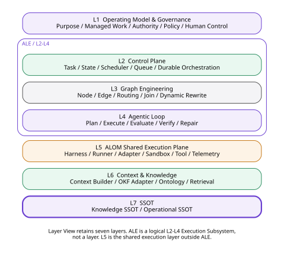
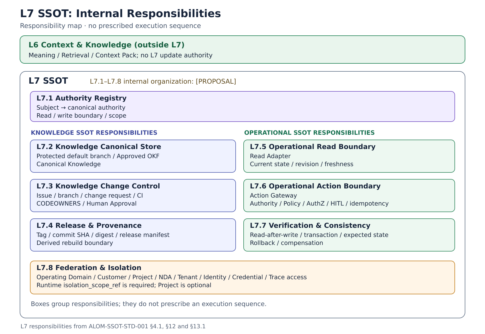
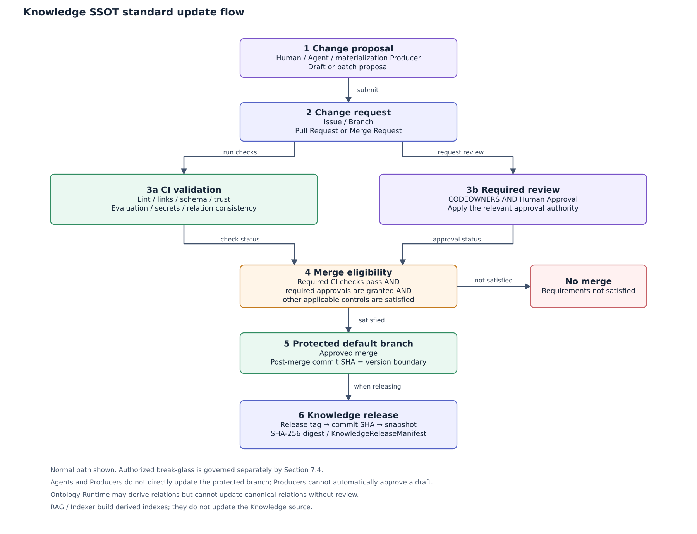
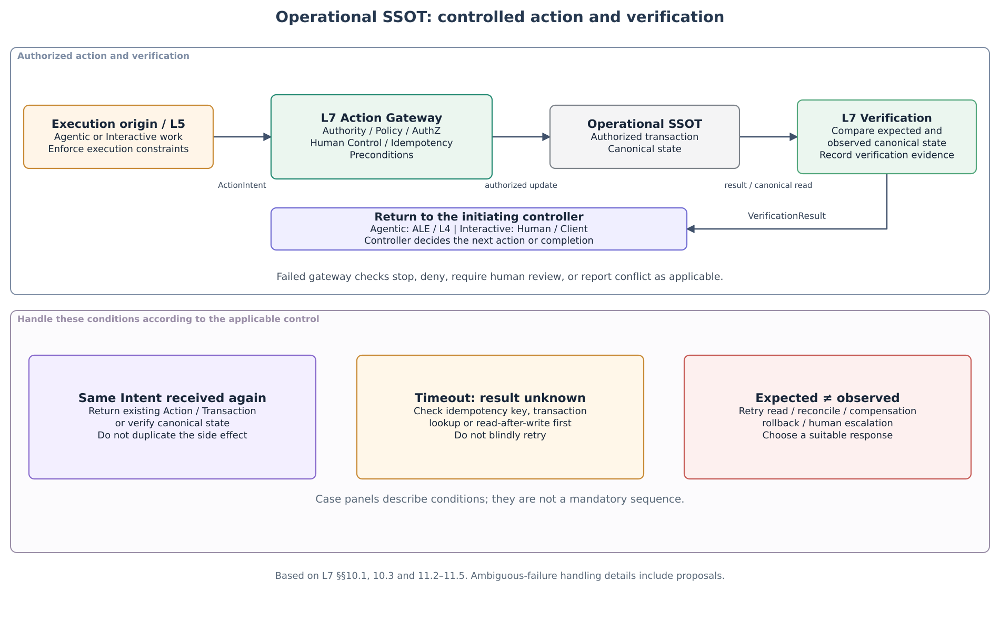
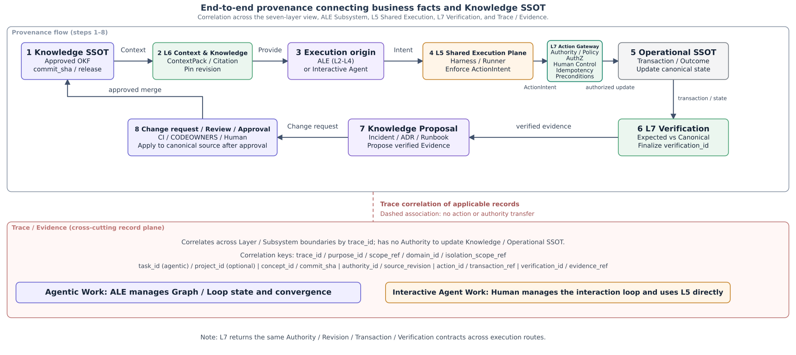

**IMPLEMENTATION STANDARD**

**ALOM SSOT**

**Implementation Architecture Standard**

**Authority Registry / Knowledge SSOT / Operational SSOT / Action Gateway / Verification / Federation**

| **Core principle** L7 SSOT is the Authority / System-of-Record Layer owned by the applying organization. Separate Knowledge SSOT from Operational SSOT. Do not transfer authoritative-source privileges to RAG, Ontology Runtime, Graph Index, Cache, Runner Memory, or other Derived Runtimes. |
|------------------------------------------------------------------------------------------------------------------------------------------------------------------------------------------------------------------------------------|

| **Management item** | **Value** |
|--------------|--------------------------------------------------|
| **Document ID** | ALOM-SSOT-STD-001 |
| **Version** | v0.5 |
| **Created** | 2026-08-13 |
| **Governing standard** | ALOM-ARCH-STD-001 v2.5 |
| **Scope** | ALOM L7 SSOT / Knowledge SSOT / Operational SSOT |
| **Owner** | Organization Architecture (Enterprise Architecture) / AI Platform |
| **Classification** | Public |

This specification details SSOT-01 through SSOT-10 of the governing standard as implementable design units.

# Document Control

## 1. Position and Order of Authority

This implementation standard details L7 SSOT in the governing standard ALOM-ARCH-STD-001 v2.5 (ALOM Integrated Architecture Standard v2.5). Without changing its MUST / MUST NOT requirements, it specifies Knowledge SSOT, Operational SSOT, Authority, update/verification boundaries, data contracts, physical deployment, security, portability, and acceptance criteria.

- In a conflict with the governing standard, ALOM-ARCH-STD-001 v2.5 takes precedence.

- Where laws, contracts, customer NDAs, or security policies impose stricter requirements, the stricter rules take precedence.

- Items marked \[PROPOSAL\] are implementation details absent from the governing standard. Standardize them through ADR / change request / Eval when adopting them.

- Do not fix a specific RAG, Graph DB, Vector DB, Runner, SaaS, or Workflow product as the applying organization's authoritative SSOT.

## 1.1 Common Scope / Isolation

The runtime / protected contracts in this document consume the CommonScopeContract in `ALOM-PROF-SCOPE-SPEC-001`.

- `scope_ref` is the required common canonical scope identity.
- `domain_id` is the required permanent operating-domain identity.
- `project_id` is an optional Project overlay / context. Do not reject a request solely because it is absent. Do not synthesize a Project to satisfy an implementation schema.
- `isolation_scope_ref` is the required runtime / protected isolation boundary. Fail closed if it cannot be resolved.
- Do not infer runtime isolation solely from `project_id`. Bind Queue / state / worker / sandbox / tool / credential / repository / cache / retrieval / Trace / L7 access to explicit `isolation_scope_ref` and authorization policy.
- Do not relax Authority conflict, Human-required, mandatory assurance, HITL timeout, no-relaxation, or cross-isolation denial requirements.
L7 Authority / read / action / federation selectors accept Common Scope. Canonical identifiers and access policies do not require a Project. Runtime isolation uses `isolation_scope_ref`.

Basis / category: \[STD\] \[S1\] Inherits Document Control, P-01, P-06, P-07, P-12, and SSOT-01 through SSOT-10 from governing standard ALOM-ARCH-STD-001 v2.5 (ALOM Integrated Architecture Standard v2.5).

## 2. Sources and Design Categories

| **ID** | **Source** | **Use in this document** |
|--------|---------------------------------------------------------|----------------------------------------------------------------------------------------------------------------------------------------------------------------|
| S1 | ALOM-ARCH-STD-001 v2.5-review.20261110 | Non-effective alignment candidate; controlled authority remains v2.5. Inherits the seven-layer Layer View, logical Execution Subsystem ALE=L2-L4, L5 ALOM Shared Execution Plane, L7, derived-artifact boundaries, Security, NFR, OPS, and G-SSOT. |
| S2 | ALOM-ARCH-STD-001 v2.5-review.20261110 / ALOM-KNW-STD-001 v0.4-review.20261110 (related specifications) | References for checking Canonical / Derived and Producer / MCP. |
| S3 | ALOM-KNW-STD-001 v0.4-review.20261110 and Sections 7.2 / 14.1 of this document (related specifications) | References for checking revision / digest, read-only Knowledge API, atomic promotion, and absence of Authority in Runtimes. |
| S4 | ALOM-LOOP-STD-001 v0.6-review.20261110 | Boundaries for read / verify / action intent from L4 within ALE to L7; separation of Eval and Verify. |
| S5 | ALOM L5 Shared Execution Plane Implementation Architecture Standard (ALOM-HR-STD-001 v0.4-review.20261110, formerly Harness & Runner v0.2) | L5 Tool / Credential / Network / Filesystem enforcement boundaries and L7 connections. |

Related specifications are references for checking current content; this does not establish their identity with the historical sources of the original document.

Design categories: \[STD\] = inherited from the governing standard; \[REF\] = reference elements based on the original document's existing sources; \[Cross-check\] = checks correspondence with public specifications and this document, without establishing identity with historical sources; \[PROPOSAL\] = detailed L7 design added in this document.

Under KNW-02, current L6 Compatibility requires Vector + Full-text + Graph/Metadata hybrid as a MUST. Target Vector/RAG MAY remains unpromoted.

## 3. Contents

- 1 Purpose and Scope

- 2 Fixed Definitions and Responsibility Boundaries

- 3 SSOT Architecture Principles

- 4 Overall ALOM Stack and Internal L7 Layers

- 5 Authority Registry

- 6 Knowledge Canonical Store

- 7 Knowledge Change Control

- 8 Knowledge Release & Provenance

- 9 Operational Read Boundary

- 10 Operational Action Boundary

- 11 Verification / Consistency / Idempotency

- 12 Federation / Isolation

- 13 Integration with ALE / L5 / L6 / Trace

- 14 Security / Credential / Break-glass

- 15 Repository / CI/CD / Versioning

- 16 Physical Deployment Reference Configuration

- 17 Nonfunctional Requirements / SLO / Observability

- 18 Acceptance Gates and Conformance Tests

- 19 Implementation Roadmap and Backlog

- Appendix A Minimum Data Contracts

- Appendix B YAML Contract Examples

- Appendix C Governing Requirement Mapping

- Appendix D Technology Mapping

# 1. Purpose and Scope

## 1.1 Purpose

This document defines the standard for implementing ALOM L7 SSOT as a Truth / Authority / Record Layer owned by the applying organization and independent of AI Agent / LLM / Runner / Retrieval products. Its purpose is to make it possible to reproduce and verify which Knowledge and business state are authoritative, who may update them, and which versions / Transactions constitute the facts.

| **Design goal** Even after changing a Runner, LLM, RAG, Vector DB, Graph DB, Ontology Runtime, or Workflow Engine, the applying organization can reproduce and verify which knowledge it has recognized as valid and what the current business facts are. |
|--------------------------------------------------------------------------------------------------------------------------------------------------------------------------------------------------------|

## 1.2 In Scope

- Knowledge SSOT using Git hosting / OKF.

- Operational SSOT such as ERP / DB / SaaS / Git hosting / issue-tracking systems / Observability.

- Authority Registry / Authority Resolution.

- Knowledge Release / Provenance / immutable revision.

- Operational Read Adapter / Action Gateway.

- Idempotency / Concurrency / read-after-write Verification.

- Customer / Project / NDA / Tenant federation.

- Contract boundaries with ALE / L4 Verifier, Runtime Enforcement in the L5 ALOM Shared Execution Plane, and L6 Context & Knowledge.

## 1.3 Out of Scope

- RAG ranking / embedding / reranking.

- Vector / Full-text / Graph Indexes themselves.

- Ontology inference / Semantic Join / Graph traverse runtime.

- Context Pack generation.

- Agent planning / Loop state machine / Runner execution.

- Physical enforcement of Tool sandboxes.

- Internal data models specific to business systems. ALOM connection contracts are nevertheless in scope.

Basis / category: \[STD\] \[S1\] Seven-layer Layer View, ALE logical Subsystem, L5 Shared Execution Plane, L7 SSOT, and derived-artifact boundaries. \[REF\] \[S4\]\[S5\] ALE/L4 and L5 out-of-scope boundaries.

# 2. Fixed Definitions and Responsibility Boundaries

| **Term** | **Fixed definition** | **Not equivalent to** |
|---------------------|--------------------------------------------------------------------------------------|-------------------------------------|
| SSOT | System of Record / Authority that establishes validity, version, and update authority for particular information. | A single monolithic DB / retrieval Index |
| Knowledge SSOT | Authoritative knowledge formally approved by the organization. In ALOM, Approved OKF on the protected default branch of Git hosting. | RAG / Vector / Ontology Runtime |
| Operational SSOT | Business System of Record that owns facts about Transactions / Business State. | An OKF copy / Dashboard cache |
| Authority | Authority to determine Canonical State for a particular Subject. | Retrieval rank / confidence |
| Authority Registry | Applying-organization configuration declaring mappings between Subjects and Canonical Systems / Read / Write Boundaries. | Operational Data Store |
| Canonical Knowledge | OKF that became Approved through a change request / CI / CODEOWNERS / Human Approval. | Agent Draft / AI Suggested Relation |
| Derived Runtime | Retrieval / semantic / cache Runtime reproducible and verifiable from SSOT. | SSOT |
| Read Adapter | Standard boundary for nondestructive reads of Operational SSOT. | Action Gateway |
| Action Gateway | Write boundary controlling side effects on Operational SSOT through Policy / AuthZ / HITL / Idempotency. | Direct API/DB writes by an Agent |
| Verification | Processing that independently confirms whether Expected State and Canonical State agree. | Private Eval / LLM judge |
| Release Manifest | Manifest pinning tag / SHA / digest / source/build for a Knowledge release. | Knowledge content |

| **Responsibility boundary** L6 = Meaning / Retrieval / Context. L7 = Truth / Authority / Record. L6 constructs meaning but does not hold L7 authoritative-source privileges. |
|----------------------------------------------------------------------------------------------------------------------------------|

Basis / category: \[STD\] \[S1\] L6/L7 responsibilities and principal records, derived-artifact boundaries, and SSOT-10. \[Cross-check\] \[S2\]\[S3\] Absence of Authority in Producer / Ontology Runtime.

# 3. SSOT Architecture Principles

| **ID** | **Principle** | **Normative requirement** |
|------------|-----------------------------|-------------------------------------------------------------------------------------------------|
| **AS-P01** | Unique Authority | Explicitly identify Canonical Authority for the same information Subject; fail closed when it cannot be resolved or conflicts arise. |
| **AS-P02** | Separate Knowledge / Operational | Do not equate Knowledge SSOT with Operational SSOT; separate the roles of knowledge and current state. |
| **AS-P03** | No Authority in Derived components | Do not transfer authoritative-source update privileges to RAG, Ontology, Graph, Cache, Memory, or generated answers. |
| **AS-P04** | Immutable Revision | Make critical Knowledge use resolvable to pinned Revisions such as commit SHAs. |
| **AS-P05** | Controlled Write | Update Knowledge only through change requests and Operational State only through Action Gateway. |
| **AS-P06** | AI Proposal Only | AI / Producer may generate Proposals but does not become the final Authority for the protected default branch. |
| **AS-P07** | Verify After Action | Do not declare external side effects successful based solely on Execution Results; recheck Canonical State. |
| **AS-P08** | Idempotent Effect | Establish contracts preventing duplicated side effects from resends, resumes, and Timeouts. |
| **AS-P09** | Provenance | Enable mutual tracing among Knowledge Revision / Source / Transaction / Trace / Evidence. |
| **AS-P10** | Federation | Propagate Customer / Project / NDA boundaries through Repository / Identity / Credential / Index / Trace. |
| **AS-P11** | Fail Closed | Do not update based on guesses when Authority, Policy, Revision, or Approval cannot be resolved. |
| **AS-P12** | Portability | Preserve Canonical Record meaning, versions, and auditability after changing Runtime products. |

Basis / category: \[STD\] AS-P02 through AS-P07 and AS-P09 through AS-P12 detail P-01/P-06/P-07/P-12 and SSOT-01 through SSOT-10. \[PROPOSAL\] Explicitly defines AS-P01/08/11 as L7 implementation principles.

# 4. Overall ALOM Stack and Internal L7 Layers



**Figure 1. Position of L7 SSOT in the ALOM seven-layer model**

L7 owns and connects Git hosting / OKF Knowledge SSOT and Operational SSOT such as ERP / DB / SaaS, establishing Commit SHA / Transaction Ref as principal records. L6 is a Derived Runtime / Manifest layer handling Context Builder / RAG / Ontology Runtime / Index / Bundle / Read Adapter; it does not hold L7 update Authority. This document treats the Layer View and Subsystem View separately. L2 Control Plane, L3 Graph Engineering, and L4 Agentic Loop form the logical Execution Subsystem ALE (Agent Loop Engine). L5 sits outside ALE as the ALOM Shared Execution Plane used by both Agentic Work and Interactive Agent Work. L7 provides Truth / Authority / Record boundaries independently of these execution forms.

Basis / category: \[STD\] \[S1\] Section 4.2 Seven-Layer Model and Appendix A Technology Mapping.

## 4.1 Eight Internal L7 Sublayers



**Figure 2. Detailed L7 SSOT architecture**

| **Layer** | **Name** | **Responsibility** |
|--------|-----------------------------|--------------------------------------------------------------------------------|
| L7.1 | Authority Registry | Declare and resolve Subject → Canonical Authority, Read/Write Boundary, and scope. |
| L7.2 | Knowledge Canonical Store | Hold Git hosting's protected default branch / Approved OKF as authoritative Knowledge. |
| L7.3 | Knowledge Change Control | Issue / Branch / change request / CI / CODEOWNERS / Human Approval. |
| L7.4   | Release & Provenance        | tag / commit SHA / digest / release manifest, Derived rebuild boundary.       |
| L7.5 | Operational Read Boundary | Retrieve current Operational state, revision, and freshness through Read Adapters. |
| L7.6 | Operational Action Boundary | Validate Authority / Policy / AuthZ / HITL / idempotency at the Action Gateway. |
| L7.7   | Verification & Consistency  | read-after-write, transaction, expected state, rollback / compensation.       |
| L7.8 | Federation & Isolation | Customer / Project / NDA / Tenant / Identity / Credential / Trace Access boundaries. |

Basis / category: \[STD\] Retains L7 responsibilities. \[PROPOSAL\] Internal layering into L7.1 through L7.8.

# 5. Authority Registry

## 5.1 Purpose

Rather than physically consolidating SSOT into one Store, resolve which System is Canonical Authority for a Subject and which Read / Write Boundaries to use through configuration owned by the applying organization. This keeps Authority unambiguous even when the same information is replicated in OKF, Tickets, DBs, and Caches.

## 5.2 Subject Classification

| **Subject class** | **Representative examples** | **Canonical class** | **Representative Authority** |
|------------------------|------------------------------------------|---------------------|-------------------------------|
| enterprise.knowledge | Policy / Standard / Glossary | knowledge | Git hosting / OKF |
| architecture.knowledge | ADR / System / API / Runbook | knowledge | Git hosting / OKF |
| project.issue | Ticket state / assignee / latest comment | operational | Issue-tracking system / Git-hosted Issues |
| business.record        | Order / Contract / Customer status       | operational         | ERP / CRM / DB                |
| observability.state    | Metric / Alert / current health          | operational         | Monitoring / telemetry system |
| knowledge.candidate | Incident learning / AI proposal | non-canonical | Branch / change request / Draft workspace |

## 5.3 AuthorityDescriptor

<table>
<colgroup>
<col style="width: 100%" />
</colgroup>
<thead>
<tr class="header">
<th>authority_id: ticket.redmine<br />
subject_type: project.issue<br />
canonical:<br />
class: operational<br />
system: redmine<br />
read:<br />
adapter_ref: redmine.read.v1<br />
write:<br />
gateway_ref: redmine.action.v1<br />
materialization:<br />
knowledge_target: incident<br />
trigger: resolved<br />
scope:<br />
scope_ref: scope://company/domain/system-integration/customer/customer-a/project/project-x<br />
domain_id: system-integration<br />
tenant_id: customer-a<br />
project_id: project-x<br />
isolation_scope_ref: scope://customer-a/project-x</th>
</tr>
</thead>
<tbody>
</tbody>
</table>

## 5.4 Resolution Rules

- Input includes Common Scope (`scope_ref` / `domain_id` / `isolation_scope_ref`, optional customer / project) / subject_type / purpose / classification. Authority resolution MUST NOT fail solely because `project_id` is absent.

- If multiple Authorities have equal precedence, stop with AMBIGUOUS_AUTHORITY.

- Prohibit Operational writes for which Authority is not registered.

- Materialization definitions do not replace Operational Authority with Knowledge Authority. The original system remains authoritative for a Resolved Ticket's current state; approved OKF is authoritative for an extracted Incident Concept.

Basis / category: \[Cross-check\] \[S2\] Separation of Materialization Path and Live Query Path. \[PROPOSAL\] Adds Authority Registry / Descriptor / Resolver.

# 6. Knowledge Canonical Store

## 6.1 Canonical Store

| **\[STD\]** Git hosting's protected default branch + Approved OKF = Knowledge SSOT |
|-------------------------------------------------------------------|

- Prohibit ordinary direct pushes.

- Manage concept / relation / provenance / trust / freshness / lifecycle / attestation using Markdown + YAML frontmatter.

- Git Commits / change requests are authoritative for Knowledge content change history; avoid duplicating records in history files.

- RAG / Vector / Graph / Ontology Runtime / Cache are reproducible derived artifacts.

## 6.2 Repository / Bundle Boundaries

<table>
<colgroup>
<col style="width: 100%" />
</colgroup>
<thead>
<tr class="header">
<th>enterprise-control/<br />
shared-platform/<br />
domain-finance/<br />
domain-operations/<br />
customer-a/<br />
project-x-knowledge/<br />
project-y-knowledge/</th>
</tr>
</thead>
<tbody>
</tbody>
</table>

Where NDA / Customer boundaries differ, separate them physically using Repositories / Git hosting organizations / repositories; do not rely solely on metadata ACLs within a single Repository.

## 6.3 Minimum Canonical Concept Attributes

| **Attribute group** | **Principal fields** | **Purpose** |
|-------------|-------------------------------------------------------------|----------------|
| identity | concept_id / type / title | Unique identification / meaning |
| scope | scope_ref / domain_id / isolation_scope_ref / optional project_id / classification | Applicability scope / runtime isolation. Project is an optional overlay, not an isolation key |
| lifecycle | status / valid_from / valid_until / review_due | Validity / freshness |
| ownership | owner_team / steward / approver | Responsibility / approval |
| provenance | source_system / source_ref / source_revision / content_hash | Source / reproducibility |
| trust | provenance.mode / attestation / review | Generation method / trust |
| relation | canonical relations / related concepts | Structured relationships |
| agent_usage | retrieval / summarization / execution policy | Agent usage constraints |

Basis / category: \[STD\] \[S1\] SSOT-01/02. \[Cross-check\] \[S2\] OKF Canonical Data Model / Repository structure / Git history as authoritative record.

# 7. Knowledge Change Control



**Figure 3. Standard Knowledge SSOT update flow**

## 7.1 Standard Flow

- Humans / Agents / Producers submit proposed changes through Issues / Branches / change requests.

- CI checks lint / links / schemas / trust / eval / secrets / relation consistency.

- Merge only changes that pass CODEOWNERS and Human Approval into the protected default branch.

- Use the post-merge commit SHA as the Knowledge version boundary.

## 7.2 AI / Producer Boundary

The read-only Producer MCP in this document describes the privileges of the interface used to consult knowledge. A materialization Producer may create Draft / Patch Proposals based on Source revisions, but cannot automatically mark them Approved or directly update the protected default branch.

| **Actor** | **Permitted** | **Prohibited** |
|-------------------|-----------------------------------------------|-----------------------------------|
| Human contributor | Issue / branch / change request / review | Bypassing main controls without approval authority |
| Agent | Issue / branch / patch / change-request proposal | Direct write to the protected default branch |
| Producer | Draft / Patch Proposal based on Source revision | Automatic promotion to Approved |
| Ontology Runtime | Derived relation / explain / traverse | Updating Canonical Relations without review |
| RAG / Indexer     | Derived index build                           | Knowledge source update           |

## 7.3 Relation trust level

| **Level** | **Generation method** | **Canonical treatment** |
|----------------------------|----------------------------------------|------------------------------------|
| L1 Declared Canonical | Explicit in Approved OKF | Authoritative |
| L2 Deterministic Extracted | Producer extraction from code / schema / config | May become Canonical after Draft → review |
| L3 Rule Inferred | Runtime derivation by Ontology rules | Remains Derived |
| L4 AI Suggested | Semantic inference by an LLM, etc. | Candidate only; basis/confidence required |

## 7.4 Break-glass

Emergency direct pushes are prohibited by default. When using an exception in the governing standard, require two-party approval, limited scope, immediate review, a retrospective change request, and Trace; do not make this routine practice.

Basis / category: \[STD\] \[S1\] SSOT-03/05/06 and Ontology Relation trust levels.

# 8. Knowledge Release & Provenance

## 8.1 Release Boundary

<table>
<colgroup>
<col style="width: 100%" />
</colgroup>
<thead>
<tr class="header">
<th>Protected default branch<br />
↓<br />
release tag<br />
↓ resolve<br />
commit SHA<br />
↓ enumerate / hash<br />
immutable snapshot + SHA-256 digest<br />
↓<br />
KnowledgeReleaseManifest<br />
↓<br />
L6 Derived Runtime build</th>
</tr>
</thead>
<tbody>
</tbody>
</table>

Critical Derived Runtimes should resolve release tag → commit SHA and build from pinned snapshots instead of implicitly referencing a moving main branch.

## 8.2 KnowledgeReleaseManifest

<table>
<colgroup>
<col style="width: 100%" />
</colgroup>
<thead>
<tr class="header">
<th>bundle_id: enterprise-architecture<br />
release_tag: okf-v2026.08.11<br />
commit_sha: abcdef123456<br />
bundle_digest: sha256:...<br />
schema_version: "1.0"<br />
profile_version: "1.0"<br />
build_job_id: "123456"<br />
built_at: "2026-08-11T19:00:00+09:00"</th>
</tr>
</thead>
<tbody>
</tbody>
</table>

## 8.3 Atomic Promotion / Last-known-good

- Publish in the order Fetch → Validate → Build → Verify → Atomic Promote.

- Do not expose partial runtimes from failed intermediate steps.

- If materialization of a new release fails, retain last-known-good.

- Associate Manifest bundle_id / tag / commit SHA / digest with Trace.

## 8.4 Derived Runtime rebuild

| **Derived component** | **Input Authority** | **Rebuild requirements** |
|------------------|-----------------------------------------------|--------------------------------------------------------|
| Ontology Runtime | KnowledgeReleaseManifest | Types / Relations / Inference can be rebuilt from the same release |
| RAG / Vector | Approved OKF release | Rebuild after index deletion |
| Full-text | Approved OKF release | Regenerate from canonical content |
| Graph Store | Canonical / extracted relation + runtime rule | Do not make the Graph itself an SSOT |
| Cursor checkout | commit SHA / tag | Make the checked-out revision traceable |

Basis / category: \[STD\] \[S1\] SSOT-04. \[Cross-check\] \[S3\] tag → SHA / digest / read-only Producer MCP / atomic promotion.

# 9. Operational Read Boundary

## 9.1 Read Adapter

Do not replicate every Operational SSOT record into OKF; retrieve current state through Read Adapters. APIs, CDC, virtualization, read-only SQL, and Source MCP are implementation options to select according to Source Authority and use.

## 9.2 OperationalReadResult

<table>
<colgroup>
<col style="width: 100%" />
</colgroup>
<thead>
<tr class="header">
<th>authority_id: redmine.issue<br />
entity_type: issue<br />
entity_id: "12345"<br />
revision: "17"<br />
observed_at: "2026-08-11T19:01:00+09:00"<br />
classification: confidential<br />
freshness: current<br />
source_ref: redmine://project-x/issues/12345<br />
payload_ref: artifact://...</th>
</tr>
</thead>
<tbody>
</tbody>
</table>

## 9.3 Freshness / Consistency

| **Mode** | **Use** | **Requirement** |
|-----------------------|----------------------------------------|--------------------------------------------|
| Live API | ticket status / current business state | Return observed_at / source revision |
| Read replica | Bulk reads / analytics support | Reflect replication lag in freshness |
| CDC materialized view | event-driven cross-source | Retain checkpoint / source offset |
| Virtualization | Reads across multiple DBs | Preserve source authority |
| Cached read | High-frequency reads | Explicitly state TTL / source revision / stale policy |

## 9.4 Separation from Materialization

Read current Ticket Status from Operational SSOT; after resolution, the Producer materializes enduring knowledge as an Incident / Runbook Draft. Materialization does not replace Operational Authority.

Basis / category: \[STD\] \[S1\] SSOT-07. \[Cross-check\] \[S2\] Distinct uses of Producer and MCP.

# 10. Operational Action Boundary



Figure 4. Operational SSOT action and verification flow

## 10.1 Action Gateway

All updates from ALOM to Operational SSOT MUST pass exclusively through Action Gateway. For Agentic Work, ALE's L4 Agentic Loop generates ExecutionIntent; for Interactive Agent Work, a Human acting as primary controller may use the L5 ALOM Shared Execution Plane directly. On either route, L5 enforces execution constraints such as Harness / Runner / Tool / Credential / Network / Filesystem / Sandbox in a fail-closed manner. L7 Action Gateway verifies Authority against the Authority Registry, Policy, AuthZ, Human Control, idempotency, and preconditions before issuing update requests to Operational SSOT. Direct use of L5 does not bypass L7 Authority / Policy / Human Control.

## 10.2 ActionIntent

<table>
<colgroup>
<col style="width: 100%" />
</colgroup>
<thead>
<tr class="header">
<th>action_id: act-001<br />
trace_id: tr-001<br />
task_id: task-001<br />
purpose_id: incident-remediation<br />
target:<br />
authority_id: redmine.issue<br />
entity_id: "12345"<br />
operation: update_status<br />
preconditions:<br />
revision: "17"<br />
status: open<br />
desired_state:<br />
status: resolved<br />
idempotency_key: task-001:update-status:12345<br />
policy_ref: ...<br />
authorization_ref: ...<br />
approval_ref: ...<br />
rollback_ref: ...</th>
</tr>
</thead>
<tbody>
</tbody>
</table>

## 10.3 Required Gateway Validation

| **Check** | **Content** | **On failure** |
|-----------------------|--------------------------------------------|--------------------------|
| Authority | Resolve the Canonical System for target / operation | STOP / CONFIG ERROR |
| Identity / Delegation | actor / delegator / workload identity      | DENY                     |
| Purpose / Policy | Purpose / prohibitions / scope / autonomy | DENY / HUMAN |
| Classification | data class / customer / project boundaries | DENY |
| HITL/HOTL | High-impact / irreversible / exception conditions | HUMAN REVIEW |
| Precondition | revision / current state / ETag, etc. | CONFLICT |
| Idempotency | Duplicate Intent / retry | RETURN EXISTING / VERIFY |
| Credential            | TTL / audience / capability                | DENY / REISSUE           |
| Rollback              | rollback / compensation availability       | ESCALATE if required     |

Basis / category: \[STD\] \[S1\] SSOT-08 and ALE / L5 Shared Execution boundary. \[REF\] \[S4\]\[S5\] ALE/L4 ExecutionIntent / L5 Runtime Enforcement responsibilities.

# 11. Verification / Consistency / Idempotency

## 11.1 Separation of Eval and Verify

| **Aspect** | **Evaluation** | **Verification** |
|----------|------------------------------------------------|---------------------------------------------------|
| Question | Does it meet quality requirements / criteria? | Is the expected state established in the real world? |
| Representative means | Private Eval / deterministic check / evaluator | Operational SSOT / CI / schema / external outcome |
| L7 responsibility | Not the authoritative source of evaluation results | Retrieve Canonical State facts / reconcile Transactions |
| Completion | Eval pass alone does not complete business work | For Use Cases requiring Verify, L4 determines completion after successful Verification |

## 11.2 Read-after-write

- Obtain transaction_ref / accepted revision from ActionResult.

- Retrieve the target entity again using a Read Adapter.

- Compare desired / expected state against observed canonical state.

- Record whether rollback is possible and rollback_ref.

- Associate VerificationResult with Trace / Evidence.

## 11.3 VerificationResult

<table>
<colgroup>
<col style="width: 100%" />
</colgroup>
<thead>
<tr class="header">
<th>verification_id: ver-001<br />
action_id: act-001<br />
transaction_ref: txn-9876<br />
expected:<br />
status: resolved<br />
observed:<br />
status: resolved<br />
revision: "18"<br />
result: verified<br />
rollback:<br />
supported: true<br />
ref: rollback-001</th>
</tr>
</thead>
<tbody>
</tbody>
</table>

## 11.4 Idempotency

Give each Action an idempotency_key identifying task / purpose / project / target / operation / business intent. Resending the same Intent must not repeat side effects; return the existing Action / Transaction or Verify Canonical State.

## 11.5 Concurrency / Ambiguous Failure

- When supported by the Source, optimistic concurrency using revision / ETag / row version, etc., is recommended. \[PROPOSAL\]

- For stale revisions, return CONFLICT to L4 instead of overwriting. \[PROPOSAL\]

- If an Action result is unknown after a Timeout, do not retry blindly. First determine whether it took effect through idempotency key / transaction lookup / read-after-write. \[PROPOSAL\]

- If Expected ≠ Observed, branch to Retry Read / Reconcile / Compensation / Rollback / Human Escalation.

Basis / category: \[STD\] \[S1\] SSOT-09 and SSOT-08 idempotency. \[REF\] \[S4\] Separation of Eval/Verify. \[PROPOSAL\] Concurrency / ambiguous-failure details.

# 12. Federation / Isolation

## 12.1 Federation Model

<table>
<colgroup>
<col style="width: 100%" />
</colgroup>
<thead>
<tr class="header">
<th>Applying organization-wide scope (Enterprise)<br />
├─ OperatingDomain finance (project_id: null, isolation_scope_ref: scope://company/finance)<br />
├─ OperatingDomain hr (project_id: null, isolation_scope_ref: scope://company/hr)<br />
├─ Shared Platform<br />
├─ Customer A<br />
│ └─ Project core-renewal (isolation_scope_ref: scope://customer-a/core-renewal)<br />
└─ Customer B<br />
&nbsp;&nbsp;└─ Project B1</th>
</tr>
</thead>
<tbody>
</tbody>
</table>

ALOM L7 does not require consolidation into a large central Store. Logically integrate multiple Systems of Record through Authority Registry and preserve NDA boundaries for each OperatingDomain / Customer / Project using `isolation_scope_ref`. Represent permanent organizational functions (Finance/HR, etc.) without synthetic Projects.

## 12.2 Boundary propagation

| **Boundary subject** | **Required separation** | **Notes** |
|------------------|-------------------------------------------|-----------------------|
| Repository | Git hosting organization / repository / protected branch | Primary Knowledge boundary |
| Identity | human / service / agent / delegator | Avoid cross-isolation sharing (including cross-PJ) |
| Credential | source / operation / isolation_scope_ref / TTL. Apply Project when relevant | Short-lived / audience-limited |
| Read Adapter | caller isolation_scope membership | Inherit source-side ACLs |
| Action Gateway   | isolation_scope_ref aware policy          | default deny          |
| Derived Index | pre-filter / partition / key boundary | Prohibit reliance solely on post-retrieval filtering |
| Trace / Evidence | isolation_scope_ref / case / classification ACL | Cannot access Trace from another isolation scope |
| Encryption key | Separate by `isolation_scope_ref` when necessary. `project_id` is an optional overlay | restricted scope |

## 12.3 Prohibition on Cross-Scope Access

Joins, Retrieval, Actions, and Evidence references across an `isolation_scope_ref` boundary are prohibited without explicit governing Policy / approval / legal basis. Customer / Project overlays may tighten isolation but MUST NOT relax stricter domain/organization boundaries.

Basis / category: \[STD\] \[S1\] P-08 / SEC. \[Cross-check\] \[S2\] Separate Project/NDA boundaries across Repository / MCP / Index.

# 13. Integration with ALE / L5 / L6 / Trace

## 13.1 L6 ↔ L7

| **Item** | **L6 Context & Knowledge** | **L7 SSOT** |
|------------------|-------------------------------------|------------------------------------|
| OKF | Read / parse / contextualize | Canonical ownership |
| Ontology         | Type / relation / inference runtime | Canonical Relation source          |
| RAG / Vector | Retrieval / ranking | No Authority |
| Graph | Derived traverse / semantic join | No Authority |
| Business State | Uses Read Adapters | Canonical system |
| Knowledge update | proposal / candidate | Change request / approval / merge authority |
| Revision | Attach to context manifest | Establish commit SHA / transaction ref |

## 13.2 ALE / L5 / L7

| Responsibility | Owning layer / primary controller | Boundary |
|----------------------------------|----------------------------------------|---------------------------------------------------------------------------------------------------------------------------------------------------|
| Determine Agentic execution intent | ALE / L4 Agentic Loop | ExecutionIntent / expected outcome. L2-L4 are correlated as internal ALE responsibilities. |
| Determine Interactive execution intent | Human / Interactive Agent | The Human controls the outer interaction loop and uses L5 directly. ALE Graph / Loop semantics are not required. |
| Enforce execution constraints | L5 ALOM Shared Execution Plane | Enforce Harness / Runner / Tool / Credential / Network / Filesystem / Sandbox in a fail-closed manner. |
| Determine the authoritative system | L7 | Authority Registry. The execution route does not change Authority. |
| Accept and execute business transactions | L7 / Source | Action Gateway / source-side transactions. |
| Verify actual state | L7 → originating controller | Return VerificationResult to ALE/L4 or the Interactive Agent / Human. |
| Determine completion / next action | ALE/L4 or Human / Interactive flow | For Agentic Work, L4 determines termination using Eval / Verify / Budget / Policy. For Interactive Agent Work, the Human examines verification results and decides the next instruction or completion. |

## 13.3 Trace / Evidence



Figure 5. End-to-end provenance connecting business facts and Knowledge SSOT

| Correlation category | Principal IDs |
|----------|------------------------------------------------------------------------------|
| Execution | trace_id / task_id / purpose_id / scope_ref / domain_id / isolation_scope_ref / project_id (optional) |
| Knowledge | concept_id / release_tag / commit_sha / bundle_digest |
| Source | authority_id / source_system / source_ref / source_revision |
| Action | action_id / idempotency_key / transaction_ref |
| Verification | verification_id / expected_state_hash / observed_state_hash |
| Governance | policy_ref / authorization_ref / approval_ref / exception_ref / rollback_ref |

Basis / category: \[STD\] \[S1\] P-07, ALE / L5 Shared Execution, L6/L7 principal records, and cross-cutting Trace. \[REF\] \[S4\]\[S5\] ALE/L4 and L5 contracts.

# 14. Security / Credential / Break-glass

## 14.1 Credential Separation

| **Credential** | **Privileges** | **Holder** | **Prohibited** |
|--------------------------|---------------------------------|---------------------------------------|-------------------------|
| Knowledge Consumer | read release / concept | L6/Producer side | Write to the protected default branch |
| Knowledge Proposal Agent | Minimum privileges needed to create branches / change requests | Agent service identity | merge authority |
| Ontology Runtime | Invoke Producer MCP | Runtime | Holding Git hosting credentials |
| Operational Read | read target / isolation_scope_ref. Apply Project when relevant | Read Adapter | write scope |
| Operational Action | Limited target / operation / TTL | Action Gateway / short-lived identity | Exposing long-lived secrets to Agents |

## 14.2 Fail-closed

- Stop Actions when Authority is unresolved, Policy is unavailable, approval is required, credentials have expired, or a revision conflict exists.

- Do not treat HITL timeout / unavailability as automatic approval.

- Do not fail open when Policy / Gateway / validation Hooks fail.

## 14.3 Break-glass

Knowledge direct-push exceptions follow SSOT-06. Operational break-glass coordinates with Source-specific emergency operating rules, remains separate from normal Agent autonomous paths, and records actor, reason, scope, approval, transaction, and retrospective review in Trace. \[PROPOSAL\]

## 14.4 Prohibitions

- Keeping DB administrator credentials persistently available to an Agent.

- Operational writes from RAG / Ontology Runtime.

- Using Knowledge with unknown Source revision as Canonical.

- Casually sharing service credentials across Customers / Projects.

- Action Gateway bypass.

- Implementing NDA controls that rely solely on ACL filtering after generating search results.

Basis / category: \[STD\] \[S1\] SSOT-05/06/08/10 and SEC. \[Cross-check\] \[S3\] No Git hosting credentials in Ontology Runtime / read-only Producer MCP.

# 15. Repository / CI/CD / Versioning

## 15.1 Reference Implementation Repository Structure

<table>
<colgroup>
<col style="width: 100%" />
</colgroup>
<thead>
<tr class="header">
<th>alom-ssot/<br />
├─ contracts/<br />
│ ├─ authority/<br />
│ ├─ knowledge/<br />
│ ├─ operational/<br />
│ └─ verification/<br />
├─ authority-registry/<br />
├─ knowledge/<br />
│ ├─ schemas/<br />
│ ├─ validators/<br />
│ ├─ release/<br />
│ └─ proposal-contract/<br />
├─ operational/<br />
│ ├─ read-adapter-sdk/<br />
│ ├─ action-gateway/<br />
│ ├─ verifier/<br />
│ └─ idempotency/<br />
├─ adapters/<br />
│ ├─ git_hosting/<br />
│ ├─ redmine/<br />
│ ├─ database/<br />
│ └─ observability/<br />
├─ policy/<br />
├─ profiles/<br />
├─ tests/<br />
└─ deploy/</th>
</tr>
</thead>
<tbody>
</tbody>
</table>

This Repository manages the standard contracts, Gateways, Adapters, and Tests between ALOM and each SSOT; it does not consolidate the Operational Systems themselves.

## 15.2 CI Gate

| **Subject** | **Required CI** |
|--------------------|----------------------------------------------------------------------------------------|
| Knowledge          | OKF schema / concept uniqueness / link / relation / trust / provenance / secret / eval |
| Authority Registry | schema / duplicate authority / unresolved target / scope overlap                       |
| Read Adapter | contract / authz / freshness / source revision / cross-isolation deny (including cross-PJ) |
| Action Gateway     | policy deny / idempotency / conflict / expired credential / gateway bypass             |
| Verifier           | read-after-write / expected mismatch / timeout / rollback                              |
| Portability        | runtime rebuild / adapter swap / release replay                                        |

## 15.3 Versioning

- Contract schemas use semantic versioning or compatibility rules.

- Pin Knowledge versions with commit SHAs and distribution units with release tags / digests.

- CI verifies the impact of Authority Registry changes on existing Actions / Adapters.

- Breaking changes to ActionIntent / VerificationResult require an Adapter compatibility gate. \[PROPOSAL\]

Basis / category: \[STD\] \[S1\] SSOT-03/04 and OPS. \[Cross-check\] \[S3\] Validation / manifest / runtime rebuild.

# 16. Physical Deployment Reference Configuration

## 16.1 Phase 1 - Knowledge SSOT

<table>
<colgroup>
<col style="width: 100%" />
</colgroup>
<thead>
<tr class="header">
<th>Git hosting<br />
├─ OKF Repository (protected default branch)<br />
├─ Authority Registry<br />
└─ Contracts / Schemas<br />
│<br />
CI<br />
├─ OKF Validator<br />
├─ Trust / Link / Relation Check<br />
└─ Release Manifest Builder<br />
│<br />
OKF Producer MCP for Git hosting (read-only)<br />
│<br />
L6 Ontology / Retrieval</th>
</tr>
</thead>
<tbody>
</tbody>
</table>

## 16.2 Phase 2 - Read Federation

<table>
<colgroup>
<col style="width: 100%" />
</colgroup>
<thead>
<tr class="header">
<th>ALOM Client / ALE / Interactive Agent<br />
│<br />
├─ Knowledge MCP ── Release Snapshot<br />
│<br />
└─ Source MCP / Read Adapter ── Operational SSOT</th>
</tr>
</thead>
<tbody>
</tbody>
</table>

## 16.3 Phase 3 - Controlled Action

<table>
<colgroup>
<col style="width: 100%" />
</colgroup>
<thead>
<tr class="header">
<th>Agentic Work: ALE / L4 Agentic Loop ─────┐<br />
├─ ExecutionIntent<br />
Interactive Agent Work: Human / Agent ──────┘<br />
▼<br />
L5 ALOM Shared Execution Plane<br />
└─ Harness / Runner / Runtime Enforcement<br />
│ ActionIntent<br />
▼<br />
L7 Action Gateway<br />
├─ Authority Resolver<br />
├─ Policy / AuthZ / Human Control<br />
└─ Idempotency / Preconditions<br />
▼<br />
Operational SSOT<br />
│ transaction_ref<br />
▼<br />
L7 Verifier<br />
│ VerificationResult<br />
└─→ Originating controller (ALE/L4 or Human / Interactive Agent)</th>
</tr>
</thead>
<tbody>
</tbody>
</table>

## 16.4 HA / DR

- Knowledge SSOT DR follows the recovery policy for Git hosting repositories / releases / artifacts.

- Do not produce duplicate Actions during Action Gateway / Idempotency Store failures.

- Treat Derived Runtime failures separately from SSOT failures and recover through last-known-good / rebuild.

- During Source System outages, do not implicitly switch Authority to another System; require explicit Failover Authority rules. \[PROPOSAL\]

Basis / category: \[Cross-check\] \[S2\]\[S3\] Git hosting / Producer / MCP / Derived Runtime reference configuration. \[PROPOSAL\] Phased deployment / HA details.

# 17. Nonfunctional Requirements / SLO / Observability

## 17.1 NFR

| **Area** | **Minimum requirement** | **Example measurements** |
|----------------|-----------------------------------------------------|-----------------------------------------------|
| Availability | Define SLOs by use for Knowledge reads / Operational actions | read availability / gateway availability |
| Integrity | Verify revision / digest / transaction / idempotency | digest mismatch / duplicate effect |
| Latency | Measure read / action / verify separately | p95 read / action acceptance / verify latency |
| Freshness | Retain freshness in OperationalReadResult | source lag / observed_at age |
| Auditability | Correlate Actions/Knowledge changes through Trace | trace completeness |
| Portability | Rebuild Derived runtimes from releases | rebuild success / RTO |
| Isolation | Zero cross-isolation leakage | negative authorization tests |
| Recoverability | rollback / compensation / last-known-good           | recovery drill pass rate                      |

## 17.2 Canonical Telemetry

| **Event family** | **Representative events** |
|------------------|-------------------------------------------------------------------|
| Knowledge        | knowledge.proposed / validated / approved / merged / released     |
| Authority        | authority.resolved / ambiguous / missing / changed                |
| Read             | ssot.read.requested / returned / stale / denied                   |
| Action           | action.requested / authorized / issued / accepted / rejected      |
| Idempotency      | action.duplicate_detected / existing_result_returned              |
| Verify           | verify.requested / matched / mismatched / ambiguous               |
| Recovery         | rollback.requested / completed / failed / compensation.completed  |
| Security         | cross_scope.denied / credential.expired / gateway_bypass.detected |

Basis / category: \[STD\] \[S1\] NFR / cross-cutting Trace. \[PROPOSAL\] Detailed L7 event families.

# 18. Acceptance Gates and Conformance Tests

| **Gate** | **Pass condition** |
|--------------------------------|-------------------------------------------------------------|
| **G7-01 Authority** | Subject → Authority resolves uniquely; fail closed on ambiguity. |
| **G7-02 Knowledge Protection** | Direct pushes to the protected default branch are prevented. |
| **G7-03 AI Write** | Agent credentials cannot update main directly. |
| **G7-04 Review** | Merge is prevented without CODEOWNERS + Human Approval. |
| **G7-05 Validation** | CI rejects invalid OKF / relation / trust metadata. |
| **G7-06 Release** | Reproduce tag → SHA → digest → manifest. |
| **G7-07 Rebuild** | Regenerate Derived Runtimes from SSOT releases. |
| **G7-08 Read Boundary** | Operational reads pass through Read Adapters / authorized boundaries. |
| **G7-09 Action Boundary** | Operational writes pass exclusively through Action Gateway. |
| **G7-10 Policy** | Fail closed for unauthorized / wrong-scope Actions. |
| **G7-11 Idempotency** | Resending the same Intent causes zero duplicate side effects. |
| **G7-12 Concurrency** | Do not overwrite on stale revisions. \[PROPOSAL\] |
| **G7-13 Verify** | Confirm Canonical State after writes. |
| **G7-14 Rollback** | Successfully drill rollback / compensation for the target Action. |
| **G7-15 NDA** | Zero cross-isolation read / action / trace leakage (including cross-PJ). |
| **G7-16 Provenance** | Trace commit SHA → context → action → transaction → outcome. |

## 18.1 Conformance Determination

| **Determination** | **Conditions** | **Treatment** |
|---------------------------|--------------------------------------------|-----------------------------------------------|
| CONFORMANT | Pass all MUST requirements and critical Gates | May be applied in Production |
| CONFORMANT WITH EXCEPTION | Deviations from SHOULD; no relaxation of MUST | ADR / risk owner / expiry / compensating control |
| LIMITED | Pass within a limited scope such as A0/A1, read-only, or isolated | Technically enforce the scope |
| NON-CONFORMANT | Unmet MUST / violated MUST NOT / failed critical Gate | Stop / remediate / reevaluate. Production writes prohibited |

| **Promotion Rule** Do not enable Operational Writes while critical Gates remain unmet. Following the governing standard, the initial MVP should cover 1-3 repositories / PJs, A0/A1, and actions up to branch / PR; release merge / deploy / production Actions at a later stage. |
|---------------------------------------------------------------------------------------------------------------------------------------------------------------------------------------------------------|

Basis / category: \[STD\] \[S1\] Details G-SSOT / conformance determination / MVP criteria.

# 19. Implementation Roadmap and Backlog

| **Phase** | **Purpose** | **Principal Deliverables** | **Promotion conditions** |
|-------------------------|-------------------------------|-----------------------------------------------------------|------------------------------------|
| 0 Contract | Establish Authority / data contracts | AuthorityDescriptor / Read / Action / Verify schema | Schema review / compatibility test |
| 1 Knowledge SSOT | Establish Canonical Knowledge | Protected default branch / OKF / change request / CI / Release Manifest | G7-02 through G7-07 |
| 2 Read Federation       | Live operational read         | Authority Registry / Read Adapter / Source MCP            | G7-01 / 08 / 15                    |
| 3 Controlled Action | Low-impact writes | Action Gateway / Policy / Idempotency / Workload Identity | G7-09 through G7-12 |
| 4 Verification | Confirm real-world outcomes | Read-after-write / Oracle / Rollback | G7-13/14/16 |
| 5 Organization-wide Federation (Enterprise Federation) | Controls across the applying organization and customers | NDA / HA / DR / multi-tenant / evidence retention | All Gates + DR drill |

## 19.1 Initial Backlog

- AuthorityDescriptor JSON Schema and Resolver implementation.

- KnowledgeReleaseManifest and CI generation.

- Integration of revision / digest contracts with OKF Producer MCP for Git hosting.

- Reference Read Adapter implementation for issue-tracking systems / Git-hosted Issues.

- ActionIntent / ActionResult / VerificationResult schema.

- Idempotency Store SPI.

- Policy Decision / ApprovalRef contract.

- Cross-isolation negative conformance test suite (including cross-PJ).

- Read-after-write / ambiguous timeout / rollback fault injection.

- End-to-end provenance query / dashboard integration.

Basis / category: \[PROPOSAL\] Implementation sequence for this standard. MVP scope is inherited from \[S1\].

# Appendix A. Minimum Data Contracts

| **Contract** | **Minimum responsibility** |
|--------------------------|-------------------------------------------------------------------------------------|
| AuthorityDescriptor      | Authority / scope / canonical system / read / write / materialization               |
| KnowledgeConceptRef      | concept_id / bundle_id / revision / classification / source                         |
| KnowledgeReleaseManifest | bundle / tag / SHA / digest / schema / build                                        |
| OperationalReadRequest   | authority / entity / scope / purpose / consistency                                  |
| OperationalReadResult    | source revision / observed_at / freshness / payload_ref                             |
| ActionIntent             | target / operation / precondition / desired state / idempotency / policy / approval |
| ActionResult             | accepted / transaction_ref / source revision / result / error                       |
| VerificationRequest      | action / expected state / policy / timeout                                          |
| VerificationResult       | transaction / expected / observed / result / rollback                               |
| SourceReference          | system / ref / revision / observed_at                                               |
| CanonicalIdentifier      | scope_ref / domain_id / isolation_scope_ref / optional project / subject / authority / entity |

## A.1 Common Identifiers

<table>
<colgroup>
<col style="width: 100%" />
</colgroup>
<thead>
<tr class="header">
<th>scope_ref<br />
domain_id<br />
isolation_scope_ref<br />
tenant_id<br />
project_id  # optional overlay<br />
purpose_id<br />
task_id<br />
trace_id<br />
authority_id<br />
source_system<br />
source_ref<br />
source_revision<br />
concept_id<br />
commit_sha<br />
action_id<br />
transaction_ref<br />
idempotency_key</th>
</tr>
</thead>
<tbody>
</tbody>
</table>

# Appendix B. YAML Contract Examples

## B.1 OperationalReadRequest / Result

<table>
<colgroup>
<col style="width: 100%" />
</colgroup>
<thead>
<tr class="header">
<th>request:<br />
trace_id: tr-001<br />
purpose_id: incident-analysis<br />
scope_ref: scope://company/domain/system-integration/customer/customer-a/project/project-x/work/incident-analysis<br />
domain_id: system-integration<br />
project_id: project-x<br />
isolation_scope_ref: scope://customer-a/project-x<br />
authority_id: redmine.issue<br />
entity_id: "12345"<br />
consistency: latest<br />
result:<br />
source_ref: redmine://project-x/issues/12345<br />
source_revision: "17"<br />
observed_at: "2026-08-11T19:01:00+09:00"<br />
freshness: current<br />
payload_ref: artifact://read/tr-001/12345</th>
</tr>
</thead>
<tbody>
</tbody>
</table>

## B.2 ActionResult / VerificationResult

<table>
<colgroup>
<col style="width: 100%" />
</colgroup>
<thead>
<tr class="header">
<th>action_result:<br />
action_id: act-001<br />
status: accepted<br />
transaction_ref: txn-9876<br />
source_revision: "18"<br />
verification_result:<br />
verification_id: ver-001<br />
action_id: act-001<br />
expected_state_hash: sha256:...<br />
observed_state_hash: sha256:...<br />
result: verified<br />
rollback_ref: rollback-001</th>
</tr>
</thead>
<tbody>
</tbody>
</table>

## B.3 Common Scope golden cases

These examples illustrate Scope propagation; they are not complete Authority/read requests or CommonScopeContract payloads. Real requests must include the complete applicable Common Scope, authorization information, and other fields required by the applicable Authority/read contract.

```yaml
# Finance project-less authority/read
request:
  scope_ref: scope://company/domain/finance/work/expense-approval
  domain_id: finance
  project_id: null
  isolation_scope_ref: scope://company/finance
  purpose_id: expense-approval
---
# SI Customer + Project
request:
  scope_ref: scope://company/domain/system-integration/customer/customer-a/project/core-renewal/work/code-review
  domain_id: system-integration
  customer_id: customer-a
  project_id: core-renewal
  isolation_scope_ref: scope://customer-a/core-renewal
# unresolved isolation_scope_ref => deny / fail-closed
# different isolation_scope_ref => cross-isolation deny
```

# Appendix C. Governing Requirement Mapping

| **Governing ID** | **Summary** | **Sections** | **Principal Gates** |
|------------|-----------------------|----------------|-------------------------|
| SSOT-01 | Protected default branch | 6 / 7 / 18 | G7-02 |
| SSOT-02    | OKF                   | 6              | G7-05                   |
| SSOT-03    | Approval              | 7 / 15         | G7-04/05                |
| SSOT-04    | Version               | 8              | G7-06/07                |
| SSOT-05    | AI write              | 7 / 14         | G7-03                   |
| SSOT-06 | Break-glass | 7 / 14 | Exception Trace / two-party approval |
| SSOT-07    | Read                  | 9              | G7-08                   |
| SSOT-08    | Write                 | 10 / 11        | G7-09-12               |
| SSOT-09    | Verify                | 11             | G7-13/14                |
| SSOT-10    | No authority transfer | 2 / 6 / 8 / 13 | G7-07 / derived rebuild |

# Appendix D. Technology Mapping

| **Area** | **Required technology category** | **Implementation examples (nonnormative)** | **Authoritative source / principal record** |
|--------------------|---------------------------------------|------------------------------------|------------------------------------|
| Authority Registry | YAML / JSON Schema / Config Registry  | Git repository / internal registry | AuthorityDescriptor                |
| Knowledge Store | Git + OKF | Self-hosted / dedicated-tenant Git hosting, etc. | commit SHA / release tag |
| Change Control | Change request / CODEOWNERS / CI | CI | change request / approval / pipeline |
| Release            | Tag / SHA / digest / manifest         | Git tag + SHA-256                  | KnowledgeReleaseManifest           |
| Operational Read   | API / CDC / virtualization / MCP      | REST / SQL read-only / CDC         | source revision / observed_at      |
| Operational Action | Action Gateway / Policy / HITL        | internal service / API gateway     | transaction / action record        |
| Policy | PDP / PEP | OPA / Cedar equivalent | policy decision / authz ref |
| Identity           | Workload Identity / OIDC              | IdP / short-lived token            | actor / delegator / credential ref |
| Idempotency | KV / RDB transaction key | PostgreSQL / KV, etc. | idempotency record |
| Verification       | Read-after-write / Oracle adapter     | API / SQL / CI / monitoring        | VerificationResult                 |
| Trace              | OpenTelemetry / Trace Ledger          | OTel Collector / SIEM              | Trace / Evidence                   |
| Derived Runtime | Ontology / Vector / Graph / full-text | Product / implementation approach is optional. Retain the KNW-02 Compatibility hybrid MUST | Manifest / rebuild evidence |

| **Product selection** Implementation examples help explain categories; they do not mandate adoption of any particular product. Evaluate portability through Contract, Trace, SSOT, and migration / rebuild tests when selecting products. |
|----------------------------------------------------------------------------------------------------------------------------------------------------|

# References

- \[S1\] Governing standard: ALOM-ARCH-STD-001 v2.5

- \[S2\] Related specifications (cross-check references): ALOM-ARCH-STD-001 v2.5-review.20261110 / ALOM-KNW-STD-001 v0.4-review.20261110.

- \[S3\] Related specifications (cross-check references): ALOM-KNW-STD-001 v0.4-review.20261110 and Sections 7.2 / 14.1 of this document.

- \[S4\] Related standard: ALOM-LOOP-STD-001 v0.6-review.20261110

- \[S5\] Related standard (current reference): ALOM L5 Shared Execution Plane Implementation Architecture Standard (ALOM-HR-STD-001 v0.4-review.20261110). The former name Harness & Runner v0.2 is naming history.

| **End of standard** L7 SSOT establishes Authority over Knowledge and Operational Reality and provides stable boundaries for higher layers to reference, execute, and verify. It does not require storing everything in one place. |
|-------------------------------------------------------------------------------------------------------------------------------------------------------------------------------------|

